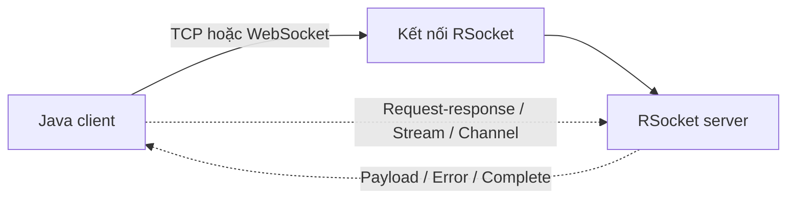

# Phạm vi sử dụng, giới hạn và kiến thức cần có trước khi thực hành RSocket

## Mục tiêu bài học

Sau bài này, bạn có thể:

- Giải thích RSocket giải quyết nhu cầu giao tiếp nào trong ứng dụng Java.
- Chọn đúng kiểu tương tác: request-response, fire-and-forget, request-stream hoặc request-channel.
- Nhận biết khi nào nên dùng TCP, khi nào cần WebSocket.
- Đánh giá các giới hạn về độ tin cậy, bảo mật, vận hành và khả năng tương thích.
- Xác định kiến thức cần chuẩn bị trước khi xây dựng client và server bằng Java hoặc Spring Boot.

## RSocket nằm ở đâu trong kiến trúc ứng dụng?

RSocket là một giao thức ứng dụng dành cho giao tiếp bất đồng bộ và reactive giữa hai đầu kết nối. Nó hỗ trợ trao đổi dữ liệu theo nhiều kiểu tương tác, cho phép một kết nối mang nhiều luồng logic đồng thời và có cơ chế điều tiết lượng dữ liệu mà bên nhận yêu cầu.

Trong phạm vi module này, ta tập trung vào RSocket qua **TCP** và **WebSocket**, cùng cách triển khai client/server bằng Java và Spring Boot. RSocket thường phù hợp khi hai thành phần cần trao đổi dữ liệu liên tục, cần gửi và nhận trong cùng một phiên giao tiếp, hoặc cần truyền một luồng dữ liệu có thể điều tiết theo khả năng xử lý của bên nhận.

Ví dụ, một dịch vụ giá thị trường có thể trả lời yêu cầu lấy giá hiện tại, sau đó phát liên tục các thay đổi giá. Một ứng dụng cộng tác có thể vừa gửi thao tác của người dùng vừa nhận cập nhật từ máy chủ. Các tình huống này có thể được mô hình hóa tự nhiên bằng các kiểu tương tác của RSocket.

RSocket không phải là một message broker, cũng không tự định nghĩa nghiệp vụ, cấu trúc dữ liệu hay chính sách lưu trữ của ứng dụng. Nó cung cấp cách giao tiếp giữa các peer; ứng dụng vẫn phải thiết kế hợp đồng dữ liệu, xác thực, xử lý lỗi và độ tin cậy phù hợp.

## Bốn kiểu tương tác cần phân biệt

RSocket định nghĩa bốn kiểu tương tác chính. Việc chọn đúng kiểu giúp API thể hiện rõ luồng dữ liệu và kỳ vọng của hai phía.

| Kiểu tương tác | Dữ liệu đi qua kết nối | Khi phù hợp |
|---|---|---|
| Request-response | Một yêu cầu, một phản hồi | Tra cứu thông tin, tính toán hoặc gọi một thao tác cần kết quả |
| Fire-and-forget | Một yêu cầu, không có phản hồi ở cấp tương tác | Gửi tín hiệu hoặc lệnh mà bên gửi không cần chờ kết quả |
| Request-stream | Một yêu cầu, nhiều phản hồi | Theo dõi giá, trạng thái, log hoặc dữ liệu cập nhật liên tục |
| Request-channel | Một luồng yêu cầu và một luồng phản hồi | Trao đổi hai chiều liên tục, chẳng hạn phiên cộng tác hoặc điều khiển realtime |

Các kiểu này không đồng nghĩa với bốn giao thức truyền tải khác nhau. Chúng là các mẫu tương tác chạy trên một kết nối RSocket.

### Request-response

Client gửi một payload và nhận tối đa một payload phản hồi. Đây là kiểu dễ bắt đầu nhất và thường phù hợp với thao tác có kết quả xác định.

### Fire-and-forget

Client gửi payload mà không chờ phản hồi từ ứng dụng phía server. Vì không có phản hồi nghiệp vụ, client không thể dựa vào kiểu tương tác này để biết chắc thao tác đã được xử lý thành công. Nếu cần xác nhận, mã giao dịch hoặc khả năng thử lại an toàn, hãy thiết kế thêm cơ chế ở tầng ứng dụng.

### Request-stream

Client gửi một yêu cầu ban đầu và nhận nhiều phần tử phản hồi theo thời gian. Luồng có thể kết thúc, phát sinh lỗi hoặc bị hủy. Đây là lựa chọn phù hợp cho dữ liệu liên tục mà client đăng ký theo một điều kiện, ví dụ giá của một mã chứng khoán.

### Request-channel

Hai phía có thể đồng thời gửi các phần tử trong luồng của mình. Kiểu này phù hợp với một phiên giao tiếp tương tác hai chiều. Vì cả hai phía đều có thể phát dữ liệu, thiết kế cần quy định rõ ý nghĩa từng thông điệp, thứ tự xử lý và cách kết thúc phiên.

## Kết nối, transport và luồng logic

Một phiên RSocket bắt đầu bằng việc thiết lập kết nối và trao đổi thông tin khởi tạo. Sau đó, hai peer có thể mở nhiều luồng logic trên cùng một kết nối vật lý. Mỗi luồng có định danh riêng để các yêu cầu, payload, lỗi và tín hiệu hủy được ghép đúng với hoạt động tương ứng.

Sơ đồ khái quát:



**TCP** thường phù hợp cho giao tiếp trực tiếp giữa các dịch vụ hoặc ứng dụng Java khi hai đầu có thể mở kết nối TCP. TCP cung cấp luồng byte có thứ tự; RSocket bổ sung cấu trúc frame và ngữ nghĩa tương tác ở tầng ứng dụng.

**WebSocket** phù hợp khi cần tích hợp với môi trường web hoặc hạ tầng đã hỗ trợ WebSocket. Trình duyệt web không mở kết nối TCP tùy ý từ JavaScript, vì vậy WebSocket là lựa chọn thường dùng để trình duyệt giao tiếp với RSocket server. Khi triển khai qua WebSocket, cần kiểm tra cấu hình proxy, cân bằng tải, Origin và chính sách bảo mật của môi trường.

RSocket tách giao thức tương tác khỏi transport, nhưng khả năng sử dụng từng transport phụ thuộc vào thư viện và cấu hình triển khai. Trong các bài thực hành của module, hãy kiểm tra transport mà phiên bản thư viện đang dùng hỗ trợ thay vì giả định mọi môi trường đều có cùng khả năng.

## Phạm vi sử dụng phù hợp

RSocket đáng cân nhắc khi hệ thống có một hoặc nhiều nhu cầu sau:

- **Trao đổi realtime hai chiều:** client vừa gửi thao tác vừa nhận sự kiện cập nhật trong cùng một phiên.
- **Phát dữ liệu liên tục:** server cung cấp luồng dữ liệu cho một hoặc nhiều client, chẳng hạn telemetry, trạng thái thiết bị hoặc giá thị trường.
- **Giao tiếp service-to-service có nhiều kiểu tương tác:** một kết nối cần hỗ trợ cả yêu cầu đơn lẻ và luồng dữ liệu.
- **Điều tiết luồng:** bên nhận cần kiểm soát số phần tử được phát tiếp để tránh bị quá tải.
- **Tích hợp ứng dụng web:** client chạy trong trình duyệt cần giao tiếp qua WebSocket với backend.

| Nhu cầu | Hướng lựa chọn ban đầu | Lý do |
|---|---|---|
| CRUD đơn giản, ít tương tác realtime | REST/HTTP thường dễ triển khai | Công cụ, cache, gateway và khả năng quan sát đã phổ biến |
| Một yêu cầu cần một kết quả | RSocket request-response hoặc HTTP | Chọn theo kiến trúc và nhu cầu kết nối lâu dài |
| Server phát dữ liệu liên tục cho client | RSocket request-stream hoặc WebSocket thuần | RSocket có mô hình stream và demand rõ ràng |
| Hai phía cùng gửi dữ liệu theo thời gian | RSocket request-channel | Mô hình tương tác hai chiều được định nghĩa sẵn |
| Hàng đợi bền vững, xử lý khi consumer offline | Message broker như Kafka hoặc RabbitMQ | Cần lưu trữ, phân phối và tiêu thụ độc lập với phiên kết nối |
| Phát sự kiện tới số lượng lớn consumer độc lập | Message broker hoặc nền tảng event streaming | Cần khả năng phân phối, lưu giữ và mở rộng theo consumer |

Bảng trên là định hướng, không phải quy tắc tuyệt đối. Một hệ thống có thể dùng REST cho API công khai, RSocket cho luồng realtime nội bộ và message broker cho sự kiện cần lưu trữ hoặc xử lý nền.

## Những giới hạn cần tính đến

### RSocket không tự tạo ra độ tin cậy nghiệp vụ

Fire-and-forget không có phản hồi xác nhận xử lý. Ngay cả với request-response, việc client nhận lỗi hoặc mất kết nối không luôn cho biết server đã thực hiện nghiệp vụ đến bước nào. Thử lại một yêu cầu có thể tạo tác dụng phụ trùng lặp.

Với thao tác quan trọng, hãy thiết kế mã định danh yêu cầu, tính idempotent, lưu trạng thái xử lý và quy tắc retry ở tầng nghiệp vụ. Nếu cần lưu thông điệp để consumer nhận lại sau khi offline, hãy dùng cơ chế lưu trữ hoặc message broker phù hợp.

### Backpressure cần được hỗ trợ xuyên suốt

RSocket có cơ chế demand để bên nhận yêu cầu số phần tử muốn nhận tiếp trong các luồng phù hợp. Cơ chế này giúp điều tiết luồng dữ liệu, nhưng không tự làm cho mọi đoạn mã trong ứng dụng trở nên không chặn.

Nếu handler gọi truy vấn blocking, chờ I/O đồng bộ hoặc giữ tài nguyên quá lâu, luồng xử lý vẫn có thể bị nghẽn. Cần hiểu cách thư viện reactive lập lịch công việc, cách giới hạn tài nguyên và cách xử lý khi consumer chậm.

### Kết nối lâu dài có chi phí vận hành

Một kết nối tồn tại lâu cần được quản lý vòng đời: timeout, keepalive, heartbeat, đóng kết nối, reconnect và giải phóng tài nguyên. Khi triển khai nhiều instance, cần tính đến số lượng kết nối đồng thời, phân phối kết nối qua load balancer và quá trình drain khi deploy.

RSocket có cơ chế resumption trong giao thức, nhưng khả năng tiếp tục phiên sau khi mất kết nối không tự bật trong mọi ứng dụng. Cần kiểm tra hỗ trợ của implementation, cấu hình resume và cách lưu trạng thái frame. Resumption cũng không thay thế việc lưu trạng thái nghiệp vụ bền vững.

### Multiplexing không loại bỏ giới hạn của transport

Nhiều stream logic có thể chia sẻ một kết nối. Điều này giảm nhu cầu mở nhiều kết nối riêng, nhưng các stream vẫn chia sẻ tài nguyên kết nối. Với TCP, mất gói có thể làm chậm việc chuyển dữ liệu trên toàn bộ luồng byte có thứ tự, ảnh hưởng đến các stream cùng kết nối.

Cần theo dõi tải, kích thước payload, độ trễ, số stream đồng thời và giới hạn kết nối. Không nên xem multiplexing là bảo đảm rằng mọi stream luôn độc lập về hiệu năng.

### Bảo mật phải được thiết kế ở nhiều lớp

RSocket không tự động xác thực danh tính người gọi hoặc cấp quyền cho từng thao tác nghiệp vụ. Ứng dụng cần xác định cách xác thực, phân quyền theo route hoặc dữ liệu, quản lý thông tin xác thực và ghi nhận hoạt động.

Khi dữ liệu đi qua mạng không tin cậy, hãy cấu hình TLS cho TCP hoặc WSS cho WebSocket theo hạ tầng triển khai. Với WebSocket, cần kiểm tra Origin, proxy và chính sách kết nối từ trình duyệt. Không đưa token hoặc dữ liệu nhạy cảm vào metadata hay log nếu chưa có biện pháp bảo vệ phù hợp.

### Hệ sinh thái và khả năng tương thích cần được kiểm tra

Không phải mọi API gateway, proxy, công cụ giám sát hay thư viện client đều hiểu RSocket. WebSocket có thể được hỗ trợ rộng hơn trong hạ tầng web, nhưng vẫn cần cấu hình timeout, giới hạn frame và nâng cấp kết nối đúng cách.

Ngoài ra, RSocket không thay thế việc thiết kế schema và quản lý phiên bản payload. Hai phía vẫn phải thống nhất cách serialize, MIME type, metadata, cách xử lý field mới và khả năng tương thích khi triển khai độc lập.

## Kiến thức cần có trước khi thực hành

Bạn không cần thành thạo toàn bộ các chủ đề dưới đây trước khi bắt đầu. Tuy nhiên, hiểu các nền tảng cốt lõi sẽ giúp bạn đọc code, phân tích lỗi và tránh nhầm lẫn giữa giao thức với framework.

| Kiến thức | Mức cần chuẩn bị | Vì sao cần |
|---|---|---|
| Java cơ bản | Biết class, interface, generic, exception, lambda và cách tổ chức ứng dụng | Đọc và viết client/server Java |
| Spring Boot cơ bản | Biết cấu hình ứng dụng, dependency injection, bean và controller | Tích hợp RSocket server và client trong ứng dụng |
| Reactive Streams và Reactor | Hiểu Publisher, Subscriber, Subscription, demand; phân biệt Mono và Flux | Nắm luồng dữ liệu, backpressure, cancellation và lỗi bất đồng bộ |
| Mạng máy tính | Hiểu địa chỉ, port, TCP, kết nối và timeout | Chẩn đoán lỗi kết nối và chọn transport |
| HTTP và WebSocket | Hiểu handshake, kết nối WebSocket, Origin và proxy ở mức cơ bản | Tích hợp client web và triển khai qua hạ tầng web |
| Serialization | Biết DTO, JSON và khái niệm MIME type | Đảm bảo hai phía giải mã payload thống nhất |
| Kiểm thử và quan sát | Biết log, test tích hợp và đọc stack trace | Kiểm tra giao tiếp, lỗi và vòng đời kết nối |

### Những khái niệm reactive cần nắm

Trong hệ sinh thái Reactor thường gặp ở Spring:

- `Mono<T>` biểu diễn một kết quả bất đồng bộ có tối đa một phần tử.
- `Flux<T>` biểu diễn một luồng bất đồng bộ có thể phát nhiều phần tử.
- `Publisher` là nguồn phát dữ liệu; `Subscriber` nhận dữ liệu.
- `Subscription` cho phép subscriber yêu cầu thêm dữ liệu hoặc hủy đăng ký.
- Backpressure là cách subscriber điều tiết lượng dữ liệu muốn nhận.

Không nên chỉ học thuộc `Mono` và `Flux`. Hãy hiểu lúc nào dữ liệu được phát, lỗi đi theo luồng như thế nào, thao tác nào có thể block và điều gì xảy ra khi subscriber hủy subscription.

## Ví dụ định hướng: một request-response bằng Spring

Ví dụ tối giản dưới đây minh họa cách một route RSocket được ánh xạ vào handler. Đoạn mã giả định dự án đã có dependency RSocket phù hợp và một `RSocketRequester` được cấu hình sẵn.

Phía server:

```java
import org.springframework.messaging.handler.annotation.MessageMapping;
import org.springframework.stereotype.Controller;
import reactor.core.publisher.Mono;

record GreetingRequest(String name) {}
record GreetingResponse(String message) {}

@Controller
class GreetingController {

    @MessageMapping("greetings")
    Mono<GreetingResponse> greet(GreetingRequest request) {
        return Mono.just(
            new GreetingResponse("Xin chào " + request.name())
        );
    }
}
```

Phía client:

```java
Mono<GreetingResponse> response = requester
    .route("greetings")
    .data(new GreetingRequest("Lan"))
    .retrieveMono(GreetingResponse.class);
```

Route `greetings` là địa chỉ logic để client chọn handler. Payload được serialize và deserialize theo cấu hình codec của hai phía. Giá trị trả về là `Mono`, thể hiện một phản hồi bất đồng bộ.

Khi chuyển sang request-stream, handler có thể trả về `Flux<T>` và client nhận bằng `retrieveFlux(...)`. Với request-channel, cả hai phía cần làm việc với các luồng dữ liệu. Các bài tiếp theo sẽ đi sâu vào từng kiểu tương tác, metadata, điều tiết luồng, bảo mật và phục hồi kết nối.

## Cách quyết định có nên dùng RSocket

Trước khi chọn RSocket cho một tính năng, hãy trả lời các câu hỏi sau:

1. Hai phía có cần giao tiếp realtime hoặc trao đổi dữ liệu liên tục không?
2. Dữ liệu chỉ đi một chiều, cần một phản hồi, hay cần hai luồng đồng thời?
3. Bên nhận có cần điều tiết tốc độ phát dữ liệu không?
4. Client là ứng dụng Java hay trình duyệt? Môi trường mạng hỗ trợ TCP hay WebSocket?
5. Khi kết nối mất, nghiệp vụ cần bỏ qua, thử lại, tiếp tục phiên hay phát lại từ dữ liệu đã lưu?
6. Hệ thống sẽ xác thực, phân quyền, giới hạn tài nguyên và quan sát từng route/stream như thế nào?

Nếu câu trả lời cho thấy cần luồng realtime, tương tác hai chiều hoặc backpressure, RSocket là một lựa chọn đáng thử nghiệm. Nếu yêu cầu chính là lưu trữ thông điệp bền vững, phân phối cho consumer độc lập hoặc xử lý khi bên nhận offline, hãy bổ sung một message broker hoặc cơ chế lưu trữ chuyên dụng.

## Chuẩn bị cho các bài thực hành

Trước khi bắt đầu code, hãy bảo đảm bạn có thể:

- Chạy một ứng dụng Spring Boot và thêm dependency theo phiên bản dự án.
- Phân biệt `Mono` với `Flux`, đọc được một pipeline Reactor đơn giản.
- Chạy client và server trên môi trường local, xác định host và port.
- Giải thích payload được serialize như thế nào và route nào sẽ xử lý payload đó.
- Đọc log khi kết nối thất bại, khi handler phát lỗi và khi stream bị hủy.

Khi đã có nền tảng này, bạn có thể lần lượt thực hành thiết lập kết nối, request-response, fire-and-forget, request-stream và request-channel; sau đó mở rộng sang metadata, flow control, bảo mật, resumption, kiểm thử và vận hành realtime.

