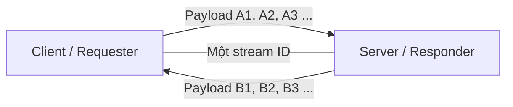
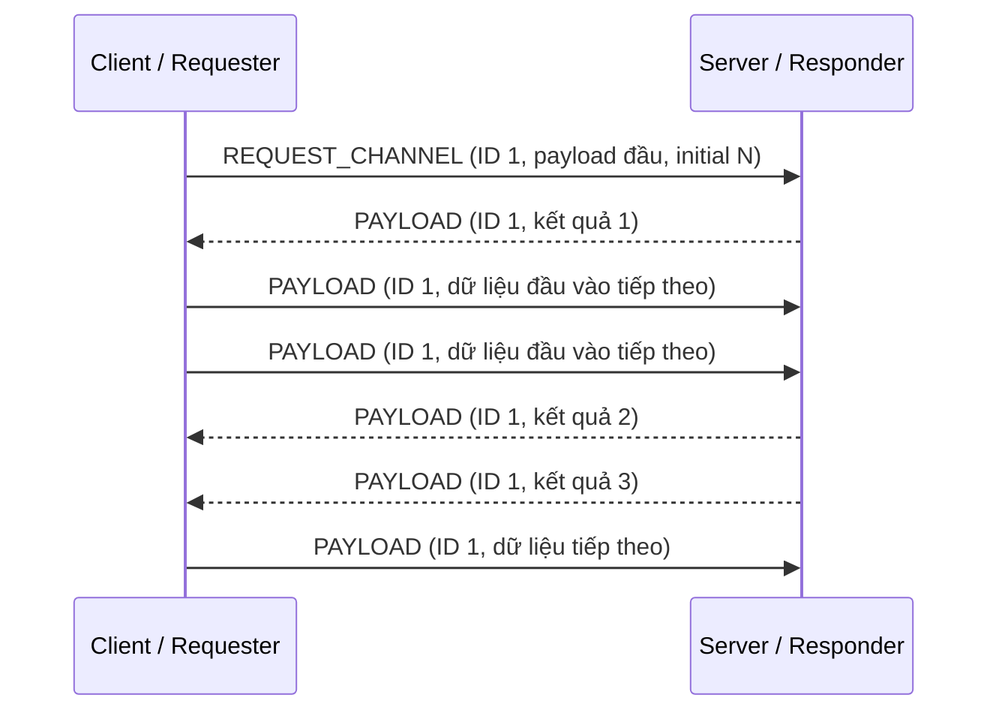
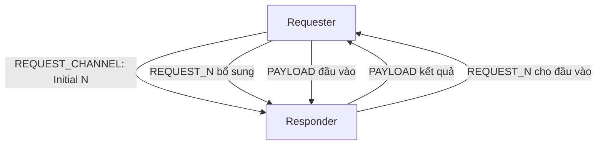

# Mô hình request-channel và hai luồng dữ liệu độc lập

RSocket `request-channel` cho phép hai peer trao đổi nhiều payload theo cả hai hướng trong cùng một tương tác. Requester gửi một chuỗi dữ liệu tới responder; đồng thời responder có thể gửi một chuỗi kết quả trở lại requester. Hai hướng dữ liệu có nhu cầu, tốc độ và thời điểm hoàn tất riêng, nhưng cùng thuộc một RSocket stream và dùng chung stream ID.

Mô hình này phù hợp với các phiên làm việc tương tác như gửi liên tục lệnh điều khiển và nhận trạng thái, truyền mẫu cảm biến để xử lý trực tiếp rồi nhận kết quả, hoặc gửi nội dung theo từng phần trong khi server trả tiến độ. Để dùng đúng request-channel, cần hiểu frame mở đầu, flow control ở từng hướng và cách một phía kết thúc việc gửi mà phía còn lại vẫn có thể tiếp tục.

## Mục tiêu học tập

Sau bài học, người học có thể:

- Giải thích request-channel và phân biệt hai hướng payload trong một stream.
- Nhận diện frame `REQUEST_CHANNEL`, stream ID, cờ và initial Request N.
- Mô tả cách các frame `PAYLOAD` tiếp tục hai chuỗi dữ liệu.
- Phân biệt nhu cầu nhận dữ liệu và backpressure ở từng hướng.
- Giải thích cách một phía hoàn tất việc gửi mà phía kia vẫn tiếp tục phát dữ liệu.
- Triển khai request-channel bằng RSocket Java và Spring Boot.
- Xử lý cancellation, lỗi, thứ tự, tải và kiểm thử tương tác hai chiều.

## 1. Bài toán hai phía cùng cần gửi dữ liệu

Hãy hình dung một client giám sát robot. Client gửi lệnh điều khiển theo thời gian thực; server tiếp nhận lệnh, tính toán và liên tục trả về trạng thái robot. Nếu chỉ dùng request-response, client phải gửi từng lệnh rồi chờ một kết quả đơn lẻ. Nếu dùng request-stream, client chỉ gửi một yêu cầu ban đầu và server phát một chuỗi kết quả. Cả hai mô hình đều chưa thể hiện đầy đủ việc hai bên cùng phát dữ liệu liên tục trong một tương tác.

`request-channel` giải quyết tình huống đó bằng hai luồng payload:

- **Luồng đi (requester → responder):** requester gửi nhiều payload, chẳng hạn các lệnh điều khiển hoặc mẫu cảm biến.
- **Luồng về (responder → requester):** responder gửi nhiều payload, chẳng hạn trạng thái, xác nhận hoặc kết quả xử lý.

Hai luồng dữ liệu độc lập về hướng phát, nhu cầu nhận và thời điểm hoàn tất. Chúng không phải hai RSocket stream riêng: cả hai cùng gắn với một stream ID của request-channel. Connection RSocket có thể đồng thời mang nhiều request-channel và các loại stream khác.



## 2. Frame REQUEST_CHANNEL mở tương tác

`REQUEST_CHANNEL` là frame khởi tạo một request-channel. Frame type của nó là `0x07`; requester cấp một stream ID dương để nhận diện tương tác.

Frame mở đầu chứa payload đầu tiên của requester và một trường **Initial Request N**. Trường này cho biết requester ban đầu muốn nhận bao nhiêu payload từ responder ở hướng về. Requester có thể tiếp tục gửi các payload tiếp theo bằng frame `PAYLOAD` trên cùng stream.

| Thành phần | Vai trò |
|---|---|
| Stream ID | Số dương do requester cấp; dùng chung cho cả hai hướng của channel |
| Frame Type | `REQUEST_CHANNEL` (`0x07`) |
| `M` (Metadata) | Cho biết payload mở đầu có metadata hay không |
| `F` (Follows) | Cho biết payload mở đầu còn fragment tiếp theo hay không |
| Initial Request N | Nhu cầu ban đầu của requester đối với payload responder gửi về |
| Metadata và Request Data | Payload mở đầu do requester gửi tới responder |

Mô hình rút gọn:

```text
+--------------------------------------------------+
| Stream ID > 0                                     |
+--------------------------------------------------+
| Frame Type = REQUEST_CHANNEL | M | F | Flags       |
+--------------------------------------------------+
| Initial Request N                                |
+--------------------------------------------------+
| Metadata Length (nếu M = 1)                      |
+--------------------------------------------------+
| Metadata bytes (nếu có)                          |
+--------------------------------------------------+
| Request Data                                     |
+--------------------------------------------------+
```

Initial Request N là nhu cầu nhận dữ liệu từ responder, không phải số payload requester được phép gửi. Nhu cầu của responder đối với chuỗi payload requester gửi được điều tiết riêng bằng flow control ở hướng ngược lại.

## 3. Hai hướng payload dùng chung stream ID

Sau frame `REQUEST_CHANNEL`, cả hai peer có thể gửi các frame `PAYLOAD` thuộc cùng stream ID:



Điểm cần quan sát là tất cả frame đều dùng ID 1 trong ví dụ. Stream ID không đổi theo từng payload và không đổi hướng khi responder gửi kết quả. Peer nhận frame xác định hướng gửi dựa trên endpoint gửi frame và xác định channel dựa trên stream ID.

Một connection có thể đồng thời mang channel ID 1, request-response ID 3 và request-stream ID 5. Multiplexing cho phép các tương tác đó tiến triển độc lập về logic, dù vẫn chia sẻ transport connection.

## 4. Flow control ở từng hướng

Vì hai phía đều có thể phát nhiều payload, mỗi phía cần kiểm soát tốc độ mà peer gửi dữ liệu tới mình. RSocket dùng nhu cầu (demand) để điều tiết số payload được phát.

### Hướng responder → requester

Requester nhận kết quả từ responder. Trường Initial Request N trong frame `REQUEST_CHANNEL` cấp nhu cầu ban đầu cho hướng này. Khi cần thêm kết quả, requester gửi frame `REQUEST_N` trên cùng stream để cấp thêm nhu cầu.

Ví dụ, initial N bằng 5 nghĩa là responder ban đầu được phép phát tối đa năm payload theo nhu cầu đã cấp. Khi requester tiêu thụ đủ và muốn nhận tiếp, nó gửi `REQUEST_N` với lượng nhu cầu bổ sung.

### Hướng requester → responder

Responder cũng cần điều tiết số payload requester gửi tới. Sau khi nhận channel, responder có thể gửi `REQUEST_N` trên cùng stream để cấp nhu cầu cho chuỗi payload đầu vào. Requester chỉ nên phát theo lượng nhu cầu đã được cấp.

Vì vậy, hai hướng có hai luồng điều tiết riêng:

| Hướng dữ liệu | Peer cấp nhu cầu | Cơ chế |
|---|---|---|
| Requester → Responder | Responder | `REQUEST_N` gửi từ responder tới requester |
| Responder → Requester | Requester | Initial Request N trong `REQUEST_CHANNEL`, sau đó `REQUEST_N` gửi từ requester tới responder |



Không nên hiểu Initial Request N là một giới hạn chung cho cả channel. Nó chỉ cấp nhu cầu ban đầu cho dữ liệu responder gửi về requester. Responder cấp nhu cầu riêng nếu muốn giới hạn dữ liệu đầu vào requester gửi tới.

## 5. Hoàn tất độc lập hai hướng

Một request-channel có thể kết thúc việc gửi ở một hướng trước hướng còn lại. Điều này rất hữu ích khi requester đã gửi hết dữ liệu nhưng vẫn muốn nhận các kết quả còn đang được xử lý.

RSocket dùng cờ `COMPLETE` trên frame `PAYLOAD` để báo một phía sẽ không gửi thêm payload. Nếu frame cuối còn mang dữ liệu, nó có thể kết hợp cờ `NEXT` và `COMPLETE`; nếu chỉ muốn báo hoàn tất mà không có payload mới, frame có thể mang `COMPLETE` mà không có `NEXT`.

Ví dụ:

1. Client gửi các mẫu cảm biến rồi đánh dấu hướng gửi của mình hoàn tất.
2. Server đã nhận đủ đầu vào nhưng vẫn cần thời gian tổng hợp kết quả.
3. Server tiếp tục phát các payload kết quả về client.
4. Khi server gửi payload cuối cùng hoặc tín hiệu hoàn tất, hướng phản hồi cũng kết thúc và channel được đóng bình thường.

```mermaid
sequenceDiagram
    participant C as Client
    participant S as Server
    C->>S: REQUEST_CHANNEL (payload đầu, initial N)
    C->>S: PAYLOAD (đầu vào 2)
    C->>S: PAYLOAD (COMPLETE: client hết dữ liệu)
    Note over C,S: Hướng client → server đã hoàn tất
    S-->>C: PAYLOAD (kết quả 1)
    S-->>C: PAYLOAD (kết quả cuối + COMPLETE)
    Note over C,S: Hướng server → client hoàn tất; channel kết thúc
```

`COMPLETE` đóng hướng gửi của peer phát frame đó. Nó không tự động hủy hướng gửi còn lại. Ngược lại, `CANCEL` hủy stream/channel và dừng toàn bộ tương tác. Lỗi stream cũng làm channel kết thúc theo semantics của protocol.

## 6. Phân biệt request-channel với request-stream

Hai interaction model đều có thể trả nhiều payload, nhưng hình dạng dữ liệu đầu vào khác nhau:

| Tiêu chí | `request-stream` | `request-channel` |
|---|---|---|
| Dữ liệu khởi tạo | Một payload | Payload đầu tiên mở channel |
| Dữ liệu requester gửi tiếp | Không có chuỗi payload đầu vào trong tương tác | Có thể gửi nhiều payload tiếp theo |
| Dữ liệu responder gửi về | Một chuỗi payload | Một chuỗi payload độc lập với hướng đầu vào |
| Hướng dữ liệu | Một request, một luồng kết quả | Hai luồng payload hai chiều |
| Ví dụ | Gửi mã thiết bị, nhận chuỗi số đo | Gửi liên tục lệnh điều khiển và nhận liên tục trạng thái |

Nếu client chỉ cần gửi một query rồi nhận nhiều kết quả, `request-stream` đơn giản và diễn đạt ý định tốt hơn. Nếu client cần tiếp tục gửi dữ liệu khi server đang phát kết quả, `request-channel` là lựa chọn phù hợp.

## 7. Triển khai request-channel bằng RSocket Java

API lõi RSocket Java cung cấp `requestChannel(Publisher<Payload>)`, trả về `Flux<Payload>`. Publisher đầu vào phát payload từ requester tới responder; Flux kết quả nhận payload responder gửi về requester.

```java
import io.rsocket.RSocket;
import io.rsocket.Payload;
import io.rsocket.util.DefaultPayload;
import org.reactivestreams.Publisher;
import reactor.core.publisher.Flux;

public Flux<Payload> controlRobot(
        RSocket requester,
        Flux<RobotCommand> commands) {

    Flux<Payload> outbound = commands.map(command ->
            DefaultPayload.create(command.toJson()));

    return requester.requestChannel(outbound);
}
```

Ví dụ minh họa luồng dữ liệu ở tầng API. Ứng dụng thực tế cần cấu hình codec/MIME type, quản lý vòng đời `Payload` và giải mã payload phản hồi. Publisher đầu vào phải tuân theo Reactive Streams; không nên tự ý biến một nguồn vô hạn thành danh sách giữ toàn bộ trong bộ nhớ.

### Responder nhận một Flux và trả một Flux

Ở phía server, responder nhận chuỗi command từ requester và trả chuỗi trạng thái:

```java
public Flux<Payload> handleControlChannel(Publisher<Payload> inbound) {
    return Flux.from(inbound)
            .map(this::decodeCommand)
            .concatMap(command -> robotService.execute(command))
            .map(status -> DefaultPayload.create(status.toJson()));
}
```

`concatMap` xử lý tuần tự theo thứ tự đầu vào. Nếu các command độc lập và nghiệp vụ cho phép xử lý song song, có thể dùng `flatMap` với concurrency giới hạn. Chọn toán tử theo yêu cầu thứ tự và tài nguyên; không mặc định mọi lệnh điều khiển đều có thể chạy song song.

## 8. Triển khai bằng Spring Boot

Spring RSocket ánh xạ route tới handler bằng `@MessageMapping`. Với request-channel, handler nhận một `Flux` đầu vào và trả một `Flux` kết quả.

### Server

```java
@Controller
public class RobotChannelController {

    private final RobotService robotService;

    public RobotChannelController(RobotService robotService) {
        this.robotService = robotService;
    }

    @MessageMapping("robots.{robotId}.control")
    public Flux<RobotStatus> control(
            @DestinationVariable String robotId,
            @Payload Flux<RobotCommand> commands) {

        return commands
                .concatMap(command -> robotService.execute(robotId, command));
    }
}
```

Trong ví dụ, `commands` là luồng requester gửi tới server. Mỗi `RobotStatus` được phát ra từ Flux trả về sẽ đi theo hướng server tới client. Hai hướng thuộc cùng request-channel.

### Client

```java
public Flux<RobotStatus> control(
        String robotId,
        Flux<RobotCommand> commands) {

    return requester
            .route("robots.{robotId}.control", robotId)
            .data(commands, RobotCommand.class)
            .retrieveFlux(RobotStatus.class);
}
```

`.data(commands, RobotCommand.class)` cung cấp publisher đầu vào cho channel; `.retrieveFlux(RobotStatus.class)` tiêu thụ chuỗi kết quả. Đăng ký Flux kết quả sẽ kích hoạt tương tác theo mô hình reactive. Khi publisher `commands` hoàn tất, client đóng hướng gửi; Flux kết quả vẫn có thể tiếp tục phát cho tới khi server hoàn tất hướng phản hồi.

## 9. Thứ tự, đồng thời và backpressure trong ứng dụng

Hai luồng dữ liệu độc lập không có nghĩa là ứng dụng được phép bỏ qua thứ tự nghiệp vụ. Ví dụ, lệnh `START` phải được xử lý trước `MOVE`; nếu client phát lệnh đồng thời và server dùng `flatMap`, kết quả có thể hoàn tất khác thứ tự đầu vào.

Một số nguyên tắc thiết kế:

- Dùng `concatMap` khi mỗi payload phải được xử lý theo thứ tự nhận.
- Dùng `flatMap` có concurrency giới hạn khi các thao tác độc lập và có thể chạy song song.
- Partition theo robot/device ID nếu muốn xử lý song song giữa các thiết bị nhưng tuần tự trong cùng thiết bị.
- Không dùng chung một mutable context cho nhiều channel nếu trạng thái thuộc riêng một channel.
- Giữ publisher có backpressure và giới hạn buffer khi kết nối producer với nguồn dữ liệu nhanh.
- Xác định rõ hành vi khi consumer chậm: giảm tốc, buffer có giới hạn, bỏ dữ liệu không quan trọng hoặc kết thúc channel.

RSocket flow control điều tiết payload theo nhu cầu ở mỗi hướng. TCP flow control vẫn điều tiết byte trên transport. Hai lớp bổ sung cho nhau; TCP không thay thế backpressure của publisher hoặc giới hạn tài nguyên ở tầng ứng dụng.

## 10. Lỗi, cancellation và vòng đời channel

Một channel có thể kết thúc theo nhiều cách:

- **Hoàn tất bình thường:** cả hai phía đều đánh dấu hướng gửi của mình hoàn tất bằng cờ `COMPLETE` trên `PAYLOAD`.
- **Requester hủy:** requester gửi `CANCEL`, yêu cầu dừng channel.
- **Lỗi stream:** một phía gửi `ERROR`; channel kết thúc theo lỗi.
- **Connection mất:** transport/session không còn khả dụng; channel đang chạy bị ảnh hưởng và ứng dụng cần xử lý lỗi hoặc reconnect.

Khi client hủy subscription Flux kết quả, cancellation có thể được truyền xuống RSocket stream và dừng xử lý không còn cần thiết ở server. Server nên bảo đảm cleanup tài nguyên, hủy công việc đang chạy và giải phóng buffer.

Không nên coi reconnect là tiếp tục tự động một request-channel cũ. Khi connection mất, channel cũ không tự chuyển sang connection mới. Nếu nghiệp vụ cần tiếp tục phiên điều khiển, hãy thiết kế session ID, sequence number, checkpoint và cơ chế resume/restart ở tầng ứng dụng phù hợp.

## 11. Bảo mật và kiểm soát tài nguyên

Request-channel duy trì hai hướng dữ liệu trên một tương tác lâu dài nên cần bảo vệ cả dữ liệu vào và dữ liệu ra:

- Xác thực peer và phân quyền route trước khi mở channel.
- Kiểm tra quyền trên từng command hoặc dữ liệu đầu vào; không chỉ dựa vào quyền mở channel ban đầu nếu quyền có thể thay đổi.
- Giới hạn kích thước payload, tốc độ phát, số channel đồng thời và buffer.
- Gắn correlation ID hoặc channel/session ID để theo dõi hai hướng trong log và trace.
- Không ghi token hoặc dữ liệu nhạy cảm ở dạng rõ.
- Hủy channel và giải phóng tài nguyên khi client ngắt kết nối hoặc không còn nhu cầu.
- Nếu dữ liệu có side effect, dùng sequence number hoặc command ID để phát hiện lệnh trùng khi ứng dụng retry.

Vì hai hướng có thể chạy đồng thời, hãy tránh để luồng kết quả bị chặn bởi một thao tác đồng bộ lâu trong xử lý đầu vào. Dùng scheduler và mô hình concurrency phù hợp với runtime reactive, đồng thời giới hạn hàng đợi để không tích tụ dữ liệu vô hạn.

## 12. Kiểm thử request-channel

Một bộ kiểm thử nên xác minh cả hai hướng, flow control và vòng đời:

1. **Kiểm tra mở channel:** frame đầu là `REQUEST_CHANNEL` (`0x07`), stream ID dương và payload đầu vào hợp lệ.
2. **Kiểm tra hai hướng:** requester gửi nhiều payload và responder phát nhiều payload trên cùng stream ID.
3. **Kiểm tra initial demand:** responder không phát vượt nhu cầu ban đầu mà requester cấp.
4. **Kiểm tra nhu cầu hướng vào:** responder cấp `REQUEST_N` và requester tuân thủ số payload được yêu cầu.
5. **Kiểm tra half-close:** requester hoàn tất hướng gửi nhưng vẫn nhận được kết quả cuối từ server.
6. **Kiểm tra cancellation:** hủy Flux kết quả và xác minh server dừng xử lý, giải phóng tài nguyên.
7. **Kiểm tra lỗi:** lỗi trong command, lỗi xử lý server, payload sai schema và connection bị đóng.
8. **Kiểm tra thứ tự/tải:** phát burst dữ liệu, xác minh concurrency, buffer và thứ tự theo yêu cầu nghiệp vụ.

| Triệu chứng | Nguyên nhân cần kiểm tra |
|---|---|
| Client gửi được nhưng không nhận kết quả | Handler server không phát Flux, lỗi route hoặc requester chưa cấp/đã dùng hết nhu cầu nhận |
| Server không nhận các payload tiếp theo | Publisher đầu vào đã hoàn tất, responder chưa cấp `REQUEST_N` hoặc client bị backpressure |
| Channel kết thúc quá sớm | Một phía gửi `COMPLETE`, `CANCEL`, `ERROR` hoặc publisher hoàn tất ngoài dự kiến |
| Kết quả về sai thứ tự | Dùng `flatMap` cho thao tác cần tuần tự |
| Buffer tăng liên tục | Nguồn phát nhanh hơn consumer, thiếu giới hạn buffer/concurrency |
| Mất phiên điều khiển sau reconnect | Channel cũ không tự được chuyển sang connection mới; cần session/recovery logic |

## Kết luận

`request-channel` mở bằng `REQUEST_CHANNEL` (`0x07`) và cho phép requester gửi một chuỗi payload trong khi responder đồng thời trả một chuỗi payload. Hai hướng dùng chung một stream ID nhưng có nhu cầu nhận, tốc độ và thời điểm hoàn tất riêng. Initial Request N cấp nhu cầu ban đầu cho dữ liệu responder gửi về; `REQUEST_N` điều tiết thêm nhu cầu ở mỗi hướng. Dùng `PAYLOAD` với cờ `COMPLETE` để kết thúc riêng một hướng, và dùng `CANCEL` khi cần hủy toàn bộ channel. Trong Java/Spring Boot, mô hình này được biểu diễn tự nhiên bằng publisher đầu vào và `Flux` kết quả.

## Tài liệu tham khảo

- [RSocket Protocol – Request Channel, PAYLOAD và Flow Control](https://rsocket.io/about/protocol/)
- [Spring Framework – RSocket Messaging](https://docs.spring.io/spring-framework/reference/rsocket.html)
