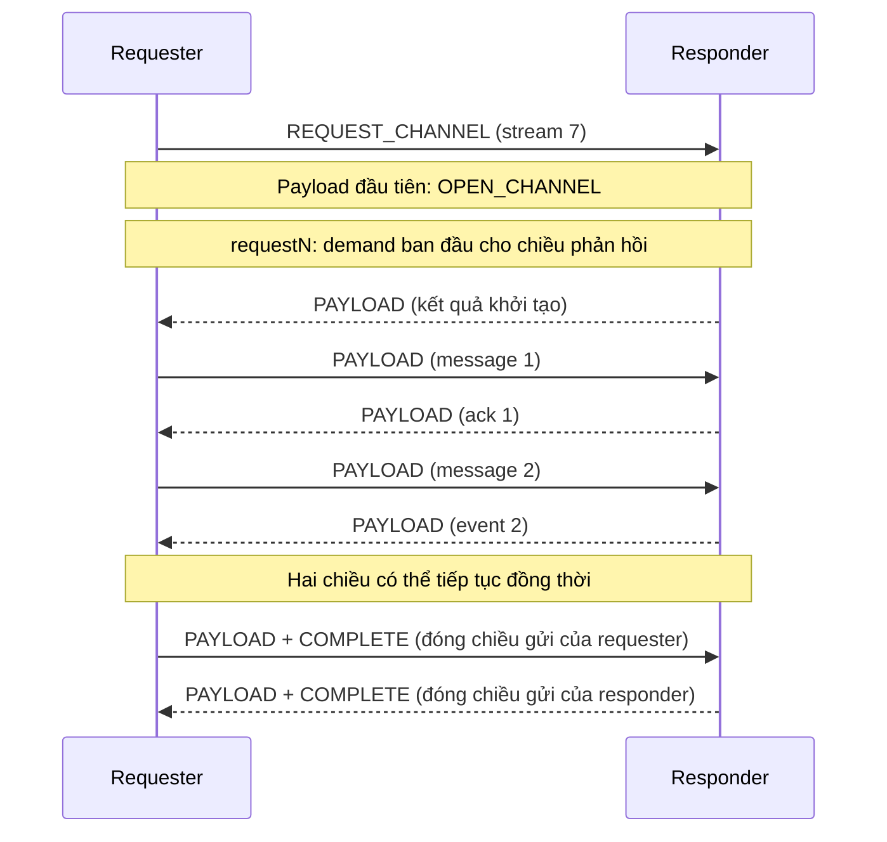
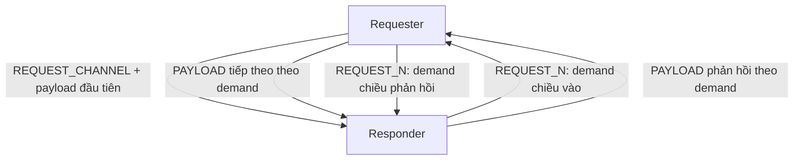

# Vai trò của payload đầu tiên trong khởi tạo kênh

Trong RSocket, `request-channel` mở một tương tác hai chiều trên cùng một stream. Bên khởi tạo gửi frame `REQUEST_CHANNEL` kèm **payload đầu tiên**; payload này vừa mở kênh, vừa trở thành phần tử đầu tiên của luồng dữ liệu đi từ requester tới responder. Sau đó, requester có thể tiếp tục gửi các payload và responder có thể phát các payload phản hồi đồng thời.

Payload đầu tiên thường được ứng dụng dùng như một thông điệp mở kênh: khai báo phòng chat, mã phiên, loại luồng, bộ lọc hoặc tham số khởi tạo. Tuy nhiên, RSocket không áp đặt ý nghĩa nghiệp vụ cụ thể cho payload đó. Ý nghĩa của nó do route và hợp đồng ứng dụng định nghĩa. Vì vậy, thiết kế payload đầu tiên là bước quan trọng để responder biết cần mở và xử lý kênh như thế nào.

## 1. Payload đầu tiên nằm ở đâu trong request-channel?

Một channel được khởi tạo theo trình tự:

1. Requester chọn route và tạo payload đầu tiên.
2. Requester gửi frame `REQUEST_CHANNEL` trên một stream ID mới. Frame chứa payload mở đầu và demand ban đầu dành cho các payload phản hồi từ responder.
3. Responder nhận payload đầu tiên như phần tử đầu của luồng dữ liệu đầu vào.
4. Responder xử lý thông điệp mở kênh, sau đó có thể nhận các payload tiếp theo và phát payload phản hồi trên cùng stream.
5. Hai phía tiếp tục gửi dữ liệu theo nhu cầu cho tới khi một hoặc cả hai chiều hoàn tất, hoặc stream bị hủy/lỗi.



`REQUEST_CHANNEL` khác với `REQUEST_RESPONSE`: request-response khởi tạo một yêu cầu và nhận tối đa một phản hồi, còn request-channel mở hai luồng payload gắn với cùng một tương tác. Payload đầu tiên của channel không phải một request-response riêng biệt và cũng không phải frame `SETUP` của kết nối.

## 2. Ý nghĩa của payload đầu tiên do ứng dụng quy định

Ở tầng giao thức, payload là cấu trúc gồm data và metadata tùy chọn. RSocket chỉ xác định cách vận chuyển payload trên stream; nó không quy định rằng payload đầu tiên phải là `OPEN`, `JOIN` hay một loại thông điệp cụ thể.

Ứng dụng thường dùng payload đầu tiên để truyền một hoặc nhiều thông tin sau:

- **Loại channel:** chat, telemetry, đồng bộ trạng thái, điều khiển thiết bị hoặc luồng sự kiện.
- **Định danh tài nguyên:** room ID, document ID, device ID hoặc session ID mà channel gắn vào.
- **Tham số khởi tạo:** bộ lọc, cursor, phiên bản schema, ngôn ngữ hoặc tùy chọn xử lý.
- **Ngữ cảnh nghiệp vụ:** người dùng đang yêu cầu tham gia, theo dõi hoặc cập nhật tài nguyên nào.
- **Khả năng client:** định dạng sự kiện hoặc tính năng mà client hỗ trợ.

Ví dụ, channel chat có thể bắt đầu bằng thông điệp:

```json
{
  "type": "OPEN",
  "roomId": "room-42",
  "userId": "user-17",
  "lastSeenMessageId": "msg-900"
}
```

Các payload tiếp theo có thể mang nội dung chat, heartbeat ở tầng ứng dụng hoặc lệnh rời phòng. Responder dùng thông điệp đầu để xác định tài nguyên và chuẩn bị luồng phản hồi phù hợp.

Payload mở kênh nên nhỏ, có schema rõ ràng và có thể kiểm tra độc lập. Tránh đưa cả lịch sử dữ liệu lớn vào payload đầu tiên; hãy truyền cursor hoặc bộ lọc rồi để responder phát dữ liệu cần thiết qua chiều phản hồi.

## 3. Payload đầu tiên và metadata định tuyến

Payload đầu tiên có thể chứa data nghiệp vụ và metadata. Với Spring RSocket, route thường được gửi dưới dạng routing metadata để chọn handler. Route là thông tin định tuyến của tương tác; trường `type: OPEN` hoặc `roomId` trong data là nội dung mà handler dùng để khởi tạo channel.

Ví dụ:

| Thành phần | Giá trị ví dụ | Mục đích |
|---|---|---|
| Route metadata | `chat.channel` | Chọn handler xử lý channel |
| Data của payload đầu tiên | `type=OPEN`, `roomId=room-42` | Mở phòng chat cụ thể |
| Metadata tùy chọn khác | trace ID, locale | Theo dõi hoặc cung cấp ngữ cảnh cho tương tác |

Không nên nhầm route với nội dung payload đầu tiên. Route trả lời câu hỏi “gửi tương tác tới handler nào?”, còn payload trả lời câu hỏi “handler cần khởi tạo channel với dữ liệu gì?”. Metadata của payload đầu tiên cũng không tự động trở thành metadata của mọi payload tiếp theo; nếu một thông điệp về sau cần metadata riêng, requester phải gửi metadata cho thông điệp đó theo hợp đồng đã thiết kế.

## 4. Payload đầu tiên quyết định hợp đồng của channel

Vì payload đầu tiên là phần tử đầu tiên của luồng requester gửi, handler cần xử lý nó như một sự kiện trong luồng. Một quy ước thường dùng là phân biệt thông điệp mở kênh với các thông điệp nghiệp vụ tiếp theo:

| Thứ tự | Loại thông điệp | Ví dụ | Cách responder xử lý |
|---|---|---|---|
| Payload đầu tiên | `OPEN` | Chọn room, device hoặc document | Xác thực, kiểm tra quyền, đăng ký channel và chuẩn bị phản hồi |
| Payload tiếp theo | `MESSAGE` | Nội dung chat hoặc lệnh cập nhật | Xử lý nghiệp vụ và phát kết quả/event |
| Payload tiếp theo | `ACK` hoặc `PING` | Xác nhận hoặc heartbeat ứng dụng | Cập nhật trạng thái hoặc phản hồi theo giao thức ứng dụng |
| Payload cuối | Thông điệp cuối kèm hoàn tất chiều gửi | `LEAVE` hoặc hoàn tất publisher | Giải phóng tài nguyên gắn với chiều gửi nếu phù hợp |

Không phải channel nào cũng cần một trường `type`. Với một luồng telemetry, payload đầu tiên có thể đơn giản là thông tin thiết bị và cấu hình lấy mẫu, các payload tiếp theo là mẫu đo. Điều quan trọng là hai phía phải thống nhất schema và quy tắc xử lý phần tử đầu tiên.

Nếu payload đầu tiên thiếu trường bắt buộc hoặc không hợp lệ, responder nên phát lỗi và kết thúc channel sớm. Không nên âm thầm coi payload nghiệp vụ đầu tiên là thông điệp mở kênh, vì điều đó có thể khiến dữ liệu bị mất hoặc xử lý sai tài nguyên.

## 5. Ví dụ Java với Spring RSocketRequester

Giả sử client mở channel chat. Payload đầu tiên là `OPEN` để tham gia phòng; các payload tiếp theo là tin nhắn. Ví dụ mô hình dữ liệu:

```java
public record ChatInput(
    String type,
    String roomId,
    String text
) {}

public record ChatOutput(
    String type,
    String roomId,
    String text
) {}
```

Client cần đảm bảo thông điệp `OPEN` được gửi trước các tin nhắn tiếp theo. `Flux.concat` giữ đúng thứ tự này:

```java
Mono<ChatInput> open = Mono.just(
    new ChatInput("OPEN", "room-42", null)
);

Flux<ChatInput> messages = messageSource;

Flux<ChatInput> outbound = Flux.concat(open, messages);

Flux<ChatOutput> inbound = requester
    .route("chat.channel")
    .data(outbound)
    .retrieveFlux(ChatOutput.class);

inbound.subscribe(this::displayChatEvent, this::handleChannelError);
```

Trong ví dụ này, khi channel được subscribe, phần tử đầu tiên của `outbound` trở thành payload mở đầu trong `REQUEST_CHANNEL`. `messageSource` chỉ được tiêu thụ sau khi publisher `open` phát phần tử đầu tiên và hoàn tất. Requester tiếp tục nhận các `ChatOutput` từ responder trên cùng channel.

## 6. Xử lý payload đầu tiên ở responder

Spring cho phép handler `@MessageMapping` nhận một `Flux` đầu vào và trả về một `Flux` đầu ra cho request-channel. Vì payload mở kênh là phần tử đầu tiên của `Flux`, handler có thể kiểm tra nó trước khi xử lý các sự kiện còn lại.

```java
@Controller
public class ChatController {

    private final ChatService chatService;

    public ChatController(ChatService chatService) {
        this.chatService = chatService;
    }

    @MessageMapping("chat.channel")
    public Flux<ChatOutput> chat(Flux<ChatInput> incoming) {
        return incoming.index().concatMap(indexed -> {
            long position = indexed.getT1();
            ChatInput input = indexed.getT2();

            if (position == 0 && !"OPEN".equals(input.type())) {
                return Mono.error(new IllegalArgumentException(
                    "Payload đầu tiên phải có type OPEN"
                ));
            }

            if (position == 0) {
                return chatService.open(input);
            }

            return chatService.handle(input);
        });
    }
}
```

`index()` đánh số các phần tử để handler nhận diện payload đầu tiên. `concatMap` giữ thứ tự xử lý và chờ xử lý từng phần tử trước khi chuyển sang phần tử tiếp theo. Cách này hữu ích khi các lệnh phụ thuộc thứ tự, ví dụ phải mở phòng trước khi ghi tin nhắn. Nếu các sự kiện độc lập và có thể xử lý song song, có thể cân nhắc `flatMap`, nhưng cần chấp nhận khả năng kết quả hoàn tất không theo thứ tự đầu vào.

`ChatService.open` và `ChatService.handle` trong ví dụ đại diện cho các hàm nghiệp vụ trả về `Mono<ChatOutput>`. Trong ứng dụng thật, `open` nên kiểm tra room tồn tại, xác thực danh tính và quyền tham gia trước khi tạo subscription hoặc đăng ký tài nguyên cho channel.

## 7. Payload đầu tiên và backpressure

Frame `REQUEST_CHANNEL` chứa một giá trị `requestN` ban đầu. Đây là số payload phản hồi mà requester sẵn sàng nhận từ responder ở chiều responder → requester. Nó không phải giới hạn số payload requester được gửi vào chiều requester → responder.

Hai chiều có thể được điều tiết độc lập:

- Requester gửi `REQUEST_N` để tăng demand cho payload phản hồi từ responder.
- Responder gửi `REQUEST_N` để cấp demand cho các payload tiếp theo từ requester.
- Mỗi phía chỉ nên phát số payload phù hợp với demand mà peer đã cấp.
- Reactive Streams và Reactor giúp truyền demand qua publisher/subscriber, nhưng ứng dụng vẫn phải tránh tạo hàng đợi không giới hạn ở các nguồn dữ liệu nóng.

Payload đầu tiên mở channel và đồng thời là một phần tử dữ liệu đầu vào; nó không phải một “vé” cho phép requester gửi vô hạn payload. Nếu responder chưa sẵn sàng nhận nhiều sự kiện, demand của chiều requester → responder sẽ điều tiết lượng dữ liệu được gửi tiếp. Tương tự, requester cần yêu cầu đủ demand để nhận phản hồi hoặc event từ responder.



Khi thiết kế channel, hãy quyết định rõ payload nào cần phản hồi, kích thước batch, giới hạn buffer và cách xử lý khi nguồn phát nhanh hơn consumer. Không nên chuyển một nguồn sự kiện vô hạn vào `Flux` rồi gom toàn bộ bằng `collectList()` chỉ để tạo payload đầu tiên hoặc chờ hoàn tất channel.

## 8. Hoàn tất một chiều, hủy channel và xử lý lỗi

Hai chiều của request-channel có thể kết thúc độc lập. Ví dụ requester có thể ngừng gửi tin nhắn nhưng vẫn tiếp tục nhận event từ responder. Tương tự, responder có thể hoàn tất luồng phản hồi trong khi chiều gửi từ requester còn hoạt động, tùy hợp đồng tương tác và trạng thái stream.

- **Hoàn tất chiều gửi:** publisher của một phía hoàn tất; phía đó không gửi thêm payload trên chiều của mình. Trong giao thức, trạng thái hoàn tất được biểu diễn bằng cờ `COMPLETE` trên frame payload thích hợp.
- **Hủy tương tác:** requester hủy subscription hoặc stream; việc hủy được truyền để dừng luồng phản hồi và giải phóng công việc liên quan.
- **Lỗi:** lỗi ở một phía có thể kết thúc tương tác; responder nên giải phóng tài nguyên như subscription, listener hoặc đăng ký phòng chat.

Không nên dùng `COMPLETE` như thể nó đồng nghĩa với `CANCEL`. Hoàn tất một chiều cho phép chiều còn lại tiếp tục nếu giao thức và ứng dụng vẫn duy trì channel; hủy stream dừng tương tác đang được tiêu thụ.

Với channel dài hạn, cần có chính sách timeout, phát hiện peer mất kết nối, cleanup và khả năng khôi phục trạng thái. Khi kết nối bị đóng đột ngột, không giả định rằng responder đã nhận được mọi payload mà requester đã tạo hoặc rằng mọi phản hồi đã được ứng dụng xử lý.

## 9. Những lỗi thiết kế thường gặp

| Lỗi | Hậu quả | Cách khắc phục |
|---|---|---|
| Không định nghĩa cấu trúc payload đầu tiên | Responder không biết channel đại diện cho tài nguyên hay loại tương tác nào | Định nghĩa schema mở kênh, trường bắt buộc và phiên bản schema |
| Gửi sự kiện nghiệp vụ trước thông điệp mở kênh | Handler có thể xử lý dữ liệu khi chưa xác định room/device/document | Dùng `Flux.concat` để gửi payload mở đầu trước |
| Nhầm payload đầu tiên với `SETUP` | Gắn thông tin channel vào toàn bộ kết nối và sai vòng đời dữ liệu | Đặt thông tin channel trong `REQUEST_CHANNEL`; chỉ dùng `SETUP` cho ngữ cảnh kết nối |
| Coi `requestN` trong frame mở đầu là số payload requester được gửi | Thiết kế backpressure sai chiều | Nhớ rằng requestN ban đầu cấp demand cho chiều phản hồi responder → requester |
| Không kiểm tra quyền trên tài nguyên trong payload mở đầu | Người dùng có thể mở channel tới tài nguyên không được phép truy cập | Xác thực và phân quyền trước khi đăng ký luồng |
| Dùng xử lý song song không kiểm soát thứ tự | Tin nhắn đến trước khi thao tác OPEN hoàn tất | Dùng `concatMap` hoặc đồng bộ hóa theo channel |
| Không giới hạn buffer | Tăng bộ nhớ khi producer nhanh hơn consumer | Áp dụng demand, giới hạn queue và chiến lược overflow |
| Tạo tác dụng phụ không idempotent khi reconnect | Tạo trùng phiên hoặc đăng ký trùng listener | Dùng channel ID/idempotency key và cleanup rõ ràng |

## 10. Kiểm thử payload mở kênh

Một bài kiểm thử request-channel nên xác minh cả hai chiều và hợp đồng của payload đầu tiên:

1. Gửi payload đầu tiên hợp lệ, xác minh responder mở đúng tài nguyên và phát phản hồi khởi tạo.
2. Gửi payload đầu tiên sai loại hoặc thiếu trường bắt buộc, xác minh channel bị từ chối bằng lỗi phù hợp.
3. Gửi nhiều payload tiếp theo, xác minh chúng được xử lý đúng thứ tự khi hợp đồng yêu cầu thứ tự.
4. Xác minh responder có thể phát event trong lúc requester vẫn đang gửi dữ liệu.
5. Kiểm tra demand/backpressure với consumer chậm và producer nhanh.
6. Hoàn tất riêng chiều requester hoặc responder, xác minh chiều còn lại hoạt động theo hợp đồng.
7. Hủy channel hoặc đóng kết nối, xác minh listener, subscription và tài nguyên được giải phóng.
8. Mở lại channel sau reconnect, xác minh idempotency key ngăn tác dụng phụ trùng lặp.

## 11. Checklist thiết kế

- [ ] Payload đầu tiên có schema và ý nghĩa nghiệp vụ được định nghĩa rõ.
- [ ] Responder kiểm tra payload đầu tiên trước khi xử lý các phần tử tiếp theo.
- [ ] Route metadata chọn đúng handler; data payload chứa thông tin mở channel.
- [ ] Client đảm bảo payload mở đầu được phát trước các payload tiếp theo.
- [ ] Hai chiều có chính sách demand/backpressure và giới hạn buffer.
- [ ] Quy tắc hoàn tất một chiều, hủy channel và xử lý lỗi đã được xác định.
- [ ] Payload mở đầu được xác thực và phân quyền theo tài nguyên.
- [ ] Reconnect không tạo đăng ký hoặc tác dụng phụ trùng lặp.

Payload đầu tiên là điểm nối giữa ý định của requester và cách responder khởi tạo channel. Nó mở stream, đồng thời là phần tử đầu tiên của luồng requester gửi. Khi hợp đồng payload mở đầu rõ ràng, route đúng, quyền truy cập được kiểm tra và demand được quản lý ở cả hai chiều, request-channel có thể hỗ trợ các luồng realtime hai chiều mà vẫn kiểm soát được thứ tự, tài nguyên và lỗi.

## Tài liệu tham khảo

- [RSocket Protocol — Request Channel](https://rsocket.io/about/protocol/)
- [Spring Framework — RSocket Request-Channel](https://docs.spring.io/spring-framework/reference/rsocket.html)
- [Reactive Streams — Specification](https://www.reactive-streams.org/)
