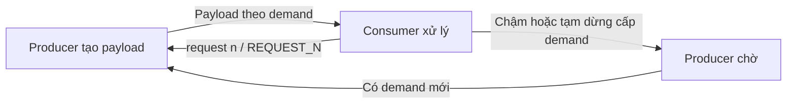
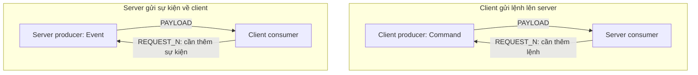
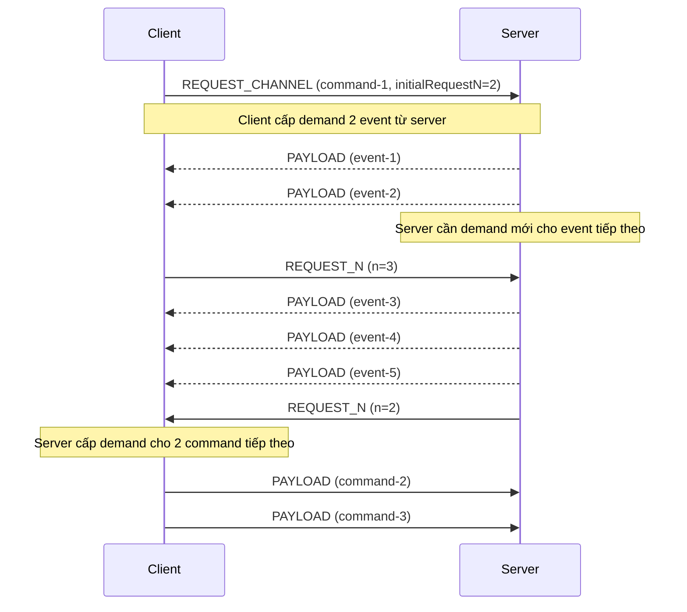

# Nhu cầu nhận và điều tiết dữ liệu theo từng chiều

Request-channel cho phép client gửi một luồng lệnh đến server đồng thời nhận một luồng sự kiện từ server trong cùng một tương tác RSocket. Hai luồng này có thể chạy với tốc độ khác nhau: client có thể phát lệnh nhanh hơn server xử lý, trong khi server cũng có thể tạo sự kiện nhanh hơn client tiêu thụ. Nếu không giới hạn lượng dữ liệu đang truyền và đang chờ, hàng đợi có thể tăng, bộ nhớ bị chiếm dụng và độ trễ ngày càng lớn.

RSocket giải quyết vấn đề này bằng cơ chế demand-based flow control. Bên nhận cho biết nó muốn nhận thêm bao nhiêu payload; bên phát chỉ gửi trong phạm vi demand đã được cấp. Với request-channel, demand được quản lý độc lập theo từng chiều. Client cấp demand cho sự kiện server gửi về; server cấp demand cho lệnh client gửi lên. Hiểu đúng hai hướng demand là nền tảng để thiết kế ứng dụng reactive không bị quá tải.

Bài này giải thích producer, consumer, `initialRequestN`, frame `REQUEST_N`, cách demand đi qua Spring/Reactor, lựa chọn buffer khi nguồn dữ liệu không thể dừng, và cách kiểm thử một channel khi hai phía có tốc độ khác nhau.

## 1. Demand và backpressure là gì?

Trong Reactive Streams, một `Publisher` phát các phần tử cho `Subscriber`. Subscriber nhận một `Subscription` và gọi `request(n)` để yêu cầu tối đa `n` phần tử tiếp theo. Publisher không được phát phần tử vượt quá tổng demand mà subscriber đã cấp. Khi subscriber không còn cần dữ liệu, nó có thể hủy subscription.

Demand là tín hiệu từ consumer đến producer. Backpressure là cách áp lực từ tốc độ tiêu thụ được truyền ngược về nguồn phát để nguồn không gửi dữ liệu vượt quá khả năng tiếp nhận.

Ví dụ, một server tạo 100 sự kiện mỗi giây nhưng client chỉ xử lý được 20 sự kiện mỗi giây. Nếu server đẩy mọi sự kiện vào một queue không giới hạn, queue sẽ tăng khoảng 80 phần tử mỗi giây. Sau một thời gian, độ trễ và bộ nhớ tăng liên tục. Nếu client chỉ cấp demand theo khả năng xử lý, server phải chờ demand tiếp theo trước khi phát thêm payload trên stream.



Backpressure không có nghĩa producer phải ngừng tạo dữ liệu ở mọi tầng. Nó chỉ có hiệu quả xuyên suốt khi các thành phần từ nguồn đến subscriber biết tôn trọng demand. Nếu nguồn là callback, cảm biến hoặc API blocking không thể tạm dừng, ứng dụng vẫn phải chọn chính sách buffer, drop, sampling hoặc từ chối dữ liệu.

## 2. Hai chiều request-channel có hai demand riêng

Trong request-channel, cùng một stream mang payload theo cả hai hướng. Tuy nhiên, consumer của mỗi hướng là một bên khác nhau, nên mỗi hướng có một dòng demand riêng.

| Hướng payload | Producer | Consumer | Ai cấp demand? |
|---|---|---|---|
| Client → Server (lệnh) | Client | Server | Server gửi `REQUEST_N` cho client. |
| Server → Client (sự kiện) | Server | Client | Client khai báo demand ban đầu trong `initialRequestN`, sau đó gửi `REQUEST_N` khi cần thêm. |

Đây là điểm dễ nhầm: frame `REQUEST_N` luôn đi từ consumer đến producer của chính hướng payload mà nó điều tiết. Vì thế, trong một request-channel, cả client lẫn server đều có thể gửi `REQUEST_N` trên cùng stream ID, nhưng mỗi frame điều tiết một chiều dữ liệu khác nhau.

Ví dụ với phiên điều khiển thiết bị:

- Client gửi các `DeviceCommand`; server là consumer của hướng client → server. Server yêu cầu thêm lệnh bằng `REQUEST_N`.
- Server phát các `DeviceEvent`; client là consumer của hướng server → client. Client yêu cầu thêm sự kiện bằng `REQUEST_N`.



Hai hướng có thể tiến triển đồng thời. Client có thể tạm dừng yêu cầu sự kiện trong khi vẫn gửi lệnh nếu server còn demand cho chiều lệnh; server cũng có thể yêu cầu thêm lệnh trong khi chờ client tiêu thụ sự kiện. Điều này không có nghĩa hai chiều hoàn toàn không liên quan: chúng vẫn thuộc cùng một stream và cùng chịu ảnh hưởng khi stream bị hủy hoặc connection bị đóng.

## 3. `initialRequestN` trong frame mở request-channel

Client mở tương tác bằng frame `REQUEST_CHANNEL`. Frame này mang payload ban đầu của client và trường `initialRequestN`. Giá trị đó thể hiện số payload response mà client ban đầu sẵn sàng nhận từ server, tức demand cho chiều server → client. Payload đầu tiên của client được gửi ngay trong frame mở channel; `initialRequestN` không phải demand cho các command client gửi lên.

Sau khi mở channel:

1. Client gửi `REQUEST_CHANNEL` với lệnh đầu tiên và `initialRequestN` cho sự kiện trả về.
2. Server có thể gửi tối đa số payload response đã được client yêu cầu.
3. Khi cần thêm sự kiện, client gửi `REQUEST_N` trên stream đó.
4. Để nhận thêm lệnh từ client, server gửi `REQUEST_N` theo chiều ngược lại.

`initialRequestN` không phải số lệnh client dự định gửi. Nó là demand ban đầu của client dành cho các payload response do server phát. Demand cho các lệnh client gửi sẽ được server cấp sau đó bằng `REQUEST_N`.



Sơ đồ minh họa hai bộ đếm demand độc lập. `initialRequestN=2` cho phép server phát hai event đầu tiên. `REQUEST_N(n=3)` từ client cấp thêm ba event. `REQUEST_N(n=2)` từ server cấp quyền nhận hai command tiếp theo từ client.

## 4. `REQUEST_N` điều tiết payload như thế nào?

`REQUEST_N` mang số lượng payload bổ sung mà consumer muốn nhận từ producer trên một stream. Giá trị `n` phải dương. Khi producer đã phát hết demand hiện có, nó phải chờ consumer yêu cầu thêm trước khi phát payload tiếp theo thuộc chiều đó.

Một vài điểm cần nhớ:

- Demand được tính theo số payload, không phải số byte.
- Mỗi `REQUEST_N` áp dụng cho stream ID cụ thể và hướng producer → consumer tương ứng.
- Demand mới được cộng vào lượng demand còn lại; nó không có nghĩa thay thế toàn bộ demand trước đó.
- Producer có thể phát ít hơn demand nếu nguồn chưa có dữ liệu.
- `REQUEST_N` không yêu cầu producer phải phát ngay lập tức; nó chỉ cho phép phát thêm trong giới hạn đã cấp.
- `COMPLETE` hoặc `ERROR` là tín hiệu vòng đời stream, không phải payload thông thường bị giới hạn như `NEXT`.

Ví dụ, client đã cấp demand 5 event. Server mới có 2 event thì chỉ phát 2 event. Ba phần tử demand còn lại vẫn có thể được dùng khi nguồn tạo thêm event. Khi client yêu cầu thêm 4, tổng demand còn lại được cộng thêm theo quy tắc protocol.

Trong request-channel, server cũng có thể cấp demand 5 command cho client. Nếu client mới có 3 command, nó có thể phát 3 và giữ lại phần demand còn lại cho command sau. Client không được phát payload vượt quá demand server đã cấp.

## 5. Demand ở tầng protocol và Reactive Streams

Trong Java reactive, `Subscription.request(n)` là tín hiệu demand của Reactive Streams. RSocket ánh xạ nhu cầu đó thành flow control ở tầng protocol. Khi subscriber phía client yêu cầu thêm response, runtime có thể gửi `REQUEST_N` cho server. Khi server subscriber yêu cầu thêm command, runtime gửi `REQUEST_N` cho client.

Với Spring Messaging, developer thường làm việc với `Flux<T>` thay vì tự tạo frame:

- `Flux<Command>` là luồng payload client gửi đến server.
- `Flux<Event>` là luồng payload server trả về client.
- Subscription và demand của mỗi phía được runtime quản lý, miễn là pipeline reactive giữ đúng semantics.

```java
@Controller
class DeviceChannelController {

    private final DeviceService deviceService;

    DeviceChannelController(DeviceService deviceService) {
        this.deviceService = deviceService;
    }

    @MessageMapping("device.control")
    Flux<DeviceEvent> control(Flux<DeviceCommand> commands) {
        // Xử lý lần lượt, chỉ prefetch một command vào pipeline.
        return commands.concatMap(deviceService::handle, 1);
    }
}
```

`concatMap(..., 1)` giúp xử lý tuần tự và giới hạn prefetch ở một phần tử trong pipeline minh họa. Nếu handler gọi một hệ thống downstream chậm, nó chỉ tiếp tục tiêu thụ lệnh theo tiến độ xử lý. Nếu dùng `flatMap` với concurrency cao, server có thể xử lý nhiều lệnh đồng thời; khi đó cần giới hạn concurrency và xác định rõ thứ tự kết quả.

Client mở request-channel bằng `RSocketRequester`:

```java
Flux<DeviceCommand> commands = Flux.fromIterable(List.of(
    new DeviceCommand("cmd-1", "SET_LEVEL", 30),
    new DeviceCommand("cmd-2", "SET_LEVEL", 50),
    new DeviceCommand("cmd-3", "STOP", 0)
));

Flux<DeviceEvent> events = requester
    .route("device.control")
    .data(commands)
    .retrieveFlux(DeviceEvent.class)
    .limitRate(8);

events.subscribe(this::handleEvent, this::handleError);
```

`Flux.fromIterable` là nguồn có thể phát theo demand. Ở chiều response, `limitRate(8)` điều tiết cách subscriber yêu cầu dữ liệu upstream theo từng đợt. Runtime RSocket chuyển demand đó thành flow control của channel. Khi subscriber yêu cầu vô hạn, lợi ích giới hạn demand ở downstream có thể mất đi; vì vậy cần xem xét cách subscribe và các operator trong pipeline.

Đoạn code minh họa API cấp ứng dụng. Ứng dụng thực tế cần có định nghĩa `DeviceCommand`, `DeviceEvent`, `DeviceService`, `handleEvent` và `handleError`, cùng cấu hình `RSocketRequester` phù hợp.

## 6. Điều tiết hai chiều trong một phiên cụ thể

Giả sử client điều khiển một thiết bị. Client có thể phát lệnh nhanh, nhưng server chỉ xử lý được từng lệnh một. Đồng thời, server phát các event trạng thái, còn giao diện client chỉ cập nhật được tối đa 10 event mỗi giây.

Ta có thể thiết kế:

- Server yêu cầu client từng command hoặc theo batch nhỏ, ví dụ `REQUEST_N(n=1)` khi chỉ muốn xử lý tuần tự.
- Client ban đầu cấp một lượng demand response vừa đủ, chẳng hạn 10 event.
- Sau khi UI xử lý event và còn khả năng nhận, client gửi `REQUEST_N` bổ sung.
- Nếu server xử lý command lâu, nó trì hoãn cấp demand command tiếp theo.
- Nếu client UI bị chậm, nó tạm thời không cấp thêm demand response.

```mermaid
sequenceDiagram
    participant C as Client UI
    participant S as Device Server
    C->>S: REQUEST_CHANNEL (command-1, initialRequestN=2)
    S-->>C: PAYLOAD (state-1)
    S-->>C: PAYLOAD (state-2)
    S->>C: REQUEST_N (n=1) - server muốn thêm command
    C->>S: PAYLOAD (command-2)
    Note over S: Xử lý command-2; chưa cấp demand command mới
    C->>S: REQUEST_N (n=2) - client muốn thêm state
    S-->>C: PAYLOAD (state-3)
    S-->>C: PAYLOAD (state-4)
    S->>C: REQUEST_N (n=1) - server sẵn sàng nhận command kế tiếp
    C->>S: PAYLOAD (command-3)
```

Các frame trong ví dụ thuộc cùng một stream. Mũi tên `REQUEST_N` từ server sang client điều tiết command; mũi tên `REQUEST_N` từ client sang server điều tiết state. Cùng tên frame nhưng ý nghĩa hướng phụ thuộc ai đang là consumer.

## 7. Backpressure không phải rate limit hay TCP flow control

Các cơ chế điều tiết có liên quan nhưng không giống nhau:

| Cơ chế | Đơn vị/đối tượng | Mục đích |
|---|---|---|
| RSocket demand (`REQUEST_N`) | Payload trên một stream và một hướng | Consumer yêu cầu producer phát thêm số phần tử cụ thể. |
| Reactive Streams backpressure | Phần tử trong publisher/subscriber pipeline | Truyền nhu cầu tiêu thụ ngược qua các operator. |
| Rate limiting | Request, event hoặc byte trong một đơn vị thời gian | Giới hạn tốc độ theo chính sách sản phẩm/hệ thống. |
| TCP flow control | Byte trong receive window | Ngăn sender TCP làm tràn receive buffer của peer. |
| Congestion control | Traffic trên đường mạng | Điều chỉnh tốc độ truyền theo tình trạng tắc nghẽn mạng. |

TCP có thể điều tiết byte nhưng không hiểu một command có quan trọng hơn event telemetry hay không. RSocket demand điều tiết số payload, nhưng không tự bảo đảm giới hạn byte nếu payload có kích thước rất khác nhau. Rate limit có thể cần thiết để bảo vệ database hoặc API downstream dù subscriber vẫn cấp demand nhanh.

Ví dụ, demand 10 payload có thể tương ứng 10 message nhỏ hoặc 10 message vài megabyte. Vì vậy, ngoài demand, cần giới hạn kích thước payload, frame, tổng buffer và tài nguyên xử lý.

## 8. Khi nguồn không thể dừng: buffer, drop và sampling

Backpressure hoạt động tốt nhất khi nguồn phát có thể tạm dừng hoặc chỉ tạo phần tử khi có demand. Một số nguồn không có khả năng đó: callback từ thiết bị, event listener, SDK bên thứ ba hoặc luồng dữ liệu từ cảm biến. Khi đó, ứng dụng phải chọn cách xử lý dữ liệu đến nhanh hơn consumer.

| Chính sách | Hành vi | Phù hợp với |
|---|---|---|
| Bounded buffer | Lưu tối đa một lượng phần tử; khi đầy thì báo lỗi hoặc áp dụng chính sách overflow | Lệnh cần giữ thứ tự, miễn là có thể từ chối khi quá tải |
| Drop latest | Bỏ phần tử mới khi consumer chưa sẵn sàng | Dữ liệu cập nhật có thể mất và phần tử đang chờ có giá trị hơn |
| Drop oldest | Bỏ phần tử cũ để giữ dữ liệu mới nhất | Snapshot/trạng thái liên tục, nơi dữ liệu mới thay thế dữ liệu cũ |
| Latest | Chỉ giữ giá trị mới nhất | Vị trí, nhiệt độ hoặc trạng thái UI không cần mọi mẫu trung gian |
| Sampling/throttling | Chỉ chuyển một phần dữ liệu theo chu kỳ | Telemetry tần suất cao, biểu đồ hoặc giám sát |
| Reject/load shed | Từ chối nhận thêm khi vượt giới hạn | Lệnh hoặc tác vụ không thể buffer an toàn |

Không có chính sách overflow phù hợp cho mọi loại payload. Với command chuyển tiền hoặc cập nhật cấu hình, drop có thể gây sai nghiệp vụ. Với nhiệt độ hiển thị trên dashboard, giữ giá trị mới nhất thường hữu ích hơn lưu mọi mẫu cũ.

Nếu dùng buffer, hãy đặt giới hạn và metric cho số phần tử đang chờ, số lần overflow, số phần tử bị drop và thời gian chờ. Buffer không giới hạn chỉ chuyển quá tải thành lỗi bộ nhớ xảy ra muộn hơn.

## 9. Chọn kích thước demand và prefetch

Demand quá nhỏ làm tăng số lần trao đổi `REQUEST_N` và có thể giảm throughput khi độ trễ mạng cao. Demand quá lớn cho phép nhiều payload đi vào hệ thống cùng lúc, làm tăng bộ nhớ và thời gian chờ nếu consumer chậm.

Khi chọn batch demand, hãy xem xét:

- Thời gian xử lý trung bình và p95/p99 của một payload.
- Độ trễ mạng giữa hai đầu.
- Kích thước payload và số lượng stream đồng thời.
- Khả năng xử lý song song của handler.
- Bộ nhớ dành cho buffer và queue.
- Mức độ chấp nhận dữ liệu cũ, mất dữ liệu hoặc từ chối lệnh.

`limitRate` và prefetch trong Reactor có thể giúp điều chỉnh cách subscriber yêu cầu dữ liệu theo từng đợt. Ví dụ, `limitRate(32)` có thể phù hợp với consumer xử lý theo batch nhỏ; `concatMap(..., 1)` phù hợp khi muốn xử lý tuần tự. Đây không phải con số tối ưu chung: hãy benchmark bằng workload thực tế và quan sát latency, throughput, queue depth cùng bộ nhớ.

Không nên tăng demand chỉ để làm cho throughput trung bình cao hơn nếu p99 latency và queue depth tăng mạnh. Mục tiêu là giữ producer và consumer cân bằng trong điều kiện tải bình thường lẫn lúc có spike.

## 10. Cancellation, completion và lỗi khi có demand

Demand quyết định producer được phép phát bao nhiêu payload `NEXT`. Nó không thay thế các tín hiệu vòng đời stream:

- `PAYLOAD` có flag `COMPLETE` báo một phía đã hoàn tất chiều phát của mình. Phía còn lại có thể tiếp tục gửi payload.
- `CANCEL` hủy tương tác khi bên khởi tạo không còn muốn tiếp tục nhận dữ liệu.
- `ERROR` kết thúc stream do lỗi.
- Khi stream bị hủy hoặc lỗi, các subscription và tài nguyên gắn với hai hướng cần được giải phóng.

Ví dụ, client đã gửi hết command nhưng vẫn còn chờ server phát kết quả cuối cùng. Client hoàn tất chiều gửi command; server có thể tiếp tục phát response cho đến khi hoàn tất. Nếu client rời màn hình và không còn cần response, nó hủy channel; server cần dừng subscription hoặc công việc không còn cần thiết.

Không nên dùng demand bằng 0 như một cách thay thế cancellation hoặc session timeout. Nếu không còn cần dữ liệu, hãy hủy stream rõ ràng. Nếu chỉ đang tạm chậm, có thể ngừng cấp thêm demand và tiếp tục khi consumer sẵn sàng.

## 11. Quan sát demand và backpressure

Để biết channel đang bị nghẽn ở hướng nào, cần tách metric theo hai luồng payload:

| Metric gợi ý | Ý nghĩa |
|---|---|
| `channel_commands_received_total` | Số command server nhận từ client. |
| `channel_commands_processed_total` | Số command server xử lý xong. |
| `channel_events_emitted_total` | Số event server phát về client. |
| `channel_events_consumed_total` | Số event client xử lý xong ở tầng ứng dụng. |
| `channel_command_queue_depth` | Số command đang chờ server xử lý. |
| `channel_event_buffer_depth` | Số event đang chờ client tiêu thụ. |
| `channel_overflow_total` | Số lần buffer đầy hoặc nguồn bị từ chối. |
| `channel_cancelled_total` | Số channel bị hủy. |
| `channel_processing_latency` | Thời gian xử lý command/event theo từng hướng. |

Nếu command queue tăng nhưng event buffer ổn định, server có thể đang xử lý command chậm hoặc client phát lệnh quá nhanh. Nếu event buffer tăng, client tiêu thụ response chậm hoặc server phát event theo chính sách không tôn trọng demand. Nếu cả hai tăng, cần xem xét tải tổng thể, concurrency, event loop và downstream dependency.

RSocket `REQUEST_N` là frame điều khiển ở tầng protocol; ứng dụng thường quan sát demand qua metric Reactor, hook hoặc log runtime tùy implementation. Không cần log mọi frame trong production nếu lưu lượng cao; tracing/packet-level logging nên được bật có chọn lọc để điều tra.

## 12. Kiểm thử điều tiết từng chiều

Một bài kiểm thử request-channel cần xác minh cả hai chiều demand độc lập. Những trường hợp nên có:

1. Client chỉ cấp demand response ban đầu là 2; server không phát event thứ ba trước khi nhận `REQUEST_N` bổ sung.
2. Server chỉ cấp demand command là 1; client không phát command thứ hai trước khi có demand mới.
3. Client tiêu thụ event chậm nhưng vẫn có thể gửi command nếu server còn demand ở chiều ngược lại.
4. Server xử lý command chậm; queue phía server không tăng vô hạn.
5. Nguồn callback phát nhanh hơn demand; overflow policy được thực thi đúng.
6. Client hủy channel; server dừng công việc và giải phóng subscription.
7. Một hướng hoàn tất tự nhiên; hướng còn lại được phép hoàn tất theo hợp đồng.
8. Lỗi ở một handler được truyền và ghi nhận đúng, không làm nhầm lẫn metric giữa hai hướng.

### 12.1. Kiểm thử demand bằng StepVerifier

`StepVerifier` cho phép bắt đầu với demand bằng 0, sau đó yêu cầu số phần tử cụ thể. Ví dụ kiểm tra một publisher response:

```java
StepVerifier.create(eventFlux, 0)
    .thenRequest(2)
    .expectNext(event1, event2)
    .thenRequest(1)
    .expectNext(event3)
    .thenCancel()
    .verify();
```

Đoạn này kiểm tra publisher tuân theo demand ở tầng Reactor. Để kiểm tra RSocket protocol, cần integration test client/server thực tế và xác minh server không phát vượt demand đã cấp qua channel. Có thể instrument publisher ở hai phía hoặc bật log frame trong môi trường test.

### 12.2. Kiểm thử nguồn nhanh hơn consumer

Tạo một nguồn phát nhanh và một consumer chậm để xác minh chính sách buffer. Với command, nên kiểm tra queue có giới hạn và khi đầy hệ thống từ chối hoặc báo lỗi theo hợp đồng. Với telemetry có thể drop, kiểm tra số phần tử bị drop và xác minh giá trị mới nhất vẫn được chuyển nếu chọn chính sách latest.

Không chỉ kiểm tra rằng test kết thúc thành công. Hãy xác minh số phần tử đã yêu cầu, số phần tử đã phát, số phần tử đã xử lý, số phần tử bị drop và số phần tử còn chờ.

## 13. Những nhầm lẫn thường gặp

| Nhầm lẫn | Cách hiểu đúng |
|---|---|
| `initialRequestN` là số command client sẽ gửi. | Đây là demand ban đầu của client cho response payload server → client. |
| Chỉ client mới gửi `REQUEST_N`. | Server cũng gửi `REQUEST_N` để yêu cầu thêm command từ client. |
| Một `REQUEST_N` điều tiết cả hai hướng. | Mỗi frame áp dụng cho một stream và một hướng producer → consumer cụ thể. |
| Demand là số byte. | Demand đếm payload; cần giới hạn kích thước payload riêng. |
| Backpressure tự động làm chậm mọi nguồn dữ liệu. | Nguồn không thể pause cần buffer, drop, sampling hoặc reject. |
| Tăng demand luôn tăng hiệu năng. | Demand lớn có thể tăng buffer, bộ nhớ và tail latency. |
| `limitRate` là rate limit theo giây. | `limitRate` điều chỉnh request theo batch; rate limit theo thời gian là chính sách khác. |
| `COMPLETE` có nghĩa cả channel đã đóng. | Nó hoàn tất chiều phát của bên gửi; chiều còn lại có thể tiếp tục. |
| Không cấp thêm demand tương đương hủy stream. | Tạm ngừng demand giữ stream; `CANCEL` hủy tương tác. |

## 14. Quy trình thiết kế demand cho một channel

Khi thiết kế request-channel, hãy đi theo trình tự:

1. Xác định payload của từng hướng: client gửi gì, server trả gì?
2. Xác định producer và consumer ở mỗi hướng.
3. Chọn demand ban đầu cho response stream qua `initialRequestN` dựa trên khả năng tiêu thụ của client.
4. Xác định khi nào server cấp `REQUEST_N` cho command stream.
5. Đảm bảo publisher nguồn tôn trọng demand; nếu không, chọn buffer/drop/reject có giới hạn.
6. Chọn concurrency và prefetch theo thứ tự nghiệp vụ, latency và tài nguyên.
7. Định nghĩa hành vi khi một hướng hoàn tất, lỗi hoặc bị hủy.
8. Đo queue depth, overflow, latency và throughput riêng cho từng hướng.
9. Kiểm thử với producer nhanh, consumer chậm và mạng có độ trễ.

## 15. Kết luận

Request-channel là một tương tác hai chiều nhưng có hai dòng demand độc lập. Client là producer của command và consumer của event; server là consumer của command và producer của event. Server gửi `REQUEST_N` để yêu cầu thêm command từ client. Client khai báo `initialRequestN` khi mở channel và gửi `REQUEST_N` tiếp theo để yêu cầu thêm event từ server.

Trong Java/Spring, Reactive Streams và Reactor giúp demand truyền qua các publisher/subscriber, còn runtime RSocket ánh xạ nhu cầu đó thành flow control của protocol. Backpressure chỉ bảo vệ hệ thống khi nguồn dữ liệu tôn trọng demand; các nguồn không thể dừng vẫn cần buffer có giới hạn, drop, sampling hoặc reject. Hãy điều chỉnh demand theo khả năng xử lý thực tế và đo từng hướng riêng để channel giữ được throughput ổn định mà không tạo hàng đợi không giới hạn.
