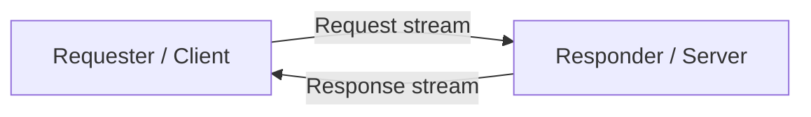
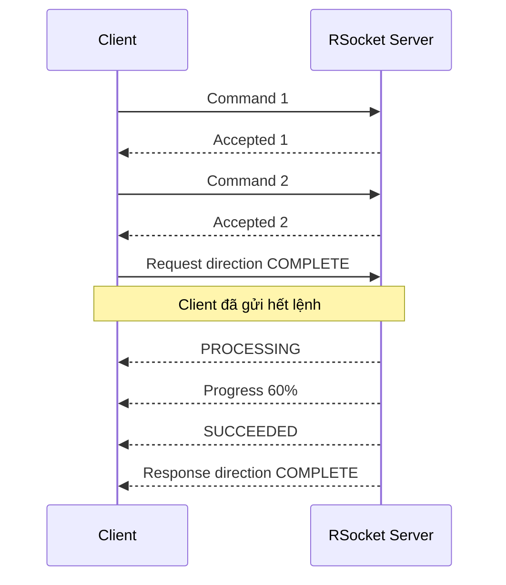
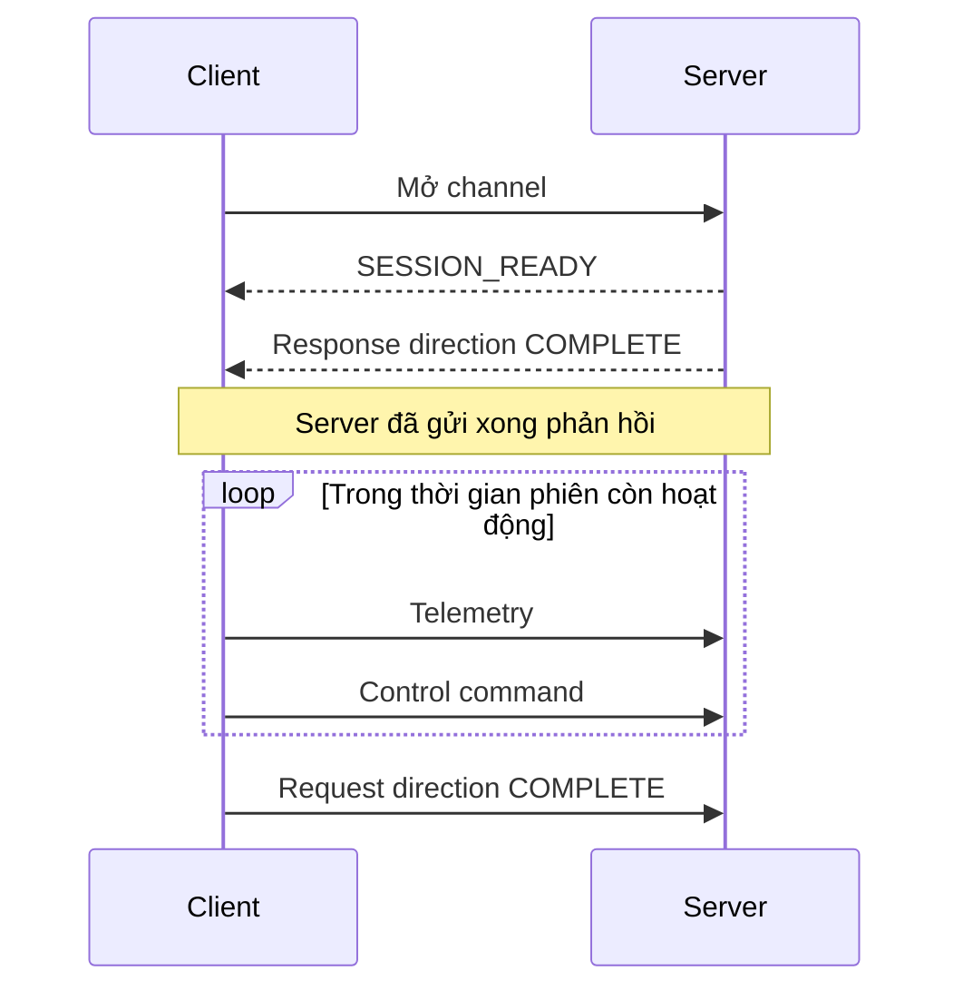

# Hoàn thành một chiều trong khi chiều còn lại tiếp tục

## Mục tiêu bài học

Request-channel của RSocket cho phép hai peer trao đổi hai luồng payload đồng thời trên cùng một tương tác. Hai luồng này có vòng đời độc lập: một phía có thể ngừng gửi và báo hoàn tất, trong khi phía còn lại vẫn tiếp tục gửi dữ liệu.

Sau bài này, bạn có thể:

- Phân biệt luồng request từ requester đến responder với luồng response theo chiều ngược lại.
- Giải thích ý nghĩa của việc hoàn tất riêng từng chiều trong request-channel.
- Thiết kế client gửi một tập lệnh hữu hạn nhưng vẫn nhận sự kiện hoặc tiến độ tiếp tục phát.
- Nhận biết khác biệt giữa complete, cancel và error.
- Tránh vô tình kết thúc cả channel khi chỉ muốn dừng phát dữ liệu ở một chiều.
- Kiểm thử vòng đời hai chiều và xử lý backpressure trong ứng dụng Spring Boot/Reactor.

## Hai luồng độc lập trong một request-channel

Trong request-channel, requester mở một tương tác hai chiều:

- **Request direction:** requester gửi các payload đến responder.
- **Response direction:** responder gửi các payload về requester.

Có thể hình dung hai luồng như hai đường dữ liệu riêng:



Hai luồng thuộc cùng một channel, nhưng việc hoàn tất một luồng không tự động hoàn tất luồng còn lại. Khi requester đã gửi hết dữ liệu, nó có thể báo hoàn tất chiều request. Responder vẫn có thể phát thêm kết quả, trạng thái hoặc sự kiện trên chiều response.

Tương tự, responder có thể phát xong các phản hồi của mình và báo hoàn tất chiều response trong khi requester vẫn tiếp tục gửi payload. Điều này hữu ích khi server chỉ cần gửi một thông báo khởi tạo hoặc một tập kết quả hữu hạn, còn client vẫn tiếp tục gửi dữ liệu điều khiển hoặc telemetry.

| Hướng dữ liệu | Bên phát | Bên nhận | Khi hướng đó hoàn tất |
|---|---|---|---|
| Request | Requester | Responder | Requester không gửi thêm payload; responder vẫn có thể gửi response |
| Response | Responder | Requester | Responder không gửi thêm payload; requester vẫn có thể gửi request |

Channel kết thúc bình thường khi cả hai hướng đã hoàn tất. Nếu channel bị hủy, phát sinh lỗi kết thúc hoặc kết nối bị đóng, vòng đời có thể kết thúc trước khi cả hai phía hoàn tất theo cách thông thường.

## Ví dụ: client gửi xong lệnh nhưng vẫn nhận tiến độ

Một tác vụ xử lý báo cáo là ví dụ dễ thấy. Client gửi danh sách lệnh cần chạy. Sau khi gửi xong danh sách, client không còn payload đầu vào nào nữa, nhưng server vẫn cần thời gian để xử lý và phát các sự kiện như `QUEUED`, `PROCESSING`, `SUCCEEDED` hoặc `FAILED`.

Luồng thời gian:



Điểm quan trọng là client đã hoàn tất publisher phát lệnh, nhưng vẫn giữ subscription nhận sự kiện. Việc publisher đầu vào phát `onComplete` không có nghĩa response Flux phải kết thúc ngay.

### Mô hình dữ liệu

Ví dụ sử dụng các record đơn giản:

```java
record JobCommand(
    String jobId,
    String operation
) {}

record JobEvent(
    String jobId,
    String state,
    int progress
) {}
```

Một command mô tả thao tác client muốn server thực hiện. Một event mô tả trạng thái hoặc tiến độ server gửi ngược lại.

### Phía server với Spring Boot

Handler có thể xử lý toàn bộ command trước, sau đó tiếp tục phát các sự kiện trạng thái cho đến khi công việc đạt trạng thái cuối:

```java
import org.springframework.messaging.handler.annotation.MessageMapping;
import org.springframework.stereotype.Controller;
import reactor.core.publisher.Flux;

@Controller
class JobChannelController {

    private final JobService jobService;

    JobChannelController(JobService jobService) {
        this.jobService = jobService;
    }

    @MessageMapping("jobs.execute")
    Flux<JobEvent> execute(Flux<JobCommand> commands) {
        Flux<JobEvent> acknowledgements = commands
            .concatMap(jobService::acceptAndAcknowledge);

        return acknowledgements.concatWith(
            jobService.watchUntilTerminal()
        );
    }
}
```

Trong ví dụ này:

1. Spring cung cấp các payload request dưới dạng `Flux<JobCommand>`.
2. `concatMap` xử lý lần lượt các command và phát xác nhận tương ứng.
3. Khi publisher `commands` hoàn tất, phần `acknowledgements` cũng hoàn tất.
4. `concatWith` chuyển sang publisher theo dõi trạng thái.
5. `watchUntilTerminal()` tiếp tục phát event cho đến khi công việc kết thúc.

Do đó, chiều request có thể hoàn tất trước, còn chiều response vẫn phát các event tiếp theo. Phương thức `watchUntilTerminal()` ở đây đại diện cho một nguồn trạng thái độc lập; khi triển khai thực tế, nguồn này cần đọc được trạng thái hiện tại hoặc lịch sử đã lưu để không bỏ lỡ event phát sinh trước lúc bắt đầu theo dõi.

### Phía client

Client gửi một publisher hữu hạn:

```java
Flux<JobCommand> commands = Flux.just(
    new JobCommand("report-42", "LOAD_DATA"),
    new JobCommand("report-42", "BUILD_FILE"),
    new JobCommand("report-42", "PUBLISH")
);

Flux<JobEvent> events = requester
    .route("jobs.execute")
    .data(commands)
    .retrieveFlux(JobEvent.class);

events.subscribe(
    event -> System.out.println(
        event.state() + " - " + event.progress() + "%"
    ),
    error -> System.err.println("Channel failed: " + error),
    () -> System.out.println("Response direction completed")
);
```

Khi subscription bắt đầu, RSocket requester gửi các command. `Flux.just(...)` phát hết ba phần tử rồi hoàn tất. Client vẫn nhận các event do server phát qua `events`. Callback hoàn tất của `events` chỉ chạy khi chiều response kết thúc.

Trong ứng dụng thật, nên dùng cơ chế quản lý subscription phù hợp với vòng đời ứng dụng thay vì tạo subscription rời rạc trong mọi phương thức nghiệp vụ.

## Trường hợp ngược lại: server gửi xong nhưng client tiếp tục gửi

Một channel cũng có thể kết thúc chiều response trước. Ví dụ client mở một phiên thiết bị và tiếp tục gửi telemetry trong vài phút. Server chỉ cần gửi một thông báo `SESSION_READY` hoặc một tập cấu hình ban đầu; sau đó server không còn dữ liệu phản hồi nào cần gửi trong channel đó.

Sơ đồ khái niệm:



Khi xây dựng trường hợp này, handler phải tiếp tục tiêu thụ và xử lý publisher request sau khi publisher response hoàn tất. Việc response publisher hoàn tất không phải tín hiệu để bỏ đăng ký hoặc hủy luồng request. Cần kiểm tra cách adapter/framework quản lý subscription của inbound publisher và bảo đảm công việc xử lý request có vòng đời rõ ràng.

Đừng dùng một thao tác hủy subscription response để mô phỏng việc server hoàn tất riêng chiều response. Hủy subscription ở phía requester có thể gửi tín hiệu CANCEL cho toàn bộ tương tác và khiến cả hai hướng dừng.

## Complete, cancel và error khác nhau như thế nào?

Đây là điểm dễ gây lỗi khi viết ứng dụng reactive.

| Tín hiệu | Ý nghĩa | Ảnh hưởng đến channel |
|---|---|---|
| Complete một chiều | Bên phát xác nhận không còn payload nào ở hướng đó | Hướng ngược lại vẫn có thể tiếp tục |
| Cancel | Requester không còn muốn tiếp tục tương tác | Channel bị hủy; peer cần dừng công việc liên quan và giải phóng tài nguyên |
| Error | Tương tác gặp lỗi kết thúc | Channel kết thúc do lỗi; bên còn lại nhận tín hiệu lỗi theo giao thức |
| Đóng kết nối | Transport không còn hoạt động | Các channel đang dùng kết nối bị ảnh hưởng |

Trong Reactor, hoàn tất publisher đầu vào thường được biểu diễn bằng `onComplete`. Với request-channel, đó là tín hiệu kết thúc chiều phát request. Nó khác với việc downstream gọi `cancel()`.

Ví dụ:

- `Flux.just(a, b, c)` phát ba command rồi complete: requester đã gửi xong request direction.
- Người dùng đóng màn hình và ứng dụng dispose subscription nhận response: đây có thể là cancel toàn channel.
- Server gặp lỗi không thể phục hồi khi xử lý channel: phát error và kết thúc tương tác.

Nếu cần dừng gửi lệnh nhưng vẫn muốn nhận kết quả, hãy làm cho publisher request hoàn tất bình thường. Đừng hủy subscription của publisher response để đạt mục đích đó.

## Backpressure vẫn hoạt động theo từng chiều

Hai phía có thể phát dữ liệu với tốc độ khác nhau. Requester có thể gửi command nhanh, trong khi responder xử lý chậm. Ở chiều ngược lại, responder có thể phát event nhanh hơn khả năng tiêu thụ của requester.

RSocket sử dụng cơ chế demand để điều tiết luồng. Với request-channel, cần quan sát cả hai chiều:

- Requester phải kiểm soát tốc độ phát command và khả năng xử lý của responder.
- Responder phải kiểm soát tốc độ phát event và khả năng tiêu thụ của requester.
- Khi một chiều đã complete, không còn payload mới ở chiều đó; demand và hoạt động của chiều còn lại vẫn cần được quản lý cho đến khi channel kết thúc.

Trong Reactor, các toán tử như `limitRate`, `onBackpressureBuffer` hoặc `onBackpressureDrop` có thể tham gia thiết kế luồng, nhưng mỗi toán tử có ngữ nghĩa và chi phí riêng. Đặc biệt, buffer không giới hạn có thể làm tăng bộ nhớ sử dụng nếu producer liên tục nhanh hơn consumer.

Hãy đặt giới hạn rõ ràng cho queue, xác định cách xử lý khi quá tải và chọn chính sách phù hợp với dữ liệu. Command nghiệp vụ có thể cần từ chối hoặc lưu bền vững; telemetry có thể cho phép gộp hoặc bỏ một số mẫu tùy yêu cầu.

## Lỗi thiết kế thường gặp

### Nghĩ rằng một chiều complete thì channel đã đóng

Đây là nhầm lẫn cốt lõi. Request direction và response direction có thể kết thúc ở các thời điểm khác nhau. Chỉ dựa vào callback complete của publisher đầu vào để kết luận không còn event response là sai.

### Dùng cancel để dừng một chiều

Cancel thể hiện requester muốn kết thúc tương tác. Nếu chỉ muốn ngừng gửi payload request, hãy complete publisher request. Giữ subscription response để tiếp tục nhận dữ liệu.

### Dùng publisher response phụ thuộc hoàn toàn vào publisher request

Ví dụ `commands.map(...)` tạo response có số phần tử và vòng đời gắn trực tiếp với request. Cách này phù hợp khi mỗi command tạo đúng một phản hồi, nhưng không thể tự phát tiến độ sau khi request hoàn tất.

Khi cần phát event sau khi nhận hết command, hãy nối với một nguồn trạng thái độc lập, như ví dụ `concatWith(jobService.watchUntilTerminal())`.

### Bỏ lỡ event khi bắt đầu theo dõi muộn

Nếu `watchUntilTerminal()` chỉ phát các sự kiện realtime và không lưu trạng thái, event có thể phát trước khi publisher được subscribe. Hãy lưu trạng thái hiện tại, dùng replay có giới hạn hoặc cung cấp lịch sử event với sequence number/cursor.

### Không giải phóng tài nguyên khi channel bị hủy

Khi requester cancel hoặc kết nối đóng, timer, subscription nội bộ, queue và tài nguyên liên quan cần được dọn dẹp. Dùng các hook vòng đời phù hợp như `doFinally` ở đúng publisher và đảm bảo việc cleanup có tính idempotent.

## Kiểm thử vòng đời hai chiều

Một bài kiểm thử tốt cần xác nhận riêng thời điểm hoàn tất của từng hướng. Đừng chỉ kiểm tra nội dung event.

Các kịch bản nên có:

1. Request publisher phát một số command rồi complete; response publisher vẫn phát thêm event.
2. Response publisher phát hữu hạn và complete; request publisher tiếp tục gửi dữ liệu theo thiết kế.
3. Cả hai hướng complete bình thường và channel giải phóng tài nguyên.
4. Requester cancel khi response chưa hoàn tất; server dừng công việc liên quan.
5. Một phía phát error; phía còn lại nhận kết quả lỗi và không tiếp tục phát dữ liệu.
6. Consumer chậm; backpressure hoặc chính sách buffer hoạt động đúng giới hạn.

Có thể dùng `StepVerifier` để kiểm tra response Flux:

```java
StepVerifier.create(events)
    .expectNextMatches(event ->
        event.state().equals("ACCEPTED")
    )
    .expectNextMatches(event ->
        event.state().equals("PROCESSING")
    )
    .expectNextMatches(event ->
        event.state().equals("SUCCEEDED")
    )
    .verifyComplete();
```

Đoạn kiểm thử này xác nhận chuỗi response và việc response direction hoàn tất. Để xác nhận request direction đã complete sớm hơn, hãy thêm tín hiệu quan sát riêng vào publisher command, ví dụ `doOnComplete`, rồi đồng bộ hóa assertion trong test. Không suy luận thời điểm hoàn tất request chỉ từ việc response Flux kết thúc.

## Quan sát khi chạy thực tế

Khi điều tra một channel bị đóng sớm, hãy ghi nhận các mốc riêng:

- Thời điểm request publisher được subscribe, phát phần tử cuối và complete.
- Thời điểm response publisher phát event cuối và complete.
- Thời điểm có cancel, error hoặc connection close.
- Số lượng payload mỗi chiều, độ trễ xử lý và queue đang chờ.
- Mã channel/trace hoặc correlation ID để ghép log hai phía.

Tên log nên thể hiện rõ hướng, chẳng hạn `request-direction-complete` và `response-direction-complete`. Một dòng log chung như `channel-complete` có thể gây hiểu nhầm nếu thực tế mới chỉ có một chiều kết thúc.

## Checklist thiết kế

Trước khi triển khai một request-channel có vòng đời hai chiều khác nhau, hãy xác định:

1. Bên nào phát dữ liệu ở mỗi hướng?
2. Điều kiện nào làm request direction complete?
3. Điều kiện nào làm response direction complete?
4. Sau khi một hướng complete, hướng còn lại cần tiếp tục trong bao lâu?
5. Ai chịu trách nhiệm cancel channel khi người dùng rời phiên hoặc công việc bị hủy?
6. Event có được lưu hoặc replay nếu consumer kết nối lại không?
7. Backpressure, queue limit và cleanup được xử lý như thế nào?

Hãy dùng request-channel khi hai phía thực sự cần trao đổi dữ liệu theo luồng. Việc hoàn tất độc lập từng chiều cho phép mô hình hóa tự nhiên những phiên mà một phía gửi xong trước, trong khi phía còn lại vẫn còn dữ liệu cần truyền.

