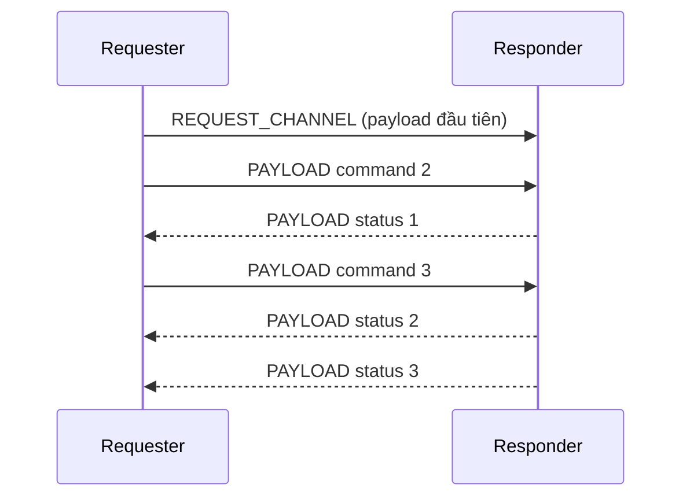
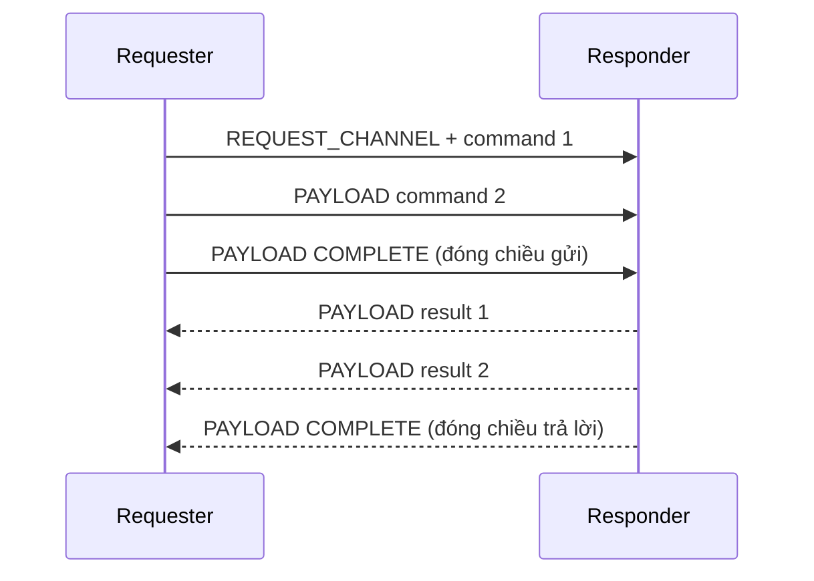
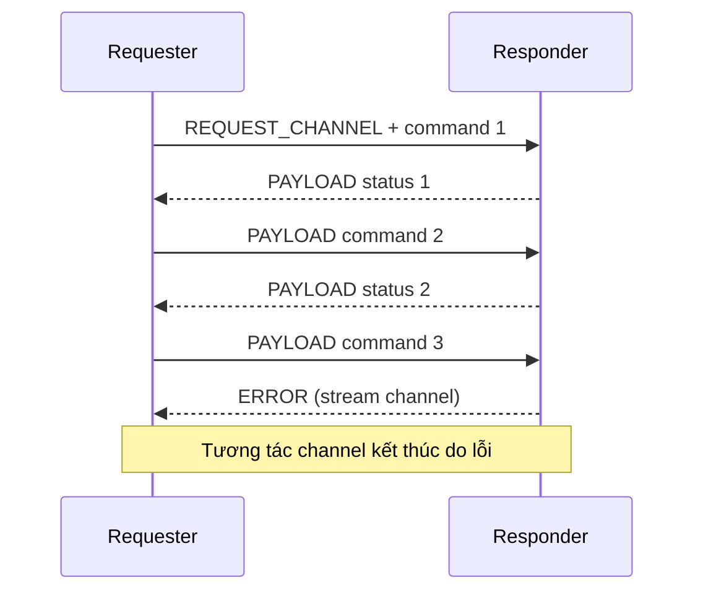
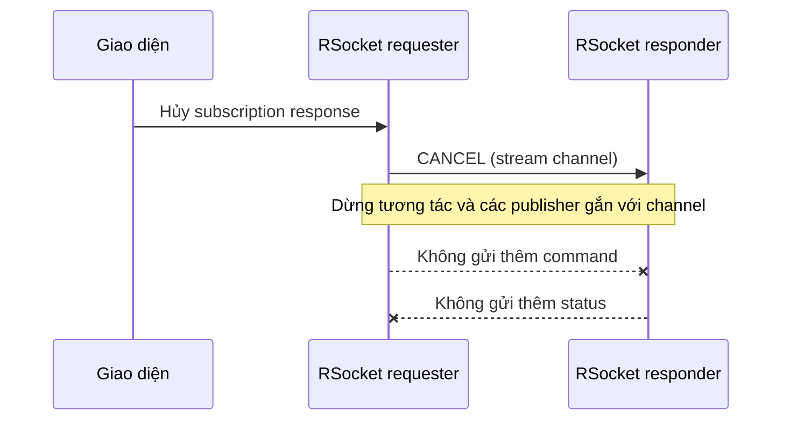

# Phạm vi tác động của lỗi và hủy đối với kênh hai chiều

Request-channel là mô hình tương tác RSocket cho phép requester gửi một dòng payload và đồng thời nhận một dòng payload từ responder. Hai hướng dữ liệu có thể tiến triển độc lập trong cùng một tương tác. Vì vậy, khi một phía hoàn tất, phát sinh lỗi hoặc bị hủy, cần xác định chính xác phạm vi tác động: chỉ một hướng dữ liệu dừng, toàn bộ channel kết thúc hay cả kết nối RSocket bị đóng.

Trong module `INTEGRATION_REALTIME_RSOCKET`, client và server Java thường dùng Spring Boot và Reactor để xây dựng các phiên realtime qua TCP hoặc WebSocket. Hiểu đúng vòng đời của request-channel giúp ứng dụng tránh đóng nhầm luồng còn cần thiết, giải phóng subscription và tài nguyên đúng thời điểm, đồng thời xử lý retry mà không lặp lại lệnh nghiệp vụ.

## 1. Request-channel có hai hướng dữ liệu

Một request-channel bắt đầu khi requester gửi frame `REQUEST_CHANNEL`. Payload đầu tiên có thể chứa data và metadata như route. Sau đó requester có thể tiếp tục gửi các payload đầu vào; responder có thể phát các payload đầu ra ngay trong khi vẫn nhận dữ liệu đầu vào.



Có thể xem channel gồm hai dòng dữ liệu:

- **Requester → Responder:** các command, mẫu dữ liệu hoặc sự kiện mà client gửi.
- **Responder → Requester:** các status, kết quả xử lý hoặc sự kiện mà server phát lại.

Hai hướng có flow control riêng. Requester yêu cầu số payload response mà nó sẵn sàng nhận, và responder phải tôn trọng nhu cầu đó. Responder cũng yêu cầu số payload request mà nó sẵn sàng nhận, và requester phải tôn trọng nhu cầu này khi gửi command. Hai bên có thể gửi và nhận đồng thời, nên không có một thứ tự tổng duy nhất giữa một payload đi lên và một payload đi xuống.

Điểm quan trọng của request-channel là hai hướng có thể hoàn tất độc lập. Hoàn tất dòng command không nhất thiết buộc dòng status kết thúc ngay. Tương tự, responder có thể ngừng phát status trong khi vẫn tiếp tục nhận command, nếu ứng dụng và tương tác còn cho phép.

## 2. Phân biệt hoàn tất một hướng và kết thúc toàn bộ channel

Trong RSocket, frame `PAYLOAD` có thể mang cờ `COMPLETE` để báo bên gửi đã kết thúc việc phát payload theo hướng đó. Đây là cách đóng một chiều dữ liệu bình thường. Bên còn lại vẫn có thể tiếp tục hoạt động trong channel.

Ví dụ, client gửi xong danh sách command nhưng vẫn muốn nhận kết quả xử lý còn đang được server phát:



Trong ví dụ, requester hoàn tất chiều gửi trước. Responder vẫn phát các kết quả còn lại rồi mới hoàn tất chiều trả lời. Channel kết thúc bình thường khi cả hai hướng đã hoàn tất theo vòng đời tương ứng.

Các tình huống thường gặp:

| Sự kiện | Phạm vi tác động |
| --- | --- |
| Requester hoàn tất publisher đầu vào | Dừng gửi thêm payload request; responder vẫn có thể phát response còn lại. |
| Responder hoàn tất publisher đầu ra | Dừng phát payload response; chiều request có thể vẫn tiếp tục được tiêu thụ. |
| Một phía phát lỗi giao thức trên stream | Toàn bộ tương tác channel kết thúc do lỗi; không tiếp tục trao đổi payload trên stream đó. |
| Requester hủy subscription response và hủy channel | Channel bị hủy; việc gửi request và xử lý gắn với tương tác cần dừng theo cancellation. |
| Kết nối RSocket bị đóng | Mọi stream trên kết nối đó đều bị ảnh hưởng. |

Đừng đồng nhất `onComplete` của một publisher với việc đóng socket. `onComplete` chỉ báo nguồn dữ liệu của publisher đó đã kết thúc. Việc đóng cả kết nối là một sự kiện ở phạm vi connection.

## 3. Lỗi ở một hướng có thể kết thúc toàn bộ channel

Hoàn tất bình thường có thể đóng từng hướng riêng, nhưng lỗi của một tương tác RSocket là tín hiệu kết thúc stream. Khi một bên gửi frame `ERROR` cho stream channel, tương tác đó kết thúc; hai phía không tiếp tục gửi payload trên channel đã lỗi.

Ví dụ, server nhận command thứ ba nhưng không thể xác minh quyền thực hiện. Nếu lỗi được đưa ra như lỗi stream, client nhận lỗi cho channel và không thể kỳ vọng tiếp tục nhận status của cùng channel như thể chỉ một command bị lỗi:



Điều này có hệ quả thiết kế: nếu từng command có thể thất bại độc lập nhưng channel vẫn phải tiếp tục, không nên biến mọi lỗi nghiệp vụ của một command thành lỗi terminal của publisher đầu ra. Thay vào đó, mô hình hóa lỗi như một kết quả nghiệp vụ trong payload, ví dụ `CommandResult` có trạng thái `REJECTED`, `INVALID` hoặc `FAILED`, rồi tiếp tục nhận command tiếp theo nếu chính sách cho phép.

Ngược lại, các lỗi khiến toàn bộ phiên không còn an toàn để tiếp tục — chẳng hạn giao thức sai, trạng thái channel không nhất quán hoặc lỗi hạ tầng nghiêm trọng — có thể cần kết thúc stream bằng lỗi.

### Lỗi nghiệp vụ và lỗi stream

| Loại lỗi | Ví dụ | Cách biểu diễn phù hợp |
| --- | --- | --- |
| Lỗi của một command | Command tham chiếu thiết bị không tồn tại. | Phát `CommandResult` thất bại trong response stream; giữ channel nếu có thể tiếp tục. |
| Lỗi xác thực/ủy quyền của cả phiên | Credential hết hạn hoặc principal bị thu hồi. | Có thể kết thúc channel và yêu cầu xác thực lại hoặc tạo phiên mới. |
| Lỗi giao thức | Payload sai định dạng hoặc vi phạm hợp đồng stream. | Kết thúc stream bằng lỗi phù hợp. |
| Lỗi kết nối | TCP/WebSocket bị ngắt. | Các stream trên connection bị kết thúc; client xử lý reconnect theo chính sách. |

Không nên gửi stack trace, thông tin nội bộ hoặc bí mật trong payload lỗi. Hãy dùng mã lỗi nghiệp vụ ổn định, thông điệp phù hợp cho client và correlation ID để tra cứu log phía server.

## 4. CANCEL và phạm vi hủy của request-channel

`CANCEL` là tín hiệu hủy một tương tác RSocket đang hoạt động. Với request-channel, khi requester quyết định không còn cần kết quả và hủy channel, frame `CANCEL` báo responder dừng tương tác đó. Việc hủy subscription response ở client thường là tín hiệu quan trọng dẫn đến cancellation của toàn bộ channel, bao gồm cả publisher request đang cung cấp payload đầu vào.

Ví dụ, người dùng rời khỏi màn hình điều khiển thiết bị. Client hủy subscription đang nhận status; channel không còn mục đích sử dụng nên publisher command cũng cần bị hủy:



Cancellation không phải là một thông điệp nghiệp vụ báo rằng command đã thất bại. Nó thể hiện bên yêu cầu không còn muốn tiếp tục tương tác. Nếu một thao tác ghi dữ liệu đã bắt đầu ở server, hủy channel không tự động rollback thao tác đó. Muốn đảm bảo tính nguyên tử, ứng dụng cần transaction hoặc cơ chế bù trừ riêng.

### Hủy toàn channel và dừng một nguồn dữ liệu

Trong code Reactor, cần phân biệt:

- Publisher đầu vào hoàn tất bình thường: đóng chiều gửi request nhưng vẫn có thể tiếp tục nhận response.
- Publisher đầu vào bị lỗi: lỗi có thể làm tương tác channel kết thúc bằng lỗi.
- Subscriber response bị cancel: client không còn tiêu thụ response; adapter có thể hủy toàn bộ tương tác channel và upstream request.
- Kết nối bị dispose: mọi tương tác gắn với connection bị ảnh hưởng.

Nếu chỉ muốn ngừng tạo command mới nhưng vẫn nhận các status còn lại, hãy hoàn tất publisher đầu vào bình thường. Đừng hủy subscription response nếu vẫn cần nhận kết quả đang chờ.

## 5. Mô hình hóa kết quả nghiệp vụ để channel tiếp tục

Một channel điều khiển thiết bị có thể nhận nhiều command. Một command sai không nhất thiết phải kết thúc cả phiên. Có thể dùng một kiểu kết quả thống nhất:

```java
public record DeviceCommand(
    String commandId,
    String deviceId,
    String action
) {}

public record CommandResult(
    String commandId,
    boolean accepted,
    String code,
    String message
) {}
```

Server xử lý từng command và chuyển lỗi nghiệp vụ thành kết quả:

```java
Flux<CommandResult> handleCommands(Flux<DeviceCommand> commands) {
    return commands.concatMap(command ->
        deviceService.apply(command)
            .map(result -> new CommandResult(
                command.commandId(), true, "OK", "Applied"
            ))
            .onErrorResume(error -> Mono.just(new CommandResult(
                command.commandId(), false, "COMMAND_FAILED", "Command was rejected"
            )))
    );
}
```

Trong ví dụ, `concatMap` xử lý tuần tự theo thứ tự command. Lỗi của một command được chuyển thành một `CommandResult` thất bại, nên pipeline có thể tiếp tục với command sau. Cần giới hạn nội dung lỗi trả về client; thông tin chi tiết được ghi log ở server bằng `commandId`.

Nếu lỗi là lỗi hệ thống khiến mọi command sau không thể xử lý an toàn, hãy để lỗi lan ra ngoài và kết thúc channel. Việc chuyển mọi lỗi thành kết quả thành công giả sẽ che giấu tình trạng hệ thống.

## 6. Quản lý lỗi ở client và server bằng Reactor

Trong Reactor, `onError` là tín hiệu terminal của một publisher. Khi lỗi xảy ra trong publisher đầu vào hoặc đầu ra của request-channel, adapter RSocket có thể kết thúc tương tác theo lỗi đó. Dùng `onErrorResume` ở đúng vị trí để chuyển một lỗi có thể phục hồi thành kết quả dự phòng; không dùng nó để che giấu lỗi kết nối hoặc lỗi bảo mật.

Ví dụ ở client, có thể chuyển lỗi tạm thời của nguồn command thành một sự kiện trạng thái nội bộ trước khi kết thúc nguồn gửi:

```java
Flux<DeviceCommand> commands = commandSource
    .onErrorResume(error -> {
        log.warn("Command source stopped", error);
        return Flux.empty();
    });
```

Ở đây publisher command hoàn tất bình thường sau khi lỗi nguồn được xử lý. Client có thể tiếp tục nhận response từ server nếu response subscription còn hoạt động. Cách xử lý này chỉ phù hợp nếu việc dừng gửi command là hành vi có thể chấp nhận; nếu mất command là lỗi nghiệp vụ, cần phát tín hiệu trạng thái hoặc dùng một cơ chế gửi bền vững.

Không nên đặt `onErrorComplete()` một cách tùy tiện trên response stream. Việc biến lỗi stream thành hoàn tất có thể làm giao diện tưởng rằng channel kết thúc bình thường trong khi dữ liệu đã bị gián đoạn. Hãy chuyển lỗi thành trạng thái rõ ràng hoặc truyền lỗi lên tầng gọi.

## 7. Hủy và giải phóng tài nguyên theo đúng phạm vi

Một request-channel có thể sở hữu nhiều tài nguyên:

- Subscription tới nguồn command ở client.
- Subscription tới nguồn status hoặc event ở server.
- Buffer giữ payload đang chờ.
- Timer, heartbeat ứng dụng hoặc tác vụ timeout.
- Listener đăng ký vào thiết bị hoặc broker.
- Context xác thực, trace hoặc session gắn với channel.

Khi channel bị cancel hoặc kết thúc do lỗi, các tài nguyên riêng của channel cần được giải phóng. Tài nguyên dùng chung cho connection hoặc cho nhiều channel chỉ được giải phóng khi không còn người dùng hoặc khi connection kết thúc.

Một mẫu quản lý đơn giản là gắn cleanup vào vòng đời subscription:

```java
Flux<DeviceStatus> statuses = statusSource
    .doOnCancel(() -> deviceSubscriptions.remove(channelId))
    .doFinally(signal -> releaseChannelResources(channelId));
```

`doOnCancel` chỉ chạy khi có cancellation. `doFinally` chạy khi pipeline kết thúc do complete, error hoặc cancel. Hàm `releaseChannelResources` cần idempotent vì nhiều đường kết thúc có thể cùng yêu cầu cleanup. Trong ứng dụng thực tế, nếu cleanup bất đồng bộ, hãy dùng cơ chế lifecycle phù hợp để chờ việc đóng tài nguyên hoàn tất.

Không giải phóng tài nguyên connection dùng chung chỉ vì một channel bị hủy. Ví dụ, nếu một kết nối đang phục vụ ba channel, cancel channel theo dõi telemetry không được đóng socket hoặc hủy subscription của hai channel còn lại.

## 8. Lỗi stream và lỗi connection có phạm vi khác nhau

RSocket multiplex nhiều stream trên một connection. Vì vậy, cần phân biệt lỗi gắn với stream channel và lỗi ở cấp connection:

| Phạm vi lỗi | Dấu hiệu | Tác động |
| --- | --- | --- |
| Lỗi nghiệp vụ được mã hóa trong payload | `CommandResult` có trạng thái thất bại. | Chỉ command đó thất bại; channel có thể tiếp tục. |
| Lỗi stream | Frame `ERROR` có stream ID của channel. | Channel đó kết thúc; stream khác trên cùng connection có thể tiếp tục. |
| Lỗi connection | Frame `ERROR` với stream ID `0`, lỗi transport hoặc socket đóng. | Connection kết thúc; mọi stream trên connection bị ảnh hưởng. |
| Cancel stream | `CANCEL` cho stream channel. | Channel bị hủy; các stream khác trên connection không tự động bị hủy. |

Nếu một channel bị lỗi do payload không hợp lệ, không nên đóng toàn bộ connection trừ khi lỗi cho thấy trạng thái giao thức hoặc bảo mật của connection đã bị xâm phạm. Giữ lỗi ở đúng phạm vi giúp một client có thể tiếp tục các tương tác độc lập.

## 9. Backpressure và cancellation trong hai chiều

Mỗi hướng của request-channel có cơ chế điều tiết nhu cầu riêng. Requester gửi nhu cầu nhận response cho responder, và responder phải giới hạn số response theo nhu cầu đó. Responder gửi nhu cầu nhận request cho requester, và requester phải giới hạn số payload request theo nhu cầu này. Một phía xử lý chậm không nên được bù bằng cách tạo buffer không giới hạn ở phía còn lại.

Khi subscriber response chậm, nhu cầu từ requester điều tiết lượng status mà responder được phép phát. Khi server xử lý command chậm, nhu cầu từ responder điều tiết lượng command mà requester được phép gửi.

Cancellation giúp dừng công việc không còn cần thiết, nhưng không thay thế backpressure. Backpressure kiểm soát tốc độ khi channel còn hoạt động; cancellation kết thúc việc tiêu thụ hoặc toàn bộ tương tác theo phạm vi hủy. Cần đặt giới hạn buffer và chính sách timeout cho cả hai hướng.

Ví dụ, client có thể xử lý command tuần tự bằng `concatMap` để không gửi lệnh mới trước khi thao tác gửi hiện tại hoàn tất theo publisher. Server có thể giới hạn concurrency khi áp dụng command, đồng thời giới hạn buffer của nguồn status. Hai giới hạn này giải quyết hai hướng tải khác nhau.

## 10. Kết nối bị ngắt và chiến lược retry

Khi TCP hoặc WebSocket bị ngắt, channel không thể tiếp tục trên connection cũ. Client cần tạo kết nối mới và khởi tạo channel mới nếu nghiệp vụ vẫn cần tiếp tục. RSocket resume có thể hỗ trợ phục hồi một số phiên khi transport và cấu hình hỗ trợ, nhưng không nên mặc định mọi request-channel đều tự động được khôi phục hoặc mọi side effect được phát lại an toàn.

Nếu client gửi command rồi mất kết nối trước khi nhận status, trạng thái command có thể không rõ: server có thể chưa nhận, đã nhận nhưng chưa xử lý, hoặc đã commit nhưng response chưa đến client. Retry mù quáng có thể thực thi command hai lần.

Để phục hồi an toàn:

1. Mỗi command có `commandId` ổn định qua các lần gửi lại.
2. Server lưu trạng thái xử lý hoặc kết quả theo `commandId` để chống thực thi trùng.
3. Nếu command có thứ tự, dùng `sequence` theo thiết bị hoặc aggregate để phát hiện lệnh đến trễ hoặc thiếu.
4. Client lưu checkpoint của command đã được xác nhận ở tầng nghiệp vụ.
5. Khi kết nối lại, client gửi lại các command chưa rõ trạng thái theo chính sách idempotent và truy vấn kết quả nếu cần.
6. Chỉ đánh dấu hoàn tất nghiệp vụ sau khi có xác nhận phù hợp, không dựa vào việc publisher gửi đã hoàn tất.

Nếu một channel bị lỗi do validation hoặc quyền truy cập, retry với cùng payload không giải quyết được nguyên nhân. Client cần phân loại lỗi trước khi tạo channel mới.

## 11. Ví dụ request-channel trong Spring Boot

Một controller có thể nhận dòng command và trả dòng status:

```java
import org.springframework.messaging.handler.annotation.MessageMapping;
import org.springframework.stereotype.Controller;
import reactor.core.publisher.Flux;

@Controller
class DeviceChannelController {
    private final DeviceService deviceService;

    DeviceChannelController(DeviceService deviceService) {
        this.deviceService = deviceService;
    }

    @MessageMapping("device.control")
    Flux<CommandResult> control(Flux<DeviceCommand> commands) {
        return commands.concatMap(deviceService::applySafely);
    }
}
```

Client mở channel bằng một publisher command và nhận một `Flux` status:

```java
Flux<CommandResult> results = requester
    .route("device.control")
    .data(commandPublisher)
    .retrieveFlux(CommandResult.class);
```

Khi client subscribe `results`, request-channel bắt đầu hoạt động. Nếu muốn ngừng gửi command nhưng vẫn nhận kết quả đang chờ, hãy hoàn tất `commandPublisher` bình thường. Nếu người dùng hủy màn hình và không cần kết quả nữa, hủy subscription `results` để dừng tương tác channel.

Để kết thúc rõ ràng khi người dùng rời màn hình, ứng dụng có thể giữ `Disposable` của subscription:

```java
Disposable channelSubscription = results.subscribe(
    this::showResult,
    this::showChannelError,
    this::showChannelComplete
);

// Khi màn hình không còn sử dụng channel:
channelSubscription.dispose();
```

`dispose()` yêu cầu hủy subscription response và có thể dẫn đến cancellation của channel ở tầng RSocket. Publisher command phải phản ứng với cancellation để dừng phát dữ liệu mới và giải phóng tài nguyên cục bộ.

## 12. Kiểm thử lỗi, hoàn tất và cancellation

Kiểm thử request-channel cần xác nhận cả hai hướng và phạm vi tác động. Không chỉ kiểm tra danh sách kết quả cuối cùng; hãy xác minh tín hiệu kết thúc, lỗi, cancellation và tài nguyên được giải phóng.

Các trường hợp quan trọng:

- Requester hoàn tất dòng command; responder vẫn gửi hết các status còn lại.
- Responder hoàn tất dòng status; hành vi của chiều command còn lại đúng theo hợp đồng ứng dụng.
- Một command bị lỗi nghiệp vụ và được chuyển thành `CommandResult` thất bại; command tiếp theo vẫn được xử lý.
- Lỗi terminal ở một phía kết thúc toàn bộ channel và được truyền tới subscriber còn lại.
- Client hủy subscription response; publisher command dừng và tài nguyên riêng của channel được giải phóng.
- Cancel một channel không đóng các channel khác trên cùng connection.
- Connection bị đóng làm tất cả channel kết thúc và cleanup được gọi.
- Backpressure ở hai chiều không tạo buffer không giới hạn.
- Reconnect và retry không thực thi trùng command có cùng `commandId`.
- Timeout và lỗi xác thực được phân loại đúng, không retry vô hạn.

Ví dụ kiểm thử thứ tự status bằng `StepVerifier`:

```java
import org.junit.jupiter.api.Test;
import reactor.core.publisher.Flux;
import reactor.test.StepVerifier;

class RequestChannelResultTest {
    @Test
    void returnsOneResultForEachCommandInOrder() {
        Flux<CommandResult> results = handleCommands(
            Flux.just(command("c-1"), command("c-2"))
        );

        StepVerifier.create(results)
            .expectNextMatches(result -> result.commandId().equals("c-1"))
            .expectNextMatches(result -> result.commandId().equals("c-2"))
            .verifyComplete();
    }
}
```

Với cancellation, có thể dùng `StepVerifier.thenCancel()` và một counter trong fake resource registry để xác nhận cleanup. Với kiểm thử tích hợp, chạy requester và responder thật để xác minh frame `CANCEL`, `ERROR` và `PAYLOAD` có cờ `COMPLETE` được xử lý đúng.

## 13. Những lỗi thường gặp

**Cho rằng hoàn tất chiều request sẽ đóng cả channel.** Publisher command hoàn tất bình thường chỉ đóng chiều gửi; server có thể tiếp tục phát status.

**Cho rằng server hoàn tất response thì client không thể gửi thêm command.** Hai hướng có vòng đời riêng; ứng dụng cần xác định có tiếp tục nhận command sau khi ngừng phát response hay không.

**Cho rằng lỗi một command luôn phải kết thúc channel.** Lỗi nghiệp vụ độc lập có thể được biểu diễn trong `CommandResult`; chỉ lỗi cần dừng tương tác mới nên kết thúc stream.

**Cho rằng cancel chỉ dừng response nhưng vẫn gửi command.** Hủy subscription response của request-channel có thể hủy toàn bộ tương tác. Nếu chỉ muốn dừng chiều gửi, hãy hoàn tất publisher command bình thường.

**Cho rằng cancel rollback side effect.** Cancellation dừng công việc còn có thể hủy; nó không tự hoàn tác transaction đã commit hoặc side effect đã xảy ra.

**Đóng cả connection khi một channel lỗi.** Lỗi stream chỉ nên ảnh hưởng channel đó. Đóng connection sẽ làm gián đoạn các stream độc lập khác.

**Retry toàn channel mà không chống trùng.** Kết nối có thể mất sau khi server đã xử lý command. Dùng `commandId`, sequence và idempotency để tránh thực thi lặp.

## 14. Ghi nhớ

- Request-channel có hai hướng payload đồng thời và mỗi hướng có thể hoàn tất bình thường độc lập.
- `PAYLOAD` mang cờ `COMPLETE` để đóng hướng phát tương ứng; hoàn tất một hướng không tự động đóng hướng kia.
- Lỗi terminal của stream kết thúc toàn bộ tương tác channel; lỗi connection có thể ảnh hưởng mọi stream trên connection.
- `CANCEL` hủy tương tác channel; hủy subscription response phía client thường làm dừng cả publisher request gắn với channel.
- Lỗi nghiệp vụ của từng command nên được biểu diễn bằng kết quả nghiệp vụ nếu channel cần tiếp tục.
- Cleanup phải phân biệt tài nguyên theo command, theo channel và dùng chung theo connection.
- Backpressure điều tiết hai hướng; cancellation kết thúc công việc không còn cần thiết và không tự rollback side effect.
- Reconnect/retry cần command ID, sequence, idempotency và acknowledgement để tránh mất hoặc thực thi trùng lệnh.
- Kiểm thử phải bao gồm complete từng hướng, lỗi stream, cancel, lỗi connection, backpressure và giải phóng tài nguyên.
