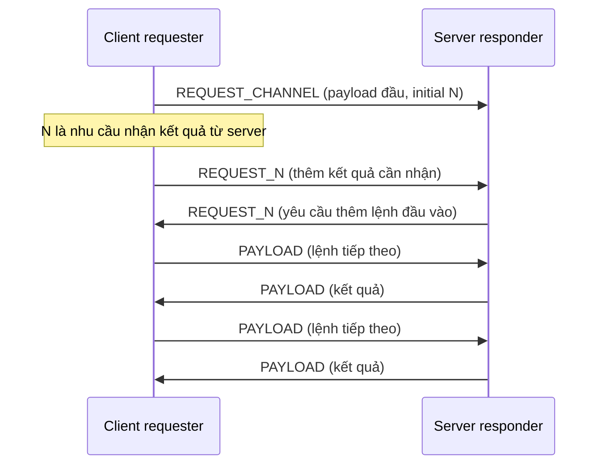

# Phối hợp luồng lệnh đầu vào với luồng kết quả đầu ra

Trong một ứng dụng realtime, client có thể liên tục gửi lệnh tới server trong khi vẫn cần nhận kết quả, trạng thái hoặc tiến độ xử lý. Ví dụ, một dashboard gửi lệnh điều khiển thiết bị và đồng thời nhận phản hồi của từng lệnh. Nếu tách thành nhiều request-response, client phải quản lý nhiều stream riêng và tự ghép các kết quả. RSocket Request-Channel cung cấp một stream hai chiều để hai bên vừa gửi vừa nhận dữ liệu trên cùng một interaction.

Bài học này xây dựng mô hình phối hợp giữa luồng lệnh đầu vào và luồng kết quả đầu ra. Trọng tâm là cách hai phía điều tiết demand độc lập, ghép kết quả với lệnh gốc, xử lý thứ tự và lỗi, đồng thời quản lý vòng đời của cả hai nửa stream.

## 1. Request-Channel là gì?

Request-Channel là một trong bốn interaction model của RSocket. Bên khởi tạo mở một channel bằng frame `REQUEST_CHANNEL`, gửi payload đầu tiên và khai báo nhu cầu ban đầu đối với dữ liệu phản hồi. Sau đó cả requester và responder đều có thể tiếp tục phát nhiều payload trên cùng stream.

Hai luồng dữ liệu có hướng ngược nhau:

- **Luồng đầu vào:** requester gửi lệnh hoặc dữ liệu tới responder.
- **Luồng đầu ra:** responder gửi kết quả, trạng thái hoặc sự kiện liên quan về requester.

```text
Requester / Client                         Responder / Server
       |                                          |
       |--- REQUEST_CHANNEL (lệnh đầu tiên) ----->|
       |                                          |
       |--- PAYLOAD (lệnh tiếp theo) ------------>|
       |<-- PAYLOAD (kết quả / tiến độ) -----------|
       |--- PAYLOAD (lệnh tiếp theo) ------------>|
       |<-- PAYLOAD (kết quả / tiến độ) -----------|
       |<-- PAYLOAD (kết quả cuối) ----------------|
       |                                          |
       |--- COMPLETE (hết lệnh) ----------------->|
       |<-- COMPLETE (hết kết quả) ----------------|
```

Một channel có thể phù hợp với các tình huống như:

- Client gửi nhiều lệnh điều khiển và nhận trạng thái thực thi tương ứng.
- Ứng dụng gửi dữ liệu đầu vào liên tục trong khi server trả kết quả phân tích theo thời gian thực.
- Client gửi các câu hỏi hoặc tác vụ vào một phiên làm việc và nhận các sự kiện tiến độ, cảnh báo cùng kết quả cuối.
- Hai dịch vụ trao đổi các bản tin liên tục trong cùng một interaction, thay vì tạo một request độc lập cho từng bản tin.

Request-Channel khác với request-response ở chỗ mỗi phía có thể phát nhiều payload. Nó cũng khác request-stream: request-stream chỉ có một phía phát chuỗi dữ liệu phản hồi, còn request-channel cho phép cả hai phía phát chuỗi dữ liệu.

## 2. Hai chiều demand được điều tiết độc lập

Request-Channel không phải một hàng đợi chung mà hai phía cùng đọc. Mỗi phía có publisher riêng và phải tuân thủ nhu cầu do peer gửi về.

- Client muốn nhận thêm kết quả từ server thì gửi `REQUEST_N` cho server.
- Server muốn nhận thêm lệnh từ client thì gửi `REQUEST_N` cho client.
- Mỗi phía chỉ phát số payload trong giới hạn demand mà peer đã cấp.

Frame `REQUEST_CHANNEL` đầu tiên có chứa payload mở channel và giá trị `initial request N`. Giá trị này thể hiện số payload đầu ra ban đầu mà requester sẵn sàng nhận từ responder. Sau đó requester có thể yêu cầu thêm kết quả bằng các frame `REQUEST_N` tiếp theo. Ở chiều ngược lại, responder yêu cầu thêm lệnh từ publisher phía requester thông qua demand của chính chiều đó.

Sơ đồ demand hai chiều:



Điểm cần nhớ là `REQUEST_N` luôn được gửi từ phía muốn nhận thêm dữ liệu tới phía đang phát dữ liệu. Do đó, hai chiều có thể có nhịp khác nhau: client có thể gửi lệnh nhanh nhưng server xử lý kết quả chậm; hoặc server phát nhiều sự kiện kết quả trong khi client đang xử lý chậm.

Backpressure giúp giới hạn số payload đang được yêu cầu. Nó không tự quyết định chính sách nghiệp vụ khi một bên quá tải. Ứng dụng vẫn cần giới hạn buffer, concurrency và thời gian xử lý.

## 3. Thiết kế message để ghép lệnh với kết quả

Trong channel, thứ tự hai luồng không nhất thiết tạo thành từng cặp một-một. Một lệnh có thể sinh nhiều sự kiện tiến độ, một kết quả có thể đến sau các lệnh khác, hoặc server có thể phát sự kiện chung không thuộc riêng một lệnh. Vì vậy nên mang định danh tương quan trong message.

Ví dụ model Java:

```java
public record DeviceCommand(
        String commandId,
        String deviceId,
        String action,
        String argument,
        long issuedAtEpochMs
) {}

public record CommandEvent(
        String commandId,
        String deviceId,
        String eventType,
        String detail,
        long sequence,
        long occurredAtEpochMs
) {}
```

Ý nghĩa các trường quan trọng:

| Trường | Vai trò |
| --- | --- |
| `commandId` | Ghép event với lệnh đã tạo ra nó |
| `deviceId` | Xác định thiết bị liên quan và kiểm tra quyền truy cập |
| `action` | Loại thao tác, ví dụ `SET_TEMPERATURE` hoặc `RESTART` |
| `eventType` | Phân biệt `ACCEPTED`, `PROGRESS`, `COMPLETED` hoặc `FAILED` |
| `sequence` | Sắp xếp các event trong phạm vi command hoặc device theo quy ước |
| `occurredAtEpochMs` | Thời điểm server tạo event |

Một command có thể tạo ra nhiều event:

```text
commandId = cmd-1001
    ACCEPTED   sequence=1
    PROGRESS   sequence=2
    PROGRESS   sequence=3
    COMPLETED  sequence=4
```

Không nên ghép kết quả bằng cách giả định payload thứ nhất ở chiều ra tương ứng với payload thứ nhất ở chiều vào. Hãy dùng `commandId` và quy tắc sequence. Nếu server có thể xử lý song song, các event của nhiều command có thể xen kẽ nhau.

## 4. Xây dựng handler Request-Channel ở Spring RSocket

Trong Spring, handler request-channel thường nhận `Flux<T>` làm tham số đầu vào và trả về `Flux<R>` làm luồng phản hồi. Ví dụ sau nhận các lệnh điều khiển thiết bị và trả về các event tương ứng:

```java
@Controller
public class DeviceChannelController {

    private final DeviceCommandService commandService;

    public DeviceChannelController(DeviceCommandService commandService) {
        this.commandService = commandService;
    }

    @MessageMapping("devices.control")
    public Flux<CommandEvent> control(Flux<DeviceCommand> commands) {
        return commands.concatMap(command ->
                commandService.execute(command)
        );
    }
}
```

`commands` là publisher nhận các payload do client phát. Kết quả trả về là publisher phát các `CommandEvent` tới client. Khi client hoàn tất luồng lệnh, server vẫn có thể phát nốt các kết quả cho những lệnh đã nhận và đang xử lý, rồi mới hoàn tất luồng đầu ra.

Ví dụ service trả về một event cuối:

```java
public Mono<CommandEvent> execute(DeviceCommand command) {
    return deviceClient.apply(command)
            .thenReturn(new CommandEvent(
                    command.commandId(),
                    command.deviceId(),
                    "COMPLETED",
                    "Command applied",
                    1,
                    System.currentTimeMillis()
            ));
}
```

Trong hệ thống thực tế, service có thể phát nhiều event cho mỗi command, chẳng hạn `ACCEPTED`, nhiều `PROGRESS` và `COMPLETED`. Khi đó có thể trả về `Flux<CommandEvent>` cho mỗi command và nối chúng bằng `concatMap` hoặc operator phù hợp.

Không gom toàn bộ `commands` bằng `collectList()` nếu mục tiêu là xử lý realtime. Cách đó buộc server chờ đầu vào hoàn tất mới xử lý danh sách, làm tăng độ trễ và có thể tiêu tốn bộ nhớ lớn. Hãy xử lý theo từng phần tử và giữ pipeline reactive xuyên suốt.

## 5. Mở Request-Channel từ client

Client cung cấp publisher các command cho `.data(...)` và nhận publisher các event bằng `.retrieveFlux(...)`:

```java
Flux<DeviceCommand> commands = commandSource;

Flux<CommandEvent> events = requester
        .route("devices.control")
        .data(commands)
        .retrieveFlux(CommandEvent.class);
```

`commandSource` có thể là `Flux` từ hàng đợi giao diện, dữ liệu cảm biến, hoặc một nguồn sự kiện khác. Client cần subscribe vào `events` hoặc nối nó với pipeline tiêu thụ để channel thực sự được thực thi:

```java
events.subscribe(
        event -> eventHandler.handle(event),
        error -> log.error("Device channel failed", error),
        () -> log.info("Device channel completed")
);
```

Trong ứng dụng thực tế, nên trả publisher về tầng gọi hoặc quản lý subscription bằng lifecycle của component thay vì tạo nhiều subscription tùy tiện. Mỗi lần subscribe vào một publisher tạo channel mới và có thể đăng ký lại nguồn `commands`; nếu nguồn là hot publisher, sự kiện phát trước khi subscription được thiết lập có thể bị bỏ lỡ.

Để quản lý channel như một phiên làm việc, hãy giữ subscription ở đúng phạm vi vòng đời: mở khi thiết bị hoặc người dùng bắt đầu phiên, hủy khi rời phiên, và xử lý reconnect bằng chính sách rõ ràng.

## 6. Phối hợp xử lý tuần tự và song song

Lựa chọn operator ở server ảnh hưởng đến thứ tự event, throughput và tài nguyên.

### 6.1. concatMap: xử lý tuần tự

```java
@MessageMapping("devices.control")
public Flux<CommandEvent> control(Flux<DeviceCommand> commands) {
    return commands.concatMap(commandService::execute);
}
```

`concatMap` chờ publisher xử lý của command hiện tại hoàn tất rồi mới chuyển sang command tiếp theo. Cách này dễ giữ thứ tự xử lý và phù hợp khi các lệnh cùng tác động tới một thiết bị hoặc trạng thái có phụ thuộc.

### 6.2. flatMap: xử lý song song

```java
@MessageMapping("devices.control")
public Flux<CommandEvent> control(Flux<DeviceCommand> commands) {
    return commands.flatMap(commandService::execute, 8);
}
```

`flatMap` cho phép xử lý nhiều command đồng thời với giới hạn concurrency. Kết quả có thể xen kẽ và hoàn tất khác thứ tự đầu vào. Điều này phù hợp khi command độc lập và cần tăng throughput.

Nếu cần chạy song song nhưng phát kết quả theo thứ tự nguồn, có thể cân nhắc `flatMapSequential`. Operator này vẫn có thể phải giữ kết quả của tác vụ hoàn tất sớm trong buffer để chờ tác vụ trước đó; hãy chọn concurrency và prefetch có giới hạn.

Không dùng song song cho các lệnh phụ thuộc trạng thái nếu chưa có cơ chế đồng bộ theo `deviceId` hoặc partition. Ví dụ hai lệnh `SET_MODE` và `RESTART` trên cùng thiết bị có thể cần được xử lý theo thứ tự, trong khi lệnh trên hai thiết bị khác nhau có thể chạy song song.

## 7. Lỗi nghiệp vụ và lỗi cấp channel

Cần phân biệt lỗi của một command với lỗi khiến toàn bộ channel không thể tiếp tục.

**Lỗi nghiệp vụ của một command:** thiết bị không online, tham số nằm ngoài giới hạn hoặc command không được phép. Nếu client cần nhận kết quả cho các command khác, hãy chuyển lỗi đó thành một `CommandEvent` có trạng thái `FAILED`:

```java
public Flux<CommandEvent> control(Flux<DeviceCommand> commands) {
    return commands.concatMap(command ->
            commandService.execute(command)
                    .onErrorResume(error -> Mono.just(
                            new CommandEvent(
                                    command.commandId(),
                                    command.deviceId(),
                                    "FAILED",
                                    safeMessage(error),
                                    1,
                                    System.currentTimeMillis()
                            )
                    ))
    );
}
```

Đây là ví dụ cho service chỉ phát một event cuối mỗi command. Nếu service phát nhiều event, có thể dùng `onErrorResume` ở từng inner `Flux` để phát một event lỗi rồi tiếp tục command tiếp theo.

**Lỗi cấp channel:** kết nối bị đóng, protocol error, lỗi codec hoặc lỗi không thể khôi phục trong pipeline. Khi publisher trả về terminal error, stream kết thúc và client cần xử lý lỗi ở cấp channel. Không nên chuyển mọi lỗi thành event `FAILED` nếu lỗi đó có nghĩa là channel không còn an toàn để tiếp tục.

Không đưa stack trace, token, thông tin xác thực hoặc dữ liệu nội bộ nhạy cảm vào `detail` trả về client. Hãy ghi chi tiết kỹ thuật ở server log với correlation ID, còn event gửi ra chỉ chứa mã lỗi và thông điệp an toàn.

## 8. Hoàn tất độc lập hai nửa stream

Request-Channel có hai hướng payload và mỗi hướng có thể kết thúc độc lập:

- Client hoàn tất luồng command bằng cách kết thúc publisher đầu vào. Server không nhận thêm command mới nhưng có thể tiếp tục phát event cho các command đã nhận.
- Server hoàn tất publisher kết quả khi không còn event nào cần gửi. Điều đó không nhất thiết có nghĩa publisher command ở client đã hoàn tất.
- Khi cả hai hướng đã hoàn tất, channel kết thúc bình thường.
- Hủy stream hoặc lỗi terminal có thể chấm dứt toàn bộ interaction; ứng dụng cần dọn tài nguyên ở cả hai phía.

Ví dụ client gửi một batch command hữu hạn, sau đó chờ kết quả cuối:

```java
Flux<DeviceCommand> batch = Flux.just(
        command1,
        command2,
        command3
);

Flux<CommandEvent> events = requester
        .route("devices.control")
        .data(batch)
        .retrieveFlux(CommandEvent.class);
```

Khi `batch` hoàn tất, server biết không còn command mới. Nếu command thứ ba đang xử lý bất đồng bộ, server vẫn có thể gửi `PROGRESS` hoặc `COMPLETED` trước khi đóng chiều kết quả.

Với nguồn vô hạn như giao diện điều khiển realtime, channel có thể tồn tại lâu. Cần có điều kiện dừng, timeout, giám sát keepalive và xử lý cancel để tránh giữ session, buffer hoặc tài nguyên thiết bị sau khi người dùng đã rời đi.

## 9. Metadata và bảo mật cho channel

Route của channel thường được truyền qua routing metadata. Ngoài route, kết nối hoặc từng payload có thể mang metadata phục vụ xác thực, tracing và ngữ cảnh tenant tùy thiết kế ứng dụng.

Một số nguyên tắc:

- Xác thực peer trước khi cho phép mở channel hoặc thực thi command.
- Kiểm tra quyền trên từng `deviceId` và từng loại `action`; không tin `deviceId` do client tự gửi.
- Giới hạn số channel đồng thời theo user, tenant hoặc thiết bị.
- Đặt giới hạn kích thước command và event, đồng thời validate dữ liệu trước khi chuyển tới thiết bị.
- Dùng TLS khi yêu cầu bảo vệ dữ liệu trên đường truyền.
- Truyền correlation ID qua log và tracing; tránh log payload nhạy cảm.
- Nếu channel sống lâu, cập nhật hoặc thu hồi quyền khi session hết hạn, tài khoản bị khóa hoặc thiết bị mất quyền.

## 10. Kiểm thử phối hợp luồng đầu vào và đầu ra

Không chỉ kiểm tra một command có tạo ra một event. Cần kiểm tra cả backpressure, thứ tự, hoàn tất và lỗi ở hai chiều.

| Tình huống | Điều cần xác minh |
| --- | --- |
| Một command, một result | Event có đúng `commandId` và nội dung dự kiến |
| Một command, nhiều event | Event `ACCEPTED`, `PROGRESS`, `COMPLETED` được phát theo quy ước |
| Nhiều command | Kết quả được ghép bằng ID, kể cả khi các event xen kẽ |
| `concatMap` | Command được xử lý tuần tự theo thứ tự đầu vào |
| `flatMap` | Concurrency bị giới hạn; kết quả có thể hoàn tất khác thứ tự |
| Client gửi chậm | Server không đọc vượt quá demand của chiều đầu vào |
| Client nhận chậm | Server không phát vượt quá demand của chiều đầu ra |
| Client hoàn tất input | Server vẫn phát nốt kết quả của command đã nhận |
| Một command lỗi nghiệp vụ | Có event `FAILED` và các command khác tiếp tục nếu chính sách cho phép |
| Lỗi cấp channel hoặc cancel | Hai phía dừng và giải phóng tài nguyên đúng cách |

Ví dụ kiểm thử đơn giản cho service có một result mỗi command:

```java
StepVerifier.create(
        commandService.execute(new DeviceCommand(
                "cmd-1001", "device-01", "RESTART", "", 1_795_348_800_000L
        ))
)
.assertNext(event -> {
    assertThat(event.commandId()).isEqualTo("cmd-1001");
    assertThat(event.eventType()).isEqualTo("COMPLETED");
})
.verifyComplete();
```

Với kiểm thử channel end-to-end, khởi động RSocket server, mở channel bằng client publisher, gửi nhiều command và xác nhận event đầu ra. Dùng `StepVerifier` để điều khiển demand và kiểm tra tín hiệu; dùng deadline hữu hạn cho test bất đồng bộ. Tránh `Thread.sleep` cố định vì không chứng minh được quan hệ giữa demand và tín hiệu.

## 11. Khi nào dùng Request-Channel?

Request-Channel phù hợp khi cùng một phiên tương tác cần cả hai phía phát dữ liệu liên tục và mỗi phía cần điều tiết tốc độ riêng. Ví dụ, client gửi lệnh trong khi server phát tiến độ, kết quả hoặc cảnh báo.

Hãy cân nhắc interaction model khác khi:

- Một request chỉ cần một kết quả: dùng request-response.
- Client chỉ gửi một sự kiện và không cần nhận dữ liệu: dùng fire-and-forget.
- Client gửi một luồng và chỉ nhận một luồng phản hồi do server khởi tạo: request-stream có thể đơn giản hơn.
- Dữ liệu cần lưu bền qua thời gian mất kết nối: kết hợp channel với durable queue/outbox hoặc broker; channel tự nó không phải kho lưu trữ.

## 12. Checklist triển khai

- [ ] Client gửi publisher command bằng `.data(commands)` và nhận publisher event bằng `.retrieveFlux(...)`.
- [ ] Server nhận `Flux<Command>` và trả `Flux<Event>` trên route tương ứng.
- [ ] Hai phía thống nhất codec, data MIME type và metadata cần thiết.
- [ ] Mỗi command có `commandId`; event mang lại ID để correlation.
- [ ] Chọn `concatMap`, `flatMap` hoặc `flatMapSequential` theo yêu cầu thứ tự và concurrency.
- [ ] Demand được giới hạn độc lập ở cả chiều command và chiều result.
- [ ] Lỗi nghiệp vụ được biểu diễn thành event nếu channel cần tiếp tục.
- [ ] Lỗi terminal, cancel và hoàn tất từng nửa stream được xử lý đúng.
- [ ] Có timeout, giới hạn buffer, giới hạn channel và cơ chế giải phóng tài nguyên.
- [ ] Kiểm thử cả thứ tự, backpressure, correlation, half-close và lỗi.

Khi phối hợp luồng lệnh với luồng kết quả, hãy thiết kế hai publisher như hai luồng độc lập có chung ngữ cảnh tương quan. Request-Channel cung cấp transport hai chiều và backpressure ở cả hai hướng; ứng dụng vẫn phải định nghĩa ID, thứ tự, chính sách lỗi và thời điểm kết thúc để cuộc trao đổi có thể vận hành ổn định.
