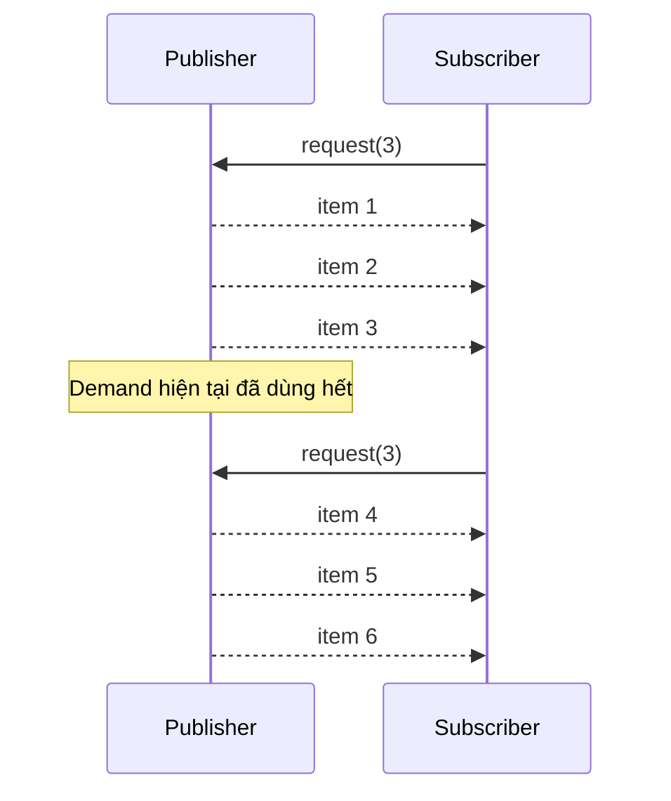
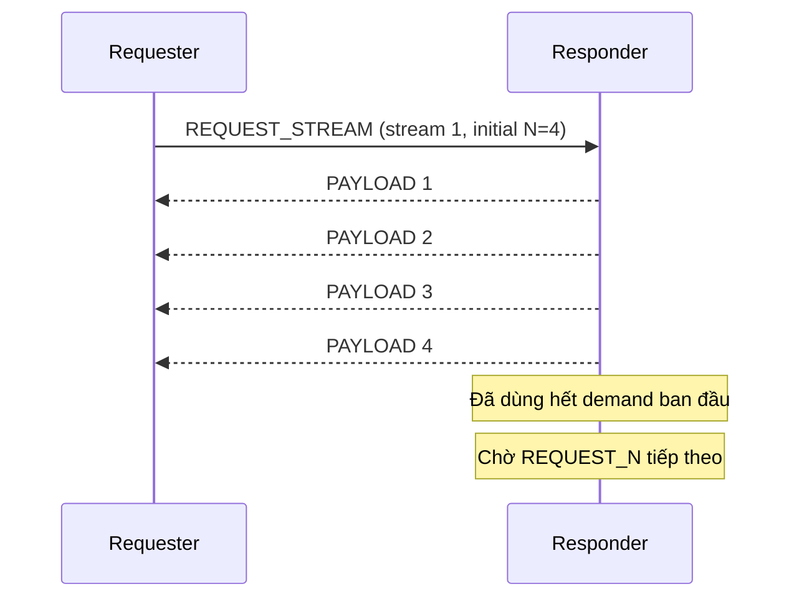
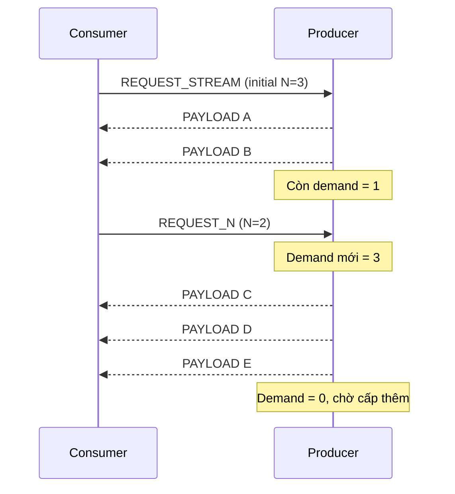
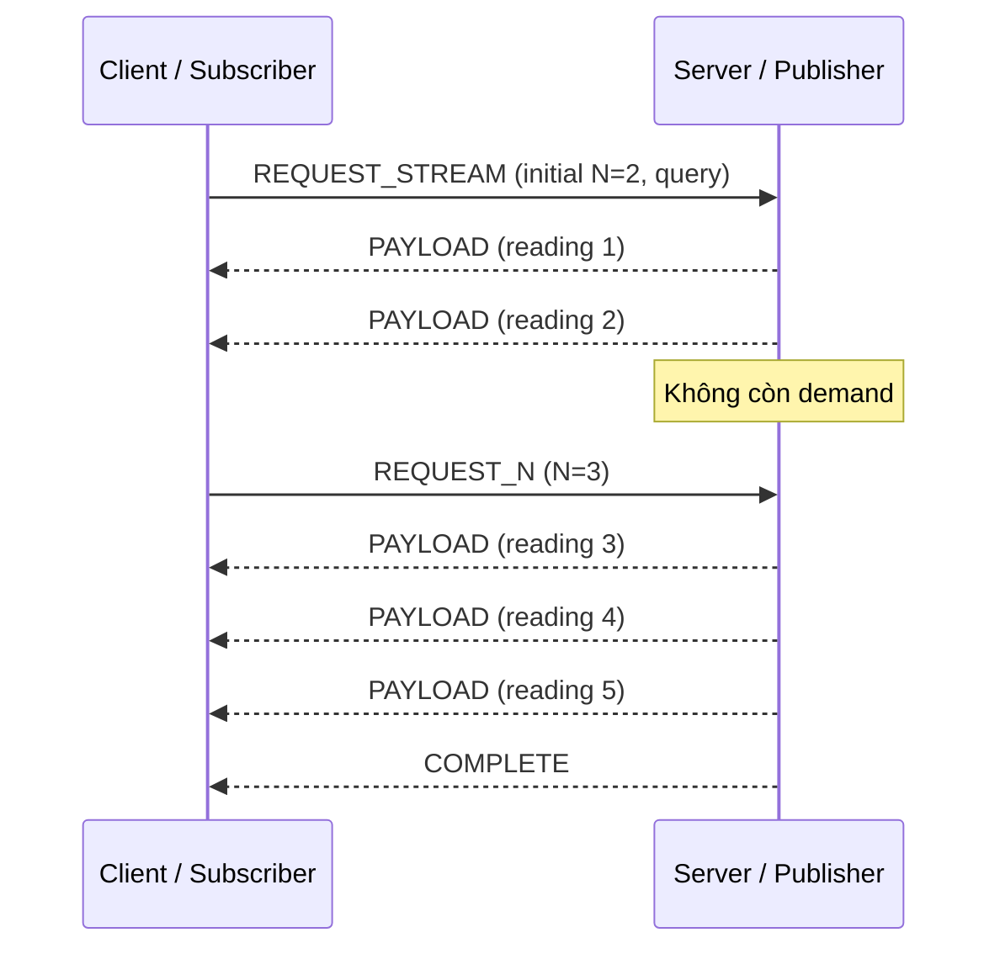
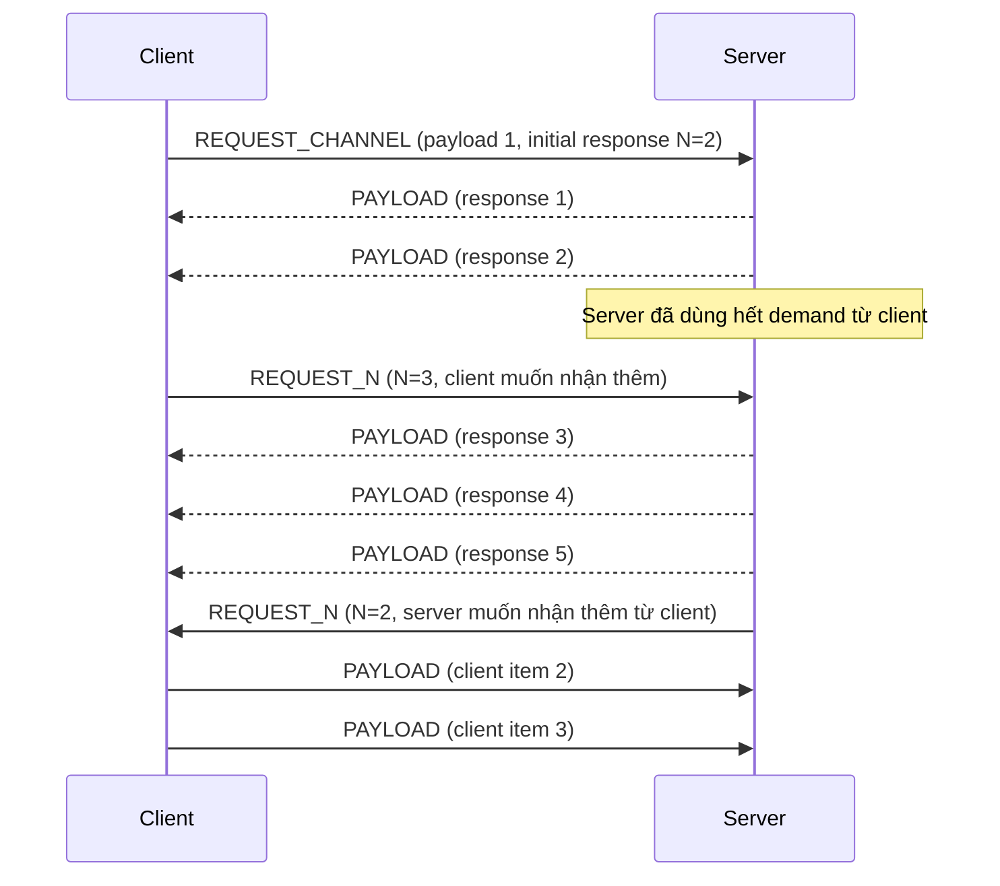

# Nhu cầu ban đầu và bổ sung nhu cầu bằng REQUEST_N

Trong RSocket, một request-stream hoặc request-channel có thể tạo ra nhiều payload trong thời gian dài. Nếu responder cứ gửi dữ liệu nhanh nhất có thể, consumer chậm có thể bị quá tải bộ nhớ, CPU hoặc downstream service. RSocket giải quyết vấn đề này bằng cơ chế demand: phía nhận chủ động cho biết mình sẵn sàng nhận thêm bao nhiêu payload.

Demand ban đầu được khai báo ngay trong frame mở stream thông qua trường `initial request N`. Khi lượng demand đó sắp hết hoặc đã dùng hết, consumer gửi frame `REQUEST_N` trên stream hiện tại để cấp thêm nhu cầu. Nhờ cơ chế này, producer biết giới hạn số payload được phép phát, còn consumer kiểm soát nhịp dữ liệu theo khả năng xử lý của mình.

Đây là một phần quan trọng của RSocket khi xây dựng dịch vụ realtime bằng Java và Spring Boot. Nó giúp quản lý stream dài hạn, nhưng cần hiểu đúng phạm vi: demand đếm số payload, áp dụng theo từng stream và phối hợp với Reactive Streams ở tầng ứng dụng. Nó không phải giới hạn byte của TCP và cũng không thay thế việc giới hạn buffer hoặc concurrency trong business pipeline.

## 1. Demand là gì?

Trong mô hình Reactive Streams, một `Publisher` phát dữ liệu cho `Subscriber`. Sau khi subscribe, `Subscriber` nhận một `Subscription` và gọi `request(n)` để yêu cầu tối đa `n` phần tử. Publisher chỉ được phát phần tử khi còn demand; mỗi phần tử được phát sẽ tiêu thụ một đơn vị demand.

Các vai trò cơ bản:

- **Publisher:** nguồn phát dữ liệu, ví dụ service đọc telemetry hoặc server trả danh sách sự kiện.
- **Subscriber:** bên tiêu thụ dữ liệu, ví dụ client hiển thị dashboard hoặc service ghi dữ liệu vào kho lưu trữ.
- **Subscription:** kênh điều khiển demand và cancellation giữa hai bên.
- **Demand:** số phần tử mà subscriber hiện cho phép publisher phát thêm.

Ví dụ consumer chỉ có thể xử lý ba bản ghi tại một thời điểm. Consumer gọi `request(3)`. Producer có thể phát tối đa ba bản ghi theo demand hiện tại. Khi consumer xử lý xong và sẵn sàng nhận thêm, nó gọi `request(3)` lần nữa.



Demand là quyền phát tối đa, không phải cam kết publisher phải tạo đủ số phần tử ngay lập tức. Nếu nguồn chỉ có một phần tử, publisher có thể phát một phần tử rồi tiếp tục chờ dữ liệu hoặc hoàn tất stream.

## 2. Initial request N trong RSocket

RSocket mang demand ban đầu trong frame mở stream. Trường `initial request N` cho responder biết requester muốn nhận tối đa bao nhiêu payload ban đầu.

Hai frame có trường này là:

- `REQUEST_STREAM`: mở một request-stream và khai báo số response payload requester sẵn sàng nhận ban đầu.
- `REQUEST_CHANNEL`: mở một channel hai chiều. Trường initial request N cho biết requester ban đầu sẵn sàng nhận bao nhiêu payload từ responder.

Giá trị N phải là số dương. Nếu chưa có demand hợp lệ, producer không được tự ý phát payload tiếp theo cho chiều dữ liệu đang được điều tiết. Requester có thể bổ sung demand sau bằng `REQUEST_N`.

Ví dụ requester mở stream với initial request N bằng 4:



`REQUEST_STREAM` vừa tạo stream vừa cấp demand ban đầu. `REQUEST_N` không tạo stream mới; nó bổ sung demand cho stream đã tồn tại.

## 3. REQUEST_N — bổ sung demand trên stream

`REQUEST_N` là frame điều khiển cấp stream. Frame chứa stream ID dương và một trường N cho biết số payload bổ sung mà bên nhận sẵn sàng nhận. N phải lớn hơn 0. Frame không mang data nghiệp vụ.

Khi requester gửi `REQUEST_N(N=5)`, responder được phép phát thêm tối đa năm payload trên stream đó. Nhu cầu mới được cộng vào demand còn lại; nó không đặt lại một quota cố định từ đầu. Nếu stream đã hoàn tất hoặc bị hủy, việc yêu cầu thêm không thể làm stream sống lại.

Ví dụ demand thay đổi theo thời gian:

| Thời điểm | Sự kiện | Demand còn lại sau sự kiện |
|---|---|---:|
| T0 | Mở stream với initial N = 3 | 3 |
| T1 | Responder phát payload A | 2 |
| T2 | Responder phát payload B | 1 |
| T3 | Requester gửi `REQUEST_N(2)` | 3 |
| T4 | Responder phát payload C | 2 |
| T5 | Responder phát payload D | 1 |
| T6 | Responder phát payload E | 0 |



Trong ví dụ, demand sau `REQUEST_N` là demand còn lại trước đó cộng với N mới. Producer có thể phát tối đa số payload được phép. Nếu nguồn dữ liệu chưa có item, demand vẫn còn để dùng khi dữ liệu xuất hiện, miễn stream chưa hoàn tất hoặc bị hủy.

## 4. Phân biệt initial N và REQUEST_N

Hai cơ chế cùng điều khiển demand nhưng xuất hiện ở hai thời điểm khác nhau.

| Tiêu chí | Initial request N | `REQUEST_N` |
|---|---|---|
| Thời điểm | Trong frame mở stream | Sau khi stream đã được mở |
| Mục đích | Cấp demand ban đầu | Bổ sung demand |
| Frame | `REQUEST_STREAM` hoặc `REQUEST_CHANNEL` | `REQUEST_N` |
| Stream ID | ID của stream mới | ID của stream đang chạy |
| Giá trị | Số payload ban đầu được phép nhận | Số payload bổ sung được phép nhận |
| Có tạo stream? | Có | Không |

Nếu initial N bằng 10, requester đã cấp trước quyền phát tối đa 10 payload. Khi producer đã dùng hết demand, requester có thể gửi `REQUEST_N(10)` để cấp thêm 10. Nếu requester gửi `REQUEST_N(4)` khi vẫn còn demand 2, tổng demand còn lại sẽ thành 6.

Không nên coi N là kích thước batch bắt buộc. Producer không phải gom đủ N phần tử mới gửi; producer có thể phát từng payload khi dữ liệu sẵn sàng. N chỉ là giới hạn lượng payload được phép phát theo demand hiện tại.

## 5. REQUEST_N trong request-stream

Request-stream là trường hợp đơn giản nhất để quan sát flow control. Client gửi một request payload và initial N. Server phát một chuỗi response payload. Client bổ sung demand khi đã sẵn sàng nhận thêm.



Ví dụ Spring Boot responder trả về `Flux`:

```java
import org.springframework.messaging.handler.annotation.MessageMapping;
import org.springframework.messaging.handler.annotation.Payload;
import org.springframework.stereotype.Controller;
import reactor.core.publisher.Flux;

@Controller
public class TelemetryController {
    private final TelemetryService telemetryService;

    public TelemetryController(TelemetryService telemetryService) {
        this.telemetryService = telemetryService;
    }

    @MessageMapping("telemetry.stream")
    public Flux<Telemetry> stream(@Payload TelemetryQuery query) {
        return telemetryService.streamFor(query.deviceId());
    }
}
```

Client gọi route bằng `RSocketRequester`:

```java
Flux<Telemetry> telemetry = requester
    .route("telemetry.stream")
    .data(new TelemetryQuery("device-42"))
    .retrieveFlux(Telemetry.class);
```

Spring và Reactor chuyển demand từ subscription của client thành flow control ở tầng RSocket. Ứng dụng thường không tự tạo frame `REQUEST_N`; nó điều khiển demand bằng Reactive Streams API. Thư viện có thể gom hoặc phát các yêu cầu theo chiến lược prefetch, vì vậy không nên giả định mỗi lần `Subscription.request(n)` luôn tương ứng với đúng một frame `REQUEST_N` có cùng giá trị N.

## 6. REQUEST_N trong request-channel: điều tiết hai chiều

Request-channel cho phép requester gửi một luồng payload và đồng thời nhận một luồng payload từ responder. Hai chiều dữ liệu có thể có tốc độ khác nhau, vì vậy mỗi phía cần kiểm soát demand mà mình cấp cho phía phát dữ liệu đối diện.

Khi requester mở channel, frame `REQUEST_CHANNEL` mang payload đầu tiên của requester và initial request N cho số payload requester muốn nhận từ responder. Đối với chiều requester tiếp tục gửi payload, responder cấp demand cho requester bằng các frame `REQUEST_N` trên stream đó. Tương tự, requester gửi `REQUEST_N` để cấp thêm demand cho chiều responder phát dữ liệu.



Điểm cần nhớ là `REQUEST_N` được gửi bởi bên muốn nhận thêm dữ liệu và tác động lên bên đang phát dữ liệu theo chiều đó. Trong request-channel, hai peer đều có thể vừa là producer vừa là consumer, nên phải theo dõi demand riêng cho mỗi chiều. Initial N trong `REQUEST_CHANNEL` là demand ban đầu requester cấp cho response stream từ responder; nó không phải số lượng payload requester được phép gửi tiếp.

Ví dụ Spring `RSocketRequester` cho request-channel:

Ở phía server, phương thức nhận một `Flux` đầu vào và trả về một `Flux` phản hồi:

```java
@MessageMapping("chat.channel")
public Flux<ChatReply> chat(@Payload Flux<ChatMessage> incoming) {
    return incoming.concatMap(chatService::reply);
}
```

`concatMap` giữ thứ tự xử lý theo thông điệp đầu vào. Nếu dùng `flatMap`, cần chấp nhận hoặc tự xử lý khả năng các phản hồi hoàn tất không theo thứ tự.

```java
Flux<ChatReply> replies = requester
    .route("chat.channel")
    .data(outgoingMessages)
    .retrieveFlux(ChatReply.class);
```

`outgoingMessages` là Publisher dữ liệu client gửi. `replies` là Publisher dữ liệu client nhận. Subscriber của `replies` điều khiển demand ở chiều nhận; phía server cần tiêu thụ luồng đầu vào theo demand mà nó cấp. Cả hai chiều đều cần giới hạn buffer và xử lý cancellation.

## 7. Mapping demand với Reactive Streams và Reactor

Trong ứng dụng Reactor, demand được điều khiển thông qua `Subscription.request(n)`. Khi dùng `RSocketRequester.retrieveFlux`, framework kết nối demand của subscriber với giao thức RSocket. Khi downstream yêu cầu thêm dữ liệu, demand có thể được chuyển thành `REQUEST_N` cho stream tương ứng.

Có thể minh họa cách một subscriber yêu cầu dữ liệu theo từng nhóm bằng `BaseSubscriber`:

```java
import java.util.concurrent.atomic.AtomicInteger;
import org.reactivestreams.Subscription;
import reactor.core.publisher.BaseSubscriber;

AtomicInteger receivedInBatch = new AtomicInteger();

quotes.subscribe(new BaseSubscriber<Quote>() {
    @Override
    protected void hookOnSubscribe(Subscription subscription) {
        request(3); // cấp initial demand ở tầng Reactive Streams
    }

    @Override
    protected void hookOnNext(Quote quote) {
        display(quote);

        if (receivedInBatch.incrementAndGet() == 3) {
            receivedInBatch.set(0);
            request(3); // yêu cầu thêm sau khi xử lý đủ một nhóm
        }
    }
});
```

Đoạn mã minh họa cách ứng dụng kiểm soát nhịp tiêu thụ. Trong ứng dụng thực tế, cần xác định điều kiện dừng, xử lý lỗi và hủy subscription khi màn hình hoặc phiên làm việc kết thúc. Nếu Publisher hoàn tất, Reactor không gửi thêm demand cho stream đã kết thúc.

Các operator hữu ích:

- `limitRate(n)` điều tiết cách Reactor yêu cầu phần tử từ upstream theo lô. Nó hữu ích để giới hạn nhịp prefetch, nhưng không phải giới hạn tổng số phần tử của stream.
- `take(n)` giới hạn tổng số phần tử downstream nhận và hủy upstream sau khi đạt giới hạn.
- `buffer(n)` gom phần tử thành nhóm; cần đánh giá bộ nhớ và thời gian chờ khi batch chưa đủ.
- `flatMap(mapper, concurrency)` giới hạn số Publisher con được xử lý đồng thời; concurrency không đồng nghĩa với demand của stream mạng.
- `onBackpressureBuffer`, `onBackpressureDrop` và `onBackpressureLatest` tạo chính sách khi dữ liệu đến nhanh hơn khả năng tiêu thụ; cần chọn theo ý nghĩa nghiệp vụ và đặt giới hạn bộ nhớ.

Không nên thêm `publishOn` hoặc buffer lớn chỉ để che giấu consumer chậm. Việc chuyển thread không làm tăng năng lực xử lý thực tế; buffer không giới hạn chỉ trì hoãn thời điểm hệ thống hết bộ nhớ.

## 8. Demand đếm payload, không đếm byte

RSocket `REQUEST_N` điều tiết số payload được phép phát trên stream. Một payload có thể nhỏ vài byte hoặc chứa dữ liệu lớn. Vì vậy, demand bằng 10 không có nghĩa giới hạn băng thông hoặc bộ nhớ là 10 đơn vị cố định.

Để bảo vệ hệ thống, cần kết hợp nhiều lớp giới hạn:

| Lớp | Đơn vị điều tiết | Ví dụ kiểm soát |
|---|---|---|
| Reactive Streams / RSocket demand | Số phần tử hoặc payload | `request(n)`, `REQUEST_N`, prefetch |
| Ứng dụng | Số tác vụ đang chạy | Giới hạn concurrency của `flatMap` |
| Bộ nhớ | Byte hoặc số phần tử được giữ | Giới hạn buffer, giới hạn kích thước payload |
| TCP flow control | Byte trên kết nối | Receive window của TCP |
| Tài nguyên nghiệp vụ | Request, tenant hoặc quota | Rate limit, lease, giới hạn theo user |

Ví dụ, client cấp demand 100 payload nhưng mỗi payload chứa ảnh 5 MB. Consumer có thể phải xử lý tới 500 MB dữ liệu nếu buffer và pipeline giữ lại tất cả. Vì vậy, hãy giới hạn cả số payload lẫn kích thước mỗi payload, và xử lý theo kiểu streaming khi dữ liệu lớn.

TCP flow control có thể làm chậm việc truyền byte khi bên nhận không đọc kịp, nhưng không thay thế demand ở tầng RSocket. Ngược lại, RSocket demand không tự giới hạn tổng byte trên socket. Hai cơ chế phối hợp ở các tầng khác nhau.

## 9. Chính sách cấp demand và lựa chọn giá trị N

Initial N và lượng demand bổ sung nên được chọn dựa trên tốc độ xử lý, kích thước payload và latency của nguồn dữ liệu. Một số cách tiếp cận:

- **Batch nhỏ:** giảm lượng dữ liệu có thể đến trước khi consumer xử lý xong; phù hợp với payload lớn hoặc client có tài nguyên hạn chế.
- **Batch lớn:** giảm tần suất cấp demand và có thể tăng throughput khi payload nhỏ, nhưng cần đủ bộ nhớ và năng lực xử lý.
- **Cấp theo khả năng xử lý:** yêu cầu thêm sau khi hoàn thành một nhóm công việc, thay vì cấp một lượng lớn từ đầu.
- **Cấp theo cửa sổ trượt:** duy trì một lượng demand outstanding ổn định; khi một số phần tử đã được xử lý, cấp thêm đúng phần đã tiêu thụ.
- **Dừng khi không còn nhu cầu:** hủy subscription khi người dùng rời màn hình hoặc công việc kết thúc.

Ví dụ với dashboard thiết bị:

- Mỗi payload chứa một số đo nhỏ.
- Client xử lý được khoảng 20 payload mỗi giây.
- Client có thể duy trì demand outstanding khoảng 10-20 payload.
- Sau khi xử lý một nhóm, client cấp thêm demand tương ứng.

Các con số trên chỉ là ví dụ để mô tả cách suy nghĩ. Giá trị phù hợp phải được đo trong môi trường thật, đặc biệt khi có nhiều client, độ trễ mạng thay đổi và downstream service có tải không đồng đều.

Nếu consumer không thể xử lý dữ liệu liên tục, cần chọn chính sách nghiệp vụ: tạm dừng yêu cầu thêm, giữ buffer có giới hạn, bỏ dữ liệu cũ, chỉ giữ giá trị mới nhất hoặc ghi vào hàng đợi bền vững. Không có một chính sách backpressure phù hợp cho mọi loại dữ liệu. Dữ liệu telemetry có thể chấp nhận bỏ một số mẫu; dữ liệu thanh toán hoặc audit thường phải được bảo toàn.

## 10. Kết thúc stream, cancellation và lỗi

Demand không kéo dài vòng đời stream vô hạn. Stream có thể kết thúc bằng frame payload mang cờ `COMPLETE`, bằng lỗi `ERROR` hoặc do requester hủy bằng `CANCEL`.

- Khi stream hoàn tất, producer không gửi thêm payload dù demand còn dư.
- Khi stream lỗi, consumer nhận tín hiệu lỗi và không tiếp tục cấp demand cho stream đó.
- Khi consumer hủy, producer nên dừng công việc upstream và giải phóng tài nguyên nếu có thể.
- Khi demand bằng 0, producer phải chờ demand mới trước khi phát payload tiếp theo.

Cancellation không phải rollback nghiệp vụ. Nếu producer đã thực hiện một tác động phụ trước khi stream bị hủy, ứng dụng phải xác định cách xử lý kết quả đó riêng.

Khi nguồn có thể phát lỗi tạm thời, đừng tự động mở lại stream và phát lại dữ liệu mà không có quy tắc resume hoặc checkpoint. Nếu cần bảo đảm không mất hoặc không lặp dữ liệu, hãy định nghĩa sequence number, offset hoặc cursor để consumer có thể tiếp tục từ vị trí xác định.

## 11. Kiểm thử flow control

Một bài kiểm thử tốt nên xác minh cả demand ban đầu và demand bổ sung:

1. Mở request-stream với initial N nhỏ, xác minh producer không phát vượt số payload đã cấp.
2. Gửi `REQUEST_N` bổ sung, xác minh producer được phép phát thêm đúng phạm vi demand mới.
3. Cấp demand khi producer chưa có dữ liệu, sau đó phát dữ liệu và xác minh demand được sử dụng đúng.
4. Gửi nhiều lần `REQUEST_N`, xác minh demand được cộng dồn và không bị hiểu nhầm thành reset quota.
5. Hủy stream khi vẫn còn demand, xác minh producer dừng và giải phóng tài nguyên.
6. Kiểm thử request-channel với demand độc lập ở cả hai chiều.
7. Dùng payload có kích thước khác nhau để xác minh hệ thống có giới hạn byte/buffer ngoài demand.
8. Mô phỏng consumer chậm và nhiều stream đồng thời để đo latency, bộ nhớ và fairness.

Ở tầng Reactor, `StepVerifier` có thể kiểm tra số phần tử, thứ tự, hoàn tất, lỗi và cancellation. Với kiểm thử giao thức, cần requester và responder thật hoặc test transport để quan sát hành vi demand trên RSocket. Một unit test chỉ xác minh `Flux` phát đúng phần tử không chứng minh rằng flow control hoạt động đúng qua mạng.

Khi vận hành, theo dõi số stream hoạt động, số payload phát/nhận, demand outstanding nếu thư viện cung cấp metric, prefetch, buffer, thời gian chờ dữ liệu, cancellation, lỗi và kích thước payload. Nếu throughput thấp, cần xác định consumer thực sự chậm hay do initial N quá nhỏ, batch cấp demand quá ít, mạng có độ trễ cao hoặc downstream bị nghẽn.

## 12. Quy tắc thiết kế

1. Chọn initial N dương và phù hợp với khả năng tiêu thụ ban đầu.
2. Dùng `REQUEST_N` để bổ sung demand trên stream đang chạy; không dùng nó để mở stream mới.
3. Theo dõi demand outstanding, không coi mỗi lần yêu cầu mới là reset quota.
4. Trong request-channel, kiểm soát demand riêng cho hai chiều dữ liệu.
5. Phối hợp demand với giới hạn concurrency, buffer và kích thước payload.
6. Chọn batch hoặc cửa sổ trượt theo throughput, latency và bộ nhớ thực tế.
7. Hủy subscription khi không còn cần dữ liệu; xử lý riêng ý nghĩa nghiệp vụ của cancellation.
8. Kiểm thử initial demand, demand bổ sung, stream hoàn tất, lỗi và cancellation qua transport thật.
9. Phân biệt RSocket demand với TCP flow control và quota nghiệp vụ.

Initial request N xác định lượng dữ liệu consumer sẵn sàng nhận khi mở stream; `REQUEST_N` bổ sung nhu cầu khi consumer xử lý được thêm. Khi ứng dụng cấp demand theo năng lực thực tế, giới hạn buffer và concurrency, đồng thời xử lý cancellation đúng cách, request-stream và request-channel có thể vận hành ổn định ngay cả khi tốc độ producer và consumer khác nhau.
