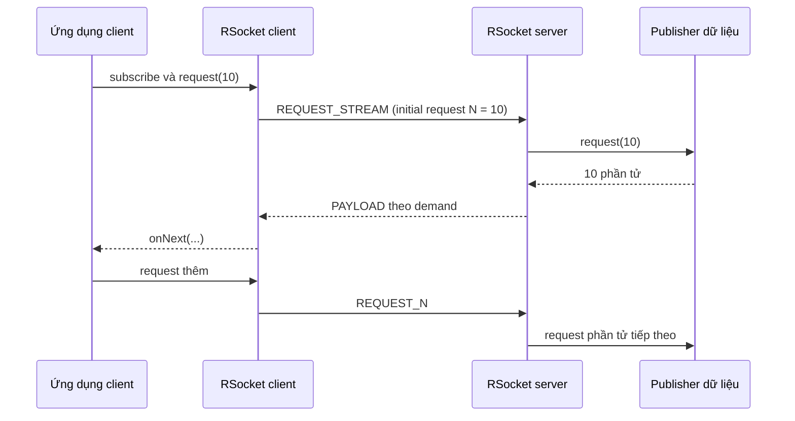

# Ảnh hưởng của prefetch, limitRate, publishOn và flatMap

RSocket dùng cơ chế demand để điều tiết dữ liệu trên các tương tác dạng stream. Subscriber yêu cầu số phần tử cần nhận; publisher chỉ nên phát trong giới hạn nhu cầu đó. Khi lập trình với Reactor, tham số `prefetch` cùng các operator `limitRate`, `publishOn` và `flatMap` thay đổi cách nhu cầu được truyền ngược lên nguồn dữ liệu. Chúng giúp tăng thông lượng hoặc tách công việc khỏi luồng xử lý hiện tại, nhưng cũng có thể làm tăng số phần tử đang chờ trong bộ đệm.

Trong một ứng dụng realtime, điều cần quan sát không chỉ là tốc độ server phát dữ liệu. Cần biết mỗi stream yêu cầu bao nhiêu phần tử, operator nào đang yêu cầu trước, có bao nhiêu tác vụ bất đồng bộ đang chạy đồng thời và dữ liệu đang được giữ ở những hàng đợi nào. Nếu các con số này không được kiểm soát, một client tiêu thụ chậm có thể làm tăng bộ nhớ sử dụng và kéo dài độ trễ.

## 1. Demand và backpressure trong RSocket

RSocket hỗ trợ flow control theo từng stream. Khi client khởi tạo `REQUEST_STREAM`, frame request có chứa số phần tử ban đầu mà client muốn nhận. Khi cần thêm dữ liệu, bên nhận gửi frame `REQUEST_N` để tăng lượng demand. Server theo dõi demand và không được phát nhiều phần tử hơn số lượng đã được yêu cầu cho stream đó.

Ở tầng Reactor, cơ chế này được thể hiện bằng Reactive Streams: subscriber gọi `request(n)` thông qua subscription, publisher nhận nhu cầu và phát tối đa `n` phần tử. Với RSocket Reactor integration, demand từ phía ứng dụng được chuyển thành yêu cầu tương ứng trong giao thức RSocket. Việc operator thay đổi nhu cầu sẽ ảnh hưởng tới số lượng `REQUEST_N` được gửi qua kết nối.



Demand là số lượng phần tử, không phải tốc độ theo thời gian. `request(100)` có nghĩa subscriber sẵn sàng nhận tối đa 100 phần tử đang được yêu cầu; nó không có nghĩa 100 phần tử mỗi giây. Nếu cần giới hạn theo thời gian, phải dùng cơ chế rate limiting riêng.

Backpressure cũng chỉ có tác dụng khi nguồn dữ liệu tôn trọng Reactive Streams. Nếu dữ liệu đến từ callback, message broker hoặc nguồn nóng không thể dừng phát, cần có chính sách đệm, loại bỏ hoặc giữ phần tử mới nhất phù hợp. Chỉ thêm `limitRate` ở downstream không thể buộc một nguồn không hỗ trợ backpressure ngừng phát dữ liệu.

## 2. Prefetch là gì?

`prefetch` là số lượng phần tử mà một operator yêu cầu từ upstream trước khi downstream tiêu thụ hết số phần tử hiện có. Thay vì chờ downstream yêu cầu từng phần tử rồi mới hỏi nguồn, operator có thể lấy trước một nhóm và lưu vào hàng đợi cục bộ. Cách này giảm số lần trao đổi demand và giúp pipeline tiếp tục xử lý khi downstream có tốc độ dao động.

Prefetch không phải một frame RSocket riêng. Đây là tham số của operator Reactor. Khi operator yêu cầu trước dữ liệu từ publisher RSocket, demand đó có thể được phản ánh thành initial request N hoặc các frame `REQUEST_N` trên stream.

Ví dụ, nếu một operator có prefetch 32, nó có thể yêu cầu trước tối đa 32 phần tử từ upstream. Khi các phần tử được tiêu thụ và hàng đợi gần cạn, operator sẽ yêu cầu thêm theo chính sách replenishment của nó. Chi tiết ngưỡng cấp thêm và giá trị mặc định phụ thuộc operator và phiên bản Reactor; vì vậy nên chỉ định rõ tham số ở những pipeline nhạy cảm về bộ nhớ hoặc độ trễ.

Prefetch lớn có thể tăng thông lượng vì nguồn có sẵn dữ liệu để xử lý ngay, nhưng cũng tăng bộ nhớ cần thiết cho hàng đợi. Prefetch nhỏ giảm số phần tử được giữ trước, song có thể làm pipeline thường xuyên phải chờ upstream bổ sung dữ liệu. Giá trị tốt phụ thuộc kích thước payload, độ trễ nguồn, thời gian xử lý từng phần tử và số stream đồng thời.

## 3. limitRate điều chỉnh nhu cầu upstream

`limitRate` giới hạn kích thước các đợt request được gửi tới upstream. Nó chia một request lớn từ downstream thành các đợt nhỏ hơn để tránh yêu cầu một lượng dữ liệu quá lớn cùng lúc.

Ví dụ:

```java
Flux<Quote> quotes = requester.route("prices.watch")
    .data(new PriceSubscription("ACME"))
    .retrieveFlux(Quote.class)
    .limitRate(64);
```

Trong ví dụ, client tiêu thụ luồng giá qua một publisher có `limitRate(64)`. Operator giới hạn mỗi đợt demand được chuyển upstream theo high-tide 64. Khi downstream tiếp tục tiêu thụ, operator bổ sung demand theo ngưỡng replenishment của nó.

Có thể điều chỉnh cả high-tide và low-tide:

```java
Flux<Quote> quotes = requester.route("prices.watch")
    .data(new PriceSubscription("ACME"))
    .retrieveFlux(Quote.class)
    .limitRate(64, 0);
```

Tham số thứ nhất là high-tide, tức giới hạn của một đợt request. Tham số thứ hai là low-tide, dùng để quyết định thời điểm cấp thêm demand. Đặt low-tide bằng `0` tạo hành vi theo từng lô nghiêm ngặt: operator chờ lô hiện tại được tiêu thụ hết rồi mới yêu cầu lô tiếp theo. Với low-tide khác `0`, operator có thể yêu cầu thêm trước khi toàn bộ lô cạn để pipeline ít bị ngắt quãng hơn.

`limitRate` không phải giới hạn tốc độ theo giây, không giới hạn số stream đồng thời và không trực tiếp giới hạn thời gian xử lý. High-tide cũng không phải giới hạn tổng số phần tử đang nằm trong mọi queue của pipeline; operator downstream vẫn có thể có prefetch và bộ đệm riêng. `limitRate` chỉ điều chỉnh số lượng demand được chuyển upstream. Nếu cần giới hạn số request mỗi giây hoặc số tác vụ chạy đồng thời, cần kết hợp công cụ phù hợp với mục tiêu đó.

### Dùng limitRate ở phía server

Server cũng có thể dùng `limitRate` để điều chỉnh cách publisher nội bộ nhận demand từ tầng RSocket responder:

```java
@MessageMapping("prices.watch")
public Flux<Quote> watch(PriceSubscription request) {
    return quoteService.stream(request.symbol())
        .limitRate(128)
        .map(this::toResponse);
}
```

Nếu `quoteService.stream` tôn trọng backpressure, `limitRate` giúp chia nhỏ nhu cầu từ responder tới nguồn dữ liệu. Nếu nguồn là một callback hoặc hot publisher không thể dừng phát, cần xem xét cách chuyển nguồn đó thành publisher có backpressure hoặc chọn chiến lược buffer/drop/latest có giới hạn.

## 4. publishOn tạo ranh giới bất đồng bộ và hàng đợi

`publishOn` chuyển việc xử lý các operator phía sau nó sang một Scheduler. Nó tạo một ranh giới bất đồng bộ: upstream phát tín hiệu vào hàng đợi, worker của Scheduler lấy phần tử ra và thực hiện các bước downstream.

Ví dụ:

```java
import reactor.core.scheduler.Schedulers;

Flux<QuoteView> views = requester.route("prices.watch")
    .data(new PriceSubscription("ACME"))
    .retrieveFlux(Quote.class)
    .publishOn(Schedulers.parallel(), 32)
    .map(this::toView);
```

Ở đây, `toView` chạy trên worker do `Schedulers.parallel()` cung cấp. Tham số `32` là prefetch của `publishOn`: operator yêu cầu trước một lượng phần tử và giữ chúng trong hàng đợi để worker xử lý. Nếu bước `toView` chậm hơn tốc độ upstream, hàng đợi có thể tăng tới giới hạn prefetch rồi demand upstream sẽ giảm hoặc tạm dừng cho đến khi có chỗ trống.

`publishOn` không tự làm một phép biến đổi tuần tự trở thành xử lý song song. Các tín hiệu downstream sau một `publishOn` cụ thể thường được xử lý tuần tự trên worker được cấp cho subscription đó. Muốn xử lý nhiều phần tử đồng thời, cần mô hình như `flatMap` hoặc `parallel` với Scheduler phù hợp.

Đặt `publishOn` quá sớm hoặc dùng prefetch quá lớn có thể làm nhiều payload nằm chờ trong bộ nhớ. Đặt nó sau một bước xử lý blocking có thể không giúp ích nếu blocking đã xảy ra trước ranh giới Scheduler. Với công việc blocking, cần chuyển công việc sang Scheduler phù hợp trước khi thực thi, thường là `subscribeOn(Schedulers.boundedElastic())` cho nguồn blocking hoặc `publishOn` trước bước blocking trong pipeline.

### publishOn khác subscribeOn

`publishOn` chuyển việc xử lý các tín hiệu downstream từ vị trí đặt operator trở đi. `subscribeOn` tác động tới nơi bắt đầu quá trình subscribe và thường được dùng để chạy phần subscription/upstream trên Scheduler khác. Hai operator giải quyết hai điểm khác nhau; không nên thêm cả hai theo thói quen nếu chưa xác định đoạn nào cần đổi luồng.

## 5. flatMap điều khiển số tác vụ bất đồng bộ đồng thời

`flatMap` biến mỗi phần tử upstream thành một publisher con rồi subscribe các publisher con đó. Các publisher con có thể chạy đồng thời; kết quả được phát khi từng publisher hoàn tất và có dữ liệu. Vì vậy, thứ tự kết quả có thể khác thứ tự phần tử đầu vào.

Hai tham số quan trọng của overload `flatMap(mapper, concurrency, prefetch)` là:

- `concurrency`: số publisher con tối đa được subscribe đồng thời. Nó giới hạn số tác vụ đang hoạt động cùng lúc.
- `prefetch`: số phần tử yêu cầu trước từ mỗi publisher con. Nó ảnh hưởng lượng dữ liệu được lấy trước và có thể được giữ trong các hàng đợi nội bộ.

Ví dụ làm giàu từng báo giá bằng một lời gọi bất đồng bộ:

```java
Flux<EnrichedQuote> enriched = quotes.flatMap(
    quote -> riskService.enrich(quote),
    8,
    1
);
```

Giả sử `riskService.enrich` trả về `Mono<EnrichedQuote>`. `concurrency = 8` cho phép tối đa tám lời gọi làm giàu đang được subscribe cùng lúc. `prefetch = 1` phù hợp với publisher con chỉ có tối đa một phần tử như `Mono`; tham số prefetch hữu ích rõ hơn khi publisher con có thể phát nhiều phần tử.

Nếu mỗi publisher con trả về một `Flux`, prefetch được áp dụng cho từng publisher con đang hoạt động. Chẳng hạn `concurrency = 8` và `prefetch = 16` có thể cho phép tối đa khoảng 128 phần tử được yêu cầu trước từ các publisher con, chưa tính các hàng đợi của operator khác và dữ liệu đang được xử lý. Đây là cách ước lượng tải, không phải cam kết mọi hàng đợi luôn đầy.

`flatMap` có thể tăng thông lượng khi công việc độc lập và I/O-bound, nhưng concurrency quá cao có thể làm quá tải database, HTTP service, CPU hoặc connection pool. Hãy chọn concurrency theo khả năng của dịch vụ phụ thuộc và đo tải thực tế.

### Thứ tự kết quả

`flatMap` không đảm bảo giữ thứ tự đầu vào. Nếu cần chạy publisher con đồng thời nhưng phát kết quả theo thứ tự nguồn, cân nhắc `flatMapSequential`. Nếu cần xử lý tuần tự từng phần tử và chỉ subscribe một publisher con tại một thời điểm, dùng `concatMap`. Hai lựa chọn này có đặc tính thông lượng và bộ đệm khác với `flatMap`.

## 6. Các operator tác động lẫn nhau như thế nào?

Các operator không hoạt động độc lập. Một operator phía downstream có thể yêu cầu trước dữ liệu từ operator upstream; operator upstream lại có thể có hàng đợi hoặc prefetch riêng. Vì vậy, khi đọc pipeline, cần xem nhu cầu được truyền từ cuối pipeline ngược lên nguồn.

Ví dụ:

```java
Flux<EnrichedQuote> stream = requester.route("prices.watch")
    .data(new PriceSubscription("ACME"))
    .retrieveFlux(Quote.class)
    .limitRate(64)
    .publishOn(Schedulers.parallel(), 32)
    .flatMap(riskService::enrich, 8, 1);
```

Pipeline này có một số giới hạn khác nhau:

1. `flatMap` subscribe tối đa tám publisher con của `riskService::enrich` cùng lúc.
2. `publishOn` tạo hàng đợi bất đồng bộ với prefetch 32 và chuyển bước xử lý tiếp theo sang Scheduler.
3. `limitRate(64)` chia các request từ downstream thành những đợt có high-tide tối đa 64 khi chuyển tới publisher RSocket.
4. RSocket chuyển demand của stream qua cơ chế flow control, để server chỉ phát số phần tử đã được yêu cầu.

Con số 64 không có nghĩa toàn pipeline chỉ giữ tối đa 64 phần tử. `publishOn` và `flatMap` có thể có các hàng đợi riêng. Mặt khác, nếu downstream chỉ yêu cầu ít hơn high-tide, `limitRate` không tự tạo thêm demand để lấp đầy một lô. Nhu cầu thực tế phụ thuộc vào cách các operator downstream request và tốc độ tiêu thụ.

Khi cần kiểm soát bộ nhớ, hãy lập sơ đồ các điểm có queue: `publishOn`, mỗi inner publisher của `flatMap`, buffer của nguồn, và các operator khác có prefetch. Sau đó ước lượng theo số subscription đồng thời và kích thước payload. Một cấu hình nhỏ cho một stream vẫn có thể tạo tổng tải lớn nếu hàng nghìn stream cùng hoạt động.

## 7. Ví dụ RSocket client có điều tiết luồng

Giả sử server cung cấp route `prices.watch` để phát giá liên tục. Client muốn chuyển dữ liệu sang mô hình giao diện và gọi một dịch vụ rủi ro bất đồng bộ để làm giàu thông tin. Có thể chia thành các bước rõ ràng:

```java
import reactor.core.publisher.Flux;
import reactor.core.scheduler.Schedulers;

Flux<Quote> source = requester.route("prices.watch")
    .data(new PriceSubscription("ACME"))
    .retrieveFlux(Quote.class);

Flux<QuoteView> views = source
    .limitRate(64, 0)
    .publishOn(Schedulers.parallel(), 32)
    .map(this::toView);

Flux<EnrichedQuote> enriched = views.flatMap(
    riskService::enrich,
    8,
    1
);
```

Ở ví dụ này, `limitRate(64, 0)` yêu cầu upstream theo lô nghiêm ngặt, `publishOn` tách bước tạo view sang worker và `flatMap` giới hạn số lời gọi làm giàu đồng thời. Đây là các giới hạn ở các tầng khác nhau; chúng cần được điều chỉnh dựa trên số stream, độ trễ dịch vụ rủi ro và kích thước mỗi báo giá.

Trong một ứng dụng giao diện, có thể subscribe ở tầng quản lý lifecycle và xử lý kết quả:

```java
Disposable subscription = enriched.subscribe(
    this::updateDashboard,
    error -> log.error("Price stream failed", error)
);

// Khi dashboard đóng hoặc người dùng rời màn hình:
subscription.dispose();
```

Hủy subscription sẽ dừng việc tiêu thụ stream ở phía client và có thể dẫn đến frame hủy tương tác trên RSocket nếu stream đã được thiết lập. Cần quản lý `Disposable` để tránh để các stream tiếp tục chạy sau khi màn hình hoặc phiên làm việc đã kết thúc.

## 8. Chọn giá trị prefetch và concurrency

Không có một bộ giá trị phù hợp cho mọi ứng dụng. Hãy bắt đầu từ giới hạn tài nguyên và đặc tính của dữ liệu:

| Tham số | Tăng giá trị thường dẫn đến | Giảm giá trị thường dẫn đến |
|---|---|---|
| Prefetch | Nhiều dữ liệu sẵn trong queue, ít chờ upstream hơn, bộ nhớ cao hơn | Queue nhỏ hơn, ít dữ liệu giữ trước, có thể chờ nguồn thường xuyên hơn |
| `limitRate` high-tide | Đợt request upstream lớn hơn | Đợt request nhỏ hơn, demand được chia mịn hơn |
| `publishOn` prefetch | Nhiều phần tử có thể chờ worker hơn | Ít phần tử chờ hơn, worker có thể dễ thiếu dữ liệu khi nguồn chậm |
| `flatMap` concurrency | Nhiều inner publisher chạy đồng thời hơn, tải phụ thuộc tăng | Ít tác vụ đồng thời hơn, có thể giảm thông lượng khi I/O độc lập |
| `flatMap` prefetch | Nhiều phần tử được yêu cầu trước từ mỗi inner publisher | Ít phần tử chờ hơn trong mỗi inner publisher |

Một cách ước lượng bộ nhớ là nhân số subscription đồng thời với số phần tử có thể nằm trong các queue và kích thước trung bình của payload. Ví dụ, 500 stream, mỗi stream có bốn queue giữ tối đa 32 payload, tương đương khoảng 64.000 vị trí phần tử trước khi tính các buffer khác. Cần tính thêm overhead của object Java, byte array, queue và dữ liệu được giữ bởi các publisher con.

Các giá trị mặc định của Reactor có thể khác theo operator và phiên bản. Đừng dựa vào một con số mặc định nhớ từ dự án cũ. Khi pipeline quan trọng về hiệu năng, hãy chỉ định tường minh prefetch/concurrency, ghi lại phiên bản Reactor và đo bằng workload gần với môi trường thật.

## 9. Những nhầm lẫn thường gặp

**Prefetch là tốc độ phát dữ liệu.** Không đúng. Prefetch là số phần tử yêu cầu trước, không phải số phần tử mỗi giây.

**limitRate giới hạn tốc độ theo thời gian.** Không đúng. Nó chia nhỏ demand upstream thành các đợt. Rate limit theo thời gian cần một cơ chế riêng.

**publishOn làm code chạy song song.** Không đúng. Nó chuyển các tín hiệu downstream sang Scheduler và tạo ranh giới bất đồng bộ; một subscription qua một `publishOn` vẫn xử lý tín hiệu tuần tự trên worker tương ứng.

**flatMap chỉ là map bất đồng bộ.** `flatMap` còn subscribe các publisher con đồng thời và có thể làm kết quả phát ra không theo thứ tự nguồn. Concurrency cần được giới hạn theo khả năng của dịch vụ phụ thuộc.

**Tăng prefetch luôn làm hệ thống nhanh hơn.** Prefetch cao có thể giảm thời gian chờ nhưng tăng bộ nhớ, độ trễ hàng đợi và số dữ liệu bị giữ khi downstream chậm.

**limitRate bảo vệ được mọi nguồn dữ liệu.** Chỉ nguồn tôn trọng backpressure mới có thể giảm tốc theo demand. Với hot source không thể dừng, phải chọn chiến lược buffer, drop hoặc latest có giới hạn.

**Một kết nối RSocket chỉ có một bộ demand.** Flow control được áp dụng theo stream. Nhiều stream multiplex trên một kết nối có thể có demand và tốc độ tiêu thụ khác nhau; tổng tài nguyên của các stream vẫn chia sẻ cùng tiến trình và kết nối.

## 10. Kiểm thử demand và hành vi backpressure

Reactor Test cung cấp `StepVerifier` để điều khiển lượng demand của subscriber. Ví dụ sau dùng một nguồn hữu hạn, tạo verifier với initial request bằng `0`, rồi yêu cầu từng phần tử theo từng đợt:

```java
import reactor.core.publisher.Flux;
import reactor.test.StepVerifier;

Flux<Integer> source = Flux.range(1, 10).limitRate(4);

StepVerifier.create(source, 0)
    .thenRequest(1)
    .expectNext(1)
    .thenRequest(2)
    .expectNext(2, 3)
    .thenCancel()
    .verify();
```

`StepVerifier` điều khiển demand mà test subscriber gửi xuống pipeline. Nếu pipeline có `publishOn` hoặc operator prefetch, upstream có thể đã nhận request trước nhiều hơn số phần tử mà verifier đang yêu cầu trực tiếp; điều này là hành vi dự kiến của operator cần kiểm tra.

Để kiểm tra tích hợp RSocket, nên chạy một server phát dữ liệu có thể quan sát số lần `request(n)` hoặc số phần tử được tạo. Client dùng `StepVerifier` để yêu cầu từng đợt, rồi xác nhận server không phát vượt quá demand giao thức. Cần kiểm thử riêng khi có `limitRate`, `publishOn` và `flatMap`, bởi mỗi operator có thể thay đổi hình dạng demand và số phần tử đang được giữ.

Khi đo hiệu năng, theo dõi ít nhất: số stream đang hoạt động, số phần tử được yêu cầu, độ dài queue nếu có metric, heap usage, thời gian xử lý mỗi phần tử, độ trễ end-to-end, số tác vụ inner đang chạy và số lỗi timeout/cancel. Chỉ đo throughput tổng thể có thể che khuất tình trạng queue tăng hoặc latency xấu đi.

## 11. Hướng dẫn chọn operator theo mục tiêu

| Mục tiêu | Operator/cấu hình nên xem xét | Điều cần quan sát |
|---|---|---|
| Chia nhỏ request lớn gửi upstream | `limitRate(highTide, lowTide)` | Số phần tử mỗi đợt và thời điểm replenishment |
| Tách xử lý khỏi luồng hiện tại | `publishOn(scheduler, prefetch)` | Queue, Scheduler, thời gian xử lý downstream |
| Chạy nhiều lời gọi I/O độc lập | `flatMap(mapper, concurrency, prefetch)` | Số tác vụ đang chạy, tải dịch vụ phụ thuộc, thứ tự kết quả |
| Giữ thứ tự trong khi xử lý inner publisher đồng thời | `flatMapSequential` | Buffer chờ kết quả trước đó và độ trễ |
| Xử lý inner publisher tuần tự | `concatMap` | Thông lượng và thời gian chờ từng phần tử |
| Giảm lượng dữ liệu được giữ trước | Giảm prefetch hoặc concurrency | Tình trạng thiếu dữ liệu và mức dùng bộ nhớ |

Hãy thay đổi từng tham số một và chạy cùng một kịch bản tải. Ghi lại throughput, p95/p99 latency, heap, số stream và tải hệ thống phụ thuộc. Nếu tăng prefetch làm throughput chỉ cải thiện rất ít nhưng heap tăng mạnh, cấu hình mới có thể không đáng giá. Nếu giảm concurrency làm latency tăng vì các tác vụ I/O phải xếp hàng, hãy cân nhắc nâng giới hạn trong khả năng chịu tải của dependency.

## 12. Kết luận

`prefetch` quyết định lượng dữ liệu operator lấy trước; `limitRate` chia nhỏ demand gửi upstream; `publishOn` tạo ranh giới Scheduler cùng hàng đợi; `flatMap` điều khiển số publisher con được xử lý đồng thời và lượng dữ liệu lấy trước từ mỗi publisher con. Mỗi operator tác động tới demand và bộ nhớ ở một điểm khác nhau trong pipeline.

Trong ứng dụng RSocket, các lựa chọn này ảnh hưởng tới cách demand Reactor được chuyển thành flow control trên stream. Hãy xem toàn bộ pipeline từ subscriber ngược về nguồn, xác định mọi queue và giới hạn concurrency, rồi đo dưới tải thực tế. Cấu hình tốt là cấu hình giữ được thông lượng cần thiết, độ trễ ổn định và mức sử dụng tài nguyên nằm trong giới hạn của hệ thống.
