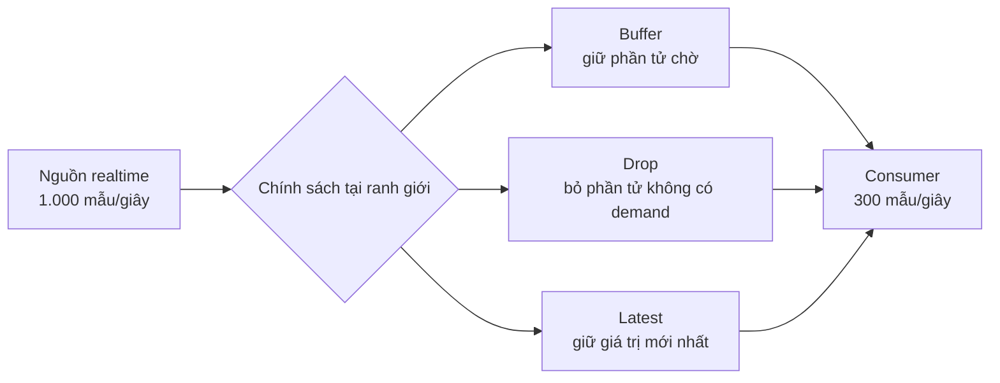
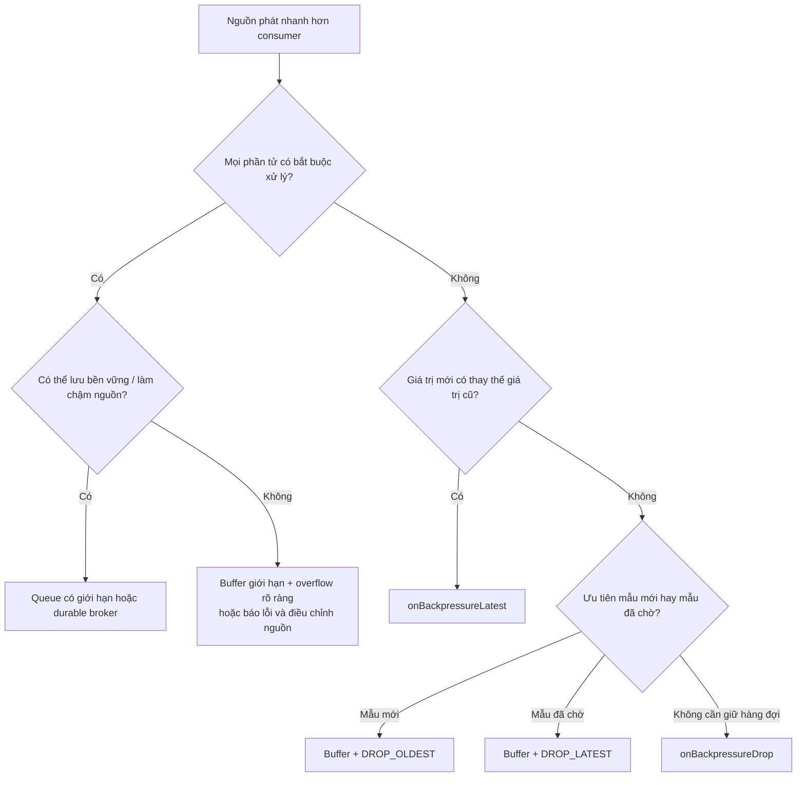

# Xử lý nguồn không tuân theo nhu cầu: đệm, bỏ bớt hoặc giữ giá trị mới nhất

Reactive Streams dùng backpressure để subscriber báo cho publisher biết mình muốn nhận bao nhiêu phần tử. Khi nguồn dữ liệu tuân thủ nhu cầu, publisher chỉ phát trong giới hạn subscriber đã yêu cầu. Nhưng nhiều nguồn realtime là nguồn nóng hoặc được điều khiển bởi hệ thống bên ngoài: cảm biến, callback, event listener hay bộ thu thập metrics vẫn phát dữ liệu dù consumer đang bận.

Khi không thể làm chậm nguồn, ứng dụng phải quyết định dữ liệu nào cần giữ. Reactor cung cấp các chính sách như **buffer**, **drop** và **latest** để xử lý phần tử đến nhanh hơn khả năng tiêu thụ. Lựa chọn chính sách ảnh hưởng trực tiếp tới độ trễ, bộ nhớ, thứ tự dữ liệu và tính đúng đắn nghiệp vụ của stream RSocket.

## Mục tiêu học tập

Sau bài học, người học có thể:

- Giải thích vì sao một nguồn nóng hoặc không tuân theo demand có thể làm consumer bị quá tải.
- Phân biệt backpressure thực sự với việc đệm hoặc loại bỏ dữ liệu tại một ranh giới.
- Chọn giữa buffer, drop, drop-oldest, drop-latest và latest theo ý nghĩa của dữ liệu.
- Cấu hình các toán tử Reactor tương ứng trong pipeline Java.
- Đặt giới hạn bộ nhớ, xử lý overflow và đo lường dữ liệu bị loại bỏ.
- Tích hợp chính sách phù hợp với `Flux` trả về từ RSocket server hoặc nguồn dữ liệu gửi qua request-channel.

## 1. Khi nguồn phát nhanh hơn consumer

Trong một pipeline reactive, subscriber gửi yêu cầu `request(n)` để chỉ ra số phần tử nó sẵn sàng nhận. Publisher tuân thủ Reactive Streams sẽ không phát quá số lượng đã được yêu cầu. Demand có thể được truyền ngược qua các operator để điều tiết nguồn dữ liệu.

Tuy nhiên, không phải nguồn nào cũng có thể tạm dừng. Một cảm biến có thể phát mẫu theo clock phần cứng; thư viện bên thứ ba có thể gọi callback theo tốc độ riêng; một event bus nóng có thể phát sự kiện ngay khi chúng xuất hiện. Những nguồn này có thể tiếp tục phát dù downstream đang xử lý chậm hoặc tạm thời không có demand.

Ví dụ, một thiết bị phát 1.000 số đo mỗi giây, trong khi dịch vụ phân tích chỉ xử lý được 300 số đo mỗi giây. Nếu giữ lại mọi số đo, hàng đợi sẽ tăng dần. Nếu không thể điều tiết thiết bị, ứng dụng phải quyết định có nên đệm, bỏ một phần mẫu hay chỉ giữ mẫu mới nhất.



Không có chính sách nào làm nguồn vật lý chậm lại. Các toán tử backpressure của Reactor tạo một ranh giới giữa nguồn và downstream: chúng thường yêu cầu upstream phát tối đa, sau đó áp dụng chính sách lưu hoặc bỏ phần tử khi downstream chưa có đủ demand. Đây là cách bảo vệ phần còn lại của pipeline; nó không thay thế khả năng điều tiết thật sự ở nguồn.

## 2. Backpressure thật và chính sách xử lý tại ranh giới

Hai tình huống cần được phân biệt:

**Nguồn tuân thủ demand:** khi subscriber chưa yêu cầu thêm phần tử, nguồn chờ. Không cần tích lũy vô hạn dữ liệu ở giữa vì tốc độ phát có thể được điều tiết từ consumer.

**Nguồn không thể hoặc không tuân thủ demand:** dữ liệu vẫn tới. Ứng dụng cần một chính sách để xác định phần tử nào được chuyển tiếp và phần tử nào được lưu hoặc bỏ.

| Chính sách | Khi downstream chưa có demand | Kết quả khi demand tiếp tục |
|---|---|---|
| Buffer | Lưu phần tử vào hàng đợi | Phát lại các phần tử đã giữ theo thứ tự |
| Drop | Bỏ phần tử mới đến | Chỉ nhận các phần tử đến khi có demand |
| Drop oldest | Khi buffer đầy, bỏ phần tử cũ nhất để nhận phần tử mới | Giữ xu hướng dữ liệu mới hơn, vẫn có hàng đợi giới hạn |
| Drop latest | Khi buffer đầy, bỏ phần tử mới đến, giữ những phần tử đã chờ | Các phần tử đã nằm trong buffer được giữ lại |
| Latest | Chỉ giữ một phần tử mới nhất đang chờ | Phát giá trị mới nhất; các giá trị chờ cũ bị thay thế |

Buffer, drop và latest là các quyết định về dữ liệu. Chúng không tương đương nhau và không nên được chọn chỉ dựa vào việc toán tử nào dễ viết nhất.

## 3. Buffer: giữ dữ liệu để xử lý sau

Buffer phù hợp khi mỗi sự kiện đều có giá trị và consumer chỉ chậm trong những khoảng ngắn. Các phần tử được xếp hàng để downstream xử lý sau khi có demand. Buffer thường giữ thứ tự đến, giúp consumer tiếp tục xử lý chuỗi sự kiện theo trình tự ban đầu.

Reactor có `onBackpressureBuffer()` để đệm phần tử khi downstream thiếu demand. Dạng không giới hạn có thể giữ số lượng phần tử tăng không giới hạn nếu nguồn tiếp tục phát và consumer không theo kịp. Với nguồn nóng hoặc chạy lâu, đây là nguy cơ hết bộ nhớ.

Nên ưu tiên buffer có giới hạn:

```java
Flux<Reading> bufferedReadings = sensorSource
        .onBackpressureBuffer(
                512,
                dropped -> overflowCounter.increment()
        );
```

Ví dụ này giữ tối đa 512 phần tử đang chờ. Khi buffer đầy, Reactor phát lỗi overflow; callback được gọi cho phần tử không thể thêm vào buffer. Ứng dụng cần quan sát lỗi và quyết định có kết thúc stream, báo lỗi hay khởi động lại pipeline.

Nếu cần chính sách khi buffer đầy, Reactor hỗ trợ `BufferOverflowStrategy`: 

```java
import reactor.core.publisher.BufferOverflowStrategy;

Flux<Reading> keepRecentQueue = sensorSource
        .onBackpressureBuffer(
                512,
                dropped -> overflowCounter.increment(),
                BufferOverflowStrategy.DROP_OLDEST
        );
```

Các chiến lược thường dùng:

- `ERROR`: báo lỗi khi không thể thêm phần tử do buffer đã đầy.
- `DROP_OLDEST`: bỏ phần tử cũ nhất đang nằm trong buffer để chừa chỗ cho phần tử mới.
- `DROP_LATEST`: bỏ phần tử mới đến khi buffer đầy, giữ lại những phần tử đã được xếp hàng.

Tên `DROP_LATEST` ở đây chỉ phần tử mới đến bị loại khi buffer đầy; nó không giống toán tử `onBackpressureLatest()`, vốn thay thế phần tử đang chờ bằng giá trị mới nhất.

### Chọn kích thước buffer

Kích thước buffer nên dựa trên tốc độ nguồn và khoảng thời gian consumer có thể bị chậm. Một ước lượng ban đầu:

```text
capacity >= peak rate * maximum pause + burst margin
```

Ví dụ, nguồn có thể phát đỉnh 200 phần tử/giây và consumer có thể tạm dừng 2 giây. Riêng phần thời gian tạm dừng cần khoảng 400 phần tử; cần cộng thêm biên cho burst và biến động tải. Đây chỉ là ước lượng, cần kiểm chứng bằng kích thước thực tế của từng phần tử và giới hạn bộ nhớ.

Buffer không giới hạn chỉ phù hợp với luồng hữu hạn có giới hạn rõ ràng hoặc trường hợp đã có cơ chế kiểm soát dung lượng bên ngoài. Với nguồn vô hạn, luôn phải cân nhắc capacity và hành vi overflow.

## 4. Drop: bỏ phần tử khi không có demand

Drop phù hợp khi từng mẫu riêng lẻ không bắt buộc phải được xử lý. Nếu consumer đang bận, phần tử mới tới sẽ bị bỏ thay vì đưa vào hàng đợi. Khi downstream có demand trở lại, nguồn tiếp tục chuyển các phần tử mới.

```java
Flux<Reading> sampledReadings = sensorSource
        .onBackpressureDrop(dropped -> droppedCounter.increment());
```

Toán tử `onBackpressureDrop()` có thể nhận callback để ghi nhận phần tử bị bỏ. Việc đo số lượng bị bỏ rất quan trọng: nếu chỉ dùng drop mà không quan sát, hệ thống có thể âm thầm mất dữ liệu trong thời gian tải cao.

Drop phù hợp với:

- Mẫu telemetry có tần suất cao, khi chỉ cần một phần mẫu để quan sát xu hướng.
- Metrics cập nhật thường xuyên mà giá trị cũ nhanh chóng mất ý nghĩa.
- Sự kiện UI hoặc trạng thái trung gian có thể bỏ qua khi consumer bận.

Không nên dùng drop cho lệnh cần thực thi, giao dịch, sự kiện kiểm toán hoặc thay đổi trạng thái mà mọi phần tử đều quan trọng. Với dữ liệu đó, cần queue bền vững, xử lý theo batch hoặc giao thức có xác nhận.

## 5. Drop oldest và drop latest khi buffer đầy

Hai chiến lược này đều giữ buffer trong một giới hạn xác định, nhưng chọn phần tử bị loại khác nhau:

| Chiến lược | Buffer trước khi phần tử mới đến | Phần tử bị loại | Buffer sau khi nhận phần tử mới |
|---|---|---|---|
| `DROP_OLDEST` | `[1, 2, 3, 4]` | `1` | `[2, 3, 4, 5]` |
| `DROP_LATEST` | `[1, 2, 3, 4]` | `5` | `[1, 2, 3, 4]` |

`DROP_OLDEST` thường phù hợp với dữ liệu trạng thái hoặc telemetry mà giá trị gần hiện tại quan trọng hơn lịch sử xa. `DROP_LATEST` phù hợp khi các phần tử đã xếp hàng cần được xử lý trước, còn mẫu mới có thể bỏ nếu hệ thống tạm thời quá tải.

Ví dụ cấu hình `DROP_OLDEST`: 

```java
Flux<Reading> recentQueue = sensorSource
        .onBackpressureBuffer(
                256,
                dropped -> droppedCounter.increment(),
                BufferOverflowStrategy.DROP_OLDEST
        );
```

Không nên nhầm `DROP_LATEST` với `onBackpressureLatest()`. Chiến lược buffer vẫn có thể giữ nhiều phần tử cũ; `onBackpressureLatest()` chỉ giữ một phần tử đang chờ và thay thế nó khi có giá trị mới.

## 6. Latest: chỉ giữ giá trị mới nhất đang chờ

`onBackpressureLatest()` phù hợp với dữ liệu biểu diễn trạng thái hiện tại. Khi downstream chưa có demand, mỗi giá trị mới thay thế giá trị trước đó đang chờ. Khi downstream sẵn sàng nhận, nó nhận giá trị mới nhất tại thời điểm đó.

```java
Flux<DeviceState> currentState = stateUpdates
        .onBackpressureLatest();
```

Ví dụ, dashboard hiển thị vị trí mới nhất của robot. Nếu giao diện đang bận render, việc phát lại 200 vị trí cũ thường không hữu ích; nó chỉ cần vị trí gần nhất để cập nhật màn hình. Latest giữ một giá trị đang chờ nên giới hạn bộ nhớ cho phần tử pending ở mức rất nhỏ.

Latest phù hợp với:

- Trạng thái thiết bị hiện tại.
- Vị trí hiện tại, giá hiện tại hoặc giá trị đo gần nhất.
- Snapshot cấu hình hoặc tiến độ mà giá trị mới thay thế giá trị cũ.
- Dashboard ưu tiên độ mới của dữ liệu hơn việc xem lại toàn bộ lịch sử.

Latest không phù hợp khi mỗi phần tử là một sự kiện độc lập cần được xử lý, ví dụ lệnh mở van, giao dịch hoặc từng bước của một workflow. Việc giữ giá trị cuối cùng có thể làm mất các chuyển trạng thái trung gian quan trọng.

## 7. Chọn chính sách theo ý nghĩa dữ liệu



| Loại dữ liệu | Chính sách gợi ý | Lý do |
|---|---|---|
| Lệnh điều khiển hoặc giao dịch | Durable queue / request có xác nhận | Mọi thao tác cần được xử lý và đối soát |
| Event nghiệp vụ cần giữ thứ tự | Buffer giới hạn, overflow phải được xử lý | Giữ thứ tự trong phạm vi queue; không âm thầm loại bỏ |
| Telemetry tần suất cao, lịch sử mẫu có ích | Buffer giới hạn hoặc drop có metric | Cân bằng độ đầy đủ và tài nguyên |
| Trạng thái hiện tại | Latest | Giá trị mới thay thế giá trị cũ |
| Snapshot UI khi quá tải | Drop-oldest hoặc latest | Ưu tiên dữ liệu gần hiện tại |
| Batch đã xếp hàng cần hoàn tất trước | Drop-latest khi buffer đầy | Giữ phần tử đã chờ, bỏ mẫu đến sau |

Nếu mọi phần tử đều bắt buộc xử lý mà nguồn không thể chậm lại, buffer trong bộ nhớ không giải quyết được bài toán lâu dài. Cần một cơ chế lưu bền vững, giới hạn tốc độ ở producer hoặc phản hồi lỗi để upstream điều chỉnh.

## 8. Áp dụng với RSocket và Spring Boot

RSocket flow control truyền nhu cầu nhận payload giữa hai peer. Với `request-stream`, client gửi request ban đầu cùng nhu cầu nhận; khi cần thêm phần tử, nó gửi `REQUEST_N`. Với `request-channel`, hai phía có thể gửi chuỗi payload và mỗi hướng cần được tiêu thụ theo demand tương ứng.

Nếu handler trả về một `Flux` tuân thủ Reactive Streams, demand từ RSocket có thể truyền ngược tới publisher. Nhưng khi `Flux` được tạo từ một nguồn nóng không thể tạm dừng, server cần chọn chính sách tại ranh giới nguồn đó.

Ví dụ handler cung cấp trạng thái cảm biến mới nhất:

```java
@Controller
public class DeviceStreamController {

    private final DeviceStateService stateService;

    public DeviceStreamController(DeviceStateService stateService) {
        this.stateService = stateService;
    }

    @MessageMapping("devices.{deviceId}.state")
    public Flux<DeviceState> state(
            @DestinationVariable String deviceId) {
        return stateService.hotUpdates(deviceId)
                .onBackpressureLatest();
    }
}
```

Client nhận chuỗi trạng thái bằng `retrieveFlux(DeviceState.class)`. Nếu client chậm, RSocket demand điều tiết publisher; tại ranh giới nguồn nóng, `onBackpressureLatest()` giữ giá trị mới nhất đang chờ. Các trạng thái trung gian có thể bị bỏ, nên chỉ dùng cách này khi semantics nghiệp vụ cho phép.

Ví dụ khác, nếu cần giữ một lượng telemetry ngắn hạn trước khi xử lý:

```java
@MessageMapping("devices.{deviceId}.readings")
public Flux<Reading> readings(
        @DestinationVariable String deviceId) {
    return telemetryService.hotReadings(deviceId)
            .onBackpressureBuffer(
                    1024,
                    dropped -> overflowCounter.increment()
            );
}
```

Khi buffer đầy, pipeline phát lỗi overflow. Hệ thống nên theo dõi lỗi này và quyết định có đóng stream, báo lỗi cho client hoặc chuyển sang nguồn lưu bền vững. Không nên để buffer không giới hạn chạy lâu dài trên connection realtime.

## 9. Vị trí đặt toán tử và các hàng đợi khác trong pipeline

Đặt chính sách càng gần nguồn không tuân theo demand càng dễ hiểu ranh giới nào đang chịu trách nhiệm giữ hoặc bỏ dữ liệu:

```java
Flux<Reading> readings = externalSensorSource
        .onBackpressureBuffer(512, dropped -> overflowCounter.increment())
        .publishOn(Schedulers.parallel())
        .map(this::enrich);
```

Trong ví dụ này, chính sách buffer nằm ngay sau nguồn. Các operator phía sau vẫn có thể có prefetch hoặc queue riêng, ví dụ `publishOn`. Do đó, tổng lượng phần tử đang chờ có thể lớn hơn capacity của buffer được khai báo. Khi thiết kế, cần xem xét tất cả queue, prefetch, số subscriber và kích thước phần tử, không chỉ một con số `512`.

Tránh xếp nhiều lớp buffer lớn mà không có mục đích rõ ràng. Nếu downstream tiếp tục chậm, việc tăng buffer chỉ trì hoãn thời điểm quá tải và làm tăng độ trễ. Một queue có giới hạn cùng metric overflow thường dễ vận hành hơn một chuỗi hàng đợi không được quan sát.

## 10. Kiểm thử và quan sát

Khi kiểm thử các chính sách, hãy tạo nguồn phát nhanh hơn demand của subscriber để kiểm tra đúng hành vi:

| Kiểm thử | Điều cần xác minh |
|---|---|
| Buffer còn chỗ | Phần tử được giữ và phát theo thứ tự khi demand quay lại |
| Buffer đạt capacity | Overflow phát lỗi hoặc áp dụng đúng chiến lược drop đã chọn |
| Drop khi không có demand | Phần tử mới đến bị bỏ và callback/metric được cập nhật |
| Drop-oldest | Phần tử cũ nhất đang chờ bị thay thế khi buffer đầy |
| Drop-latest | Phần tử mới đến bị bỏ khi buffer đầy |
| Latest | Chỉ giá trị mới nhất đang chờ được phát khi demand quay lại |
| Hủy subscription | Nguồn listener được tháo hoặc tài nguyên được giải phóng đúng cách |
| Nhiều subscriber | Chính sách và tài nguyên được quản lý đúng phạm vi subscriber/connection |

Nên theo dõi các chỉ số:

- Số phần tử nguồn phát ra và số phần tử consumer nhận được.
- Số phần tử bị drop, bị thay thế hoặc bị từ chối khi buffer đầy.
- Số lần overflow và số stream kết thúc do overflow.
- Độ trễ từ lúc tạo event đến lúc consumer xử lý.
- Queue depth, dung lượng bộ nhớ, tốc độ phát và tốc độ tiêu thụ.
- Số subscriber/connection đang hoạt động và thời gian xử lý trung bình.

Đối với RSocket, kết hợp metric của pipeline với số lượng payload được yêu cầu qua flow control và trạng thái connection. Nếu consumer không nhận đủ dữ liệu, cần phân biệt nguồn không phát, subscriber không có demand, operator đang drop, buffer overflow hay connection đã đóng.

## 11. Các lỗi thiết kế thường gặp

| Lỗi | Hậu quả | Cách khắc phục |
|---|---|---|
| Dùng buffer không giới hạn cho nguồn vô hạn | Bộ nhớ tăng liên tục, cuối cùng có thể hết heap | Dùng capacity hữu hạn và chính sách overflow |
| Dùng drop cho lệnh quan trọng | Mất thao tác nghiệp vụ | Durable queue hoặc request có xác nhận |
| Dùng latest cho event cần giữ thứ tự | Mất các chuyển trạng thái trung gian | Buffer hoặc lưu bền vững |
| Chọn buffer quá lớn để che consumer chậm | Độ trễ tăng và áp lực bộ nhớ kéo dài | Điều chỉnh producer/consumer, giới hạn queue |
| Không đo số phần tử bị drop | Mất dữ liệu âm thầm | Metric và cảnh báo theo tỷ lệ drop |
| Đặt policy quá xa nguồn nóng | Các queue trung gian có thể tăng trước khi policy được áp dụng | Đặt backpressure boundary sát nguồn |
| Retry sau overflow mà không có event ID | Có thể xử lý trùng | Idempotency và deduplication |

## Kết luận

Khi nguồn realtime không thể tuân theo demand, ứng dụng phải chọn dữ liệu nào được giữ ở ranh giới backpressure. Buffer giữ phần tử để xử lý sau nhưng cần giới hạn và chính sách overflow. Drop bỏ phần tử mới khi downstream chưa sẵn sàng. Drop-oldest ưu tiên mẫu mới hơn trong một hàng đợi hữu hạn; drop-latest giữ những phần tử đã chờ. `onBackpressureLatest()` chỉ giữ giá trị mới nhất đang chờ, phù hợp với snapshot trạng thái. Hãy chọn dựa trên ý nghĩa nghiệp vụ, giới hạn tài nguyên và metric quan sát; với dữ liệu bắt buộc phải xử lý, hãy dùng điều tiết nguồn hoặc lưu bền vững thay vì âm thầm bỏ mẫu.

## Tài liệu tham khảo

- [Project Reactor Reference – Backpressure](https://projectreactor.io/docs/core/release/reference/)
- [Reactive Streams Specification](https://www.reactive-streams.org/)
- [RSocket Protocol – Flow Control](https://rsocket.io/about/protocol/)
