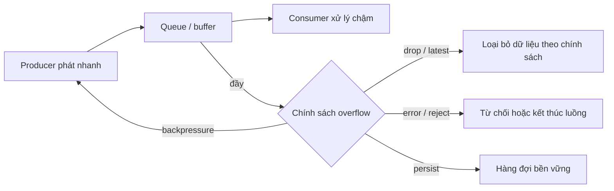

# Giới hạn bộ đệm và chính sách khi vượt khả năng tiếp nhận

Trong hệ thống realtime, tốc độ tạo dữ liệu có lúc cao hơn tốc độ xử lý hoặc tiêu thụ. Nếu producer tiếp tục phát dữ liệu trong khi consumer bị chậm, các phần tử sẽ tích tụ trong hàng đợi, làm tăng độ trễ và mức dùng bộ nhớ. Khi hàng đợi không có giới hạn, một đợt tăng tải ngắn cũng có thể làm heap tăng liên tục và khiến toàn bộ dịch vụ mất ổn định.

RSocket hỗ trợ điều tiết luồng bằng demand theo Reactive Streams. Tuy nhiên, demand ở tầng giao thức không tự động giới hạn mọi queue trong ứng dụng. Nhà phát triển vẫn phải chọn dung lượng buffer, giới hạn số tác vụ đồng thời và quyết định cách xử lý khi hệ thống không thể tiếp nhận thêm dữ liệu.

## 1. Vì sao cần giới hạn bộ đệm?

Giả sử một dịch vụ nhận 5.000 sự kiện mỗi giây nhưng chỉ xử lý được 2.000 sự kiện mỗi giây. Chênh lệch 3.000 sự kiện mỗi giây sẽ tích lũy thành backlog nếu không có cơ chế giảm tốc, từ chối hoặc loại bỏ dữ liệu.



Buffer giúp hấp thụ dao động tải ngắn hạn. Nó không làm tăng năng lực xử lý lâu dài. Nếu tốc độ đầu vào luôn cao hơn tốc độ đầu ra, mọi buffer hữu hạn cuối cùng cũng đầy. Do đó cần quyết định trước điều gì sẽ xảy ra tại thời điểm đó.

Giới hạn buffer giúp:

- Giữ mức sử dụng bộ nhớ trong ngân sách có thể dự đoán.
- Tránh một stream chậm chiếm tài nguyên của toàn bộ kết nối hoặc tiến trình.
- Kiểm soát độ trễ và kích thước backlog.
- Tạo điểm kích hoạt rõ ràng cho việc drop, báo lỗi, từ chối hoặc chuyển dữ liệu sang lưu trữ bền vững.

## 2. Demand của RSocket và giới hạn buffer là hai cơ chế khác nhau

Trong RSocket, requester của `REQUEST_STREAM` hoặc `REQUEST_CHANNEL` gửi số lượng phần tử mà nó sẵn sàng nhận. Thông tin demand được truyền qua giá trị request-N trong frame mở đầu và các frame `REQUEST_N` tiếp theo. Responder chỉ nên phát số payload được phép theo demand còn lại.

Với Spring RSocket, luồng demand được ánh xạ vào Reactive Streams của Reactor. Khi subscriber yêu cầu thêm phần tử, demand có thể truyền ngược qua pipeline tới publisher. Nếu publisher hỗ trợ backpressure, nó có thể giảm tốc độ phát để phù hợp với tốc độ tiêu thụ.

| Cơ chế | Kiểm soát điều gì? | Giới hạn của cơ chế |
|---|---|---|
| RSocket request-N | Số payload mà requester sẵn sàng nhận trên stream | Không đặt dung lượng cho mọi queue nội bộ của ứng dụng |
| Reactive Streams demand | Số phần tử subscriber yêu cầu từ publisher | Chỉ điều tiết được publisher và operator tuân thủ demand |
| Buffer hữu hạn | Số phần tử được giữ tạm trong một queue | Khi đầy vẫn cần chính sách overflow |
| Giới hạn concurrency | Số tác vụ hoặc request được xử lý đồng thời | Không tự giới hạn dữ liệu đang chờ ở queue khác |
| Admission control / lease | Khả năng tiếp nhận request mới trong một khoảng thời gian | Không thay thế flow control của các stream đang chạy |

`REQUEST_STREAM` có một hướng dữ liệu chính từ responder về requester. Với `REQUEST_CHANNEL`, hai phía đều có thể gửi payload; demand cho dữ liệu đi theo từng hướng được quản lý riêng. Việc requester chậm tiêu thụ phản hồi không đồng nghĩa server được phép nhận vô hạn dữ liệu đầu vào của channel.

`REQUEST_RESPONSE` chỉ trả tối đa một payload phản hồi nên không có chuỗi phần tử cần điều tiết như stream. `FIRE_AND_FORGET` không có luồng phản hồi để requester dùng demand điều khiển; ứng dụng gửi fire-and-forget phải tự giới hạn tốc độ, số tác vụ đang chờ hoặc dùng cơ chế xác nhận ở tầng nghiệp vụ khi cần bảo đảm tiếp nhận.

Một cách ghi nhớ: **demand điều khiển tốc độ phát theo nhu cầu; buffer hấp thụ phần chênh lệch còn lại; overflow policy quyết định hành vi khi phần chênh lệch vượt dung lượng**.

## 3. Chọn dung lượng buffer theo tải và bộ nhớ

Dung lượng buffer nên được tính từ số phần tử có thể chờ và kích thước thực tế của mỗi phần tử, thay vì chọn một con số tùy ý.

Một ước lượng đơn giản:

\[
M_{queue} \approx N_{queue} \times C_{queue} \times S_{item}
\]

Trong đó:

- \(N_{queue}\) là số queue có thể tồn tại đồng thời, ví dụ số stream hoặc số subscriber.
- \(C_{queue}\) là sức chứa tối đa của mỗi queue tính theo số phần tử.
- \(S_{item}\) là kích thước trung bình của một phần tử trong heap, gồm object và dữ liệu được tham chiếu.

Ví dụ có 80 stream hoạt động, mỗi stream giữ tối đa 256 phần tử, kích thước trung bình mỗi phần tử trong heap là 2 KB:

\[
80 \times 256 \times 2\ KB = 40\ MB
\]

Đây chỉ là phần bộ nhớ ước tính dành cho các phần tử trong queue. Nó chưa tính overhead của queue, object header, buffer mã hóa, operator prefetch, dữ liệu đang xử lý, các queue khác và bộ nhớ của runtime. Khi thiết kế, hãy dành khoảng trống an toàn cho những phần này.

Các yếu tố cần cân nhắc:

1. **Tốc độ đầu vào và đầu ra:** chênh lệch càng lớn thì queue đầy càng nhanh.
2. **Thời gian chờ tối đa:** queue lớn có thể giữ dữ liệu lâu hơn và làm phản hồi cũ đi.
3. **Kích thước phần tử:** một phần tử JSON nhỏ và một payload chứa ảnh hoặc object lớn có chi phí bộ nhớ rất khác nhau.
4. **Số stream đồng thời:** giới hạn 256 phần tử trên một stream vẫn có thể tạo hàng chục hoặc hàng trăm MB nếu nhiều stream cùng hoạt động.
5. **Độ quan trọng của dữ liệu:** dữ liệu đo trạng thái mới nhất có thể bỏ qua giá trị cũ; giao dịch hoặc lệnh nghiệp vụ thường cần lưu bền vững hoặc từ chối rõ ràng.

Buffer nên được giới hạn theo cả số phần tử và kích thước byte nếu payload có độ lớn biến thiên mạnh. Một queue giới hạn 500 phần tử vẫn có thể tiêu thụ quá nhiều bộ nhớ nếu mỗi phần tử rất lớn.

## 4. Các chính sách khi buffer đầy

Không có chính sách overflow phù hợp cho mọi loại dữ liệu. Hãy chọn dựa trên yêu cầu mất dữ liệu, thứ tự và độ mới của thông tin.

| Chính sách | Hành vi khi không tiếp nhận thêm | Phù hợp với | Đánh đổi |
|---|---|---|---|
| Backpressure | Giảm demand hoặc yêu cầu producer phát chậm lại | Publisher hỗ trợ demand và có thể điều tiết nguồn | Không hiệu quả nếu nguồn là hot producer không thể dừng |
| Buffer hữu hạn + error | Kết thúc stream bằng lỗi khi queue đầy | Dữ liệu cần phát hiện quá tải rõ ràng | Consumer phải xử lý lỗi và quyết định phục hồi |
| Drop latest | Bỏ phần tử mới đến khi buffer đầy | Giữ các phần tử đã xếp hàng, ưu tiên dữ liệu cũ hơn | Thông tin mới nhất có thể bị mất |
| Drop oldest | Bỏ phần tử cũ nhất để nhận phần tử mới | Telemetry hoặc trạng thái cần giữ thông tin mới | Có thể bỏ qua sự kiện cũ chưa xử lý |
| Latest only | Chỉ giữ giá trị gần nhất trong lúc downstream chậm | Snapshot, giá trị nhiệt độ, vị trí hoặc trạng thái hiện tại | Không phù hợp với sự kiện cần xử lý đầy đủ |
| Reject / shed load | Từ chối request, tác vụ hoặc stream mới | Hệ thống cần bảo vệ tài nguyên và phản hồi quá tải sớm | Client cần xử lý từ chối, retry có kiểm soát |
| Persist | Đưa dữ liệu vào hàng đợi hoặc log bền vững | Giao dịch, lệnh và sự kiện không được phép mất | Tăng độ trễ và yêu cầu quản lý dung lượng lưu trữ |

### Chọn chính sách theo loại dữ liệu

- **Telemetry liên tục:** có thể dùng drop-oldest hoặc latest-only nếu mục tiêu là quan sát trạng thái gần hiện tại.
- **Sự kiện audit hoặc giao dịch:** không nên drop âm thầm. Dùng backpressure nếu nguồn hỗ trợ, hoặc ghi vào hàng đợi bền vững và xác nhận sau khi lưu.
- **Lệnh điều khiển:** nên từ chối rõ ràng khi quá tải, có mã lỗi và chính sách retry/idempotency.
- **Thông báo UI:** có thể gộp nhiều cập nhật thành snapshot mới nhất nếu người dùng không cần xem từng thay đổi trung gian.

Nếu dùng drop, cần đo số phần tử bị loại bỏ và công khai hành vi này trong hợp đồng của API. Drop âm thầm có thể làm hệ thống trông vẫn khỏe trong khi dữ liệu thực tế đã bị mất.

## 5. Cấu hình buffer hữu hạn với Reactor

Reactor cung cấp các toán tử backpressure để xử lý tình huống downstream tiêu thụ chậm hơn upstream. Ví dụ, với một nguồn telemetry nóng không thể giảm tốc độ phát, có thể giới hạn buffer ở 256 phần tử và bỏ phần tử cũ nhất khi buffer đầy:

```java
import reactor.core.publisher.BufferOverflowStrategy;
import reactor.core.publisher.Flux;

Flux<Metric> safeMetrics = hotMetrics
    .onBackpressureBuffer(
        256,
        dropped -> metrics.counter("rsocket.metrics.dropped").increment(),
        BufferOverflowStrategy.DROP_OLDEST
    );
```

`onBackpressureBuffer` yêu cầu upstream phát không giới hạn rồi giữ phần tử trong queue khi downstream chưa có demand. Vì vậy, toán tử này là một ranh giới hấp thụ áp lực: nó bảo vệ downstream bằng buffer có giới hạn, nhưng không truyền nguyên vẹn backpressure tới nguồn. Khi queue đầy, `DROP_OLDEST` loại phần tử cũ để dành chỗ cho phần tử mới. Chỉ dùng cách này khi việc bỏ dữ liệu cũ là chấp nhận được.

Nếu muốn kết thúc luồng khi vượt giới hạn để ứng dụng xử lý quá tải rõ ràng:

```java
Flux<Metric> failWhenFull = hotMetrics
    .onBackpressureBuffer(
        256,
        BufferOverflowStrategy.ERROR
    );
```

Khi buffer đầy, stream phát lỗi overflow. Phía gọi có thể ghi nhận lỗi, đóng stream hoặc khởi tạo lại theo chính sách phù hợp. Không nên tự động retry vô hạn vì nguồn vẫn quá tải và lần kết nối mới có thể thất bại tương tự.

Một số lựa chọn khác:

```java
// Bỏ phần tử mới đến khi downstream chưa sẵn sàng.
Flux<Metric> dropIncoming = hotMetrics.onBackpressureDrop();

// Giữ giá trị mới nhất trong khi downstream đang chậm.
Flux<Metric> latestOnly = hotMetrics.onBackpressureLatest();
```

`onBackpressureDrop()` và `onBackpressureLatest()` cũng thay đổi cách áp lực được xử lý giữa upstream và downstream. Hãy chọn chúng khi semantics dữ liệu cho phép bỏ phần tử; đừng dùng như một cách sửa lỗi chung cho mọi stream.

## 6. Điều tiết nguồn và giới hạn tác vụ đồng thời

Nếu publisher hỗ trợ Reactive Streams demand, hãy để demand truyền ngược tới nguồn thay vì lập tức chuyển mọi dữ liệu vào một buffer. Có thể dùng `limitRate` để chia yêu cầu upstream thành các đợt nhỏ hơn:

```java
Flux<Metric> controlled = databaseMetricPublisher()
    .limitRate(64);
```

`limitRate(64)` điều chỉnh cách Reactor yêu cầu phần tử từ upstream theo các đợt; nó không phải giới hạn tổng số phần tử được giữ trong mọi queue của pipeline. Nguồn phải hỗ trợ demand thì việc điều tiết mới có tác dụng tới tốc độ phát thực tế.

Đối với xử lý bất đồng bộ, giới hạn số tác vụ đang chạy đồng thời và số phần tử được prefetch:

```java
Flux<Receipt> receipts = incomingEvents
    .flatMap(
        event -> eventService.process(event),
        8,  // tối đa 8 tác vụ con đồng thời
        1   // prefetch 1 phần tử cho mỗi tác vụ con
    );
```

Nếu cần giữ thứ tự và chỉ xử lý tuần tự, dùng `concatMap`:

```java
Flux<Receipt> ordered = incomingEvents
    .concatMap(event -> eventService.process(event), 16);
```

Concurrency và prefetch cũng tiêu thụ tài nguyên. Chọn concurrency theo năng lực database, thread pool và dịch vụ phụ thuộc. Nếu tăng concurrency quá cao, hệ thống có thể chuyển điểm nghẽn từ RSocket sang database hoặc downstream service.

`publishOn(scheduler, prefetch)` cũng có queue để chuyển xử lý sang scheduler khác. Vì vậy, khi rà soát bộ nhớ, cần tính cả prefetch của các operator và số subscription đang hoạt động, không chỉ queue được khai báo bằng `onBackpressureBuffer`.

## 7. Áp dụng cho request-stream và request-channel

Với `request-stream`, requester có thể tiêu thụ chậm hơn tốc độ mà responder tạo dữ liệu. Nếu nguồn phía responder tuân thủ demand, RSocket và Reactor có thể truyền tín hiệu yêu cầu theo từng đợt. Nếu nguồn là hot publisher, cần chọn rõ buffer hoặc drop policy.

Ví dụ handler phát telemetry với buffer có giới hạn:

```java
@Controller
class TelemetryController {

    @MessageMapping("telemetry.live")
    Flux<Metric> liveMetrics() {
        return telemetryService.hotMetrics()
            .onBackpressureBuffer(
                256,
                dropped -> metrics.counter("telemetry.dropped").increment(),
                BufferOverflowStrategy.DROP_OLDEST
            );
    }
}
```

Trong ví dụ này, server giữ tối đa 256 phần tử đang chờ cho mỗi subscription của pipeline. Khi subscriber tiêu thụ chậm và queue đầy, phần tử cũ nhất bị loại bỏ. Nếu dữ liệu là lệnh hoặc giao dịch, hãy thay bằng chiến lược backpressure thực sự hoặc lưu bền vững; không áp dụng drop-oldest một cách máy móc.

Với `request-channel`, hai hướng truyền có demand riêng. Ví dụ server nhận sự kiện từ client và xử lý tối đa tám sự kiện cùng lúc:

```java
@Controller
class EventChannelController {

    @MessageMapping("events.ingest")
    Flux<Receipt> ingest(Flux<Event> incoming) {
        return incoming
            .limitRate(32)
            .flatMap(eventService::process, 8, 1);
    }
}
```

Ở đây:

- `incoming` là luồng payload client gửi tới server. Pipeline giới hạn cách lấy dữ liệu và số tác vụ xử lý đồng thời.
- `flatMap(..., 8, 1)` cho phép tối đa tám tác vụ xử lý đồng thời, với prefetch nhỏ cho mỗi tác vụ con.
- `Flux<Receipt>` là luồng phản hồi server gửi về client. Tốc độ tiêu thụ phản hồi được điều tiết bởi demand ở chiều server-to-client của channel.

Nếu client không tiêu thụ `Receipt`, demand ở chiều phản hồi sẽ giảm. Pipeline phản hồi phải giữ trạng thái và queue trong giới hạn; việc này độc lập với khả năng server đang nhận `Event` ở chiều ngược lại.

## 8. Xử lý fire-and-forget và request-response khi quá tải

`FIRE_AND_FORGET` không có payload phản hồi để báo cho requester biết server đã xử lý thành công. Vì vậy, đừng xem việc gửi frame là bằng chứng nghiệp vụ đã hoàn tất. Nếu gửi từ một nguồn phát nhanh, cần giới hạn tốc độ và số tác vụ đang chờ ở phía gửi hoặc phía nhận.

Khi cần xác nhận tiếp nhận, có thể dùng `REQUEST_RESPONSE` trả về receipt, hoặc gửi theo batch và xác nhận sau khi batch đã được lưu bền vững. Với lệnh có thể retry, cần idempotency key để tránh xử lý trùng.

`REQUEST_RESPONSE` có tối đa một phản hồi cho mỗi request, nhưng nhiều request đồng thời vẫn có thể làm server quá tải. Cần giới hạn số request in-flight, đặt timeout, và trả lỗi quá tải có thể nhận biết được thay vì để hàng đợi chờ vô hạn.

## 9. Từ chối tải mới và admission control

Flow control bảo vệ một stream đang hoạt động bằng cách điều tiết payload. Khi server không còn khả năng nhận thêm stream hoặc request mới, cần admission control ở cấp ứng dụng hoặc kết nối.

Các lựa chọn thường gặp:

- Giới hạn số kết nối, số stream hoặc số request in-flight trên mỗi peer.
- Rate limit theo người dùng, tenant, route hoặc client.
- Từ chối sớm với lỗi hoặc trạng thái quá tải để client có thể backoff.
- Dùng lease của RSocket khi muốn responder cấp số request được phép trong một khoảng thời gian. Lease kiểm soát việc khởi tạo request mới; nó không thay thế demand và buffer của stream đang chạy.
- Đặt hàng đợi bền vững cho công việc cần được xử lý sau, đồng thời giới hạn dung lượng và chính sách khi storage đầy.

Khi từ chối do quá tải, nên cung cấp thông tin đủ để client phân biệt lỗi tạm thời với lỗi nghiệp vụ. Retry cần có backoff và jitter, giới hạn số lần thử, đồng thời chỉ áp dụng tự động cho thao tác an toàn khi lặp lại.

## 10. Quan sát buffer và phát hiện quá tải

Để chọn giới hạn phù hợp, cần quan sát hệ thống dưới tải thực tế. Một số chỉ số hữu ích:

| Chỉ số | Điều cần quan sát |
|---|---|
| Queue depth / buffer occupancy | Số phần tử đang chờ và thời gian duy trì ở mức cao |
| Overflow count | Số lần buffer đầy hoặc phát sinh lỗi overflow |
| Dropped item count | Số phần tử bị bỏ, phân theo route và lý do |
| In-flight requests | Số request hoặc tác vụ đang xử lý đồng thời |
| Processing latency | Thời gian từ lúc nhận tới lúc hoàn tất xử lý |
| Rejected requests | Số request/stream bị admission control từ chối |
| Heap, GC và CPU | Tác động của queue và xử lý quá tải lên tiến trình |

Không chỉ nhìn số lượng phần tử. Một queue có thể luôn dưới ngưỡng nhưng chứa các phần tử đã quá cũ. Theo dõi tuổi phần tử hoặc độ trễ đầu-cuối giúp nhận ra backlog đang làm giảm giá trị dữ liệu realtime.

Khi kiểm thử tải, nên mô phỏng consumer chậm, burst ngắn, tải vượt năng lực kéo dài, nhiều stream đồng thời và tình huống downstream ngừng phản hồi. Xác minh rằng queue không tăng vô hạn, overflow policy hoạt động đúng, lỗi được quan sát và tài nguyên trở về bình thường sau khi tải giảm.

## 11. Quy trình chọn chính sách

1. Xác định dữ liệu có được phép mất hay không và có cần giữ đúng thứ tự không.
2. Đo tốc độ đầu vào, tốc độ xử lý, kích thước phần tử và số stream đồng thời.
3. Ưu tiên truyền demand ngược tới publisher có thể điều tiết.
4. Nếu nguồn không thể giảm tốc, chọn buffer hữu hạn và quy định rõ drop, error hoặc persist khi đầy.
5. Giới hạn concurrency, prefetch và số request in-flight ở các tầng xử lý.
6. Đặt timeout, admission control và chính sách retry có backoff.
7. Đo queue depth, overflow, dropped events, latency, heap và kiểm thử dưới tải vượt ngưỡng.

Không có một con số buffer tối ưu cho mọi dịch vụ. Hãy đặt giới hạn theo ngân sách bộ nhớ, độ trễ cho phép và semantics của dữ liệu. Một hệ thống RSocket ổn định cần phối hợp demand của giao thức, queue hữu hạn trong ứng dụng, giới hạn concurrency và chính sách rõ ràng khi không thể tiếp nhận thêm.
