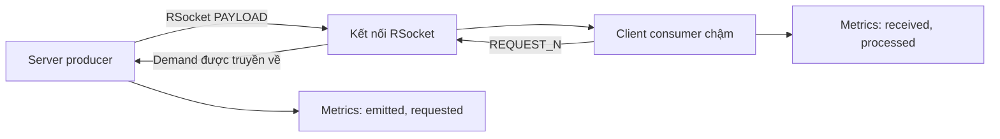

# Thực nghiệm bên nhận chậm để quan sát nhu cầu và mức sử dụng bộ nhớ

Trong hệ thống realtime, producer có thể tạo dữ liệu nhanh hơn tốc độ consumer xử lý. Ví dụ, server phát 100 sự kiện mỗi giây trong khi giao diện client chỉ xử lý được 20 sự kiện mỗi giây. Nếu dữ liệu tiếp tục được xếp vào một hàng đợi không giới hạn, độ trễ và bộ nhớ sẽ tăng theo thời gian. Nếu luồng reactive truyền được nhu cầu tiêu thụ ngược về producer, nguồn có thể giảm tốc độ phát và giữ lượng dữ liệu đang chờ ở mức ổn định.

RSocket hỗ trợ demand-based flow control bằng các frame `REQUEST_N`. Bên nhận yêu cầu số payload tiếp theo mà nó có thể tiếp nhận; bên phát chỉ gửi trong giới hạn demand đã cấp. Cách hiệu quả nhất để hiểu cơ chế này là chạy một thí nghiệm có kiểm soát: giữ nguyên payload và tải nguồn, thay đổi tốc độ consumer, sau đó quan sát demand, throughput, hàng đợi và bộ nhớ.

Bài này hướng dẫn dựng thí nghiệm với Java, Spring Boot, Reactor và RSocket; so sánh nguồn phát tôn trọng backpressure với nguồn phải buffer; đo heap và direct memory; tính mức tăng hàng đợi; và diễn giải kết quả để tìm điểm nghẽn.

## 1. Mục tiêu và mô hình thí nghiệm

Thí nghiệm cần trả lời bốn câu hỏi:

1. Khi client xử lý chậm, demand từ client được truyền ngược về publisher trên server như thế nào?
2. Producer có tôn trọng demand và giảm tốc độ phát hay tiếp tục tạo dữ liệu?
3. Hàng đợi tăng bao nhiêu khi tốc độ phát lớn hơn tốc độ tiêu thụ?
4. Mức sử dụng heap, direct memory, allocation rate và GC thay đổi ra sao giữa các cách xử lý?

Mô hình cơ bản:



Trong RSocket request-stream, client là consumer của luồng server phát. Client gửi demand ban đầu trong `initialRequestN`, sau đó gửi `REQUEST_N` khi cần thêm payload. Runtime RSocket ánh xạ nhu cầu của Reactive Streams sang flow control ở tầng protocol. Publisher phía server nhận demand và quyết định khi nào phát phần tử tiếp theo.

Với request-channel, nguyên tắc tương tự áp dụng độc lập theo hai chiều: client cấp demand cho event server gửi về; server cấp demand cho command client gửi lên. Bài thực nghiệm đầu tiên nên cô lập một chiều để dễ đọc số liệu, sau đó mới chạy channel hai chiều.

## 2. Chuẩn bị môi trường và biến cần kiểm soát

Có thể dùng một ứng dụng Spring Boot có RSocket server và một client riêng. Cấu hình transport TCP hoặc WebSocket không làm thay đổi mục tiêu thí nghiệm: cần đo demand ở publisher, tốc độ tiêu thụ ở subscriber và bộ nhớ của process.

Giữ các yếu tố sau cố định giữa các lần chạy:

- Cùng số lượng client và stream đồng thời.
- Cùng kích thước payload trung bình.
- Cùng thời gian chạy và thời gian warm-up.
- Cùng JVM heap limit, phiên bản JDK, Reactor và rsocket-java.
- Cùng transport, độ trễ mạng và cấu hình keepalive.
- Cùng cách ghi metric; không bật debug log cho mọi payload trong một lần chạy nhưng tắt ở lần khác.

Một cấu hình minh họa để bắt đầu:

| Tham số | Giá trị thử nghiệm |
|---|---:|
| Tốc độ nguồn phát định kỳ | 100 payload/giây |
| Tốc độ xử lý consumer | 10 payload/giây |
| Payload trung bình | 1 KiB |
| Thời gian quan sát | 60 giây |
| Buffer giới hạn trong kịch bản buffer | 10.000 payload |
| Số client | 1 trước, sau đó tăng dần |

Đây là các giá trị mẫu để làm rõ xu hướng, không phải cấu hình production. Nên chạy một lần baseline với consumer nhanh, một lần với consumer chậm và lặp lại mỗi kịch bản vài lần sau warm-up.

## 3. Kịch bản A: publisher tôn trọng demand

Đầu tiên, dùng một nguồn reactive có thể phát theo nhu cầu. `Flux.range` là nguồn hữu hạn và demand-aware: nó không cần tạo sẵn toàn bộ phần tử rồi xếp vào một queue. Khi downstream yêu cầu thêm, publisher mới phát thêm phần tử.

### 3.1. Server phát dữ liệu

```java
import java.util.concurrent.atomic.AtomicLong;
import org.springframework.messaging.handler.annotation.MessageMapping;
import org.springframework.stereotype.Controller;
import reactor.core.publisher.Flux;

record LabSample(long sequence, String payload) {}

@Controller
class FlowControlController {

    private final AtomicLong emitted = new AtomicLong();
    private final AtomicLong requested = new AtomicLong();

    @MessageMapping("lab.samples")
    Flux<LabSample> samples() {
        return Flux.range(1, 200)
            .map(sequence -> new LabSample(
                sequence,
                "x".repeat(1024) + sequence
            ))
            .doOnRequest(n -> {
                long total = requested.addAndGet(n);
                log.info("server demand n={}, total={}", n, total);
            })
            .doOnNext(sample -> {
                long total = emitted.incrementAndGet();
                log.debug("server emitted sequence={}, total={}",
                    sample.sequence(), total);
            })
            .doFinally(signal ->
                log.info("sample stream finished: {}", signal)
            );
    }
}
```

Publisher phát tối đa 200 mẫu. `doOnRequest` ghi lại số phần tử downstream yêu cầu; `doOnNext` đếm số mẫu đã phát. Khi client yêu cầu ít phần tử hơn, server không cần đẩy trước toàn bộ 200 mẫu vào bộ nhớ.

Trong ví dụ, mỗi payload tạo một chuỗi riêng có kích thước xấp xỉ 1 KiB cộng phần sequence. Điều này giúp payload có chi phí bộ nhớ thực tế hơn so với việc dùng chung một chuỗi hằng cho mọi mẫu. Kích thước đối tượng trong heap vẫn lớn hơn kích thước nội dung do header và object graph.

### 3.2. Client xử lý chậm có chủ đích

Để mô phỏng consumer chậm, dùng một bước xử lý bất đồng bộ có thời gian trễ. Tránh dùng `Thread.sleep()` trong `onNext`, vì nó chặn thread xử lý và làm nhiễu thí nghiệm.

```java
import java.time.Duration;
import java.util.concurrent.atomic.AtomicLong;
import reactor.core.publisher.Flux;
import reactor.core.publisher.Mono;

AtomicLong processed = new AtomicLong();

Flux<LabSample> remoteSamples = requester
    .route("lab.samples")
    .retrieveFlux(LabSample.class)
    .doOnRequest(n ->
        log.info("client requests n={}", n)
    );

remoteSamples
    .concatMap(sample ->
        Mono.delay(Duration.ofMillis(100))
            .thenReturn(sample),
        1
    )
    .doOnNext(sample -> {
        long total = processed.incrementAndGet();
        log.debug("client processed sequence={}, total={}",
            sample.sequence(), total);
    })
    .blockLast();
```

`concatMap(..., 1)` xử lý từng mẫu tuần tự với prefetch một phần tử trong pipeline minh họa. `Mono.delay` tạo thời gian xử lý bất đồng bộ khoảng 100 ms cho mỗi mẫu, tương đương tốc độ xấp xỉ 10 mẫu/giây. Khi phần tử hiện tại được xử lý xong, pipeline mới yêu cầu thêm phần tử.

Trong ứng dụng thực tế, không gọi `blockLast()` trên event-loop của WebFlux hoặc Netty. Đoạn này phù hợp với một runner/test client riêng dùng để tạo tải; nếu tích hợp vào ứng dụng reactive, hãy compose publisher vào lifecycle hiện tại.

### 3.3. Quan sát demand

Khi chạy kịch bản A, hãy so sánh:

- Tổng demand mà client yêu cầu.
- Tổng demand server nhìn thấy ở publisher.
- Số payload server đã phát.
- Số payload client đã xử lý.
- Số payload đang chờ và số stream đang hoạt động.

`doOnRequest` có thể nhận các đợt demand theo batch do operator hoặc runtime yêu cầu. Không nhất thiết mỗi payload tương ứng một frame `REQUEST_N` riêng. Điều quan trọng là tổng demand và số phần tử phát tuân theo giới hạn; khi consumer chậm, tốc độ phát thực tế giảm theo tiến độ tiêu thụ thay vì tạo một backlog không giới hạn.

## 4. Kịch bản B: nguồn phát theo đồng hồ và phải buffer

Không phải nguồn dữ liệu nào cũng có thể dừng khi consumer chậm. Một cảm biến, callback bên ngoài hoặc bộ lập lịch có thể tạo sự kiện theo thời gian cố định. `Flux.interval` là ví dụ dễ quan sát: nó phát tick theo lịch. Nếu downstream không tiêu thụ kịp, nguồn thời gian không thể đơn giản đợi demand như `Flux.range`.

Trong Reactor, `onBackpressureBuffer(capacity)` có thể tách nguồn phát khỏi tốc độ downstream bằng một buffer có giới hạn:

```java
import java.time.Duration;
import java.util.concurrent.atomic.AtomicLong;
import reactor.core.publisher.Flux;

AtomicLong produced = new AtomicLong();
AtomicLong delivered = new AtomicLong();

Flux<LabSample> scheduledSamples = Flux
    .interval(Duration.ofMillis(10))
    .map(sequence -> new LabSample(
        sequence,
        "x".repeat(1024) + sequence
    ))
    .doOnNext(sample -> produced.incrementAndGet())
    .onBackpressureBuffer(10_000)
    .doOnNext(sample -> delivered.incrementAndGet());
```

Nguồn tạo tick khoảng 100 lần mỗi giây. Buffer cho phép giữ những phần tử chưa thể chuyển tiếp vì downstream đang chậm. Khi buffer đạt giới hạn 10.000 phần tử, operator phát lỗi overflow theo hành vi mặc định của overload này. Ứng dụng cần bắt lỗi, ghi metric và quyết định dừng, retry, drop hoặc từ chối dữ liệu theo hợp đồng.

Hiệu số `produced - delivered` là một ước lượng số phần tử đã được tạo nhưng chưa đi qua buffer. Khi đọc số liệu, cần tính đến phần tử đang xử lý, prefetch và các hàng đợi khác trong pipeline. Nếu muốn đo chính xác queue depth, hãy dùng một queue do ứng dụng quản lý có gauge riêng thay vì suy ra từ hai counter.

Không dùng `onBackpressureBuffer()` không giới hạn cho luồng dài hạn trong production. Nếu producer liên tục nhanh hơn consumer, buffer có thể tăng đến khi JVM hết heap. Bản không giới hạn chỉ nên được xem như đối chứng trong một môi trường lab ngắn, có giới hạn heap và giám sát.

## 5. Kịch bản C: request-channel và hai hướng chậm khác nhau

Sau khi hiểu một chiều, có thể mở rộng sang request-channel. Client gửi command đến server và nhận acknowledgement/event về trong cùng tương tác. Server có thể xử lý command chậm; client cũng có thể tiêu thụ acknowledgement chậm. Hai hướng có demand riêng.

### 5.1. Server xử lý command tuần tự

```java
record LabCommand(long id, String action) {}
record LabAck(long id, String status) {}

@MessageMapping("lab.commands")
Flux<LabAck> handleCommands(Flux<LabCommand> commands) {
    return commands.concatMap(command ->
        Mono.delay(Duration.ofMillis(50))
            .thenReturn(new LabAck(command.id(), "ACCEPTED")),
        1
    );
}
```

Server mô phỏng thời gian xử lý 50 ms cho mỗi command, tức năng lực xử lý tối đa khoảng 20 command/giây nếu response demand không phải nút thắt. `concatMap` giữ thứ tự và giới hạn prefetch ở một phần tử. Nếu client gửi command nhanh hơn, demand từ server sẽ điều tiết chiều client → server.

### 5.2. Client tạo command nhanh và xử lý acknowledgement chậm

```java
AtomicLong commandsProduced = new AtomicLong();
AtomicLong acknowledgementsProcessed = new AtomicLong();

Flux<LabCommand> commands = Flux
    .interval(Duration.ofMillis(10))
    .map(id -> new LabCommand(id, "UPDATE"))
    .doOnNext(command -> commandsProduced.incrementAndGet())
    .onBackpressureBuffer(256);

Flux<LabAck> acknowledgements = requester
    .route("lab.commands")
    .data(commands)
    .retrieveFlux(LabAck.class)
    .doOnRequest(n ->
        log.info("client requests acknowledgements n={}", n)
    );

acknowledgements
    .concatMap(ack ->
        Mono.delay(Duration.ofMillis(100))
            .thenReturn(ack),
        1
    )
    .doOnNext(ack -> acknowledgementsProcessed.incrementAndGet())
    .take(Duration.ofSeconds(60))
    .blockLast();
```

Đoạn code tạo command theo lịch 100 lần mỗi giây, trong khi server có năng lực xử lý tuần tự tối đa khoảng 20 command mỗi giây. Buffer phía client có giới hạn 256 command; khi đầy, publisher báo overflow thay vì tiếp tục tăng bộ nhớ. Client chỉ tiêu thụ acknowledgement khoảng 10 lần mỗi giây, vì vậy demand response có thể trở thành nút thắt và làm tốc độ hoàn tất thực tế thấp hơn 20 command mỗi giây. Điều này tạo áp lực ở cả hai hướng và cho phép quan sát tác động của demand response đến tiến độ toàn channel.

Đây là tải minh họa có chủ đích, không phải mô hình tối ưu cho command production. Trong thực tế, command quan trọng không nên bị drop âm thầm; cần quyết định rõ có từ chối lệnh mới, lưu bền vững, hay báo trạng thái quá tải. Hãy chạy riêng từng hướng trước, sau đó mới chạy cả hai để tránh khó xác định nguồn gây backlog.

## 6. Tính tốc độ tăng của hàng đợi

Gọi:

- \(\lambda_p\): tốc độ producer tạo payload (payload/giây).
- \(\lambda_c\): tốc độ consumer xử lý payload (payload/giây).
- \(Q(t)\): số payload đang chờ trong buffer tại thời điểm \(t\).
- \(S\): kích thước payload trung bình tính bằng byte.
- \(O\): overhead trung bình của object và cấu trúc queue cho mỗi payload.

Nếu producer không thể dừng và buffer lưu mọi payload, khi \(\lambda_p > \lambda_c\), backlog tăng gần đúng theo:

\[
Q(t) = Q(0) + (\lambda_p - \lambda_c)t
\]

Ước lượng bộ nhớ dành cho phần tử đang chờ:

\[
M(t) \approx Q(t)(S + O)
\]

Đây là mô hình gần đúng. Bộ nhớ thực tế còn phụ thuộc object graph, alignment, compression, buffer của operator, serializer, Netty, socket và GC.

### 6.1. Ví dụ số liệu

Giả sử producer tạo 100 payload/giây, consumer xử lý 10 payload/giây và thời gian quan sát là 60 giây. Backlog tăng khoảng:

\[
(100 - 10) \times 60 = 5.400\text{ payload}
\]

Với payload trung bình 1 KiB, riêng nội dung thô đã chiếm khoảng 5,27 MiB. Object header, chuỗi, reference, queue node và các buffer khác làm mức sử dụng thực tế cao hơn.

Nếu producer tạo 1.000 payload/giây và consumer chỉ xử lý 200 payload/giây trong 60 giây, backlog tăng 48.000 payload, tương đương khoảng 46,9 MiB nội dung thô ở mức 1 KiB mỗi payload. Một buffer không giới hạn sẽ tiếp tục tăng nếu chênh lệch tốc độ duy trì.

### 6.2. Khi buffer có giới hạn

Với buffer tối đa \(B_{max}\), thời gian gần đúng để buffer đầy khi tốc độ ổn định và \(\lambda_p > \lambda_c\) là:

\[
t_{full} \approx \frac{B_{max} - Q(0)}{\lambda_p - \lambda_c}
\]

Với buffer 10.000 phần tử, tốc độ phát 100/giây và xử lý 10/giây, buffer có thể đầy sau khoảng 111 giây nếu không có thay đổi về tốc độ. Buffer giới hạn không làm mất chênh lệch tốc độ; nó buộc ứng dụng phải có chính sách khi đạt ngưỡng: báo lỗi, drop, ghi bền vững hoặc từ chối dữ liệu mới.

## 7. Đo bộ nhớ đúng cách

Không nên chỉ nhìn một ảnh chụp heap tại một thời điểm rồi kết luận backpressure hoạt động hay không. Hãy đo nhiều chỉ số đồng thời và theo dõi xu hướng trong suốt thí nghiệm.

| Chỉ số | Ý nghĩa | Công cụ/cách quan sát |
|---|---|---|
| Heap used | Bộ nhớ heap JVM đang dùng | Micrometer JVM metrics, JMX, VisualVM hoặc JFR |
| Heap after GC/live set | Dữ liệu còn sống sau khi GC thu gom | JFR, heap dump khi cần, VisualVM |
| Allocation rate | Tốc độ tạo object | JFR allocation events, profiler |
| GC pause/count | Áp lực thu gom rác và thời gian dừng | `jvm.gc.pause`, JFR, GC logs |
| Direct buffer used | Bộ nhớ direct buffer ngoài heap | `BufferPoolMXBean`, Micrometer buffer metrics |
| Process RSS | Tổng bộ nhớ resident của process | Công cụ hệ điều hành/container |
| Queue depth | Số payload đang chờ | Gauge do ứng dụng tự instrument |
| In-flight payload | Số payload đã gửi nhưng chưa xử lý xong | Counter nhận/trả hoặc trace theo event ID |

RSocket trên TCP thường dùng Netty; một phần dữ liệu có thể nằm trong direct buffer thay vì Java heap. Vì vậy, heap ổn định không đảm bảo tổng bộ nhớ process ổn định. Cần theo dõi direct memory và RSS. Ngược lại, RSS tăng không nhất thiết toàn bộ là queue của ứng dụng; có thể do allocator giữ lại vùng nhớ đã cấp phát để tái sử dụng.

### 7.1. Theo dõi bằng JFR và JMX

Java Flight Recorder (JFR) giúp quan sát allocation, GC, thread, socket và các sự kiện runtime. Có thể dùng Java Mission Control để mở file ghi JFR và xem allocation hot spots, GC pause cùng thread activity. VisualVM hữu ích để quan sát heap theo thời gian và tạo heap dump trong môi trường thử nghiệm.

Ở mức code, `BufferPoolMXBean` có thể cung cấp thông tin về direct/mapped buffer pool:

```java
import java.lang.management.BufferPoolMXBean;
import java.lang.management.ManagementFactory;

ManagementFactory.getPlatformMXBeans(BufferPoolMXBean.class)
    .forEach(pool -> log.info(
        "bufferPool={} count={} usedBytes={} capacityBytes={}",
        pool.getName(),
        pool.getCount(),
        pool.getMemoryUsed(),
        pool.getTotalCapacity()
    ));
```

Đọc các giá trị này theo chu kỳ và ghi thành metric. Không gọi heap dump hoặc ép full GC liên tục trong lúc đo throughput, vì thao tác đó làm thay đổi chính workload cần quan sát. Nếu cần heap dump, hãy thực hiện ở lần chạy riêng hoặc sau khi đã ghi nhận hiện tượng.

### 7.2. Instrument demand và backlog

Nên có các counter/gauge riêng:

- `samples_requested_total`: tổng demand nhận được ở publisher.
- `samples_emitted_total`: số payload producer đã phát.
- `samples_received_total`: số payload client đã nhận.
- `samples_processed_total`: số payload client xử lý xong.
- `buffer_depth`: số phần tử đang chờ trong buffer được instrument.
- `buffer_overflow_total`: số lần buffer đạt giới hạn.
- `active_rsocket_streams`: số stream đang hoạt động.
- `processing_duration`: thời gian xử lý mỗi payload.

Đừng dùng ID từng payload làm label metric vì cardinality sẽ tăng rất lớn. Dùng event ID trong log/trace; metric nên dùng label có tập giá trị nhỏ như route, scenario, client group hoặc outcome.

## 8. So sánh kết quả giữa các kịch bản

Sau khi chạy cùng tải và thời gian, kết quả thường có dạng:

| Kịch bản | Demand và tốc độ phát | Backlog | Bộ nhớ kỳ vọng | Hành vi khi kéo dài |
|---|---|---|---|---|
| Consumer nhanh, nguồn demand-aware | Consumer cấp demand nhanh; producer phát theo demand | Thấp | Ổn định | Hoàn tất nhanh, ít chờ |
| Consumer chậm, nguồn demand-aware | Demand được cấp chậm; producer giảm tốc độ phát | Thấp hoặc bị giới hạn bởi prefetch | Tương đối ổn định | Thời gian hoàn tất tăng, heap không tăng tuyến tính theo tổng thời gian |
| Consumer chậm, nguồn có buffer giới hạn | Producer vẫn phát theo lịch; buffer tích lũy | Tăng đến ngưỡng | Tăng đến mức tương ứng với capacity | Khi đầy thì overflow/drop/reject theo chính sách |
| Consumer chậm, buffer không giới hạn | Producer tiếp tục phát nhanh hơn xử lý | Tăng liên tục | Tăng theo backlog | GC dày hơn, latency tăng, có nguy cơ `OutOfMemoryError` |
| Nhiều stream cùng tải | Demand và buffer nhân theo số stream | Phụ thuộc từng stream và tổng tải | Tổng tài nguyên tăng theo số stream | Có thể chạm giới hạn connection, heap hoặc direct memory |

Nếu kịch bản demand-aware vẫn có bộ nhớ tăng đều, hãy kiểm tra các operator có prefetch/buffer, subscriber có yêu cầu vô hạn, publisher có phát ngoài demand, và liệu ứng dụng có giữ tham chiếu đến các phần tử đã xử lý hay không. Backpressure không thể thu hồi dữ liệu mà ứng dụng vô tình giữ lại trong collection hoặc cache.

## 9. Đọc dấu hiệu khi thí nghiệm gặp vấn đề

| Quan sát | Nguyên nhân có thể | Việc nên kiểm tra |
|---|---|---|
| `requested` tăng chậm, `emitted` cũng tăng chậm, queue ổn định | Backpressure đang điều tiết producer theo consumer | Xác nhận latency và throughput phù hợp với tốc độ xử lý |
| `produced` tăng nhanh, `delivered` tăng chậm, buffer depth tăng | Producer không thể dừng hoặc operator đang buffer | Kiểm tra `onBackpressureBuffer`, nguồn interval và overflow policy |
| Heap tăng, GC pause tăng, backlog tăng | Hàng đợi hoặc object đang chờ tích lũy | Kiểm tra queue depth, heap dominator và allocation profile |
| Heap ổn định nhưng RSS/direct memory tăng | Netty/direct buffer hoặc native memory | Kiểm tra `BufferPoolMXBean`, allocator metrics và container memory |
| Buffer depth thấp nhưng latency cao | Xử lý downstream chậm hoặc network latency | Đo thời gian từng bước, thread scheduling và dependency |
| Một stream ổn định nhưng nhiều stream gây tăng bộ nhớ | Chi phí per-stream hoặc tổng concurrency | Tăng số stream theo từng bước và đo tài nguyên mỗi stream |
| Buffer đầy và stream lỗi | Capacity nhỏ hơn backlog cần thiết | Xem lại capacity và chọn hành vi overflow đúng nghiệp vụ |

Hãy phân biệt memory đang dùng với memory đã được JVM/Netty cấp phát và giữ lại. Sau khi buffer được xả, heap live set có thể giảm sau GC nhưng RSS hoặc direct memory pool chưa chắc giảm ngay vì allocator có thể tái sử dụng vùng nhớ.

## 10. Những yếu tố có thể làm sai lệch kết quả

Một thí nghiệm tốt phải tránh các yếu tố gây nhiễu:

1. **Payload dùng chung:** nếu mọi event trỏ đến cùng một object hoặc chuỗi hằng, bộ nhớ backlog sẽ thấp giả tạo. Hãy tạo payload riêng có kích thước gần workload thật.
2. **Log quá nhiều:** ghi log mỗi payload làm tăng allocation và I/O, khiến consumer chậm hơn. Dùng counter và log theo chu kỳ.
3. **Warm-up JIT:** kết quả những giây đầu có thể khác sau khi code được biên dịch tối ưu. Chạy warm-up trước khi lấy số liệu.
4. **GC chưa xảy ra:** heap used có thể tăng tạm thời do object chưa được thu gom. Xem allocation rate, live set và GC events.
5. **Buffer ẩn:** `flatMap`, `publishOn`, `delayElements`, `onBackpressureBuffer` và các operator khác có thể có prefetch hoặc queue riêng. Kiểm tra cấu hình từng operator.
6. **Nhiều client:** số stream và số kết nối thay đổi tổng demand, buffer và bộ nhớ. Ghi rõ concurrency ở mỗi lần chạy.
7. **Direct memory:** chỉ nhìn heap có thể bỏ qua bộ nhớ Netty và socket buffer.
8. **Payload size thay đổi:** demand đếm payload chứ không đếm byte. Một demand window nhỏ vẫn có thể giữ nhiều byte nếu mỗi payload lớn.

Không nên so sánh hai lần chạy nếu một lần bật debug logging, một lần tắt; hoặc nếu payload, số stream, heap limit và thời gian quan sát khác nhau.

## 11. Thử nghiệm hai hướng trong request-channel

Sau khi đo riêng request-stream, hãy kiểm tra request-channel với hai consumer chậm độc lập:

- Server xử lý command client gửi lên chậm. Demand từ server điều tiết producer command ở client.
- Client xử lý event server gửi về chậm. Demand từ client điều tiết producer event ở server.

Chạy ba lượt:

| Lượt | Client gửi command | Client nhận event | Mục tiêu |
|---|---|---|---|
| 1 | Nhanh | Nhanh | Baseline hai chiều |
| 2 | Nhanh | Chậm | Quan sát demand response và buffer event |
| 3 | Chậm | Nhanh | Quan sát demand command và buffer command |

Sau đó chạy cả hai hướng chậm đồng thời. Theo dõi riêng command queue và event buffer; không gộp chúng thành một metric chung. Nếu một hướng bị nghẽn, hướng kia có thể vẫn tiến triển trong phạm vi demand và vòng đời stream cho phép, nhưng cả hai vẫn chịu ảnh hưởng nếu connection hoặc channel bị đóng.

Khi client gửi command từ nguồn callback không thể pause, cần buffer có giới hạn phía client. Khi server phát event từ nguồn định kỳ không thể pause, cần buffer có giới hạn phía server. Chọn overflow policy theo dữ liệu: command quan trọng thường cần từ chối hoặc lưu bền vững; trạng thái telemetry có thể phù hợp với latest/drop nếu nghiệp vụ cho phép.

## 12. Quy trình thực hiện thí nghiệm

Có thể dùng quy trình sau để kết quả dễ lặp lại và so sánh:

1. **Khởi động và warm-up:** mở server/client, thiết lập RSocket session, chạy tải nhẹ cho JIT ổn định.
2. **Đo baseline:** dùng consumer nhanh và publisher demand-aware; ghi throughput, latency, heap, direct memory và GC.
3. **Làm chậm consumer:** thêm delay bất đồng bộ; giữ nguyên publisher, payload và số stream.
4. **Ghi demand:** thu `doOnRequest` ở client/server, số phần tử phát, nhận và xử lý.
5. **Chuyển nguồn sang clock-driven:** dùng `Flux.interval` và buffer có giới hạn để quan sát backlog.
6. **Thử overflow:** tăng thời gian chạy đủ để buffer đạt capacity; xác minh lỗi/drop/reject theo cấu hình.
7. **Lặp với nhiều stream:** tăng concurrency từng bước và đo bộ nhớ tổng cũng như chi phí mỗi stream.
8. **Đối chiếu:** so sánh cùng khoảng thời gian, cùng payload, cùng JVM limit và cùng mức log.
9. **Lưu kết quả:** ghi lại cấu hình, biểu đồ metric, JFR recording và kết luận theo từng kịch bản.

## 13. Checklist đánh giá kết quả

Sau thí nghiệm, hãy tự trả lời:

- Consumer chậm có làm demand từ client giảm hoặc cấp theo batch nhỏ hơn không?
- Publisher server có phát theo demand hay đang bị một operator buffer làm mất tác dụng backpressure?
- `initialRequestN` và các lần `REQUEST_N` có phù hợp với tốc độ xử lý không?
- Backlog nằm ở client, server, Reactor operator, Netty hay queue nghiệp vụ?
- Heap live set, direct memory và RSS thay đổi thế nào khi consumer chậm?
- Buffer có capacity rõ ràng và overflow policy có đúng nghiệp vụ không?
- Số stream đồng thời làm bộ nhớ tăng tuyến tính, theo bậc hay có điểm bão hòa?
- Khi hủy stream hoặc đóng connection, queue và subscription có được giải phóng không?
- Có thể tái hiện kết quả với cùng cấu hình và workload không?

## 14. Kết luận

Thực nghiệm bên nhận chậm cho thấy tác dụng của backpressure rõ nhất khi so sánh một publisher có thể tôn trọng demand với một nguồn phát theo lịch phải buffer. Với nguồn demand-aware như `Flux.range`, consumer chậm làm producer phát chậm lại; lượng phần tử đang chờ thường được giới hạn bởi demand, prefetch và buffer của runtime. Với nguồn không thể pause như callback hoặc tick định kỳ, dữ liệu tiếp tục đến; nếu buffer tăng không giới hạn, bộ nhớ tăng theo chênh lệch tốc độ producer-consumer.

Đo đúng cần theo dõi cả demand, throughput, queue depth, heap, allocation rate, GC, direct memory và RSS. RSocket `REQUEST_N` đếm payload chứ không đếm byte; do đó vẫn cần giới hạn kích thước payload và tài nguyên. Trong request-channel, đo riêng hai hướng để biết bên nhận nào đang tạo áp lực. Kết quả thí nghiệm giúp chọn demand, prefetch, buffer và overflow policy dựa trên dữ liệu thực tế thay vì phỏng đoán.
