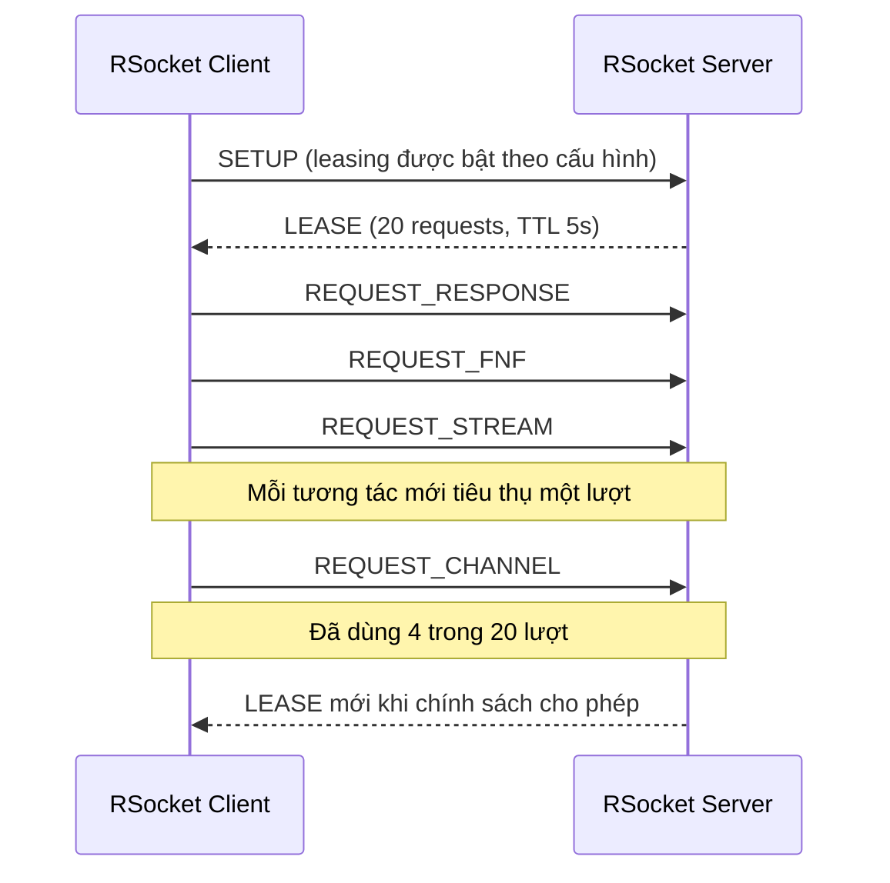

# Leasing và mục đích giới hạn số yêu cầu mới

## Mục tiêu bài học

RSocket có cơ chế *leasing* để bên nhận chủ động cấp quyền cho peer khởi tạo một số lượng request mới trong một khoảng thời gian. Cơ chế này giúp server kiểm soát việc tiếp nhận tương tác mới khi tài nguyên có giới hạn hoặc tải thay đổi theo thời gian.

Sau bài này, bạn có thể:

- Giải thích LEASE frame và hai thông tin chính: số request được phép và thời hạn hiệu lực.
- Xác định leasing giới hạn request mới theo từng kết nối như thế nào.
- Phân biệt leasing với backpressure, giới hạn số request đang chạy và quota nghiệp vụ.
- Thiết kế chính sách cấp lease theo tải, dung lượng hàng đợi và mức tài nguyên còn lại.
- Xử lý khi lease hết hạn hoặc hết số request được cấp.
- Kiểm thử và quan sát leasing trong ứng dụng Java/Spring Boot.

## Leasing giải quyết vấn đề gì?

Một server có thể duy trì nhiều kết nối RSocket cùng lúc. Nếu mọi client đều được tự do khởi tạo request mới bất cứ lúc nào, lượng request đến có thể tăng nhanh hơn khả năng tiếp nhận. Hệ quả là hàng đợi tăng, độ trễ cao, bộ nhớ bị chiếm dụng và các request quan trọng cũng bị ảnh hưởng.

Leasing cung cấp một cơ chế admission control ở cấp giao thức. Thay vì để requester tự quyết định số request mới tùy ý, responder cấp cho requester một quyền gửi có giới hạn. Quyền này được truyền bằng **LEASE frame**.

Một lease có hai thông tin quan trọng:

- **Request count:** số request mới tối đa mà requester được phép khởi tạo theo lease đó.
- **TTL (time to live):** khoảng thời gian lease còn hiệu lực, thường được biểu diễn bằng mili giây trong frame.

Ví dụ, server cấp lease gồm 20 request trong 5 giây. Client được phép khởi tạo tối đa 20 request trong thời hạn đó. Khi đã dùng hết 20 lượt hoặc lease hết hạn, client cần chờ một lease mới trước khi khởi tạo request tiếp theo.

Leasing giúp server điều tiết tốc độ tiếp nhận request mới dựa trên khả năng hiện tại. Nó không phải là cơ chế bảo đảm request đã được xử lý thành công, cũng không phải hàng đợi lưu trữ request.

## LEASE frame đi theo hướng nào?

Peer nhận request là bên quyết định cấp lease cho peer gửi request. Trong mô hình client-server thông thường:

1. Client thiết lập kết nối RSocket.
2. Hai phía cấu hình và thương lượng việc sử dụng leasing theo khả năng của implementation.
3. Server gửi LEASE frame cho client.
4. Client dùng quyền được cấp để khởi tạo các tương tác request.
5. Khi quyền đã dùng hết hoặc hết TTL, client cần lease mới để gửi thêm request.



Trong kết nối hai chiều, mỗi peer có thể là requester cho các tương tác do chính nó khởi tạo và là responder cho các tương tác do peer kia khởi tạo. Vì vậy, quyền gửi request cần được xem xét theo từng hướng và theo cấu hình của từng peer.

Leasing là cơ chế có thể bật hoặc không tùy cấu hình. Cần bảo đảm hai đầu và phiên bản thư viện đang dùng hỗ trợ đúng chế độ này. Không nên giả định chỉ cần khai báo một thuộc tính Spring bất kỳ là mọi kết nối RSocket tự động được bảo vệ bằng lease.

## Lease đếm request mới, không đếm từng payload

Request count được dùng để giới hạn số lần requester khởi tạo một tương tác RSocket mới. Những kiểu tương tác như request-response, fire-and-forget, request-stream và request-channel đều là request mới khi được mở.

Một request-stream có thể phát hàng nghìn payload sau khi được khởi tạo. Những payload tiếp theo trong cùng stream không phải là hàng nghìn request mới và không tiêu thụ thêm hàng nghìn lease credit. Tương tự, các payload tiếp theo trong một request-channel vẫn thuộc cùng tương tác channel.

| Hoạt động | Có tiêu thụ một lượt request trong lease? | Giải thích |
|---|---:|---|
| Mở request-response | Có | Khởi tạo một tương tác mới |
| Gửi fire-and-forget | Có | Khởi tạo một request mới |
| Mở request-stream | Có | Toàn bộ stream là một tương tác |
| Mở request-channel | Có | Hai luồng dữ liệu thuộc một tương tác |
| Gửi thêm payload trong stream đang mở | Không | Là phần tiếp theo của tương tác hiện tại |
| Nhận response từ server | Không | Đây là dữ liệu theo chiều phản hồi |

Điểm này rất quan trọng khi chọn leasing. Nếu mục tiêu là giới hạn số tương tác mới, leasing phù hợp. Nếu mục tiêu là giới hạn số phần tử trong một stream, cần dùng backpressure, quota ở tầng ứng dụng hoặc giới hạn dữ liệu riêng.

## Hết lượt và hết thời hạn có ý nghĩa gì?

Một lease có thể hết hiệu lực theo hai cách:

- **Hết request count:** requester đã sử dụng toàn bộ số lượt được cấp, dù TTL vẫn còn.
- **Hết TTL:** thời hạn lease đã kết thúc, dù requester chưa dùng hết số lượt.

Khi một trong hai điều kiện xảy ra, requester không được tự ý khởi tạo thêm request dựa trên lease cũ. Nó cần chờ lease mới hoặc áp dụng chính sách phía client như xếp hàng có giới hạn, từ chối sớm hay thông báo thử lại sau.

Lease chỉ kiểm soát việc bắt đầu request mới. Một request-stream hoặc request-channel đã được mở hợp lệ không tự động bị hủy chỉ vì lease dùng để mở nó đã hết TTL. Vòng đời tương tác đang chạy được quản lý bằng complete, cancel, error, timeout và các chính sách tài nguyên riêng.

Không nên xem TTL là timeout của request. TTL nói về thời hạn của quyền khởi tạo request mới, không phải thời gian tối đa để một request hoàn tất.

## Leasing khác gì backpressure và concurrency limit?

Các cơ chế này giải quyết những vấn đề liên quan nhưng khác nhau.

| Cơ chế | Kiểm soát điều gì? | Ví dụ |
|---|---|---|
| Leasing | Số request mới requester được phép mở trong một khoảng thời gian | Cho phép tối đa 50 request mới trong 10 giây |
| Backpressure | Số phần tử mà consumer yêu cầu từ publisher trong một stream | Consumer yêu cầu thêm 8 phần tử |
| Concurrency limit | Số request hoặc tác vụ được phép đang chạy đồng thời | Tối đa 30 tác vụ đang thực thi |
| Rate limiter tầng ứng dụng | Tốc độ request theo client, user hoặc tenant | Tối đa 10 request/giây cho một tenant |
| Queue limit | Số công việc được phép chờ xử lý | Hàng đợi tối đa 500 lệnh |

Leasing không thay thế các cơ chế còn lại. Ví dụ, server cấp 100 request trong 10 giây. Client có thể khởi tạo cả 100 request gần như cùng lúc, tạo ra một burst lớn. Leasing giới hạn tổng số request được phép trong thời hạn, nhưng không bắt buộc chúng phải được phân bố đều theo từng giây.

Một request-stream dài hạn cũng có thể tiêu thụ một lease credit khi mở, rồi tiếp tục hoạt động lâu. Nếu chỉ dựa vào lease count, server vẫn có thể có quá nhiều stream đồng thời. Vì vậy, cần thêm giới hạn concurrency, timeout, giới hạn payload và chính sách backpressure phù hợp.

## Thiết kế chính sách cấp lease

Server nên cấp lease dựa trên khả năng tiếp nhận thực tế. Các tín hiệu có thể dùng gồm:

- Số request hoặc stream đang hoạt động.
- Độ sâu hàng đợi và tốc độ tăng hàng đợi.
- Số worker còn rảnh.
- CPU, bộ nhớ và mức sử dụng connection pool.
- Độ trễ xử lý gần đây và tỷ lệ lỗi/quá tải.
- Giới hạn theo tenant hoặc nhóm client.

Một chính sách cơ bản có thể chia thành ba mức:

| Trạng thái server | Chính sách gợi ý | Mục đích |
|---|---|---|
| Tải thấp, còn nhiều tài nguyên | Cấp nhiều request hơn với TTL vừa phải | Tận dụng năng lực xử lý |
| Tải trung bình | Giảm request count hoặc rút ngắn TTL | Điều tiết tốc độ tiếp nhận |
| Tải cao hoặc hàng đợi gần đầy | Cấp ít lượt hoặc tạm ngừng cấp lease mới | Cho hệ thống thời gian phục hồi |

Không có một giá trị request count và TTL tối ưu cho mọi hệ thống. Hãy đo tải thực tế, thử nghiệm dưới các mức tải khác nhau và điều chỉnh chính sách theo đặc điểm request.

### Ví dụ mô hình chính sách trong Java

Đoạn code sau mô tả phần quyết định của ứng dụng. Đây là mô hình chính sách minh họa, không phải chữ ký API cấu hình lease cố định của RSocket Java. Phần tích hợp thực tế cần nối kết quả này với API leasing của implementation và phiên bản thư viện đang dùng.

```java
import java.time.Duration;
import java.util.Optional;

record LoadSnapshot(
    int activeInteractions,
    int queuedJobs,
    double cpuUsage
) {}

record LeaseGrant(
    int requestCount,
    Duration ttl
) {}

class LeasePolicy {

    Optional<LeaseGrant> decide(LoadSnapshot load) {
        if (load.queuedJobs() >= 500 || load.cpuUsage() >= 0.90) {
            return Optional.empty();
        }

        if (load.activeInteractions() >= 200) {
            return Optional.of(
                new LeaseGrant(5, Duration.ofSeconds(2))
            );
        }

        if (load.activeInteractions() >= 100) {
            return Optional.of(
                new LeaseGrant(15, Duration.ofSeconds(3))
            );
        }

        return Optional.of(
            new LeaseGrant(40, Duration.ofSeconds(5))
        );
    }
}
```

Ví dụ này minh họa ba quyết định:

- Khi hàng đợi hoặc CPU đã chạm ngưỡng cao, tạm thời không cấp lease mới.
- Khi số tương tác đang hoạt động tăng, giảm số request được cấp và rút ngắn TTL.
- Khi tải thấp, cho phép nhiều request mới hơn.

Trong triển khai thật, cần tránh để mọi kết nối cùng nhận một hạn mức lớn mà không xét tổng tải toàn server. Có thể kết hợp giới hạn toàn cục với phân bổ theo kết nối hoặc tenant. Chính sách cũng cần có hysteresis hoặc ngưỡng phục hồi để tránh liên tục thay đổi giữa cấp và ngừng cấp khi tải dao động quanh một ngưỡng.

## Phía requester nên làm gì khi không còn lease?

Requester cần có một chính sách rõ ràng khi không còn quyền mở request mới. Các lựa chọn phổ biến:

1. **Chờ lease mới:** phù hợp khi thao tác có thể chờ và độ trễ cho phép.
2. **Xếp hàng cục bộ có giới hạn:** phù hợp khi cần hấp thụ burst ngắn. Phải giới hạn kích thước queue và thời gian chờ.
3. **Từ chối sớm:** trả lỗi hoặc trạng thái bận cho tầng gọi khi thao tác cần phản hồi nhanh.
4. **Thử lại có kiểm soát:** dùng backoff và jitter để tránh nhiều client cùng gửi lại ngay khi lease mới xuất hiện.

Không nên tạo một queue vô hạn ở client. Khi server đã giới hạn request mới, việc giữ vô hạn công việc ở phía client chỉ chuyển vấn đề quá tải sang nơi khác.

Với thao tác nghiệp vụ, nếu client phải retry sau khi chờ, cần dùng idempotency key hoặc cơ chế tương đương để tránh thực hiện lặp. Leasing không bảo đảm exactly-once và cũng không thay thế xử lý trùng.

### Ví dụ cổng admission ở tầng ứng dụng

Có thể đặt một abstraction để phần nghiệp vụ chỉ gửi request khi đã có quyền. Interface dưới đây là hợp đồng ứng dụng minh họa; adapter cụ thể phải nhận cập nhật lease từ RSocket client và quản lý số lượt theo đúng giao thức.

```java
interface RequestAdmission {
    Mono<Void> acquirePermit();
}

Mono<JobResult> submit(
    RSocketRequester requester,
    RequestAdmission admission,
    JobCommand command
) {
    return admission.acquirePermit()
        .then(
            requester
                .route("jobs.submit")
                .data(command)
                .retrieveMono(JobResult.class)
        );
}
```

Cổng admission cần bảo đảm permit chỉ được cấp khi lease còn hiệu lực và còn request count. Nếu không có permit, nó có thể chờ, từ chối hoặc đưa yêu cầu vào queue hữu hạn theo chính sách của ứng dụng. Không được cấp permit giả chỉ để tránh làm chậm luồng gọi.

## Leasing không phải quota nghiệp vụ

Lease thường áp dụng theo kết nối và do peer nhận request cấp. Điều đó không tự động tạo ra quota toàn hệ thống theo người dùng hoặc tenant.

Ví dụ, một người dùng có thể mở nhiều kết nối. Nếu mỗi kết nối được cấp 20 request, tổng số request người dùng đó có thể khởi tạo lớn hơn 20. Nếu yêu cầu nghiệp vụ là mỗi tenant chỉ được chạy 100 tác vụ mỗi phút, server phải có rate limiter hoặc quota dùng chung ở tầng ứng dụng, có thể dựa trên danh tính đã xác thực.

Cần phân biệt:

- **Lease:** quyền giao thức để khởi tạo request trên kết nối.
- **Quota nghiệp vụ:** giới hạn theo tài khoản, tenant, gói dịch vụ hoặc loại thao tác.
- **Authorization:** quyết định người gọi có quyền thực hiện thao tác hay không.

Một request được lease cho phép vẫn có thể bị từ chối do không đủ quyền, vượt quota nghiệp vụ hoặc dữ liệu không hợp lệ. Lease không phải token xác thực và không thay thế kiểm tra quyền.

## Những lỗi triển khai thường gặp

### Cấp lease quá lớn

Cấp hàng nghìn lượt trong thời gian dài làm giảm khả năng phản ứng khi tải đột ngột tăng. Hãy bắt đầu với hạn mức thận trọng và điều chỉnh theo số liệu.

### Cấp lease mà không theo dõi tải toàn cục

Nếu mỗi connection tự nhận hạn mức tối đa, tổng hạn mức có thể vượt xa năng lực server khi số client tăng. Chính sách cần phối hợp giữa tài nguyên toàn cục và phân bổ theo connection.

### Nghĩ rằng lease giới hạn số request đang chạy

Lease giới hạn số lần mở request trong thời hạn được cấp. Các request đã mở có thể tiếp tục chạy. Dùng semaphore, bulkhead hoặc concurrency limiter để kiểm soát số tác vụ đồng thời.

### Nghĩ rằng lease giới hạn payload trong stream

Một stream có thể mang nhiều payload sau khi đã mở. Dùng backpressure, giới hạn kích thước và quota dữ liệu để kiểm soát lượng payload.

### Không xử lý lease hết hạn

Client có thể thử gửi request bằng quyền đã hết hạn hoặc giữ queue chờ vô hạn. Hãy kiểm tra TTL, request count và chính sách timeout/queue ở requester.

### Dùng leasing như cơ chế bảo đảm giao nhận

Lease chỉ cấp quyền khởi tạo request. Nó không lưu request, không xác nhận xử lý và không bảo đảm request sẽ thành công. Với công việc cần độ tin cậy cao, cần kết hợp xác nhận, idempotency, lưu trữ bền vững và cơ chế retry phù hợp.

## Kiểm thử leasing

Nên kiểm tra cả logic cấp quyền và hành vi của hai peer:

1. Requester khởi tạo request khi lease còn lượt và còn TTL.
2. Requester dùng hết request count trước khi TTL kết thúc.
3. TTL hết trong khi vẫn còn request count chưa sử dụng.
4. Lease mới được cấp và requester tiếp tục khởi tạo request.
5. Nhiều request đồng thời tranh chấp lượt cuối cùng.
6. Server ngừng cấp lease khi queue hoặc tải vượt ngưỡng.
7. Request-stream đang chạy vẫn tiếp tục sau khi lease dùng để mở stream hết hạn.
8. Client queue đầy hoặc chờ quá thời hạn thì từ chối theo chính sách.
9. Một tenant mở nhiều connection nhưng vẫn bị quota nghiệp vụ toàn cục giới hạn.

Dùng clock giả trong kiểm thử chính sách TTL để tránh test phụ thuộc vào thời gian thực. Với kiểm thử giao thức, xác minh hành vi bằng đúng phiên bản RSocket implementation được triển khai, đặc biệt khi kiểm tra cách client xử lý lúc không còn lease.

## Quan sát và vận hành

Các chỉ số nên theo dõi:

- Số LEASE frame được cấp và số lượt request trong mỗi lease.
- Request count đã sử dụng và thời gian còn lại của lease.
- Số lần requester phải chờ, bị từ chối hoặc xếp hàng vì thiếu lease.
- Số kết nối không nhận được lease mới.
- Số request đang hoạt động, độ sâu hàng đợi và thời gian xử lý.
- Tỷ lệ lỗi, timeout và mức sử dụng CPU/bộ nhớ.

Log nên gắn với connection ID, peer hoặc tenant đã xác thực, request route và thời điểm cấp lease. Tránh ghi payload nhạy cảm. Khi điều tra tình trạng client bị chặn, cần xác định rõ nguyên nhân là hết request count, hết TTL, chưa nhận lease mới hay quota nghiệp vụ từ chối.

## Checklist thiết kế

Trước khi bật leasing, hãy trả lời:

1. Server muốn giới hạn request mới theo kết nối hay theo tenant?
2. Request count và TTL ban đầu dựa trên số liệu tải nào?
3. Server quyết định cấp lease mới theo CPU, queue, số stream hay worker rảnh?
4. Requester sẽ chờ, queue hay từ chối khi không còn lease?
5. Queue phía client có giới hạn kích thước và thời gian chờ không?
6. Hệ thống có concurrency limit riêng cho request dài hạn không?
7. Các quota nghiệp vụ và kiểm tra quyền được áp dụng ở đâu?
8. Làm thế nào để quan sát lease đã cấp, đã dùng và đã hết hạn?

Leasing phù hợp khi server cần kiểm soát số tương tác mới mà requester có thể mở trên một kết nối. Khi kết hợp với backpressure, giới hạn concurrency, quota nghiệp vụ và quan sát tải, nó giúp hệ thống tiếp nhận request có kiểm soát và phản ứng tốt hơn khi năng lực xử lý thay đổi.

