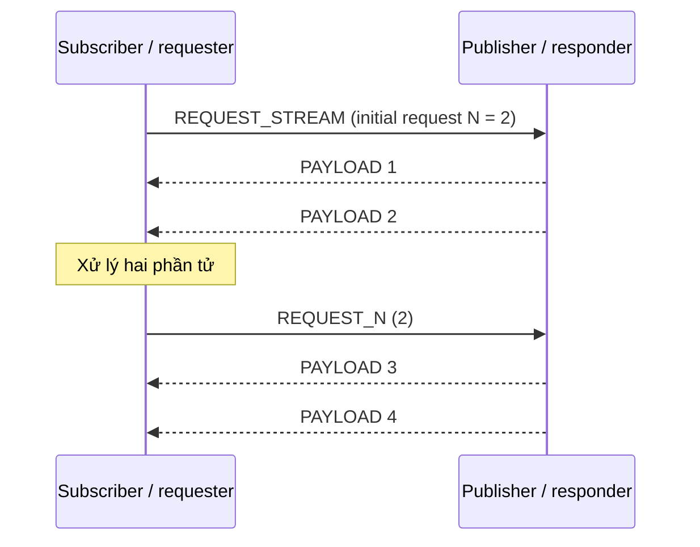
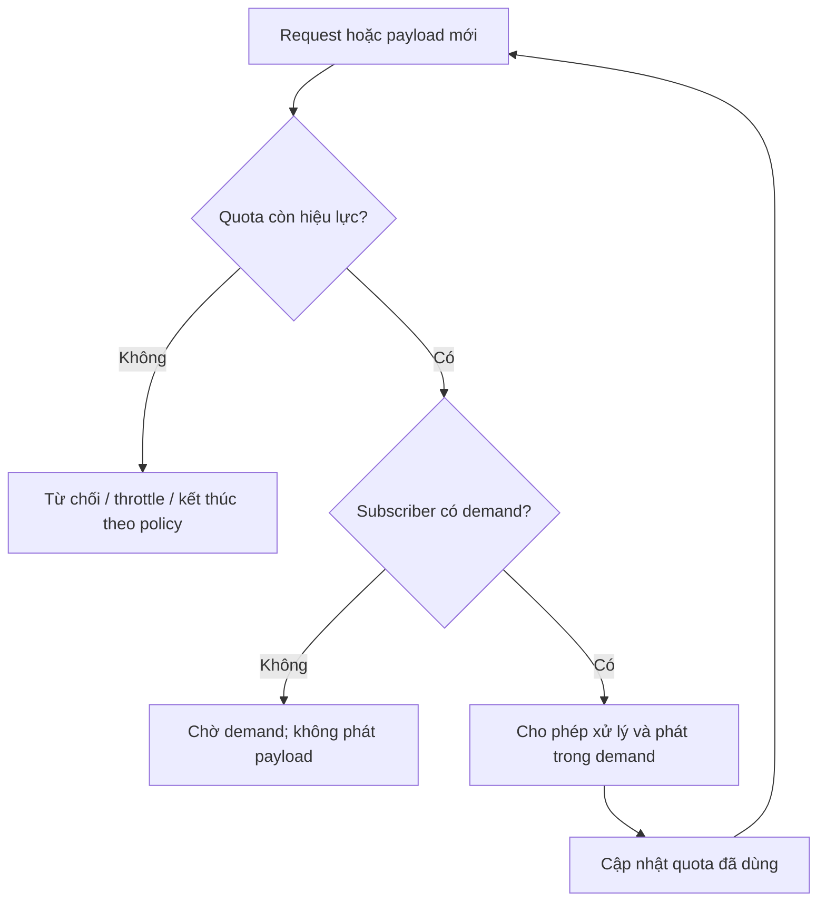

# Phân biệt hạn ngạch yêu cầu với backpressure của luồng đang chạy

Trong một hệ thống RSocket, backpressure và hạn ngạch yêu cầu (request quota) đều có thể giới hạn lượng công việc đi vào hệ thống, nhưng chúng giải quyết hai vấn đề khác nhau. Backpressure điều tiết số phần tử mà một subscriber sẵn sàng nhận trong một subscription đang hoạt động. Quota là chính sách cấp quyền sử dụng tài nguyên: một client, tenant hoặc route được phép mở bao nhiêu request, gửi bao nhiêu phần tử hoặc tiêu thụ bao nhiêu byte trong một khoảng thời gian.

Nếu xem hai cơ chế là một, hệ thống dễ gặp hai lỗi: nghĩ rằng một stream có backpressure thì không cần rate limit, hoặc dùng quota như thể nó tự điều khiển nhu cầu của publisher. Với Java, Spring Boot, Reactor và RSocket qua TCP/WebSocket, cần thiết kế riêng cả hai lớp: flow control của từng stream và quota ở cấp ứng dụng.

## 1. Backpressure điều tiết nhu cầu của subscription

Reactive Streams định nghĩa hợp đồng giữa `Publisher`, `Subscriber` và `Subscription`. Sau khi nhận `onSubscribe`, subscriber yêu cầu số phần tử bằng `Subscription.request(n)`. Publisher chỉ được phát số `onNext` trong phạm vi nhu cầu đã được yêu cầu. Subscriber có thể yêu cầu thêm khi đã xử lý được dữ liệu.

Trong RSocket, flow control của stream được thực hiện qua các frame yêu cầu số payload, thường được gọi là `REQUEST_N`. Khi một phía nhận stream chậm, nó có thể chỉ yêu cầu thêm dữ liệu khi sẵn sàng xử lý. Cơ chế này giúp phối hợp tốc độ giữa hai phía của một subscription đang chạy.



Backpressure trả lời câu hỏi: *subscriber hiện có thể nhận thêm bao nhiêu phần tử?* Nó không trả lời câu hỏi: *client này được phép gọi dịch vụ bao nhiêu lần trong một phút?* Một subscriber có thể yêu cầu `Long.MAX_VALUE` và tiêu thụ theo tốc độ nguồn phát; khi đó backpressure không tạo ra quota thời gian.

## 2. Request quota là chính sách sử dụng tài nguyên

Quota xác định mức sử dụng tối đa theo một phạm vi và một khoảng thời gian hoặc một ngân sách tài nguyên. Chính sách có thể áp dụng cho:

- Một danh tính client hoặc principal đã được xác thực.
- Một tenant hoặc tổ chức.
- Một route, ví dụ `orders.create` hoặc `telemetry.ingest`.
- Một thiết bị, tài khoản hoặc nhóm tài nguyên.
- Một kết nối hoặc một nhóm kết nối của cùng client.

Quota có thể giới hạn nhiều đại lượng:

| Loại quota | Ví dụ | Mục tiêu |
| --- | --- | --- |
| Request count | 120 request trong 1 phút cho mỗi tenant. | Giới hạn số lần khởi tạo tương tác. |
| Message/item count | 1.000 payload trong 1 phút trên một stream hoặc route. | Giới hạn số phần tử được gửi hoặc xử lý. |
| Byte quota | 20 MB trong 1 phút cho mỗi client. | Giới hạn băng thông hoặc dung lượng dữ liệu. |
| Concurrency quota | Tối đa 10 request đang xử lý đồng thời. | Giới hạn công việc đang chiếm tài nguyên. |
| Connection quota | Tối đa 5 kết nối hoạt động cho một principal. | Giới hạn tài nguyên socket và session. |

Quota trả lời câu hỏi: *chủ thể này còn được phép sử dụng bao nhiêu tài nguyên theo chính sách?* Nó có thể được kiểm tra trước khi mở request, trước khi chấp nhận một phần tử stream hoặc trước một thao tác tốn tài nguyên.

Quota không phải tính năng flow control được RSocket tự động áp dụng. Đây là chính sách ứng dụng hoặc hạ tầng mà server cần triển khai và thực thi. RSocket cung cấp các cơ chế truyền thông điệp và flow control; ứng dụng quyết định ai được phép gửi bao nhiêu và khi nào quota được làm mới.

## 3. So sánh quota và backpressure

| Tiêu chí | Backpressure | Request quota |
| --- | --- | --- |
| Mục đích | Đồng bộ tốc độ phát và tiêu thụ. | Phân bổ và giới hạn quyền sử dụng tài nguyên. |
| Phạm vi | Một subscription/stream và chiều dữ liệu tương ứng. | Có thể theo principal, tenant, route, connection hoặc toàn hệ thống. |
| Cơ chế | Subscriber yêu cầu `n` phần tử; publisher phát theo demand. | Bộ đếm, token bucket, sliding window, semaphore hoặc ngân sách byte. |
| Thời gian | Theo nhu cầu hiện tại của subscription. | Thường gắn với cửa sổ thời gian, chu kỳ làm mới hoặc giới hạn đồng thời. |
| Khi chạm giới hạn | Publisher tạm thời không được phát thêm phần tử nếu không có demand. | Ứng dụng từ chối, trì hoãn, giảm tốc, xếp hàng hoặc áp dụng chính sách dự phòng. |
| Có biết danh tính/tenant? | Không tự hiểu danh tính nghiệp vụ. | Thường gắn trực tiếp với principal, tenant hoặc API key đã xác thực. |
| Tự bảo vệ quota toàn cụm? | Không. | Chỉ khi bộ đếm/chính sách được chia sẻ hoặc phối hợp giữa các instance. |

Hai cơ chế có thể hoạt động đồng thời. Ví dụ, một subscriber chỉ yêu cầu 10 phần tử mỗi lần để không bị quá tải, trong khi tenant của subscriber chỉ được phép xử lý tối đa 5.000 sự kiện mỗi phút. Backpressure kiểm soát nhịp nhận của subscriber; quota kiểm soát ngân sách sử dụng của tenant.

## 4. Phân biệt quota mở request với quota phần tử stream

Không phải quota nào cũng được tính theo từng payload. Cần xác định chính xác đơn vị tính trong hợp đồng dịch vụ.

### Quota cho lần khởi tạo request

Quota này đếm số lần client bắt đầu một tương tác RSocket, ví dụ số lần gọi request-response, request-stream, request-channel hoặc fire-and-forget trong một cửa sổ thời gian. Một request-stream được tính một lần khi khởi tạo, dù nó phát hàng nghìn payload về sau.

Quota mở request hữu ích để bảo vệ chi phí thiết lập tương tác, xác thực, truy vấn ban đầu hoặc cấp phát session. Nó không tự giới hạn số phần tử được phát trong một stream đã được chấp nhận.

### Quota cho từng phần tử stream

Quota này tính mỗi payload hoặc mỗi sự kiện đi qua stream. Ví dụ, một kết nối được phép mở 10 stream nhưng mỗi tenant chỉ được xử lý 1.000 telemetry event mỗi phút. Server cần kiểm tra quota trong quá trình stream hoạt động, thường theo từng phần tử hoặc theo lô.

### Quota theo byte

Hai payload có cùng số lượng nhưng kích thước rất khác nhau. Nếu tài nguyên bị chi phối bởi băng thông hoặc bộ nhớ, quota byte phù hợp hơn quota đếm thông điệp. Ứng dụng có thể tính số byte đã giải mã hoặc kích thước payload theo cách nhất quán và giới hạn kích thước tối đa của từng payload.

### Quota đồng thời

Concurrency quota giới hạn số thao tác đang chạy cùng lúc, ví dụ tối đa 20 truy vấn database trên mỗi tenant. Nó khác quota request theo phút: nếu mỗi thao tác chỉ mất vài mili giây, 20 slot có thể phục vụ rất nhiều request trong một phút; nếu thao tác kéo dài, số request hoàn tất sẽ ít hơn.

## 5. Các thuật toán quota thường dùng

### Fixed window

Fixed window đếm số lần sử dụng trong một khoảng thời gian cố định, chẳng hạn từ 10:00 đến 10:01. Khi sang cửa sổ mới, bộ đếm được đặt lại.

Ưu điểm là đơn giản và dễ triển khai bằng Redis hoặc database. Nhược điểm là có thể tạo burst ở ranh giới cửa sổ: client có thể dùng hết quota ở giây cuối của cửa sổ này rồi tiếp tục dùng hết quota ngay đầu cửa sổ kế tiếp.

### Sliding window

Sliding window tính số lần sử dụng trong khoảng thời gian trượt tính từ thời điểm hiện tại. Nó hạn chế burst tại ranh giới cửa sổ hơn fixed window, nhưng cần lưu hoặc xấp xỉ lịch sử sử dụng, nên chi phí bộ nhớ và xử lý có thể cao hơn.

### Token bucket

Token bucket có một số token hữu hạn. Token được bổ sung theo tốc độ cấu hình đến khi đạt dung lượng tối đa. Mỗi request hoặc payload tiêu thụ một số token. Bucket cho phép burst ngắn khi đã tích lũy token, đồng thời giới hạn tốc độ trung bình dài hạn.

Ví dụ: bucket có dung lượng 60 token, được bổ sung 1 token mỗi giây. Client có thể gửi burst tối đa 60 request nếu bucket đang đầy; sau burst, tốc độ duy trì trung bình là 1 request mỗi giây.

### Leaky bucket

Leaky bucket xếp request vào hàng đợi và xử lý theo nhịp ổn định. Cách này làm phẳng burst nhưng cần giới hạn hàng đợi và chính sách khi đầy. Nếu request không thể chờ, từ chối ngay có thể phù hợp hơn việc xếp hàng.

### Semaphore cho concurrency

Semaphore hoặc bulkhead giới hạn số thao tác đang hoạt động. Khi hết slot, request mới có thể chờ trong hàng đợi hữu hạn hoặc bị từ chối. Cần bảo đảm slot được trả lại trong cả trường hợp complete, error và cancellation.

## 6. Áp dụng quota cho request RSocket

Với request-response, quota thường được kiểm tra trước khi chạy nghiệp vụ. Nếu quota đã hết, server có thể từ chối request bằng lỗi ứng dụng phù hợp. Client cần phân biệt lỗi quota với lỗi mạng để không retry ngay lập tức.

Với request-stream hoặc request-channel, có ít nhất hai điểm kiểm tra khác nhau:

1. **Khi mở stream:** quota request count hoặc connection quota quyết định client có được bắt đầu tương tác hay không.
2. **Trong khi stream chạy:** quota item/byte quyết định mỗi payload tiếp theo có được xử lý hay không.

Nếu quota item hết giữa stream, ứng dụng cần chọn hành vi rõ ràng: kết thúc stream bằng lỗi quota, phát một kết quả nghiệp vụ từ chối rồi tiếp tục, hoặc tạm dừng/đưa dữ liệu vào hàng đợi nếu chính sách cho phép. Không nên âm thầm bỏ dữ liệu quan trọng.

Với fire-and-forget, requester không có response payload nghiệp vụ để nhận thông báo quota cho từng sự kiện. Nếu client cần biết sự kiện bị từ chối, hãy cung cấp kênh acknowledgement hoặc trạng thái quota riêng, hoặc dùng mô hình tương tác có phản hồi.

## 7. Backpressure không thay thế quota trong stream đang chạy

Giả sử một client mở request-stream và subscriber chỉ yêu cầu 5 payload mỗi lần. Server sẽ phát theo demand. Nếu client xử lý nhanh, nó có thể liên tục yêu cầu thêm dữ liệu và tiêu thụ hàng triệu payload trong một giờ. Backpressure vẫn đang hoạt động đúng vì subscriber có khả năng nhận dữ liệu; nhưng chính sách quota của tenant có thể đã bị vượt.

Ngược lại, quota của tenant có thể còn nhiều nhưng subscriber chỉ yêu cầu 1 payload rồi dừng. Server không được tự ý phát thêm payload vượt nhu cầu chỉ vì quota còn dư.



Sơ đồ thể hiện hai điều kiện độc lập. Quota cho phép sử dụng tài nguyên theo chính sách; demand cho phép phát phần tử tại thời điểm đó. Một payload chỉ nên được xử lý/phát khi cả hai điều kiện liên quan đều được đáp ứng.

## 8. Triển khai kiểm tra quota trong Reactor

Nên tách quota thành một service để có thể thay đổi thuật toán hoặc kho lưu trữ mà không làm lẫn logic nghiệp vụ. Ví dụ dưới đây minh họa kiểm tra quota cho từng event trước khi xử lý:

```java
import java.security.Principal;
import reactor.core.publisher.Flux;
import reactor.core.publisher.Mono;

Flux<ProcessedEvent> processEvents(
        Flux<IncomingEvent> events,
        Principal principal) {

    return events.concatMap(event ->
        quotaService.tryConsume(
                principal.getName(),
                "telemetry.ingest",
                event.estimatedBytes())
            .flatMap(decision -> {
                if (!decision.allowed()) {
                    return Mono.error(new QuotaExceededException(
                        decision.retryAfter()
                    ));
                }
                return telemetryService.process(event);
            })
    );
}
```

Trong ví dụ, `tryConsume` nhận principal đã xác thực, route và số byte ước tính. `concatMap` kiểm tra từng event theo thứ tự và chỉ gọi service nghiệp vụ khi quota cho phép. Nếu quota hết, stream kết thúc bằng lỗi `QuotaExceededException`. Đây là một chính sách minh họa; hệ thống có thể chọn biểu diễn từ chối thành phần tử kết quả để stream tiếp tục nếu hợp đồng nghiệp vụ cho phép.

`tryConsume` cần thực hiện cập nhật quota nguyên tử. Nếu nhiều request cùng kiểm tra một quota đồng thời, thao tác đọc số dư rồi ghi tăng không nguyên tử có thể cho phép tất cả request cùng vượt ngưỡng. Có thể dùng transaction, Redis script, atomic counter hoặc dịch vụ quota chuyên dụng tùy kiến trúc.

Với quota theo request, đặt kiểm tra ở ranh giới trước khi gọi handler. Với quota theo phần tử, đặt kiểm tra trong pipeline stream. Với quota concurrency, dùng semaphore/bulkhead và bảo đảm giải phóng slot trong mọi đường kết thúc.

## 9. Kết hợp quota với Reactor backpressure và concurrency

Reactor có nhiều công cụ điều tiết nhưng mỗi công cụ có vai trò riêng:

| Công cụ | Tác dụng | Không thay thế |
| --- | --- | --- |
| `request(n)` / demand | Yêu cầu số phần tử subscriber sẵn sàng nhận. | Quota theo principal hoặc thời gian. |
| `limitRate(n)` | Điều chỉnh cách một subscriber yêu cầu dữ liệu upstream theo lô. | Rate limit N request/giây. |
| `delayElements(duration)` | Tạo nhịp phát cách nhau theo thời gian trong pipeline. | Quota dùng chung giữa nhiều instance. |
| `flatMap(mapper, concurrency)` | Giới hạn số publisher con đang hoạt động đồng thời. | Quota số request trong cửa sổ thời gian. |
| `onBackpressureBuffer(capacity)` | Đệm phần tử khi upstream nhanh hơn downstream trong phạm vi capacity. | Chính sách cấp quyền hoặc quota. |
| Token bucket/rate limiter | Giới hạn mức sử dụng theo tốc độ và burst. | Demand của subscriber. |
| Semaphore/bulkhead | Giới hạn công việc đồng thời. | Giới hạn tổng số request trong một ngày hoặc phút. |

Một pipeline có thể áp dụng nhiều lớp: quota trước khi nhận request, concurrency limit khi xử lý, demand để điều tiết stream và buffer hữu hạn để hấp thụ burst ngắn. Hãy tránh thêm nhiều hàng đợi ở các tầng mà không có giới hạn tổng, vì tổng lượng dữ liệu chờ có thể lớn hơn dự kiến.

## 10. Quota phân tán và nhận diện chủ thể

Trong môi trường nhiều instance Spring Boot, quota lưu trong bộ nhớ của từng instance không tạo ra giới hạn toàn cục. Nếu tenant được cấp 100 request mỗi phút và có 4 instance độc lập, mỗi instance có thể cho phép 100 request, khiến tổng mức sử dụng đạt 400.

Các lựa chọn triển khai:

- Dùng kho chia sẻ như Redis với thao tác nguyên tử và key có TTL.
- Dùng database transaction hoặc bộ đếm có điều kiện nếu lưu lượng và độ trễ cho phép.
- Dùng API gateway hoặc dịch vụ quota trung tâm để kiểm soát nhiều dịch vụ.
- Phân vùng quota theo tenant hoặc principal nếu cần khả năng mở rộng và chấp nhận giới hạn theo shard.

Key quota nên chứa danh tính đã xác thực và chiều chính sách, ví dụ `tenantId + route + window`. Không lấy `tenantId` hoặc `userId` chưa được xác minh từ payload làm khóa bảo mật. Nếu quota theo client IP, cần hiểu ảnh hưởng của proxy, NAT và header chuyển tiếp; chỉ tin header từ proxy đã được cấu hình đáng tin cậy.

Khi kho quota dùng chung bị lỗi, cần quyết định fail-open hay fail-closed. Fail-open giữ khả năng phục vụ nhưng có thể vượt quota; fail-closed bảo vệ tài nguyên nhưng có thể từ chối cả client hợp lệ. Quyết định phụ thuộc độ nhạy của dịch vụ và cần có metric cảnh báo.

## 11. Xử lý khi quota bị vượt

Khi quota hết, phản hồi nên cho client biết đây là giới hạn chính sách và khi nào có thể thử lại nếu thông tin đó có ý nghĩa. Có thể dùng `retryAfter` hoặc thời điểm làm mới quota trong payload lỗi ứng dụng hay metadata phản hồi theo hợp đồng riêng.

Các hành vi có thể chọn:

| Hành vi | Khi phù hợp | Lưu ý |
| --- | --- | --- |
| Reject ngay | Request không thể chờ hoặc quota là hard limit. | Client không retry ngay lập tức. |
| Throttle/delay | Có thể trì hoãn request mà không vi phạm deadline. | Hàng đợi phải có giới hạn và timeout. |
| Queue | Công việc cần xử lý sau và chấp nhận độ trễ. | Cần persistence, giới hạn capacity và chính sách hết hạn. |
| Degrade | Có thể giảm tần suất hoặc độ chi tiết dữ liệu. | Phải rõ dữ liệu nào bị gộp hoặc bỏ. |
| Terminate stream | Quota item của stream đã cạn và không thể tiếp tục. | Phát lỗi rõ ràng; client cần tạo stream mới sau khi quota hồi phục nếu được phép. |

Không nên dùng retry không có backoff khi quota hết. Nhiều client cùng retry ngay khi nhận lỗi có thể tạo một đợt tải mới đúng thời điểm hệ thống đang bị giới hạn. Hãy dùng exponential backoff, jitter và `retryAfter` nếu server cung cấp.

## 12. Quan sát quota và backpressure

Quota và backpressure cần metric riêng vì chúng chỉ ra hai loại vấn đề khác nhau.

Metric quota nên có:

- Số request được phép và bị từ chối theo route/tenant.
- Số payload hoặc byte đã tiêu thụ trong mỗi cửa sổ.
- Số lần chạm quota và thời gian chờ đến khi quota hồi phục.
- Số slot concurrency đang dùng và số request chờ.
- Lỗi truy cập kho quota và số lần fail-open/fail-closed.

Metric flow control nên có:

- Số payload được yêu cầu và phát trên mỗi stream.
- Độ sâu buffer, tuổi phần tử chờ và độ trễ xử lý.
- Tốc độ upstream và downstream.
- Số subscription bị cancel hoặc kết thúc do lỗi.

Không nên gắn nhãn metric bằng user ID hoặc giá trị có cardinality cao. Dùng route, tenant tier hoặc nhóm client đã được chuẩn hóa; chi tiết định danh có thể tra cứu qua log bảo mật với quyền truy cập phù hợp.

## 13. Kiểm thử quota và backpressure độc lập

Kiểm thử cần chứng minh mỗi cơ chế thực hiện đúng vai trò của nó:

- Subscriber yêu cầu 2 phần tử thì publisher không phát phần tử thứ ba trước khi có demand mới.
- Subscriber yêu cầu không giới hạn nhưng quota request của tenant đã hết thì request mới vẫn bị từ chối.
- Quota request còn nhưng subscriber chưa yêu cầu thêm thì publisher không phát vượt demand.
- Quota item hết giữa request-stream thì hành vi kết thúc, throttle hoặc trả kết quả nghiệp vụ đúng policy.
- Hai request đồng thời cùng tiêu thụ quota không thể vượt giới hạn do race condition.
- Nhiều instance cùng dùng quota phân tán vẫn tuân thủ tổng hạn ngạch.
- Cancellation và error giải phóng semaphore/concurrency slot.
- Quota byte tính đúng kích thước theo quy ước đã chọn.
- Client xử lý `retryAfter` và backoff mà không tạo retry storm.
- Khi kho quota lỗi, hành vi fail-open/fail-closed đúng cấu hình.

Có thể dùng `StepVerifier` để kiểm tra demand của publisher và test riêng `QuotaService` bằng clock giả để kiểm tra cửa sổ thời gian. Kiểm thử tích hợp nhiều instance hoặc nhiều client đồng thời giúp phát hiện lỗi quota phân tán mà unit test đơn lẻ không thấy.

## 14. Những lỗi thường gặp

**Xem backpressure như rate limit.** `request(n)` giới hạn số phần tử theo nhu cầu subscriber, không giới hạn số request trong một phút. Dùng quota hoặc rate limiter cho chính sách thời gian.

**Chỉ kiểm tra quota khi mở stream.** Một stream có thể tồn tại lâu và phát nhiều payload. Nếu chính sách giới hạn item hoặc byte, cần kiểm tra trong lúc stream chạy.

**Chỉ kiểm tra quota theo từng stream.** Nhiều stream cùng principal có thể vượt tổng quota nếu mỗi stream có bộ đếm riêng. Chọn đúng phạm vi chia sẻ của chính sách.

**Dùng counter cục bộ trong hệ thống nhiều instance.** Mỗi instance có thể cấp quota riêng và làm tổng mức sử dụng vượt giới hạn. Dùng bộ đếm chia sẻ hoặc phân vùng quota có chủ đích.

**Nhầm concurrency với request-per-second.** Giới hạn số thao tác đang chạy không tạo ra quota theo thời gian. Cần áp dụng đúng thuật toán cho từng đại lượng.

**Dùng hàng đợi vô hạn khi quota hết.** Điều này chỉ trì hoãn quá tải và có thể làm cạn bộ nhớ. Hàng đợi cần capacity, timeout và chính sách khi đầy.

**Retry ngay khi bị từ chối.** Retry storm làm tăng tải. Hãy tôn trọng retry-after, backoff và jitter.

## 15. Ghi nhớ

- Backpressure điều tiết demand của subscriber trong một subscription; quota giới hạn quyền sử dụng tài nguyên theo chính sách.
- RSocket flow control theo stream không tự thực thi quota theo tenant, route, thời gian hoặc tổng số byte.
- Phân biệt quota mở request, quota item stream, quota byte, concurrency quota và connection quota.
- Fixed window, sliding window, token bucket, leaky bucket và semaphore giải quyết các loại giới hạn khác nhau.
- Request quota có thể được kiểm tra lúc mở tương tác; item/byte quota cần được kiểm tra trong stream đang chạy.
- `request(n)`, `limitRate`, `delayElements`, `flatMap` concurrency và buffer là công cụ điều tiết khác nhau, không thay thế quota service.
- Trong hệ thống nhiều instance, quota toàn cục cần bộ đếm dùng chung hoặc cơ chế phân vùng có chủ đích.
- Khi quota hết, cần hành vi rõ ràng như reject, throttle, queue, degrade hoặc terminate stream; client phải backoff thay vì retry liên tục.
- Kiểm thử quota và backpressure độc lập, bao gồm race condition, nhiều instance, cancellation và xử lý khi kho quota lỗi.
