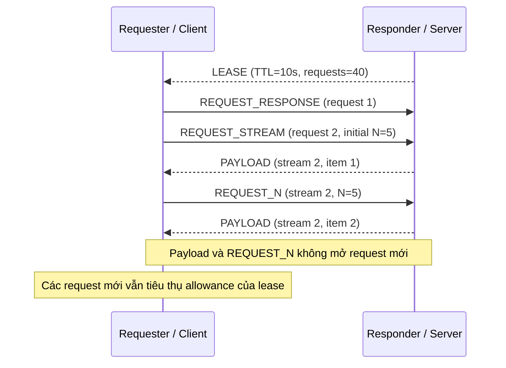
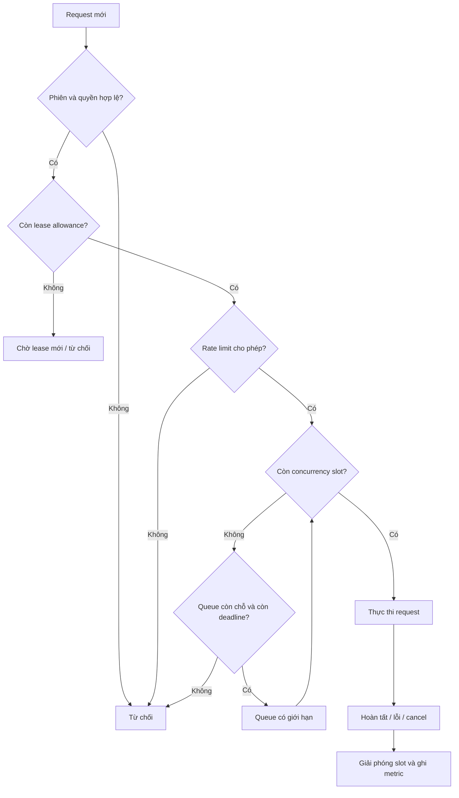

# Kết hợp leasing với giới hạn đồng thời và kiểm soát tải

RSocket leasing giúp một peer kiểm soát số request mới mà peer còn lại được phép khởi tạo trong một khoảng thời gian. Cơ chế này hữu ích khi một server phục vụ nhiều client realtime và cần điều tiết lượng công việc đi vào. Tuy nhiên, quota request không giới hạn trực tiếp số request đang chạy đồng thời. Một client có thể mở nhiều request gần như cùng lúc rồi giữ chúng hoạt động lâu; ngược lại, một lượng request mới không lớn nhưng mỗi request kéo dài vẫn có thể làm cạn tài nguyên.

Vì vậy, hệ thống cần kết hợp nhiều lớp bảo vệ: leasing để kiểm soát admission từ peer, giới hạn concurrency để giới hạn số thao tác đang thực thi, rate limit để kiểm soát tốc độ đến, hàng đợi có giới hạn để hấp thụ burst ngắn và load shedding để từ chối sớm khi hệ thống không còn khả năng phục vụ. Với request-stream và request-channel, flow control bằng `REQUEST_N` còn điều tiết số payload trong từng stream. Mỗi cơ chế giải quyết một loại áp lực khác nhau.

## 1. Leasing kiểm soát điều gì?

Leasing là cơ chế cấp quyền mở request trong RSocket. Khi peer khởi tạo muốn responder cấp lease, peer đó bật khả năng yêu cầu leasing trong frame `SETUP`. Responder có thể gửi frame `LEASE` để cấp một allowance cho requester.

Một frame `LEASE` chứa hai giới hạn chính:

- **TTL (time to live):** thời gian lease có hiệu lực.
- **Number of requests:** số request mới tối đa requester được phép khởi tạo trong thời gian hiệu lực.

Requester chỉ được mở request mới trong phạm vi lease hợp lệ. Nếu quota đã dùng hết hoặc TTL đã hết, requester phải chờ grant hợp lệ tiếp theo trước khi mở request mới. Metadata tùy chọn của lease có thể mang thông tin về chính sách hoặc ngữ cảnh cấp quyền nếu ứng dụng và thư viện hai phía hỗ trợ.

Các interaction mở request gồm:

- `REQUEST_RESPONSE` — một yêu cầu, tối đa một response.
- `REQUEST_FNF` — gửi một yêu cầu không chờ response nghiệp vụ.
- `REQUEST_STREAM` — mở một response stream.
- `REQUEST_CHANNEL` — mở một channel hai chiều.

Mỗi frame mở interaction là một request mới và tiêu thụ một đơn vị allowance. Khi stream đã được mở, các payload tiếp theo của stream không phải request mới. `PAYLOAD`, `REQUEST_N`, `CANCEL`, `KEEPALIVE` và `METADATA_PUSH` không tiêu thụ quota mở request như các frame `REQUEST_*`.

Ví dụ server cấp lease TTL 10 giây với quota 40 request. Client có thể khởi tạo tối đa 40 interaction mới trong khoảng hiệu lực đó. Một request-stream vẫn chỉ tiêu thụ một đơn vị khi mở stream, dù sau đó server phát hàng nghìn payload theo demand. `REQUEST_N` bổ sung demand cho stream hiện có, không tiêu thụ thêm lease.



Leasing là cơ chế tùy chọn và phải được thương lượng khi thiết lập phiên. Nếu phiên không bật hoặc không triển khai leasing, không nên giả định rằng một quota lease đang có hiệu lực. Cách cấu hình cụ thể phụ thuộc phiên bản RSocket Java và Spring đang sử dụng.

## 2. Vì sao lease quota không thay thế concurrency limit?

Quota của lease giới hạn tổng số request mới được mở trong TTL. Concurrency limit giới hạn số thao tác còn đang hoạt động tại cùng một thời điểm. Hai đại lượng này khác nhau.

Giả sử server cấp 100 request trong 10 giây. Client có thể gửi cả 100 request trong giây đầu tiên. Nếu mỗi request mất 5 giây, server có thể phải xử lý gần 100 thao tác đồng thời dù quota lease không bị vượt. Nếu mỗi request mất 30 giây, một burst tương tự có thể giữ tài nguyên lâu hơn nhiều.

Ngược lại, một server có concurrency limit bằng 20 vẫn có thể bị quá tải nếu request đến với tốc độ cao hơn tốc độ hoàn tất. Các request mới chờ trong queue, chiếm bộ nhớ hoặc làm tăng độ trễ. Concurrency limit cần đi cùng rate limit và queue có giới hạn.

| Cơ chế | Kiểm soát | Câu hỏi được trả lời |
|---|---|---|
| RSocket `LEASE` | Số request mới trong TTL | Peer được phép mở thêm bao nhiêu request? |
| Concurrency limit / bulkhead | Số thao tác đang chạy | Tại một thời điểm hệ thống xử lý tối đa bao nhiêu việc? |
| Rate limiter | Số request trong một đơn vị thời gian | Request đến với tốc độ bao nhiêu? |
| Bounded queue | Số request đang chờ | Có thể giữ lại bao nhiêu việc chưa chạy? |
| Load shedding | Khả năng chấp nhận tải hiện tại | Khi quá tải, request nào cần bị từ chối sớm? |
| `REQUEST_N` | Số payload được phát trên một stream | Consumer được nhận thêm bao nhiêu phần tử? |

Không nên lấy số request trong lease làm giới hạn số request đồng thời. Cũng không nên coi TCP flow control hoặc `REQUEST_N` là giới hạn số route nghiệp vụ có thể được khởi tạo.

## 3. Mô hình admission control nhiều lớp

Một request mới có thể đi qua các bước kiểm soát sau:

1. **Kiểm tra phiên và danh tính:** kết nối đã setup thành công, peer được xác thực và route được phép gọi.
2. **Kiểm tra lease ở requester:** client chỉ gửi request mới nếu còn allowance hợp lệ.
3. **Kiểm tra quota/rate limit nghiệp vụ:** áp dụng giới hạn theo tenant, user, route hoặc loại tác vụ.
4. **Kiểm tra concurrency:** chỉ bắt đầu xử lý khi còn slot phù hợp.
5. **Queue có giới hạn (nếu được phép):** nếu hết slot tạm thời, có thể xếp hàng trong giới hạn thời gian và kích thước.
6. **Thực thi và giải phóng:** khi request hoàn tất, lỗi hoặc bị hủy, giải phóng permit và ghi nhận kết quả.



Đây là mô hình khái niệm. Một hệ thống có thể thực hiện một số kiểm tra ở client, một số ở gateway và phần quyết định cuối cùng ở server. Server luôn phải tự bảo vệ tài nguyên của mình; lease là cơ chế điều tiết peer hợp tác, không phải ranh giới bảo mật để tin tưởng tuyệt đối mọi client.

## 4. Chọn concurrency limit theo tài nguyên

Concurrency limit nên dựa trên loại công việc và dependency bị giới hạn. Không nhất thiết mọi route dùng chung một con số.

- **CPU-bound:** giới hạn gần năng lực CPU và số worker có thể chạy song song hiệu quả. Tăng concurrency quá cao có thể gây context switching và tăng latency.
- **Database-bound:** giới hạn theo connection pool, khả năng xử lý truy vấn và mức tải database. Không để số request đang chờ connection tăng vô hạn.
- **HTTP downstream:** giới hạn theo connection pool, quota của dịch vụ đích và timeout của mỗi call.
- **Memory-bound:** giới hạn số request đang giữ payload hoặc kết quả lớn trong bộ nhớ.
- **Long-lived stream:** giới hạn số stream đang hoạt động riêng với số request-response ngắn hạn, vì stream có thể giữ subscription và tài nguyên trong thời gian dài.

Có thể áp dụng bulkhead theo nhiều phạm vi:

| Phạm vi | Mục đích |
|---|---|
| Toàn server | Bảo vệ tổng CPU, heap và khả năng phục vụ |
| Theo route | Một route chậm không chiếm hết slot của route khác |
| Theo tenant hoặc client | Một khách hàng không chiếm toàn bộ năng lực của hệ thống |
| Theo dependency | Giới hạn số call đến database hoặc dịch vụ downstream |
| Theo loại interaction | Tách request-response ngắn khỏi stream dài hạn |

Giới hạn quá thấp làm giảm throughput dù hệ thống còn tài nguyên. Giới hạn quá cao làm tăng queue, memory pressure và tail latency. Nên đo tải thực tế, đặt ngưỡng ban đầu thận trọng rồi điều chỉnh dựa trên p95/p99 latency, tỷ lệ lỗi, queue depth và mức sử dụng tài nguyên.

## 5. Triển khai bulkhead không chặn trong Reactor

Khi không còn concurrency slot, handler nên từ chối nhanh hoặc đưa request vào queue có giới hạn. Không gọi `Semaphore.acquire()` theo kiểu chờ trên EventLoop vì thao tác đó chặn thread I/O. Có thể dùng `tryAcquire()` để kiểm tra ngay và giải phóng permit khi publisher kết thúc.

```java
import java.util.concurrent.Semaphore;
import reactor.core.publisher.Mono;

public class InventoryService {
    private final Semaphore permits = new Semaphore(32);

    public Mono<Reservation> reserve(ReserveCommand command) {
        return Mono.defer(() -> {
            if (!permits.tryAcquire()) {
                return Mono.error(new ServiceOverloadedException());
            }

            return Mono.defer(() -> performReservation(command))
                .doFinally(signal -> permits.release());
        });
    }

    private Mono<Reservation> performReservation(ReserveCommand command) {
        // Gọi repository/client reactive và trả về Mono.
        return reservationRepository.reserve(command);
    }
}
```

`tryAcquire()` không chờ slot. `doFinally` giải phóng permit khi publisher hoàn tất, phát lỗi hoặc bị hủy. `Mono.defer` đảm bảo việc lấy permit diễn ra khi có subscription, không phải lúc tạo biến `Mono`.

Đây là ví dụ đơn giản cho một instance. Khi chạy nhiều replica, mỗi instance có semaphore riêng; tổng concurrency toàn cụm có thể lớn hơn giới hạn mỗi instance nhân với số replica. Nếu cần quota toàn cụm hoặc công bằng theo tenant, phải dùng bộ điều phối tập trung hoặc phân bổ ngân sách rõ ràng. Với production, có thể dùng bulkhead của Resilience4j Reactor hoặc cơ chế giới hạn đã được chuẩn hóa trong hệ thống.

Handler Spring có thể trả lỗi overload để tầng mapping chuyển thành lỗi stream phù hợp:

```java
import org.springframework.messaging.handler.annotation.MessageMapping;
import org.springframework.messaging.handler.annotation.Payload;
import reactor.core.publisher.Mono;

@MessageMapping("inventory.reserve")
public Mono<Reservation> reserve(@Payload ReserveCommand command) {
    return inventoryService.reserve(command);
}
```

Không nên bắt mọi lỗi overload rồi trả response thành công giả. Client cần phân biệt bị từ chối do tải với kết quả nghiệp vụ như hết hàng.

## 6. Hàng đợi có giới hạn và thời gian chờ

Queue hấp thụ burst ngắn khi concurrency slot tạm thời đã dùng hết. Nhưng queue không tạo thêm năng lực xử lý. Nếu tốc độ đến liên tục cao hơn tốc độ hoàn tất, queue sẽ tăng cho đến khi đầy, làm latency và bộ nhớ tăng.

Một queue an toàn cần có:

- **Capacity hữu hạn:** giới hạn số request hoặc tổng byte đang chờ.
- **Queue timeout:** request chỉ được chờ trong khoảng thời gian còn hữu ích với nghiệp vụ.
- **Deadline:** không bắt đầu thực thi một request đã hết hạn.
- **Fairness:** tránh để một tenant hoặc route chiếm toàn bộ queue.
- **Overflow policy:** từ chối nhanh, thay thế dữ liệu cũ hoặc ghi vào hàng đợi bền vững tùy loại tác vụ.
- **Cancellation:** nếu client hủy khi đang chờ, loại request khỏi queue và giải phóng trạng thái.

Không phải request nào cũng nên xếp hàng. Một truy vấn dashboard có thể hết giá trị sau vài giây; một lệnh thanh toán cần được xử lý bền vững có thể cần queue durable và trạng thái job thay vì giữ một stream mạng mở.

Khi queue đầy, server có thể trả lỗi overload với mã có thể nhận diện, ví dụ `REJECTED_OVERLOADED`, và gợi ý thời gian thử lại nếu chính sách cho phép. Không nên để client tự retry liên tục ngay lập tức, vì điều đó tạo retry storm và làm tải nặng hơn.

## 7. Kết hợp lease với concurrency budget

Server cấp lease nên tính đến năng lực còn lại, không chỉ một quota cố định. Một chính sách đơn giản có thể dựa trên:

- Số concurrency slot còn trống.
- Độ sâu queue hiện tại.
- Latency gần đây của các route quan trọng.
- Tỷ lệ lỗi và timeout.
- Tải CPU, heap và trạng thái dependency.
- Mức quota đã phân bổ cho các peer/tenant khác.

Ví dụ, server có thể cấp grant nhỏ hơn khi queue sâu hoặc p99 latency tăng, và cấp grant lớn hơn khi tải thấp. TTL ngắn giúp quyền đã cấp không tồn tại quá lâu sau khi điều kiện tải thay đổi; TTL dài giảm overhead cấp lease nhưng khiến allowance đã phát khó thích ứng nhanh với burst hoặc thay đổi tải.

Không có công thức grant chung cho mọi ứng dụng. Một mô hình khái niệm là:

```text
available = max(0, capacity - active - reserved)
grant = min(perPeerCap, fairShare, available * safetyFactor)
```

Trong đó `active` là số thao tác đang chạy, `reserved` là năng lực đã dành cho công việc khác, `fairShare` là ngân sách của peer hiện tại và `safetyFactor` để lại khoảng dự phòng. Đây là cách suy nghĩ về admission budget, không phải thuật toán bắt buộc của giao thức RSocket.

Lease quota và concurrency permit cần được quản lý riêng. Khi client thực sự mở request mới, allowance của lease được tiêu thụ. Khi server bắt đầu xử lý, concurrency permit được giữ; permit được giải phóng khi xử lý kết thúc hoặc bị hủy. Một request đã tiêu thụ lease nhưng sau đó bị server từ chối do bulkhead vẫn đã dùng một lượt mở request theo lease.

## 8. Kiểm soát tải ở client

Client cũng cần tự bảo vệ mình. Nếu nhận lease với allowance lớn, client không nhất thiết phải dùng hết ngay lập tức. Client có thể kết hợp:

1. Theo dõi quota và thời điểm hết hạn của lease.
2. Duy trì giới hạn số request đang chờ phản hồi.
3. Giới hạn số request đang chờ gửi trong queue nội bộ.
4. Ưu tiên request quan trọng và loại bỏ request đã hết deadline.
5. Chỉ tiêu thụ allowance khi request thực sự sẵn sàng được gửi.
6. Dùng cùng idempotency key khi retry một ý định nghiệp vụ đã có tác động phụ.

Nếu client đã hết lease, có thể chờ grant mới trong một queue có giới hạn, trả lỗi cho caller hoặc dùng fallback phù hợp. Không nên giữ hàng nghìn request trong bộ nhớ chỉ để chờ lease tiếp theo. Nếu TTL của lease hết khi request vẫn đang chờ, request đó cần được đánh giá lại theo grant mới trước khi gửi.

Khi dùng Spring RSocket, thư viện có thể đảm nhiệm việc nhận lease và từ chối request vượt allowance khi leasing được cấu hình. Ứng dụng vẫn cần chính sách queue, concurrency và retry ở tầng nghiệp vụ. Hãy kiểm tra API và cấu hình của đúng phiên bản Spring/RSocket Java đang triển khai thay vì giả định mọi phiên bản có cùng cách bật hoặc quan sát lease.

## 9. Rate limit, lease và flow control là các lớp khác nhau

Các cơ chế thường bị gộp chung thành “giới hạn tải”, nhưng đơn vị và phạm vi khác nhau:

| Cơ chế | Đơn vị | Phạm vi |
|---|---|---|
| Leasing | Request mới trong TTL | Quyền mở request trên kết nối/peer |
| Token bucket hoặc sliding window | Request trong một đơn vị thời gian | Route, user, tenant hoặc toàn hệ thống |
| Concurrency bulkhead | Request đang thực thi | Instance, route hoặc dependency |
| Queue limit | Request đang chờ hoặc byte đang giữ | Hàng đợi nội bộ |
| `REQUEST_N` | Payload trong stream | Một stream request-stream/channel |
| TCP flow control | Byte | Kết nối TCP |

Ví dụ một request-stream chỉ tiêu thụ một đơn vị lease khi mở. Server có thể phát hàng trăm payload nếu requester đã cấp demand đủ lớn bằng initial N và `REQUEST_N`. Trong khi đó, rate limiter có thể giới hạn số stream mới mỗi giây, concurrency bulkhead giới hạn số stream đang xử lý, còn TCP điều tiết byte trên socket.

Với hệ thống realtime, nên áp dụng các lớp theo thứ tự phù hợp: admission cho request mới, concurrency cho công việc đang chạy, flow control cho payload của stream và giới hạn byte/buffer cho bộ nhớ. Không dùng một con số duy nhất để đại diện cho tất cả.

## 10. Công bằng giữa nhiều client và tenant

Nếu mỗi kết nối nhận cùng một lease grant, client có thể tạo ra tải tổng vượt năng lực server khi số kết nối tăng. Ví dụ 200 client, mỗi client được cấp 50 request trong cùng TTL, có thể tạo ra 10.000 request mới trong một cửa sổ ngắn.

Để tránh một nhóm client chiếm hết tài nguyên:

- Đặt giới hạn toàn server bên cạnh giới hạn từng kết nối.
- Phân bổ ngân sách theo tenant hoặc mức dịch vụ.
- Đặt cap theo peer để một client không chiếm toàn bộ allowance.
- Dùng weighted fair queue hoặc round-robin cho các tenant có mức ưu tiên khác nhau.
- Dành capacity cho route quan trọng hoặc tác vụ vận hành.
- Theo dõi số lease grant và request thực tế theo peer/tenant.

Nếu một tenant phát burst, có thể giảm grant tiếp theo cho tenant đó hoặc áp dụng rate limit riêng. Tránh dùng một queue chung không phân vùng nếu các tenant có SLA khác nhau, vì một tenant có thể tạo head-of-line blocking cho những tenant khác.

## 11. Retry và overload: tránh retry storm

Khi server từ chối do quá tải, retry ngay lập tức thường làm tình hình xấu hơn. Client nên phân biệt lỗi tạm thời có thể thử lại với lỗi nghiệp vụ hoặc lỗi không thể phục hồi.

- Dùng exponential backoff và jitter để phân tán thời điểm retry.
- Giới hạn số lần retry và tổng thời gian retry.
- Tôn trọng `Retry-After` hoặc thông tin thời gian chờ nếu ứng dụng có quy ước truyền.
- Không retry lỗi validation, authentication hoặc authorization.
- Với lệnh có tác động phụ, dùng idempotency key ổn định qua mọi lần retry.
- Khi lease hết quota, chờ grant hợp lệ tiếp theo thay vì mở request vượt allowance.
- Khi deadline đã hết, dừng retry vì kết quả không còn hữu ích.

Ví dụ retry có giới hạn ở Reactor:

```java
import java.time.Duration;
import reactor.util.retry.Retry;

Mono<Reservation> reservation = sendReservation(command, idempotencyKey)
    .retryWhen(Retry.backoff(2, Duration.ofMillis(250))
        .maxBackoff(Duration.ofSeconds(3))
        .jitter(0.5)
        .filter(this::isTransientOverloadOrTransportFailure));
```

Đoạn mã minh họa chính sách retry; cần cấu hình filter chỉ cho phép retry những lỗi thực sự tạm thời. Không nên retry vô điều kiện mọi `RSocketException` hoặc mọi lỗi ứng dụng.

## 12. Quan sát và điều chỉnh grant

Để biết hệ thống cần cấp lease và concurrency limit bao nhiêu, cần quan sát cả tải đến và năng lực xử lý.

Các metric nên có:

- Lease grant: số grant, TTL, allowance được cấp và allowance đã sử dụng.
- Admission: request được chấp nhận, bị từ chối do hết lease, rate limit hoặc bulkhead.
- Concurrency: số request đang chạy theo route, tenant và dependency.
- Queue: depth, thời gian chờ, overflow và số request bị hủy khi đang chờ.
- Latency: p50, p95 và p99 theo route; thời gian xử lý và thời gian chờ tách biệt.
- Dependency: connection pool, query latency, lỗi downstream và timeout.
- Resource: CPU, heap, GC pause, network throughput và số stream hoạt động.
- Retry: số lần thử lại, lý do retry và tỷ lệ retry thành công.

Một số dấu hiệu chẩn đoán:

| Dấu hiệu | Khả năng cần kiểm tra |
|---|---|
| Queue tăng liên tục, concurrency luôn đầy | Tốc độ đến vượt năng lực xử lý; cần giảm admission hoặc tăng capacity có kiểm chứng |
| Concurrency thấp nhưng latency cao | Dependency chậm, network latency hoặc timeout/retry không hợp lý |
| CPU thấp nhưng request bị từ chối | Bulkhead có thể đặt quá thấp hoặc dependency/connection pool là nút thắt |
| Nhiều request bị từ chối ngay sau khi grant | Grant có thể quá lớn so với concurrency budget hoặc client phát burst |
| Một tenant chiếm phần lớn queue | Cần quota/fairness theo tenant |
| Retry tăng cùng timeout | Có nguy cơ retry storm; cần backoff, jitter và load shedding |

Điều chỉnh lease TTL, quota và concurrency theo tải thực tế. Tránh thay đổi nhiều ngưỡng cùng lúc vì sẽ khó xác định yếu tố nào cải thiện hoặc làm xấu hệ thống.

## 13. Kiểm thử phối hợp leasing và concurrency

Kiểm thử cần xác minh các lớp bảo vệ phối hợp đúng:

1. **Lease hợp lệ:** requester chỉ mở request mới trong quota và TTL được cấp.
2. **Hết quota:** requester không gửi thêm request mới cho đến khi có grant hợp lệ.
3. **Hết TTL:** allowance chưa dùng cũng không còn hiệu lực.
4. **Concurrency đầy:** server từ chối hoặc xếp hàng theo capacity đã định; không block EventLoop.
5. **Queue đầy:** request bị từ chối theo chính sách overflow, bộ nhớ không tăng vô hạn.
6. **Burst:** nhiều request đến cùng lúc không làm vượt giới hạn concurrency.
7. **Nhiều client:** tổng tải từ nhiều lease không vượt giới hạn toàn server; fairness theo tenant được duy trì.
8. **Stream dài:** một request-stream tiêu thụ một lượt lease khi mở; payload và `REQUEST_N` không bị tính thành request mới.
9. **Cancellation:** request bị hủy giải phóng concurrency permit và loại khỏi queue nếu chưa chạy.
10. **Retry:** client dùng backoff, jitter và idempotency; không tạo retry storm khi server overload.
11. **Lỗi dependency:** khi database hoặc downstream chậm, grant/admission được điều chỉnh hoặc load shedding kích hoạt.

Có thể dùng `StepVerifier` để kiểm tra publisher, cancellation và retry ở tầng Reactor. Kiểm thử tích hợp nên chạy RSocket client/server thật để xác minh lease frame, quota và stream behavior. Kiểm thử tải cần mô phỏng số client, burst, request duration khác nhau và payload stream lớn; một bài unit test với vài request không chứng minh được hệ thống chịu tải.

## 14. Quy tắc thiết kế

1. Dùng leasing để giới hạn request mới theo TTL và quota; không coi nó là concurrency limit.
2. Nhớ rằng mỗi interaction mở bằng `REQUEST_*` tiêu thụ một lượt; payload và `REQUEST_N` trong stream không mở request mới.
3. Giới hạn concurrency theo tài nguyên thực tế, có thể tách theo route, tenant và dependency.
4. Dùng rate limiter để kiểm soát tốc độ, bounded queue để hấp thụ burst ngắn và load shedding khi quá tải.
5. Không block EventLoop khi chờ concurrency slot hoặc chờ lease mới.
6. Cấp lease dựa trên capacity còn lại, queue, latency và fairness giữa các peer.
7. Giữ queue hữu hạn, có timeout, deadline và overflow policy rõ ràng.
8. Retry overload có backoff, jitter, giới hạn và idempotency cho lệnh có tác động phụ.
9. Phân biệt lease admission, `REQUEST_N` flow control và TCP byte flow control.
10. Đo tải nhiều client và stream dài trước khi điều chỉnh quota hoặc concurrency.

Leasing điều tiết số request mới mà một peer được phép mở; concurrency limit bảo vệ số thao tác đang chạy; rate limit, bounded queue và load shedding kiểm soát tốc độ cùng lượng việc chờ. Khi kết hợp đúng các lớp này, hệ thống RSocket có thể hấp thụ burst ngắn, giữ công bằng giữa client và bảo vệ tài nguyên mà vẫn duy trì giao tiếp realtime có độ trễ dự đoán được.
