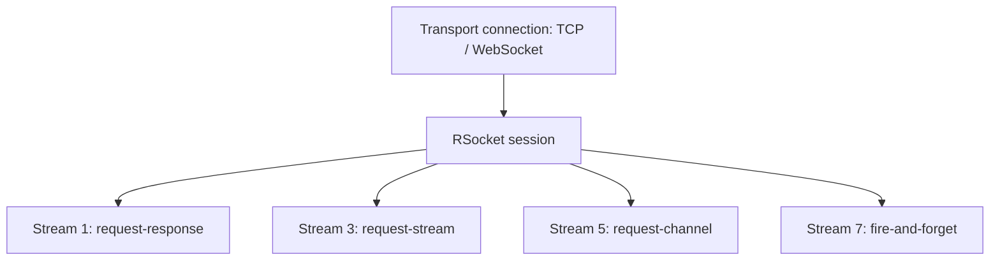

# Vòng đời một luồng từ lúc khởi tạo đến khi kết thúc

## Mục tiêu bài học

Một tương tác RSocket bắt đầu bằng một request frame, có thể trao đổi nhiều payload và kết thúc bằng complete, error hoặc cancel. Hiểu rõ vòng đời này giúp bạn biết khi nào nên giải phóng tài nguyên, vì sao một stream dừng sớm và tại sao việc một luồng kết thúc không đồng nghĩa kết nối RSocket đã đóng.

Sau bài này, bạn có thể:

- Phân biệt vòng đời transport, phiên RSocket và từng stream.
- Mô tả các bước từ thiết lập kết nối đến khởi tạo tương tác.
- Nhận biết vai trò của stream ID, PAYLOAD, REQUEST_N, COMPLETE, ERROR và CANCEL.
- Phân biệt kết thúc bình thường, hủy từ requester và lỗi.
- Theo dõi vòng đời stream trong Java, Reactor và Spring Boot.
- Viết kiểm thử cho các trường hợp complete, error, cancel và mất kết nối.

## Ba lớp vòng đời cần phân biệt

Khi làm việc với RSocket, cần phân biệt ba phạm vi:

1. **Transport connection:** kết nối vật lý hoặc logic bên dưới, chẳng hạn TCP hoặc WebSocket. Một kết nối có thể mang nhiều stream RSocket.
2. **RSocket session:** trạng thái giao thức được thiết lập trên transport sau quá trình SETUP. Session quản lý trao đổi frame và các stream trên kết nối.
3. **Interaction/stream:** một tương tác cụ thể như request-response, fire-and-forget, request-stream hoặc request-channel.



Các stream có thể hoàn tất ở những thời điểm khác nhau. Khi một request-response kết thúc, request-stream khác trên cùng session vẫn có thể tiếp tục. Chỉ khi transport/session bị đóng hoặc gặp lỗi ở cấp kết nối, nhiều stream đang hoạt động mới đồng thời bị ảnh hưởng.

**Stream ID** định danh một tương tác trong session. Nó được dùng để ghép các frame thuộc cùng stream. Stream ID không phải route nghiệp vụ, user ID hay command ID; ứng dụng vẫn cần correlation ID riêng nếu muốn liên kết log và dữ liệu nghiệp vụ qua nhiều tương tác.

## Bước 1: thiết lập transport và phiên RSocket

Trước khi gửi request, hai peer phải có transport hoạt động. Ví dụ client mở kết nối TCP đến server hoặc thiết lập WebSocket handshake đến endpoint RSocket.

Sau đó, peer khởi tạo gửi frame **SETUP** để bắt đầu session. SETUP chứa thông tin cần thiết cho việc thiết lập giao thức, bao gồm các MIME type cho metadata và data, payload khởi tạo tùy chọn, cùng các tham số liên quan theo phiên bản giao thức.

Ở giai đoạn này, hai bên cũng cần có cấu hình tương thích về transport, serialization, bảo mật và khả năng giao thức được sử dụng. Nếu setup thất bại, chưa có tương tác nghiệp vụ nào được mở.

```mermaid
sequenceDiagram
    participant C as Client
    participant T as TCP / WebSocket
    participant S as RSocket Server
    C->>T: Mở transport
    T-->>C: Kết nối sẵn sàng
    C->>S: SETUP
    Note over C,S: SETUP được chấp nhận; session sẵn sàng mở stream
```

SETUP là hoạt động ở cấp session. Nó không phải một request-response nghiệp vụ và không tiêu thụ stream ID như các tương tác thông thường. Nếu transport bị đóng, session trên transport đó không còn khả dụng. Các cơ chế resume, nếu được cấu hình và implementation hỗ trợ, là chủ đề riêng; không nên giả định session luôn tự phục hồi sau mọi lần mất kết nối.

## Bước 2: requester mở một tương tác

Sau khi session sẵn sàng, requester chọn kiểu tương tác và gửi frame mở đầu tương ứng:

| Request frame | Mục đích | Hành vi response |
|---|---|---|
| `REQUEST_RESPONSE` | Gửi một request | Nhận tối đa một payload response |
| `REQUEST_FNF` | Gửi một thông điệp một chiều | Không có response nghiệp vụ |
| `REQUEST_STREAM` | Gửi một request ban đầu | Nhận một luồng payload |
| `REQUEST_CHANNEL` | Mở trao đổi hai chiều | Hai phía có thể gửi luồng payload |

Requester cấp một stream ID cho tương tác mới. Các frame tiếp theo của tương tác sử dụng stream ID đó để peer ghép đúng dữ liệu, demand và tín hiệu kết thúc.

Với request-stream và request-channel, thông tin demand ban đầu có thể được gửi cùng frame mở đầu. Demand cho biết số phần tử mà bên nhận sẵn sàng nhận ở hướng tương ứng. Khi cần thêm dữ liệu, peer gửi frame **REQUEST_N** để yêu cầu thêm phần tử.

Ví dụ, một client mở request-stream để theo dõi giá:

```java
Flux<Quote> quotes = requester
    .route("quotes.watch")
    .data(new WatchRequest("ACME"))
    .retrieveFlux(Quote.class);
```

Khi subscription được tạo, requester mới thực sự bắt đầu trao đổi dữ liệu. Chỉ tạo một publisher Reactor mà không subscribe hoặc không kết nối nó vào một pipeline được subscribe thì chưa khởi chạy tương tác.

## Bước 3: trao đổi payload và điều tiết luồng

Sau khi stream được mở, các payload được trao đổi theo kiểu tương tác đã chọn. Với những tương tác có nhiều phần tử, bên phát cần tuân thủ demand từ bên nhận.

Các frame thường gặp trong giai đoạn này:

- **PAYLOAD với NEXT:** mang một payload tiếp theo.
- **PAYLOAD với COMPLETE:** báo rằng phía gửi đã hoàn tất việc phát dữ liệu ở hướng đó; frame có thể chỉ mang COMPLETE hoặc kết hợp NEXT và COMPLETE để đánh dấu payload cuối.
- **REQUEST_N:** yêu cầu peer phát thêm một số phần tử.
- **ERROR:** báo lỗi kết thúc tương tác hoặc phạm vi được chỉ định bởi stream ID.

Với request-stream, responder phát các PAYLOAD về requester theo demand. Requester có thể yêu cầu thêm phần tử trong quá trình tiêu thụ.

Với request-channel, cả hai phía đều có thể phát payload. Mỗi hướng có vòng đời riêng: requester có thể hoàn tất việc gửi request trong khi vẫn nhận response; responder cũng có thể hoàn tất chiều response trong khi requester tiếp tục gửi dữ liệu. Điều này không giống việc hủy toàn bộ channel.

Backpressure giúp bên nhận điều tiết lượng phần tử muốn nhận. Nó không tự giới hạn thời gian sống của stream, số stream đồng thời hoặc kích thước payload. Những giới hạn này cần chính sách riêng.

## Bước 4: stream kết thúc như thế nào?

Một tương tác có thể kết thúc theo nhiều cách. Cần phân biệt tín hiệu kết thúc một chiều với tín hiệu chấm dứt toàn bộ tương tác.

### Complete: kết thúc bình thường

Complete có nghĩa bên phát không còn payload nào cần gửi ở hướng đó.

- Trong request-response, responder thường gửi payload kết quả cuối cùng với NEXT và COMPLETE cùng lúc.
- Trong request-stream, responder gửi COMPLETE sau phần tử cuối hoặc khi không còn dữ liệu.
- Trong request-channel, requester có thể complete chiều request trong khi responder tiếp tục gửi response. Responder cũng có thể complete chiều response trong khi requester vẫn tiếp tục gửi request.
- Fire-and-forget không có response stream để requester chờ complete. Việc gửi FNF hoàn tất ở phía requester không xác nhận nghiệp vụ phía server đã thành công.

Complete không có nghĩa transport connection đã đóng. Những stream khác trên cùng session vẫn có thể tiếp tục.

### Cancel: requester không muốn tiếp tục

Requester có thể gửi **CANCEL** khi không còn muốn nhận hoặc duy trì tương tác, ví dụ người dùng rời màn hình theo dõi hoặc một tác vụ không còn cần kết quả.

Cancel là tín hiệu hủy tương tác, khác với việc hoàn tất bình thường một chiều của request-channel. Responder nên dừng công việc liên quan, hủy subscription nội bộ và giải phóng tài nguyên càng sớm càng tốt.

Trong Reactor, việc dispose subscription ở phía client thường dẫn đến hủy publisher và có thể tạo CANCEL cho stream đang hoạt động. Không dùng dispose nếu mục tiêu chỉ là ngừng phát request nhưng vẫn tiếp tục nhận response; trong trường hợp đó, hãy complete publisher request theo đúng mô hình request-channel.

### Error: kết thúc do lỗi

Frame **ERROR** kết thúc stream do lỗi. Lỗi có thể đến từ validation, nghiệp vụ, serialization hoặc xử lý nội bộ. Ứng dụng cần phân loại lỗi để quyết định thông báo cho client, ghi log và có nên retry hay không.

Cần phân biệt ERROR ở cấp stream với lỗi ở cấp kết nối. ERROR gắn với một stream ảnh hưởng đến tương tác đó. Lỗi cấp connection (stream ID bằng 0 theo giao thức) có thể ảnh hưởng toàn session và các stream trên kết nối.

### Transport đóng hoặc mất kết nối

Nếu TCP/WebSocket đóng bất ngờ, tất cả stream đang phụ thuộc vào session đó có thể bị gián đoạn. Client cần xử lý lỗi kết nối và trạng thái kết quả chưa xác định. Ví dụ server có thể đã thực hiện nghiệp vụ nhưng response chưa đến client.

Không nên mặc định rằng mọi lỗi kết nối đều có nghĩa nghiệp vụ chưa chạy. Với thao tác có tác dụng phụ, hãy dùng command ID, idempotency key, truy vấn trạng thái và chính sách retry phù hợp.

## Bảng tổng hợp tín hiệu vòng đời

| Tín hiệu | Ai thường gửi? | Phạm vi | Ý nghĩa |
|---|---|---|---|
| SETUP | Peer khởi tạo session | Session | Bắt đầu phiên RSocket |
| REQUEST_* | Requester | Stream mới | Mở tương tác theo một kiểu cụ thể |
| PAYLOAD NEXT | Bên đang phát dữ liệu | Một hướng của stream | Gửi phần tử tiếp theo |
| PAYLOAD COMPLETE | Bên đang phát dữ liệu | Một hướng của stream | Hoàn tất việc phát ở hướng đó |
| REQUEST_N | Bên nhận dữ liệu | Một hướng của stream | Yêu cầu thêm phần tử |
| CANCEL | Requester | Stream | Hủy tương tác đang hoạt động |
| ERROR | Peer phát hiện lỗi | Stream hoặc connection | Kết thúc do lỗi |
| KEEPALIVE | Peer gửi keepalive; peer kia phản hồi khi được yêu cầu | Connection/session | Duy trì và kiểm tra hoạt động kết nối |
| Đóng transport | Transport hoặc hệ thống mạng | Session/connection | Kết nối bị đóng và ảnh hưởng các stream liên quan |

KEEPALIVE là cơ chế ở cấp kết nối, không phải heartbeat riêng cho từng stream. Một stream có thể im lặng trong khi session vẫn hoạt động. Ngược lại, kết nối bị mất có thể làm gián đoạn cả những stream đang có dữ liệu.

## Vòng đời trong Spring Boot và Reactor

Spring Messaging ánh xạ route RSocket vào handler. Các kiểu trả về Reactor thể hiện số lượng dữ liệu và vòng đời bất đồng bộ:

- `Mono<T>`: không có hoặc có tối đa một kết quả.
- `Flux<T>`: có thể không phát phần tử nào, phát nhiều phần tử, hoàn tất hoặc lỗi.
- Một `Flux` có thể bị cancel khi consumer không còn subscribe.

Ví dụ handler request-stream:

```java
import org.springframework.messaging.handler.annotation.MessageMapping;
import org.springframework.stereotype.Controller;
import reactor.core.publisher.Flux;

@Controller
class QuoteController {

    private final QuoteService quoteService;

    QuoteController(QuoteService quoteService) {
        this.quoteService = quoteService;
    }

    @MessageMapping("quotes.watch")
    Flux<Quote> watch(WatchRequest request) {
        return quoteService.watch(request.symbol())
            .doFinally(signal ->
                quoteService.recordStreamTermination(
                    request.symbol(), signal.name()
                )
            );
    }
}
```

`doFinally` được gọi khi publisher complete, error hoặc cancel. Đây là vị trí hữu ích để ghi nhận kết thúc stream và dọn tài nguyên gắn với subscription. Phần cleanup cần an toàn khi được gọi trong mọi kiểu kết thúc.

Ở client, có thể gắn các hook tương tự:

```java
Flux<Quote> quotes = requester
    .route("quotes.watch")
    .data(new WatchRequest("ACME"))
    .retrieveFlux(Quote.class)
    .doOnSubscribe(s -> log.info("Quote stream subscribed"))
    .doOnNext(q -> log.debug("Quote received: {}", q))
    .doOnComplete(() -> log.info("Quote stream completed"))
    .doOnError(e -> log.warn("Quote stream failed", e))
    .doFinally(signal ->
        log.info("Quote stream terminated: {}", signal)
    );
```

Nếu người dùng dừng theo dõi, ứng dụng có thể dispose subscription đang giữ. Cần lưu subscription ở một thành phần quản lý vòng đời rõ ràng để tránh rò rỉ stream khi màn hình hoặc phiên làm việc đã kết thúc.

## Timeout, retry và trạng thái kết quả chưa xác định

Timeout là chính sách của ứng dụng hoặc client để giới hạn thời gian chờ. Nó không phải cùng một khái niệm với COMPLETE, CANCEL hay TTL của lease.

Ví dụ, client chờ request-response trong 3 giây. Nếu hết thời gian, pipeline có thể phát timeout error và hủy subscription. Nhưng server có thể đã commit thay đổi trước khi client timeout. Vì vậy:

- Chỉ retry tự động khi thao tác an toàn để thực hiện lặp hoặc có idempotency key.
- Với thao tác chạy lâu, cân nhắc trả mã công việc và cung cấp route truy vấn trạng thái.
- Khi kết nối bị ngắt, phân biệt lỗi tạm thời với lỗi nghiệp vụ không thể khắc phục.
- Đặt timeout phù hợp với từng loại tương tác; stream dài hạn có thể cần idle timeout hoặc chính sách heartbeat riêng thay vì một timeout ngắn cho toàn stream.

Một request-stream có thể im lặng trong một khoảng thời gian mà vẫn hợp lệ. Nếu cần phát hiện stream không còn hữu ích, hãy thiết kế idle timeout ở tầng ứng dụng hoặc chính sách giám sát phù hợp.

## Dọn dẹp tài nguyên khi stream kết thúc

Mỗi stream có thể giữ tài nguyên riêng như subscription tới database, timer, queue, buffer hoặc listener. Khi stream kết thúc, các tài nguyên này phải được giải phóng.

Một quy trình cleanup nên:

1. Hủy subscription hoặc listener nội bộ khi nhận cancel.
2. Đóng tài nguyên tạm khi complete hoặc error.
3. Giải phóng buffer và tham chiếu không còn cần thiết.
4. Ghi lại nguyên nhân kết thúc để hỗ trợ điều tra.
5. Bảo đảm cleanup có thể chạy an toàn ngay cả khi nhiều tín hiệu dừng xảy ra gần nhau.

Không nên dùng một biến trạng thái toàn cục để biểu diễn vòng đời của mọi stream trên connection. Mỗi stream cần trạng thái và tài nguyên riêng; connection/session quản lý tài nguyên cấp kết nối.

## Kiểm thử vòng đời stream

Một bài kiểm thử tốt nên xác nhận cả dữ liệu và tín hiệu kết thúc. Với Reactor, `StepVerifier` hỗ trợ kiểm tra các trường hợp complete và error:

```java
StepVerifier.create(quoteService.watch("ACME"))
    .expectNextMatches(q -> q.symbol().equals("ACME"))
    .expectNextCount(1)
    .thenCancel()
    .verify();
```

Ví dụ trên kiểm tra client hủy subscription trước khi publisher tự hoàn tất. Để kiểm tra cleanup, hãy dùng một spy hoặc bộ đếm và xác nhận hook cleanup được gọi với tín hiệu CANCEL.

Các kịch bản quan trọng:

- Request-response trả về một payload rồi complete.
- Request-stream phát nhiều payload rồi complete bình thường.
- Handler phát error và client nhận lỗi tương ứng.
- Client cancel stream; server ngừng nguồn phát và giải phóng tài nguyên.
- Request-channel hoàn tất một chiều nhưng chiều kia tiếp tục.
- Transport bị đóng khi nhiều stream đang hoạt động.
- Timeout xảy ra sau khi server có thể đã xử lý nghiệp vụ.
- Một stream chậm không làm buffer tăng vô hạn hoặc ảnh hưởng ngoài dự kiến đến stream khác.

Nên có cả unit test cho publisher và integration test qua transport thật. Unit test xác minh logic Reactor; integration test xác minh frame, serialization, setup và hành vi của implementation RSocket được sử dụng.

## Quan sát khi vận hành

Để tìm nguyên nhân một stream kết thúc bất thường, hãy ghi lại:

- Connection/session ID và stream ID.
- Route nghiệp vụ và correlation ID.
- Kiểu tương tác đã mở.
- Thời điểm subscribe, payload đầu/cuối và thời điểm terminal signal.
- Số payload đã phát/nhận và demand liên quan.
- Nguyên nhân kết thúc: complete, cancel, stream error, connection error hay transport close.
- Thời gian sống của stream và tài nguyên được giải phóng.

Các metric hữu ích gồm số stream đang hoạt động, số stream mở mới, thời gian sống trung bình, tỷ lệ complete/error/cancel, số kết nối bị đóng và số lần timeout. Tránh đưa payload nhạy cảm vào log.

Khi một stream dừng, hãy kiểm tra phạm vi lỗi trước: chỉ stream đó hay cả connection/session. Điều này giúp xác định nên điều tra handler, publisher, serialization hay transport.

## Checklist thiết kế

Trước khi triển khai một tương tác RSocket, hãy trả lời:

1. Tương tác cần request-response, fire-and-forget, request-stream hay request-channel?
2. Điều kiện nào làm từng hướng complete?
3. Ai có quyền cancel và khi nào cần dừng publisher?
4. Lỗi nào kết thúc riêng stream, lỗi nào làm mất connection?
5. Timeout và retry có an toàn với tác dụng phụ nghiệp vụ không?
6. Tài nguyên nào được tạo cho mỗi stream và được dọn dẹp ở tín hiệu nào?
7. Có cần correlation ID để truy vết stream qua các service không?
8. Làm thế nào để kiểm thử complete, error, cancel và mất kết nối?

Nắm được vòng đời từ SETUP, mở stream, trao đổi payload đến complete/error/cancel giúp bạn thiết kế ứng dụng RSocket dễ dự đoán hơn. Hãy quản lý vòng đời từng stream riêng với session và transport, đồng thời gắn cleanup, timeout, quan sát và retry vào đúng phạm vi.

