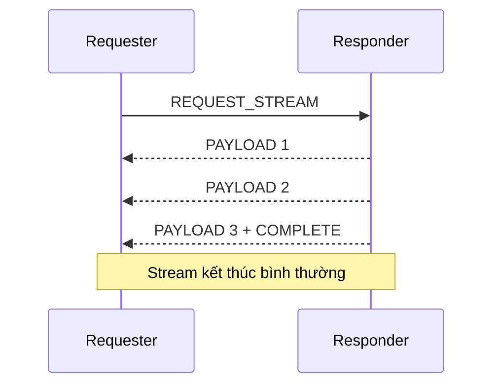
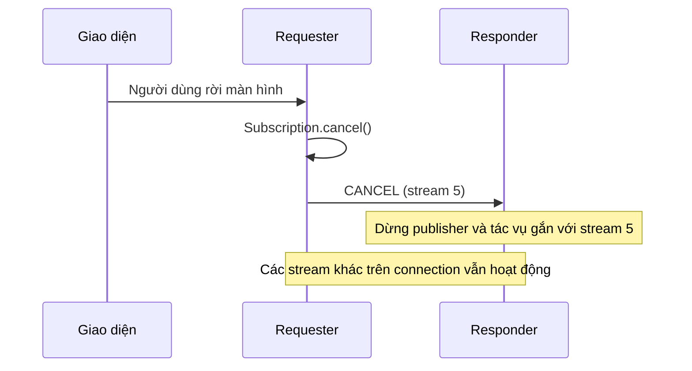
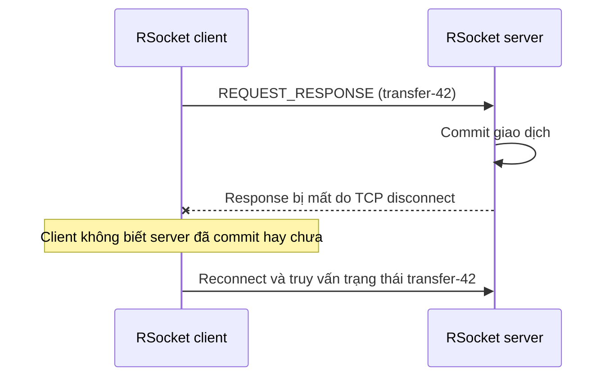

# Phân biệt hoàn thành, hủy, lỗi ứng dụng và mất kết nối

Một tương tác RSocket có thể kết thúc bình thường, bị hủy bởi bên tiêu thụ, kết thúc do lỗi hoặc bị gián đoạn vì kết nối mạng mất. Các trường hợp này có vẻ giống nhau ở chỗ ứng dụng không còn nhận dữ liệu, nhưng ý nghĩa và phạm vi tác động rất khác nhau. Nếu xử lý nhầm, client có thể retry một lệnh đã được thực hiện, server có thể giữ tài nguyên sau khi người dùng rời phiên, hoặc một lỗi của một stream có thể làm ứng dụng đóng cả kết nối đang phục vụ nhiều tương tác khác.

Trong module `INTEGRATION_REALTIME_RSOCKET`, client và server Java thường dùng Spring Boot, Reactor và RSocket qua TCP hoặc WebSocket. Bài học này phân biệt bốn tình huống chính: hoàn thành (`complete`), hủy (`cancel`), lỗi ứng dụng (`application error`) và mất kết nối (`connection loss`). Từ đó, ta xác định được tín hiệu nào kết thúc publisher, tín hiệu nào được truyền qua giao thức, tài nguyên nào cần giải phóng và khi nào retry là an toàn.

## 1. Bốn cách một tương tác có thể dừng

Hãy bắt đầu bằng ý nghĩa ở cấp ứng dụng:

| Trường hợp | Ai hoặc điều gì khởi phát? | Ý nghĩa | Hướng xử lý thường gặp |
| --- | --- | --- | --- |
| Complete | Publisher đã phát xong dữ liệu. | Luồng kết thúc bình thường. | Đóng tài nguyên của luồng và hoàn tất phía tiêu thụ. |
| Cancel | Subscriber không còn muốn nhận dữ liệu. | Bên tiêu thụ yêu cầu dừng công việc. | Hủy upstream, dừng tác vụ có thể dừng và giải phóng tài nguyên. |
| Application error | Nghiệp vụ hoặc pipeline phát hiện lỗi. | Yêu cầu không thể tiếp tục theo hợp đồng hiện tại. | Trả kết quả lỗi phù hợp hoặc kết thúc stream bằng lỗi. |
| Connection loss | Transport hoặc peer bị ngắt. | Các tương tác phụ thuộc kết nối không thể tiếp tục trên connection đó. | Đóng tài nguyên, phân loại lỗi và kết nối lại nếu phù hợp. |

`Complete`, `Cancel` và `Error` là các khái niệm trong vòng đời Reactive Streams. Mất kết nối là sự kiện ở tầng transport/connection, thường khiến các publisher liên quan kết thúc bằng lỗi hoặc bị hủy tùy adapter. Vì vậy, không nên coi connection loss là một loại `onComplete`.

## 2. Complete: nguồn dữ liệu kết thúc bình thường

Trong Reactive Streams, publisher gửi `onComplete()` để thông báo không còn phần tử nào được phát. Đây là tín hiệu kết thúc bình thường. Sau `onComplete`, publisher không được phát thêm `onNext` hoặc `onError` cho subscription đó.

Trong RSocket, việc hoàn tất được biểu diễn bằng cờ `COMPLETE` trên frame `PAYLOAD` hoặc bằng quy tắc kết thúc tương ứng của interaction. Với request-stream, responder phát các payload rồi đánh dấu payload cuối cùng hoàn tất. Với request-response, response đơn lẻ hoàn tất tương tác. Với request-channel, hai hướng dữ liệu có thể hoàn tất độc lập.



Complete không có nghĩa là mọi công việc trong hệ thống đã hoàn tất. Nó chỉ xác nhận publisher hoặc hướng dữ liệu cụ thể đã kết thúc theo hợp đồng. Ví dụ, một publisher có thể phát kết quả sau khi đã ghi dữ liệu vào database; nhưng nếu publisher chỉ phát tín hiệu từ một hàng đợi trung gian, `onComplete` không chứng minh mọi consumer downstream khác cũng đã xử lý xong.

Trong Reactor, có thể xử lý complete bằng `doOnComplete` hoặc `doFinally`. `doOnComplete` chỉ chạy khi kết thúc bình thường; `doFinally` chạy khi complete, error hoặc cancel và nhận loại tín hiệu kết thúc.

## 3. Cancel: subscriber yêu cầu dừng

Trong Reactive Streams, subscriber gọi `Subscription.cancel()` để thông báo không còn nhu cầu nhận dữ liệu. Đây là thao tác điều khiển, không phải tín hiệu `onNext`, `onComplete` hay `onError` được gửi xuống subscriber. Publisher cần ngừng phát dữ liệu cho subscription và giải phóng công việc gắn với nó trong phạm vi có thể.

Trong RSocket, cancellation của một tương tác đang hoạt động được truyền bằng frame `CANCEL` có stream ID tương ứng. Cancel một stream chỉ nhắm tới stream đó; các stream độc lập khác trên cùng connection không tự động bị hủy.



Cancellation thường xảy ra khi người dùng rời màn hình, timeout ở phía client, một kết quả khác khiến dữ liệu hiện tại không còn cần thiết hoặc ứng dụng chủ động thay thế subscription cũ.

Cancel không phải là bằng chứng nghiệp vụ thất bại. Nếu server đã bắt đầu một lệnh ghi và transaction đã commit trước khi nhận cancellation, việc hủy không tự động hoàn tác side effect đó. Các thao tác cần tính nguyên tử phải dựa vào transaction, idempotency hoặc cơ chế bù trừ riêng.

Cancellation cũng không phải công tắc dừng tức thời. Frame `CANCEL` cần thời gian truyền tới peer; một callback hoặc thao tác I/O đang chạy có thể đã bắt đầu trước khi cancellation được quan sát. Handler nên kiểm tra cancellation ở các ranh giới phù hợp, hủy tác vụ upstream khi có thể và bảo đảm side effect đang thực hiện có ngữ nghĩa nhất quán.

## 4. Application error: nghiệp vụ hoặc pipeline không thể tiếp tục

Application error xảy ra khi dữ liệu hoặc thao tác không đáp ứng hợp đồng nghiệp vụ, ví dụ:

- Mã đơn hàng không tồn tại.
- Người dùng không có quyền thực hiện thao tác.
- Payload thiếu trường bắt buộc hoặc sai phiên bản schema.
- Hệ thống phụ thuộc không phản hồi trong thời hạn cho phép.
- Trạng thái hiện tại không cho phép chuyển sang bước tiếp theo.

Có hai cách biểu diễn phổ biến và cần phân biệt.

### Lỗi nghiệp vụ như một kết quả bình thường

Nếu lỗi chỉ áp dụng cho một phần tử và stream vẫn có thể tiếp tục, hãy biểu diễn nó trong kiểu kết quả nghiệp vụ. Ví dụ `CommandResult` có thể chứa `accepted=false`, `code` và `message`. Khi đó publisher vẫn phát `onNext` cho kết quả thất bại và có thể tiếp tục xử lý phần tử tiếp theo.

```java
public record CommandResult(
    String commandId,
    boolean accepted,
    String code,
    String message
) {}
```

Cách này phù hợp với request-channel hoặc request-stream khi mỗi phần tử có thể thành công/thất bại độc lập và hợp đồng cho phép tiếp tục.

### Lỗi terminal của publisher

Nếu tương tác không thể tiếp tục an toàn, publisher phát `onError(Throwable)`. Trong RSocket, lỗi stream được truyền bằng frame `ERROR` với stream ID của tương tác. Stream đó kết thúc; các stream khác trên connection có thể tiếp tục.

Ví dụ, payload sai định dạng khiến server không thể giải mã phần còn lại của một channel. Kết thúc stream bằng lỗi phù hợp hơn việc giả vờ đã xử lý xong.

Không nên dùng `onError` cho mọi lỗi nghiệp vụ nhỏ. Một lỗi validation của một command có thể được trả thành kết quả thất bại; lỗi giao thức hoặc trạng thái stream không còn an toàn mới nên kết thúc toàn bộ tương tác.

## 5. Connection loss: transport hoặc peer bị ngắt

Connection loss là tình huống TCP/WebSocket bị đóng, peer mất liên lạc hoặc transport gặp lỗi. Đây là sự kiện ở phạm vi kết nối. Mọi stream đang phụ thuộc vào connection đó đều bị ảnh hưởng, kể cả khi từng stream không có lỗi nghiệp vụ.

Một số nguyên nhân phổ biến:

- Mạng mất, thiết bị chuyển Wi-Fi sang mạng di động hoặc VPN thay đổi tuyến.
- Client hoặc server bị dừng, khởi động lại hoặc crash.
- Proxy, load balancer hoặc firewall đóng kết nối nhàn rỗi.
- TLS handshake hoặc transport handshake thất bại trước khi RSocket setup hoàn tất.
- Keepalive/lifetime phát hiện peer không còn hoạt động.
- Lỗi socket hoặc lỗi I/O trong quá trình truyền dữ liệu.

Khi connection mất, client có thể thấy một exception ở tầng transport hoặc một lỗi được adapter chuyển thành terminal signal. Ứng dụng không nên suy ra rằng request chưa được server nhận. Một request có thể đã tới server và đã commit nhưng response bị mất trước khi về client.



Đây là trạng thái kết quả không chắc chắn (ambiguous outcome). Retry một cách mù quáng có thể tạo giao dịch trùng. Với thao tác có side effect, hãy dùng request ID ổn định, idempotency key hoặc truy vấn trạng thái trước khi gửi lại.

## 6. Phạm vi kết thúc: publisher, stream và connection

Một ứng dụng RSocket có nhiều lớp vòng đời. Cần gắn tín hiệu kết thúc với đúng lớp:

| Phạm vi | Complete | Cancel | Error | Connection loss |
| --- | --- | --- | --- | --- |
| Một publisher trong ứng dụng | `onComplete` kết thúc nguồn. | Subscription bị hủy. | `onError` kết thúc nguồn. | Nguồn phụ thuộc socket có thể lỗi hoặc bị hủy. |
| Một RSocket stream | Payload/interaction kết thúc bình thường. | `CANCEL` dừng stream. | `ERROR` kết thúc stream. | Stream không thể tiếp tục trên connection cũ. |
| Toàn connection | Không bị đóng chỉ vì một stream complete. | Không bị đóng chỉ vì một stream cancel. | Chỉ lỗi stream không tự đóng connection. | Connection đóng và tất cả stream bị ảnh hưởng. |
| Nghiệp vụ | Có thể hoàn tất một tác vụ. | Yêu cầu dừng nếu còn có thể. | Tác vụ thất bại hoặc trả kết quả lỗi. | Kết quả có thể chưa rõ nếu mất liên lạc giữa các bước. |

RSocket multiplex nhiều stream trên một connection. Vì vậy, lỗi stream không đồng nghĩa lỗi connection. Frame `ERROR` có stream ID bằng `0` biểu diễn lỗi cấp connection; frame `ERROR` có stream ID khác `0` biểu diễn lỗi của stream tương ứng. Tương tự, `CANCEL` chỉ hủy stream được chỉ định.

## 7. Xử lý tín hiệu trong Reactor

Reactor cung cấp các operator để quan sát và xử lý vòng đời publisher:

| Operator | Khi chạy | Dùng để |
| --- | --- | --- |
| `doOnComplete` | Khi publisher hoàn tất bình thường. | Ghi nhận kết thúc thành công của nguồn. |
| `doOnError` | Khi publisher phát lỗi. | Ghi log, tăng metric hoặc gắn ngữ cảnh lỗi. |
| `doOnCancel` | Khi subscription bị hủy. | Dừng tác vụ hoặc ghi nhận lý do hủy. |
| `doFinally` | Sau complete, error hoặc cancel. | Cleanup chung và ghi nhận signal kết thúc. |
| `onErrorResume` | Khi có lỗi. | Chuyển sang publisher dự phòng nếu có thể phục hồi. |
| `onErrorMap` | Khi có lỗi. | Ánh xạ lỗi kỹ thuật sang lỗi ứng dụng có ý nghĩa. |
| `timeout` | Khi không có tín hiệu trong thời hạn. | Kết thúc publisher bằng lỗi timeout. |

Ví dụ ghi nhận vòng đời:

```java
Flux<DeviceStatus> statusStream(String deviceId) {
    return deviceService.statuses(deviceId)
        .doOnComplete(() -> metrics.completed(deviceId))
        .doOnError(error -> metrics.failed(deviceId, error))
        .doOnCancel(() -> metrics.cancelled(deviceId))
        .doFinally(signal -> releaseStreamResources(deviceId));
}
```

Trong ví dụ, `releaseStreamResources` phải an toàn khi được gọi sau bất kỳ tín hiệu kết thúc nào. Nếu một publisher có thể được subscribe nhiều lần, không nên giữ tài nguyên dùng chung trong biến mutable mà không quản lý riêng theo subscription.

`timeout` tạo ra lỗi timeout ở pipeline; nó không tự chứng minh connection đã mất. Một timeout của một request có thể xảy ra trong khi socket vẫn hoạt động và các stream khác vẫn chạy bình thường.

## 8. Lỗi ứng dụng, lỗi giao thức và lỗi transport

Phân loại lỗi giúp client quyết định có nên hiển thị thông báo, retry, làm mới credential hay đóng kết nối.

| Nhóm lỗi | Ví dụ | Phạm vi thường gặp | Hành động |
| --- | --- | --- | --- |
| Validation/business | ID không tồn tại, trạng thái không hợp lệ. | Một request hoặc một phần tử. | Trả kết quả nghiệp vụ; không retry tự động nếu dữ liệu không đổi. |
| Authentication/authorization | Token hết hạn, thiếu quyền. | Một request hoặc cả phiên tùy chính sách. | Làm mới credential hoặc kết thúc phiên; tránh retry liên tục. |
| Serialization/protocol | JSON sai cú pháp, MIME type không hỗ trợ. | Payload hoặc stream; lỗi setup có thể ở connection. | Sửa hợp đồng/cấu hình; không retry cùng byte không hợp lệ. |
| Dependency | Database hoặc dịch vụ ngoài tạm thời lỗi. | Một thao tác hoặc stream. | Retry có giới hạn nếu thao tác an toàn; dùng timeout/circuit breaker. |
| Transport | Socket reset, TLS alert, DNS hoặc connect timeout. | Connection hoặc giai đoạn trước setup. | Kiểm tra mạng/cấu hình và reconnect có backoff. |
| Application timeout | Một thao tác vượt deadline. | Một request/stream. | Hủy công việc còn có thể, phân loại kết quả và retry nếu an toàn. |

Không nên để client phụ thuộc vào nội dung exception tùy ý. Hãy chuẩn hóa mã lỗi ứng dụng và phân biệt với lỗi transport. Với RSocket, có thể ánh xạ exception server thành mã lỗi giao thức phù hợp; client cần đọc mã và ngữ cảnh để đưa ra hành vi ổn định.

## 9. Cleanup theo vòng đời tài nguyên

Một kết nối hoặc stream có thể tạo ra subscription, timer, listener, buffer, session database hoặc tác vụ nền. Cleanup phải theo đúng phạm vi sở hữu:

- **Theo request:** transaction, lock hoặc tài nguyên chỉ dùng trong một lần xử lý.
- **Theo stream:** subscription tới nguồn sự kiện, buffer, timer và listener riêng của tương tác.
- **Theo connection:** session context, principal đã xác thực, registry các stream và tài nguyên dùng chung giữa các tương tác trên connection.
- **Theo ứng dụng:** connection pool, server listener và executor do ứng dụng quản lý.

Khi một stream bị cancel, chỉ giải phóng tài nguyên của stream và tài nguyên dùng chung nếu không còn stream nào sử dụng. Khi connection đóng, dọn tất cả tài nguyên gắn với connection. Khi ứng dụng shutdown, đóng listener và các connection còn hoạt động theo thứ tự phù hợp.

Trong Reactor, `using` hoặc `usingWhen` có thể quản lý tài nguyên có vòng đời gắn với một publisher. Với tài nguyên theo connection, gắn cleanup vào lifecycle của socket/session, ví dụ tín hiệu `RSocket.onClose()` trong API tương ứng. Không dùng `doFinally` trên `Mono` tạo handler như thể đó là tín hiệu đóng connection: publisher tạo handler có thể complete ngay sau khi accept, trong khi connection vẫn hoạt động.

Cleanup nên idempotent để nhiều tín hiệu đóng hoặc đường lỗi cùng yêu cầu giải phóng mà không gây lỗi. Nếu thao tác đóng bất đồng bộ, cần phối hợp để không bỏ dở cleanup khi ứng dụng shutdown.

## 10. Timeout và keepalive không giống nhau

Timeout ở tầng ứng dụng giới hạn thời gian một request hoặc một bước nghiệp vụ được phép chạy. Keepalive/lifetime ở RSocket theo dõi tình trạng hoạt động của connection. Hai cơ chế phục vụ các mục tiêu khác nhau.

- **Request timeout:** giới hạn thời gian chờ kết quả của một tương tác. Một request có thể timeout dù connection vẫn khỏe.
- **Idle timeout:** chính sách của ứng dụng hoặc proxy đóng kết nối không hoạt động trong một khoảng thời gian.
- **Keepalive interval:** khoảng thời gian peer dự kiến gửi frame keepalive để duy trì việc phát hiện kết nối còn hoạt động.
- **Max lifetime:** giới hạn thời gian peer có thể chờ mà không nhận được keepalive trước khi xem connection không còn hoạt động.

Nếu request timeout, chỉ request đó cần được xử lý theo timeout policy. Không nên đóng connection nếu các stream khác vẫn hoạt động và socket không có lỗi. Ngược lại, khi keepalive phát hiện peer đã mất, các tương tác trên connection đều cần được kết thúc hoặc phục hồi theo cấu hình.

## 11. Retry, reconnect và RSocket resume

Retry là gửi lại một thao tác; reconnect là tạo lại kết nối; resume là cơ chế giao thức RSocket để tiếp tục một session khi hai phía và transport hỗ trợ. Không nên dùng ba khái niệm này thay thế cho nhau.

### Retry một request

Chỉ retry khi lỗi có khả năng tạm thời và thao tác có thể thực hiện lặp lại an toàn. Với thao tác tạo đơn hàng, thanh toán hoặc điều khiển thiết bị, hãy dùng idempotency key hoặc request ID để server nhận diện lần gửi lại.

### Reconnect

Khi connection bị mất, client tạo connection mới và thực hiện setup lại. Các stream của connection cũ không tự động tồn tại trên connection mới. Ứng dụng cần quyết định tương tác nào được mở lại, dữ liệu nào phải truy vấn lại và trạng thái nào cần khôi phục từ checkpoint.

### Resume

RSocket resume có thể khôi phục một session trong điều kiện giao thức, transport và cấu hình hỗ trợ. Resume dựa vào thông tin nhận diện session và dữ liệu được lưu đệm để tiếp tục trao đổi sau gián đoạn. Nó không phải bảo đảm exactly-once cho side effect nghiệp vụ; ứng dụng vẫn cần ID ổn định, idempotency và xác nhận ở tầng nghiệp vụ.

Chính sách retry nên có exponential backoff, jitter và giới hạn số lần. Lỗi validation, quyền truy cập hoặc MIME type không tương thích thường không tự hết khi retry. Client cần phân loại lỗi trước khi thử lại.

## 12. Ví dụ client Spring Boot xử lý vòng đời

Một requester có thể tạo stream trạng thái và quan sát complete, error, cancel:

```java
import java.time.Duration;
import reactor.core.Disposable;

Disposable subscription = requester
    .route("device.status")
    .data(new DeviceQuery("device-17"))
    .retrieveFlux(DeviceStatus.class)
    .timeout(Duration.ofSeconds(30))
    .doOnComplete(() -> log.info("Status stream completed"))
    .doOnError(error -> log.warn("Status stream failed", error))
    .doOnCancel(() -> log.info("Status stream cancelled"))
    .subscribe(
        this::updateDashboard,
        this::handleStreamError
    );
```

Khi dashboard đóng, ứng dụng gọi `subscription.dispose()` để yêu cầu cancellation. Nếu stream timeout, `timeout` phát lỗi timeout và subscriber xử lý ở `handleStreamError`. Nếu server phát hết dữ liệu, `doOnComplete` chạy. Ba tình huống cần metric và hành vi khác nhau.

Trong code đầy đủ, cần import `java.time.Duration`, quản lý `Disposable` theo vòng đời UI/session và phân biệt timeout của stream với lỗi connection ở tầng requester. Không giữ subscription vô thời hạn sau khi màn hình hoặc phiên người dùng đã kết thúc.

## 13. Kiểm thử complete, cancel, error và connection loss

Kiểm thử nên xác minh cả tín hiệu reactive và hành vi tài nguyên. Reactor `StepVerifier` giúp kiểm tra complete, error và cancellation ở cấp publisher.

```java
import java.util.concurrent.atomic.AtomicBoolean;
import org.junit.jupiter.api.Test;
import reactor.core.publisher.Flux;
import reactor.test.StepVerifier;
import static org.junit.jupiter.api.Assertions.assertTrue;

class LifecycleTest {
    @Test
    void completesNormally() {
        StepVerifier.create(Flux.just("a", "b"))
            .expectNext("a", "b")
            .verifyComplete();
    }

    @Test
    void propagatesApplicationError() {
        StepVerifier.create(Flux.error(new IllegalStateException("invalid state")))
            .expectError(IllegalStateException.class)
            .verify();
    }

    @Test
    void cancellationReleasesStreamResources() {
        AtomicBoolean released = new AtomicBoolean();
        Flux<Integer> source = Flux.<Integer>never()
            .doFinally(signal -> released.set(true));

        StepVerifier.create(source)
            .thenCancel()
            .verify();

        assertTrue(released.get());
    }
}
```

Kiểm thử tích hợp RSocket nên bao gồm:

- Một stream complete không làm đóng các stream khác trên cùng connection.
- Cancel một stream phát `CANCEL` đúng stream ID và không đóng connection.
- Lỗi stream được truyền đến subscriber tương ứng; các stream độc lập tiếp tục hoạt động.
- Lỗi connection hoặc đóng socket kết thúc mọi stream trên connection.
- Timeout request không đóng nhầm connection còn khỏe.
- Tài nguyên theo stream và connection được giải phóng đúng số lần.
- Reconnect tạo setup/session mới; trạng thái nghiệp vụ được khôi phục theo checkpoint.
- Retry sau ambiguous outcome không tạo side effect trùng nhờ idempotency key.

Đối với connection loss, dùng test transport có thể đóng socket có kiểm soát hoặc test double cho tầng kết nối. Không nên dùng `StepVerifier` đơn lẻ để khẳng định hành vi TCP/WebSocket; nó chỉ kiểm tra publisher trong tiến trình.

## 14. Những lỗi thường gặp

**Coi cancel là complete.** Cancel là yêu cầu dừng từ subscriber; nó không chứng minh nguồn đã phát hết dữ liệu bình thường.

**Coi timeout là connection loss.** Một request có thể timeout trong khi socket vẫn hoạt động và các stream khác không bị ảnh hưởng.

**Coi mọi application error là lỗi connection.** Lỗi stream chỉ kết thúc tương tác liên quan. Chỉ lỗi ở cấp connection hoặc transport mới ảnh hưởng toàn bộ connection.

**Retry mọi lỗi.** Lỗi validation, authentication và cấu hình thường không thể tự khắc phục bằng retry. Retry thao tác có side effect có thể tạo kết quả trùng.

**Cho rằng cancel rollback transaction.** Cancellation không tự hoàn tác side effect đã commit; cần transaction hoặc cơ chế bù trừ.

**Giải phóng tài nguyên connection khi một stream kết thúc.** Một connection có thể phục vụ nhiều stream. Cleanup cần theo đúng phạm vi sở hữu.

**Dùng `doOnComplete` để cleanup mọi trường hợp.** Operator này không chạy khi error hoặc cancel. Dùng `doFinally` cho cleanup chung và vẫn thiết kế thao tác đóng idempotent.

**Cho rằng resume bảo đảm exactly-once.** Resume phục hồi phiên truyền thông trong điều kiện hỗ trợ; tính đúng một lần của nghiệp vụ cần idempotency và xác nhận riêng.

## 15. Ghi nhớ

- Complete là kết thúc bình thường của publisher hoặc hướng dữ liệu; nó không tự đóng toàn connection.
- Cancel là yêu cầu dừng từ subscriber; trong RSocket, `CANCEL` nhắm tới một stream cụ thể.
- Application error có thể là kết quả nghiệp vụ trong payload hoặc lỗi terminal của stream bằng `ERROR`.
- Connection loss là sự kiện ở tầng transport/connection và ảnh hưởng mọi stream phụ thuộc connection đó.
- `onComplete`, `onError` và cancellation có ý nghĩa khác nhau trong Reactor; `doFinally` quan sát cả ba.
- Timeout của một request không đồng nghĩa socket đã mất; keepalive/lifetime theo dõi sức khỏe connection.
- Cleanup phải phân biệt tài nguyên request, stream, connection và ứng dụng.
- Retry, reconnect và resume là ba cơ chế khác nhau; side effect cần request ID/idempotency để xử lý kết quả không chắc chắn.
- Kiểm thử cần bao gồm complete, cancel, application error, connection loss, cleanup và retry an toàn.
