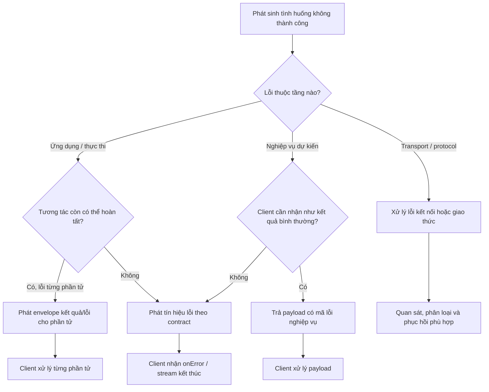

# Chuyển lỗi nghiệp vụ thành phản hồi hoặc tín hiệu lỗi phù hợp

Trong một ứng dụng RSocket, không phải mọi tình huống không thành công đều nên được biểu diễn theo cùng một cách. Một đơn hàng không tồn tại có thể là kết quả nghiệp vụ mà client cần hiển thị; một lỗi cơ sở dữ liệu khiến server không thể xử lý request lại là lỗi thực thi; một kết nối bị đóng thuộc vòng đời transport. Chọn đúng cách biểu diễn giúp client biết khi nào nên hiển thị thông báo, khi nào cần thử lại và khi nào phải kết thúc stream.

RSocket cung cấp hai cách truyền đạt kết quả quan trọng ở cấp ứng dụng:

- **Payload kết quả nghiệp vụ**: responder trả về một payload hợp lệ, trong đó nội dung mô tả thành công hoặc một trạng thái nghiệp vụ như `NOT_FOUND`, `CONFLICT` hay `INSUFFICIENT_BALANCE`.
- **Tín hiệu lỗi RSocket (`ERROR`)**: responder kết thúc tương tác bằng lỗi. Phía requester nhận được tín hiệu lỗi trong `Mono`/`Flux` và stream không tiếp tục phát dữ liệu bình thường.

Hai cách này có ý nghĩa khác nhau. Payload lỗi vẫn là một phản hồi theo hợp đồng dữ liệu của ứng dụng; `ERROR` là tín hiệu kết thúc tương tác. Bài học này tập trung vào cách lựa chọn giữa chúng, cách ánh xạ exception trong Spring và cách giữ cho client có thể xử lý lỗi nhất quán.

## 1. Phân biệt các tầng lỗi

Trước khi quyết định trả payload hay phát tín hiệu lỗi, hãy xác định lỗi xuất hiện ở tầng nào.

| Tầng | Ví dụ | Phạm vi ảnh hưởng | Hướng xử lý |
|---|---|---|---|
| Transport | TCP reset, WebSocket đóng, timeout mạng | Có thể ảnh hưởng toàn bộ kết nối và nhiều stream | Theo dõi vòng đời kết nối, reconnect và phục hồi nếu phù hợp |
| Giao thức/thiết lập | SETUP không hợp lệ, MIME type không hỗ trợ, frame sai | Kết nối hoặc stream tùy loại lỗi | Dùng mã lỗi giao thức phù hợp; không biến thành lỗi nghiệp vụ |
| Ứng dụng | Handler ném exception, dịch vụ phụ thuộc ngừng hoạt động | Thường ảnh hưởng một tương tác; lỗi nghiêm trọng có thể ảnh hưởng kết nối | Phát tín hiệu lỗi hoặc ánh xạ sang hợp đồng lỗi của ứng dụng |
| Nghiệp vụ | Không tìm thấy đơn hàng, hết hàng, không đủ số dư | Thường chỉ ảnh hưởng thao tác hiện tại | Trả trạng thái nghiệp vụ có mã ổn định nếu đó là kết quả dự kiến |

Ví dụ, `ORDER_NOT_FOUND` không nhất thiết có nghĩa là giao thức RSocket bị lỗi. Client đã gửi đúng request, server đã xử lý và xác định rằng không có đơn hàng tương ứng. Đây có thể là một kết quả nghiệp vụ hợp lệ. Ngược lại, nếu server không thể đọc cơ sở dữ liệu do lỗi hạ tầng, thao tác chưa tạo ra kết quả nghiệp vụ đáng tin cậy; responder nên báo lỗi tương tác.

## 2. Khi nào nên trả payload lỗi nghiệp vụ?

Trả payload khi tình huống không thành công là một nhánh có thể dự đoán trong hợp đồng nghiệp vụ và client cần tiếp tục xử lý như một kết quả bình thường.

Ví dụ:

- Tìm kiếm không có kết quả.
- Người dùng không đủ điều kiện thực hiện thao tác.
- Đơn hàng đã ở trạng thái không thể hủy.
- Sản phẩm hết hàng tại thời điểm kiểm tra.
- Một lệnh bị từ chối do quy tắc nghiệp vụ.

Trong các trường hợp này, client thường cần đọc mã lỗi, hiển thị thông báo phù hợp hoặc đưa ra lựa chọn khác. Một payload có cấu trúc ổn định giúp client không phải phân tích nội dung exception hoặc phụ thuộc vào tên class Java.

Ví dụ hợp đồng phản hồi:

```java
public record ApiError(
    String code,
    String message,
    String correlationId
) {}

public record OrderLookupResponse(
    OrderView order,
    ApiError error
) {
    public static OrderLookupResponse success(OrderView order) {
        return new OrderLookupResponse(order, null);
    }

    public static OrderLookupResponse failure(ApiError error) {
        return new OrderLookupResponse(null, error);
    }
}
```

Client nhận cùng một kiểu payload cho cả hai nhánh:

```java
Mono<OrderLookupResponse> response = requester
    .route("orders.find")
    .data(new FindOrderRequest("ORD-1001"))
    .retrieveMono(OrderLookupResponse.class);

response.subscribe(result -> {
    if (result.error() != null) {
        showMessage(result.error().message());
        return;
    }
    displayOrder(result.order());
});
```

Ở đây `ORDER_NOT_FOUND` có thể được biểu diễn trong `ApiError.code`. Mã này là mã nghiệp vụ do ứng dụng định nghĩa, không phải mã lỗi frame của RSocket.

## 3. Khi nào nên phát tín hiệu lỗi RSocket?

Dùng tín hiệu lỗi khi responder không thể hoàn thành tương tác theo hợp đồng, hoặc khi requester cần nhận biết rằng stream đã thất bại. Một số ví dụ:

- Request có cấu trúc không hợp lệ hoặc không thể giải mã.
- Handler gặp lỗi ngoài dự kiến.
- Dịch vụ phụ thuộc tạm thời không khả dụng.
- Một thao tác stream không thể tiếp tục phát dữ liệu.
- Chính sách của ứng dụng yêu cầu từ chối tương tác thay vì trả kết quả nghiệp vụ.

Trong RSocket, `ERROR` là tín hiệu kết thúc. Với `request-response`, requester nhận một lỗi thay cho payload kết quả. Với `request-stream` và `request-channel`, lỗi kết thúc tương tác đang chạy; các phần tử đã nhận trước đó không thể được thu hồi. Phía requester thường quan sát lỗi qua `onError` của Reactor.

Một số mã lỗi chuẩn của RSocket thường gặp:

| Mã | Ý nghĩa khái quát | Ghi chú |
|---|---|---|
| `APPLICATION_ERROR` | Lỗi ở tầng ứng dụng | Dùng cho lỗi xử lý request do ứng dụng phát ra |
| `REJECTED` | Request bị responder từ chối | Có thể dùng khi chính sách hoặc khả năng tiếp nhận không cho phép xử lý |
| `CANCELED` | Tương tác bị requester hủy | Không nhất thiết là lỗi nghiệp vụ |
| `INVALID` | Request không hợp lệ | Dùng cho request vi phạm yêu cầu giao thức/tương tác |
| `REJECTED_SETUP` | Thiết lập kết nối bị từ chối | Xảy ra ở bước SETUP, không phải phản hồi cho một request nghiệp vụ |
| `CONNECTION_ERROR` | Lỗi ở cấp kết nối | Có thể ảnh hưởng nhiều stream trên kết nối |

Các mã này mô tả loại lỗi ở tầng giao thức. Ứng dụng vẫn nên có mã nghiệp vụ riêng như `ORDER_NOT_FOUND`, `PAYMENT_DECLINED` hoặc `INVENTORY_UNAVAILABLE` khi trả payload. Không nên tạo một mã RSocket mới cho từng lỗi nghiệp vụ.

## 4. Chọn cách biểu diễn theo interaction model

Mỗi kiểu tương tác có cách quan sát lỗi khác nhau. Cần xét việc requester có nhận phản hồi hay không và lỗi có thể kết thúc bao nhiêu dữ liệu.

| Kiểu tương tác | Payload nghiệp vụ | Tín hiệu lỗi | Lưu ý |
|---|---|---|---|
| `request-response` | Trả một kết quả thành công hoặc một DTO lỗi | Thay payload bằng lỗi | Dễ biểu diễn cả hai nhánh trong một kiểu response |
| `request-stream` | Có thể phát các phần tử kết quả, kể cả phần tử mang trạng thái lỗi | Kết thúc toàn bộ stream | Nếu muốn tiếp tục sau lỗi của một phần tử, hãy mã hóa lỗi thành phần tử dữ liệu |
| `request-channel` | Có thể gửi/nhận các envelope kết quả cho từng thông điệp | Kết thúc tương tác hai chiều đang hoạt động | Một lỗi terminal có thể làm dừng cả luồng vào và luồng ra |
| `fire-and-forget` | Không có payload xác nhận nghiệp vụ | Không thể dựa vào thao tác gửi để xác nhận handler đã xử lý | Dùng log/metrics hoặc chọn kiểu tương tác có xác nhận nếu cần biết kết quả xử lý |

### Request-response

Đây là lựa chọn phù hợp khi client cần biết kết quả của một thao tác. Nếu lỗi là một trạng thái nghiệp vụ dự kiến, trả DTO kết quả. Nếu handler không thể thực thi request, phát lỗi để client đi vào nhánh `onError`.

### Request-stream

Nếu một stream phát danh sách đơn hàng và gặp lỗi truy vấn giữa chừng, responder có thể kết thúc stream bằng `ERROR`. Client đã nhận các đơn hàng trước thời điểm lỗi vẫn giữ chúng; stream không phát tiếp.

Nếu mỗi phần tử có thể thất bại độc lập mà stream vẫn phải tiếp tục, hãy phát một kiểu envelope như `StreamItem<OrderView>` có trường `error` cho từng phần tử. Đừng dùng `Flux.error` cho một lỗi đơn lẻ nếu hợp đồng yêu cầu tiếp tục xử lý các phần tử sau.

### Request-channel

Trong channel, requester gửi một luồng dữ liệu và responder có thể đồng thời phát luồng kết quả. Nếu một lỗi terminal xảy ra, tương tác channel kết thúc. Nếu lỗi chỉ thuộc về một thông điệp đầu vào, hãy cân nhắc gửi một kết quả lỗi cho thông điệp đó rồi tiếp tục nhận các thông điệp tiếp theo.

### Fire-and-forget

Fire-and-forget không có phản hồi nghiệp vụ. Việc client hoàn tất thao tác gửi không chứng minh handler đã xử lý thành công. Nếu bên gửi cần xác nhận đã lưu hoặc đã xử lý, hãy dùng `request-response` với acknowledgement, hoặc một cơ chế sự kiện có trạng thái theo dõi riêng.

## 5. Ánh xạ exception thành payload bằng Spring

Spring RSocket hỗ trợ xử lý exception trong controller bằng `@MessageExceptionHandler`. Nếu handler exception trả về một DTO, DTO đó trở thành payload phản hồi theo hợp đồng của ứng dụng. Đây là cách hữu ích khi muốn biến exception nghiệp vụ thành trạng thái có cấu trúc.

```java
@Controller
public class OrderController {

    private final OrderService orderService;

    public OrderController(OrderService orderService) {
        this.orderService = orderService;
    }

    @MessageMapping("orders.find")
    public Mono<OrderLookupResponse> find(FindOrderRequest request) {
        return orderService.findById(request.orderId())
            .map(OrderLookupResponse::success)
            .switchIfEmpty(Mono.error(
                new OrderNotFoundException(request.orderId())
            ));
    }

    @MessageExceptionHandler(OrderNotFoundException.class)
    public OrderLookupResponse handleNotFound(OrderNotFoundException ex) {
        return OrderLookupResponse.failure(
            new ApiError("ORDER_NOT_FOUND", "Không tìm thấy đơn hàng", null)
        );
    }
}
```

`@MessageExceptionHandler` ở đây biến `OrderNotFoundException` thành một payload `OrderLookupResponse` bình thường. Vì vậy, phía client kiểm tra `result.error()`; nó không nhận `onError` chỉ vì đơn hàng không tồn tại.

Nên giữ mã lỗi ổn định qua các phiên bản API. Nội dung `message` có thể được bản địa hóa hoặc thay đổi cho dễ hiểu, còn client nên dựa vào `code` để quyết định hành vi. `correlationId` có thể dùng để liên kết phản hồi với log, nhưng không nên chứa dữ liệu nhạy cảm.

## 6. Để exception trở thành tín hiệu lỗi

Nếu handler không chuyển exception thành payload, lỗi có thể được truyền qua reactive pipeline và được adapter RSocket chuyển thành tín hiệu lỗi cho requester. Ví dụ, một lỗi hệ thống khiến thao tác không thể hoàn tất:

```java
@MessageMapping("payments.capture")
public Mono<PaymentReceipt> capture(CapturePaymentRequest request) {
    return paymentService.capture(request)
        .onErrorMap(DatabaseUnavailableException.class,
            ex -> new PaymentServiceUnavailableException(
                "Payment service is temporarily unavailable", ex
            ));
}
```

Không khai báo `@MessageExceptionHandler` để biến `PaymentServiceUnavailableException` thành payload nếu hợp đồng yêu cầu requester nhận lỗi terminal. Ở phía client, xử lý tín hiệu lỗi bằng Reactor:

```java
Mono<PaymentReceipt> receipt = requester
    .route("payments.capture")
    .data(new CapturePaymentRequest("PAY-9001"))
    .retrieveMono(PaymentReceipt.class)
    .doOnError(error -> log.warn(
        "Payment capture failed, correlationId={}", correlationId, error
    ));
```

`doOnError` chỉ quan sát lỗi; nó không biến lỗi thành kết quả thành công. Nếu cần fallback, có thể dùng `onErrorResume`, nhưng chỉ nên xử lý những loại lỗi đã hiểu rõ:

```java
Mono<PaymentReceipt> safeReceipt = receipt.onErrorResume(
    PaymentServiceUnavailableException.class,
    error -> loadPreviouslyConfirmedReceipt()
);
```

Ví dụ fallback chỉ hợp lý khi `loadPreviouslyConfirmedReceipt()` thực sự cung cấp một kết quả đã được xác nhận trước đó. Không nên biến mọi exception thành một payload rỗng hoặc một giá trị mặc định vì điều đó che giấu lỗi dữ liệu và lỗi vận hành.

## 7. Lỗi theo từng phần tử trong stream

Một `Flux` có thể phát nhiều phần tử rồi kết thúc. Khi publisher phát `onError`, stream chấm dứt và không thể tiếp tục phát các phần tử tiếp theo. Vì vậy, cần phân biệt:

- **Lỗi terminal**: toàn bộ thao tác không thể tiếp tục; dùng tín hiệu lỗi RSocket.
- **Lỗi của một phần tử**: phần tử đó không xử lý được nhưng các phần tử khác vẫn có thể xử lý; biểu diễn lỗi thành dữ liệu trong stream.

Ví dụ envelope cho stream:

```java
public record StreamResult<T>(
    T value,
    ApiError error
) {
    public static <T> StreamResult<T> success(T value) {
        return new StreamResult<>(value, null);
    }

    public static <T> StreamResult<T> failure(ApiError error) {
        return new StreamResult<>(null, error);
    }
}
```

Responder xử lý từng phần tử độc lập:

```java
public Flux<StreamResult<OrderView>> exportOrders(Flux<OrderId> ids) {
    return ids.flatMap(id -> orderService.findById(id.value())
        .map(StreamResult::success)
        .switchIfEmpty(Mono.just(StreamResult.failure(
            new ApiError("ORDER_NOT_FOUND", "Không tìm thấy đơn hàng", null)
        )))
        .onErrorResume(error -> Mono.just(StreamResult.failure(
            new ApiError("ORDER_READ_FAILED", "Không thể đọc đơn hàng", null)
        )))
    );
}
```

Trong ví dụ này, lỗi truy vấn của một ID được chuyển thành phần tử lỗi để stream vẫn có thể xử lý ID tiếp theo. Nếu chính kết nối cơ sở dữ liệu bị hỏng đến mức không thể tiếp tục bất kỳ phần tử nào, ứng dụng có thể chọn phát lỗi terminal thay vì phát nhiều kết quả lỗi giống nhau.

## 8. Fire-and-forget và yêu cầu xác nhận

Với fire-and-forget, client gửi một payload mà không chờ phản hồi nghiệp vụ. Vì vậy, không thể dùng `onError` của request-response để nhận lỗi xử lý ở phía responder. Những việc sau có thể giúp vận hành an toàn hơn:

- Gắn event ID duy nhất để truy vết sự kiện.
- Ghi log và metric ở phía responder khi xử lý thành công hoặc thất bại.
- Đưa sự kiện vào hàng đợi bền vững trước khi xác nhận theo hợp đồng của hệ thống.
- Dùng cơ chế retry có giới hạn ở producer nếu tầng gửi có thể phát hiện lỗi truyền tải.
- Thiết kế consumer idempotent để xử lý an toàn khi một event được gửi lại.

Nếu client cần biết sự kiện đã được chấp nhận hoặc xử lý, hãy dùng `request-response`:

```java
Mono<EventAck> acknowledgement = requester
    .route("events.publish")
    .data(event)
    .retrieveMono(EventAck.class);
```

Một `EventAck` nên nói rõ ý nghĩa xác nhận, ví dụ `ACCEPTED` nghĩa là đã tiếp nhận bền vững hay `PROCESSED` nghĩa là xử lý nghiệp vụ đã hoàn tất. Hai trạng thái này không giống nhau.

## 9. Mã lỗi, thông điệp và thông tin nhạy cảm

Hợp đồng lỗi nên tách ba trường:

| Trường | Vai trò | Ví dụ |
|---|---|---|
| `code` | Mã máy đọc, ổn định qua các phiên bản | `INSUFFICIENT_BALANCE` |
| `message` | Thông báo dành cho người dùng hoặc log đã làm sạch | `Số dư không đủ để thực hiện giao dịch` |
| `correlationId` | Liên kết phản hồi với log/tracing | `req-7f2a...` |

Không gửi stack trace, câu lệnh SQL, tên bảng, token, secret hoặc thông tin nội bộ của dịch vụ phụ thuộc cho client. Phía server nên ghi chi tiết exception cùng correlation ID vào log bảo mật; payload hoặc tín hiệu lỗi chỉ chứa thông tin cần thiết cho caller.

Không dùng nội dung exception làm mã lỗi. Câu chữ có thể thay đổi theo thư viện, ngôn ngữ hoặc phiên bản triển khai. Hãy ánh xạ exception nội bộ sang mã ổn định của ứng dụng tại ranh giới API.

## 10. Retry, timeout và cancellation

Không phải lỗi nào cũng nên retry. Một số nguyên tắc:

- Chỉ retry lỗi tạm thời như timeout hoặc dịch vụ phụ thuộc tạm ngừng, với số lần giới hạn và exponential backoff có jitter.
- Chỉ retry thao tác không gây tác dụng phụ lặp lại, hoặc thao tác có idempotency key và cơ chế chống xử lý trùng.
- Không retry lỗi xác thực, phân quyền, validation hoặc quy tắc nghiệp vụ không thay đổi.
- Với request đã gửi nhưng client bị timeout, kết quả có thể đã được server thực hiện. Trước khi gửi lại lệnh ghi, hãy kiểm tra trạng thái hoặc dùng idempotency key.
- Cancellation là việc requester không còn cần kết quả hoặc đã hủy subscription; không nên tự động ghi nhận nó như lỗi nghiệp vụ của server.

Ví dụ retry có giới hạn cho một thao tác đọc có thể lặp an toàn:

```java
Mono<OrderView> order = requester.route("orders.find")
    .data(new FindOrderRequest("ORD-1001"))
    .retrieveMono(OrderView.class)
    .retryWhen(Retry.backoff(2, Duration.ofMillis(200))
        .filter(this::isTransientTransportFailure));
```

`isTransientTransportFailure` cần phân loại lỗi cụ thể theo ứng dụng. Không retry mọi exception và không áp dụng ví dụ này cho thao tác thanh toán hoặc ghi dữ liệu nếu chưa có bảo vệ idempotency.

## 11. Cách kiểm tra luồng lỗi

Khi debug, hãy theo dõi từ nơi phát sinh lỗi đến nơi quan sát:

1. Xác định lỗi bắt đầu ở transport, giao thức, handler hay quy tắc nghiệp vụ.
2. Xác định contract yêu cầu một payload kết quả hay một tín hiệu lỗi terminal.
3. Kiểm tra exception có bị `@MessageExceptionHandler`, `onErrorResume` hoặc một lớp adapter chuyển thành payload khác hay không.
4. Kiểm tra requester đang xử lý kết quả bằng callback thành công hay `onError`.
5. Với stream, xác định lỗi thuộc về một phần tử hay toàn bộ stream.
6. Dùng correlation ID để ghép log client, server và dịch vụ phụ thuộc.

Một sơ đồ quyết định đơn giản:



## 12. Checklist thiết kế lỗi

- [ ] Phân biệt lỗi transport, giao thức, ứng dụng và nghiệp vụ.
- [ ] Mỗi tình huống có quy ước rõ: payload lỗi hay RSocket `ERROR`.
- [ ] Payload lỗi có mã ổn định, thông điệp an toàn và correlation ID khi cần.
- [ ] Không để lộ stack trace, secret hoặc chi tiết nội bộ cho client.
- [ ] `@MessageExceptionHandler` chỉ chuyển exception thành payload khi đó là hợp đồng mong muốn.
- [ ] Client có xử lý `onError` và không biến mọi lỗi thành thành công giả.
- [ ] Với stream/channel, phân biệt lỗi terminal và lỗi của từng phần tử.
- [ ] Với fire-and-forget, không giả định thao tác gửi đồng nghĩa xử lý thành công.
- [ ] Retry có giới hạn, có phân loại lỗi và bảo vệ idempotency cho thao tác ghi.
- [ ] Cancellation và lỗi kết nối được quan sát riêng trong log/metrics.

Chọn đúng giữa payload nghiệp vụ và tín hiệu lỗi giúp client hiểu chính xác kết quả của từng tương tác. Payload lỗi phù hợp với nhánh nghiệp vụ dự kiến mà caller cần xử lý như dữ liệu; RSocket `ERROR` phù hợp khi tương tác không thể hoàn tất và phải kết thúc. Với stream và channel, quyết định này còn xác định dữ liệu có thể tiếp tục được phát hay toàn bộ tương tác phải dừng.
