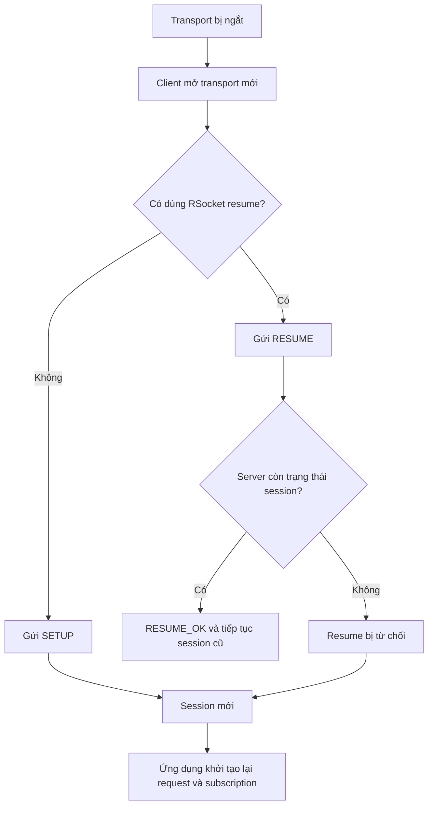
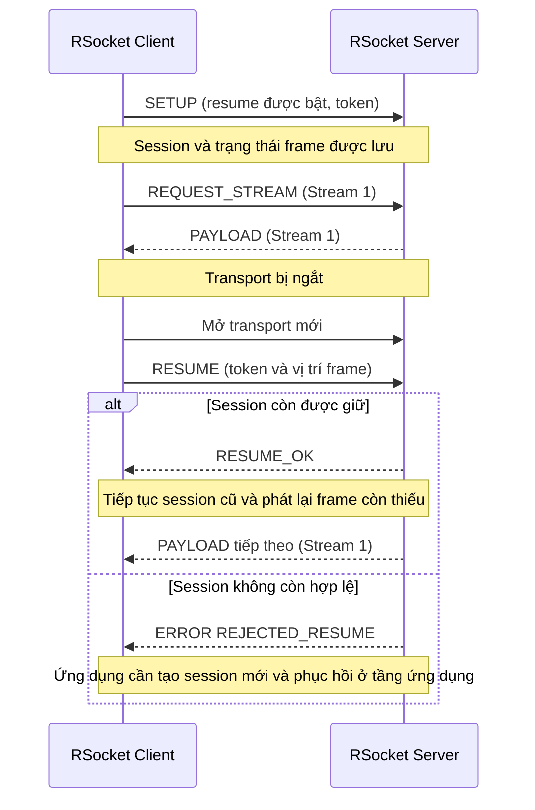

# Phân biệt reconnect, retry, resubscribe và resume

Trong một ứng dụng realtime, kết nối mạng có thể bị ngắt trong khi client đang chờ một response hoặc nhận một luồng sự kiện. Khi kết nối trở lại, ứng dụng cần quyết định phải tạo phiên mới, gửi lại request, đăng ký lại luồng dữ liệu hay khôi phục chính phiên RSocket cũ.

Bốn thao tác này có liên quan nhưng giải quyết những vấn đề khác nhau:

- **Reconnect** mở lại kết nối transport. Nếu client tạo một phiên RSocket mới bằng `SETUP`, trạng thái của phiên cũ không tự được khôi phục.
- **Retry** thực hiện lại một thao tác hoặc request sau khi thất bại.
- **Resubscribe** đăng ký lại một luồng dữ liệu ở tầng ứng dụng, thường tạo một stream RSocket mới.
- **Resume** dùng cơ chế của giao thức RSocket để nối lại một phiên đã bị gián đoạn và tiếp tục trao đổi dựa trên trạng thái frame được lưu giữ.

Phân biệt đúng các khái niệm giúp tránh gửi lặp thao tác ghi, bỏ sót sự kiện hoặc cho rằng một kết nối mới đã tự khôi phục mọi subscription đang chạy.

## 1. Bốn khái niệm giải quyết bốn việc khác nhau

Giả sử client đang theo dõi trạng thái giao hàng của đơn `ORD-1002`. Client đã thiết lập RSocket session, gửi một request lấy trạng thái ban đầu và mở một request-stream để nhận các sự kiện tiếp theo. Nếu Wi-Fi mất kết nối, có thể cần nhiều hành động ở các tầng khác nhau.

| Khái niệm | Hành động chính | Tạo stream mới? | Giữ phiên RSocket cũ? | Ví dụ |
|---|---|---:|---:|---|
| Reconnect | Mở lại transport và thiết lập kết nối | Tùy cách kết nối | Không nếu dùng `SETUP` mới; có nếu reconnect để `RESUME` | Kết nối lại server sau khi socket bị đóng |
| Retry | Gửi lại một thao tác thất bại | Thường có request stream mới | Có thể dùng session hiện tại hoặc session mới | Gửi lại truy vấn trạng thái sau timeout |
| Resubscribe | Đăng ký lại một luồng ở tầng ứng dụng | Có | Không cần giữ session cũ | Mở lại `orders.events` từ sequence đã xử lý |
| Resume | Tiếp tục session theo giao thức RSocket | Không tạo lại các tương tác như một phiên mới | Có, nếu server khôi phục được session | Tiếp tục các stream đang hoạt động sau khi transport bị gián đoạn |

Reconnect là thao tác ở tầng kết nối. Retry và resubscribe là quyết định của ứng dụng hoặc reactive pipeline. Resume là khả năng của giao thức và implementation RSocket. Một ứng dụng có thể kết hợp chúng: thử resume trước; nếu server từ chối resume, tạo session mới rồi resubscribe các luồng cần thiết và retry những request còn an toàn.

## 2. Reconnect: mở lại kết nối transport

Reconnect có nghĩa là client thiết lập lại kết nối mạng tới server sau khi kết nối trước đó bị đóng hoặc không còn sử dụng được. Với RSocket, cần phân biệt hai kết quả có thể xảy ra sau khi transport được mở lại.

**Tạo một phiên RSocket mới:** client kết nối TCP hoặc WebSocket rồi gửi `SETUP`. Server tạo session mới. Các stream, demand, request đang chờ và trạng thái nội bộ của session trước không tự xuất hiện trong session mới. Ứng dụng phải chủ động khởi tạo lại các thao tác cần thiết.

**Mở transport để resume phiên cũ:** client tạo một kết nối transport mới nhưng dùng frame `RESUME` để yêu cầu server gắn kết nối đó với session đã tồn tại. Đây vẫn là một lần reconnect ở tầng transport, nhưng kết quả là tiếp tục session cũ thay vì tạo session mới bằng `SETUP`.



Reconnect không tự nói lên rằng request trước đã được server xử lý hay chưa. Nếu kết nối bị mất ngay sau khi client gửi lệnh thanh toán, server có thể đã xử lý lệnh nhưng response chưa tới client. Tạo kết nối mới không giải quyết được sự không chắc chắn này; ứng dụng cần truy vấn trạng thái hoặc dùng idempotency key trước khi gửi lại thao tác có tác dụng phụ.

## 3. Retry: thực hiện lại request

Retry là gửi lại một thao tác khi lần thực hiện trước kết thúc bằng lỗi hoặc timeout. Trong RSocket, mỗi lần retry request thường tạo một tương tác mới với stream ID mới. Retry có thể xảy ra trên session đang hoạt động hoặc sau khi client đã reconnect.

Retry phù hợp với những thao tác có thể thực hiện lặp an toàn, chẳng hạn truy vấn trạng thái đơn hàng. Với thao tác ghi, cần xác định rõ tính idempotent hoặc dùng một khóa idempotency do client tạo và server lưu để nhận diện lần gửi trùng.

Ví dụ dùng Reactor để retry một request-response khi gặp lỗi tạm thời:

```java
import java.time.Duration;
import reactor.core.publisher.Mono;
import reactor.util.retry.Retry;

Mono<OrderStatus> status = Mono.defer(() ->
        requester.route("orders.status")
            .data(new OrderStatusRequest("ORD-1002"))
            .retrieveMono(OrderStatus.class)
    )
    .retryWhen(
        Retry.backoff(3, Duration.ofMillis(500))
            .filter(this::isTransientFailure)
    );
```

`isTransientFailure` là hàm phân loại lỗi do ứng dụng định nghĩa. Ví dụ, có thể cho phép retry một số lỗi transport tạm thời, nhưng không retry lỗi validation, lỗi phân quyền hoặc lỗi nghiệp vụ không thể tự hết. `Mono.defer` tạo publisher request khi có subscription; mỗi lần retry sẽ đăng ký lại publisher và phát request mới.

Backoff làm khoảng chờ tăng dần giữa các lần thử. Có thể thêm jitter để nhiều client không đồng loạt gửi lại request cùng lúc. Luôn giới hạn số lần retry và đặt timeout tổng thể cho thao tác. Retry vô hạn có thể làm tăng tải đúng lúc server đang gặp sự cố.

### Timeout không chứng minh request chưa được xử lý

Khi client timeout, có hai khả năng: server chưa nhận hoặc chưa xử lý request; hoặc server đã xử lý xong nhưng response bị trễ hay thất lạc do kết nối bị ngắt. Nếu client gửi lại một thao tác không idempotent, nghiệp vụ có thể xảy ra hai lần.

Với thao tác ghi, một hợp đồng idempotency thường có các bước:

1. Client tạo `idempotencyKey` duy nhất cho ý định nghiệp vụ.
2. Client gửi key cùng request.
3. Server lưu key và kết quả xử lý một cách nhất quán với thao tác nghiệp vụ.
4. Nếu nhận lại cùng key, server trả kết quả đã lưu hoặc trạng thái hiện tại thay vì thực hiện tác dụng phụ lần nữa.

Retry là chính sách ở tầng ứng dụng. RSocket không tự bảo đảm request được thực hiện đúng một lần chỉ vì client dùng resume hoặc reconnect.

## 4. Resubscribe: đăng ký lại một luồng dữ liệu

Resubscribe xảy ra khi client đăng ký lại một publisher hoặc route stream sau khi subscription trước đã kết thúc. Với RSocket, client thường gửi một request-stream mới, do đó server tạo một stream mới. Resubscribe không tự khôi phục stream ID, demand hay vị trí dữ liệu của subscription cũ.

Nếu server chỉ phát dữ liệu mới kể từ lúc đăng ký, client có thể bỏ lỡ những sự kiện phát sinh trong thời gian mất kết nối. Nếu server phát lại toàn bộ lịch sử, client có thể nhận trùng các sự kiện đã xử lý. Để tránh mất hoặc xử lý trùng, hợp đồng stream nên có sequence number, offset hoặc cursor.

Ví dụ request đăng ký lại từ sequence cuối cùng đã xử lý:

```java
public record EventsRequest(String orderId, long afterSequence) {
}

public record OrderEvent(long sequence, String status) {
}
```

Client có thể mở stream mới với cursor đã lưu:

```java
Flux<OrderEvent> subscribeFrom(long lastProcessedSequence) {
    return requester.route("orders.events")
        .data(new EventsRequest("ORD-1002", lastProcessedSequence))
        .retrieveFlux(OrderEvent.class);
}
```

Server cần thực hiện đúng hợp đồng `afterSequence`: chỉ phát các sự kiện có sequence lớn hơn cursor, theo thứ tự xác định, và phải giữ lịch sử đủ lâu để đáp ứng yêu cầu. Nếu cursor đã quá cũ, server cần trả lỗi hoặc yêu cầu client thực hiện đồng bộ trạng thái đầy đủ trước khi đăng ký tiếp.

Trong hệ thống thực, cursor cuối cùng đã xử lý nên được lưu bền vững. Chỉ cập nhật cursor sau khi xử lý nghiệp vụ thành công. Nếu cập nhật cursor trước khi ghi nhận kết quả xử lý, sự cố có thể khiến client bỏ qua một sự kiện chưa được áp dụng. Nếu xử lý xong nhưng chưa lưu cursor, sự kiện có thể được phát lại; handler nên idempotent hoặc có cơ chế chống trùng.

Resubscribe hữu ích khi ứng dụng có thể khôi phục luồng từ nguồn dữ liệu nghiệp vụ như event log, database hoặc message broker. Nó là lựa chọn phù hợp ngay cả khi implementation RSocket không hỗ trợ resume, hoặc khi ứng dụng muốn khôi phục trên một session RSocket hoàn toàn mới.

## 5. Resume: khôi phục session theo giao thức RSocket

RSocket resume cho phép client tiếp tục một session đã được thiết lập trước đó sau khi transport bị gián đoạn. Thay vì gửi `SETUP` để tạo session mới, client mở một transport mới và gửi frame `RESUME` với thông tin nhận diện session cùng vị trí frame mà hai bên đã trao đổi. Server kiểm tra xem session và dữ liệu cần thiết còn được giữ hay không.

Nếu server chấp nhận, nó gửi `RESUME_OK`. Hai bên tiếp tục trên session cũ và có thể trao đổi lại các frame chưa được xác nhận theo cơ chế resume của giao thức. Những stream đang hoạt động có thể tiếp tục mà không cần ứng dụng tạo lại từng request-stream như khi bắt đầu session mới.



Resume cần sự hỗ trợ của cả client và server. Trong quá trình setup ban đầu, client bật khả năng resume và cung cấp resume token. Implementation phải lưu trạng thái phiên và các frame cần thiết để có thể phát lại sau khi kết nối được khôi phục. Khi transport mất, client giữ token và trạng thái vị trí frame; sau đó gửi `RESUME` trên transport mới.

Resume là cơ chế ở tầng giao thức, không phải cách phát lại toàn bộ lịch sử nghiệp vụ. Nó có thể khôi phục việc truyền các frame còn nằm trong vùng lưu trữ của session, nhưng không thay thế event store, database hay chính sách xử lý trùng của ứng dụng. Nếu server đã loại bỏ trạng thái phiên hoặc buffer không còn đủ dữ liệu để tiếp tục, resume có thể bị từ chối.

## 6. Điều kiện và giới hạn của resume

Để resume hoạt động, hệ thống cần đáp ứng các điều kiện sau:

- Client và server đều hỗ trợ RSocket resume và đã bật cấu hình tương ứng.
- Resume token nhận diện đúng session cũ và được bảo vệ khỏi bị lộ hoặc sử dụng sai mục đích.
- Server giữ trạng thái session, vị trí frame và dữ liệu replay trong khoảng thời gian cần thiết.
- Kết nối mới tới đúng server hoặc cụm server có thể truy cập trạng thái session đó.
- Thời gian gián đoạn không vượt quá thời gian lưu session và buffer của implementation.

Trong môi trường nhiều instance, cần bảo đảm request resume được định tuyến tới node có trạng thái session hoặc trạng thái đó được chia sẻ theo cơ chế mà implementation hỗ trợ. Nếu load balancer chuyển client sang một node khác không có session cũ, resume có thể bị từ chối dù transport mới vẫn mở bình thường.

Resume cũng có chi phí bộ nhớ và lưu trữ. Buffer càng lớn hoặc thời gian giữ session càng dài thì khả năng chịu gián đoạn có thể tăng, nhưng tài nguyên dành cho mỗi kết nối cũng tăng. Cần đặt giới hạn cho số session, kích thước buffer và thời gian giữ trạng thái, rồi kiểm thử dưới tải thực tế.

Resume không bảo đảm exactly-once cho tác dụng phụ nghiệp vụ. Frame có thể được truyền lại khi hai bên chưa thống nhất được vị trí đã nhận. Ứng dụng vẫn phải thiết kế handler idempotent, correlation ID hoặc sequence number cho các thao tác có tác dụng phụ.

Nếu server từ chối resume, ví dụ trả mã `REJECTED_RESUME`, client cần chuyển sang quy trình phục hồi ở tầng ứng dụng: tạo session mới bằng `SETUP`, resubscribe các stream từ cursor bền vững và chỉ retry các request an toàn.

## 7. Kết hợp resume, reconnect, retry và resubscribe

Một chiến lược phục hồi thường có nhiều bước. Ví dụ client đang theo dõi đơn hàng và có một truy vấn chưa nhận được response khi mạng bị mất:

1. Phát hiện transport đã đóng hoặc không còn phản hồi.
2. Thử mở transport mới và resume session cũ nếu tính năng này đã được cấu hình.
3. Nếu `RESUME_OK`, tiếp tục session và các stream được giao thức khôi phục. Kiểm tra kết quả của request đang chờ trước khi tự gửi lại.
4. Nếu resume bị từ chối hoặc không được hỗ trợ, thiết lập session mới bằng `SETUP`.
5. Resubscribe luồng sự kiện từ sequence cuối cùng đã xử lý thành công.
6. Retry request còn cần thiết, sau khi xác định thao tác an toàn và có idempotency phù hợp.

Không phải ứng dụng nào cũng cần đủ bốn cơ chế. Một client chỉ truy vấn dữ liệu ngắn hạn có thể chỉ cần reconnect và retry có giới hạn. Một dashboard nhận sự kiện liên tục có thể dùng reconnect cộng resubscribe với cursor. Một phiên tương tác lâu dài cần duy trì nhiều stream đang chạy có thể hưởng lợi từ resume nếu hạ tầng và implementation hỗ trợ.

## 8. Ví dụ resubscribe có cursor với Reactor

Ví dụ sau minh họa cách ứng dụng đăng ký lại một luồng sự kiện từ sequence cuối cùng đã xử lý. `lastProcessedSequence` trong ví dụ là biến trong bộ nhớ để minh họa; ứng dụng thực tế nên lưu cursor bền vững cùng với kết quả xử lý.

```java
import java.time.Duration;
import java.util.concurrent.atomic.AtomicLong;
import reactor.core.publisher.Flux;
import reactor.core.publisher.Mono;
import reactor.util.retry.Retry;

AtomicLong lastProcessedSequence = new AtomicLong(0);

Mono<Void> consumeEvents = Flux.defer(() ->
        requester.route("orders.events")
            .data(new EventsRequest("ORD-1002", lastProcessedSequence.get()))
            .retrieveFlux(OrderEvent.class)
    )
    .concatMap(event -> process(event)
        .then(Mono.fromRunnable(() ->
            lastProcessedSequence.set(event.sequence())
        ))
    )
    .then()
    .retryWhen(
        Retry.backoff(5, Duration.ofSeconds(1))
            .filter(this::isTransientFailure)
    );
```

`process(event)` là hàm reactive của ứng dụng và chỉ hoàn tất khi sự kiện đã được xử lý thành công. `concatMap` xử lý tuần tự để cursor không vượt trước một sự kiện chưa hoàn tất. Khi lỗi tạm thời làm publisher kết thúc, `retryWhen` đăng ký lại pipeline; `Flux.defer` đọc cursor mới nhất và tạo request-stream mới từ vị trí đó.

Để dùng trong production, cần lưu cursor bền vững sau khi xử lý sự kiện trong một giao dịch hoặc cơ chế nhất quán tương đương. Nếu tác dụng phụ và cursor không thể commit nguyên tử, handler phải chấp nhận khả năng sự kiện được phát lại và xử lý idempotent. Cũng cần xử lý trường hợp server không còn lịch sử tại cursor được yêu cầu.

## 9. So sánh theo tình huống thực tế

| Tình huống | Cơ chế phù hợp | Lý do |
|---|---|---|
| Một request-response đọc trạng thái thất bại vì lỗi mạng tạm thời | Retry, có thể cần reconnect trước | Thực hiện lại truy vấn nếu thao tác an toàn |
| Một request tạo thanh toán timeout | Tra cứu trạng thái và idempotency trước khi retry | Không biết server đã xử lý lần đầu hay chưa |
| Một subscription bị đóng khi session mới được tạo | Resubscribe | Tạo stream mới và phục hồi từ cursor nghiệp vụ |
| Mạng chập chờn trong khi nhiều stream đang hoạt động | Resume nếu hai bên hỗ trợ | Tiếp tục session và trạng thái frame cũ |
| Resume bị từ chối do session hết hạn | Reconnect bằng SETUP rồi resubscribe | Session cũ không còn khả năng khôi phục |
| Client khởi động lại sau nhiều giờ | Reconnect và resubscribe từ cursor bền vững | Resume session có thể đã hết thời gian lưu |

## 10. Kiểm thử và quan sát khả năng phục hồi

Không nên chỉ kiểm thử trường hợp server tắt rồi bật lại. Cần kiểm tra các điểm ngắt khác nhau vì chúng có thể tạo ra trạng thái không chắc chắn khác nhau.

Các kịch bản nên có:

- **Mất transport trước khi request được gửi:** client reconnect; request chưa gửi có thể được phát sau khi session sẵn sàng.
- **Mất transport sau khi server nhận request nhưng trước khi response tới client:** kiểm tra khả năng xử lý request đã hoàn tất nhưng response bị mất; retry phải an toàn.
- **Mất transport giữa một request-stream:** nếu resume thành công, kiểm tra stream tiếp tục; nếu tạo session mới, kiểm tra resubscribe từ cursor không mất hoặc xử lý trùng dữ liệu ngoài hợp đồng.
- **Resume token không hợp lệ hoặc session hết hạn:** xác nhận server từ chối resume và client chuyển sang setup mới.
- **Node server thay đổi sau reconnect:** kiểm tra load balancer có định tuyến tới nơi lưu session hoặc resume bị từ chối có kiểm soát.
- **Nhiều client cùng reconnect:** xác nhận backoff và jitter tránh tạo đợt tải đột biến.

Nên ghi nhận các chỉ số như số lần reconnect, số lần retry theo route, số lần resubscribe, số lần resume thành công/thất bại, thời gian phục hồi, số frame replay và số sự kiện trùng hoặc bị bỏ lỡ theo cursor. Những số liệu này giúp phân biệt lỗi transport với lỗi hợp đồng dữ liệu và lỗi xử lý nghiệp vụ.

## 11. Quy tắc chọn cơ chế

Khi thiết kế phục hồi, hãy lần lượt trả lời các câu hỏi:

1. Kết nối transport còn dùng được không? Nếu không, cần reconnect.
2. Có thể tiếp tục đúng session cũ không? Nếu resume được hỗ trợ và trạng thái còn lưu, thử resume.
3. Request nào cần thực hiện lại? Chỉ retry khi thao tác an toàn hoặc có idempotency.
4. Stream nào cần đăng ký lại? Resubscribe từ cursor đã xử lý bền vững.
5. Nếu không thể resume, dữ liệu nghiệp vụ có nguồn replay không? Nếu không, cần đồng bộ snapshot mới trước khi tiếp tục nhận sự kiện.

Reconnect khôi phục đường truyền. Retry lặp lại một thao tác. Resubscribe tạo lại một đăng ký stream ở tầng ứng dụng. Resume tiếp tục session RSocket cũ bằng trạng thái giao thức được lưu giữ. Kết hợp đúng các cơ chế này giúp ứng dụng phục hồi có kiểm soát khi mạng không ổn định.
