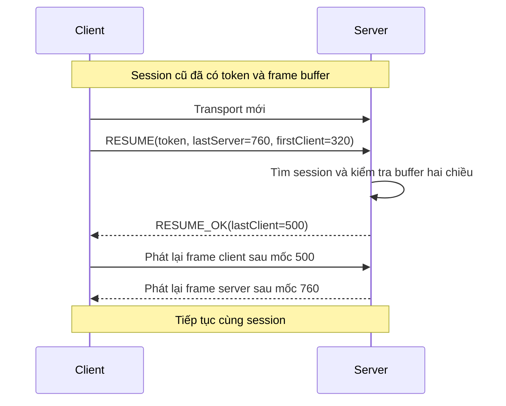

# Trình tự RESUME, RESUME_OK và đồng bộ vị trí frame đã tiếp nhận

RSocket có thể duy trì một tương tác khi kết nối TCP hoặc WebSocket bị gián đoạn rồi được thiết lập lại. Cơ chế này gọi là *connection resumption* (phục hồi kết nối). Thay vì tạo một phiên RSocket hoàn toàn mới, client gửi frame `RESUME` để yêu cầu tiếp tục phiên trước. Server kiểm tra phiên và vùng frame còn được lưu; nếu có thể tiếp tục, server trả `RESUME_OK`. Hai phía dùng vị trí frame đã tiếp nhận để xác định phần dữ liệu cần phát lại.

Trong module `INTEGRATION_REALTIME_RSOCKET`, cơ chế này hữu ích cho stream realtime chạy lâu, chẳng hạn telemetry, trạng thái thiết bị hoặc cập nhật thị trường. Tuy nhiên, resume là khả năng tùy chọn và mang tính lạc quan: nó chỉ thành công khi cả hai phía còn giữ đủ trạng thái và frame cần thiết. Resume duy trì luồng frame của giao thức; nó không tự bảo đảm một giao dịch nghiệp vụ chỉ được thực hiện đúng một lần.

## 1. Resume giải quyết tình huống nào?

Giả sử client đang nhận một request-stream. Server đã gửi một số payload, nhưng Wi-Fi của client mất kết nối trong vài giây. Nếu chỉ reconnect theo cách thông thường, client tạo một kết nối và session mới. Những stream cũ không tự động tiếp tục; ứng dụng phải mở lại tương tác và tự xác định dữ liệu nào cần truy vấn hoặc gửi lại.

Với resume, client và server giữ trạng thái của session cũ trong một khoảng thời gian. Khi transport được tạo lại, client gửi `RESUME` kèm token nhận diện session và vị trí frame. Nếu server còn đủ dữ liệu để phát lại phần client chưa nhận, server chấp nhận bằng `RESUME_OK` và hai phía tiếp tục trao đổi trên session đã được giữ.

```mermaid
sequenceDiagram
    participant C as RSocket client
    participant S as RSocket server
    C->>S: SETUP (bật resume, gửi resume token)
    S-->>C: Kết nối/session được thiết lập
    S-->>C: PAYLOAD 1
    S-->>C: PAYLOAD 2
    Note over C,S: Transport bị ngắt; hai phía giữ session và frame buffer
    C->>S: Mở transport mới
    C->>S: RESUME (token và vị trí)
    S-->>C: RESUME_OK (vị trí server đã nhận từ client)
    S-->>C: Phát lại frame server chưa được client xác nhận đã nhận
    C->>S: Phát lại frame client chưa được server xác nhận đã nhận
    Note over C,S: Tiếp tục các stream cũ
```

Resume phù hợp với gián đoạn transport ngắn khi trạng thái của cả hai phía vẫn còn. Nó không phải cơ chế khôi phục sau mọi loại sự cố. Nếu server khởi động lại và chỉ giữ session trong bộ nhớ, hoặc frame cần phát lại đã bị loại khỏi buffer, resume có thể bị từ chối.

## 2. Điều kiện để một session có thể resume

Resume là tính năng tùy chọn trong RSocket. Client cần yêu cầu khả năng này trong `SETUP`; server cũng phải hỗ trợ và bật resume. Khi một trong hai phía không hỗ trợ, client không thể tự biến một kết nối thông thường thành phiên có thể resume sau khi đã mất kết nối.

Để resume thành công, thường cần giữ các trạng thái sau:

- Resume token dùng để nhận diện session cũ.
- Trạng thái giao thức của các stream đang hoạt động.
- Vị trí frame đã gửi và đã nhận theo từng chiều.
- Các frame đã gửi nhưng chưa được peer xác nhận đã nhận, để có thể phát lại.
- Thời hạn session còn hiệu lực và chính sách retry khi tạo lại transport.

Hai phía cần giữ trạng thái xuyên suốt khoảng mất kết nối. Nếu một phía mất session hoặc không còn frame cần thiết, quá trình resume không thể khôi phục đầy đủ luồng cũ.

Resume cũng giả định hợp đồng kết nối không thay đổi trong lúc gián đoạn. Client không được đổi protocol version, data MIME type, metadata MIME type hoặc các tham số định dạng như thể đang tạo session mới. Những thông tin đó đã được thống nhất trong `SETUP` ban đầu.

## 3. Resume token được tạo và sử dụng như thế nào?

Khi client gửi `SETUP` ban đầu, nó có thể bật cờ resume và gửi một *Resume Identification Token*. Token này được gửi lại nguyên vẹn trong `RESUME` để server tìm session tương ứng. Token là mã nhận diện mờ (opaque identifier): client không cần biết cấu trúc nội bộ và server không nên phụ thuộc vào cách client tạo token.

Token nên đáp ứng các yêu cầu sau:

- Nhận diện duy nhất một session trên server trong thời gian session còn hiệu lực.
- Khó đoán và chống việc bên thứ ba tự tạo token hợp lệ.
- Chỉ có hiệu lực trong vòng đời của một kết nối RSocket cụ thể.
- Có khả năng chống replay ngoài ngữ cảnh session dự kiến.
- Không bị dùng đồng thời để tạo nhiều session độc lập ngoài chính sách của server.

Server không nên chấp nhận một `SETUP` mới dùng token đang gắn với session còn hoạt động. Resume token không phải bằng chứng thay thế cho authentication hoặc authorization. Server vẫn phải ràng buộc session với principal đã được xác thực và áp dụng chính sách bảo mật phù hợp; dùng TLS để bảo vệ token trên đường truyền. Không ghi token vào log thông thường, không đưa token vào metric label và không gửi token cho client khác.

## 4. Vị trí frame (implied position) là gì?

Để biết frame nào đã được peer nhận, RSocket duy trì một vị trí tích lũy riêng cho mỗi chiều của kết nối. Đây là *implied position*: vị trí không được ghi trong từng frame thông thường mà được suy ra từ thứ tự frame và độ dài đã mã hóa.

Các điểm quan trọng:

1. Mỗi phía duy trì vị trí frame đã gửi và vị trí frame đã nhận theo chiều tương ứng.
2. Vị trí bắt đầu từ `0` và tăng dần theo dữ liệu frame được tính vào resume.
3. Vị trí được tính theo độ dài frame đã mã hóa, không tính trường frame-length prefix; nếu có fragmentation thì tính sau khi áp dụng fragmentation.
4. Đây là vị trí byte tích lũy trong luồng frame của một chiều, không phải số thứ tự message, số request hoặc sequence nghiệp vụ.
5. Vị trí không tạo thành một bộ đếm chung cho hai chiều. Client → server và server → client có các vị trí độc lập.

Các frame tương tác được tính vào vị trí resume gồm các frame request (`REQUEST_RESPONSE`, `REQUEST_FNF`, `REQUEST_STREAM`, `REQUEST_CHANNEL`), `REQUEST_N`, `CANCEL`, `ERROR` và `PAYLOAD`. Những frame điều khiển khác như `SETUP`, `KEEPALIVE`, `RESUME`, `RESUME_OK` và `METADATA_PUSH` không làm tăng implied position theo quy tắc này.

Do vị trí được suy ra từ luồng frame liên tục, transport phải giao dữ liệu theo thứ tự và không đưa frame chưa hoàn chỉnh cho tầng xử lý. TCP và WebSocket đáp ứng yêu cầu truyền dữ liệu có thứ tự này khi được đóng khung đúng cách.

## 5. RESUME frame mang những thông tin gì?

`RESUME` là frame cấp connection, luôn dùng stream ID bằng `0`. Client gửi frame này ngay sau khi tạo transport mới để yêu cầu tiếp tục session cũ. Trong lúc chờ kết quả, client không được gửi các frame tương tác thông thường khác.

Các trường chính của `RESUME`:

| Trường | Ý nghĩa |
| --- | --- |
| Major/Minor Version | Phiên bản giao thức của session đang resume. |
| Resume Identification Token | Token đã được sử dụng trong `SETUP` ban đầu. |
| Last Received Server Position | Vị trí cuối cùng mà client đã nhận thành công từ server trên session cũ. |
| First Available Client Position | Vị trí sớm nhất của frame client vẫn còn giữ để có thể phát lại. |

Hai vị trí này phục vụ hai hướng khác nhau. `Last Received Server Position` cho server biết client đã nhận đến đâu trong chiều server → client. `First Available Client Position` cho server biết client còn có thể phát lại dữ liệu từ mốc nào trong chiều client → server.

`RESUME` không mang một danh sách request cần chạy lại ở cấp ứng dụng. Nó mang thông tin nhận diện session và mốc vị trí để hai phía khôi phục luồng frame đã tồn tại.

## 6. RESUME_OK xác nhận mốc nào?

Nếu server xác định session còn hợp lệ và dữ liệu cần thiết vẫn được lưu, server trả `RESUME_OK`. Đây cũng là frame cấp connection với stream ID bằng `0`.

`RESUME_OK` mang trường `Last Received Client Position`: vị trí cuối cùng mà server đã nhận thành công từ client trong session trước. Client dùng mốc này để xác định phần frame client → server cần phát lại.

Có thể nhớ quan hệ giữa hai frame như sau:

| Frame | Vị trí được gửi | Bên nhận dùng để biết |
| --- | --- | --- |
| `RESUME` | Last Received Server Position | Client đã nhận từ server đến đâu. |
| `RESUME` | First Available Client Position | Client còn giữ frame client → server từ mốc nào. |
| `RESUME_OK` | Last Received Client Position | Server đã nhận từ client đến đâu. |

Sau `RESUME_OK`, hai phía tiếp tục dùng các vị trí đã đồng bộ. Client có thể phát lại frame client → server bắt đầu từ mốc server xác nhận; server có thể phát lại frame server → client bắt đầu từ mốc client đã báo. Frame mới tiếp tục nối vào vị trí đã có, không khởi động lại bộ đếm từ đầu session.

## 7. Trình tự RESUME và RESUME_OK từng bước

Quá trình resume có thể chia thành các bước sau:

1. **Tạo session ban đầu:** client gửi `SETUP` với cờ resume và token. Hai phía khởi tạo trạng thái session, bộ đếm vị trí và frame store.
2. **Trao đổi bình thường:** hai phía gửi/nhận các frame thuộc session. Frame gửi đi được lưu để có thể phát lại cho đến khi peer xác nhận đã nhận.
3. **Phát hiện transport bị mất:** TCP/WebSocket cũ đóng hoặc lỗi. Client giữ token và trạng thái session trong thời gian cho phép; server cũng giữ session tương ứng.
4. **Tạo transport mới:** client mở kết nối TCP/WebSocket mới tới server có thể tìm thấy session cũ.
5. **Gửi RESUME:** đây là frame đầu tiên của kết nối mới. Client gửi token, vị trí cuối cùng đã nhận từ server và vị trí sớm nhất còn giữ ở chiều client.
6. **Server kiểm tra:** server xác minh token, thời hạn session, trạng thái stream và khả năng phát lại các frame cần thiết ở cả hai chiều.
7. **Phản hồi:** nếu có thể tiếp tục, server gửi `RESUME_OK` cùng vị trí cuối cùng đã nhận từ client. Nếu không thể, server gửi lỗi phù hợp, thường là `REJECTED_RESUME` hoặc `CONNECTION_ERROR`.
8. **Phát lại và tiếp tục:** sau `RESUME_OK`, hai phía phát lại phần frame còn thiếu theo các mốc đã thống nhất rồi tiếp tục trao đổi mới.



Thứ tự truyền các frame replay cụ thể được runtime quản lý. Ứng dụng không nên tự tạo `RESUME` hoặc tự gửi lại frame thô khi đang dùng thư viện RSocket; hãy bật resume ở connector và để implementation quản lý giao thức.

## 8. Ví dụ đồng bộ vị trí frame bằng số liệu

Giả sử trước khi mất kết nối:

- Server đã nhận từ client đến vị trí `500`.
- Client vẫn còn giữ frame chiều client → server từ vị trí `320` trở đi.
- Client đã nhận từ server đến vị trí `760`.
- Server vẫn còn giữ frame chiều server → client từ vị trí `700` trở đi.

Client gửi `RESUME` với:

```text
Last Received Server Position = 760
First Available Client Position = 320
```

Server kiểm tra chiều server → client: server còn frame từ `700`, nên có thể phát lại phần sau mốc `760` mà client chưa xác nhận đã nhận.

Server kiểm tra chiều client → server: server đã nhận đến `500`, còn client giữ frame từ `320`, nên client vẫn có thể phát lại phần sau mốc `500` mà server chưa xác nhận đã nhận.

Server trả:

```text
RESUME_OK
Last Received Client Position = 500
```

Sau phản hồi này, client phát lại các frame client → server sau mốc `500`; server phát lại các frame server → client sau mốc `760`. Các con số trên chỉ minh họa quan hệ vị trí tích lũy; trong thực tế chúng được tính từ độ dài frame đã mã hóa, không phải do ứng dụng tự gán sequence.

Nếu client chỉ còn giữ frame từ `600` trong khi server mới nhận đến `500`, client đã mất một đoạn frame cần phát lại. Nếu server chỉ còn giữ frame từ `800` trong khi client mới nhận đến `760`, server cũng đã mất một đoạn cần thiết. Trong cả hai trường hợp, hai phía không thể đảm bảo tiếp tục không có khoảng trống nên server có thể từ chối resume.

## 9. Frame buffer và thời hạn session

Resume cần lưu frame chưa được peer xác nhận đã nhận. Khi peer báo vị trí đã nhận tiến lên, các frame cũ hơn có thể được giải phóng khỏi retransmission buffer. Nếu không giữ frame, server không thể phát lại dữ liệu mà client chưa nhận; nếu giữ vô hạn, bộ nhớ có thể tăng không giới hạn.

Một `ResumableFramesStore` trong RSocket Java cung cấp các thao tác chính như lưu frame, cung cấp luồng frame để replay, theo dõi vị trí và giải phóng frame khi peer đã nhận. `InMemoryResumableFramesStore` là một triển khai lưu trong bộ nhớ. Store có thể được thay bằng triển khai khác nếu hệ thống cần chính sách lưu trữ riêng và phiên bản thư viện hỗ trợ.

Hai tham số vận hành quan trọng:

- **Session duration:** thời gian server giữ session sau khi transport mất. Hết thời hạn, token có thể không còn ánh xạ tới session hợp lệ.
- **Buffer capacity:** lượng frame hoặc byte được giữ để phát lại. Buffer quá nhỏ làm resume thất bại khi gián đoạn dài hoặc lưu lượng lớn; buffer quá lớn tăng chi phí bộ nhớ và lưu trữ.

Thiết kế cần cân bằng thời gian gián đoạn muốn hỗ trợ, lưu lượng frame trung bình, kích thước payload và số session đồng thời. Cần có giới hạn tổng bộ nhớ, giới hạn theo session và metric cho số byte đang giữ.

## 10. Vai trò của KEEPALIVE trong đồng bộ vị trí

Frame `KEEPALIVE` có trường `Last Received Position` để bên gửi thông báo vị trí frame mà nó đã nhận từ peer. Trường này giúp peer cập nhật tiến độ nhận và có thể giải phóng phần frame retransmission buffer đã được xác nhận.

KEEPALIVE không phải `RESUME_OK` và không khởi tạo quá trình resume. Nó là cơ chế duy trì/phát hiện trạng thái connection và có thể mang thông tin vị trí hữu ích trong lúc kết nối bình thường. Khi transport bị ngắt, `RESUME` và `RESUME_OK` thực hiện đồng bộ mốc cần thiết để tiếp tục session.

Không dùng vị trí KEEPALIVE như xác nhận nghiệp vụ. Nó cho biết frame đã được nhận ở tầng giao thức; nó không chứng minh ứng dụng đã commit giao dịch hoặc xử lý xong side effect.

## 11. Resume thất bại trong những trường hợp nào?

Resume có thể bị từ chối hoặc không thể hoàn tất trong các tình huống:

- Server không hỗ trợ resume hoặc chưa bật resume.
- Resume token không tồn tại, hết hạn, không khớp session hoặc không được phép sử dụng.
- Session đã bị dọn khỏi server do vượt thời hạn.
- Client hoặc server không còn giữ đủ frame cần phát lại.
- Client kết nối đến instance khác không có session state tương ứng.
- Một phía đã mất trạng thái stream hoặc frame store bị lỗi.
- Phiên bản hoặc các tham số định dạng không tương thích với session cũ.

Server có thể trả `ERROR[REJECTED_RESUME]` khi không chấp nhận yêu cầu resume. Theo protocol, sau khi nhận `REJECTED_RESUME`, client không được tiếp tục thử resume lại cùng session. Nếu ứng dụng vẫn cần liên lạc, nó có thể tạo một session mới bằng `SETUP` sau khi quyết định cách đồng bộ trạng thái nghiệp vụ; đây là kết nối mới, không phải tiếp tục session cũ.

`CONNECTION_ERROR` có thể báo lỗi trong quá trình thiết lập lại. Client cần phân loại nguyên nhân và tránh vòng lặp resume vô hạn. Chính sách retry transport nên có backoff, jitter và giới hạn thời gian.

## 12. Reconnect, retry và resume khác nhau

Ba cơ chế này thường được nhắc cùng nhau nhưng không thay thế cho nhau:

| Cơ chế | Điều được khôi phục | Điều ứng dụng cần làm |
| --- | --- | --- |
| Retry | Một thao tác được gửi lại. | Bảo đảm thao tác an toàn khi lặp, dùng request ID/idempotency key. |
| Reconnect | Một transport/connection mới và session mới. | Tạo lại request/stream cần thiết, truy vấn checkpoint và đồng bộ trạng thái nghiệp vụ. |
| Resume | Session RSocket cũ cùng các stream/frame state còn được giữ. | Cấu hình cả hai phía và bảo đảm session/buffer tồn tại; xử lý fallback nếu resume bị từ chối. |

Trong RSocket Java, `RSocketConnector.reconnect(Retry)` và `RSocketConnector.resume(Resume)` là hai chế độ cấu hình khác nhau; API mô tả chúng là mutually exclusive và resume được ưu tiên nếu cả hai cùng được đặt. Chọn resume khi cần tiếp tục các stream đang chạy và chấp nhận chi phí lưu frame. Chọn reconnect khi server không hỗ trợ resume hoặc ứng dụng chủ động mở session mới.

## 13. Cấu hình resume trong Java và Spring Boot

Trong RSocket Java, `Resume` cấu hình thời gian giữ session, chính sách retry và frame store. Client và server đều cần bật resume. Ví dụ sau minh họa cách cấu hình client qua `RSocketRequester` trong Spring:

```java
import java.time.Duration;
import io.rsocket.core.Resume;
import org.springframework.messaging.rsocket.RSocketRequester;
import reactor.util.retry.Retry;

Resume resume = new Resume()
    .sessionDuration(Duration.ofMinutes(2))
    .retry(Retry.fixedDelay(5, Duration.ofSeconds(1)));

RSocketRequester requester = RSocketRequester.builder()
    .rsocketConnector(connector -> connector.resume(resume))
    .tcp("localhost", 7000);
```

Đoạn code minh họa API của Spring Framework và RSocket Java có hỗ trợ `resume`; chữ ký chi tiết có thể thay đổi theo phiên bản dependency. Server cũng phải bật resume trong cấu hình `RSocketServer` hoặc customizer tương ứng của Spring Boot. Chỉ bật ở client không đủ để phục hồi session.

Ví dụ ở mức RSocket Java server:

```java
import io.rsocket.core.Resume;
import io.rsocket.core.RSocketServer;
import io.rsocket.transport.netty.server.TcpServerTransport;
import java.time.Duration;

Resume serverResume = new Resume()
    .sessionDuration(Duration.ofMinutes(2));

RSocketServer.create()
    .resume(serverResume)
    .bind(TcpServerTransport.create("localhost", 7000))
    .block();
```

Ví dụ server lược bỏ cấu hình acceptor và lifecycle của ứng dụng để tập trung vào điểm bật resume. Trong môi trường Spring Boot, có thể cấu hình thông qua hook `RSocketServerCustomizer` của phiên bản Spring Boot đang dùng. Cần đảm bảo client và server dùng cấu hình session duration và store phù hợp với mục tiêu phục hồi.

## 14. Bảo toàn trạng thái khi chạy nhiều instance

Một lỗi triển khai phổ biến là client reconnect qua load balancer và được chuyển tới một server instance khác. Nếu session và frame buffer chỉ nằm trong bộ nhớ instance ban đầu, instance mới không tìm thấy token hoặc trạng thái cần thiết nên từ chối resume.

Có một số cách giải quyết:

- **Sticky routing:** đưa kết nối resume trở lại đúng instance đang giữ session.
- **Shared session/frame store:** các instance có thể truy cập cùng trạng thái session và frame buffer theo token.
- **Durable store/session recreation:** lưu đủ dữ liệu để khôi phục session qua restart, nếu implementation và thiết kế ứng dụng hỗ trợ.
- **Fallback có kiểm soát:** nếu không thể tiếp tục session, tạo session mới và đồng bộ nghiệp vụ từ checkpoint.

Store trong bộ nhớ không tự tồn tại sau khi tiến trình server dừng. Dùng Redis hoặc database làm nơi lưu frame không tự động biến resume thành khả năng khôi phục sau mọi crash; implementation phải bảo đảm tính liên tục của vị trí, thứ tự frame, session metadata và trạng thái stream. Cần kiểm thử tình huống server restart và chuyển node riêng biệt.

## 15. Resume không bảo đảm exactly-once cho nghiệp vụ

Resume đồng bộ việc nhận frame ở tầng giao thức. Nó không biết một handler đã commit database hay chưa, một lệnh thiết bị đã được thực thi hay chưa hoặc một event đã kích hoạt side effect ở hệ thống ngoài chưa.

Ví dụ, server nhận một frame chứa lệnh `capture-payment`, thực hiện commit thành công rồi mất kết nối trước khi trạng thái nhận frame được phản ánh đầy đủ về client. Khi resume, frame có thể được phát lại để bảo đảm không mất dữ liệu ở tầng giao thức. Nếu handler không nhận diện lệnh trùng, khoản thanh toán có thể bị thực hiện hai lần.

Để bảo vệ nghiệp vụ:

1. Mỗi command hoặc event có ID ổn định qua reconnect/resume.
2. Server lưu trạng thái xử lý hoặc kết quả theo ID và thực hiện idempotent.
3. Với dữ liệu cần thứ tự, dùng sequence nghiệp vụ theo aggregate hoặc thiết bị.
4. Ghi nhận commit và trạng thái xử lý trong cùng transaction khi có thể.
5. Sau resume hoặc fallback reconnect, đối chiếu checkpoint và truy vấn trạng thái các thao tác có kết quả chưa rõ.

Không dùng implied position thay cho event ID hoặc sequence nghiệp vụ. Position là byte offset của frame trong session; sequence là thứ tự nghiệp vụ mà ứng dụng định nghĩa.

## 16. Lease và định dạng dữ liệu khi resume

Resume tiếp tục session cũ nên không phải lúc để thay đổi data MIME type, metadata MIME type, encoding hoặc protocol version. Hai phía phải tiếp tục diễn giải frame theo hợp đồng ban đầu.

Lease có một quy tắc riêng: ngữ nghĩa lease không mặc nhiên được mang qua kết nối mới sau resume. Nếu ứng dụng sử dụng LEASE để giới hạn số request được phép gửi, server cần khởi động lại ngữ nghĩa lease trên kết nối mới bằng frame `LEASE` theo protocol. Không giả định quota lease cũ vẫn còn hiệu lực chỉ vì session được resume.

## 17. Kiểm thử trình tự resume và đồng bộ vị trí

Kiểm thử cần mô phỏng gián đoạn tại các thời điểm khác nhau, đặc biệt là sau khi một phía đã gửi frame nhưng trước khi nhận được tiến độ xác nhận từ peer.

Các tình huống nên kiểm tra:

- Client và server cùng bật resume; `SETUP` ban đầu có resume token.
- Transport bị ngắt khi stream đang hoạt động; client gửi `RESUME` đầu tiên trên transport mới.
- `RESUME` dùng đúng token ban đầu và Last Received Server Position phản ánh frame cuối cùng client đã nhận.
- First Available Client Position phản ánh frame sớm nhất client còn giữ.
- Server trả `RESUME_OK` với Last Received Client Position chính xác.
- Hai phía replay frame sau các mốc đã xác nhận, không bỏ sót khoảng frame cần thiết.
- Frame store giải phóng frame cũ khi peer đã nhận và giữ frame chưa được xác nhận.
- Resume bị từ chối khi token sai, session hết hạn hoặc buffer thiếu frame.
- Client không tiếp tục gửi frame ứng dụng trước khi nhận `RESUME_OK`.
- Client không thử resume lại sau `REJECTED_RESUME`; fallback tạo session mới được kiểm tra riêng.
- Server restart hoặc load balancer chuyển node có hành vi đúng với chiến lược lưu session.
- KEEPALIVE position cập nhật tiến độ nhận và buffer được trim đúng.
- Replay không gây side effect nghiệp vụ trùng nhờ idempotency.
- Lease được thiết lập lại khi cần sau resume.

Nên kiểm thử cả TCP và WebSocket nếu hệ thống hỗ trợ hai transport. Cần đo thời gian resume, số byte replay, số lần bị từ chối và kích thước buffer để xác định cấu hình session duration phù hợp.

## 18. Những lỗi thường gặp

**Cho rằng resume luôn thành công.** Resume là tùy chọn và lạc quan; token, session hoặc buffer có thể không còn hợp lệ.

**Nhầm position với số thứ tự message.** Implied position được tính từ độ dài frame đã mã hóa theo từng chiều, không phải sequence nghiệp vụ.

**Đảo nghĩa hai trường trong RESUME.** Last Received Server Position nói client đã nhận từ server đến đâu; First Available Client Position nói client còn giữ frame gửi đi từ đâu.

**Nhầm RESUME_OK.** Last Received Client Position trong `RESUME_OK` là mốc server đã nhận từ client, không phải mốc client đã nhận từ server.

**Gửi request ứng dụng trước RESUME_OK.** Client phải chờ server chấp nhận resume trước khi tiếp tục trao đổi frame thông thường.

**Chỉ bật resume ở client.** Server cũng phải bật resume và giữ session/frame state tương ứng.

**Dùng frame store không có giới hạn.** Buffer vô hạn có thể làm cạn bộ nhớ; buffer quá nhỏ lại khiến resume thất bại. Cần capacity và session duration rõ ràng.

**Cho rằng in-memory store sống qua server restart.** Trạng thái trong heap mất khi tiến trình dừng. Khả năng resume qua restart cần store và session recovery được thiết kế riêng.

**Xem resume là exactly-once.** Frame replay không bảo đảm side effect nghiệp vụ chỉ chạy một lần. Dùng ID và idempotency.

## 19. Ghi nhớ

- Resume là khả năng tùy chọn, do client khởi tạo và server chấp nhận hoặc từ chối.
- `SETUP` ban đầu phải bật resume và cung cấp token nhận diện session.
- `RESUME` là frame cấp connection với stream ID `0`; client gửi token, Last Received Server Position và First Available Client Position.
- `RESUME_OK` là phản hồi cấp connection với Last Received Client Position do server xác nhận.
- Implied position là vị trí byte tích lũy theo từng chiều, tính từ frame đã mã hóa sau fragmentation và không phải sequence nghiệp vụ.
- Hai phía cần giữ session state và frame chưa được peer xác nhận; KEEPALIVE position có thể hỗ trợ trim retransmission buffer.
- Sau `RESUME_OK`, hai phía phát lại phần frame còn thiếu rồi tiếp tục session cũ.
- `REJECTED_RESUME` kết thúc nỗ lực resume của session đó; fallback bằng `SETUP` tạo session mới và cần đồng bộ nghiệp vụ.
- Resume không bảo đảm exactly-once; cần idempotency, event ID và checkpoint cho side effect.
- Trong hệ thống nhiều instance, session/frame store phải được định tuyến hoặc chia sẻ đúng cách; in-memory state không sống qua server restart.

## Tài liệu tham khảo

- [RSocket Protocol — Resuming Operation](https://rsocket.io/about/protocol/)
- [Spring Framework — RSocket](https://docs.spring.io/spring-framework/reference/rsocket.html)
- [RSocket Java — RSocketConnector API](https://javadoc.io/static/io.rsocket/rsocket-core/1.1.5/io/rsocket/core/RSocketConnector.html)
- [RSocket Java — ResumableFramesStore API](https://javadoc.io/static/io.rsocket/rsocket-core/1.1.5/io/rsocket/resume/ResumableFramesStore.html)
