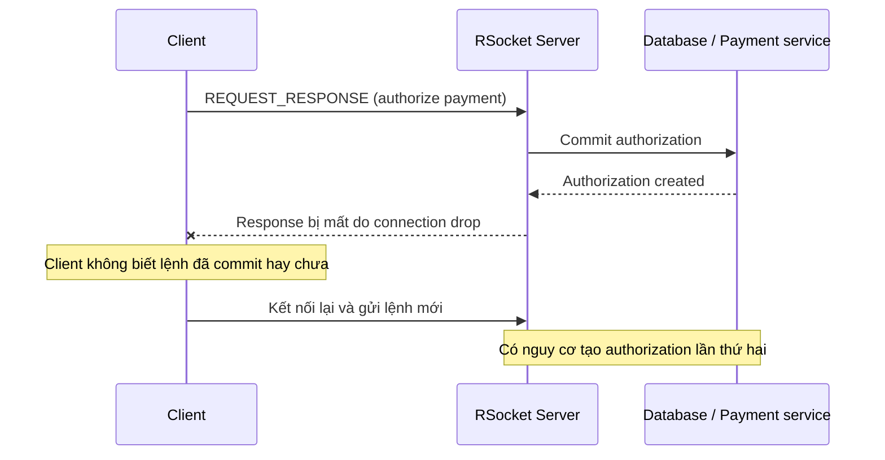
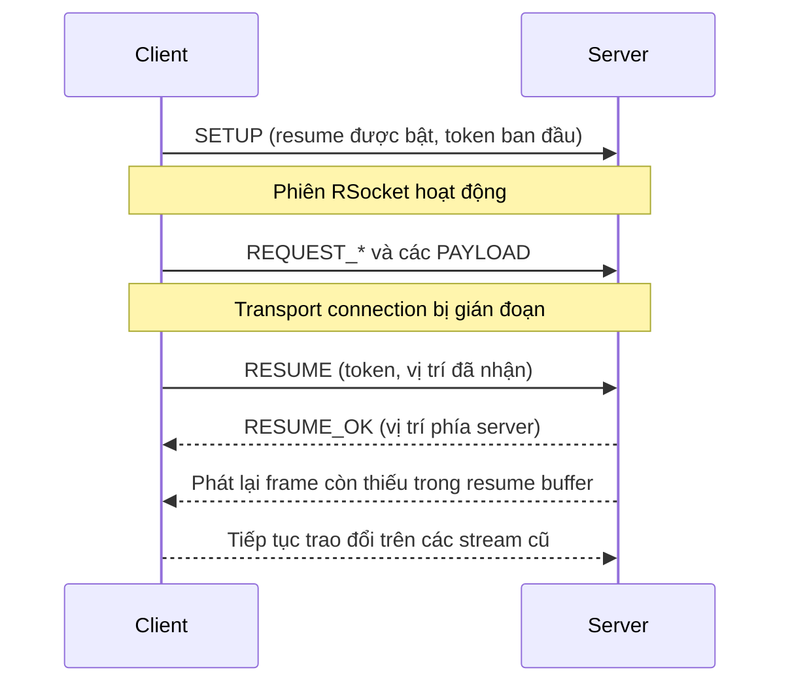
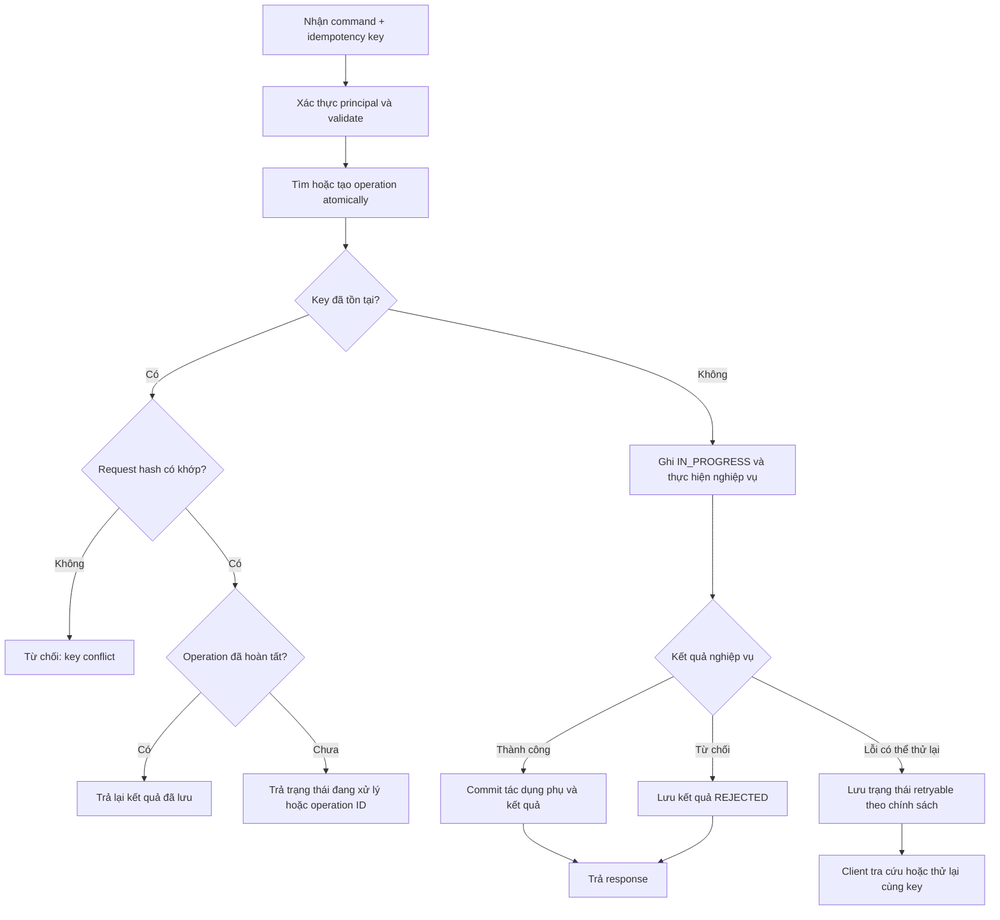
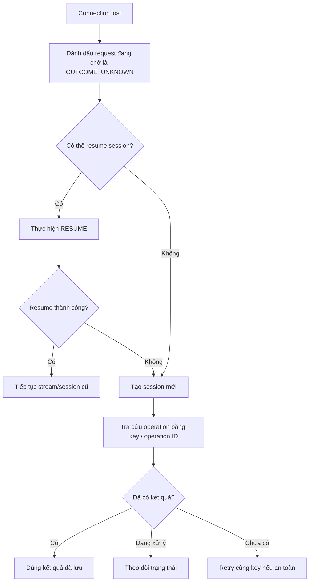

# Tránh lặp tác dụng phụ khi phục hồi yêu cầu đang dang dở

Khi kết nối RSocket bị gián đoạn, client có thể không biết request cuối cùng đã được server xử lý đến đâu. Server có thể chưa nhận request, đang xử lý, đã commit thay đổi nhưng response chưa đến client, hoặc đã gửi response nhưng kết nối mất trước khi client nhận được. Nếu client lập tức mở một request mới để thực hiện lại lệnh, một tác dụng phụ như trừ tiền, giữ chỗ hoặc tạo đơn hàng có thể xảy ra hai lần.

RSocket có cơ chế connection resumption để tiếp tục một phiên đã tồn tại và phát lại những frame chưa được xác nhận trong phạm vi dữ liệu còn lưu. Cơ chế này giúp khôi phục phiên giao thức và stream đang hoạt động. Tuy nhiên, nó không tự tạo ra bảo đảm exactly-once cho nghiệp vụ hoặc cho các hệ thống bên ngoài như database, payment gateway và message broker. Muốn tránh lặp tác dụng phụ, ứng dụng cần kết hợp resumption với idempotency key, lưu trạng thái lệnh bền vững, deduplication và quy tắc retry rõ ràng.

## 1. Vì sao kết nối mất tạo ra kết quả không chắc chắn?

Một request có thể đi qua nhiều bước: client gửi frame, server nhận và giải mã, handler chạy nghiệp vụ, database commit, server tạo response và response được truyền về client. Kết nối có thể mất ở bất kỳ thời điểm nào trong chuỗi đó.

Ví dụ client gửi lệnh `payment.authorize`:



Sau khi timeout hoặc mất kết nối, client chỉ biết mình chưa nhận được response. Client không thể suy ra rằng server chưa xử lý request. Đây là *kết quả không chắc chắn* (ambiguous outcome), khác với một lỗi validation được trả về rõ ràng hoặc một `NOT_FOUND` đã được xác nhận.

| Thời điểm kết nối mất | Trạng thái có thể có ở server | Điều client biết |
|---|---|---|
| Trước khi request đến server | Chưa xử lý | Không nhận được response; chưa biết chắc frame đã đến nơi chưa |
| Sau khi server nhận request, trước commit | Đang xử lý hoặc đã dừng | Không biết tác vụ có tiếp tục hay không |
| Sau khi commit, trước khi gửi response | Tác dụng phụ đã xảy ra | Client vẫn không có kết quả |
| Sau khi gửi response, trước khi client nhận | Server đã trả kết quả | Client vẫn không có kết quả |

Với lệnh có tác động phụ, không được xem timeout, socket close hoặc cancellation là bằng chứng thao tác thất bại. Cần một cách nhận diện ý định nghiệp vụ để có thể hỏi lại trạng thái hoặc gửi lại an toàn.

## 2. RSocket connection resumption làm gì?

RSocket resumption cho phép hai peer tiếp tục một phiên logic sau khi transport connection bị gián đoạn, nếu cả hai phía hỗ trợ và đã cấu hình cơ chế này. Client mở một transport connection mới và gửi thông tin resume, bao gồm resume token cùng vị trí dữ liệu đã nhận. Server kiểm tra phiên còn được giữ hay không và trả vị trí tương ứng. Hai phía có thể phát lại các frame còn nằm trong resume buffer để tiếp tục trao đổi.

Các khái niệm chính:

- **Resume token:** định danh phiên logic cần tiếp tục. Token phải được xử lý như dữ liệu nhạy cảm và gắn với đúng phiên/principal.
- **Position:** vị trí byte/frame trong luồng giao thức mà peer đã nhận hoặc lưu giữ. Nó giúp xác định phần dữ liệu cần phát lại.
- **Resume buffer:** vùng lưu các frame đã gửi nhưng chưa được xác nhận để có thể phát lại khi reconnect.
- **Session state:** trạng thái cần thiết để khôi phục các stream đang tồn tại, bao gồm thông tin giao thức và các bộ đếm liên quan.
- **Resume timeout / retention:** khoảng thời gian server giữ phiên và dữ liệu phục hồi. Khi hết hạn hoặc buffer không còn đủ dữ liệu, phiên không thể tiếp tục.

Luồng khái niệm:



Resumption là tiếp tục phiên hiện có, không phải tạo một phiên nghiệp vụ mới. Khi resume thành công, ứng dụng có thể tiếp tục các stream còn sống theo trạng thái giao thức đã được phục hồi. Khi resume thất bại, ví dụ token hết hạn hoặc buffer không còn dữ liệu cần thiết, client phải tạo kết nối/session mới và áp dụng quy tắc phục hồi nghiệp vụ riêng.

## 3. Phân biệt replay ở tầng giao thức và retry ở tầng nghiệp vụ

Hai hành vi này thường bị nhầm lẫn:

| Tiêu chí | RSocket resumption / frame replay | Application retry |
|---|---|---|
| Mục tiêu | Tiếp tục phiên và truyền lại frame chưa được xác nhận | Thực hiện lại một ý định nghiệp vụ |
| Định danh | Resume token, position, stream ID của phiên | Operation ID hoặc idempotency key |
| Phạm vi | Phiên RSocket và frame trong resume buffer | Database, service và tác dụng phụ nghiệp vụ |
| Điều kiện | Phiên còn được giữ, token hợp lệ, buffer đủ dữ liệu | Chính sách retry và trạng thái nghiệp vụ cho phép |
| Nguy cơ | Không thể tiếp tục nếu session/buffer đã hết hạn | Có thể lặp tác dụng phụ nếu không deduplicate |

Khi resumption thành công, protocol dùng position để nhận biết dữ liệu đã nhận và dữ liệu cần replay. Cơ chế này không thể tự bảo đảm một transaction database và việc cập nhật vị trí giao thức luôn commit nguyên tử với nhau. Nó cũng không thể điều khiển một hệ thống bên ngoài không tham gia giao thức RSocket.

Nếu client không thể resume và tạo một session mới, việc gửi lại `payment.authorize` là một request nghiệp vụ mới, ngay cả khi payload giống request trước. Nếu không có idempotency, server có thể thực hiện tác dụng phụ lần nữa.

Không nên dùng khái niệm “exactly once” cho toàn bộ chuỗi client → RSocket → handler → database → dịch vụ ngoài nếu ứng dụng không có cơ chế giao dịch và deduplication bao phủ tất cả các ranh giới đó. Thiết kế thực tế thường là giao nhận có thể lặp (at-least-once) kết hợp xử lý idempotent để đạt kết quả nghiệp vụ tương đương một lần.

## 4. Gắn idempotency key với ý định nghiệp vụ

Idempotency key là mã duy nhất đại diện cho một ý định nghiệp vụ, chẳng hạn “giữ 2 sản phẩm SKU-42 cho đơn ORD-1008”. Client tạo key trước lần gửi đầu tiên và giữ nguyên key cho mọi lần thử lại của cùng ý định đó.

Ví dụ request:

```java
public record ReserveInventoryCommand(
    String orderId,
    String sku,
    int quantity,
    String warehouseId
) {}

public record IdempotencyMetadata(String key) {}
```

Client tạo key một lần và dùng lại khi cần retry:

```java
String key = commandIdGenerator.newKey();

Mono<ReservationResult> attempt = requester
    .route("inventory.reserve")
    .metadata(new IdempotencyMetadata(key), IDEMPOTENCY_MIME)
    .data(command)
    .retrieveMono(ReservationResult.class);
```

Nếu request bị timeout, lần thử lại phải dùng cùng `key` và cùng nội dung command. Không tạo key mới chỉ vì kết nối mới được thiết lập. Một key mới có nghĩa là một ý định mới và có thể tạo thêm tác dụng phụ.

Key nên có phạm vi rõ ràng, thường kết hợp tenant hoặc principal, tên thao tác và key do client tạo. Server không nên dùng key toàn cục mà không xác thực người gửi, vì một client khác có thể vô tình hoặc cố ý dò kết quả của client đầu tiên.

Nếu cùng một key được gửi với payload khác, server phải từ chối thay vì trả lại kết quả cũ hoặc thực hiện lệnh mới. Có thể lưu hash của payload đã chuẩn hóa để kiểm tra tính nhất quán.

## 5. Lưu trạng thái lệnh bền vững ở server

Idempotency chỉ hiệu quả nếu server lưu trạng thái đủ lâu và có thể tra cứu sau khi process hoặc connection thay đổi. Một bảng operation có thể gồm các trường:

| Trường | Mục đích |
|---|---|
| `scope` | Tenant/principal và loại thao tác |
| `idempotency_key` | Khóa duy nhất cho ý định nghiệp vụ |
| `request_hash` | Phát hiện key bị dùng với payload khác |
| `operation_id` | Mã tham chiếu bền vững để client truy vấn |
| `status` | `IN_PROGRESS`, `SUCCEEDED`, `REJECTED`, `FAILED_RETRYABLE` hoặc trạng thái cần thiết khác |
| `response_body` | Kết quả đã tạo để trả lại cho lần gửi trùng |
| `created_at`, `updated_at` | Thời điểm tạo và cập nhật |

Ràng buộc unique nên áp dụng trên cặp phạm vi và key, ví dụ `(scope, idempotency_key)`. Việc kiểm tra key, chiếm quyền xử lý và ghi kết quả cần được bảo vệ bằng transaction hoặc thao tác nguyên tử ở database.

Luồng xử lý:



Khi nhận lại cùng key:

- Nếu operation đã `SUCCEEDED` hoặc `REJECTED`, trả lại kết quả đã lưu.
- Nếu operation đang `IN_PROGRESS`, không chạy tác dụng phụ lần nữa. Có thể trả `ACCEPTED` kèm `operationId`, chờ có giới hạn hoặc cho client truy vấn trạng thái.
- Nếu request hash khác, trả lỗi conflict theo contract.
- Nếu lần trước thất bại trước khi có tác dụng phụ và trạng thái được đánh dấu retryable, cho phép tiếp tục xử lý theo quy tắc đồng bộ hóa.

Không nên xóa idempotency record ngay sau khi trả response. Client có thể reconnect hoặc retry sau một khoảng thời gian. Thời hạn lưu key phải dài hơn cửa sổ retry/recovery mà hệ thống cam kết; với nghiệp vụ tài chính hoặc đơn hàng, có thể cần lưu lịch sử operation lâu hơn để audit.

## 6. Commit kết quả và tác dụng phụ trong cùng ranh giới

Với tác dụng phụ nằm trong cùng database, cách an toàn là lưu trạng thái idempotency, cập nhật dữ liệu nghiệp vụ và lưu response trong cùng transaction. Khi transaction commit, cả tác dụng phụ lẫn kết quả deduplication cùng tồn tại. Nếu transaction rollback, cả hai cùng không được xem là hoàn tất.

Ví dụ pseudocode ở tầng service:

```java
Mono<ReservationResult> reserveOnce(
        String scope,
        String key,
        String requestHash,
        ReserveInventoryCommand command) {

    return transactionalOperator.transactional(
        operationRepository.claim(scope, key, requestHash)
            .flatMap(claim -> inventoryRepository.reserve(command)
                .flatMap(reservation -> {
                    ReservationResult result =
                        ReservationResult.reserved(reservation.id());
                    return operationRepository.markSucceeded(
                            claim.operationId(), result)
                        .thenReturn(result);
                })
            )
    );
}
```

Đây là khung minh họa; `claim` phải xử lý unique conflict và trạng thái hiện có một cách nguyên tử. Không thể chỉ gọi `findByKey()` rồi sau đó `insert()` bằng hai thao tác tách rời mà không có unique constraint hoặc khóa phù hợp: hai request đồng thời có thể cùng thấy key chưa tồn tại và cùng thực hiện lệnh.

Nếu tác dụng phụ nằm ở hệ thống ngoài transaction database, ví dụ gọi cổng thanh toán hoặc gửi lệnh đến thiết bị, transaction local không thể commit nguyên tử với hệ thống đó. Khi ấy cần thêm một cơ chế phối hợp:

- Ghi operation và outbox event trong cùng transaction local.
- Worker gửi lệnh ra hệ thống ngoài bằng idempotency key ổn định.
- Hệ thống đích deduplicate theo key nếu hỗ trợ.
- Ghi lại kết quả hoặc trạng thái cần đối soát.
- Khi mất response từ hệ thống đích, tra cứu theo reference/key trước khi gửi lại.

Outbox thường giao event ít nhất một lần. Consumer của outbox vẫn phải idempotent. Nếu hệ thống ngoài không hỗ trợ idempotency hoặc truy vấn trạng thái, cần thiết kế reconciliation/manual review cho các kết quả không chắc chắn; không thể tuyên bố exactly-once chỉ bằng transaction local.

## 7. Dùng operation ID cho công việc dài

Với công việc có thể kéo dài hơn timeout request hợp lý, hãy tách việc chấp nhận lệnh khỏi việc hoàn tất lệnh. Request-response đầu tiên có thể trả `operationId` và trạng thái `ACCEPTED`. Client dùng operation ID để truy vấn trạng thái sau khi reconnect, hoặc mở request-stream để theo dõi tiến độ.

```java
public record OperationAccepted(
    String operationId,
    String status
) {}

public record OperationStatus(
    String operationId,
    String status,
    String resultReference,
    String errorCode
) {}
```

Các route có thể được thiết kế như sau:

| Route | Interaction model | Mục đích |
|---|---|---|
| `reports.generate` | Request-response | Chấp nhận lệnh và trả operation ID |
| `operations.get` | Request-response | Truy vấn trạng thái hiện tại |
| `operations.watch` | Request-stream | Theo dõi cập nhật trạng thái |
| `operations.cancel` | Request-response | Yêu cầu hủy nếu operation còn có thể hủy |

Operation ID là định danh tra cứu, còn idempotency key là định danh ý định gửi lệnh. Có thể lưu quan hệ giữa hai giá trị. Khi client không biết request đầu tiên đã được chấp nhận chưa, client gửi lại cùng idempotency key hoặc truy vấn theo key để lấy operation ID hiện có.

## 8. Quy trình phục hồi ở client

Khi phát hiện connection bị gián đoạn, client nên thực hiện theo thứ tự có kiểm soát:

1. Đánh dấu các request đang chờ là `OUTCOME_UNKNOWN`; không tự kết luận chúng thất bại.
2. Nếu phiên RSocket hỗ trợ resumption, thử resume phiên hiện tại trong cửa sổ retention đã cấu hình.
3. Nếu resume thành công, để session phục hồi các stream và frame theo trạng thái giao thức; không đồng thời mở một request nghiệp vụ mới cho cùng thao tác.
4. Nếu resume không thể thực hiện, thiết lập session mới.
5. Với mỗi lệnh có tác động phụ, tra cứu operation bằng idempotency key hoặc operation ID.
6. Nếu chưa có operation và chính sách cho phép gửi lại, gửi cùng command với cùng idempotency key.
7. Nếu trạng thái vẫn không xác định, giữ operation ở trạng thái chờ đối soát; không tạo key mới để ép thao tác chạy lại.



Đối với truy vấn đọc, retry thường đơn giản hơn nếu chấp nhận dữ liệu có thể thay đổi giữa hai lần đọc. Đối với command có tác động phụ, cần idempotency và trạng thái bền vững trước khi retry.

## 9. Retry policy không được tạo thêm ý định mới

Retry policy nên phân loại lỗi và bảo toàn idempotency key:

| Tình huống | Hành động |
|---|---|
| Validation hoặc authorization bị từ chối | Không retry tự động; sửa request hoặc credential theo chính sách |
| Kết nối mất, kết quả không rõ | Thử resume; nếu không được, tra cứu operation trước |
| Lỗi tạm thời trước khi tác dụng phụ xảy ra | Có thể retry cùng key với backoff |
| Operation đã hoàn tất | Trả lại kết quả đã lưu, không chạy lại |
| Operation đang xử lý | Theo dõi hoặc trả `ACCEPTED`; không tạo worker xử lý trùng |
| Cùng key nhưng payload khác | Từ chối conflict |
| Hệ thống ngoài không xác định kết quả | Tra cứu/reconcile trước khi gửi lệnh mới |

Ví dụ retry có giới hạn cho một command đã có idempotency key:

```java
Mono<ReservationResult> result = sendReserve(command, key)
    .retryWhen(Retry.backoff(2, Duration.ofMillis(250))
        .maxBackoff(Duration.ofSeconds(2))
        .filter(this::isRetryableTransportOrTransientFailure));
```

Đoạn mã chỉ an toàn khi server thực thi deduplication theo `key` và client không đổi key giữa các lần subscribe/retry. Không retry tất cả `Throwable`; lỗi nghiệp vụ, lỗi phân quyền và key conflict không thể khắc phục bằng cách gửi lại. Cũng cần giới hạn tổng thời gian retry để không vượt deadline nghiệp vụ.

## 10. Hạn chế và vận hành RSocket resumption

Resumption chỉ hoạt động trong các điều kiện mà phiên còn khả năng khôi phục:

- Cả client và server phải hỗ trợ và bật resumption.
- Resume token phải hợp lệ và phiên tương ứng vẫn được giữ.
- Resume buffer phải còn chứa frame cần phát lại.
- Thời gian gián đoạn không vượt giới hạn retention/timeout đã cấu hình.
- Với server cluster, node nhận yêu cầu resume phải truy cập được session state và buffer tương ứng; cần sticky routing hoặc cơ chế chia sẻ state phù hợp với implementation.

Khi buffer đầy, phiên hết hạn, process restart làm mất state hoặc token không còn hợp lệ, resume có thể thất bại. Ứng dụng cần fallback sang session mới và phục hồi nghiệp vụ bằng operation ID/idempotency key. Không nên đặt buffer vô hạn để tránh lỗi resume; buffer tiêu thụ bộ nhớ theo lượng dữ liệu gửi và thời gian peer chưa xác nhận.

Resume token có thể cho phép tiếp tục một phiên đã xác thực. Hãy bảo vệ token như credential: truyền qua transport được bảo vệ, không ghi vào log, giới hạn thời hạn và ràng buộc với principal/session phù hợp. Khi quyền của người dùng bị thu hồi, chính sách server phải quyết định phiên cũ có được tiếp tục hay không.

Keepalive và resumption có vai trò khác nhau. Keepalive giúp phát hiện peer hoặc đường truyền không còn phản hồi; resumption là cách tiếp tục session sau khi transport gián đoạn. Tăng tần suất keepalive không thay thế resume buffer, và bật resumption không có nghĩa client sẽ không bao giờ cần tạo session mới.

## 11. Kiểm thử tránh lặp tác dụng phụ

Không chỉ kiểm thử trường hợp reconnect thành công. Hãy mô phỏng các điểm mất kết nối khác nhau:

1. Ngắt kết nối trước khi server nhận request.
2. Ngắt sau khi server nhận request nhưng trước khi bắt đầu transaction.
3. Ngắt trong lúc transaction đang chạy.
4. Ngắt ngay sau commit nhưng trước khi response đến client.
5. Ngắt sau khi response được gửi nhưng trước khi client xác nhận nhận.
6. Resume thành công trong khi stream còn hoạt động.
7. Resume thất bại do token hết hạn hoặc buffer không còn frame cần thiết.
8. Client gửi lại cùng idempotency key tuần tự và đồng thời.
9. Client gửi cùng key nhưng payload khác.
10. Process server restart hoặc request resume đến node khác trong cluster.
11. Hệ thống ngoài thực hiện tác dụng phụ nhưng response của nó bị mất.

Với mỗi tình huống, xác minh số tác dụng phụ thực tế, operation state, response được trả lại và khả năng tra cứu sau reconnect. Ví dụ lệnh giữ hàng có thể được gọi nhiều lần với cùng key nhưng chỉ tạo một reservation; mọi lần gọi sau trả cùng `reservationId`.

Ở tầng ứng dụng, dùng `StepVerifier` để kiểm tra trạng thái reactive và lỗi. Ở tầng tích hợp, dùng RSocket client/server thật cùng transport để kiểm tra resumption, sau đó kiểm tra database hoặc mock service ngoài để xác minh số lần side effect. Một unit test chỉ xác minh `retryWhen` chạy hai lần không thể chứng minh nghiệp vụ không bị thực hiện hai lần.

## 12. Metric và dấu vết cần theo dõi

Để điều tra lỗi phục hồi, nên theo dõi:

- Số lần transport disconnect, resume attempt, resume success và resume failure.
- Lý do resume thất bại: token không hợp lệ, session hết hạn, buffer thiếu hoặc lỗi transport.
- Số frame được replay và dung lượng resume buffer đang sử dụng nếu thư viện cung cấp.
- Số operation ở trạng thái `IN_PROGRESS`, `OUTCOME_UNKNOWN` hoặc quá thời gian xử lý.
- Số lần idempotency hit, key conflict và request được deduplicate.
- Tỷ lệ retry theo route, thời gian hoàn tất operation và số lần reconciliation.
- Các tác dụng phụ được tạo theo operation ID để phát hiện trường hợp trùng.

Log nên liên kết `traceId`, `operationId`, idempotency key đã che hoặc hash, route và session correlation ID. Không ghi resume token, access token hoặc payload chứa dữ liệu nhạy cảm. Khi client retry, giữ correlation nghiệp vụ ổn định để các lần thử có thể được nhìn như một ý định duy nhất.

## 13. Quy tắc thiết kế

1. Thử resume phiên RSocket hiện tại trước khi tạo một request nghiệp vụ mới, nếu resumption đã được bật và còn khả dụng.
2. Xem timeout hoặc disconnect khi command đang chạy là kết quả chưa xác định.
3. Tạo idempotency key trước lần gửi đầu và giữ nguyên key cùng payload cho mọi lần retry của cùng ý định.
4. Lưu operation state và kết quả bền vững; dùng unique constraint hoặc thao tác nguyên tử để xử lý request đồng thời.
5. Commit tác dụng phụ và kết quả idempotency trong cùng transaction khi chúng cùng nằm trong một database.
6. Với dịch vụ ngoài, dùng outbox, downstream idempotency key và reconciliation; không giả định transaction local bao phủ hệ thống ngoài.
7. Dùng operation ID cho công việc dài để client có thể truy vấn hoặc theo dõi sau reconnect.
8. Khi resume thất bại, tra cứu trạng thái trước khi retry; không tạo key mới để chạy lại command cũ.
9. Bảo vệ resume token, giới hạn buffer và retention, đồng thời tính đến session state khi triển khai cluster.
10. Kiểm thử mất kết nối ngay sau commit và xác minh tác dụng phụ chỉ xảy ra một lần về mặt nghiệp vụ.

RSocket resumption giúp tiếp tục phiên và phục hồi frame trong giới hạn session/buffer được giữ. Idempotency và operation state giúp bảo vệ tác dụng phụ khi ứng dụng phải gửi lại command ở một session mới. Kết hợp hai lớp này, client có thể phục hồi kết nối mà vẫn giữ được một ý định nghiệp vụ nhất quán, kể cả khi response bị mất sau lúc server đã commit.
