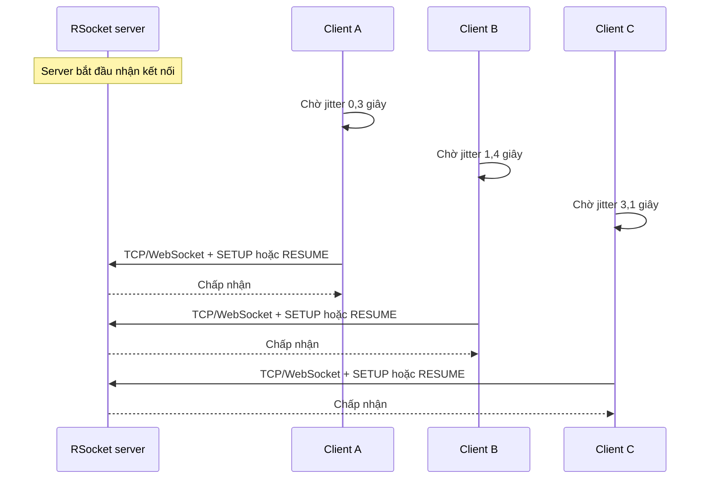

# Xử lý nhiều phía kết nối lại đồng thời sau sự cố

Khi một máy chủ RSocket hoặc một tuyến mạng gặp sự cố, nhiều client có thể mất kết nối gần như cùng lúc. Nếu tất cả client lập tức kết nối lại theo cùng một lịch cố định, máy chủ vừa phục hồi sẽ phải xử lý một đợt lớn TCP handshake, TLS handshake, RSocket `SETUP` và xác thực trong thời gian rất ngắn. Tải tăng đột ngột này thường được gọi là **thundering herd** (đàn kết nối dồn dập). Máy chủ có thể quá tải lần nữa, khiến client tiếp tục retry và tạo thành vòng lặp sự cố.

Với RSocket, giải pháp cần phối hợp cả client và server: phân tán thời điểm retry, giới hạn số lần và tốc độ thử lại, kiểm soát số kết nối mới được tiếp nhận, đồng thời xác định có thể **resume phiên cũ** hay phải tạo **kết nối/phiên mới**. Mục tiêu là đưa hệ thống trở lại trạng thái ổn định mà không làm một đợt reconnect trở thành sự cố thứ hai.

## 1. Vì sao nhiều client reconnect cùng lúc?

Một sự kiện dùng chung có thể tác động tới hàng nghìn client:

- Tiến trình server khởi động lại hoặc triển khai phiên bản mới.
- Load balancer, gateway, NAT hoặc tuyến mạng bị gián đoạn.
- Sự cố DNS khiến nhiều client không phân giải được endpoint.
- Chứng chỉ TLS, dịch vụ xác thực hoặc một dịch vụ phụ thuộc gặp vấn đề.
- Server bị quá tải và đóng nhiều kết nối trong một khoảng thời gian ngắn.

Nếu client dùng lịch retry giống nhau, chẳng hạn tất cả chờ đúng 1 giây rồi thử lại, các lần thử sẽ tiếp tục tập trung thành từng đợt. Khi server mở cổng trở lại, một lượng lớn client đồng thời thực hiện các thao tác tốn tài nguyên:

1. Phân giải DNS và thiết lập socket TCP.
2. Thương lượng TLS nếu dùng TLS/WebSocket Secure.
3. Gửi RSocket `SETUP` hoặc yêu cầu resume.
4. Xác thực, tải ngữ cảnh kết nối và đăng ký handler.
5. Khôi phục subscription hoặc gửi lại dữ liệu ứng dụng đang chờ.

Một server có thể đủ khả năng xử lý tải realtime bình thường nhưng không đủ năng lực xử lý tất cả công việc khởi tạo phiên trong cùng một giây. Vì vậy, reconnect cần được điều tiết như một luồng tải riêng.

## 2. Phân biệt reconnect transport và resume phiên RSocket

Hai khái niệm này có liên quan nhưng không đồng nghĩa.

| Khái niệm | Việc xảy ra | Kết quả |
|---|---|---|
| Reconnect transport | Client mở lại TCP hoặc WebSocket sau khi đường truyền bị mất | Có một transport mới; chưa chắc phiên RSocket cũ được khôi phục |
| Resume phiên | Hai peer dùng cơ chế RSocket Resumption để tiếp tục phiên đã được giữ trạng thái | Có thể khôi phục phiên và truyền lại các frame còn thiếu theo trạng thái giao thức |
| Tạo phiên mới | Resume không được hỗ trợ, bị từ chối hoặc trạng thái phiên cũ đã hết hạn | Client gửi `SETUP` và ứng dụng phải khởi tạo lại ngữ cảnh cần thiết |

RSocket Resumption là khả năng tùy chọn. Hai phía phải hỗ trợ và cấu hình phù hợp; server phải còn giữ trạng thái phiên và dữ liệu cần thiết để tiếp tục. Resume có thể thất bại nếu token không hợp lệ, trạng thái đã hết hạn hoặc server không còn dữ liệu phiên. Khi đó ứng dụng cần quyết định có tạo phiên mới hay báo lỗi cho người dùng.

Resume xử lý việc tiếp tục phiên ở tầng giao thức. Nó không tự bảo đảm rằng mọi tác vụ nghiệp vụ bên ngoài (ví dụ ghi cơ sở dữ liệu hoặc gửi email) được thực hiện đúng một lần. Các thao tác có side effect vẫn cần idempotency key, mã sự kiện hoặc cơ chế đối soát ở tầng ứng dụng.

Một đợt mất kết nối lớn có thể tạo ra hai nhóm tải: client cố resume phiên cũ và client phải tạo phiên mới. Cả hai nhóm đều cần backoff, giới hạn concurrency và admission control.

## 3. Backoff lũy thừa để giảm tốc độ thử lại

Thay vì retry theo khoảng cố định, client tăng dần thời gian chờ sau mỗi lần thất bại. Một công thức phổ biến là:

\[
  cap_n = \min(maxDelay, baseDelay \times 2^n)
\]

Trong đó:

- `baseDelay` là thời gian chờ ban đầu, ví dụ 500 ms.
- `n` là số lần retry đã thực hiện.
- `maxDelay` là thời gian chờ tối đa, ví dụ 30 giây.

Ví dụ không có jitter, các client có thể cùng chờ 500 ms, 1 giây, 2 giây, 4 giây... Vì mọi client thường thất bại cùng thời điểm, chúng vẫn tiếp tục thử lại theo các đợt đồng bộ. Do đó, backoff cần đi kèm **jitter**.

## 4. Jitter: phân tán thời điểm reconnect

Jitter thêm một khoảng ngẫu nhiên vào thời gian chờ. Với *full jitter*, mỗi client chọn một thời điểm ngẫu nhiên trong khoảng từ 0 tới giới hạn backoff hiện tại:

\[
  delay_n \sim U(0, cap_n)
\]

Ví dụ `cap_n = 8 giây`, client có thể thử lại sau 0,4 giây, 2,7 giây hoặc 7,2 giây. Các client không còn dồn vào cùng một thời điểm.

| Lần retry | Giới hạn backoff minh họa | Khoảng full jitter |
|---:|---:|---:|
| 1 | 500 ms | 0–500 ms |
| 2 | 1 giây | 0–1 giây |
| 3 | 2 giây | 0–2 giây |
| 4 | 4 giây | 0–4 giây |
| 5 | 8 giây | 0–8 giây |
| 6 trở đi | Tăng tới tối đa 30 giây | 0–30 giây |

Các giá trị chỉ là ví dụ để giải thích thuật toán. Hãy chọn base delay, max delay và số lần retry theo thời gian phục hồi thực tế, timeout và khả năng chịu tải của server. Với hệ thống có hàng chục nghìn client, jitter nên được áp dụng ngay từ lần retry đầu tiên.

Một retry budget có thể giới hạn tổng số lần thử lại trong một cửa sổ thời gian hoặc trong vòng đời của một lần gián đoạn. Khi budget cạn, client chuyển sang trạng thái chờ dài hơn, báo trạng thái mất kết nối hoặc yêu cầu người dùng can thiệp tùy sản phẩm. Chỉ đặt lại budget sau khi kết nối đã ổn định trong một khoảng thời gian; nếu reset ngay khi TCP vừa mở được rồi lại rớt, client có thể lặp vô hạn các đợt retry ngắn.

Nếu hạ tầng có cơ chế thông báo thời điểm nên thử lại, client có thể kết hợp gợi ý đó với jitter để tránh đồng bộ trở lại. Không nên giả định RSocket `ERROR` có sẵn một trường retry-after chuẩn cho mọi triển khai; hãy định nghĩa rõ kênh trao đổi gợi ý nếu hệ thống cần khả năng này.

Ví dụ diễn tiến sau khi server phục hồi:



## 5. Ví dụ tạo retry policy có full jitter bằng Reactor

Đoạn mã sau minh họa retry có giới hạn, exponential backoff và full jitter. `isTransientFailure` là hàm phân loại lỗi của ứng dụng; cần triển khai dựa trên loại lỗi thực tế.

```java
import java.time.Duration;
import java.util.concurrent.ThreadLocalRandom;

import reactor.core.publisher.Mono;
import reactor.util.retry.Retry;

Retry reconnectRetry() {
    long baseDelayMs = 500;
    long maxDelayMs = 30_000;
    long maxRetries = 8;

    return Retry.from(signals -> signals.concatMap(signal -> {
        if (!isTransientFailure(signal.failure())
                || signal.totalRetries() >= maxRetries) {
            return Mono.error(signal.failure());
        }

        long multiplier = 1L << Math.min(signal.totalRetries(), 16L);
        long cap = Math.min(maxDelayMs, baseDelayMs * multiplier);
        long delay = ThreadLocalRandom.current().nextLong(cap + 1);

        return Mono.delay(Duration.ofMillis(delay));
    }));
}
```

Áp dụng policy cho thao tác mở kết nối:

```java
Mono<RSocketRequester> connectWithRetry() {
    return Mono.defer(this::connectOnce)
        .retryWhen(reconnectRetry());
}
```

`Mono.defer` tạo lại thao tác kết nối ở mỗi lần subscribe/retry. `connectOnce()` đại diện cho hàm mở kết nối và hoàn tất khi phiên đã được thiết lập theo contract của ứng dụng. Phần giám sát vòng đời cần gọi lại `connectWithRetry()` khi phát hiện kết nối hiện tại đã đóng; retry lúc khởi tạo không tự động thay thế một connection supervisor.

Không retry mọi lỗi. Ví dụ, DNS tạm thời không phân giải được hoặc server từ chối do đang quá tải có thể là lỗi tạm thời; sai hostname, chứng chỉ không hợp lệ, MIME type không tương thích hoặc token bị thu hồi thường cần sửa cấu hình hoặc xác thực lại thay vì lặp vô hạn.

## 6. Chỉ cho phép một reconnect loop cho mỗi client

Một client có thể có nhiều stream RSocket cùng dùng một kết nối. Khi kết nối bị đóng, nhiều callback của các stream có thể cùng phát hiện lỗi. Nếu mỗi callback tự tạo một requester mới, một client cũng có thể tự tạo ra một đợt reconnect song song.

Hãy quản lý kết nối bằng một **connection supervisor** duy nhất cho mỗi endpoint logic:

- Chỉ có một trạng thái kết nối hiện hành và một reconnect loop đang chạy.
- Nhiều stream cùng quan sát một trạng thái kết nối, không tự mở socket riêng khi cùng gặp lỗi.
- Khi kết nối mới sẵn sàng, supervisor công bố requester/session mới cho các thành phần cần dùng.
- Nếu kết nối vừa tạo lại tiếp tục đóng trong lúc supervisor đang cập nhật trạng thái, supervisor phải ghi nhận sự kiện đó và chạy vòng reconnect tiếp theo.

Có thể dùng `AtomicBoolean` hoặc một actor/event loop để chống tạo nhiều vòng reconnect cùng lúc. Mã sau minh họa nguyên tắc single-flight; `connectWithRetry()` và xử lý lifecycle được cung cấp bởi lớp quản lý kết nối của ứng dụng:

```java
private final AtomicBoolean reconnecting = new AtomicBoolean(false);
private volatile RSocketRequester currentRequester;

void onConnectionClosed() {
    if (!reconnecting.compareAndSet(false, true)) {
        return;
    }

    connectWithRetry()
        .doOnNext(requester -> currentRequester = requester)
        .doFinally(signal -> reconnecting.set(false))
        .subscribe(
            requester -> log.info("RSocket session is ready"),
            error -> log.error("Reconnect attempts exhausted", error)
        );
}
```

Đây là phần lõi minh họa; triển khai production cần xử lý thêm race giữa sự kiện đóng kết nối và thời điểm gán requester mới, đóng tài nguyên cũ, hủy subscription khi ứng dụng shutdown và chuyển trạng thái cho các stream. Nếu cần nhiều lần reconnect liên tiếp, hãy để supervisor điều phối thay vì để từng request tự retry việc tạo kết nối.

## 7. Giới hạn tốc độ và số kết nối đồng thời

Jitter phân tán thời điểm thử lại nhưng không giới hạn tổng tải. Trong một khoảng thời gian dài, quá nhiều client vẫn có thể cùng tạo kết nối mới. Có thể kết hợp các cơ chế sau:

| Cơ chế | Vị trí áp dụng | Mục đích |
|---|---|---|
| Connection concurrency limit | Client hoặc gateway | Giới hạn số lần mở kết nối đang diễn ra đồng thời |
| Token bucket/rate limit | Client fleet, gateway hoặc server | Giới hạn số lần thử kết nối trong một đơn vị thời gian |
| Admission control | Server | Chỉ nhận kết nối mới khi còn tài nguyên |
| Bounded queue | Server hoặc gateway | Xếp hàng trong giới hạn, tránh tích lũy vô hạn |
| Load shedding | Server | Từ chối sớm khi quá tải để bảo vệ kết nối đang hoạt động |
| Per-tenant quota | Gateway/server | Ngăn một tenant chiếm hết năng lực phục hồi |

Nếu có thể, client nên giới hạn số lần kết nối đồng thời trong cùng tiến trình. Ví dụ, một ứng dụng desktop có thể có hàng trăm thành phần cùng dùng RSocket nhưng chỉ cần một kết nối được multiplex cho nhiều stream. Tránh tạo một TCP/WebSocket connection mới cho từng request.

Ở phía server, giới hạn số kết nối đang thiết lập giúp tránh cạn file descriptor, bộ nhớ, CPU TLS hoặc tài nguyên xác thực. Queue phải có kích thước hữu hạn; khi quá giới hạn, server nên từ chối nhanh theo chính sách phù hợp thay vì giữ vô hạn các socket đang chờ.

Retry budget ở cấp tiến trình hoặc fleet còn giúp kiểm soát tổng tải khi có nhiều client logic trong cùng ứng dụng. Ví dụ, mỗi client có giới hạn retry riêng nhưng gateway cũng áp dụng token bucket toàn cục; khi nhiều client cùng mất kết nối, tổng số lần thử vẫn bị chặn ở mức mà hạ tầng có thể phục vụ.

## 8. Admission control và phục hồi phía server

Server cũng cần một quy trình phục hồi có kiểm soát:

1. Khởi động listener khi các thành phần thiết yếu đã sẵn sàng, ví dụ cấu hình, codec, authentication và dependency cần thiết.
2. Đặt giới hạn cho số handshake/SETUP hoặc resume có thể xử lý đồng thời.
3. Ưu tiên duy trì các kết nối đang hoạt động và công việc đang chạy; không để reconnect mới chiếm hết CPU hoặc connection pool.
4. Khi quá tải, từ chối sớm theo chính sách. Client nhận biết lỗi tạm thời và quay lại theo backoff/jitter.
5. Tăng dần năng lực tiếp nhận khi server ổn định, thay vì mở toàn bộ giới hạn ngay lập tức nếu hệ thống còn đang warm-up.

Với RSocket, lỗi từ chối thiết lập và lỗi từ chối tương tác có phạm vi khác nhau. Nếu không thể chấp nhận một phiên mới, server có thể từ chối setup theo quy tắc giao thức. Nếu kết nối đã sẵn sàng nhưng một request không thể được tiếp nhận, có thể từ chối request đó. Mã lỗi và hành vi cụ thể cần thống nhất với client; không giả định mọi lỗi đều có nghĩa là server đang quá tải.

Không nên dựa vào một hàng đợi vô hạn để “hấp thụ” reconnect. Queue lớn làm tăng độ trễ và bộ nhớ, khiến server có thể chết muộn hơn nhưng khó chẩn đoán hơn. Từ chối có kiểm soát cộng với retry có jitter thường giúp hệ thống phục hồi dự đoán được hơn.

## 9. Triển khai và bảo trì không tạo reconnect storm

Khi triển khai phiên bản mới hoặc bảo trì server, có thể chủ động làm giảm số client bị mất kết nối cùng lúc:

- Đưa instance ra khỏi danh sách nhận kết nối mới trước khi dừng.
- Chuyển readiness sang trạng thái không nhận session mới, trong khi vẫn cho phép các kết nối hiện tại hoàn tất trong thời gian drain.
- Đặt thời gian drain hữu hạn và thông báo đóng kết nối theo chính sách của hệ thống.
- Triển khai rolling hoặc theo từng nhóm nhỏ thay vì dừng toàn bộ instance cùng lúc.
- Nếu cần client chuyển sang instance khác, phân tán thời điểm chuyển và tránh đồng loạt reset tất cả kết nối.
- Sau khi instance mới sẵn sàng, tăng dần tỷ lệ nhận kết nối và theo dõi tải handshake/SETUP.

Nếu trạng thái resume chỉ được lưu trong bộ nhớ cục bộ của một instance, load balancer cần giữ affinity hoặc hạ tầng phải có cách chia sẻ trạng thái phiên tương thích. Nếu request resume bị định tuyến tới instance không có trạng thái cần thiết, server có thể từ chối resume dù transport mới đã kết nối thành công. Đây là lý do cần thiết kế rõ nơi lưu session state và thời hạn giữ buffer.

## 10. Quản lý token và xác thực khi reconnect

Nhiều client reconnect cùng lúc cũng có thể tạo tải đột biến lên dịch vụ cấp token hoặc xác thực. Nếu mọi client đều làm mới token ngay khi kết nối rớt, hệ thống xác thực có thể trở thành nút thắt mới.

Một số biện pháp:

- Dùng single-flight để nhiều request trong cùng client chia sẻ một lần refresh token.
- Làm mới token trước khi hết hạn theo một khoảng thời gian có jitter, tránh mọi client refresh đúng cùng thời điểm.
- Phân biệt lỗi xác thực tạm thời với token hết hạn, bị thu hồi hoặc sai audience.
- Không retry liên tục với thông tin xác thực không hợp lệ.
- Không ghi token vào log hoặc đưa token vào metric label.
- Nếu server yêu cầu xác thực lại sau khi resume thất bại và phải tạo phiên mới, áp dụng cùng giới hạn tải cho bước xác thực.

## 11. Dữ liệu đang truyền và khôi phục trạng thái ứng dụng

Một kết nối mới không tự khôi phục mọi trạng thái mà ứng dụng từng giữ trong bộ nhớ. Khi resume thành công, giao thức có thể tiếp tục phiên theo các vị trí frame đã trao đổi. Khi phải tạo phiên mới, ứng dụng cần khôi phục những trạng thái nghiệp vụ ở cấp ứng dụng, ví dụ:

- Đăng ký lại subscription và route cần thiết.
- Gửi lại cursor/offset cuối cùng đã xử lý đối với luồng sự kiện.
- Tải lại snapshot hoặc trạng thái hiện tại từ nguồn dữ liệu chuẩn.
- Dùng event ID hoặc idempotency key để loại bỏ thông điệp trùng.
- Đánh dấu những thao tác đang ở trạng thái chưa xác định để đối soát trước khi thực hiện lại.

Đặc biệt với thao tác ghi, timeout hoặc mất kết nối sau khi gửi request không chứng minh server chưa xử lý. Client có thể không nhận được phản hồi dù side effect đã hoàn tất. Gửi lại request mà không có idempotency có thể tạo giao dịch trùng.

Với subscription realtime, nên xác định rõ semantics của cursor: cursor biểu diễn phần tử cuối đã nhận hay cuối đã xử lý bền vững. Nếu chỉ lưu phần tử đã nhận vào bộ nhớ rồi mất kết nối, ứng dụng có thể bỏ sót dữ liệu sau khi tạo phiên mới. Chỉ xác nhận offset sau khi ứng dụng đã xử lý và lưu trạng thái theo contract.

## 12. Quan sát sức khỏe của đợt reconnect

Không nên chỉ đo số kết nối hiện tại. Trong một sự cố reconnect, cần quan sát cả tốc độ thử lại, thời gian phục hồi và kết quả resume.

| Chỉ số | Điều cần theo dõi |
|---|---|
| Reconnect attempts/sec | Số lần client/gateway thử kết nối trong mỗi giây |
| Concurrent handshakes | Số TCP/TLS/WebSocket handshake đang diễn ra |
| SETUP rate và latency | Tốc độ và thời gian xử lý RSocket setup |
| Resume attempts/success/rejected | Số phiên resume và tỷ lệ thành công/từ chối |
| Fresh session rate | Số phiên mới được tạo sau khi resume không thành công |
| Connection admission rejects | Số kết nối bị từ chối do chính sách tiếp nhận |
| Time to recover | Thời gian từ khi mất kết nối tới khi client hoạt động lại |
| Retry delay distribution | Phân bố thời gian chờ giữa các lần thử lại |
| Active streams và pending work | Tác động lên stream đang chạy và công việc chờ xử lý |

Nên phân nhóm metric theo transport, vùng triển khai hoặc nhóm client. Tránh dùng user ID, session token hoặc connection ID làm label có cardinality cao. Dùng log có correlation ID hoặc trace sampling để điều tra từng phiên cụ thể.

## 13. Kiểm thử tình huống nhiều client kết nối lại

Một bài kiểm thử reconnect cần tạo ra sự cố có kiểm soát và đo tải phục hồi, không chỉ kiểm tra một client có kết nối lại được hay không.

Các kịch bản nên có:

1. Ngắt đồng thời một tỷ lệ lớn client rồi khôi phục server.
2. Ngắt mạng trong một khoảng ngắn và kiểm tra resume khi session state còn hiệu lực.
3. Giữ kết nối mất lâu hơn thời hạn resume để kiểm tra fallback sang phiên mới.
4. Tạo lỗi xác thực hoặc MIME type không tương thích để xác nhận client không retry vô hạn lỗi cấu hình.
5. Giới hạn số kết nối server có thể tiếp nhận và quan sát admission control.
6. Tạo tải xác thực/token refresh đồng thời để kiểm tra single-flight và jitter.
7. Gửi thao tác ghi trước khi ngắt kết nối, sau đó xác nhận idempotency khi client retry.

Đánh giá kết quả bằng thời gian phục hồi, tỷ lệ resume thành công, số kết nối mới mỗi giây, độ trễ setup, tỷ lệ từ chối, CPU/bộ nhớ và số tác vụ nghiệp vụ bị lặp hoặc thất lạc. Một thử nghiệm đạt yêu cầu khi hệ thống phục hồi trong giới hạn đặt ra mà không tạo ra đợt quá tải thứ hai.

## 14. Checklist thiết kế reconnect an toàn

- [ ] Có một connection supervisor cho mỗi endpoint logic; nhiều stream không tự tạo reconnect loop riêng.
- [ ] Retry dùng exponential backoff có cap và jitter ngay từ lần đầu.
- [ ] Có giới hạn số lần retry, retry budget hoặc thời gian tối đa thử lại.
- [ ] Lỗi cấu hình, xác thực vĩnh viễn và lỗi protocol không bị retry liên tục.
- [ ] Client giới hạn số lần mở kết nối đồng thời và tái sử dụng kết nối để multiplex stream.
- [ ] Server có admission control, queue hữu hạn, rate limit và load shedding.
- [ ] Có chính sách rõ ràng cho resume, resume bị từ chối và tạo phiên mới.
- [ ] Session state và resume buffer có thời hạn, dung lượng và chiến lược định tuyến rõ ràng.
- [ ] Có idempotency/cursor để khôi phục trạng thái nghiệp vụ và xử lý thông điệp gửi lại.
- [ ] Token refresh và xác thực được điều tiết, không tạo thêm một đợt tải đồng bộ.
- [ ] Triển khai rolling, drain và readiness tránh đóng toàn bộ kết nối cùng lúc.
- [ ] Có metric cho retry rate, handshake, SETUP, resume, admission reject và thời gian phục hồi.
- [ ] Đã kiểm thử sự cố đồng thời trên số lượng client gần với quy mô thực tế.

Phục hồi kết nối ở quy mô lớn là bài toán phối hợp hai phía. Client cần phân tán retry và tránh tạo nhiều vòng reconnect; server cần kiểm soát số phiên mới, bảo vệ tài nguyên và phục hồi từng bước. RSocket Resumption có thể giữ lại phiên cũ khi đủ điều kiện, còn khi phải tạo phiên mới thì ứng dụng cần tự khôi phục subscription, cursor và tính idempotent của nghiệp vụ.
