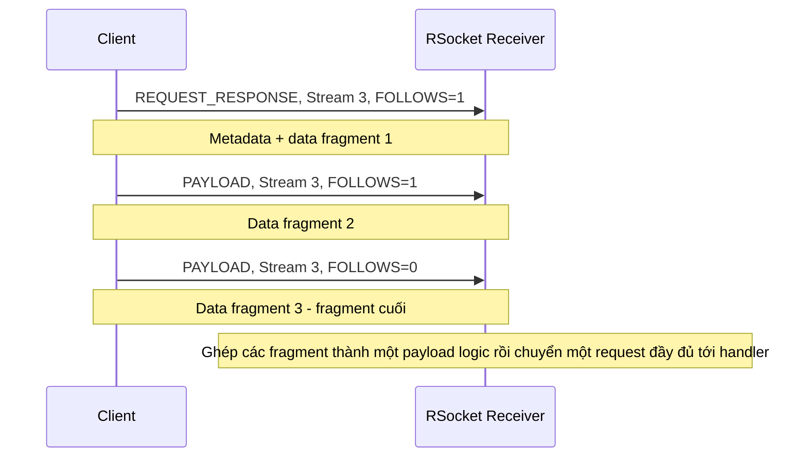

# Phân mảnh payload và vai trò của cờ FOLLOWS

RSocket truyền các tương tác bằng frame. Một payload lớn có thể vượt quá kích thước frame mà ứng dụng hoặc transport cho phép. Thay vì gửi một frame quá lớn, implementation có thể chia payload logic thành nhiều fragment, truyền lần lượt rồi ghép chúng lại ở đầu nhận.

Cờ `FOLLOWS` cho biết fragment hiện tại chưa phải phần cuối: vẫn còn fragment tiếp theo thuộc cùng payload logic. Khi nhận fragment cuối cùng, bên nhận hoàn tất việc ghép và chuyển một payload đầy đủ lên tầng xử lý. Vì vậy, `FOLLOWS` điều khiển quá trình phân mảnh và tái lắp ráp; nó không có nghĩa là server sẽ phát thêm một phần tử stream nghiệp vụ.

## 1. Vì sao cần phân mảnh payload?

Một tương tác RSocket thường mang payload nhỏ như mã đơn hàng, trạng thái hoặc một đối tượng JSON. Nhưng ứng dụng realtime cũng có thể cần gửi nội dung lớn, ví dụ:

- Một tài liệu JSON chứa nhiều dữ liệu tổng hợp.
- Ảnh xem trước hoặc nội dung nhị phân.
- Một thông điệp channel chứa dữ liệu cảm biến được gom theo lô.
- Một kết quả truy vấn lớn được trả về trong một response.

Nếu payload vượt giới hạn frame mà hai đầu hoặc transport chấp nhận, frame có thể bị từ chối, không thể giải mã hoặc làm tăng áp lực bộ nhớ. Phân mảnh chia một payload thành các phần nhỏ hơn để từng frame nằm trong giới hạn đã cấu hình.

Phân mảnh không làm giảm tổng số byte của payload. Đầu nhận vẫn phải ghép các phần thành payload logic ban đầu trước khi ứng dụng xử lý. Vì vậy, fragmentation giúp kiểm soát kích thước frame trên đường truyền nhưng không thay thế giới hạn kích thước payload tổng thể, backpressure hoặc thiết kế truyền dữ liệu theo từng phần ở tầng nghiệp vụ.

## 2. FOLLOWS là gì?

`FOLLOWS` là một cờ trong phần flags của frame RSocket có payload. Cờ này báo cho bên nhận biết payload hiện tại đang được chia thành nhiều frame và còn fragment tiếp theo.

Quy tắc dễ nhớ:

- Fragment đầu tiên mang loại frame của tương tác gốc, ví dụ `REQUEST_RESPONSE`, `REQUEST_STREAM`, `REQUEST_CHANNEL` hoặc `PAYLOAD`.
- Các fragment tiếp theo được truyền dưới dạng frame `PAYLOAD` trên cùng `Stream ID`.
- `FOLLOWS` được đặt trên fragment còn có phần tiếp theo.
- Fragment cuối cùng không đặt `FOLLOWS`, báo rằng payload logic đã đủ để ghép.
- Metadata của payload được mang ở fragment đầu tiên; các fragment tiếp theo mang phần data tiếp nối.

`FOLLOWS` không phải một frame type riêng. Nó cũng không phải cờ báo hoàn tất tương tác. Cờ `COMPLETE` biểu thị một hướng phát dữ liệu đã hoàn tất, còn `FOLLOWS` chỉ báo rằng payload của frame hiện tại còn các fragment cần ghép.

## 3. Ví dụ một payload được chia thành ba fragment

Giả sử client gửi request-response trên `Stream ID = 3`. Payload gồm metadata định tuyến và phần data dài. Implementation chia data thành ba phần để mỗi frame nhỏ hơn giới hạn đã cấu hình.

| Thứ tự | Frame type | Stream ID | FOLLOWS | Nội dung |
|---:|---|---:|---|---|
| 1 | `REQUEST_RESPONSE` | 3 | Có | Metadata và phần data đầu tiên |
| 2 | `PAYLOAD` | 3 | Có | Phần data tiếp theo |
| 3 | `PAYLOAD` | 3 | Không | Phần data cuối cùng |



Bên nhận dùng `Stream ID` để xác định các fragment thuộc tương tác nào, thu thập data theo thứ tự nhận và ghép lại. Sau khi fragment cuối cùng đến, tầng RSocket mới đưa payload logic hoàn chỉnh tới handler. Handler không nhận ba request riêng biệt chỉ vì dữ liệu đi qua ba frame.

Nếu payload ban đầu không có metadata, fragment đầu tiên chỉ mang phần data đầu tiên. Nếu có metadata, metadata được gắn với phần đầu để bên nhận có thể giữ nguyên metadata của payload sau khi tái lắp ráp.

## 4. Fragment đầu tiên và các fragment tiếp theo

Fragment đầu tiên có vai trò đặc biệt vì nó xác định tương tác gốc. Nó giữ frame type ban đầu cùng các trường cần thiết để khởi tạo tương tác, chẳng hạn request channel hoặc request stream. Nếu payload có metadata, phần metadata cũng xuất hiện tại fragment đầu tiên.

Các fragment tiếp theo dùng frame `PAYLOAD` với cùng `Stream ID` để tiếp tục phần data của payload đang ghép. Chúng không khởi tạo một tương tác mới và cũng không mang metadata lặp lại. Fragment cuối cùng là frame tiếp nối cuối cùng, có `FOLLOWS` không được đặt.

Có thể hình dung cấu trúc như sau:

```text
Fragment 1
+------------------------------------------------+
| Header: Stream ID, original frame type          |
| Flags: FOLLOWS=1, METADATA nếu có               |
| Original interaction fields                    |
| Metadata (nếu có)                               |
| Data bytes: phần đầu                            |
+------------------------------------------------+

Fragment 2 ... N-1
+------------------------------------------------+
| Header: cùng Stream ID, frame type PAYLOAD      |
| Flags: FOLLOWS=1                                |
| Data bytes: phần tiếp theo                      |
+------------------------------------------------+

Fragment N (cuối)
+------------------------------------------------+
| Header: cùng Stream ID, frame type PAYLOAD      |
| Flags: FOLLOWS=0                                |
| Data bytes: phần cuối                           |
+------------------------------------------------+
```

Đây là sơ đồ khái niệm, không phải layout byte đầy đủ của frame. Header, độ dài trường, các cờ khác và cách mã hóa payload phải tuân theo đặc tả RSocket. Không tự tạo frame bằng cách nối chuỗi byte nếu chưa xử lý chính xác cấu trúc giao thức.

## 5. FOLLOWS khác NEXT và COMPLETE như thế nào?

Các cờ này có ý nghĩa ở những cấp khác nhau:

| Cờ | Ý nghĩa | Câu hỏi được trả lời |
|---|---|---|
| `FOLLOWS` | Còn fragment tiếp theo của cùng payload logic | Payload này đã được ghép đủ chưa? |
| `NEXT` | Frame payload mang một phần tử dữ liệu tiếp theo của tương tác | Có phần tử payload mới để chuyển tới subscriber không? |
| `COMPLETE` | Bên gửi đã hoàn tất việc phát dữ liệu theo hướng tương ứng | Hướng phát dữ liệu này còn tiếp tục không? |

`FOLLOWS` chỉ liên quan đến việc hoàn tất một payload bị phân mảnh. `NEXT` và `COMPLETE` mô tả ngữ nghĩa của payload và vòng đời tương tác. Đừng dùng `FOLLOWS` để suy ra stream đã kết thúc hoặc sẽ phát thêm một phần tử nghiệp vụ.

Ví dụ, một `REQUEST_STREAM` có thể mang một request ban đầu rất lớn. Request đó được chia thành nhiều fragment; khi fragment cuối cùng đến, server mới xử lý một request logic. Sau đó server có thể phát nhiều payload response độc lập theo ngữ nghĩa request-stream. Mỗi response logic có thể được phân mảnh riêng nếu nó vượt giới hạn frame.

## 6. Phân mảnh không giống request-stream hoặc chunking nghiệp vụ

Đây là khác biệt quan trọng khi thiết kế API:

| Tiêu chí | Fragmentation với FOLLOWS | Request-stream | Chunking ở tầng ứng dụng |
|---|---|---|---|
| Mục đích | Chia một payload logic thành frame nhỏ | Gửi nhiều payload logic trong một tương tác | Chia dữ liệu nghiệp vụ thành các phần có ý nghĩa riêng |
| Ranh giới dữ liệu | Nội bộ tầng giao thức | Mỗi payload là một phần tử stream | Mỗi chunk có hợp đồng riêng |
| Ứng dụng nhìn thấy | Một payload đã ghép hoàn chỉnh | Nhiều phần tử | Nhiều chunk và metadata nghiệp vụ |
| Có cursor/sequence nghiệp vụ? | Không tự có | Không tự có | Có thể được thiết kế rõ ràng |
| Phục hồi từng phần | Không thay thế cơ chế phục hồi nghiệp vụ | Tùy nguồn dữ liệu và ứng dụng | Có thể tiếp tục từ chunk/offset đã xác nhận |

Nếu cần gửi một file lớn, fragmentation có thể chia frame của một payload nhưng đầu nhận vẫn cần bộ nhớ để ghép payload đó. Nếu file lớn đến mức không nên giữ toàn bộ trong bộ nhớ, hãy thiết kế truyền file thành nhiều chunk nghiệp vụ qua request-stream hoặc request-channel. Mỗi chunk có thể chứa file ID, sequence number, offset, checksum và thông tin xác nhận.

Nói cách khác, fragmentation giải quyết giới hạn kích thước frame. Chunking nghiệp vụ giải quyết cách ứng dụng truyền, xác nhận và phục hồi một đối tượng lớn theo từng phần.

## 7. Fragmentation hoạt động với các kiểu tương tác ra sao?

Các frame khởi tạo tương tác có payload có thể cần được phân mảnh nếu payload ban đầu quá lớn. Các payload được gửi trong một stream cũng có thể cần phân mảnh riêng. Việc phân mảnh không thay đổi kiểu tương tác mà ứng dụng đã chọn.

| Kiểu tương tác | Ví dụ payload có thể phân mảnh | Ý nghĩa sau khi ghép |
|---|---|---|
| Request-response | Request chứa bộ lọc truy vấn lớn hoặc response chứa kết quả lớn | Một request và tối đa một response |
| Fire-and-forget | Sự kiện lớn cần gửi mà không chờ response | Một request không có response nghiệp vụ |
| Request-stream | Request mở stream lớn hoặc một payload response lớn | Một request mở luồng nhiều response |
| Request-channel | Payload đầu vào của channel hoặc payload đầu ra của channel lớn | Hai hướng có thể tiếp tục trao đổi nhiều payload |
| PAYLOAD trong stream đang hoạt động | Một phần tử stream lớn | Một phần tử logic sau khi tái lắp ráp |

Mỗi payload logic được xử lý độc lập. Khi một payload đã được ghép xong, các payload tiếp theo của cùng stream vẫn là những phần tử riêng theo kiểu tương tác ban đầu.

## 8. Kích thước fragment và giới hạn payload tổng

Implementation thường cung cấp cấu hình để giới hạn kích thước frame hoặc fragment gửi đi, đồng thời giới hạn kích thước payload được nhận. Tên API và thuộc tính cấu hình có thể khác giữa các phiên bản RSocket Java, Spring Framework và Spring Boot, vì vậy cần kiểm tra tài liệu đúng phiên bản đang sử dụng.

Phân biệt hai giới hạn:

- **Kích thước fragment/frame:** giới hạn số byte trong một frame được truyền. Giá trị này cần phù hợp với cấu hình hai đầu và transport.
- **Kích thước payload sau tái lắp ráp:** giới hạn tổng dữ liệu mà receiver chấp nhận cho một payload logic. Payload có thể gồm nhiều fragment nhưng vẫn vượt giới hạn tổng.

Ví dụ, nếu một payload 4 MiB được chia thành các fragment 64 KiB, mỗi frame có thể nằm trong giới hạn frame nhưng receiver vẫn phải ghép một payload 4 MiB. Nếu giới hạn inbound payload chỉ là 2 MiB, payload đó vẫn phải bị từ chối.

Khi chọn kích thước fragment, cần cân nhắc:

- Kích thước header và metadata làm giảm phần data thực tế trong mỗi frame.
- Fragment quá nhỏ làm tăng số frame, chi phí header, scheduling và công việc ghép.
- Fragment quá lớn có thể vượt giới hạn frame của peer hoặc hạ tầng trung gian.
- Nhiều payload lớn đồng thời có thể làm tăng bộ nhớ dùng cho các bộ đệm reassembly.
- Giới hạn tổng payload phải phù hợp với năng lực bộ nhớ và quy mô dữ liệu hợp lệ của ứng dụng.

Không lấy MTU của mạng làm đồng nghĩa với max fragment size của RSocket. TCP truyền luồng byte và có thể chia dữ liệu thành nhiều segment; WebSocket cũng có framing riêng. RSocket frame là một lớp framing ở tầng ứng dụng nằm phía trên transport.

## 9. Cấu hình trong RSocket Java và Spring

Trong RSocket Java, fragmentation được cấu hình ở các thành phần client/server hoặc connector tương ứng. Ứng dụng cần thống nhất giới hạn frame với peer và đặt giới hạn inbound payload phù hợp. Các API cấu hình fragmentation, kích thước tối đa và giá trị mặc định phụ thuộc phiên bản thư viện; không nên sao chép một tên method hoặc property từ ví dụ của phiên bản khác mà chưa đối chiếu dependency đang dùng.

Trong Spring, `RSocketRequester` và các endpoint Spring Messaging dùng implementation RSocket bên dưới. Spring xử lý chuyển đổi payload thành kiểu Java sau khi RSocket đã nhận và tái lắp ráp payload logic. Vì vậy, handler `@MessageMapping` thường không cần tự ghép các fragment hoặc đọc cờ `FOLLOWS`.

Ví dụ một handler nhận một payload logic lớn:

```java
import org.springframework.messaging.handler.annotation.MessageMapping;
import org.springframework.stereotype.Controller;
import reactor.core.publisher.Mono;

@Controller
public class ReportController {

    private final ReportService reportService;

    public ReportController(ReportService reportService) {
        this.reportService = reportService;
    }

    @MessageMapping("reports.preview")
    public Mono<ReportPreview> preview(ReportRequest request) {
        return reportService.createPreview(request);
    }
}
```

Client có thể gửi request theo route:

```java
Mono<ReportPreview> preview = requester.route("reports.preview")
    .data(largeReportRequest)
    .retrieveMono(ReportPreview.class);
```

Nếu payload vượt ngưỡng fragment đã cấu hình và implementation hỗ trợ fragmentation cho tương tác này, thư viện xử lý việc chia frame và ghép lại. Handler vẫn nhận một `ReportRequest` logic. Ví dụ chỉ minh họa luồng lập trình; nó không thay thế việc cấu hình giới hạn frame/inbound payload hoặc xác nhận khả năng của phiên bản thư viện.

## 10. Điều tiết luồng và bộ nhớ reassembly

Fragmentation và backpressure giải quyết hai vấn đề khác nhau. Fragmentation giới hạn kích thước từng frame. Backpressure kiểm soát tốc độ và số lượng phần tử logic mà subscriber yêu cầu từ publisher.

Receiver thường phải thu thập đủ fragment trước khi chuyển payload logic lên tầng ứng dụng. Vì vậy, trong khi một payload đang được ghép, bộ nhớ có thể được giữ cho tới khi fragment cuối cùng đến hoặc quá trình bị hủy/lỗi. Nếu có nhiều stream đồng thời gửi payload lớn, tổng bộ nhớ reassembly có thể tăng đáng kể.

Các biện pháp cần cân nhắc:

- Đặt giới hạn inbound payload để ngăn payload lớn bất thường chiếm hết bộ nhớ.
- Giới hạn số kết nối và số tương tác đồng thời theo năng lực hệ thống.
- Theo dõi số payload đang reassemble, kích thước và thời gian ghép nếu implementation cung cấp metric.
- Hủy hoặc giải phóng trạng thái reassembly khi stream bị hủy, lỗi hoặc transport đóng.
- Dùng request-stream hoặc chunking nghiệp vụ khi dữ liệu quá lớn để ghép thành một payload duy nhất.

Một stream có demand nhỏ vẫn có thể có một payload đơn lẻ rất lớn. Do đó, backpressure không thay thế giới hạn kích thước payload. Ngược lại, fragmentation không ngăn producer tạo quá nhiều payload logic liên tiếp nếu ứng dụng không quản lý demand.

## 11. Metadata và thứ tự ghép payload

Metadata như route, MIME type hoặc thông tin xác thực thuộc về payload logic. Khi payload có metadata được phân mảnh, metadata được mang cùng fragment đầu tiên. Các fragment tiếp theo tiếp tục phần data và không lặp lại metadata.

Sau khi ghép, receiver phải giữ nguyên quan hệ giữa metadata và data để tầng định tuyến hoặc message conversion diễn giải payload đúng. Nếu tự viết một bộ xử lý frame, cần tránh ghép nhầm fragment từ hai stream khác nhau, đảo thứ tự data hoặc gắn metadata của một request vào payload khác.

Trong ứng dụng Spring thông thường, việc giải mã metadata và data do RSocket/Spring codec đảm nhiệm. Lập trình viên chủ yếu cần bảo đảm client và server thống nhất MIME type, route và codec. Chỉ khi làm việc ở tầng protocol, transport hoặc custom interceptor mới cần xử lý trực tiếp cấu trúc fragment.

## 12. Lỗi thường gặp khi phân mảnh payload

| Dấu hiệu | Nguyên nhân có thể | Hướng kiểm tra |
|---|---|---|
| Payload lớn bị từ chối trước khi handler chạy | Vượt giới hạn frame hoặc inbound payload | Kiểm tra fragmentation đã bật chưa và giới hạn ở cả hai đầu |
| Receiver chờ mãi một payload chưa hoàn chỉnh | Thiếu fragment cuối hoặc transport bị ngắt giữa chừng | Kiểm tra `FOLLOWS`, thứ tự fragment, timeout và trạng thái transport |
| Handler nhận dữ liệu không đầy đủ hoặc lỗi decode | Reassembly, codec hoặc metadata không nhất quán | Kiểm tra stream ID, fragment đầu/cuối, MIME type và decoder |
| Bộ nhớ tăng khi nhiều client gửi payload lớn | Quá nhiều payload đang reassemble hoặc giới hạn inbound quá cao | Giới hạn kích thước, số tương tác đồng thời và thời gian giữ buffer |
| Tăng overhead dù dữ liệu nhỏ | Fragment size đặt quá thấp | Đo số frame và điều chỉnh kích thước fragment |
| Dùng request-stream nhưng vẫn mất dữ liệu lớn | Nhầm fragmentation với replay nghiệp vụ | Thiết kế cursor, sequence và cơ chế xác nhận ở tầng ứng dụng |

Khi chẩn đoán frame, hãy kiểm tra cùng lúc frame type, `Stream ID`, `FOLLOWS`, `METADATA` và các cờ payload khác. Không coi mỗi frame `PAYLOAD` tiếp nối là một phần tử độc lập trước khi xác định nó có thuộc một payload đang được phân mảnh hay không.

## 13. Kiểm thử fragmentation

Một bộ kiểm thử nên xác nhận cả trường hợp không cần phân mảnh lẫn trường hợp payload được chia thành nhiều frame:

1. Gửi payload nhỏ hơn giới hạn fragment và xác nhận request-response hoạt động bình thường.
2. Gửi payload lớn hơn giới hạn fragment nhưng nhỏ hơn giới hạn inbound payload; xác nhận receiver ghép đủ và handler chỉ xử lý một payload logic.
3. Gửi payload vượt giới hạn inbound payload; xác nhận receiver từ chối có kiểm soát và không làm cạn bộ nhớ.
4. Gửi payload có metadata; xác nhận metadata được giữ đúng sau khi ghép.
5. Ngắt transport giữa các fragment; xác nhận tương tác kết thúc bằng lỗi hoặc được dọn dẹp theo implementation, không chuyển payload chưa hoàn chỉnh tới handler.
6. Chạy nhiều stream đồng thời có payload lớn; quan sát bộ nhớ, thời gian reassembly và khả năng phục hồi sau khi một stream bị hủy.

Với kiểm thử ở tầng giao thức, có thể ghi nhận số frame phát ra, `FOLLOWS` của fragment đầu/cuối và `Stream ID` của các fragment. Với kiểm thử tích hợp Spring, kiểm tra nội dung DTO cuối cùng và xác nhận handler chỉ được gọi với payload hoàn chỉnh.

## 14. Kết luận

Phân mảnh cho phép một payload logic lớn được truyền qua nhiều frame RSocket nhỏ hơn. Fragment đầu tiên mang loại frame của tương tác gốc và metadata nếu có; các fragment tiếp theo dùng `PAYLOAD` trên cùng `Stream ID`. `FOLLOWS` được đặt khi còn fragment tiếp theo và bỏ ở fragment cuối để receiver biết thời điểm hoàn tất reassembly.

`FOLLOWS` không đồng nghĩa với `NEXT` hoặc `COMPLETE`, và fragmentation không phải request-stream hay chunking nghiệp vụ. Khi triển khai client/server Java hoặc Spring, hãy cấu hình giới hạn frame và payload tổng phù hợp, theo dõi bộ nhớ reassembly, đồng thời chọn stream/chunking ở tầng ứng dụng khi cần truyền dữ liệu lớn có khả năng tiếp tục, xác nhận hoặc phục hồi từng phần.
