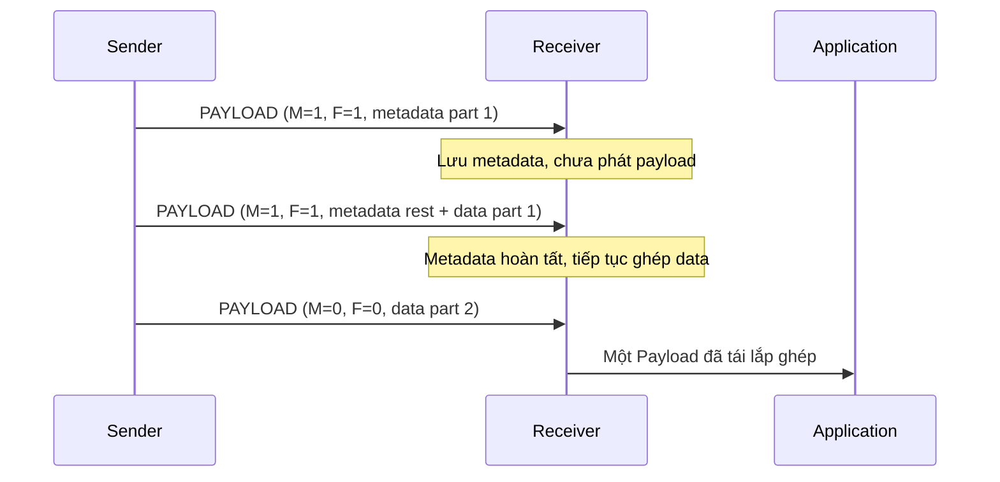

# Tái lắp ghép data, metadata và ranh giới thông điệp

RSocket truyền payload trong các frame có kích thước giới hạn. Khi một payload lớn hơn ngưỡng frame mà kết nối cho phép, sender có thể chia nó thành nhiều fragment để truyền qua TCP hoặc WebSocket. Ở đầu nhận, các fragment phải được ghép lại đúng thứ tự thành một payload logic trước khi ứng dụng giải mã hoặc xử lý.

Việc tái lắp ghép cần giữ riêng hai vùng `metadata` và `data`, nhận biết chính xác ranh giới của từng payload, đồng thời giới hạn bộ nhớ dành cho payload đang ghép. Nếu nhầm fragment với thông điệp độc lập, ứng dụng có thể giải mã dữ liệu chưa đầy đủ, xử lý trùng hoặc làm hỏng ranh giới giữa các message trong stream.

## 1. Vì sao RSocket cần fragmentation?

Mỗi RSocket frame có header và phần nội dung. Frame có giới hạn kích thước theo giao thức và có thể còn chịu giới hạn thấp hơn từ transport hoặc cấu hình của implementation. Một payload chứa file, ảnh, metadata lớn hoặc một object được tuần tự hóa có thể vượt quá ngưỡng đó.

Fragmentation chia một payload logic thành nhiều frame nhỏ hơn. Receiver nhận các frame theo thứ tự, tái lắp ghép chúng rồi mới đưa payload hoàn chỉnh lên tầng ứng dụng.

```text
Ứng dụng phía gửi
       |
       v
  Payload logic
  +-----------+----------------------+
  | metadata  |         data         |
  +-----------+----------------------+
       |
       v
  Chia thành các fragment
       |
       +---- Frame 1 (F=1) ---------->
       +---- Frame 2 (F=1) ---------->
       +---- Frame 3 (F=0) ---------->
                                      |
                                      v
                              Reassembly buffer
                                      |
                                      v
                              Payload hoàn chỉnh
                                      |
                                      v
                              Decoder / Handler
```

Fragmentation là cơ chế ở tầng protocol. Nó không làm thay đổi nội dung nghiệp vụ, không tự nén dữ liệu và không biến một payload lớn thành nhiều message ứng dụng.

## 2. Payload có hai vùng độc lập: metadata và data

Một RSocket `Payload` có hai vùng byte:

- **Metadata** mô tả hoặc điều khiển cách xử lý payload, ví dụ route, authentication metadata, tracing hoặc thông tin định tuyến.
- **Data** chứa nội dung nghiệp vụ, ví dụ JSON, CBOR, Protobuf, ảnh hoặc dữ liệu nhị phân.

Hai vùng được giải mã theo MIME type đã thống nhất khi thiết lập kết nối. Metadata và data không phải một chuỗi byte duy nhất. Khi tái lắp ghép, receiver phải giữ đúng ranh giới của chúng để decoder không đọc nhầm byte metadata thành data hoặc ngược lại.

Trong frame, cờ `M` cho biết fragment hiện tại có chứa metadata. Nếu `M` được bật, frame có trường độ dài metadata và phần metadata của fragment đó. Nếu `M` không bật, fragment hiện tại không mang metadata.

Ví dụ một payload có routing metadata và JSON data:

```text
Logical Payload
  metadata = route: devices.upload
  data     = {"fileId":"f-100","part":1,"content":"..."}
```

Khi payload bị chia nhỏ, receiver vẫn phải tái tạo được chính xác metadata route và toàn bộ JSON data như payload ban đầu.

## 3. Cờ F: nhận biết fragment còn tiếp

Trong các frame request và `PAYLOAD`, cờ `F` (*Follows*) cho biết còn fragment tiếp theo thuộc cùng payload logic hay không:

- `F = 1`: còn fragment của payload hiện tại ở phía sau.
- `F = 0`: fragment hiện tại là fragment cuối của payload đang được tái lắp ghép.

Ví dụ một payload data-only được chia thành ba fragment:

```text
PAYLOAD frame 1: F=1, data = bytes[0..999]
PAYLOAD frame 2: F=1, data = bytes[1000..1999]
PAYLOAD frame 3: F=0, data = bytes[2000..2499]

Sau frame 3:
reassembled data = bytes[0..2499]
```

`F = 0` chỉ kết thúc chuỗi fragment của payload hiện tại. Nó không tự có nghĩa là stream đã hoàn tất. Một stream có thể tiếp tục gửi payload logic tiếp theo trên cùng stream ID.

Với frame `PAYLOAD`, cần phân biệt thêm:

- `N` (*Next*) cho biết có một payload được phát tới subscriber.
- `C` (*Complete*) cho biết stream đã hoàn tất.
- `F` cho biết fragment của payload hiện tại còn tiếp hay không.

Các cờ này có mục đích khác nhau. Không dùng `F` để suy ra `onComplete`, và không dùng `N` để suy ra một payload đã được ghép xong nếu `F` vẫn còn bật.

## 4. Metadata phải được truyền hoàn tất trước data

Một quy tắc quan trọng của RSocket fragmentation là metadata phải được truyền đầy đủ trước data. Metadata có thể lớn hơn kích thước một frame và được chia qua nhiều fragment. Sender tiếp tục gửi các phần metadata cho đến khi metadata hoàn tất; sau đó mới bắt đầu gửi phần data.

Ví dụ một payload có 20 MB metadata và 25 MB data, được chia thành ba frame minh họa:

```text
Frame 1
  M = 1, F = 1
  16 MB metadata
  0 MB data

Frame 2
  M = 1, F = 1
  4 MB metadata còn lại
  12 MB data đầu tiên

Frame 3
  M = 0, F = 0
  13 MB data còn lại
```

Sau khi nhận frame 1, receiver chưa có metadata hoàn chỉnh và chưa thể giải mã metadata. Sau frame 2, metadata đã đủ 20 MB; phần data đã bắt đầu và có thể được nối tiếp từ frame này. Sau frame 3, receiver có đủ toàn bộ data và metadata để tạo payload logic.

Không giả định metadata chỉ xuất hiện trong frame đầu tiên. Nếu metadata lớn, nó có thể tiếp tục trong các fragment sau; cờ `M` thể hiện fragment hiện tại mang metadata. Khi metadata đã truyền hết, các fragment tiếp theo chỉ mang data và `M = 0`.

## 5. Tái lắp ghép PAYLOAD frame

Khi một `PAYLOAD` lớn cần fragmentation, sender gửi một chuỗi `PAYLOAD` frame trên cùng stream ID. Receiver dùng cờ `F` để biết chuỗi fragment đã kết thúc hay chưa.

Quy trình khái quát:

1. Nhận fragment đầu tiên và xác định stream ID.
2. Nếu `M = 1`, đọc metadata length và nối phần metadata của fragment vào vùng metadata đang ghép.
3. Chỉ sau khi metadata hoàn tất mới nối các byte data theo thứ tự.
4. Nếu `F = 1`, tiếp tục chờ fragment tiếp theo của cùng payload.
5. Khi nhận fragment cuối với `F = 0`, hoàn tất payload và chuyển đúng một payload logic lên tầng ứng dụng.
6. Giải phóng buffer và trạng thái reassembly sau khi payload đã được chuyển giao hoặc bị hủy.

Sơ đồ ví dụ:



Receiver không được gọi decoder JSON/CBOR/Protobuf sau từng fragment như thể fragment là một object độc lập. Decoder chỉ nhận vùng data hoàn chỉnh sau khi kết thúc chuỗi fragment. Tương tự, composite metadata chỉ được parse sau khi tất cả byte metadata đã được ghép.

## 6. Tái lắp ghép các REQUEST frame

Không chỉ `PAYLOAD` frame mới được phân mảnh. Các frame khởi tạo request cũng có thể lớn hơn ngưỡng frame, gồm:

- `REQUEST_RESPONSE`
- `REQUEST_FNF`
- `REQUEST_STREAM`
- `REQUEST_CHANNEL`

Khi một request frame cần fragmentation, frame đầu tiên vẫn giữ loại `REQUEST_*` tương ứng và bật `F = 1`. Các fragment tiếp theo được gửi bằng `PAYLOAD` frame trên cùng stream ID. Receiver phải ghép chúng thành payload của request ban đầu trước khi chuyển request tới handler.

Ví dụ request-response có metadata và data lớn:

```text
REQUEST_RESPONSE (M=1, F=1)
    metadata part 1

PAYLOAD (M=1, F=1)
    metadata part 2 + data part 1

PAYLOAD (M=0, F=0)
    data part 2

Sau reassembly:
    gọi handler request-response đúng một lần
```

Với request-channel, cần phân biệt payload mở channel với các message tiếp theo của channel. Nếu frame `REQUEST_CHANNEL` đầu tiên có `F = 1`, những `PAYLOAD` tiếp theo có thể là fragment tiếp nối của chính payload mở channel. Chỉ sau khi payload mở channel được ghép xong, các payload tiếp theo mới được hiểu là các phần tử tiếp theo của luồng input channel. Mỗi phần tử channel về sau cũng có thể cần fragmentation riêng.

Điều này giúp giữ đúng ranh giới message: một chuỗi fragment hoàn tất request ban đầu không được phát thành nhiều command riêng, và các message sau trong channel không được nối nhầm vào data của request đầu tiên.

## 7. Ranh giới payload khác ranh giới stream

Một stream có thể chứa nhiều payload logic. Mỗi payload logic có thể được truyền bằng một frame hoặc nhiều fragment. Vì vậy có ba khái niệm cần phân biệt:

| Khái niệm | Ý nghĩa |
| --- | --- |
| Frame | Đơn vị truyền trên transport, bị giới hạn kích thước |
| Fragment sequence | Một hoặc nhiều frame cùng tạo thành một payload logic |
| Stream | Chuỗi tương tác mang một hoặc nhiều payload logic theo interaction model |

Ví dụ một request-stream gửi ba kết quả, trong đó kết quả thứ hai lớn nên bị chia thành ba fragment:

```text
Stream ID = 7

PAYLOAD A (F=0)                 -> Message A
PAYLOAD B fragment 1 (F=1)     ->
PAYLOAD B fragment 2 (F=1)     -> Message B sau reassembly
PAYLOAD B fragment 3 (F=0)     ->
PAYLOAD C (F=0)                 -> Message C
COMPLETE                       -> Stream kết thúc
```

Ứng dụng nhận ba payload logic, không phải năm payload. Fragment cuối của Message B chỉ kết thúc việc ghép Message B; stream vẫn tiếp tục với Message C. `COMPLETE` hoặc tín hiệu hoàn tất tương ứng mới biểu thị kết thúc stream.

Đặc biệt với request-channel hoặc payload stream dài, receiver phải xử lý từng payload logic một cách độc lập. Đặc tả yêu cầu reassembly phải tính đến khả năng stream vô hạn. Không được đợi toàn bộ channel hoàn tất rồi mới gom tất cả message vào một danh sách trong bộ nhớ.

## 8. Fragmentation không thay đổi backpressure hoặc LEASE quota

Chia một payload thành nhiều fragment không làm tăng số quyền request hoặc số credit demand:

- Một payload logic bị chia thành nhiều `PAYLOAD` frame vẫn tiêu thụ một credit `request(n)` khi subscriber yêu cầu payload đó.
- Một request frame bị chia thành nhiều fragment vẫn tiêu thụ một request count LEASE duy nhất.
- Các fragment tiếp nối không phải request mới.

Ví dụ:

```text
LEASE request count = 2

REQUEST_RESPONSE lớn
  REQUEST_RESPONSE (F=1)
  PAYLOAD (F=1)
  PAYLOAD (F=0)
  -> tiêu thụ 1 lease request

PAYLOAD lớn trong một stream
  PAYLOAD (F=1)
  PAYLOAD (F=0)
  -> tiêu thụ 1 payload demand, không phải 2
```

Backpressure điều tiết số payload logic mà subscriber muốn nhận. Fragmentation chỉ chia cách truyền một payload logic thành các frame nhỏ. LEASE giới hạn số interaction mới được mở; fragmentation của request không tiêu thụ thêm quota.

## 9. Cấu hình fragmentation và giới hạn reassembly trong RSocket Java

Trong RSocket Java, `RSocketConnector.fragment(mtu)` cấu hình ngưỡng chia frame ở phía client. `RSocketServer.fragment(mtu)` cấu hình ngưỡng chia frame ở phía server. Mỗi phía cần cấu hình sender của mình để phát frame phù hợp với transport và cấu hình receiver của peer.

Ví dụ cấu hình ở client:

```java
int fragmentSize = 16 * 1024;
int maxInboundPayload = 32 * 1024 * 1024;

RSocketConnector connector = RSocketConnector.create()
        .fragment(fragmentSize)
        .maxInboundPayloadSize(maxInboundPayload);

Mono<RSocket> connection = connector.connect(transport);
```

Nếu dùng Spring `RSocketRequester`, có thể cấu hình connector bên dưới thông qua builder:

```java
RSocketRequester requester = RSocketRequester.builder()
        .rsocketConnector(connector -> connector
                .fragment(16 * 1024)
                .maxInboundPayloadSize(32 * 1024 * 1024))
        .tcp("localhost", 7000);
```

Builder vẫn quản lý codec và kết nối theo cấu hình Spring; callback `rsocketConnector` dùng để điều chỉnh các tùy chọn protocol như fragmentation. Nếu dùng WebSocket, thay `.tcp(...)` bằng `.websocket(uri)` theo API phiên bản Spring.

Ví dụ cấu hình ở server:

```java
int fragmentSize = 16 * 1024;
int maxInboundPayload = 32 * 1024 * 1024;

Mono<CloseableChannel> server = RSocketServer.create(acceptor)
        .fragment(fragmentSize)
        .maxInboundPayloadSize(maxInboundPayload)
        .bind(transport);
```

Các tên API ở ví dụ dựa trên RSocket Java 1.1.x; kiểu transport và kiểu trả về khi bind phụ thuộc module đang sử dụng. Khi tích hợp Spring Boot, hãy cấu hình `RSocketConnector` hoặc `RSocketServer` thông qua cơ chế customizer/connector mà phiên bản Spring hỗ trợ.

Hai cấu hình có ý nghĩa khác nhau:

- `fragment(mtu)` giới hạn kích thước frame phát ra trước khi cần chia nhỏ. MTU phải đủ lớn để chứa header và phần dữ liệu cần thiết; RSocket Java yêu cầu giá trị tối thiểu 64 byte.
- `maxInboundPayloadSize(size)` giới hạn kích thước payload logic sau khi tái lắp ghép. Giá trị này phải ít nhất bằng `Transport.maxFrameLength()` của transport để một frame hợp lệ không vượt quá giới hạn payload cấu hình.

Nếu không cấu hình `fragment(mtu)`, RSocket Java mặc định không chủ động chia payload theo MTU; payload được gửi nguyên vẹn trong giới hạn frame tối đa. Vì vậy, nếu ứng dụng cần truyền payload lớn hơn MTU mong muốn, hãy cấu hình fragmentation ở các sender tương ứng.

RSocket protocol giới hạn frame tối đa ở 16.777.215 byte. Transport hoặc implementation có thể đặt giới hạn thấp hơn. Vì vậy nên chọn MTU nhỏ hơn giới hạn frame thực tế, đồng thời đặt `maxInboundPayloadSize` theo kích thước payload nghiệp vụ lớn nhất mà hệ thống thực sự chấp nhận.

Nếu chỉ cấu hình fragment ở sender mà receiver có giới hạn inbound quá thấp, payload vẫn có thể bị từ chối khi reassembly. Cần kiểm tra cả hai chiều: client gửi payload tới server và server gửi payload tới client.

## 10. Giới hạn bộ nhớ và bảo vệ tài nguyên

Fragmentation giảm kích thước từng frame trên đường truyền, nhưng receiver vẫn cần đủ dữ liệu để tạo lại payload logic. Vì vậy một payload lớn vẫn có thể chiếm bộ nhớ đáng kể trong thời gian reassembly.

Các biện pháp cần áp dụng:

- Đặt `maxInboundPayloadSize` hữu hạn theo nhu cầu nghiệp vụ.
- Giới hạn kích thước metadata và data riêng nếu ứng dụng có yêu cầu khác nhau.
- Giới hạn số stream đang reassemble đồng thời và theo dõi tổng buffer đang sử dụng.
- Áp dụng timeout hoặc chính sách đóng kết nối cho chuỗi fragment bị treo quá lâu theo khả năng của implementation.
- Không giữ payload hoặc ByteBuf lâu hơn vòng đời xử lý cần thiết.
- Nếu dùng zero-copy payload decoder, quản lý retain/release đúng cách để tránh memory leak; nếu không cần tối ưu này, decoder mặc định dễ sử dụng hơn.
- Kiểm tra kích thước trước khi parse nội dung có cấu trúc hoặc giải nén dữ liệu.

Một payload 40 MB được chia thành hàng nghìn frame nhỏ vẫn cần khoảng 40 MB dữ liệu sau khi ghép, cộng thêm overhead của buffer và object. Fragmentation không thay thế giới hạn payload và không bảo vệ ứng dụng khỏi payload quá lớn.

## 11. Khi nào nên dùng application-level chunking?

RSocket fragmentation phù hợp khi ứng dụng muốn gửi một payload logic lớn và để protocol tự chia frame. Tuy nhiên, nếu dữ liệu rất lớn hoặc cần xử lý dần mà không giữ toàn bộ payload trong bộ nhớ, hãy chia dữ liệu ở cấp ứng dụng thành nhiều payload nhỏ trên request-stream hoặc request-channel.

Ví dụ tải file theo từng chunk:

```java
public record FileChunk(
        String transferId,
        int chunkIndex,
        boolean last,
        byte[] content
) {}
```

Mỗi `FileChunk` là một payload logic riêng. Receiver có thể ghi chunk ra file hoặc object storage ngay khi nhận, thay vì đợi ghép toàn bộ file trong RAM. Ứng dụng cần tự quản lý:

- `transferId` để phân biệt các lần truyền.
- `chunkIndex` để xác định vị trí và phát hiện thiếu hoặc trùng chunk.
- Kích thước chunk và giới hạn tổng kích thước file.
- Checksum để xác minh dữ liệu sau khi ghép.
- Cách retry, resume, deduplicate và xóa dữ liệu truyền dở.
- Tín hiệu kết thúc và xác nhận file đã được lưu hoàn chỉnh.

Không nhầm hai cơ chế: protocol fragmentation tạo nhiều frame nhưng vẫn là một payload; application-level chunking tạo nhiều payload logic và ứng dụng phải tự ghép nội dung nghiệp vụ.

## 12. Hủy chuỗi fragment và xử lý dữ liệu không hoàn chỉnh

Nếu sender không thể tiếp tục gửi một chuỗi fragment, sender có thể gửi `CANCEL` cho stream trước khi hoàn tất chuỗi. Receiver phải bỏ dữ liệu đang reassemble của interaction bị hủy và giải phóng buffer liên quan. Ứng dụng không được chuyển một payload thiếu fragment lên decoder hoặc handler.

Các tình huống cần xử lý:

- Kết nối bị đóng giữa chuỗi fragment.
- Sender gửi `CANCEL` trước fragment cuối.
- Kích thước reassembled payload vượt `maxInboundPayloadSize`.
- Fragment không đúng thứ tự hoặc không khớp stream đang reassemble.
- Metadata length hoặc frame length không hợp lệ.
- Một chuỗi fragment không hoàn tất trong thời gian dự kiến.

Hành vi cụ thể khi frame sai phụ thuộc implementation và phạm vi lỗi. Điều quan trọng ở tầng ứng dụng là không dùng dữ liệu chưa hoàn chỉnh, không để buffer tồn tại vô hạn và ghi nhận lỗi với stream/correlation context phù hợp.

## 13. Kiểm thử fragmentation và ranh giới message

Kiểm thử cần xác nhận byte metadata, byte data và số payload logic sau reassembly. Không chỉ kiểm tra rằng request cuối cùng không báo lỗi.

| Trường hợp | Điều cần xác minh |
| --- | --- |
| Payload nhỏ hơn MTU | Được truyền trong một frame, nội dung không đổi |
| Payload lớn hơn MTU | Có nhiều fragment và reassemble đúng một payload |
| Metadata-only | Metadata được ghép đủ, data rỗng vẫn hợp lệ theo hợp đồng |
| Data-only | Data được ghép đúng thứ tự |
| Metadata và data cùng lớn | Toàn bộ metadata được truyền trước data |
| Metadata kéo dài qua nhiều fragment | Không parse metadata trước khi hoàn tất |
| Request frame lớn | REQUEST_* đầu tiên cùng PAYLOAD continuation tạo một request logic |
| Nhiều payload trong stream | Mỗi chuỗi fragment tạo đúng một payload, không nối nhầm message kế tiếp |
| Request-channel | Payload mở channel được ghép riêng với các message tiếp theo |
| CANCEL giữa chuỗi | Payload dở bị bỏ và buffer được giải phóng |
| Payload vượt giới hạn | Receiver từ chối có kiểm soát |
| Nhiều stream đồng thời | Fragment của các stream không bị trộn lẫn |
| Backpressure / LEASE | Fragmentation không làm tăng payload demand hoặc request quota |

Ví dụ kiểm thử round-trip ở tầng ứng dụng:

```java
static Payload createPayload(byte[] data, byte[] metadata) {
    return DefaultPayload.create(data, metadata);
}

static void verifyReassembledPayload(
        Payload received,
        byte[] originalMetadata,
        byte[] originalData) {
    // Sau khi gửi payload qua RSocket đã bật fragmentation, peer nhận một Payload đã reassemble.
    assertThat(copyBytes(received.getMetadata())).containsExactly(originalMetadata);
    assertThat(copyBytes(received.getData())).containsExactly(originalData);
}

private static byte[] copyBytes(ByteBuffer source) {
    ByteBuffer view = source.asReadOnlyBuffer();
    byte[] result = new byte[view.remaining()];
    view.get(result);
    return result;
}
```

Đây là mã minh họa cho assertion; cần import `java.nio.ByteBuffer`, `io.rsocket.Payload`, `io.rsocket.util.DefaultPayload` và static `org.assertj.core.api.Assertions.assertThat`. Trong test thực tế cần giải phóng `Payload` theo vòng đời sở hữu và decoder đang dùng, đồng thời khởi chạy hai peer qua transport cần kiểm tra. Nên chạy test với cả TCP và WebSocket nếu ứng dụng hỗ trợ hai transport.

Ngoài round-trip, cần kiểm tra số lần handler được gọi. Một request logic bị chia thành năm fragment vẫn phải gọi handler một lần. Một stream có ba payload logic, trong đó payload thứ hai bị chia thành nhiều fragment, vẫn phải phát đúng ba payload lên subscriber.

## 14. Những nhầm lẫn thường gặp

**Mỗi fragment không phải một message ứng dụng.** Các frame có `F = 1` vẫn thuộc payload logic đang ghép. Chỉ sau fragment cuối mới chuyển payload hoàn chỉnh lên ứng dụng.

**`F = 0` không có nghĩa stream kết thúc.** Nó chỉ cho biết chuỗi fragment của payload hiện tại đã xong. Stream có thể tiếp tục với payload logic tiếp theo.

**Metadata không phải data.** Hai vùng được ghép và giải mã riêng. Metadata phải được truyền hoàn tất trước data.

**Fragmentation không làm payload nhỏ đi về tổng thể.** Nó chỉ chia frame. Receiver vẫn cần tài nguyên để tái lắp ghép payload logic.

**Request fragmentation không tạo thêm request.** Một request lớn bị chia thành nhiều frame vẫn tiêu thụ một quyền request và một lease count.

**Một channel vô hạn không thể được gom vào một buffer duy nhất.** Hãy reassemble từng payload logic, phát từng message và giữ buffer có giới hạn.

## 15. Checklist triển khai

- [ ] Xác định kích thước frame tối đa của transport và MTU phù hợp.
- [ ] Cấu hình fragmentation ở các sender có thể phát payload lớn.
- [ ] Cấu hình giới hạn inbound payload ở receiver.
- [ ] Ghép fragment theo stream ID và đúng thứ tự.
- [ ] Dùng cờ `F` để xác định fragment cuối của từng payload.
- [ ] Giữ metadata và data riêng; truyền metadata hoàn tất trước data.
- [ ] Với request fragmentation, ghép REQUEST_* ban đầu với PAYLOAD continuation trước khi gọi handler.
- [ ] Không giải mã hoặc xử lý từng fragment như message độc lập.
- [ ] Không nhầm fragment cuối với tín hiệu kết thúc stream.
- [ ] Xử lý CANCEL, kết nối đóng và payload vượt giới hạn để giải phóng buffer.
- [ ] Kết hợp fragmentation với backpressure và giới hạn số stream đồng thời.
- [ ] Dùng application-level chunking nếu cần xử lý dữ liệu rất lớn theo từng phần.
- [ ] Kiểm thử data, metadata, message boundary, request-channel và nhiều stream đồng thời.

RSocket fragmentation giúp truyền một payload lớn qua các frame có kích thước phù hợp mà vẫn giữ nguyên một message logic. Receiver cần ghép metadata và data theo đúng thứ tự, nhận biết fragment cuối bằng `F`, rồi chỉ chuyển payload hoàn chỉnh lên ứng dụng. Khi payload lớn đến mức không nên giữ toàn bộ trong bộ nhớ, hãy chuyển sang chia chunk ở cấp ứng dụng và xử lý từng message với giới hạn tài nguyên rõ ràng.

## Tài liệu tham khảo

- [RSocket Protocol — Fragmentation and Reassembly](https://rsocket.io/about/protocol/#fragmentation-and-reassembly)
- [RSocket Java `RSocketConnector` API](https://javadoc.io/doc/io.rsocket/rsocket-core/1.1.5/io/rsocket/core/RSocketConnector.html)
- [RSocket Java `RSocketServer` API](https://javadoc.io/doc/io.rsocket/rsocket-core/1.1.5/io/rsocket/core/RSocketServer.html)
