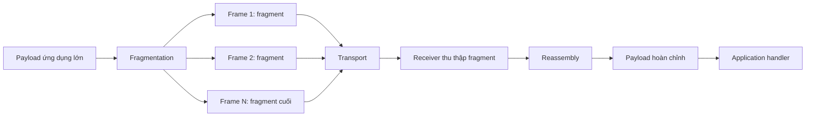

# Chi phí bộ nhớ, độ trễ và bảo vệ trước payload quá lớn

RSocket cho phép một payload được chia thành nhiều frame nhỏ hơn để truyền qua transport. Cơ chế fragmentation giúp một thông điệp lớn phù hợp với giới hạn frame của kết nối, nhưng không làm cho thông điệp đó tự động trở thành một luồng dữ liệu nhỏ và không bảo đảm ứng dụng tiêu thụ được từng mảnh ngay khi chúng đến. Trong nhiều triển khai, receiver phải thu thập và ghép các fragment trước khi chuyển payload hoàn chỉnh lên tầng ứng dụng.

Vì vậy, fragmentation giải quyết bài toán kích thước frame trên đường truyền; nó không thay thế giới hạn kích thước payload, backpressure, kiểm soát bộ nhớ hoặc thiết kế streaming ở tầng nghiệp vụ. Nếu ứng dụng gửi một file lớn dưới dạng một payload duy nhất, receiver vẫn có thể cần bộ nhớ cho toàn bộ payload sau khi ghép. Để bảo vệ dịch vụ realtime, cần tính đến số byte, số fragment, số thông điệp đang xử lý đồng thời, chi phí giải mã và tốc độ consumer.

## 1. Frame, payload và fragmentation

RSocket trao đổi các frame trên một transport như TCP hoặc WebSocket. Frame có header chứa thông tin như stream ID, loại frame và flags. Payload là nội dung ứng dụng được mang trong các frame tương tác; nó có thể gồm data và metadata.

Khi payload lớn hơn kích thước frame mà transport hoặc cấu hình cho phép, RSocket có thể chia payload thành nhiều fragment. Các fragment thuộc cùng một stream và được đánh dấu để receiver biết còn fragment tiếp theo hay đã đến mảnh cuối. Khi đã có đủ fragment, receiver ghép lại thành payload để chuyển cho tầng xử lý.



Ở mức khái niệm:

- **Payload:** thông điệp logic mà ứng dụng gửi hoặc nhận.
- **Frame:** đơn vị giao thức được đóng gói để truyền trên kết nối.
- **Fragment:** một phần của payload được mang trong frame.
- **Reassembly:** quá trình ghép các phần về payload logic ban đầu.
- **Maximum frame size / fragment size:** giới hạn kích thước frame hoặc fragment do transport/thư viện/cấu hình áp dụng.

Một payload logic có thể cần nhiều frame. Ngược lại, việc một payload vừa với frame không có nghĩa nó an toàn với bộ nhớ hoặc decoder của ứng dụng.

## 2. Fragmentation khác TCP segmentation và WebSocket fragmentation

Ba cơ chế có thể cùng xuất hiện nhưng nằm ở các tầng khác nhau:

| Cơ chế | Tầng | Mục đích | Ứng dụng thường nhìn thấy gì? |
|---|---|---|---|
| RSocket payload fragmentation | Giao thức RSocket | Chia một payload thành nhiều RSocket frame theo giới hạn fragment | Thư viện thường reassemble trước khi giao payload cho handler |
| TCP segmentation | Transport TCP/IP | Chia byte stream thành các TCP segment phù hợp với MTU, congestion và receive window | TCP ghép lại byte stream; ứng dụng không nhận ranh giới segment |
| WebSocket fragmentation | Giao thức WebSocket | Chia một WebSocket message thành nhiều WebSocket frame | WebSocket stack reassemble message theo quy tắc WebSocket |

TCP segmentation không thay thế RSocket fragmentation. TCP có thể chia một frame RSocket thành nhiều segment, nhưng frame RSocket vẫn có thể vượt giới hạn frame mà peer hoặc implementation chấp nhận. Tương tự, WebSocket fragmentation là cơ chế của WebSocket; nó không đồng nghĩa với việc RSocket payload được chia thành nhiều RSocket frame.

Khi phân tích packet capture, cần xác định tầng đang quan sát. Một TCP segment nhỏ không chứng minh payload RSocket đã được fragment. Một WebSocket message có nhiều frame cũng không tự cho biết RSocket đã tạo bao nhiêu payload fragment.

## 3. Fragmentation hoạt động ở mức giao thức

RSocket sử dụng cờ `F` (Follows) để cho biết còn fragment tiếp theo trong chuỗi fragment. Các frame mang fragment thuộc cùng stream; receiver theo dõi trạng thái ghép để biết khi nào payload đã hoàn chỉnh. Fragment cuối không báo còn phần tiếp theo.

Tùy loại interaction và vị trí của payload trong stream, fragment đầu tiên gắn với frame mở tương tác hoặc frame payload tương ứng; các phần tiếp theo tiếp tục mang phần còn lại. Ứng dụng nên để RSocket implementation xử lý định dạng fragment thay vì tự dựng hoặc tự ghép RSocket frame ở tầng handler.

Các điểm cần nhớ:

- Fragmentation không tạo ra nhiều request nghiệp vụ độc lập. Các mảnh vẫn thuộc một payload logic.
- Fragment không phải là chunk API mà handler có thể xử lý độc lập.
- Receiver cần đủ fragment để hoàn thành reassembly trước khi xử lý payload theo contract thông thường.
- Mất kết nối giữa chuỗi fragment có thể khiến payload không hoàn chỉnh; việc phục hồi phụ thuộc transport, session và khả năng resumption đã cấu hình.
- Giới hạn fragment size không đồng nghĩa có giới hạn tổng kích thước payload sau reassembly.

Không nên dựa vào việc receiver sẽ phát hiện mọi payload quá lớn trước khi cấp phát bộ nhớ. Một implementation có thể cần giữ các fragment hoặc buffer ghép trong lúc chờ phần còn lại. Cần cấu hình giới hạn ở tầng transport/protocol và kiểm tra thêm ở tầng ứng dụng.

## 4. Chi phí bộ nhớ của một payload lớn

Một payload lớn có thể tiêu thụ nhiều bộ nhớ hơn kích thước byte ban đầu. Tùy implementation và pipeline, hệ thống có thể đồng thời giữ:

- Buffer chứa fragment vừa nhận.
- Buffer reassembly cho payload hoàn chỉnh.
- ByteBuf hoặc DataBuffer được giữ bởi handler.
- Object Java tạo ra sau deserialize, có thể lớn hơn nhiều so với bytes đã mã hóa.
- Bản sao dữ liệu phát sinh khi chuyển đổi charset, giải nén, ánh xạ DTO hoặc ghi log.
- Buffer downstream đang chờ xử lý nếu producer nhanh hơn consumer.

Vì thế, không nên ước lượng heap chỉ bằng số byte trên mạng. Một JSON 2 MB có thể tạo ra nhiều object và chuỗi Java; một payload nén 2 MB có thể giải nén thành hàng trăm MB. Nếu nhiều request như vậy chạy đồng thời, áp lực bộ nhớ tăng nhanh.

Có thể dùng mô hình ước lượng đơn giản:

\[
M_{peak} \approx C \times (M_{fragments} + M_{reassembled} + M_{decoded} + M_{queued}) + M_{shared}
\]

Trong đó:

- `C` là số payload lớn đang được xử lý đồng thời.
- `M_fragments` là bộ nhớ giữ các fragment.
- `M_reassembled` là bộ nhớ của payload đã ghép.
- `M_decoded` là bộ nhớ của object sau giải mã.
- `M_queued` là dữ liệu đang chờ downstream xử lý.
- `M_shared` là bộ nhớ dùng chung như pool, cache và cấu trúc quản lý kết nối.

Đây là mô hình lập kế hoạch, không phải công thức đo chính xác cho mọi implementation. Zero-copy, pooled buffer hoặc decoder streaming có thể giảm một số bản sao; nhưng không nên giả định các tối ưu đó loại bỏ hoàn toàn chi phí reassembly và object allocation.

Ví dụ, 40 request đồng thời, mỗi request có payload 8 MB, riêng dữ liệu reassembled đã có thể cần khoảng 320 MB. Nếu mỗi request còn giữ buffer fragment, object đã deserialize và queue downstream, mức heap thực tế có thể cao hơn đáng kể.

## 5. Chi phí độ trễ và thông lượng

Fragmentation làm một payload logic trở thành nhiều frame. Mỗi frame có header và chi phí xử lý riêng. Với payload có kích thước `P` và dung lượng fragment hữu dụng trung bình `F`, số fragment xấp xỉ:

\[
N = \left\lceil \frac{P}{F} \right\rceil
\]

Dung lượng `F` nhỏ hơn giới hạn frame tổng vì frame còn header, metadata và các trường giao thức. Giá trị thực tế phụ thuộc cấu hình và implementation.

Tác động có thể gồm:

- Nhiều header và lần xử lý frame hơn.
- Nhiều lần ghi/đọc hoặc callback transport hơn.
- Reassembly phải chờ đủ mảnh trước khi handler nhận payload hoàn chỉnh.
- Bộ nhớ bị giữ lâu hơn nếu fragment đến chậm hoặc kết nối có jitter.
- Một stream có payload lớn có thể cạnh tranh tài nguyên với các stream khác trên cùng connection.

Fragmentation không nhất thiết làm tổng số byte payload tăng nhiều, nhưng overhead frame tăng theo số fragment. Nếu fragment quá nhỏ, overhead và số lần xử lý tăng. Nếu fragment quá lớn, có thể vượt giới hạn transport hoặc tạo buffer lớn. Hãy chọn kích thước dựa trên benchmark, đặc tính mạng và giới hạn của implementation.

Độ trễ của payload lớn còn phụ thuộc băng thông, round-trip, congestion, tốc độ consumer và thời gian reassembly. Ngay cả khi các fragment được truyền liên tục, ứng dụng có thể chỉ nhận payload sau khi fragment cuối đến. Nếu cần xử lý từng phần ngay khi nhận, hãy thiết kế stream gồm nhiều message nhỏ ở tầng ứng dụng.

## 6. Fragmentation không phải application-level streaming

Đây là khác biệt quan trọng nhất khi gửi file, video, ảnh lớn hoặc dữ liệu nhị phân.

| Tiêu chí | RSocket fragmentation | Application chunking / streaming |
|---|---|---|
| Đơn vị | Một payload được chia thành frame | Nhiều payload nghiệp vụ độc lập |
| Handler | Thường nhận payload sau reassembly | Có thể xử lý từng chunk khi đến |
| Bộ nhớ | Có thể cần buffer toàn payload | Có thể giới hạn bộ nhớ theo chunk/window |
| Backpressure | Áp dụng theo interaction và demand ở tầng protocol | Có thể điều khiển từng message/chunk bằng Reactive Streams demand |
| Phục hồi | Phục hồi frame/phiên nếu resumption hỗ trợ | Có thể tiếp tục theo transfer ID, sequence hoặc offset do ứng dụng quản lý |
| Kiểm tra tính toàn vẹn | Theo payload logic hoặc transport | Có thể kiểm tra checksum từng chunk và checksum toàn bộ file |

Nếu một file 200 MB được gửi dưới dạng một payload duy nhất, fragmentation chỉ chia payload thành nhiều frame để truyền. Receiver vẫn có thể phải ghép lại 200 MB trước khi handler xử lý. Nếu ứng dụng chia file thành các chunk 256 KB và gửi thành một stream, server có thể ghi từng chunk xuống storage, xác nhận tiến độ và giới hạn số chunk đang chờ.

Với dữ liệu lớn, hãy ưu tiên application-level streaming khi:

- Payload có thể lớn hơn ngân sách bộ nhớ của một request.
- Muốn hiển thị tiến độ hoặc xác nhận từng phần.
- Cần resume upload/download từ offset đã lưu.
- Muốn giới hạn concurrency và buffer theo số chunk.
- Cần kiểm tra checksum, sequence hoặc quyền truy cập theo từng phần.

## 7. Thiết kế chunk protocol ở tầng ứng dụng

Một chunk nên mang đủ thông tin để server xác định nó thuộc transfer nào, vị trí nào và có phải chunk cuối không. Ví dụ:

```java
public record UploadChunk(
    UUID transferId,
    long sequence,
    long offset,
    boolean last,
    byte[] content,
    String checksum
) {}
```

Một protocol upload cần định nghĩa:

- **Transfer ID:** định danh duy nhất của phiên upload nghiệp vụ.
- **Sequence/offset:** phát hiện chunk trùng, thiếu hoặc sai thứ tự.
- **Chunk size limit:** giới hạn bytes tối đa của từng chunk.
- **Total size:** tổng kích thước dự kiến, nếu biết trước.
- **Checksum:** xác minh chunk và/hoặc toàn bộ nội dung.
- **Completion:** dấu hiệu kết thúc và điều kiện để công bố file hoàn chỉnh.
- **Resume:** cách client tiếp tục từ offset đã được server xác nhận.
- **Expiry/cleanup:** dọn dữ liệu tạm khi client bỏ dở hoặc transfer hết hạn.

Ví dụ request-channel trong Spring RSocket cho upload có phản hồi tiến độ:

```java
@Controller
public class UploadController {
    private final UploadService uploadService;

    public UploadController(UploadService uploadService) {
        this.uploadService = uploadService;
    }

    @MessageMapping("files.upload")
    public Flux<UploadAck> upload(@Payload Flux<UploadChunk> chunks) {
        return chunks.concatMap(uploadService::acceptChunk);
    }
}
```

Client gửi các chunk và nhận acknowledgment:

```java
Flux<UploadAck> acknowledgements = requester
    .route("files.upload")
    .data(uploadChunks)
    .retrieveFlux(UploadAck.class);
```

Ví dụ dùng `concatMap` để xử lý tuần tự và giữ thứ tự chunk. Nếu cần ghi song song, phải giới hạn concurrency và thiết kế storage để xử lý offset/out-of-order một cách an toàn. Không dùng `flatMap` không giới hạn cho hàng nghìn chunk đang chờ.

Với download, client có thể gửi một request mô tả file rồi nhận `Flux<DownloadChunk>` qua request-stream. Như vậy, server phát từng chunk và client ghi dần ra file thay vì đợi một payload duy nhất hoàn chỉnh.

## 8. Backpressure không thay thế giới hạn byte

RSocket `REQUEST_N` điều tiết số payload được phép phát trên một stream. Nó không giới hạn số byte của mỗi payload. Một demand 10 có thể cho phép nhận 10 payload rất nhỏ hoặc 10 payload cực lớn.

Hãy kết hợp nhiều lớp bảo vệ:

| Lớp | Giới hạn nên có | Ví dụ |
|---|---|---|
| Frame/transport | Kích thước frame tối đa | Max frame/fragment size của transport và RSocket implementation |
| Payload logic | Tổng bytes của một message sau reassembly | Max inbound payload bytes |
| Metadata | Tổng bytes và số entry | Max metadata bytes, max entry count |
| Application chunk | Kích thước mỗi chunk và tổng transfer | 256 KB mỗi chunk, 200 MB mỗi transfer (giá trị minh họa) |
| Reactive pipeline | Demand, prefetch và concurrency | `limitRate`, `flatMap` có giới hạn |
| Connection/user | Số stream, request và byte theo thời gian | Quota theo principal hoặc tenant |
| Process | Tổng bộ nhớ và số tác vụ đang hoạt động | Bounded queue, admission control |

Không nên chỉ dựa vào `REQUEST_N` để bảo vệ heap. Cũng không nên chỉ giới hạn frame size rồi cho phép tổng payload không giới hạn: attacker có thể gửi rất nhiều fragment để buộc receiver giữ buffer lớn.

## 9. Bảo vệ trước payload quá lớn và dữ liệu độc hại

Payload lớn có thể đến từ client hợp lệ gửi file lớn, client lỗi cấu hình hoặc hành vi tấn công. Server cần kiểm tra cả kích thước và chi phí giải mã.

### Giới hạn trước khi deserialize

Đặt max frame size ở transport/protocol layer để từ chối frame vượt giới hạn sớm. Đặt max reassembled payload size nếu implementation hỗ trợ. Sau khi payload đến tầng ứng dụng, kiểm tra riêng kích thước data và metadata trước khi chuyển sang cấu trúc nghiệp vụ hoặc lưu trữ.

Kiểm tra sau deserialize có thể đã quá muộn để ngăn decoder cấp phát bộ nhớ. Với JSON, CBOR hoặc serializer khác, cần giới hạn kích thước đầu vào, độ sâu lồng nhau, số phần tử collection và độ dài string ngay ở decoder nếu thư viện hỗ trợ.

### Giới hạn metadata

Metadata thường nhỏ nhưng có thể bị lợi dụng để gửi rất nhiều entry, route dài, token lớn hoặc cấu trúc lồng sâu. Hãy đặt giới hạn bytes, số entry và độ dài từng trường. Chỉ giải mã MIME type được hỗ trợ; từ chối dữ liệu sai định dạng.

### Cẩn trọng với compression

Nén giảm bytes truyền qua mạng nhưng dữ liệu giải nén có thể lớn hơn rất nhiều. Đây là rủi ro decompression bomb. Cần giới hạn kích thước sau giải nén, tỷ lệ nén, thời gian CPU và số tác vụ giải nén đồng thời. Không tin kích thước do client khai báo; đo số bytes thực tế khi giải nén.

### Admission control và quota

Giới hạn số payload lớn đang reassemble đồng thời, tổng byte buffer theo connection/principal và số transfer đang hoạt động. Nếu vượt quota, từ chối sớm hoặc áp dụng backpressure có giới hạn. Không giữ vô hạn request trong hàng đợi chờ bộ nhớ.

### Xác thực và phân quyền

Xác thực peer trước khi cho phép upload hoặc xử lý nội dung đắt đỏ. Kiểm tra quyền trên route và tài nguyên đích. Tenant ID hoặc transfer ID do client gửi không tự chứng minh client có quyền ghi vào tài nguyên đó.

## 10. Kiểm tra kích thước ở tầng ứng dụng

Ví dụ dưới đây minh họa kiểm tra kích thước trên một DTO đã được giải mã. Nó là lớp kiểm tra bổ sung; giới hạn frame và giới hạn decoder vẫn cần được đặt ở tầng thấp hơn để ngăn cấp phát quá lớn trước khi handler chạy.

```java
public final class PayloadLimits {
    public static final int MAX_COMMAND_BYTES = 256 * 1024;
    public static final int MAX_METADATA_BYTES = 16 * 1024;

    private PayloadLimits() {}

    public static void validate(byte[] data, byte[] metadata) {
        if (data != null && data.length > MAX_COMMAND_BYTES) {
            throw new PayloadTooLargeException("Command payload is too large");
        }

        if (metadata != null && metadata.length > MAX_METADATA_BYTES) {
            throw new PayloadTooLargeException("Metadata is too large");
        }
    }
}
```

Các giới hạn 256 KB và 16 KB chỉ là giá trị ví dụ. Hãy chọn ngưỡng riêng cho từng route và loại dữ liệu. Một route tìm trạng thái thiết bị có thể chỉ cần vài KB; route upload chunk có thể cho phép vài trăm KB; một transfer lớn phải được chia thành nhiều chunk thay vì nới giới hạn payload đơn lên hàng trăm MB.

Khi từ chối payload quá lớn, trả lỗi có mã rõ ràng theo contract, chẳng hạn `PAYLOAD_TOO_LARGE`. Không trả stack trace hoặc thông tin nội bộ cho client. Ghi metric về route, principal đã được xác thực, kích thước thực tế và lý do từ chối; tránh ghi nội dung payload nhạy cảm.

## 11. Giữ bộ nhớ bounded trong pipeline

Ngay cả khi payload riêng lẻ đã có giới hạn, nhiều request đồng thời vẫn có thể làm cạn bộ nhớ. Cần quản lý concurrency và queue ở các tầng:

- Giới hạn số upload đang chạy trên mỗi user/tenant và toàn process.
- Giới hạn số chunk đang được xử lý đồng thời.
- Dùng `concatMap` khi cần tuần tự; dùng `flatMap(mapper, concurrency)` khi có thể chạy song song với giới hạn rõ ràng.
- Tránh `collectList()` hoặc `join` toàn bộ chunk thành một `byte[]` lớn nếu mục tiêu là streaming.
- Ghi chunk xuống file/object storage sớm, giải phóng buffer sau khi xử lý và chỉ giữ metadata tiến độ cần thiết.
- Đặt timeout cho thời gian chờ chunk tiếp theo và expiry cho transfer bỏ dở.
- Khi client hủy hoặc connection mất, dừng subscription và dọn tài nguyên tạm theo chính sách.

Ví dụ giới hạn concurrency khi xử lý chunk:

```java
Flux<UploadAck> acknowledgements = chunks
    .flatMap(uploadService::acceptChunk, 4);
```

Ở đây tối đa bốn lời gọi `acceptChunk` được xử lý đồng thời. Chỉ dùng kiểu song song nếu service bảo đảm ghi đúng offset, xử lý chunk trùng và bảo toàn tính toàn vẹn. Nếu cần thứ tự tuyệt đối, dùng `concatMap` hoặc một cơ chế sắp xếp/commit theo sequence.

Không nên dựa vào việc Netty dùng pooled ByteBuf để cho phép giữ buffer tùy ý. Buffer pool giảm chi phí cấp phát nhưng không làm bộ nhớ trở nên vô hạn; giữ reference quá lâu vẫn làm pool cạn và gây áp lực lên process.

## 12. Xử lý lỗi, cancellation và dữ liệu chưa hoàn chỉnh

Một chuỗi fragment không hoàn chỉnh không phải payload nghiệp vụ hợp lệ. Nếu transport mất giữa chừng, RSocket implementation có thể báo lỗi stream/connection hoặc xử lý theo resumption nếu phiên còn phục hồi được. Ứng dụng không nên tự coi phần bytes đã nhận là một payload hoàn chỉnh.

Với application-level chunking, server cần quản lý transfer state:

- Chunk sai checksum: từ chối chunk và cho phép gửi lại theo quy tắc.
- Chunk trùng sequence: trả acknowledgment idempotent nếu nội dung giống; từ chối nếu nội dung khác.
- Thiếu sequence hoặc offset: yêu cầu gửi lại hoặc ghi vào vùng tạm có giới hạn.
- Transfer hết hạn: dọn file tạm và metadata.
- Client hủy: ngừng nhận chunk, đánh dấu transfer tạm dừng hoặc hủy theo contract.
- Chunk cuối: chỉ công bố file hoàn chỉnh sau khi kiểm tra tổng kích thước và checksum toàn bộ.

Cancellation không tự xóa các tác dụng phụ đã commit. Nếu server đã ghi một phần dữ liệu xuống storage, cần biết phần nào đã được xác nhận và có thể tiếp tục từ offset nào. Dùng transfer ID cùng sequence/offset để tránh ghi lặp hoặc bỏ sót dữ liệu khi resume ở tầng ứng dụng.

## 13. Quan sát và kiểm thử tải

Theo dõi cả protocol và application streaming:

- Kích thước payload trước/sau giải nén và kích thước metadata.
- Số fragment trên mỗi payload, nếu implementation cung cấp metric.
- Thời gian từ fragment đầu đến fragment cuối và thời gian reassembly.
- Số payload lớn đang hoạt động, tổng byte buffer và số lần từ chối do vượt giới hạn.
- Heap usage, direct memory, pooled buffer usage và allocation rate.
- Số upload/download đang chạy, số chunk outstanding và queue depth.
- Tỷ lệ timeout, cancellation, checksum failure, retry và transfer hết hạn.
- Latency p50/p95/p99 và throughput theo route, loại payload và kích thước.

Các bài kiểm thử nên bao gồm:

1. Payload nhỏ vừa trong một frame.
2. Payload lớn buộc phải fragmentation và được reassemble chính xác.
3. Payload vượt max frame hoặc max reassembled payload bị từ chối.
4. Nhiều payload lớn đồng thời để đo peak heap/direct memory.
5. Consumer chậm để xác minh demand và buffer không tăng vô hạn.
6. Metadata quá lớn hoặc có quá nhiều entry.
7. Payload nén có tỷ lệ giải nén bất thường.
8. Ngắt kết nối giữa các fragment và kiểm tra hành vi lỗi/resumption.
9. Upload chunk sai thứ tự, trùng sequence, sai checksum và thiếu chunk cuối.
10. Client hủy transfer và server dọn tài nguyên đúng hạn.

Đo cả warm-up và tải kéo dài. Một bài test gửi một payload lớn rồi kết thúc chưa bộc lộ memory leak do buffer chưa được release hoặc transfer tạm chưa được dọn. Với Netty, nên quan sát cả heap và direct memory vì ByteBuf có thể sử dụng bộ nhớ ngoài heap.

## 14. Quy tắc thiết kế

1. Dùng RSocket fragmentation để phù hợp giới hạn frame; không xem nó là application-level streaming.
2. Đặt giới hạn frame, payload sau reassembly và metadata riêng biệt.
3. Ước lượng peak memory theo số request đồng thời, fragment, payload đã ghép, object decode và queue downstream.
4. Dùng request-stream/request-channel với chunk nghiệp vụ cho file hoặc dữ liệu lớn cần xử lý từng phần.
5. Thiết kế transfer ID, sequence/offset, checksum, acknowledgment và expiry cho chunk protocol.
6. Dùng `REQUEST_N` để điều tiết số payload, đồng thời giới hạn byte, concurrency và buffer.
7. Giới hạn dữ liệu sau giải nén và độ phức tạp của decoder.
8. Giải phóng buffer, xử lý cancellation và dọn transfer dở dang.
9. Đo heap, direct memory, reassembly latency và số fragment dưới tải thực tế.
10. Từ chối payload vượt giới hạn sớm với mã lỗi ổn định và log an toàn.

Fragmentation giúp RSocket truyền một payload lớn qua các frame có kích thước phù hợp, nhưng receiver vẫn có thể phải giữ và ghép toàn bộ payload trước khi ứng dụng xử lý. Muốn kiểm soát bộ nhớ và độ trễ, cần giới hạn payload logic, số request đồng thời, metadata, decoder và buffer. Với dữ liệu rất lớn, application-level chunking kết hợp request-stream hoặc request-channel, backpressure và kiểm tra tính toàn vẹn là lựa chọn phù hợp hơn.
