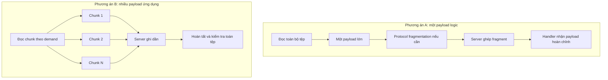

# Lựa chọn giữa một payload lớn và một luồng nhiều phần tử

Khi truyền một tệp, ảnh, tài liệu hoặc tập dữ liệu qua RSocket, ứng dụng có thể gửi toàn bộ nội dung trong một payload hoặc chia nội dung thành nhiều phần tử của một stream. Hai cách này nhìn bề ngoài đều có thể tạo ra nhiều frame trên mạng, nhưng ý nghĩa ở tầng ứng dụng rất khác nhau.

RSocket có cơ chế **protocol fragmentation** để chia một payload logic lớn thành nhiều frame khi cần. Runtime ghép các fragment lại trước khi chuyển payload hoàn chỉnh cho ứng dụng. Cách này giúp một payload vượt giới hạn frame có thể đi qua kết nối, nhưng không biến nó thành một stream phần tử nhỏ để ứng dụng xử lý dần.

Ngược lại, **application-level chunking** chia dữ liệu thành nhiều payload độc lập. Mỗi chunk có thể được xử lý, xác nhận, lưu hoặc hủy riêng; demand và backpressure điều tiết số phần tử stream được truyền. Lựa chọn phù hợp phụ thuộc kích thước dữ liệu, giới hạn bộ nhớ, độ trễ, khả năng phục hồi và việc ứng dụng có cần tiến độ từng phần hay không.

## 1. Hai cách truyền dữ liệu

Giả sử client cần tải lên một tệp 40 MiB.

**Một payload lớn:** client đọc toàn bộ tệp thành một mảng byte, đóng gói vào một payload và gửi bằng request-response. Nếu payload vượt kích thước fragment cho phép, RSocket runtime có thể chia nó thành nhiều frame và ghép lại ở phía nhận. Ứng dụng server chỉ nhận được payload logic khi việc ghép hoàn tất.

**Một stream nhiều phần tử:** client đọc tệp thành các chunk, ví dụ mỗi chunk 64 KiB, rồi phát lần lượt trong một request-channel. Server nhận và ghi từng chunk, đồng thời trả về tiến độ hoặc acknowledgement. Client không cần giữ toàn bộ tệp trong heap nếu nguồn đọc và pipeline đều phát theo demand.



Điểm cần nhớ: nhiều frame ở phương án A vẫn có thể chỉ là các mảnh của **một payload**. Ở phương án B, mỗi chunk là **một payload riêng** trong stream.

## 2. Protocol fragmentation không giống application chunking

### 2.1. Protocol fragmentation

RSocket truyền dữ liệu bằng frame. Khi một payload logic lớn hơn kích thước fragment tối đa được cấu hình, implementation có thể chia payload đó thành nhiều fragment. Cờ `FOLLOWS` cho biết payload còn fragment tiếp theo; fragment cuối không đặt cờ này. Receiver ghép các phần theo đúng thứ tự rồi mới đưa payload hoàn chỉnh lên tầng ứng dụng.

Đối với ứng dụng, đây vẫn là một request hoặc một phần tử stream. Handler không nhận từng fragment để xử lý độc lập. Ví dụ, một request-response chứa payload 40 MiB có thể được truyền qua nhiều frame, nhưng method xử lý request vẫn nhận một đối tượng chứa toàn bộ nội dung sau khi reassembly.

Protocol fragmentation hữu ích khi một thông điệp logic cần giữ nguyên tính đơn nhất nhưng không vừa một frame. Nó giúp tránh yêu cầu mọi payload phải nằm gọn trong một frame đơn lẻ. Tuy nhiên, phía nhận vẫn cần đủ bộ nhớ hoặc cơ chế lưu trữ để ghép payload; fragment không tự động làm giảm footprint của toàn bộ thông điệp.

Kích thước fragment tối đa, giới hạn frame và giới hạn payload đầu vào cần được cấu hình theo implementation và transport đang dùng. Không nên giả định mọi thư viện có cùng giá trị mặc định hoặc mọi proxy đều chấp nhận frame lớn. Nếu payload vượt giới hạn mà runtime hoặc hạ tầng cho phép, request có thể bị từ chối hoặc connection bị đóng.

### 2.2. Application-level chunking

Application chunking chia tệp thành các payload độc lập. Ví dụ, tệp 40 MiB được chia thành 640 chunk 64 KiB. Mỗi chunk có thể mang `transferId`, số thứ tự, offset, độ dài và checksum riêng.

Vì mỗi chunk là một payload riêng:

- Consumer có thể ghi chunk vào file hoặc object storage ngay khi nhận.
- Stream có thể dùng demand để giới hạn số chunk đang truyền.
- Ứng dụng có thể báo tiến độ sau từng chunk hoặc theo batch.
- Khi lỗi, ứng dụng có thể biết chunk nào đã được nhận và quyết định tiếp tục từ offset đã lưu.
- Client có thể hủy transfer mà không phải đợi toàn bộ tệp được reassemble ở server.

Đổi lại, ứng dụng phải quản lý thứ tự, duplicate, offset, checksum, trạng thái transfer, timeout và dọn dữ liệu dở dang. Đây là trách nhiệm ở tầng nghiệp vụ, không được RSocket tự cung cấp chỉ vì dữ liệu được chia nhỏ.

## 3. So sánh một payload lớn với stream nhiều phần tử

| Tiêu chí | Một payload lớn | Stream nhiều payload nhỏ |
|---|---|---|
| Mô hình ứng dụng | Một thông điệp logic | Nhiều phần tử độc lập trong stream |
| Xử lý ở phía nhận | Thường cần reassemble và decode toàn bộ payload trước khi xử lý | Có thể xử lý và lưu từng phần tử |
| Bộ nhớ | Có thể cần giữ toàn bộ payload ở sender, receiver và codec; fragmentation vẫn cần reassembly | Có thể giữ một số chunk đang in-flight và buffer có giới hạn |
| Độ trễ phần tử đầu tiên | Chỉ có dữ liệu sau khi payload hoàn chỉnh được nhận/ghép | Có thể xử lý chunk đầu tiên trước khi toàn bộ tệp đến |
| Backpressure | Demand tính theo payload logic; một payload rất lớn vẫn là một phần tử | Demand điều tiết số chunk; kích thước chunk cần được giới hạn riêng |
| Overhead protocol | Ít payload logic và ít metadata chunk lặp lại | Nhiều payload logic và metadata chunk hơn; số frame header phụ thuộc kích thước chunk |
| Tiến độ | Thường chỉ có trạng thái tổng thể | Có thể báo tiến độ theo chunk/offset |
| Retry | Thường gửi lại toàn bộ payload hoặc dùng cơ chế riêng | Có thể retry chunk/đoạn nếu có checkpoint và idempotency |
| Hủy | Hủy request/stream; dữ liệu đã reassemble có thể đã chiếm bộ nhớ | Có thể dừng sớm và giải phóng chunk/buffer đang chờ |
| Độ phức tạp | Thấp hơn nếu payload có kích thước vừa phải | Cao hơn do phải quản lý transfer và tính toàn vẹn |
| Trường hợp phù hợp | Blob nhỏ/vừa, snapshot, thông điệp cần xử lý nguyên khối | Tệp lớn, dữ liệu liên tục, upload/download dài hoặc xử lý incremental |

Không có ngưỡng byte duy nhất áp dụng cho mọi hệ thống. Quyết định phụ thuộc heap giới hạn, số transfer đồng thời, codec, giới hạn fragment, băng thông và cách xử lý dữ liệu ở server.

## 4. Backpressure khác nhau ra sao?

RSocket flow control dựa trên số payload mà consumer yêu cầu, không dựa trực tiếp trên tổng số byte. Trong request-stream hoặc request-channel, `initialRequestN` và `REQUEST_N` điều tiết số payload logic được phát.

Với một payload lớn được fragmentation thành nhiều frame, ứng dụng vẫn đang gửi một payload logic. Demand không biến từng fragment thành một phần tử ứng dụng riêng. Do đó, consumer có thể chỉ yêu cầu một payload nhưng payload đó vẫn chiếm hàng chục MiB sau khi reassembly.

Với stream nhiều chunk, mỗi chunk là một payload. Nếu chunk có kích thước tối đa cố định, demand giúp giới hạn gần đúng lượng dữ liệu đang in-flight. Ví dụ, nếu consumer cho phép tối đa 4 chunk 64 KiB đang được xử lý, phần dữ liệu chunk tương ứng khoảng 256 KiB, chưa tính codec, queue, network buffer và object overhead.

Vì demand đếm phần tử, vẫn phải đặt giới hạn kích thước mỗi chunk. Nếu một chunk có thể chứa 20 MiB, demand 4 có thể cho phép khoảng 80 MiB dữ liệu payload cùng lúc. Hãy kết hợp:

- Giới hạn số payload được yêu cầu.
- Giới hạn byte tối đa của từng payload/chunk.
- Giới hạn tổng byte đang in-flight hoặc buffer.
- Giới hạn số transfer đồng thời trên mỗi client/tenant.
- Chính sách overflow hoặc từ chối khi vượt quota.

Trong request-channel upload, server là consumer của các chunk client gửi lên và gửi `REQUEST_N` để điều tiết số chunk client được phát. Server đồng thời là producer của các thông điệp tiến độ; client khai báo demand ban đầu cho luồng phản hồi bằng `initialRequestN` và gửi `REQUEST_N` tiếp theo khi cần thêm tiến độ. Hai hướng demand độc lập. Một chunk ứng dụng cũng có thể cần protocol fragmentation nếu chính chunk đó vượt fragment size đã cấu hình.

### 4.1. Ước lượng bộ nhớ

Gọi \(P\) là kích thước payload logic, \(C\) là kích thước chunk tối đa và \(D\) là số chunk được demand/in-flight đồng thời.

Với một payload lớn, sender và receiver có thể cần giữ bộ nhớ tỷ lệ với toàn bộ payload:

\[
M_{large} = O(P)
\]

Trong thực tế peak memory có thể cao hơn \(P\) do bản sao khi serialize, reassembly, decode và buffer transport.

Với chunking và pipeline được giới hạn, phần dữ liệu chunk đang chờ có thể được ước lượng:

\[
M_{chunks} \approx D \times C + M_{processing} + M_{buffers}
\]

Ví dụ với \(D=4\) và \(C=64\text{ KiB}\), lượng chunk đang chờ khoảng 256 KiB trước khi tính overhead. Đây là lợi ích chỉ đạt được khi nguồn đọc file phát theo demand và server ghi dần; nếu client đọc toàn bộ tệp rồi tạo một `List<Chunk>`, ứng dụng vẫn giữ gần như toàn bộ dữ liệu trong heap.

## 5. Khi nào chọn một payload lớn?

Một payload lớn phù hợp khi:

- Dữ liệu có kích thước nhỏ hoặc vừa và nằm trong giới hạn bộ nhớ an toàn.
- Server cần toàn bộ nội dung trước khi thực hiện validation hoặc xử lý nguyên khối.
- Thông điệp cần được xác thực và commit như một đơn vị.
- Không cần tiến độ từng phần hoặc khôi phục từ offset.
- Số request đồng thời đủ thấp để tổng memory footprint có thể dự đoán.

Ví dụ, client gửi một ảnh avatar đã resize, một JSON snapshot vài trăm KiB hoặc một tài liệu nhỏ để server kiểm tra và lưu trong một transaction. Nếu payload vượt fragment size, runtime có thể fragmentation rồi reassemble; application code vẫn đơn giản.

### 5.1. Ví dụ request-response

```java
public record SingleFilePayload(
    String transferId,
    String fileName,
    byte[] content,
    String sha256
) {}

public record UploadReceipt(
    String transferId,
    String storageKey,
    String status
) {}
```

Server xử lý toàn bộ payload:

```java
@Controller
class FileController {

    private final FileService fileService;

    FileController(FileService fileService) {
        this.fileService = fileService;
    }

    @MessageMapping("files.upload.single")
    Mono<UploadReceipt> upload(SingleFilePayload payload) {
        return fileService.validateAndStore(payload);
    }
}
```

Client gọi request-response:

```java
Mono<UploadReceipt> receipt = requester
    .route("files.upload.single")
    .data(payload)
    .retrieveMono(UploadReceipt.class);
```

Đoạn code giả định codec của ứng dụng hỗ trợ kiểu payload. Nếu dùng JSON, `byte[]` có thể được biểu diễn bằng Base64 và làm tăng kích thước dữ liệu. Với binary lớn, hãy cân nhắc codec nhị phân phù hợp và đo kích thước sau serialization, không chỉ kích thước file gốc.

## 6. Khi nào chọn stream nhiều phần tử?

Stream nhiều chunk phù hợp khi:

- Tệp hoặc tập dữ liệu lớn hơn mức nên giữ trong heap một lần.
- Server có thể ghi, parse hoặc xử lý từng phần tử.
- Cần báo tiến độ, hủy sớm hoặc kiểm soát tốc độ truyền.
- Muốn retry từ một offset đã xác nhận.
- Nguồn và đích có thể làm việc theo luồng, không cần materialize toàn bộ nội dung.

Ví dụ gồm upload video, truyền bản sao lưu, tải log lớn, xuất dữ liệu database hoặc gửi telemetry theo batch. Với dữ liệu cần đi từ server đến client, request-stream thường là lựa chọn tự nhiên. Với upload cần server trả tiến độ hoặc acknowledgement trong khi client tiếp tục gửi chunk, request-channel thể hiện đúng mô hình hai chiều.

### 6.1. Thiết kế metadata cho chunk

Một chunk nên có đủ thông tin để server xác minh và lưu đúng vị trí:

| Field | Vai trò |
|---|---|
| `transferId` | Định danh một lần upload/download |
| `sequence` | Số thứ tự chunk trong transfer |
| `offset` | Vị trí byte bắt đầu của chunk trong tệp |
| `totalSize` | Tổng kích thước dự kiến nếu đã biết |
| `data` | Nội dung chunk |
| `chunkChecksum` | Kiểm tra tính toàn vẹn của chunk |
| `last` | Đánh dấu chunk cuối nếu giao thức ứng dụng sử dụng cờ này |

Server nên kiểm tra `sequence` và `offset` để phát hiện thiếu, trùng hoặc sai thứ tự. Không nên chỉ dựa vào thứ tự đến nếu dữ liệu có thể được retry hoặc tiếp tục sau gián đoạn. Có thể dùng checksum từng chunk để phát hiện lỗi cục bộ và checksum toàn tệp để xác minh kết quả cuối cùng.

### 6.2. Ví dụ request-channel trong Spring Boot

```java
public record FileChunk(
    String transferId,
    long sequence,
    long offset,
    long totalSize,
    byte[] data,
    String chunkChecksum,
    boolean last
) {}

public record FileProgress(
    String transferId,
    long acceptedSequence,
    long receivedBytes,
    String status
) {}
```

Server nhận stream chunk và trả stream tiến độ:

```java
@Controller
class ChunkUploadController {

    private final ChunkUploadService uploadService;

    ChunkUploadController(ChunkUploadService uploadService) {
        this.uploadService = uploadService;
    }

    @MessageMapping("files.upload.chunks")
    Flux<FileProgress> upload(Flux<FileChunk> chunks) {
        return chunks.concatMap(uploadService::acceptChunk, 1);
    }
}
```

`concatMap(..., 1)` xử lý tuần tự và giới hạn prefetch ở một chunk trong pipeline minh họa. `acceptChunk` cần xác minh transfer, checksum, sequence, offset và quyền ghi; sau đó ghi chunk xuống storage trước khi phát tiến độ tương ứng. Khi nhận chunk cuối, service kiểm tra tổng kích thước và checksum toàn tệp rồi mới đánh dấu transfer hoàn tất.

Client mở channel:

```java
// chunkSource đọc file theo demand và chỉ giữ số chunk giới hạn trong bộ nhớ.
Flux<FileChunk> chunks = chunkSource.read(path, 64 * 1024);

Flux<FileProgress> progress = requester
    .route("files.upload.chunks")
    .data(chunks)
    .retrieveFlux(FileProgress.class);

progress.subscribe(
    updateProgressBar,
    this::handleUploadError,
    this::handleUploadComplete
);
```

`chunkSource.read` là adapter do ứng dụng triển khai; hợp đồng quan trọng là nó đọc và phát chunk theo demand thay vì tải toàn bộ file vào một collection. Trong một command-line test runner có thể chặn để đợi kết quả, nhưng không gọi `blockLast()` trên event-loop của WebFlux hoặc Netty.

### 6.3. Tải xuống bằng request-stream

Với download, server có thể trả về `Flux<FileChunk>`:

```java
@MessageMapping("files.download.{fileId}")
Flux<FileChunk> download(@DestinationVariable String fileId) {
    return fileService.readChunks(fileId, 64 * 1024);
}
```

Client yêu cầu stream và ghi từng chunk xuống đích. Khi client xử lý chậm, demand từ client điều tiết tốc độ server phát chunk, miễn là `readChunks` và các operator downstream không đưa toàn bộ dữ liệu vào buffer không giới hạn.

## 7. Chọn kích thước chunk

Chunk quá nhỏ làm tăng số payload, frame header, metadata, callback và chi phí quản lý. Chunk quá lớn làm tăng memory mỗi phần tử, thời gian xử lý một chunk và lượng dữ liệu phải gửi lại khi chunk lỗi.

Không có kích thước tối ưu chung. Hãy benchmark các mức như 16 KiB, 64 KiB, 256 KiB hoặc 1 MiB với workload thực tế, sau đó chọn theo latency, throughput, heap, direct memory và số transfer đồng thời.

| Chunk size | Điểm mạnh | Chi phí cần chú ý |
|---|---|---|
| Nhỏ | Memory mỗi phần tử thấp, tiến độ cập nhật thường xuyên | Nhiều frame/payload, metadata và callback hơn |
| Trung bình | Cân bằng giữa số phần tử và memory | Cần đo theo payload và concurrency thực tế |
| Lớn | Ít phần tử hơn, có thể tăng hiệu suất codec/IO tuần tự | Tăng in-flight bytes, peak memory và chi phí retry |

Một quy tắc khởi đầu là giới hạn tổng byte in-flight, sau đó suy ra số chunk có thể yêu cầu đồng thời. Ví dụ, nếu ngân sách dữ liệu in-flight là 1 MiB và chunk tối đa 64 KiB, chỉ cho phép khoảng 16 chunk cùng outstanding cho transfer đó; thực tế cần trừ phần dành cho buffer và processing.

## 8. Toàn vẹn dữ liệu, thứ tự và retry

Khi truyền một payload lớn, ứng dụng thường kiểm tra checksum của toàn payload sau khi nhận. Với chunking, nên có hai tầng kiểm tra:

1. **Checksum chunk:** phát hiện chunk hỏng trước khi ghi hoặc khi đọc lại.
2. **Checksum toàn tệp:** xác minh toàn bộ dữ liệu sau khi ghép theo offset.

Mỗi chunk cần `transferId` và `sequence`/`offset` ổn định. Nếu client retry chunk đã gửi, server phải nhận ra duplicate và không ghi lặp sai vị trí. Có thể lưu checkpoint gồm transfer ID, các offset đã commit và checksum tương ứng.

Không nên coi việc RSocket stream giữ thứ tự trên một stream là cơ chế phục hồi nghiệp vụ. Khi reconnect tạo phiên mới, ứng dụng cần biết đã lưu đến offset nào. RSocket resumption có thể tiếp tục phiên protocol nếu state còn đủ, nhưng không thay thế durable checkpoint khi process hoặc server mất state.

Với dữ liệu lớn, một chiến lược an toàn là:

- Tạo transfer ID duy nhất.
- Ghi chunk theo offset vào file tạm hoặc object multipart storage.
- Chỉ xác nhận chunk sau khi storage đã chấp nhận/ghi bền vững theo yêu cầu.
- Khi reconnect, client truy vấn offset đã commit và tiếp tục từ vị trí đó.
- Khi đủ dữ liệu, xác minh kích thước và checksum toàn tệp rồi atomically publish/rename tài nguyên.
- Dọn file tạm và transfer hết hạn bằng job có giới hạn.

## 9. Fragmentation, giới hạn frame và giới hạn payload

Ba giới hạn cần phân biệt:

- **Frame limit:** kích thước frame tối đa mà protocol implementation và transport chấp nhận.
- **Fragment size:** kích thước fragment mà runtime dùng khi chia một payload logic thành nhiều frame.
- **Application payload limit:** kích thước dữ liệu tối đa mà route/nghiệp vụ cho phép xử lý.

Một payload có thể được fragmentation để phù hợp frame limit nhưng vẫn vượt application payload limit. Ngược lại, một payload nằm dưới application limit có thể vẫn cần fragmentation nếu fragment size được cấu hình nhỏ hơn.

Với application chunking, hãy giữ kích thước từng chunk dưới giới hạn payload đầu vào, đồng thời bảo đảm metadata cộng data vẫn vừa giới hạn frame sau serialization/encoding. Không chỉ đo `data.length`; codec có thể thêm envelope, Base64, field metadata hoặc header.

Fragmentation giúp truyền một payload lớn qua nhiều frame, nhưng không nên dùng nó để né giới hạn an toàn của server. Hãy đặt giới hạn tổng payload, tổng transfer bytes, số chunk, thời gian transfer và số upload đồng thời để chống cạn bộ nhớ hoặc lạm dụng tài nguyên.

## 10. Serialization và compression

Kích thước dữ liệu trên mạng có thể khác đáng kể kích thước object trong Java. JSON có thể lặp tên field, escape ký tự và biểu diễn `byte[]` bằng Base64. Protocol Buffers, CBOR hoặc codec nhị phân khác có thể giảm overhead nhưng cần quản lý schema và tương thích phiên bản.

Với một payload lớn, serialize/deserialize có thể tạo bản sao lớn trong heap. Với stream chunk, mỗi phần tử nhỏ hơn nhưng có thêm envelope và metadata. Hãy đo allocation rate và peak memory thay vì chỉ so sánh byte trên wire.

Compression có thể giảm dung lượng truyền nếu dữ liệu nén tốt, nhưng tiêu tốn CPU và có thể cần buffer lớn. Dữ liệu đã nén như JPEG, MP4 hoặc ZIP thường không giảm nhiều khi nén thêm. Nếu nén theo từng chunk, mỗi chunk có thể giải nén độc lập và retry riêng, nhưng hiệu quả nén có thể thấp hơn nén toàn tệp. Nếu nén toàn tệp, receiver có thể cần chờ đủ dữ liệu trước khi giải nén/kiểm tra.

## 11. Hủy transfer và dọn dữ liệu dở dang

Một stream chunk cho phép client hủy khi người dùng rời màn hình hoặc không muốn tiếp tục. Server cần phản ứng với cancellation bằng cách dừng đọc nguồn, đóng file/channel, giải phóng buffer và đánh dấu transfer dở dang theo chính sách.

Không phải mọi thao tác ghi storage đều có thể rollback. Nếu đã ghi một số chunk, server cần giữ trạng thái partial có thời hạn hoặc xóa file tạm. Nếu client tiếp tục lại sau đó, service phải xác minh transfer ID, quyền truy cập và checkpoint trước khi nhận chunk tiếp theo.

Với một payload lớn, client hủy giữa lúc truyền có thể khiến toàn bộ payload không được chuyển đến handler. Với chunk stream, server có thể đã lưu một phần dữ liệu; vì vậy cần chính sách rõ ràng cho partial upload, timeout và cleanup.

## 12. Bảo mật và giới hạn tài nguyên

Payload lớn và stream dài hạn có thể bị lạm dụng để chiếm bộ nhớ, băng thông hoặc storage. Mỗi route nên kiểm tra:

- Kích thước payload/chunk tối đa sau khi decode.
- Tổng byte tối đa của một transfer.
- Số chunk tối đa và số transfer đồng thời trên user/tenant.
- Thời gian không hoạt động và thời gian tối đa của transfer.
- Quyền truy cập với transfer ID và đích lưu trữ.
- Tên file, đường dẫn, content type và nội dung thực tế; không tin metadata do client tự khai.
- Checksum, sequence, offset và duplicate.
- Giới hạn buffer và chính sách khi quá tải.

Đối với payload lớn, không cấp phát mảng byte theo `totalSize` do client gửi mà chưa kiểm tra quota. Với stream chunk, không tạo buffer không giới hạn để giữ mọi chunk cho đến khi nhận chunk cuối. Xác thực và authorization phải áp dụng cho cả việc tạo transfer, gửi chunk, truy vấn tiến độ và hoàn tất transfer.

## 13. Đo và so sánh hai phương án

Một benchmark công bằng nên dùng cùng tệp, cùng codec, cùng transport, cùng số client và cùng hạ tầng. Đo ít nhất:

| Chỉ số | Điều cần quan sát |
|---|---|
| Time to first byte/chunk | Bao lâu client/server có thể bắt đầu xử lý dữ liệu |
| Total completion time | Thời gian truyền và xử lý toàn bộ nội dung |
| Throughput | Byte/giây thực tế sau serialization và trên wire |
| Peak heap/live set | Bộ nhớ Java giữ trong lúc transfer |
| Direct memory/RSS | Buffer Netty và tổng bộ nhớ process |
| Allocation rate/GC | Chi phí tạo object, bản sao và thu gom rác |
| In-flight bytes | Tổng byte đang được yêu cầu, truyền hoặc xử lý |
| Retry/replay cost | Lượng dữ liệu phải truyền lại khi gián đoạn |
| CPU/codec time | Chi phí serialize, deserialize, checksum và compression |

Kết quả thường có xu hướng:

- Một payload lớn có thể có ít overhead ứng dụng hơn và đơn giản hơn, nhưng peak memory cao và thời gian chờ đến khi đủ payload dài hơn.
- Stream chunk có thể bắt đầu xử lý sớm, giới hạn memory theo số chunk outstanding và hỗ trợ tiến độ; đổi lại, số payload, metadata và logic kiểm tra tăng.
- Nếu chunk source materialize toàn bộ tệp hoặc server gom tất cả chunk thành một mảng trước khi xử lý, lợi ích memory của streaming sẽ biến mất.
- Nếu payload nhỏ và số transfer ít, sự phức tạp của chunking có thể không mang lại lợi ích đáng kể.

## 14. Quy trình lựa chọn

Hãy trả lời các câu hỏi sau trước khi chọn cách truyền:

1. Payload lớn nhất là bao nhiêu sau serialization, và có nằm trong memory budget khi nhiều client hoạt động đồng thời không?
2. Server có cần toàn bộ nội dung trước khi xử lý, hay có thể xử lý từng phần?
3. Có cần time-to-first-chunk, progress, cancellation hoặc resume từ offset không?
4. Consumer có thể điều tiết nguồn bằng demand hay nguồn phải buffer?
5. Giới hạn frame, fragment và application payload của client, server, proxy là gì?
6. Có thể giới hạn chunk size và tổng byte in-flight không?
7. Cần checksum, sequence, idempotency và checkpoint đến mức nào?
8. Khi client ngắt kết nối, partial data được giữ, xóa hay cho phép tiếp tục?
9. Số transfer đồng thời và quota theo tenant là bao nhiêu?
10. Benchmark cho thấy phương án nào đáp ứng latency, throughput và memory budget tốt hơn?

## 15. Kết luận

Một payload lớn phù hợp khi dữ liệu có kích thước kiểm soát được, cần xử lý như một đơn vị và ứng dụng không cần tiến độ từng phần. RSocket có thể fragmentation payload thành nhiều frame để phù hợp giới hạn frame, nhưng receiver vẫn reassemble thành một payload logic; ứng dụng thường vẫn cần bộ nhớ tỷ lệ với kích thước payload.

Stream nhiều phần tử phù hợp với tệp lớn hoặc dữ liệu có thể xử lý incremental. Mỗi chunk là một payload riêng nên demand/backpressure có thể giới hạn số phần tử đang in-flight, giúp kiểm soát memory và hỗ trợ tiến độ, cancellation, checkpoint. Đổi lại, ứng dụng phải quản lý transfer ID, thứ tự, offset, checksum, duplicate và cleanup.

Hãy phân biệt fragmentation của protocol với chunking ở tầng ứng dụng. Chọn cách truyền dựa trên memory budget, nhu cầu xử lý từng phần, giới hạn frame/payload và benchmark thực tế. Nếu chọn streaming, bảo đảm nguồn đọc và đích ghi đều làm việc theo demand và mọi buffer đều có giới hạn; nếu chọn một payload lớn, đặt giới hạn kích thước và số request đồng thời để bảo vệ tài nguyên.
