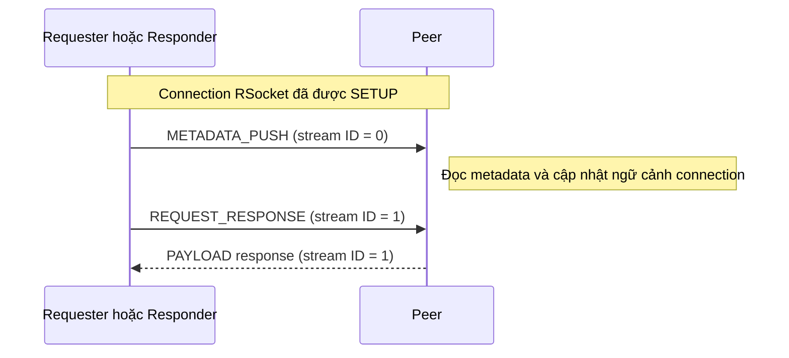

# Gửi metadata phạm vi kết nối bằng metadataPush

Trong một kết nối RSocket, ứng dụng có thể cần cập nhật ngữ cảnh dùng chung cho nhiều tương tác đang chạy, chẳng hạn locale, phiên bản cấu hình, trạng thái đăng ký hoặc thông tin tracing cấp kết nối. Nếu gắn cùng metadata vào từng request, ứng dụng phải gửi lặp lại dữ liệu và có thể khiến các stream đang hoạt động nhìn thấy những giá trị không đồng nhất. RSocket cung cấp **Metadata Push** để gửi một thông báo metadata bất đồng bộ gắn với toàn bộ connection.

Trong module `INTEGRATION_REALTIME_RSOCKET`, Java và Spring Boot thường dùng `RSocketRequester`, Reactor và composite metadata để giao tiếp qua TCP hoặc WebSocket. API `metadataPush(Payload)` của RSocket Java và `sendMetadata()` của Spring giúp gửi loại thông báo này. Phía nhận có thể xử lý bằng `@ConnectMapping`, vì annotation này tiếp nhận cả frame `SETUP` ban đầu lẫn các thông báo `METADATA_PUSH` về sau.

## 1. Metadata Push là gì?

Metadata Push là một kiểu thông điệp một chiều ở phạm vi kết nối. Requester hoặc responder đều có thể gửi metadata cho peer sau khi connection đã được thiết lập. Thông điệp không thuộc về một request-response, request-stream hay request-channel cụ thể.

Một số ví dụ phù hợp:

- Client cập nhật locale hoặc múi giờ được dùng chung cho các tương tác tiếp theo.
- Client thông báo phiên bản cấu hình giao diện hoặc bộ lọc đăng ký hiện tại.
- Server gửi chính sách kết nối mới hoặc thông báo thay đổi ngữ cảnh cho client.
- Một phía cập nhật trace context hoặc thông tin chẩn đoán gắn với connection.

Metadata Push không mang data payload nghiệp vụ. Nó truyền metadata để peer cập nhật ngữ cảnh hoặc thực hiện hành động cấp kết nối. Nếu cần gửi một đối tượng dữ liệu thông thường, hãy chọn mô hình tương tác phù hợp như request-response, fire-and-forget hoặc stream.

## 2. Cấu trúc METADATA_PUSH trong giao thức

Frame `METADATA_PUSH` có các đặc điểm quan trọng:

- Frame type là `0x0C`.
- Stream ID luôn bằng `0`, vì thông điệp gắn với toàn bộ connection.
- Cờ `M` (Metadata) được bật.
- Frame chỉ chứa metadata, không có phần data.
- Vì đây là frame chỉ có metadata, wire format không có trường Metadata Length như frame hỗ trợ cả metadata và data.
- Frame được gửi bất đồng bộ và không mở một stream ứng dụng riêng.



Frame Metadata Push không có stream ID riêng để ghép với request đang chạy. Nó cũng không làm thay đổi payload đã gửi trước đó. Ứng dụng nhận thông báo và quyết định cách áp dụng metadata cho trạng thái connection hiện tại hoặc các tương tác tiếp theo.

## 3. Phân biệt SETUP metadata, request metadata và Metadata Push

Ba cách gửi metadata có phạm vi và thời điểm khác nhau:

| Cơ chế | Thời điểm | Phạm vi | Ví dụ |
| --- | --- | --- | --- |
| SETUP metadata | Khi tạo connection | Khởi tạo connection một lần | Thông tin nhận diện client hoặc ngữ cảnh ban đầu. |
| Request metadata | Cùng từng request hoặc payload của stream | Một tương tác hoặc một payload cụ thể | Route, correlation ID, tenant context cho request. |
| Metadata Push | Sau khi connection được thiết lập | Toàn bộ connection | Cập nhật locale, cấu hình hoặc ngữ cảnh dùng chung. |

Ví dụ: khi client kết nối, nó gửi locale ban đầu trong `SETUP`. Khi gọi `orders.find`, client có thể gửi correlation ID riêng trong metadata của request. Nếu người dùng đổi locale trong lúc connection vẫn mở và ứng dụng muốn cập nhật ngữ cảnh chung, client có thể gửi Metadata Push.

Không dùng Metadata Push chỉ để tránh viết lại metadata cho từng request nếu giá trị đó thực sự khác nhau theo request. Ngược lại, không nên gửi một thông tin cấp connection trong mọi payload nếu hợp đồng ứng dụng xác định nó là ngữ cảnh dùng chung và có thể cập nhật riêng.

## 4. Khi nào nên dùng Metadata Push?

Metadata Push phù hợp khi thông tin có các đặc điểm sau:

1. Nó mô tả hoặc cập nhật trạng thái của connection, không phải kết quả của một request cụ thể.
2. Peer có thể tiếp nhận bất đồng bộ mà không cần trả response nghiệp vụ ngay.
3. Thông tin đủ nhỏ để đặt trong metadata và có cấu trúc đã thống nhất.
4. Ứng dụng có cách xử lý trường hợp thông báo bị lỗi, bị bỏ qua hoặc trạng thái không được cập nhật như mong muốn.

Không nên dùng Metadata Push cho các trường hợp sau:

- Dữ liệu có tần suất cao hoặc một dòng sự kiện dài; dùng request-stream hoặc request-channel.
- Lệnh cần biết kết quả xử lý; dùng request-response hoặc một giao thức acknowledgement riêng.
- Metadata chỉ có ý nghĩa cho một request; gắn nó vào request tương ứng.
- Dữ liệu lớn hoặc chứa nội dung nghiệp vụ chính; dùng phần data của payload ở mô hình tương tác phù hợp.

Một ví dụ tốt là thông báo `connection.preferences.changed` khi người dùng đổi locale và múi giờ. Một ví dụ không phù hợp là gửi từng mẫu nhiệt độ cảm biến qua Metadata Push; trường hợp đó nên dùng request-stream.

## 5. MIME type và composite metadata

Metadata Push sử dụng quy ước metadata MIME type đã khai báo trong `SETUP` của connection. Trong nhiều ứng dụng Spring, metadata MIME type mặc định là composite metadata:

```text
message/x.rsocket.composite-metadata.v0
```

Composite metadata cho phép một frame chứa nhiều entry, mỗi entry có MIME type riêng. Ví dụ, một Metadata Push có thể gồm route và một đối tượng ngữ cảnh JSON:

```text
Composite metadata
|-- Routing entry
|     MIME type: message/x.rsocket.routing.v0
|     Route: connection.preferences.changed
|
|-- Context entry
      MIME type: application/json
      Value: { "locale": "vi-VN", "timeZone": "Asia/Ho_Chi_Minh" }
```

Route giúp Spring chọn `@ConnectMapping` phù hợp. Entry JSON mang dữ liệu ngữ cảnh. Nếu dùng metadata MIME type đơn thay cho composite metadata, ứng dụng phải tuân thủ định dạng đơn đó; không thể tùy ý ghép route và nhiều entry có MIME type khác nhau.

MIME type chỉ mô tả cách giải mã byte. Encoder và decoder tương ứng vẫn phải được cấu hình ở hai phía. Metadata nhận từ peer cũng phải được kiểm tra cấu trúc và giá trị trước khi cập nhật trạng thái ứng dụng.

## 6. Gửi Metadata Push bằng RSocketRequester

Trong Spring, `RSocketRequester.RequestSpec.sendMetadata()` thực hiện Metadata Push và trả về `Mono<Void>`. Ta có thể tạo một request spec với route và metadata rồi gọi `sendMetadata()` thay vì `send()`, `retrieveMono()` hoặc `retrieveFlux()`.

Ví dụ client gửi cập nhật ngữ cảnh:

```java
import org.springframework.messaging.rsocket.RSocketRequester;
import org.springframework.util.MimeTypeUtils;
import reactor.core.publisher.Mono;

public record ConnectionPreferences(
    String locale,
    String timeZone,
    long revision
) {}

Mono<Void> pushPreferences(
        RSocketRequester requester,
        ConnectionPreferences preferences) {

    return requester
        .route("connection.preferences.changed")
        .metadata(preferences, MimeTypeUtils.APPLICATION_JSON)
        .sendMetadata();
}
```

Trong ví dụ:

- `route(...)` thêm routing metadata để responder chọn handler.
- `metadata(...)` thêm entry JSON vào composite metadata.
- `sendMetadata()` gửi frame Metadata Push; không có phần data và không khai báo response type.

`RSocketRequester` phải được tạo với `RSocketStrategies` có encoder JSON phù hợp. Với cấu hình Spring Web thông dụng, có thể đăng ký `Jackson2JsonEncoder` và `Jackson2JsonDecoder`. Nếu dùng MIME type tùy chỉnh, encoder/decoder phải hỗ trợ chính MIME type đó.

`sendMetadata()` trả `Mono<Void>`, vì vậy cần subscribe hoặc compose Mono này trong pipeline để thao tác được thực thi. Không gọi `block()` trên event loop hoặc trong một handler reactive. Mono hoàn tất không phải response nghiệp vụ từ peer; nếu cần xác nhận rằng peer đã áp dụng thay đổi, hãy thiết kế acknowledgement riêng.

## 7. Nhận Metadata Push bằng @ConnectMapping

Spring dùng `@ConnectMapping` để xử lý frame `SETUP` khi connection bắt đầu và các thông báo Metadata Push sau đó. Annotation có thể khai báo route pattern để chỉ nhận các connection event phù hợp; nếu không khai báo pattern, handler có thể khớp với mọi connection.

Ví dụ handler nhận cập nhật preferences:

```java
import org.springframework.messaging.handler.annotation.Header;
import org.springframework.messaging.rsocket.annotation.ConnectMapping;
import org.springframework.stereotype.Controller;
import reactor.core.publisher.Mono;

@Controller
class ConnectionMetadataHandler {

    private final ConnectionPreferencesService preferencesService;

    ConnectionMetadataHandler(ConnectionPreferencesService preferencesService) {
        this.preferencesService = preferencesService;
    }

    @ConnectMapping("connection.preferences.changed")
    Mono<Void> onPreferencesChanged(
            @Header("connectionPreferences") ConnectionPreferences preferences) {

        return preferencesService.update(preferences);
    }
}
```

Phương thức `@ConnectMapping` không trả dữ liệu cho bên gửi. Kiểu trả về phải là `void` hoặc `Mono<Void>`. Trong ví dụ, `connectionPreferences` là tên metadata đã được đăng ký trong `MetadataExtractor`; Spring giải mã entry JSON thành `ConnectionPreferences` trước khi truyền vào handler.

`@ConnectMapping` cũng xử lý `SETUP`. Vì vậy, nếu ứng dụng có handler xử lý cả setup và metadata push, cần thiết kế route và tham số sao cho dữ liệu có thể vắng mặt ở một trong hai loại frame. Có thể tách các handler theo route hoặc kiểm tra rõ entry metadata cần thiết.

## 8. Đăng ký decoder cho metadata tùy chỉnh

Để Spring chuyển một entry JSON thành kiểu Java, cấu hình `RSocketStrategies` với encoder, decoder và đăng ký MIME type trong `MetadataExtractor`:

```java
import org.springframework.context.annotation.Bean;
import org.springframework.context.annotation.Configuration;
import org.springframework.http.codec.json.Jackson2JsonDecoder;
import org.springframework.http.codec.json.Jackson2JsonEncoder;
import org.springframework.messaging.rsocket.RSocketStrategies;
import org.springframework.util.MimeTypeUtils;

@Configuration
class RSocketCodecConfiguration {

    @Bean
    RSocketStrategies rSocketStrategies() {
        return RSocketStrategies.builder()
            .encoders(encoders -> encoders.add(new Jackson2JsonEncoder()))
            .decoders(decoders -> decoders.add(new Jackson2JsonDecoder()))
            .metadataExtractorRegistry(registry ->
                registry.metadataToExtract(
                    MimeTypeUtils.APPLICATION_JSON,
                    ConnectionPreferences.class,
                    "connectionPreferences"))
            .build();
    }
}
```

Tên `connectionPreferences` trong đăng ký phải khớp với tên dùng ở `@Header`. Cả requester lẫn responder cần cấu hình codec tương thích. Nếu nhiều loại metadata JSON khác nhau cùng xuất hiện, nên dùng các MIME type riêng hoặc thiết kế một envelope có trường phân biệt loại để tránh giải mã nhầm kiểu.

Trong một ứng dụng Spring Boot, bean `RSocketStrategies` được dùng để cấu hình requester hoặc message handler tùy cách khởi tạo. Hãy xác nhận cả client và server thực sự sử dụng bean đã cấu hình; chỉ khai báo bean mà không gắn nó vào thành phần RSocket tương ứng sẽ không tự đăng ký decoder cho mọi connection.

## 9. Metadata Push theo cả hai chiều

RSocket là giao thức hai chiều. Cả requester lẫn responder đều có thể gửi Metadata Push cho peer. Vì vậy, client có thể cập nhật ngữ cảnh trên server, và server cũng có thể gửi chính sách hoặc trạng thái connection mới về client.

Ở phía server, Spring cung cấp `RSocketRequester` gắn với connection trong các phương thức `@ConnectMapping` và `@MessageMapping`. Có thể lưu requester theo session sau khi setup hoàn tất và dùng nó để gửi thông báo về client khi cần. Phía client cần đăng ký responder có `@ConnectMapping` để tiếp nhận metadata push từ server; Spring hỗ trợ annotated responders đối xứng ở client và server.

Khi lưu requester theo connection, hãy quản lý vòng đời cẩn thận:

- Gắn requester với một connection/session đã xác thực.
- Xóa requester khỏi registry khi connection đóng.
- Không dùng requester đã dispose hoặc thuộc session cũ sau reconnect.
- Nếu gửi đồng thời nhiều cập nhật, dùng revision hoặc sequence để peer phát hiện dữ liệu cũ.

Không nên gọi ngược requester để gửi request khác trong lúc handler `@ConnectMapping` đang xử lý `SETUP`. Handler setup phải hoàn tất trước khi các request ứng dụng bắt đầu; hãy đưa công việc gửi ngược sang giai đoạn sau khi connection đã sẵn sàng.

## 10. Vòng đời và thứ tự cập nhật

Metadata Push là thông báo connection-level, không tạo subscription stream riêng và không dùng `REQUEST_N` để điều tiết từng thông báo. Nếu ứng dụng gửi nhiều cập nhật, cần quản lý tốc độ và thứ tự ở tầng ứng dụng.

Ví dụ, client gửi hai thay đổi preferences gần nhau:

```text
revision 10: locale = en-US
revision 11: locale = vi-VN
```

Nếu các lệnh gửi được tạo và subscribe đồng thời từ nhiều luồng, ứng dụng không nên dựa vào thứ tự gọi hàm để suy ra thứ tự xử lý ở peer. Có thể tuần tự hóa việc gửi trên mỗi connection và đưa `revision` vào metadata. Peer chỉ áp dụng revision mới hơn revision hiện tại, nhờ đó một cập nhật cũ đến trễ không ghi đè trạng thái mới.

Metadata Push không tự tạo lịch sử hay lưu trạng thái bền vững. Nếu peer mất connection hoặc ứng dụng khởi động lại, trạng thái đã gửi có thể không còn. Hãy gửi lại snapshot hiện tại trong connection mới hoặc dùng một request đồng bộ trạng thái sau khi kết nối.

## 11. Metadata Push không có acknowledgement nghiệp vụ

Metadata Push được thiết kế như thông báo bất đồng bộ, không phải request-response. Bên gửi không nhận một payload phản hồi từ handler để chứng minh ứng dụng phía nhận đã cập nhật thành công.

`Mono<Void>` từ `sendMetadata()` cho phép compose và quan sát việc gửi ở API Spring. Tuy nhiên, ứng dụng không nên xem việc Mono hoàn tất như xác nhận nghiệp vụ rằng peer đã lưu dữ liệu, cập nhật session hoặc thực hiện xong side effect.

Nếu cần xác nhận, có thể chọn một trong các cách:

1. Dùng request-response với một route cập nhật và nhận kết quả xử lý.
2. Gửi Metadata Push kèm `updateId`, sau đó peer gửi acknowledgement qua một route request-response hoặc một stream riêng.
3. Duy trì version/revision và cung cấp endpoint truy vấn trạng thái hiện tại để sender đối chiếu.

Chọn cách phù hợp với mức độ quan trọng của cập nhật. Locale hiển thị có thể chấp nhận eventual consistency; thay đổi quyền truy cập hoặc trạng thái thanh toán cần xác nhận và kiểm tra chặt chẽ hơn.

## 12. Bảo mật và xác thực metadata nhận được

Metadata Push có thể thay đổi ngữ cảnh dùng chung cho nhiều request, nên một thông báo giả mạo hoặc không hợp lệ có thể ảnh hưởng toàn bộ connection. Cần áp dụng các nguyên tắc sau:

- Chỉ chấp nhận thông báo trên connection đã được xác thực và gắn với principal phù hợp.
- Không coi `tenantId`, `userId`, `role` hoặc quyền do peer tự gửi là sự thật nếu chưa được kiểm tra.
- Kiểm tra schema, kích thước, revision và các giá trị cho phép trước khi cập nhật context.
- Không dùng Metadata Push để âm thầm nâng quyền; thay đổi quyền cần được xác minh qua nguồn tin cậy.
- Dùng TLS trên mạng không đáng tin cậy và tránh ghi token hoặc dữ liệu nhạy cảm vào log.
- Giới hạn tần suất gửi, kích thước metadata và số lượng cập nhật chờ xử lý.

Nếu metadata chứa credential, hãy dùng định dạng xác thực đã thống nhất và chính sách xoay vòng/thu hồi. Metadata MIME type chỉ xác định cách giải mã; nó không mã hóa, ký hoặc xác thực nội dung.

## 13. Điều tiết tải và xử lý lỗi

Do Metadata Push không phải stream có demand riêng, ứng dụng cần tránh dùng nó như một kênh truyền dữ liệu tần suất cao. Khi có nhiều thay đổi liên tiếp, có thể:

- Gộp nhiều thay đổi thành một snapshot mới nhất.
- Debounce hoặc throttle các cập nhật không cần gửi ngay.
- Tuần tự hóa các lần gửi trên mỗi connection.
- Giới hạn hàng đợi và loại bỏ các cập nhật cũ đã bị snapshot mới thay thế.
- Theo dõi số lần gửi lỗi, số lần handler từ chối và độ trễ cập nhật.

Khi peer đóng connection, Mono gửi metadata có thể kết thúc bằng lỗi. Client cần xử lý lỗi này như lỗi connection hoặc lỗi gửi, sau đó đồng bộ lại trạng thái trên connection mới. Không retry vô hạn cùng một metadata cũ nếu đã có revision mới hơn.

Nếu handler nhận metadata phát sinh lỗi, ứng dụng cần ghi nhận và quyết định trạng thái context. Với thông tin quan trọng, không nên âm thầm bỏ qua lỗi rồi tiếp tục xử lý request như thể cập nhật đã thành công. Có thể đánh dấu context cần đồng bộ lại hoặc yêu cầu sender gửi snapshot qua một request có acknowledgement.

## 14. Kiểm thử Metadata Push

Kiểm thử cần xác nhận cả frame được gửi, handler nhận đúng metadata và trạng thái connection được cập nhật đúng.

Các trường hợp nên có:

- Metadata Push dùng stream ID `0` và chỉ mang metadata.
- Sender dùng composite metadata với route và entry JSON; receiver giải mã đúng route và DTO.
- `@ConnectMapping` nhận Metadata Push sau khi `SETUP` đã hoàn tất.
- Handler có route pattern chỉ xử lý đúng loại thông báo.
- `Mono<Void>` gửi hoàn tất nhưng test không nhầm nó với acknowledgement nghiệp vụ.
- Metadata thiếu trường, sai kiểu hoặc vượt giới hạn bị từ chối an toàn.
- Revision cũ đến sau revision mới không ghi đè context hiện tại.
- Nhiều lần push liên tiếp được tuần tự hóa hoặc coalesce theo policy.
- Connection đóng giữa lúc gửi được xử lý và đồng bộ lại sau reconnect.
- Client và server đều có thể gửi Metadata Push nếu ứng dụng sử dụng hai chiều.
- Metadata nhạy cảm không xuất hiện trong log và quyền cập nhật được xác minh.

Ví dụ kiểm tra sender bằng `StepVerifier`:

```java
import org.junit.jupiter.api.Test;
import org.springframework.messaging.rsocket.RSocketRequester;
import org.springframework.util.MimeTypeUtils;
import reactor.core.publisher.Mono;
import reactor.test.StepVerifier;

import static org.mockito.Mockito.mock;
import static org.mockito.Mockito.verify;
import static org.mockito.Mockito.when;

class MetadataPushSenderTest {
    @Test
    void buildsAndSendsConnectionMetadata() {
        RSocketRequester requester = mock(RSocketRequester.class);
        RSocketRequester.RequestSpec request = mock(RSocketRequester.RequestSpec.class);
        ConnectionPreferences preferences =
            new ConnectionPreferences("vi-VN", "Asia/Ho_Chi_Minh", 12);

        when(requester.route("connection.preferences.changed")).thenReturn(request);
        when(request.metadata(preferences, MimeTypeUtils.APPLICATION_JSON)).thenReturn(request);
        when(request.sendMetadata()).thenReturn(Mono.empty());

        StepVerifier.create(pushPreferences(requester, preferences))
            .verifyComplete();

        verify(requester).route("connection.preferences.changed");
        verify(request).metadata(preferences, MimeTypeUtils.APPLICATION_JSON);
        verify(request).sendMetadata();
    }
}
```

Đây là test đơn vị cho việc xây dựng và thực thi lời gọi `sendMetadata()`; nó không kiểm tra frame trên mạng hoặc handler ở peer. Kiểm thử tích hợp nên khởi chạy hai endpoint RSocket thật, gửi metadata push qua TCP hoặc WebSocket và xác minh một `Sinks.One`/`StepVerifier` ở phía nhận quan sát được cập nhật context.

## 15. Những lỗi thường gặp

**Nhầm Metadata Push với metadata của request.** Metadata request gắn với một stream hoặc payload; Metadata Push gắn với toàn connection và dùng stream ID `0`.

**Gửi data trong Metadata Push.** Frame `METADATA_PUSH` chỉ mang metadata. Dữ liệu nghiệp vụ chính cần dùng payload của mô hình tương tác phù hợp.

**Mong đợi response từ peer.** Metadata Push không có response payload. Nếu cần xác nhận nghiệp vụ, hãy dùng request-response hoặc acknowledgement riêng.

**Dùng `send()` thay cho `sendMetadata()`.** `send()` thực hiện Fire-and-Forget; `sendMetadata()` thực hiện Metadata Push. Hai API có frame và phạm vi khác nhau.

**Quên đăng ký decoder.** Có MIME type trong composite metadata chưa đủ; Spring cần encoder/decoder để chuyển DTO thành byte và ngược lại.

**Dùng `@MessageMapping` để nhận Metadata Push.** `@MessageMapping` xử lý request theo stream; `@ConnectMapping` xử lý connection setup và metadata push.

**Đưa dữ liệu tần suất cao vào metadata push.** Không có demand theo stream cho từng thông báo; dùng stream interaction và backpressure khi dữ liệu liên tục.

**Xem Mono hoàn tất là peer đã commit.** `Mono<Void>` không phải acknowledgement nghiệp vụ. Cần cơ chế xác nhận nếu cập nhật quan trọng.

## 16. Ghi nhớ

- Metadata Push là thông báo metadata bất đồng bộ gắn với connection, có thể gửi từ requester hoặc responder.
- Frame `METADATA_PUSH` có type `0x0C`, stream ID `0`, cờ metadata bật và không chứa data.
- SETUP metadata khởi tạo connection; request metadata gắn với từng tương tác; Metadata Push cập nhật ngữ cảnh connection sau khi setup.
- Spring gửi bằng `RSocketRequester.RequestSpec.sendMetadata()` và nhận bằng `@ConnectMapping`.
- Composite metadata có thể kết hợp route với entry JSON hoặc định dạng khác; cần cấu hình encoder/decoder và `MetadataExtractor`.
- `@ConnectMapping` chỉ trả `void` hoặc `Mono<Void>`; handler cần xử lý nhanh và không trả response payload.
- Metadata Push không có acknowledgement nghiệp vụ và không thay thế request-response.
- Hãy kiểm tra danh tính, quyền, schema, revision, kích thước và tần suất cập nhật.
- Với dữ liệu liên tục hoặc cần backpressure, dùng request-stream/request-channel; với cập nhật cần xác nhận, dùng acknowledgement riêng.

## Tài liệu tham khảo

- [RSocket Protocol — Metadata Push Frame](https://rsocket.io/about/protocol/)
- [Spring Framework — RSocket, @ConnectMapping và RSocketRequester](https://docs.spring.io/spring-framework/reference/rsocket.html)
- [Spring Framework — RSocketRequester.RequestSpec API](https://docs.spring.io/spring-framework/docs/6.0.19/javadoc-api/org/springframework/messaging/rsocket/RSocketRequester.RequestSpec.html)
- [RSocket Java — RSocket.metadataPush(Payload)](https://javadoc.io/static/io.rsocket/rsocket-core/1.1.5/io/rsocket/RSocket.html)
