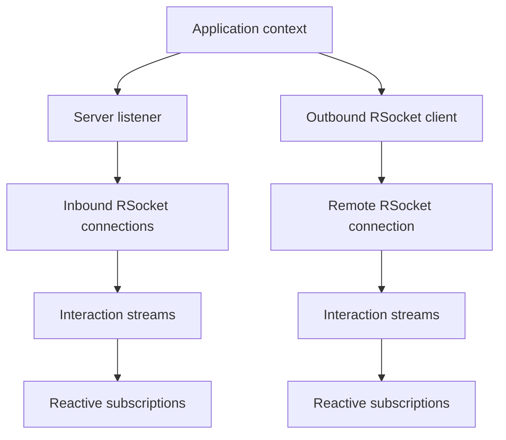
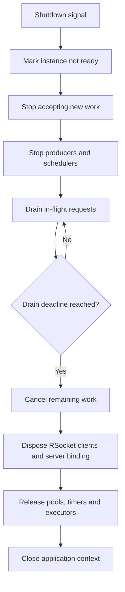

# Quản lý dispose, onClose và đóng ứng dụng đúng cách

Một ứng dụng RSocket không chỉ cần mở kết nối và gửi request; nó còn phải quản lý vòng đời của socket, server listener và các tài nguyên liên quan. Nếu không dispose đúng lúc, kết nối có thể tiếp tục giữ event loop, buffer, subscription hoặc socket transport sau khi phần nghiệp vụ đã dừng. Ngược lại, đóng socket quá sớm có thể làm request đang xử lý bị hủy và khiến client không biết kết quả cuối cùng.

Trong RSocket Java, `dispose()` dùng để chủ động đóng một RSocket hoặc tài nguyên transport có hỗ trợ lifecycle; `onClose()` cung cấp tín hiệu reactive khi tài nguyên đã đóng. Hai API này bổ sung cho nhau: một API khởi tạo hành động đóng, API kia cho phép quan sát thời điểm kết thúc. Chúng không thay thế việc quản lý vòng đời request/stream và cũng không tự triển khai quy trình graceful shutdown cho toàn bộ nghiệp vụ.

## 1. Các lớp vòng đời trong một ứng dụng RSocket

Một ứng dụng realtime có nhiều tài nguyên với vòng đời khác nhau:

| Tài nguyên | Phạm vi | Cách kết thúc thường gặp |
|---|---|---|
| Application context | Toàn bộ tiến trình Spring Boot | Context shutdown hoặc JVM shutdown |
| Server listener | Cổng TCP/WebSocket nhận kết nối mới | Dispose/close server binding |
| RSocket connection | Một phiên giữa client và server | `RSocket.dispose()` hoặc transport đóng |
| Interaction stream | Một request-response, stream hoặc channel | Complete, error hoặc cancel |
| Publisher/subscription | Một pipeline reactive | Complete, error hoặc cancel subscription |
| Tài nguyên phụ | Buffer, file, timer, connection pool, scheduler | Release/close/dispose theo owner |

Không nên xem các lớp này là một đối tượng duy nhất. Một request có thể hoàn tất trong khi connection vẫn được giữ để phục vụ request tiếp theo. Một connection có thể đóng trong khi application context vẫn tiếp tục chạy. Khi server listener ngừng nhận kết nối mới, các session hiện tại có thể cần thêm thời gian để hoàn tất hoặc được đóng theo chính sách của transport.



Thiết kế tốt phải xác định ai sở hữu mỗi tài nguyên, ai có trách nhiệm đóng nó và tài nguyên nào cần kết thúc trước tài nguyên nào.

## 2. `dispose()` và `onClose()` khác nhau thế nào?

Trong RSocket Java, hai thao tác có ý nghĩa khác nhau:

- **`dispose()`** yêu cầu tài nguyên được đóng. Với một RSocket connection, thao tác này chủ động kết thúc socket và các tương tác gắn với connection đó theo hành vi của implementation.
- **`onClose()`** trả về `Mono<Void>` đại diện cho tín hiệu đóng của tài nguyên. Có thể subscribe hoặc chờ tín hiệu này để thực hiện cleanup tiếp theo hay ghi nhận trạng thái.
- **`isDisposed()`** cho biết tài nguyên đã ở trạng thái disposed hay chưa, nếu đối tượng cụ thể cung cấp API này qua contract `Disposable`.

`onClose()` không phải là callback cho từng request. Nó theo dõi vòng đời của socket hoặc server binding. Muốn theo dõi một request, hãy quan sát `Mono`/`Flux` của request đó bằng `doOnSuccess`, `doOnError`, `doFinally` hoặc cơ chế tracing tương ứng.

Ví dụ với một RSocket client đã kết nối:

```java
import io.rsocket.RSocket;
import io.rsocket.core.RSocketConnector;
import io.rsocket.transport.netty.client.TcpClientTransport;

RSocket socket = RSocketConnector.create()
    .connect(TcpClientTransport.create("localhost", 7000))
    .block();

socket.onClose()
    .doFinally(signal -> log.info("RSocket connection closed: {}", signal))
    .subscribe();

// Khi component sở hữu socket cần dừng:
socket.dispose();
```

Ví dụ trên dùng `.block()` tại ranh giới khởi tạo của chương trình minh họa. Trong đường xử lý request reactive, không gọi `block()` để đợi connection đóng. Hãy giữ `onClose()` như một publisher và kết hợp nó với lifecycle của ứng dụng.

`dispose()` là hành động đóng do owner chủ động gọi. `onClose()` là tín hiệu để biết quá trình đóng đã xảy ra. Chỉ gọi `onClose()` mà không có cơ chế nào đóng tài nguyên sẽ không tự giải phóng socket.

## 3. Quản lý vòng đời RSocket client

Khi client kết nối đến server, đối tượng `RSocket` đại diện cho connection logic và được dùng để gọi `requestResponse`, `requestStream`, `requestChannel`, `fireAndForget` hoặc `metadataPush`. Component tạo connection nên giữ quyền sở hữu đối tượng đó và dispose khi component không còn cần nó.

Một nguyên tắc quan trọng là không tạo một RSocket connection mới cho từng request nếu ứng dụng có thể tái sử dụng connection. Tạo và đóng connection liên tục gây thêm handshake, cấp phát transport và tải cho server. Thay vào đó, quản lý connection ở phạm vi phù hợp, theo dõi `onClose()` để phát hiện connection kết thúc và thực hiện reconnect theo chính sách.

Ví dụ component quản lý một client socket:

```java
import jakarta.annotation.PreDestroy;
import io.rsocket.RSocket;
import org.springframework.stereotype.Component;
import reactor.core.publisher.Mono;

@Component
public class RemoteRSocketClient {
    private final RSocket socket;

    public RemoteRSocketClient(RSocket socket) {
        this.socket = socket;
    }

    public Mono<StatusReply> getStatus(StatusQuery query) {
        return socket.requestResponse(encode(query))
            .map(this::decodeStatus);
    }

    @PreDestroy
    public void shutdown() {
        socket.dispose();
    }
}
```

Đây là ví dụ về ownership; factory tạo `RSocket` phải cung cấp cùng instance cho component và bảo đảm chỉ một lifecycle owner chịu trách nhiệm dispose. Nếu nhiều service dùng chung socket, không để từng service tự đóng connection khi bản thân service dừng. Đặt quyền đóng ở bean quản lý connection hoặc một owner cấp cao hơn.

Trong ứng dụng reactive, method `getStatus` trả về `Mono` và không block. Việc dispose socket chỉ diễn ra khi application context kết thúc hoặc owner quyết định đóng connection. Nếu cần reconnect, component phải thay thế connection theo một cơ chế đồng bộ trạng thái rõ ràng, tránh nhiều thread cùng tạo socket mới và rò rỉ instance cũ.

## 4. Theo dõi `onClose()` để biết connection đã kết thúc

Có thể đăng ký một observer cho `onClose()` ngay sau khi connection được tạo:

```java
socket.onClose()
    .doOnSuccess(ignored -> log.info("Connection completed"))
    .doOnError(error -> log.warn("Connection closed with error", error))
    .doFinally(signal -> connectionRegistry.markClosed(connectionId))
    .subscribe();
```

Observer này có thể cập nhật registry, metric hoặc trạng thái reconnect. Tuy nhiên, không nên chỉ dựa vào `onClose()` để biết nguyên nhân mạng bị gián đoạn. Hãy kết hợp lỗi transport, keepalive timeout, trạng thái application và metric của transport để phân loại nguyên nhân.

`onClose()` cũng không đồng nghĩa mọi request trước đó đã được xử lý thành công. Khi connection kết thúc đột ngột, request đang chờ có thể có kết quả chưa xác định. Với command có tác dụng phụ, dùng operation ID/idempotency key để tra cứu hoặc gửi lại an toàn theo contract nghiệp vụ.

Không đăng ký observer lặp lại mỗi lần gọi request. Mỗi connection chỉ cần một observer lifecycle; các request riêng có observer riêng nếu cần đo thời gian hoặc xử lý lỗi.

## 5. Quản lý vòng đời server binding

RSocket server thường được bind vào một transport như TCP hoặc WebSocket. Lệnh bind trả về một publisher tạo server binding; sau khi bind thành công, binding giữ listener hoạt động và cung cấp lifecycle handle để đóng server.

Ví dụ server độc lập dùng RSocket Java với TCP:

```java
import io.rsocket.core.RSocketServer;
import io.rsocket.transport.netty.server.TcpServerTransport;

RSocketServer serverFactory = RSocketServer.create(acceptor);

var server = serverFactory
    .bind(TcpServerTransport.create("0.0.0.0", 7000))
    .block();

Runtime.getRuntime().addShutdownHook(
    new Thread(server::dispose, "rsocket-server-shutdown"));

try {
    server.onClose().block();
} finally {
    server.dispose();
}
```

Đoạn mã phù hợp cho chương trình standalone cần giữ tiến trình sống trong khi server binding hoạt động. `bind(...)` chỉ tạo listener khi publisher được subscribe; `.block()` ở đây là ranh giới bootstrap imperative. `onClose().block()` giữ main thread chờ server kết thúc. Khi ứng dụng có tín hiệu dừng, binding được dispose và `finally` bảo đảm cleanup.

Trong ứng dụng Spring Boot, thông thường không cần tự viết vòng lặp chờ như trên. Hãy để auto-configuration và `ApplicationContext` quản lý server listener. Nếu tự tạo server binding trong một bean, bean đó phải có lifecycle callback đóng binding khi context dừng. Không tạo thêm một server thủ công trên cùng cổng với server mà Spring Boot đã cấu hình.

Server listener và các connection đã được chấp nhận có thể có chính sách shutdown khác nhau tùy transport implementation. Hãy kiểm tra contract của binding đang dùng và kiểm thử xem dispose listener có đóng các connection con ngay hay chỉ ngừng nhận kết nối mới. Nếu cần drain request, thực hiện ở tầng ứng dụng trước khi dispose binding.

## 6. Đóng ứng dụng theo thứ tự

Một quy trình shutdown có kiểm soát thường có các giai đoạn:

1. **Ngừng nhận việc mới:** đánh dấu instance không còn sẵn sàng, ngừng nhận kết nối hoặc request mới theo cơ chế deployment và server.
2. **Ngừng tạo request mới:** client nội bộ dừng phát sinh request, job scheduler ngừng kích hoạt công việc mới.
3. **Drain công việc đang chạy:** cho request/stream có thời gian hoàn tất trong một khoảng giới hạn.
4. **Hủy phần còn lại:** khi hết thời hạn drain, cancel các tác vụ còn lại theo chính sách.
5. **Dispose connection và server binding:** đóng các socket do ứng dụng sở hữu.
6. **Đóng tài nguyên phụ:** scheduler, timer, pool, file và executor do ứng dụng tự tạo.
7. **Kết thúc application context:** để framework hoàn tất các callback shutdown.



Đây là trình tự logic; thứ tự callback cụ thể trong Spring phụ thuộc dependency graph và lifecycle phase. Tài nguyên được tạo bởi bean nào nên được bean đó đóng, hoặc được quản lý bởi một lifecycle owner cấp cao có thứ tự rõ ràng.

## 7. Graceful shutdown không đồng nghĩa với dispose

`dispose()` là thao tác đóng tài nguyên. Nó không tự đảm bảo mọi request đang xử lý được hoàn tất, mọi response đã đến client hay mọi tác dụng phụ đã commit. Nếu dispose ngay khi còn request đang chạy, stream có thể kết thúc bằng lỗi transport hoặc cancellation.

Graceful shutdown là quy trình ở tầng ứng dụng: ngừng nhận việc mới, chờ công việc đang chạy hoàn tất trong giới hạn, rồi mới đóng transport. Với hệ thống realtime, cần xác định riêng chính sách cho từng loại interaction:

| Interaction | Chính sách shutdown có thể áp dụng |
|---|---|
| Request-response đang chạy | Cho hoàn tất trong deadline; nếu quá hạn, client cần xử lý kết quả chưa xác định |
| Fire-and-forget đã được nhận | Xác định thời điểm server coi việc tiếp nhận là hoàn tất và bảo đảm công việc nền được lưu bền vững nếu cần |
| Request-stream | Ngừng phát dữ liệu mới, phát complete nếu có thể hoặc hủy theo deadline |
| Request-channel | Dừng cả hai chiều theo contract, thông báo hoàn tất/lỗi và giải phóng producer/consumer |
| Background job | Lưu checkpoint hoặc operation state để tiếp tục sau restart |

Đừng giữ tiến trình sống vô thời hạn chỉ vì một stream không bao giờ hoàn tất. Mỗi stream dài hạn cần có chính sách timeout, cancellation hoặc cách chuyển giao công việc sang một session khác.

## 8. Dùng `@PreDestroy` và lifecycle của Spring

Với một resource đồng bộ như `RSocket.dispose()`, `@PreDestroy` là cách đơn giản để đóng khi bean bị hủy:

```java
import jakarta.annotation.PreDestroy;
import io.rsocket.RSocket;
import org.springframework.stereotype.Component;

@Component
public class RSocketConnectionOwner {
    private final RSocket socket;

    public RSocketConnectionOwner(RSocket socket) {
        this.socket = socket;
    }

    @PreDestroy
    public void shutdown() {
        socket.dispose();
    }
}
```

Nếu shutdown cần nhiều bước bất đồng bộ hoặc phải đợi drain, có thể dùng `SmartLifecycle`, `Lifecycle` hoặc cơ chế graceful shutdown được Spring Boot hỗ trợ. Chọn một nơi quản lý lifecycle duy nhất; không vừa dispose trong `@PreDestroy`, vừa dispose độc lập trong một shutdown hook khác mà không có đồng bộ trạng thái.

Một lưu ý về `@PreDestroy`: callback thường là điểm đóng tài nguyên, không phải nơi thực hiện công việc kéo dài không giới hạn. Nếu cần đợi publisher hoàn tất, hãy thiết kế timeout shutdown rõ ràng và bảo đảm nền tảng triển khai cho phép đủ thời gian trước khi gửi SIGKILL hoặc kết thúc process.

Với server do Spring Boot auto-configure, ưu tiên lifecycle của `ApplicationContext` và cấu hình graceful shutdown mà transport thực sự hỗ trợ. Không mặc định cơ chế graceful shutdown của HTTP server cũng áp dụng cho RSocket TCP/WebSocket server. Kiểm tra đúng transport đang dùng và không tự đóng một binding mà framework sở hữu nếu không có lý do và không nắm rõ quyền sở hữu bean.

## 9. Phân biệt đóng connection với đóng stream

Một connection có thể mang nhiều stream độc lập. Đóng một stream không nên đóng toàn bộ connection nếu protocol và implementation không yêu cầu điều đó.

| Sự kiện | Phạm vi | Ý nghĩa |
|---|---|---|
| `COMPLETE` | Stream | Publisher kết thúc bình thường |
| `ERROR` | Stream hoặc connection tùy stream ID | Kết thúc tương tác với lỗi trong phạm vi tương ứng |
| `CANCEL` | Stream | Consumer không cần tiếp tục nhận dữ liệu của stream đó |
| `RSocket.dispose()` | Connection | Đóng socket logic và các stream gắn với connection |
| Server binding dispose | Listener/transport binding | Dừng server theo contract của transport |
| Application context close | Toàn ứng dụng | Kích hoạt lifecycle shutdown của các bean |

Không gọi `socket.dispose()` chỉ vì một request phát lỗi. Xử lý lỗi ở `Mono`/`Flux` của request đó và giữ connection nếu nó vẫn hoạt động. Ngược lại, khi connection đã disposed, không tiếp tục gửi request qua cùng instance; hãy tạo connection mới theo chính sách reconnect.

## 10. Tránh rò rỉ tài nguyên

Các lỗi lifecycle phổ biến gồm:

- Tạo RSocket connection mới cho mỗi request rồi quên dispose.
- Subscribe `onClose()` nhiều lần ở mỗi request và giữ callback không cần thiết.
- Tạo scheduler hoặc executor riêng nhưng không dispose khi application dừng.
- Giữ `Payload`, `ByteBuf` hoặc `DataBuffer` sau khi xử lý mà không release theo contract của API.
- Dùng `subscribe()` fire-and-forget cho tác vụ nền mà không giữ handle để hủy hoặc quan sát lỗi.
- Không timeout stream dài hạn hoặc không xử lý cancellation khi client rời đi.
- Đóng connection dùng chung từ một service không phải owner.

Khi dùng `Payload` hoặc buffer tham chiếu đếm của Netty, tuân thủ quy tắc ownership của phiên bản thư viện. Không giữ buffer vượt quá vòng đời được phép; nếu API yêu cầu retain/release, phải ghép cặp đúng. Nếu dùng operator reactive, ưu tiên API tích hợp với lifecycle buffer thay vì tự sao chép hoặc giữ reference tùy tiện.

## 11. Quan sát trạng thái đóng và lỗi shutdown

Nên ghi nhận các metric sau:

- Số server binding đang hoạt động và thời điểm bind/dispose.
- Số RSocket connection đang mở, thời gian sống và lý do đóng.
- Số request/stream đang chạy khi shutdown bắt đầu.
- Thời gian drain và số request phải cancel khi hết deadline.
- Số lần dispose, reconnect, resume và lỗi transport.
- Số subscription, scheduler hoặc buffer còn tồn tại sau khi context đã đóng.

Log nên có connection ID hoặc correlation ID, remote endpoint đã được phép ghi log, lifecycle event và nguyên nhân kết thúc. Không ghi token hoặc payload nhạy cảm. `onClose()` có thể là tín hiệu để cập nhật metric đóng; nguyên nhân chi tiết nên lấy từ lỗi transport hoặc trạng thái đóng mà implementation cung cấp.

## 12. Kiểm thử dispose, onClose và shutdown

Kiểm thử lifecycle nên xác minh hành vi thực tế, không chỉ kiểm tra method đã được gọi:

1. Kết nối client thành công, gọi `dispose()` và xác minh `onClose()` phát tín hiệu hoàn tất.
2. Server binding được dispose và không còn nhận kết nối mới.
3. Connection bị đóng bởi peer hoặc transport; observer `onClose()` được kích hoạt theo contract.
4. Một request lỗi không làm dispose connection dùng chung.
5. Application context đóng thì các client socket do bean sở hữu được dispose.
6. Server ngừng nhận việc mới và drain request đang chạy trong deadline.
7. Request vượt deadline shutdown được cancel hoặc đánh dấu kết quả chưa xác định theo contract.
8. Scheduler, executor và buffer do ứng dụng tạo được giải phóng.
9. Nhiều lần gọi shutdown không tạo lỗi hoặc cleanup lặp gây hại.
10. Reconnect sau shutdown tạo instance mới; instance cũ không còn được sử dụng.

Có thể dùng `StepVerifier` để kiểm tra publisher `onClose()` hoặc lifecycle signal, và kiểm thử tích hợp với TCP/WebSocket transport để xác minh socket thực sự đóng. Với Spring, tạo và đóng `ApplicationContext` trong test để kiểm tra callback của bean. Với graceful shutdown, đo thời gian drain và xác minh request đang chạy có kết quả phù hợp.

## 13. Quy tắc thiết kế

1. Xác định rõ owner của mỗi RSocket connection và server binding.
2. Dùng `dispose()` để chủ động đóng resource; dùng `onClose()` để quan sát tín hiệu đóng.
3. Theo dõi `onClose()` một lần cho mỗi connection, không nhầm nó với lifecycle của từng request.
4. Tái sử dụng connection trong phạm vi phù hợp; không tạo connection cho từng request nếu không cần.
5. Trong Spring Boot, để ApplicationContext quản lý resource do framework tạo; resource tự tạo phải có callback shutdown rõ ràng.
6. Thực hiện drain ở tầng ứng dụng trước khi dispose nếu cần hoàn tất request đang chạy.
7. Đặt deadline shutdown; không chờ stream vô hạn.
8. Phân biệt stream complete/error/cancel với connection dispose và application shutdown.
9. Giải phóng scheduler, buffer và tài nguyên phụ theo đúng ownership.
10. Kiểm thử đóng bình thường, đóng đột ngột, timeout drain và reconnect sau shutdown.

Quản lý lifecycle đúng giúp RSocket client/server giải phóng tài nguyên có kiểm soát và tránh request bị cắt giữa chừng ngoài dự kiến. `dispose()` thực hiện hành động đóng, `onClose()` cung cấp tín hiệu kết thúc, còn graceful shutdown cần được thiết kế ở cấp ứng dụng để ngừng nhận việc mới, drain công việc đang chạy và đóng transport đúng thời điểm.
