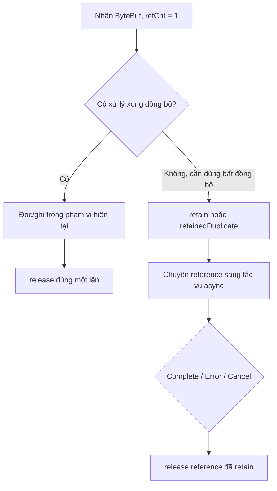

# Phát hiện rò rỉ ByteBuf và lỗi IllegalReferenceCountException

RSocket chạy trên Netty thường dùng các buffer được quản lý bằng reference counting. Cách quản lý này giúp tái sử dụng vùng nhớ heap hoặc direct memory mà không phải chờ garbage collector thu gom từng object. Đổi lại, code phải tuân thủ vòng đời của buffer: mỗi quyền sở hữu được tạo ra phải được giải phóng đúng một lần, và không được đọc buffer sau khi quyền sở hữu cuối cùng đã được release.

Hai vấn đề thường gặp là **memory leak** và `IllegalReferenceCountException`. Leak xảy ra khi buffer vẫn còn reference count lớn hơn 0 nhưng không còn đường code nào chịu trách nhiệm release nó. `IllegalReferenceCountException` thường xuất hiện khi code truy cập buffer đã được release về 0 hoặc release nhiều lần hơn số reference đã giữ. Chúng có thể cùng bắt nguồn từ quản lý ownership sai, nhưng là hai triệu chứng khác nhau.

Bài này giải thích reference count của Netty `ByteBuf`, cách ownership đi qua pipeline và Reactor, các lỗi thường gặp khi dùng RSocket, cách bật leak detector, cách đọc stack trace và quy trình xử lý sự cố trong Java/Spring Boot.

## 1. Vì sao ByteBuf cần reference counting?

Netty cung cấp `ByteBuf` để đọc/ghi dữ liệu mạng. Buffer có thể được cấp phát từ heap hoặc direct memory; allocator có thể dùng pool để tái sử dụng các vùng nhớ. Việc giải phóng một `ByteBuf` không nhất thiết trả ngay toàn bộ vùng nhớ về hệ điều hành: pooled allocator có thể giữ vùng nhớ để tái sử dụng. Tuy nhiên, reference count phải về đúng trạng thái để buffer được trả lại allocator và không còn được truy cập.

Khác với object Java thông thường, vòng đời tài nguyên của `ByteBuf` không chỉ phụ thuộc vào việc object wrapper còn được GC nhìn thấy hay không. Code phải gọi `release()` khi đã dùng xong reference mà mình sở hữu.

### 1.1. Quy tắc cơ bản

Một buffer mới được cấp phát thường có `refCnt() == 1`:

```java
ByteBuf buffer = ByteBufAllocator.DEFAULT.buffer();
System.out.println(buffer.refCnt()); // 1
```

Các thao tác chính:

| Thao tác | Tác dụng |
|---|---|
| `retain()` | Tăng reference count, tạo thêm một quyền giữ buffer cần được release tương ứng. |
| `release()` | Giảm reference count; khi về 0, vùng nhớ có thể được giải phóng hoặc trả về pool. |
| `refCnt()` | Đọc reference count hiện tại để chẩn đoán. |
| `touch(hint)` | Ghi thêm gợi ý về nơi buffer được sử dụng, hỗ trợ leak detector. |
| `copy()` | Tạo buffer mới với vùng nhớ độc lập và nội dung được sao chép. |
| `duplicate()` | Tạo view dùng chung vùng nhớ nhưng không tự tăng reference count. |
| `retainedDuplicate()` | Tạo view dùng chung vùng nhớ và tăng reference count. |
| `slice()` | Tạo view trên một phần vùng nhớ, không tự tăng reference count. |
| `retainedSlice()` | Tạo view trên một phần vùng nhớ và tăng reference count. |

`retain()` và `release()` phải cân bằng theo ownership. Nếu buffer bắt đầu ở count 1 và code gọi `retain()` thêm một lần, sẽ có hai quyền giữ; mỗi quyền cần được release đúng một lần. Khi count về 0, không được tiếp tục đọc, ghi, slice hoặc retain buffer đó.

### 1.2. Ví dụ vòng đời đúng

```java
ByteBuf buffer = allocator.buffer();
try {
    buffer.writeBytes(input);
    decode(buffer);
} finally {
    buffer.release();
}
```

Ví dụ này giả định method hiện tại sở hữu reference được cấp phát và `decode` chỉ đọc dữ liệu đồng bộ, không giữ buffer sau khi trả về. `finally` bảo đảm release kể cả khi `writeBytes` hoặc `decode` ném exception.

Nếu `decode` giữ buffer để xử lý bất đồng bộ, ownership phải được chuyển hoặc tăng reference trước khi method hiện tại kết thúc. Không được release buffer trong `finally` rồi để callback khác tiếp tục sử dụng cùng vùng nhớ.

## 2. Ownership: ai phải release?

Phần khó nhất khi debug ByteBuf không phải nhớ tên method, mà là xác định **ai đang sở hữu từng reference**. Một cách làm rõ ràng là ghi hợp đồng ownership ở mỗi ranh giới API.

Ba mô hình thường gặp:

1. **Own:** code nhận quyền sở hữu một reference và phải release khi dùng xong.
2. **Borrow:** code chỉ mượn buffer trong thời gian gọi; không được release reference của bên cho mượn.
3. **Transfer:** code chuyển quyền sở hữu cho thành phần tiếp theo; bên nhận chịu trách nhiệm release.

Khi cần giữ buffer sau thời điểm callback hiện tại kết thúc, code có thể `retain()` hoặc tạo `retainedSlice()`/`retainedDuplicate()` để có một reference riêng. Sau đó, code phải release reference vừa tạo ở nhánh hoàn tất, lỗi và hủy.



Không nên suy đoán ownership chỉ từ tên biến hoặc từ việc code đang chạy trong callback. Hãy kiểm tra hợp đồng của API tạo buffer, handler Netty, operator Reactor và API RSocket đang dùng.

## 3. Các lỗi ownership thường gặp trong Netty

### 3.1. Quên release

```java
void handle(ByteBuf inbound) {
    String text = inbound.toString(StandardCharsets.UTF_8);
    log.info("received {}", text);
    // Sai nếu method này nhận ownership: không release inbound.
}
```

Nếu handler chịu trách nhiệm giải phóng inbound buffer mà không gọi `release()`, reference count còn dương. Khi object không còn được sử dụng, leak detector có thể phát hiện vùng nhớ bị bỏ quên.

### 3.2. Release hai lần

```java
void handle(ByteBuf inbound) {
    try {
        process(inbound);
    } finally {
        inbound.release();
    }

    // Sai nếu một nhánh khác cũng release cùng reference.
    inbound.release();
}
```

Lần release đầu có thể đưa count về 0. Lần thứ hai giảm dưới 0 hoặc ném `IllegalReferenceCountException`. Lỗi này thường xuất hiện ở code cleanup trùng lặp, nơi cả caller và callee đều nghĩ mình sở hữu cùng một reference.

### 3.3. Dùng buffer sau khi release

```java
ByteBuf buffer = allocator.buffer();
buffer.writeByte(42);
buffer.release();

byte value = buffer.readByte(); // Không hợp lệ: refCnt đã về 0.
```

Sau release cuối cùng, buffer có thể đã được trả về pool và vùng nhớ có thể được tái sử dụng cho dữ liệu khác. Không được dùng `refCnt()` như một cách hợp thức hóa việc đọc buffer đã release.

### 3.4. Chuyển buffer sang callback bất đồng bộ mà không retain

```java
void onMessage(ByteBuf inbound) {
    executor.execute(() -> process(inbound));
    // Handler hiện tại kết thúc và framework có thể release inbound.
}
```

Callback chạy sau có thể đọc một buffer đã bị release. Đây là nguyên nhân phổ biến của `IllegalReferenceCountException` trong code bất đồng bộ. Nếu cần chuyển buffer sang tác vụ khác, phải retain trước khi rời callback và bảo đảm tác vụ release reference đó trong mọi đường kết thúc.

## 4. Các API view: copy, duplicate và slice

Không phải method tạo buffer mới nào cũng tạo vùng nhớ độc lập.

| API | Vùng nhớ | Reference count |
|---|---|---|
| `copy()` | Vùng nhớ mới, nội dung được sao chép | Buffer mới có ownership riêng |
| `duplicate()` | Dùng chung vùng nhớ gốc | Không tự retain |
| `retainedDuplicate()` | Dùng chung vùng nhớ gốc | Tăng reference count |
| `slice()` | Dùng chung một đoạn vùng nhớ gốc | Không tự retain |
| `retainedSlice()` | Dùng chung một đoạn vùng nhớ gốc | Tăng reference count |

Ví dụ:

```java
ByteBuf original = allocator.buffer();
original.writeBytes(payloadBytes);

ByteBuf view = original.slice(0, 8);
ByteBuf ownedView = original.retainedSlice(0, 8);

// view phụ thuộc lifetime của original; không có reference riêng.
// ownedView có thêm một reference và phải được release riêng.
ownedView.release();
original.release();
```

Nếu `original` bị release về 0, `view` không còn hợp lệ dù object `view` vẫn tồn tại trong heap. `retainedSlice()` phù hợp khi cần giữ một phần dữ liệu vượt qua lifetime của reference gốc; `copy()` phù hợp khi cần dữ liệu độc lập và chấp nhận chi phí sao chép.

## 5. Auto-release trong Netty pipeline

Một số handler Netty tự động release message đầu vào sau khi callback hoàn tất; một số handler thì không. Cần biết chính xác base class và hành vi của handler đang dùng.

| Handler/API | Quy tắc thường gặp |
|---|---|
| `SimpleChannelInboundHandler<T>` | Tự release message được nhận sau khi `channelRead0` kết thúc, trừ khi code retain để giữ lại. |
| `ChannelInboundHandlerAdapter` | Không tự release message; handler phải release nếu tiêu thụ và không chuyển tiếp. |
| `MessageToMessageDecoder<I>` | Decoder quản lý release của inbound message sau khi decode; output được chuyển tiếp theo pipeline. |
| `ctx.fireChannelRead(msg)` | Chuyển message cho handler tiếp theo; ownership được chuyển tiếp, không release thêm cùng reference ở handler hiện tại. |

Ví dụ với `SimpleChannelInboundHandler`:

```java
final class TextHandler extends SimpleChannelInboundHandler<ByteBuf> {

    @Override
    protected void channelRead0(ChannelHandlerContext ctx, ByteBuf msg) {
        String text = msg.toString(StandardCharsets.UTF_8);
        processText(text);
        // msg sẽ được auto-release khi channelRead0 kết thúc.
    }
}
```

Nếu cần dùng `msg` sau callback, retain trước khi lưu hoặc chuyển cho tác vụ bất đồng bộ. Nếu chỉ cần dữ liệu text, thường nên decode/copy sang kiểu Java bất biến trong callback rồi để framework release buffer.

Không được áp dụng quy tắc của `SimpleChannelInboundHandler` cho mọi handler. Một handler tùy chỉnh có thể có ownership khác; hãy kiểm tra contract của class cha và các decoder/encoder ở hai phía.

## 6. ByteBuf trong Reactor và RSocket

RSocket Java thường chạy trên Netty và dùng `Payload` chứa data/metadata dưới dạng buffer. Các raw API có thể làm lộ đối tượng reference-counted như `Payload` hoặc `ByteBuf` cho code ứng dụng. Khi đó, phải tuân thủ ownership contract của phiên bản thư viện: ai tạo payload, ai nhận payload, API có chuyển ownership hay giữ thêm reference, và ai release sau khi xử lý.

Spring Messaging thường cho phép handler làm việc với DTO đã được codec chuyển đổi. Ví dụ `@MessageMapping` nhận `DeviceCommand` hoặc `FileChunk`; ứng dụng không trực tiếp sở hữu ByteBuf nội bộ mà codec dùng. Không nên tự tìm và release các buffer ẩn khi API đã quản lý chúng.

### 6.1. Xử lý raw Payload nhận được

Khi ứng dụng làm việc trực tiếp với một stream raw `Payload`, hãy giải phóng payload sau khi đọc xong nếu contract API giao ownership cho subscriber:

```java
Flux<String> decodePayloads(Flux<Payload> inboundPayloads) {
    return inboundPayloads.map(payload -> {
        try {
            return payload.getDataUtf8();
        } finally {
            payload.release();
        }
    });
}
```

Ví dụ này chuyển dữ liệu sang `String` độc lập trước khi release. Không trả về một `ByteBuf` view trỏ vào payload rồi release payload ngay, vì view đó có thể mất hiệu lực. Nếu cần chuyển data/metadata sang tầng khác dưới dạng buffer, phải retain hoặc copy và xác định rõ nơi release.

Với outbound raw `Payload`, hãy làm theo contract của method RSocket cụ thể trong phiên bản đang dùng. Một số API chuyển ownership cho runtime hoặc giữ reference trong thời gian gửi; không được vừa release theo giả định của caller vừa để runtime release cùng reference. Hãy đối chiếu Javadoc của method thay vì áp dụng một quy tắc chung cho mọi overload.

### 6.2. DTO qua RSocketRequester

Ví dụ Spring:

```java
@MessageMapping("device.command")
Mono<CommandResult> handle(DeviceCommand command) {
    return deviceService.execute(command);
}
```

Với đường đi DTO này, Spring codec và RSocket runtime chịu trách nhiệm serialize/deserialize payload. Handler làm việc với object Java; không cần gọi `release()` cho `DeviceCommand`. Nếu tự chuyển sang raw `Payload` hoặc Netty `ByteBuf`, ownership trở thành trách nhiệm của code theo API contract tương ứng.

## 7. Giữ ByteBuf qua ranh giới bất đồng bộ

Một callback đồng bộ có thể đọc buffer rồi kết thúc. Một pipeline reactive có thể chuyển buffer qua nhiều operator, đổi scheduler, queue, filter hoặc cancel. Mỗi ranh giới có thể kéo dài lifetime của buffer hoặc loại bỏ phần tử trước khi downstream xử lý.

### 7.1. Retain trước khi rời callback

Ví dụ dưới đây giả định `inbound` đang hợp lệ trong callback, và `decode` chỉ đọc buffer đồng bộ, không giữ lại vùng nhớ:

```java
Flux<DecodedMessage> decodeAsync(Flux<ByteBuf> inbound) {
    return inbound.flatMap(buffer -> {
        ByteBuf retained = buffer.retainedDuplicate();

        return Mono.fromCallable(() -> decode(retained))
            .doFinally(signal -> retained.release());
    }, 1);
}
```

`retainedDuplicate()` tạo view có thêm reference để tác vụ async sử dụng sau callback hiện tại. `doFinally` chạy khi publisher kết thúc bình thường, lỗi hoặc bị cancel, nhờ đó reference được release. `flatMap` subscribe publisher con trong pipeline; nếu tách publisher ra và không bao giờ subscribe, code vẫn phải có cách quản lý reference đã retain.

Nếu `decode` trả về object vẫn giữ view của `retained`, ví dụ trả một slice hoặc wrapper đọc lazy, thì không thể release ngay ở `doFinally`. Khi đó cần chuyển ownership của buffer đến object trả về hoặc copy dữ liệu thành object độc lập.

### 7.2. Giải phóng phần tử bị discard

Một số operator có thể bỏ phần tử khi filter, drop, overflow hoặc cancellation. Nếu phần tử bị bỏ là reference-counted, cần cleanup cho nhánh discard.

```java
Flux<ByteBuf> accepted = inbound
    .filter(this::isValid)
    .doOnDiscard(ByteBuf.class, ReferenceCountUtil::safeRelease);
```

`doOnDiscard` đăng ký cleanup cho những phần tử mà operator upstream hỗ trợ discard. Không phải mọi operator hoặc mọi loại cancellation đều tự động gọi discard hook; hãy đọc semantics của pipeline và kiểm thử các nhánh drop/overflow/cancel cụ thể.

Với operator có callback drop riêng, có thể release ngay trong callback:

```java
Flux<ByteBuf> latestOnly = inbound
    .onBackpressureDrop(ReferenceCountUtil::safeRelease);
```

Chỉ dùng cleanup callback khi code thực sự sở hữu reference bị drop. Không release một buffer đang được subscriber khác sử dụng hoặc một reference đã được chuyển ownership.

### 7.3. Scheduler và queue

Các operator như `publishOn`, `flatMap` hoặc buffer có thể giữ phần tử trong queue. Khi pipeline bị cancel hoặc lỗi, phần tử đang chờ có thể bị discard. Hãy xác định operator nào giữ reference, operator nào giải phóng phần tử bị bỏ và nơi cần `doOnDiscard`.

Đừng gọi `release()` ngay sau khi phát buffer vào `sink` hoặc queue nếu consumer sẽ đọc nó sau đó. Phải quyết định rõ thao tác `emit` chuyển ownership hay consumer chỉ mượn buffer; nếu nhiều consumer cùng giữ, mỗi consumer cần reference riêng hoặc một bản copy.

## 8. IllegalReferenceCountException: đọc lỗi và tìm nguyên nhân

`IllegalReferenceCountException` là exception của Netty khi thao tác trên một reference-counted object không hợp lệ với reference count hiện tại. Thông báo thường cho biết count hiện tại hoặc thao tác đã làm count xuống dưới mức hợp lệ.

Các nguyên nhân thường gặp:

| Triệu chứng | Nguyên nhân có thể | Cách điều tra |
|---|---|---|
| `refCnt: 0` khi đọc/ghi | Buffer đã được release hết reference | Tìm nơi release trước đó và đường callback sử dụng sau |
| `refCnt: 0` khi gọi `release()` | Double release hoặc release reference không thuộc mình | Lập bảng ownership ở từng method và handler |
| Lỗi chỉ xuất hiện khi tải cao | Race giữa consumer và cleanup, hai nhánh cùng release | Kiểm tra concurrency, `flatMap`, share/publish và cancellation |
| Lỗi sau `publishOn`/async callback | Buffer bị release trước khi task chạy | Retain trước khi chuyển scheduler và release sau xử lý |
| Lỗi khi dùng `slice`/`duplicate` | View không retain nhưng buffer gốc đã release | Dùng `retainedSlice`/`retainedDuplicate` hoặc copy |
| Lỗi khi pipeline bị cancel | Cleanup ở cancel và cleanup thủ công cùng release | Kiểm tra `doFinally`, discard hook và handler auto-release |

Exception này không đồng nghĩa với memory leak. Leak thường là reference count không về 0; `IllegalReferenceCountException` thường là code đang dùng hoặc release một object sau khi reference count không còn hợp lệ. Một lỗi ownership có thể gây cả hai: nhánh A quên release tạo leak, nhánh B release quá nhiều gây exception.

### 8.1. Không dùng `refCnt()` để thay thế ownership

Đoạn code sau không phải cách sửa chắc chắn:

```java
if (buffer.refCnt() > 0) {
    buffer.release();
}
```

Reference count có thể thay đổi giữa lúc kiểm tra và lúc release nếu nhiều thread cùng thao tác. Hơn nữa, code vẫn chưa biết mình có quyền release reference đó hay không. `refCnt()` hữu ích cho log/chẩn đoán; ownership phải được bảo đảm bằng thiết kế và đồng bộ hóa đúng.

### 8.2. Dùng safeRelease có chọn lọc

`ReferenceCountUtil.safeRelease(value)` bỏ qua exception phát sinh trong quá trình release. Nó có ích trong một số cleanup path phòng thủ, nhưng có thể che giấu lỗi double release. Trong code nghiệp vụ thông thường, ưu tiên `release()` rõ ràng và để test phát hiện ownership sai. Chỉ dùng `safeRelease` khi chính sách cleanup yêu cầu không để lỗi giải phóng làm che lỗi chính, đồng thời vẫn có log/metric để phát hiện bất thường.

## 9. Bật Netty leak detector

Netty có `ResourceLeakDetector` để phát hiện reference-counted object bị bỏ quên. Có thể cấu hình bằng JVM system property trước khi Netty khởi tạo:

```text
-Dio.netty.leakDetection.level=advanced
-Dio.netty.leakDetection.targetRecords=32
```

Hoặc cấu hình trong test trước khi tạo các buffer cần theo dõi:

```java
ResourceLeakDetector.setLevel(ResourceLeakDetector.Level.ADVANCED);
```

Các mức thường dùng:

| Level | Hành vi | Khi nên dùng |
|---|---|---|
| `DISABLED` | Tắt leak detection | Chỉ khi đã có lý do vận hành rõ ràng; không dùng để debug leak |
| `SIMPLE` | Phát hiện theo sampling với overhead thấp | Chạy ứng dụng thông thường khi cần chi phí nhỏ |
| `ADVANCED` | Sampling kèm nhiều thông tin access record hơn | Staging hoặc điều tra leak có thể tái hiện |
| `PARANOID` | Theo dõi mọi allocation phù hợp, overhead cao | Test ngắn và có kiểm soát để tăng khả năng bắt lỗi |

`PARANOID` có thể làm giảm throughput và tăng allocation/CPU, vì vậy không nên bật vô thời hạn trên production. Dùng `ADVANCED` hoặc mức phù hợp với môi trường để thu thập bằng chứng, sau đó quay về cấu hình vận hành đã chọn.

### 9.1. Đọc leak report

Leak report thường có dòng dạng `LEAK: ByteBuf.release() was not called before it's garbage-collected`. Report có thể chứa:

- Loại buffer hoặc wrapper bị nghi ngờ.
- Stack trace tại thời điểm allocation.
- Các access record do leak detector ghi lại.
- Gợi ý từ `touch(hint)` nếu code đã thêm nhãn ở các ranh giới quan trọng.

Stack trace allocation cho biết buffer được tạo ở đâu, không nhất thiết là nơi quên release. Hãy lần theo ownership từ nơi tạo qua các handler/operator đến nhánh cuối. Access record có thể giúp khoanh vùng nơi buffer đi qua, nhưng sampling và garbage collection khiến thời điểm report xuất hiện không nhất thiết trùng thời điểm leak bắt đầu.

Không có leak report trong một lần chạy không chứng minh hệ thống không leak. Object có thể chưa được GC, đường lỗi chưa được thực thi hoặc sampling chưa chọn allocation đó. Hãy kết hợp test lặp lại, metric memory và kiểm tra ownership trong code.

### 9.2. Thêm hint bằng touch

`touch(hint)` có thể thêm dấu vết khi buffer đi qua các tầng:

```java
ByteBuf tracked = inbound.touch("before image decoder");
tracked = tracked.touch("queued for async storage write");
```

`touch` không retain và không release. Nó chỉ hỗ trợ leak detector ghi lại gợi ý truy cập. Đừng dùng `touch()` như cách sửa ownership.

## 10. Phân biệt leak với pooled memory được giữ lại

Netty pooled allocator có thể giữ vùng nhớ đã được giải phóng khỏi một `ByteBuf` để tái sử dụng. Vì vậy, direct memory hoặc RSS của process có thể không giảm ngay sau khi buffer được release. Đây không tự động là leak.

Phân biệt các tín hiệu:

- **Reference count:** có buffer còn reference mà code không giải phóng hay không?
- **Allocator metrics:** số byte heap/direct đang được allocator quản lý và dùng trong pool.
- **JVM heap:** object Java còn sống sau GC.
- **Direct memory/RSS:** vùng nhớ native/direct và tổng resident memory của process.
- **Application queue depth:** số payload/chunk đang chờ xử lý.

Nếu queue depth và số buffer outstanding tăng liên tục cùng với tải, cần kiểm tra backpressure và ownership. Nếu heap live set ổn định nhưng allocator giữ pool lớn rồi ổn định, đó có thể là hành vi pooling bình thường. Nếu bộ nhớ tiếp tục tăng qua nhiều chu kỳ tải và không trở về mức ổn định, hãy điều tra leak, buffer queue không giới hạn hoặc cache giữ reference.

Có thể quan sát allocator metrics của Netty khi dùng pooled allocator, cùng JMX/JFR và metric bộ nhớ của process. Không chỉ dựa vào `Runtime.freeMemory()` để kết luận direct ByteBuf đã được release.

## 11. Mẫu quản lý tài nguyên an toàn

### 11.1. Giữ buffer cho một tác vụ async

```java
Mono<Integer> writeAsync(ByteBuf inbound) {
    ByteBuf owned = inbound.retainedDuplicate();

    return Mono.fromCallable(() -> storageWriter.write(owned))
        .doFinally(signal -> owned.release());
}
```

Ví dụ giả định `storageWriter.write` đọc buffer đồng bộ trong lúc callable chạy và không giữ lại buffer sau khi trả về. `retainedDuplicate()` tạo reference riêng; `doFinally` giải phóng reference đó sau complete, error hoặc cancel. Nếu `storageWriter` giữ buffer để tiếp tục xử lý sau khi trả về, cần chuyển ownership rõ ràng cho storage writer và release tại nơi nó hoàn tất.

### 11.2. Copy khi cần tách lifetime

Nếu dữ liệu nhỏ và cần tách hoàn toàn khỏi buffer gốc, copy sang kiểu độc lập:

```java
byte[] bytes = new byte[inbound.readableBytes()];
inbound.getBytes(inbound.readerIndex(), bytes);
return processAsync(bytes);
```

Mảng `byte[]` không phụ thuộc reference count của ByteBuf. Đổi lại, copy tạo thêm allocation và tiêu tốn bộ nhớ; với payload lớn hoặc nhiều stream, hãy đo chi phí trước khi chọn.

### 11.3. Giải phóng khi loại bỏ phần tử

```java
Flux<ByteBuf> decoded = inboundBuffers
    .filter(this::isSupported)
    .doOnDiscard(ByteBuf.class, ReferenceCountUtil::safeRelease)
    .map(this::decodeAndRelease);
```

Trong ví dụ này, `decodeAndRelease` phải có hợp đồng rõ: đọc buffer, tạo kết quả độc lập và release đúng reference mà nó sở hữu. `doOnDiscard` là lớp bảo vệ cho phần tử bị operator hỗ trợ discard loại bỏ; nó không thay thế release ở nhánh được xử lý bình thường.

## 12. Kiểm thử leak và lỗi reference count

Một test hữu ích nên ép cả đường thành công, lỗi, cancel và discard. Chỉ test method decode thành công không đủ để phát hiện leak ở nhánh exception hoặc khi client ngắt kết nối.

Các tình huống nên có:

1. Buffer được cấp phát và xử lý thành công; reference count về đúng 0 sau khi ownership kết thúc.
2. Decoder ném exception; `finally` vẫn release buffer.
3. Tác vụ async bị cancel; reference đã retain được release.
4. Filter/drop loại phần tử; discard hook giải phóng phần tử bị bỏ.
5. Buffer được chuyển qua scheduler; consumer đọc được dữ liệu trước khi release.
6. `slice`/`duplicate` được dùng sau khi buffer gốc release; test xác minh code đã chọn retained view hoặc copy phù hợp.
7. Nhiều stream đồng thời; số buffer outstanding không tăng vô hạn sau khi stream kết thúc.
8. Connection bị đóng giữa lúc truyền; buffer trong queue và replay/transport path được dọn theo contract của runtime.

Ví dụ test đơn vị cho ownership đồng bộ:

```java
@Test
void releasesBufferAfterDecode() {
    ByteBuf buffer = Unpooled.buffer();
    buffer.writeByte(7);

    try {
        assertEquals(7, decode(buffer));
    } finally {
        buffer.release();
    }

    assertEquals(0, buffer.refCnt());
}
```

Đây là test minh họa vòng đời của một buffer do test sở hữu. Trong test pipeline Netty thực tế, phải tính đến auto-release của handler và ownership chuyển qua channel; không release lần nữa ở test nếu pipeline đã nhận ownership.

### 12.1. Chạy test với leak detection mạnh hơn

Có thể chạy bộ test liên quan với:

```text
-Dio.netty.leakDetection.level=paranoid
```

Lặp lại test nhiều lần và kiểm tra log leak. Vì leak report phụ thuộc GC và detector, có thể cần tạo áp lực allocation có kiểm soát để object bị bỏ quên trở nên đủ điều kiện phát hiện. Tránh gọi `System.gc()` liên tục hoặc xem việc không có log sau một lần test là bằng chứng tuyệt đối.

### 12.2. Kiểm thử dưới tải

Sau unit test, chạy integration test có nhiều connection/stream, payload lớn, consumer chậm, cancellation và network interruption. Theo dõi:

- Số buffer được tạo, retain và release nếu có instrumentation.
- Heap live set và allocation rate.
- Direct memory và Netty allocator metrics.
- Số stream đang hoạt động và queue depth.
- Leak detector logs và `IllegalReferenceCountException`.
- Bộ nhớ sau khi tải dừng và các stream được dispose.

Một leak thường thể hiện qua mức outstanding tăng theo số lần lặp, thay vì tăng rồi ổn định theo pool warm-up. Hãy chạy cùng tải trong nhiều chu kỳ để phân biệt hai hiện tượng.

## 13. Quy trình điều tra sự cố production

Khi gặp leak report hoặc `IllegalReferenceCountException`, xử lý theo trình tự:

1. **Thu thập bằng chứng:** log đầy đủ stack trace, phiên bản Netty/rsocket-java, route, loại transport, thời điểm và mức tải.
2. **Xác định object:** đó là `ByteBuf`, `Payload`, `DataBuffer` hay wrapper khác; không áp dụng API release sai loại.
3. **Tìm nơi tạo:** dùng allocation stack từ leak report để tìm allocator hoặc decoder.
4. **Lập đường ownership:** từ nơi tạo đến handler, operator, queue và callback cuối.
5. **Tìm retain/release:** ghi lại từng lần tăng/giảm reference và xác định owner sau mỗi lần chuyển giao.
6. **Kiểm tra nhánh bất thường:** error, cancel, timeout, drop, overflow và shutdown.
7. **Tái hiện ở môi trường test:** bật `ADVANCED` hoặc `PARANOID` trong thời gian ngắn, thêm `touch()` ở ranh giới cần theo dõi.
8. **Sửa hợp đồng ownership:** chọn một nơi chịu trách nhiệm release cho mỗi reference; thêm retain chỉ khi có lifetime độc lập.
9. **Kiểm thử lại:** chạy test thành công, lỗi, cancel và tải đồng thời; theo dõi memory qua nhiều chu kỳ.
10. **Đánh giá tác động:** kiểm tra throughput, latency và allocation sau khi thêm copy/retain/release.

Không nên sửa nhanh bằng cách thêm `safeRelease()` vào mọi catch/finally. Việc đó có thể che double release hoặc giải phóng buffer vẫn đang được consumer khác dùng. Hãy xác định owner trước, sau đó mới đặt cleanup tại đúng điểm kết thúc.

## 14. Checklist ownership cho code review

Khi review code dùng ByteBuf hoặc raw RSocket Payload, hãy hỏi:

- Ai cấp phát buffer và reference count ban đầu là bao nhiêu?
- Method nhận buffer sở hữu, mượn hay nhận ownership chuyển giao?
- Có `retain()`/`retainedSlice()`/`retainedDuplicate()` nào không, và nơi nào release reference đó?
- `slice()` hoặc `duplicate()` có bị dùng sau khi buffer gốc kết thúc lifetime không?
- Buffer có đi qua scheduler, queue, callback hoặc publisher lazy không?
- Khi error/cancel/drop/overflow, reference nào được giải phóng?
- Handler Netty có auto-release không? Có forward message sang handler tiếp theo không?
- Code có release cả object do framework/runtime quản lý không?
- Có copy không cần thiết làm tăng allocation hoặc giữ payload lớn trong heap không?
- Test có chạy leak detector và xác minh đường cleanup không?

## 15. Kết luận

`ByteBuf` là tài nguyên reference-counted. `retain()` tạo thêm một quyền giữ, `release()` kết thúc một quyền giữ, và buffer chỉ còn hợp lệ khi reference count vẫn lớn hơn 0. Memory leak xảy ra khi một reference không được release; `IllegalReferenceCountException` thường cho biết code đang truy cập hoặc release buffer sau khi count đã không còn hợp lệ.

Trong Netty, Reactor và RSocket, lỗi thường phát sinh ở ranh giới ownership: auto-release của handler, chuyển buffer sang callback bất đồng bộ, queue/discard khi cancel, hoặc nhầm lẫn giữa `slice`/`duplicate` và các biến thể retained. Hãy ghi rõ ai sở hữu từng reference, retain trước khi vượt qua lifetime hiện tại, release trong mọi nhánh kết thúc và dùng copy khi cần lifetime độc lập. Leak detector, metric bộ nhớ và test dưới tải sẽ giúp xác định lỗi, nhưng thiết kế ownership rõ ràng mới là cách ngăn chúng tái diễn.
