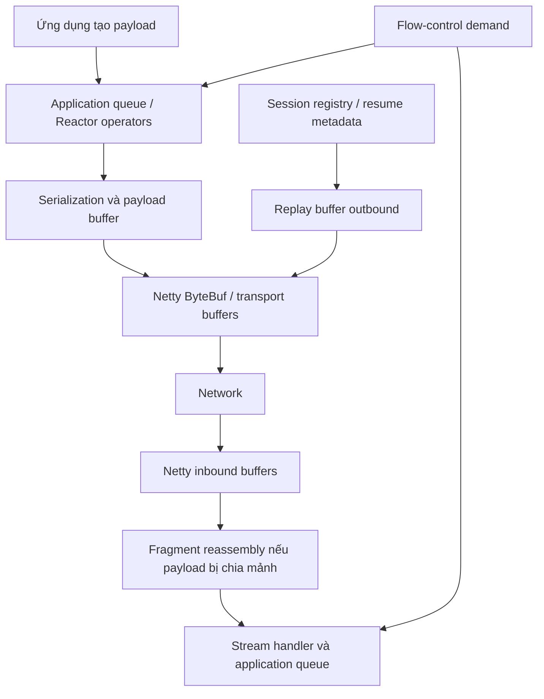

# Đặt giới hạn bộ nhớ cho bộ đệm, phân mảnh và resume

Một kết nối RSocket có thể giữ nhiều stream đồng thời, truyền payload lớn qua nhiều frame và lưu frame chưa được xác nhận để hỗ trợ session resumption. Mỗi khả năng đều cần bộ nhớ. Nếu chỉ đặt giới hạn heap của JVM mà không giới hạn buffer theo session, payload, stream và tổng connection, một đợt tải tăng hoặc một nhóm client mất mạng có thể làm bộ nhớ tăng vượt dự kiến.

Quản lý bộ nhớ cho RSocket cần nhìn toàn bộ đường đi dữ liệu: buffer ứng dụng, hàng đợi Reactor, payload đang được serialize, fragment đang được ghép, Netty ByteBuf, replay buffer cho resumption và metadata của session. Những vùng nhớ này có thể nằm ở heap hoặc direct memory, và một số allocator giữ vùng nhớ đã release để tái sử dụng.

Bài này hướng dẫn lập ngân sách bộ nhớ, đặt giới hạn cho từng loại buffer, tính capacity của replay buffer và reassembly, phối hợp giới hạn payload với backpressure, cùng cách theo dõi heap/direct memory trong Java và Spring Boot.

## 1. Bản đồ bộ nhớ của một ứng dụng RSocket

Một ứng dụng RSocket thường có nhiều lớp giữ dữ liệu cùng lúc:



Các nhóm bộ nhớ quan trọng:

| Nhóm | Ví dụ | Rủi ro nếu không giới hạn |
|---|---|---|
| Application buffer | Danh sách event, upload queue, batch chưa ghi | Queue tăng theo chênh lệch tốc độ producer-consumer |
| Reactor/operator queue | `publishOn`, `flatMap` prefetch, backpressure buffer | Nhiều phần tử được giữ ngoài dự kiến của ứng dụng |
| Payload/serialization | Object đã encode, bản sao byte array, metadata | Một payload lớn có thể tạo nhiều bản sao trong lúc encode/decode |
| Netty ByteBuf | Heap/direct buffer và pooled allocator | Direct memory tăng, buffer bị giữ do thiếu release |
| Fragment reassembly | Các mảnh của một payload logic đang ghép | Một payload lớn cần vùng nhớ tương ứng với toàn payload |
| Replay buffer | Frame outbound chưa được peer xác nhận | Mất mạng kéo dài khiến dữ liệu cần replay tích lũy |
| Session/stream state | Resume token, stream registry, demand, timer | Số session chờ resume tăng không giới hạn |

Không nên coi `-Xmx` là giới hạn bộ nhớ duy nhất. Process còn dùng direct memory, metaspace, thread stack, code cache, TLS/native allocation và vùng nhớ của thư viện mạng. Khi chạy trong container, tổng các phần này phải nằm trong memory limit của container với headroom phù hợp.

## 2. Lập ngân sách trước khi cấu hình

Hãy bắt đầu từ số connection/session đồng thời và lượng dữ liệu tối đa mà mỗi session có thể giữ. Ngân sách cần có cả giới hạn per-session và giới hạn tổng process.

Một mô hình ước lượng đơn giản:

\[
M_{total} = M_{base} + N_{sessions} \times M_{session} + M_{shared}
\]

Trong đó:

- \(M_{base}\): bộ nhớ nền của JVM, Spring, Netty, codec và các service.
- \(N_{sessions}\): số session RSocket đồng thời, gồm cả session đang kết nối và session đang chờ resume.
- \(M_{session}\): ngân sách dữ liệu/buffer/metadata cho một session.
- \(M_{shared}\): queue, cache hoặc buffer dùng chung ngoài phạm vi từng session.

Có thể tách ngân sách mỗi session thành:

\[
M_{session} = B_{replay} + B_{reassembly} + B_{stream} + B_{metadata}
\]

Đây là mô hình lập kế hoạch, không phải công thức đo chính xác allocator. Một số buffer có thể dùng chung hoặc được tính ở tầng transport; một số payload có thể tồn tại đồng thời ở nhiều dạng trong quá trình encode/decode. Hãy đo peak memory thực tế và thêm hệ số dự phòng.

### 2.1. Ví dụ capacity

Giả sử server dự kiến giữ 400 session. Mỗi session được phân bổ tối đa:

- 2 MiB replay buffer.
- 1 MiB cho fragment reassembly đang hoạt động.
- 256 KiB cho stream/application queue.
- 64 KiB cho metadata và trạng thái session.

Ngân sách thô mỗi session là 3,3125 MiB. Nhân với 400 session tạo ra khoảng 1.294 MiB, chưa tính bộ nhớ nền, buffer dùng chung, bản sao khi serialize và headroom. Nếu cộng 256 MiB bộ nhớ nền và 30% dự phòng, ngân sách cần dành cho nhóm này đã xấp xỉ 2 GiB.

Con số này giúp phát hiện cấu hình không khả thi trước khi triển khai. Nếu container chỉ có 1 GiB memory limit, không thể đặt 400 session với mức buffer như trên rồi kỳ vọng JVM tự điều tiết.

### 2.2. Tách heap và direct memory

Không phải mọi nhóm buffer đều nằm trong cùng một vùng nhớ. Object Java, metadata, queue node và nhiều DTO nằm trên heap. Netty có thể dùng direct ByteBuf cho I/O; pooled allocator có thể giữ vùng nhớ để tái sử dụng.

Hãy lập hai bảng ngân sách riêng:

| Heap | Direct/native |
|---|---|
| DTO và object graph | Netty direct ByteBuf |
| Queue của Reactor/application | Native transport allocation |
| Metadata/session registry | Một phần buffer của TLS/codec |
| Byte array và bản sao khi serialize | Direct buffer pool và socket-related buffers |

`-Xmx` giới hạn heap. `-XX:MaxDirectMemorySize` có thể giới hạn direct buffer do JVM quản lý, nhưng không đại diện cho toàn bộ native memory của process. Hãy quan sát thêm RSS/container memory, metaspace và thread stack.

## 3. Giới hạn application buffer và Reactor queue

Backpressure giúp consumer yêu cầu đúng số payload cần nhận, nhưng không tự động giới hạn mọi queue trong ứng dụng. Các operator Reactor có thể prefetch; callback ngoài hệ thống có thể không pause được; ứng dụng có thể tự gom event vào collection.

Các nguyên tắc:

1. Ưu tiên nguồn demand-aware như `Flux.generate`, `Flux.fromIterable` hoặc adapter đọc file theo demand.
2. Đặt prefetch và concurrency tường minh cho `flatMap`, `concatMap`, `publishOn` khi chúng ảnh hưởng đến số phần tử đang chờ.
3. Không dùng buffer không giới hạn cho stream kéo dài.
4. Khi nguồn không thể dừng, dùng bounded buffer và xác định hành vi overflow.
5. Đo queue depth và tổng byte, không chỉ đếm số phần tử.

Ví dụ buffer có giới hạn:

```java
Flux<DeviceEvent> events = externalEventSource()
    .onBackpressureBuffer(
        512,
        dropped -> metrics.increment("event_buffer_overflow")
    );
```

Ví dụ này giới hạn số event được buffer ở 512; khi đầy, operator báo overflow theo overload đã chọn. Trong ứng dụng thật, callback overflow cần log event ID hoặc route ở mức phù hợp, tăng metric và kích hoạt chính sách nghiệp vụ như từ chối, retry hoặc drop. Không nên âm thầm bỏ command quan trọng.

Với `flatMap`, giới hạn số tác vụ đồng thời:

```java
Flux<CommandResult> results = commands.flatMap(
    commandService::execute,
    8,  // concurrency tối đa
    1   // prefetch cho mỗi inner publisher
);
```

Concurrency và prefetch tác động đến số phần tử đang được xử lý hoặc giữ trong queue. Giá trị phù hợp phải dựa trên thời gian xử lý, payload size, số stream và năng lực downstream; không nên tăng concurrency chỉ để cải thiện throughput trung bình nếu memory và p99 latency tăng mạnh.

### 3.1. Demand đếm payload, không đếm byte

RSocket `REQUEST_N` yêu cầu số payload tiếp theo. Nếu payload có kích thước thay đổi lớn, demand 8 có thể tương ứng 8 KiB hoặc 80 MiB. Vì vậy, cần kết hợp demand với giới hạn kích thước payload và byte in-flight.

Ví dụ, nếu mỗi chunk tối đa 64 KiB và client cho phép tối đa 16 chunk outstanding, phần dữ liệu chunk có thể lên đến khoảng 1 MiB mỗi stream, chưa tính metadata, queue và buffer transport. Nếu một payload đơn lẻ được phép lên tới 8 MiB, chỉ một demand cũng có thể giữ 8 MiB sau reassembly.

Với request-channel, có hai hướng demand độc lập: server yêu cầu command từ client; client yêu cầu event từ server. Nên có quota byte và queue riêng cho từng hướng để một bên chậm không khiến buffer của cả channel tăng không kiểm soát.

## 4. Đặt giới hạn payload và fragment

Các giới hạn cần tách biệt:

- **Runtime inbound payload limit:** giới hạn kích thước payload logic mà RSocket runtime chấp nhận sau khi ghép fragment. Cấu hình này giúp chặn payload quá lớn trước khi giao cho handler; thời điểm kiểm tra cụ thể phụ thuộc implementation.
- **Application payload limit:** kích thước tối đa nghiệp vụ chấp nhận cho một payload logic. Validation trong handler thường diễn ra sau khi runtime đã reassemble payload, nên chỉ kiểm tra ở đây không đủ để bảo vệ bộ nhớ reassembly.
- **Fragment size:** kích thước fragment mà RSocket runtime dùng để chia payload logic thành frame nhỏ hơn.
- **Frame/transport limit:** kích thước frame tối đa mà protocol implementation và transport chấp nhận.

Protocol fragmentation giúp payload logic lớn được truyền qua nhiều frame, nhưng receiver vẫn phải reassemble payload trước khi đưa nó lên handler thông thường. Vì thế, giảm fragment size không đồng nghĩa giảm bộ nhớ cần để giữ toàn payload.

Ví dụ, một payload logic 32 MiB được chia thành các fragment 64 KiB. Receiver có thể nhận nhiều frame nhỏ hơn, nhưng nếu handler cần payload nguyên khối thì bộ nhớ reassembly vẫn phải chứa khoảng 32 MiB cộng overhead. Nếu có 20 request lớn đồng thời, phần reassembly thô có thể lên tới 640 MiB.

### 4.1. Chọn fragment size

Fragment size quá lớn làm mỗi frame nặng hơn và có thể vượt giới hạn transport/proxy. Fragment size quá nhỏ làm tăng số frame, header, scheduling và chi phí xử lý. Hãy benchmark nhiều mức dựa trên payload thực tế và transport.

Khi chọn fragment size, xem xét:

- Frame limit của client/server và các thành phần mạng trung gian.
- Payload lớn nhất mà route cho phép.
- Số payload lớn có thể cùng reassemble.
- Direct memory và heap headroom.
- Throughput, latency và chi phí xử lý nhiều fragment.
- Khả năng hủy request và giải phóng vùng reassembly.

Không nên dùng fragmentation để né giới hạn an toàn của application payload. Hãy từ chối payload vượt quota trước khi cấp phát lượng bộ nhớ lớn.

### 4.2. Khi nào nên chuyển sang application chunking?

Nếu dữ liệu lớn đến mức không nên reassemble toàn bộ trong heap/direct memory, hãy chia ở tầng ứng dụng thành nhiều payload độc lập. Server có thể ghi từng chunk xuống storage, kiểm tra checksum và cập nhật checkpoint trước khi nhận thêm.

Chunking kết hợp backpressure có thể giới hạn lượng dữ liệu in-flight theo `chunkSize × outstandingChunks`. Đổi lại, ứng dụng phải quản lý transfer ID, sequence, offset, checksum, duplicate, retry và dọn dữ liệu dở dang.

## 5. Đặt giới hạn replay buffer cho resumption

Khi bật RSocket session resumption, mỗi phía cần giữ frame outbound chưa được peer xác nhận để có thể replay sau khi transport bị ngắt. Replay buffer tăng theo tốc độ gửi và thời gian peer không xác nhận được frame.

Một công thức ước lượng ban đầu:

\[
B_{replay} \approx R_{out} \times T_{outage} \times F_{burst}
\]

Trong đó:

- \(R_{out}\): tốc độ byte outbound trung bình của một session.
- \(T_{outage}\): khoảng gián đoạn tối đa mà hệ thống muốn hỗ trợ resume.
- \(F_{burst}\): hệ số dự phòng cho burst, jitter và dao động lưu lượng.

Ví dụ, một session gửi trung bình 1 MiB/giây, muốn chịu gián đoạn 20 giây và dùng hệ số burst 1,5:

\[
B_{replay} \approx 1 \times 20 \times 1,5 = 30\text{ MiB}
\]

Đây là ngân sách ước lượng cho dữ liệu outbound cần giữ của một phía. Nếu server giữ 500 session có cùng profile, replay buffer có thể cần đến khoảng 15 GiB trước overhead. Khi con số này vượt ngân sách, phải giảm resume window, giảm tốc độ/dữ liệu outbound, giảm số session, hoặc chọn chính sách resume khác.

### 5.1. Tính theo hai hướng

Mỗi peer giữ dữ liệu outbound của chính nó. Trong hệ thống hai chiều, client và server đều có replay buffer riêng cho frame đã gửi nhưng chưa được peer xác nhận. Không nên chỉ tính chiều server → client nếu client cũng gửi command hoặc event đáng kể.

Ở server, ngân sách tổng thường phải cộng replay data của tất cả session đang hoạt động hoặc chờ resume. Ở client, cần tính theo số kết nối/session mà một process client quản lý.

### 5.2. Giới hạn theo byte và thời gian

Replay buffer nên có giới hạn byte per-session và giới hạn tổng. Resume window cũng cần giới hạn thời gian giữ session. Nếu chỉ giới hạn thời gian mà không giới hạn byte, một session có throughput cao có thể tạo lượng replay data rất lớn trong thời gian ngắn. Nếu chỉ giới hạn byte mà không giới hạn thời gian, session bỏ quên có thể giữ metadata và buffer lâu hơn cần thiết.

Khi buffer đạt capacity trước khi peer resume, runtime có thể không còn đủ frame để khôi phục phiên. Ứng dụng cần chấp nhận resumption thất bại có kiểm soát và chuyển sang full reconnect + đồng bộ lại ở tầng nghiệp vụ.

## 6. Giới hạn bộ nhớ cho fragment reassembly

Reassembly là vùng nhớ tạm giữ fragment của một payload logic cho đến khi payload hoàn chỉnh. Ngân sách cần dựa trên số payload fragmented đồng thời, không chỉ dựa trên fragment size.

Ước lượng:

\[
B_{reassembly} \approx N_{large} \times P_{max}
\]

Trong đó \(N_{large}\) là số payload lớn có thể đang được ghép đồng thời và \(P_{max}\) là kích thước payload logic tối đa. Nếu một route cho phép payload 16 MiB và tối đa 10 request cùng lúc, vùng reassembly thô có thể cần khoảng 160 MiB, chưa tính bản sao codec và buffer transport.

Các biện pháp kiểm soát:

- Đặt application payload limit trước khi xử lý payload lớn.
- Giới hạn số request lớn đang hoạt động trên connection và tenant.
- Đặt timeout cho request/stream để fragment dở dang không tồn tại vô hạn.
- Hủy và giải phóng state reassembly khi stream lỗi hoặc bị cancel theo semantics của runtime.
- Với dữ liệu rất lớn, chuyển sang application chunking và ghi dần xuống storage.

## 7. Đặt giới hạn tổng theo connection, session và tenant

Giới hạn per-session không đủ nếu một client có thể mở hàng nghìn session hoặc một tenant tạo quá nhiều stream. Cần quota ở nhiều cấp:

| Cấp | Giới hạn nên có |
|---|---|
| Payload | Byte tối đa sau decode/serialization |
| Stream | Số stream đồng thời và số payload outstanding |
| Connection | Tổng buffer/replay bytes và số stream trên connection |
| Session | Replay capacity, reassembly capacity, session retention time |
| Client/tenant | Số connection, transfer, byte in-flight và tốc độ gửi |
| Process/server | Tổng direct memory, heap budget, số session và queue capacity |

Quota theo tenant giúp một client lỗi hoặc gửi dữ liệu lớn không chiếm hết tài nguyên của server. Khi quota bị vượt, hãy trả lỗi rõ ràng, từ chối mở stream hoặc áp dụng load shedding; tránh để hệ thống tiếp tục nhận payload rồi mới phát hiện cạn bộ nhớ. Với payload logic lớn, cần cấu hình giới hạn inbound ở runtime/transport để chặn dữ liệu vượt ngưỡng sớm; validation tại handler là lớp kiểm tra nghiệp vụ bổ sung sau khi payload đã được runtime tiếp nhận/reassemble.

## 8. Một lớp cấu hình giới hạn trong Java

Có thể biểu diễn chính sách ứng dụng thành một cấu hình độc lập với API builder cụ thể của rsocket-java:

```java
import java.time.Duration;

public record RSocketMemoryLimits(
    long maxPayloadBytes,
    int fragmentBytes,
    long maxReplayBytesPerSession,
    long maxReassemblyBytesPerSession,
    long maxBufferedBytesPerSession,
    int maxStreamsPerConnection,
    int maxSessions,
    Duration resumeWindow
) {
    public RSocketMemoryLimits {
        if (maxPayloadBytes <= 0 || fragmentBytes <= 0) {
            throw new IllegalArgumentException("Payload and fragment limits must be positive");
        }
        if (maxReplayBytesPerSession <= 0
                || maxReassemblyBytesPerSession <= 0
                || maxBufferedBytesPerSession <= 0) {
            throw new IllegalArgumentException("Buffer limits must be positive");
        }
        if (maxStreamsPerConnection <= 0 || maxSessions <= 0) {
            throw new IllegalArgumentException("Concurrency limits must be positive");
        }
        if (resumeWindow.isNegative() || resumeWindow.isZero()) {
            throw new IllegalArgumentException("Resume window must be positive");
        }
    }
}
```

Đây là object chính sách do ứng dụng định nghĩa. Nó không tự cấu hình RSocket runtime. Khi khởi tạo server/client, adapter của phiên bản thư viện đang dùng phải ánh xạ các giá trị tương ứng sang fragment, replay store, resume duration, connection/stream limit và validation của route. Không nên giả định tên method builder giống nhau giữa mọi phiên bản rsocket-java hoặc Spring Boot.

### 8.1. Ước lượng ngân sách session bằng Java

```java
public final class MemoryBudgetEstimator {

    private MemoryBudgetEstimator() {}

    public static long estimateBytes(
            long baseBytes,
            long sessionCount,
            long replayBytesPerSession,
            long reassemblyBytesPerSession,
            long bufferedBytesPerSession,
            long metadataBytesPerSession) {

        long perSession = Math.addExact(
            Math.addExact(replayBytesPerSession, reassemblyBytesPerSession),
            Math.addExact(bufferedBytesPerSession, metadataBytesPerSession)
        );

        return Math.addExact(
            baseBytes,
            Math.multiplyExact(sessionCount, perSession)
        );
    }
}
```

Ví dụ gọi:

```java
long estimated = MemoryBudgetEstimator.estimateBytes(
    256L * 1024 * 1024, // base memory estimate
    200,                 // maximum sessions
    2L * 1024 * 1024,   // replay per session
    1L * 1024 * 1024,   // reassembly per session
    512L * 1024,        // application/stream buffers
    64L * 1024           // metadata estimate
);

log.info("Estimated RSocket memory budget: {} MiB", estimated / (1024 * 1024));
```

Estimator này cộng các giới hạn cấu hình theo mô hình đơn giản. Trong hệ thống thật, cần tách heap và direct memory, cộng shared buffers, nhân hệ số headroom, và kiểm chứng bằng benchmark/JFR. Không dùng ước lượng này thay cho metric runtime.

## 9. Cấu hình JVM và Netty

Một ví dụ cấu hình JVM có thể bắt đầu từ:

```text
-Xms1g
-Xmx2g
-XX:MaxDirectMemorySize=1g
-XX:+ExitOnOutOfMemoryError
```

Các con số chỉ minh họa. Container cần đủ memory cho heap, direct memory, metaspace, thread stack, code cache, TLS/native memory và phần headroom của hệ điều hành. Nếu tổng giới hạn heap + direct memory đã sát container memory limit, process có thể bị OOMKill trước khi JVM ném `OutOfMemoryError`.

Netty pooled allocator có thể giữ các arena/chunk để tái sử dụng sau khi buffer được release. Vì vậy, direct memory không nhất thiết giảm ngay về mức ban đầu khi tải kết thúc. Cần phân biệt allocator pool ổn định với buffer bị giữ reference hoặc queue tăng liên tục.

Không nên hạ `MaxDirectMemorySize` hoặc tắt pooling như một cách chữa leak trước khi xác định nguyên nhân. Hãy đo allocator metrics, số buffer outstanding, direct memory và RSS để hiểu vùng nhớ đang được giữ ở đâu.

## 10. Theo dõi bộ nhớ và buffer trong production

Theo dõi riêng các chỉ số:

| Metric | Ý nghĩa |
|---|---|
| JVM heap used/live | Object Java và queue trên heap |
| Direct buffer used | ByteBuf/direct buffer được JVM quản lý |
| Netty allocator used memory | Vùng nhớ allocator đang quản lý theo pool/arena |
| Process RSS/container memory | Tổng bộ nhớ resident thực tế |
| Replay bytes per session | Dữ liệu đang giữ để resume |
| Reassembly bytes | Payload logic đang được ghép từ fragment |
| Application queue depth/bytes | Dữ liệu đang chờ ở tầng nghiệp vụ |
| Active/resumable sessions | Số session đang chạy và chờ resume |
| Active streams per connection | Mức multiplexing trên connection |
| Buffer overflow/reject count | Số lần đạt giới hạn và hành vi quá tải |

Nên dùng gauge cho byte/queue đang dùng và counter cho overflow, reject, resume failure hoặc cleanup. Tránh dùng session ID hoặc token làm metric label vì cardinality cao và có thể lộ dữ liệu nhạy cảm. Có thể dùng log/trace với ID đã làm mờ để điều tra một session cụ thể.

### 10.1. Dấu hiệu chẩn đoán

| Dấu hiệu | Nguyên nhân cần kiểm tra |
|---|---|
| Heap tăng theo số event chưa xử lý | Application/Reactor queue không giới hạn hoặc consumer chậm |
| Direct memory tăng cùng số payload lớn | Fragment reassembly, Netty ByteBuf hoặc số request lớn đồng thời |
| Replay bytes tăng khi client mất mạng | Resume window dài, outbound throughput cao hoặc peer không xác nhận frame |
| Số resumable session tăng dù client không quay lại | Session retention/cleanup policy chưa phù hợp |
| Queue ổn định nhưng RSS cao sau tải | Pooled allocator có thể giữ memory để tái sử dụng; kiểm tra allocator metrics và xu hướng nhiều chu kỳ |
| Buffer overflow tăng | Capacity thấp, nguồn nhanh hơn consumer hoặc resume window không phù hợp |
| OOM khi mở nhiều stream | Per-connection/per-session limit thiếu hoặc tổng concurrency vượt ngân sách |

## 11. Xử lý khi đạt giới hạn

Một giới hạn chỉ hữu ích nếu có hành vi rõ ràng khi đạt ngưỡng.

| Loại giới hạn | Hành vi có thể chọn |
|---|---|
| Payload vượt runtime inbound max | Từ chối/đóng tương tác theo hành vi implementation khi payload vượt ngưỡng runtime; cấu hình lớp này để bảo vệ giai đoạn nhận/reassembly |
| Payload vượt application max | Handler từ chối theo hợp đồng nghiệp vụ; payload có thể đã được runtime reassemble trước khi validation chạy |
| Stream buffer đầy | Báo overflow, drop theo chính sách hoặc reject nguồn mới |
| Replay buffer đầy | Từ chối tiếp tục giữ frame; đánh dấu session không thể resume và yêu cầu full reconnect |
| Reassembly quota đầy | Từ chối payload/stream lớn mới hoặc giới hạn số request lớn đồng thời |
| Session quota đầy | Từ chối setup/resume mới hoặc áp dụng quota theo tenant |
| Tổng direct memory gần ngưỡng | Load shed, giảm concurrency, ngừng nhận transfer lớn và cảnh báo |

Không nên drop dữ liệu một cách âm thầm nếu nghiệp vụ cần độ tin cậy. Với telemetry có thể chấp nhận mất một phần mẫu, drop/latest có thể hợp lý. Với command điều khiển hoặc giao dịch, cần từ chối rõ ràng, lưu bền vững hoặc trả trạng thái retryable để caller quyết định.

## 12. Kiểm thử capacity và resumption

Trước khi production, hãy kiểm tra:

1. Một payload lớn được fragmentation; đo peak reassembly memory và xác minh payload limit.
2. Nhiều payload lớn đồng thời; xác minh semaphore/quota giới hạn số lần reassembly.
3. Consumer chậm; xác minh demand và bounded queue giữ buffer trong capacity.
4. Nguồn không pause được; xác minh overflow/drop/reject theo chính sách.
5. Ngắt transport trong khi có outbound traffic; đo replay bytes tăng theo tốc độ gửi và outage duration.
6. Resume trong window; xác minh replay buffer được xả và memory giảm/ổn định.
7. Resume sau window; xác minh session hết hạn và full reconnect được kích hoạt.
8. Buffer overflow; xác minh phiên không tiếp tục giả vờ resume thành công khi thiếu frame.
9. Mở số session tối đa; xác minh tổng heap/direct memory nằm trong ngân sách.
10. Hủy stream/đóng connection; xác minh queue, fragment state và session metadata được dọn.
11. Chạy nhiều chu kỳ tải; phân biệt allocator pool giữ memory với xu hướng leak tăng liên tục.

Nên chạy các kịch bản với payload size và số stream đại diện production. Theo dõi heap, direct memory, RSS, replay bytes, reassembly bytes, queue depth và p95/p99 latency cùng lúc.

## 13. Quy trình đặt giới hạn

Một quy trình thực tế:

1. Đo baseline của process khi không có RSocket session.
2. Đo memory per connection, per stream và per session bằng payload nhỏ.
3. Đo peak memory với payload lớn và fragmentation.
4. Ước lượng replay buffer từ outbound throughput và outage window cần hỗ trợ.
5. Đặt giới hạn per-session, per-connection, per-tenant và tổng process.
6. Đặt application payload limit và fragment size phù hợp transport.
7. Đặt bounded queue, prefetch và outstanding payload theo byte budget.
8. Thêm headroom cho burst, allocator, GC và native memory.
9. Chạy tải tăng dần cho đến concurrency mục tiêu và kiểm tra overflow.
10. Kiểm tra cleanup sau cancel, disconnect, resume và session expiry.

## 14. Kết luận

Quản lý bộ nhớ cho RSocket cần giới hạn đồng thời application queue, Reactor prefetch, payload, fragment reassembly, replay buffer, số stream và số session. Fragmentation làm frame nhỏ hơn nhưng không làm payload logic nhỏ đi; receiver vẫn có thể cần bộ nhớ cho toàn bộ payload đang ghép. Resumption giữ frame outbound chưa được xác nhận, nên dung lượng replay phụ thuộc tốc độ gửi, thời gian gián đoạn và số session.

Hãy lập ngân sách riêng cho heap và direct memory, tính theo concurrency, đặt giới hạn per-session và tổng process, đồng thời xác định hành vi khi buffer đầy. Demand/backpressure giới hạn số payload nhưng không giới hạn byte nếu payload không có max size. Cuối cùng, dùng metric allocator, replay bytes, reassembly bytes, queue depth và RSS để kiểm chứng cấu hình bằng tải thực tế; không dựa vào một con số heap đơn lẻ để kết luận hệ thống an toàn.
