# Cấu trúc ứng dụng: cấu hình, bộ xử lý, dịch vụ và DTO

Một ứng dụng RSocket dùng Spring Boot nên được tổ chức sao cho mỗi thành phần có một trách nhiệm rõ ràng: cấu hình thiết lập transport và codec, bộ xử lý nhận route và ánh xạ thông điệp, service thực hiện nghiệp vụ, còn DTO định nghĩa dữ liệu trao đổi giữa client và server. Cách tổ chức này giúp ứng dụng dễ kiểm thử, mở rộng từ request-response sang streaming và thay đổi transport TCP/WebSocket mà không làm logic nghiệp vụ phụ thuộc vào chi tiết kết nối.

RSocket hỗ trợ request-response, fire-and-forget, request-stream và request-channel. Các interaction model này khác nhau về số lượng payload và chiều truyền, nhưng có thể dùng chung cấu trúc controller-handler, service và DTO. Một handler nhận dữ liệu từ RSocket, gọi service trả về `Mono` hoặc `Flux`, rồi để Spring chuyển kết quả thành frame giao thức. Service tập trung vào quy tắc nghiệp vụ; DTO giữ contract ổn định giữa các phiên bản client và server.

## 1. Phân chia trách nhiệm theo lớp

Một cấu trúc điển hình có thể chia thành các nhóm sau:

| Thành phần | Trách nhiệm | Ví dụ |
|---|---|---|
| `config` | Cấu hình transport, codec, metadata, security và bean dùng chung | `RSocketConfiguration` |
| `handler` hoặc `web` | Nhận route, đọc payload/metadata, gọi service và định nghĩa interaction model | `DeviceHandler` |
| `service` | Thực hiện use case, phối hợp repository và dependency | `DeviceService` |
| `domain` | Mô hình và quy tắc nghiệp vụ nội bộ | `Device`, `DeviceState` |
| `dto` hoặc `contract` | Kiểu request/response trao đổi qua mạng | `DeviceQuery`, `DeviceStatusDto` |
| `repository` | Truy cập dữ liệu bằng API phù hợp, ưu tiên reactive nếu chạy trong pipeline non-blocking | `DeviceRepository` |
| `error` | Exception nghiệp vụ, mã lỗi và ánh xạ lỗi | `DeviceNotFoundException` |

Ví dụ cây thư mục:

```text
src/main/java/com/example/realtime/
├── RealtimeApplication.java
├── config/
│   ├── RSocketConfiguration.java
│   └── SecurityConfiguration.java
├── handler/
│   ├── DeviceHandler.java
│   └── TelemetryHandler.java
├── service/
│   ├── DeviceService.java
│   └── TelemetryService.java
├── repository/
│   └── DeviceRepository.java
├── domain/
│   ├── Device.java
│   └── DeviceState.java
├── dto/
│   ├── DeviceQuery.java
│   └── DeviceStatusDto.java
└── error/
    ├── DeviceNotFoundException.java
    └── ApiError.java
```

Đây là một cách tổ chức tham khảo, không phải cấu trúc bắt buộc của Spring. Với ứng dụng nhỏ, có thể gom một số package; với hệ thống lớn, có thể chia theo feature như `device`, `telemetry`, `orders`, bên trong mỗi feature có handler, service, DTO riêng. Điều quan trọng là tránh để controller vừa giải mã giao thức, vừa chứa toàn bộ nghiệp vụ, truy cập database và định dạng response.

## 2. Cấu hình dự án và RSocket transport

Một ứng dụng Spring Boot cần dependency hỗ trợ RSocket. Với Gradle, có thể dùng starter do Spring Boot quản lý phiên bản:

```groovy
dependencies {
    implementation 'org.springframework.boot:spring-boot-starter-rsocket'
    implementation 'org.springframework.boot:spring-boot-starter-validation'

    // Thêm starter dữ liệu phù hợp với hệ thống, ví dụ R2DBC,
    // nếu service sử dụng database reactive.
}
```

Không nên tự ghim các phiên bản Spring Messaging, Reactor hoặc RSocket riêng lẻ khi Spring Boot dependency management đã quản lý chúng. Hãy chọn một dòng Spring Boot tương thích với JDK và các thư viện còn lại của dự án.

Ví dụ cấu hình server TCP trong `application.yml`:

```yaml
spring:
  rsocket:
    server:
      transport: tcp
      port: 7000

server:
  shutdown: graceful
```

Với WebSocket, cấu hình transport và mapping path theo phiên bản Spring Boot đang dùng, ví dụ:

```yaml
spring:
  rsocket:
    server:
      transport: websocket
      mapping-path: /rsocket
      port: 8080
```

TCP và WebSocket là lựa chọn transport; các route và service nghiệp vụ không nên phụ thuộc vào việc client đang kết nối qua transport nào. `server.shutdown: graceful` là cấu hình lifecycle của Spring Boot cho server web được framework hỗ trợ; không mặc định nó thay thế quy trình drain của mọi RSocket TCP transport. Hãy kiểm tra transport cụ thể và tự quản lý lifecycle nếu ứng dụng tự bind server ngoài auto-configuration.

Lớp cấu hình Java chỉ nên khai báo các thành phần cần tùy chỉnh. Ví dụ, nếu ứng dụng cần codec hoặc metadata extractor riêng, có thể cung cấp `RSocketStrategies`:

```java
@Configuration
public class RSocketConfiguration {

    @Bean
    RSocketStrategies rSocketStrategies() {
        return RSocketStrategies.builder()
            .encoders(encoders -> encoders.add(new Jackson2JsonEncoder()))
            .decoders(decoders -> decoders.add(new Jackson2JsonDecoder()))
            .build();
    }
}
```

Các import tương ứng thường gồm `RSocketStrategies`, `Jackson2JsonEncoder`, `Jackson2JsonDecoder` và `@Configuration`/`@Bean`. Ví dụ minh họa cách đăng ký codec JSON; trong ứng dụng thật cần kiểm tra codec mặc định do Spring Boot đã cấu hình để tránh thêm decoder trùng hoặc vô tình làm mất codec cần thiết cho các kiểu dữ liệu khác. Chỉ tùy chỉnh khi contract yêu cầu định dạng hoặc metadata cụ thể.

## 3. DTO là contract trao đổi qua mạng

DTO (Data Transfer Object) mô tả dữ liệu đi qua ranh giới client-server. DTO không nên là entity database hoặc object nội bộ của domain. Nếu gửi trực tiếp entity, thay đổi schema lưu trữ có thể vô tình làm thay đổi API; entity cũng có thể chứa trường nội bộ không nên công bố.

Ví dụ request và response cho route xem trạng thái thiết bị:

```java
import jakarta.validation.constraints.NotBlank;
import jakarta.validation.constraints.Size;

public record DeviceQuery(
    @NotBlank
    @Size(max = 80)
    String deviceId
) {}
```

```java
import java.time.Instant;

public record DeviceStatusDto(
    String deviceId,
    String state,
    Instant observedAt,
    String firmwareVersion
) {}
```

`DeviceQuery` định nghĩa đầu vào và ràng buộc dữ liệu. `DeviceStatusDto` chỉ chứa thông tin cần trả cho client. Các trường có thể được bổ sung theo quy tắc tương thích, nhưng không nên đổi ý nghĩa hoặc kiểu dữ liệu hiện có mà không có kế hoạch versioning.

Với DTO, cần xác định:

- Tên trường, kiểu dữ liệu, đơn vị đo và định dạng thời gian.
- Trường bắt buộc, trường tùy chọn và giá trị mặc định.
- Giới hạn độ dài chuỗi, số lượng phần tử và kích thước payload.
- Quy tắc tương thích khi thêm/bỏ trường.
- Thông tin nào được phép công khai và thông tin nào chỉ dùng nội bộ.
- MIME type và codec dùng để serialize/deserialize.

Không nên dùng `Map<String, Object>` cho mọi request chỉ để tránh định nghĩa DTO. Kiểu dữ liệu động làm giảm khả năng kiểm tra contract, khó validate và dễ gây lỗi khi client/server khác phiên bản. Chỉ dùng cấu trúc linh hoạt khi schema thực sự do người dùng định nghĩa và có cơ chế kiểm tra rõ ràng.

## 4. Handler tiếp nhận route và điều phối interaction

Trong Spring Messaging, `@MessageMapping` đánh dấu phương thức xử lý route RSocket. Handler chịu trách nhiệm đọc payload và metadata, kiểm tra đầu vào ở ranh giới, gọi service và trả về kiểu kết quả phù hợp với interaction model.

Ví dụ handler request-response:

```java
import jakarta.validation.Valid;
import org.springframework.messaging.handler.annotation.MessageMapping;
import org.springframework.messaging.handler.annotation.Payload;
import org.springframework.stereotype.Controller;
import reactor.core.publisher.Mono;

@Controller
public class DeviceHandler {
    private final DeviceService deviceService;

    public DeviceHandler(DeviceService deviceService) {
        this.deviceService = deviceService;
    }

    @MessageMapping("devices.status")
    public Mono<DeviceStatusDto> status(
            @Valid @Payload DeviceQuery query) {
        return deviceService.getStatus(query.deviceId());
    }
}
```

Handler không cần biết service truy vấn database bằng cách nào. Nó chỉ nhận contract và chuyển lời gọi sang service. Spring chuyển `Mono<DeviceStatusDto>` thành response của request-response.

Với route streaming, kiểu trả về là `Flux`:

```java
@MessageMapping("devices.telemetry")
public Flux<TelemetryDto> telemetry(@Payload TelemetryQuery query) {
    return telemetryService.stream(query.deviceId());
}
```

Với request-channel, handler có thể nhận `Flux` đầu vào và trả `Flux` đầu ra:

```java
@MessageMapping("chat.channel")
public Flux<ChatReplyDto> chat(@Payload Flux<ChatMessageDto> incoming) {
    return incoming.concatMap(chatService::reply);
}
```

`concatMap` xử lý từng message theo thứ tự và chờ publisher con hoàn tất trước khi chuyển sang message tiếp theo. Nếu nghiệp vụ cho phép xử lý song song, có thể dùng `flatMap` với concurrency giới hạn; cần xác định rõ phản hồi có thể hoàn tất không theo thứ tự hay không.

Fire-and-forget có thể được biểu diễn bằng handler không trả response payload hoặc trả `Mono<Void>` tùy contract framework và cách triển khai. Hãy phân biệt việc server đã nhận request với việc một công việc nền đã hoàn tất; nếu client cần xác nhận, request-response thường phù hợp hơn.

## 5. Service chứa nghiệp vụ và giữ tính reactive

Service nên thể hiện use case bằng kiểu dữ liệu domain hoặc DTO đã được chuyển đổi. Interface giúp handler không phụ thuộc implementation cụ thể:

```java
public interface DeviceService {
    Mono<DeviceStatusDto> getStatus(String deviceId);
}
```

Implementation có thể kết hợp repository reactive:

```java
@Service
public class DefaultDeviceService implements DeviceService {
    private final DeviceRepository repository;

    public DefaultDeviceService(DeviceRepository repository) {
        this.repository = repository;
    }

    @Override
    public Mono<DeviceStatusDto> getStatus(String deviceId) {
        return repository.findById(deviceId)
            .switchIfEmpty(Mono.error(
                new DeviceNotFoundException(deviceId)))
            .map(device -> new DeviceStatusDto(
                device.id(),
                device.state().name(),
                device.observedAt(),
                device.firmwareVersion()
            ));
    }
}
```

Service chịu trách nhiệm chuyển domain sang DTO và áp dụng quy tắc nghiệp vụ. Handler không nên tự tạo query SQL, quyết định quyền truy cập hoặc xử lý nhiều nhánh domain phức tạp.

Giữ pipeline non-blocking xuyên suốt khi có thể. Nếu repository dùng JDBC/JPA đồng bộ, không gọi trực tiếp trên EventLoop. Ưu tiên R2DBC hoặc API reactive; nếu phải tích hợp thư viện blocking, cô lập lời gọi trên scheduler phù hợp và giới hạn concurrency. Không dùng `.block()` trong handler hoặc service được gọi từ pipeline reactive.

## 6. DTO, domain và repository không nên phụ thuộc lẫn nhau

Luồng dữ liệu thường đi theo hướng:

```mermaid
flowchart LR
    A[RSocket frame] --> B[Spring message conversion]
    B --> C[Request DTO]
    C --> D[Handler]
    D --> E[Service / use case]
    E --> F[Repository / external client]
    F --> G[Domain result]
    G --> H[Response DTO]
    H --> I[Spring encoder]
    I --> J[RSocket response frame]
```



DTO là contract bên ngoài; domain là mô hình bên trong; repository là chi tiết lấy/lưu dữ liệu. Service đứng giữa để điều phối. Khi database đổi từ một hệ quản trị sang hệ khác, handler và DTO không nên phải thay đổi nếu contract nghiệp vụ giữ nguyên.

Không trả trực tiếp entity có lazy relation hoặc proxy ORM qua RSocket. Việc serialize có thể kích hoạt truy vấn ngoài ý muốn, gây lỗi session hoặc gửi dữ liệu vượt quyền. Hãy map sang DTO rõ ràng trước khi trả response.

## 7. Cấu hình codec và metadata theo nhu cầu

RSocket payload có data và metadata. Codec chuyển DTO thành bytes và ngược lại; metadata extractor chuyển các entry metadata thành header hoặc giá trị có thể sử dụng trong handler.

Với metadata tùy chỉnh, cần thống nhất MIME type giữa client và server và đăng ký cách giải mã. Ví dụ có thể định nghĩa `TenantMetadata` hoặc `TraceMetadata`, sau đó trích xuất thành header để handler nhận bằng `@Header`. Không nên nhét tenant, trace ID hoặc token vào DTO nghiệp vụ nếu chúng là thông tin điều khiển request.

Một số nguyên tắc:

- Dùng data cho nội dung nghiệp vụ; dùng metadata cho routing, tracing, tenant context hoặc thông tin xác thực theo contract.
- Giới hạn kích thước data và metadata trước khi giải mã sâu.
- Chỉ chấp nhận MIME type được hỗ trợ; từ chối hoặc bỏ qua entry tùy chọn theo chính sách tương thích.
- Không log access token, session key hoặc payload nhạy cảm.
- Không tin tenant ID hoặc role do client gửi nếu chưa được xác thực và ủy quyền ở server.

## 8. Xử lý lỗi ở ranh giới handler

Service nên phát exception có ý nghĩa domain, chẳng hạn `DeviceNotFoundException`, `DeviceOfflineException` hoặc `QuotaExceededException`. Handler hoặc lớp xử lý lỗi tập trung ánh xạ các lỗi đó thành response/error contract phù hợp.

Ví dụ exception:

```java
public class DeviceNotFoundException extends RuntimeException {
    public DeviceNotFoundException(String deviceId) {
        super("Device not found: " + deviceId);
    }
}
```

Có thể dùng `@MessageExceptionHandler` trong controller hoặc một cơ chế xử lý lỗi tập trung để chuẩn hóa cách phản hồi. Hãy quyết định rõ lỗi nào là lỗi ứng dụng của một stream, lỗi nào cần kết thúc connection và lỗi nào nên được biểu diễn thành response DTO có trạng thái. Không trả stack trace, SQL hoặc thông tin bí mật cho client.

Nếu `Mono` hoàn tất rỗng, client có thể nhận empty completion thay vì một DTO. Hãy xác định rõ empty completion có ý nghĩa gì cho từng route; nếu cần phân biệt `NOT_FOUND`, `FORBIDDEN` và `EMPTY_RESULT`, nên dùng mã kết quả hoặc lỗi có cấu trúc theo contract.

## 9. Tổ chức cấu hình theo môi trường

Không hardcode host, port, credential hoặc giới hạn payload trong service. Dùng `application.yml`, profile và `@ConfigurationProperties` cho các giá trị thay đổi theo môi trường:

```yaml
app:
  rsocket:
    remote:
      host: ${RSOCKET_REMOTE_HOST:localhost}
      port: ${RSOCKET_REMOTE_PORT:7001}
    limits:
      max-command-bytes: 262144
      max-concurrent-streams: 200
```

Có thể bind vào properties class:

```java
@ConfigurationProperties(prefix = "app.rsocket")
public record RSocketAppProperties(
    Remote remote,
    Limits limits
) {
    public record Remote(String host, int port) {}
    public record Limits(int maxCommandBytes, int maxConcurrentStreams) {}
}
```

Đăng ký properties bằng `@ConfigurationPropertiesScan` trên application hoặc `@EnableConfigurationProperties`. Validate giá trị cấu hình lúc khởi động để tránh port sai, giới hạn âm hoặc concurrency không hợp lệ. Credential nên lấy từ secret manager hoặc biến môi trường được quản lý, không commit vào source control.

## 10. Khởi tạo ứng dụng và dependency injection

Lớp main chỉ nên khởi tạo Spring Boot:

```java
@SpringBootApplication
@ConfigurationPropertiesScan
public class RealtimeApplication {
    public static void main(String[] args) {
        SpringApplication.run(RealtimeApplication.class, args);
    }
}
```

Spring quản lý vòng đời bean và inject dependency qua constructor. Constructor injection giúp dependency rõ ràng, dễ thay thế bằng mock trong unit test và tránh object ở trạng thái chưa khởi tạo đầy đủ.

Tránh tạo service bằng `new` bên trong handler nếu service cần repository, transaction hoặc configuration do Spring quản lý. Tránh dùng static mutable state để lưu session, tenant hoặc connection; nhiều request và stream có thể chạy đồng thời trên cùng process.

## 11. Kiểm thử theo từng lớp

Tách lớp giúp kiểm thử tập trung:

| Loại test | Thành phần | Nội dung |
|---|---|---|
| Unit test DTO | DTO/validator | Trường bắt buộc, độ dài, giá trị biên |
| Unit test service | Service | Quy tắc nghiệp vụ, not-found, lỗi dependency, mapping domain |
| Handler test | Handler | Route gọi đúng service và trả đúng kiểu `Mono`/`Flux` |
| Codec test | `RSocketStrategies` | DTO serialize/deserialize và metadata được trích xuất đúng |
| Integration test | RSocket client/server | Route, transport, interaction model, error và cancellation |
| Context test | Spring Boot | Bean wiring, properties và lifecycle khởi động/dừng |

Ví dụ kiểm thử service với `StepVerifier`:

```java
StepVerifier.create(deviceService.getStatus("device-42"))
    .expectNextMatches(status ->
        status.deviceId().equals("device-42"))
    .verifyComplete();
```

Với request-stream hoặc request-channel, kiểm thử số phần tử, thứ tự, demand, lỗi và cancellation. Kiểm thử tích hợp nên chạy qua transport thực tế mà ứng dụng triển khai, vì unit test handler không xác minh được cấu hình TCP/WebSocket, serialization hoặc metadata trên wire.

## 12. Những lỗi tổ chức thường gặp

- Đặt toàn bộ nghiệp vụ trong `@MessageMapping`, khiến handler khó kiểm thử và tái sử dụng.
- Dùng entity database làm request/response DTO, làm lộ cấu trúc nội bộ và dữ liệu nhạy cảm.
- Để service phụ thuộc trực tiếp vào `RSocketRequester` hoặc frame protocol dù use case không cần biết transport.
- Gọi JDBC/JPA blocking trên EventLoop.
- Dùng `block()` trong handler hoặc gọi `.subscribe()` tùy tiện trong service, làm mất khả năng theo dõi lỗi/cancellation của pipeline.
- Dùng `Map<String, Object>` cho mọi payload, bỏ qua validation và versioning.
- Không giới hạn kích thước payload, metadata, concurrency hoặc buffer.
- Đưa host, port, token và timeout vào source code thay vì cấu hình môi trường.
- Trả lỗi nội bộ hoặc stack trace trực tiếp cho client.
- Dùng trạng thái mutable dùng chung giữa nhiều stream mà không có isolation phù hợp.

## 13. Quy tắc thiết kế thực tế

1. Đặt cấu hình transport, codec, metadata và security trong `config`.
2. Dùng handler cho route và chuyển tiếp request đến service.
3. Giữ logic nghiệp vụ trong service và truy cập dữ liệu qua repository.
4. Dùng DTO riêng cho request/response; không serialize trực tiếp entity nội bộ.
5. Trả `Mono` cho kết quả tối đa một phần tử và `Flux` cho stream nhiều phần tử.
6. Giữ pipeline non-blocking; cô lập dependency blocking nếu chưa thể thay thế.
7. Validate payload và metadata tại ranh giới, giới hạn kích thước và concurrency.
8. Chuẩn hóa lỗi theo contract; phân biệt empty, not-found, validation và lỗi hạ tầng.
9. Quản lý cấu hình bằng profile/properties, không hardcode thông tin môi trường.
10. Kiểm thử DTO, service, handler, codec, transport và lifecycle theo từng lớp.

Một ứng dụng RSocket Spring Boot dễ phát triển khi cấu hình quản lý transport và codec, handler chịu trách nhiệm nhận route, service thực hiện nghiệp vụ reactive, còn DTO giữ contract dữ liệu rõ ràng. Sự phân tách này cho phép thay đổi TCP sang WebSocket, bổ sung metadata hoặc mở rộng từ request-response sang streaming mà không làm các lớp nghiệp vụ phụ thuộc vào chi tiết frame và kết nối.
