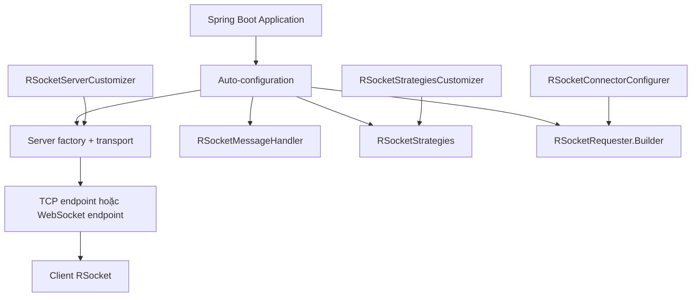

# Tùy chỉnh bằng RSocketServerCustomizer và RSocketConnectorConfigurer

Spring Boot có thể tự khởi tạo RSocket server và hạ tầng xử lý message khi ứng dụng có dependency phù hợp. Các thuộc tính `spring.rsocket.server.*` quyết định server lắng nghe ở transport và endpoint nào. Khi cần tinh chỉnh hành vi giao thức ở mức thấp hơn, ta dùng `RSocketServerCustomizer` cho server. Ở phía client, `RSocketConnectorConfigurer` cho phép cấu hình `RSocketConnector` mà Spring Boot dùng để tạo `RSocketRequester`.

Trong module `INTEGRATION_REALTIME_RSOCKET`, hai extension point này giúp ứng dụng Java/Spring Boot triển khai giao tiếp reactive hai chiều qua TCP hoặc WebSocket. Bài học tập trung vào ranh giới giữa cấu hình endpoint, cấu hình server RSocket và cấu hình connector phía client, sau đó ghép chúng thành một cấu hình có thể vận hành và kiểm thử.

## 1. Kiến trúc khởi tạo RSocket trong Spring Boot

Khi có `spring-boot-starter-rsocket`, Spring Boot có thể tự cấu hình các thành phần cơ bản:

- RSocket server và transport dựa trên các thuộc tính `spring.rsocket.server.*`.
- `RSocketMessageHandler` để tìm các controller có `@MessageMapping`.
- `RSocketStrategies` cùng encoder/decoder cho payload.
- `RSocketRequester.Builder` để client tạo kết nối đi ra.
- Các callback customizer để ứng dụng bổ sung cấu hình mà không phải tự quản lý toàn bộ vòng đời server hoặc connector.



`RSocketServerCustomizer` tác động lên đối tượng `io.rsocket.core.RSocketServer` trước khi server khởi chạy. `RSocketConnectorConfigurer` tác động lên `io.rsocket.core.RSocketConnector` dùng để mở kết nối phía client. `RSocketStrategiesCustomizer` là một extension point khác, chuyên cấu hình codec và serialization.

## 2. Dependency và phiên bản API

Với Maven, dependency khởi đầu thường là:

```xml
<dependency>
    <groupId>org.springframework.boot</groupId>
    <artifactId>spring-boot-starter-rsocket</artifactId>
</dependency>
```

Nếu muốn tích hợp endpoint WebSocket RSocket vào web server của ứng dụng reactive, thêm `spring-boot-starter-webflux` và sử dụng Reactor Netty. Spring Boot cũng có thể chạy một RSocket server độc lập trên port riêng mà không cần endpoint HTTP.

Các ví dụ Java trong bài dùng API Spring Boot 3.x, Spring Framework 6.x và RSocket Java 1.1.x. Hãy dùng Spring Boot dependency management/BOM để đồng bộ phiên bản Spring Framework, RSocket Core và transport. Một số package hoặc chữ ký API có thể thay đổi ở major version khác; không nên trộn snippet từ Boot 2.x, 3.x và 4.x trong cùng ứng dụng.

## 3. Phân biệt ba lớp cấu hình

| Lớp | Cấu hình chính | Vai trò |
| --- | --- | --- |
| Endpoint/transport | `spring.rsocket.server.transport`, `port`, `mapping-path`, `address`, SSL và cấu hình server factory. | Quyết định server lắng nghe ở đâu và qua TCP hay WebSocket. |
| RSocket server | `RSocketServerCustomizer`. | Tinh chỉnh frame, fragmentation, timeout nhận frame đầu, interceptor, lease hoặc resume. |
| RSocket client | `RSocketConnectorConfigurer`. | Tinh chỉnh keepalive, reconnect/resume, fragmentation, giới hạn payload và interceptor của connector. |
| Serialization | `RSocketStrategiesCustomizer`. | Đăng ký encoder, decoder và metadata extractor cho payload. |

Hai customizer trong đề bài không thay thế thuộc tính endpoint. Ví dụ, đổi port TCP là cấu hình server factory/`spring.rsocket.server.port`; thêm giới hạn kích thước payload là cấu hình RSocket server qua customizer.

## 4. Cấu hình endpoint TCP độc lập

Với TCP, Spring Boot khởi chạy một RSocket server độc lập. Cấu hình tối thiểu:

```yaml
spring:
  rsocket:
    server:
      transport: tcp
      port: 9898
```

Client có thể kết nối đến host và port đó bằng `RSocketRequester.Builder.tcp(...)`:

```java
RSocketRequester requester = requesterBuilder
    .tcp("localhost", 9898);
```

TCP phù hợp với service-to-service hoặc client native khi các bên có thể mở kết nối trực tiếp đến port RSocket. Khi triển khai production, cần xác định địa chỉ bind, firewall, TLS/mTLS và chính sách giới hạn kết nối theo môi trường.

Nếu không chỉ định transport, giá trị mặc định có thể phụ thuộc phiên bản và cấu hình auto-configuration. Để cấu hình có thể đọc và triển khai nhất quán giữa môi trường local, staging và production, nên khai báo rõ `transport` cùng `port`.

## 5. Đưa RSocket qua WebSocket của WebFlux

Nếu ứng dụng đã chạy WebFlux trên Reactor Netty, có thể gắn RSocket vào web server hiện tại bằng WebSocket mapping path:

```yaml
spring:
  main:
    web-application-type: reactive
  rsocket:
    server:
      transport: websocket
      mapping-path: /rsocket
```

Trong cấu hình này, RSocket dùng chung listener HTTP/WebFlux của ứng dụng. Client kết nối bằng URI WebSocket, ví dụ `ws://localhost:8080/rsocket` nếu web server đang chạy ở port 8080:

```java
RSocketRequester requester = requesterBuilder
    .websocket(URI.create("ws://localhost:8080/rsocket"));
```

Việc tích hợp RSocket vào web server yêu cầu ứng dụng WebFlux và Reactor Netty. `mapping-path` là đường dẫn WebSocket dành cho RSocket, không phải route `@MessageMapping` của nghiệp vụ.

### WebSocket server độc lập

Spring Boot cũng có thể chạy RSocket WebSocket server độc lập với port riêng, thay vì ghép vào listener WebFlux. Trong trường hợp đó, cấu hình transport và port của server độc lập, sau đó client kết nối đến URI WebSocket tương ứng. Hãy phân biệt rõ URI/port của server độc lập với mapping path được gắn vào web server.

Ví dụ cấu hình một listener WebSocket độc lập:

```yaml
spring:
  rsocket:
    server:
      transport: websocket
      port: 9898
```

Khi muốn ghép vào listener WebFlux, dùng `mapping-path` và không khai báo port RSocket riêng; khi muốn listener độc lập, cấu hình port riêng như ví dụ trên.

## 6. Khai báo route xử lý request

Spring Boot tự cấu hình `RSocketMessageHandler` để tìm các controller RSocket. Ví dụ một endpoint request-response:

```java
import org.springframework.messaging.handler.annotation.MessageMapping;
import org.springframework.stereotype.Controller;
import reactor.core.publisher.Mono;

@Controller
class InventoryRSocketController {

    private final InventoryService inventoryService;

    InventoryRSocketController(InventoryService inventoryService) {
        this.inventoryService = inventoryService;
    }

    @MessageMapping("inventory.lookup")
    Mono<InventoryView> lookup(InventoryQuery query) {
        return inventoryService.lookup(query.sku());
    }
}
```

Client gọi route tương ứng:

```java
import reactor.core.publisher.Mono;

Mono<InventoryView> result = requester
    .route("inventory.lookup")
    .data(new InventoryQuery("SKU-42"))
    .retrieveMono(InventoryView.class);
```

`@MessageMapping` là route ở tầng message. Nó không quyết định transport, port hoặc mapping path WebSocket. Các lớp cấu hình này hoạt động cùng nhau nhưng có trách nhiệm khác nhau.

## 7. Tùy chỉnh server bằng RSocketServerCustomizer

`RSocketServerCustomizer` nằm trong package `org.springframework.boot.rsocket.server`. Với Spring Boot 3.x, callback nhận một đối tượng `io.rsocket.core.RSocketServer`:

```java
import java.time.Duration;

import org.springframework.boot.rsocket.server.RSocketServerCustomizer;
import org.springframework.context.annotation.Bean;
import org.springframework.context.annotation.Configuration;

@Configuration
class RSocketServerConfiguration {

    @Bean
    RSocketServerCustomizer rSocketServerCustomizer() {
        return server -> server
            .fragment(64 * 1024)
            .maxInboundPayloadSize(16 * 1024 * 1024)
            .maxTimeToFirstFrame(Duration.ofSeconds(15));
    }
}
```

Ví dụ cấu hình ba hành vi:

- `fragment(...)` đặt ngưỡng kích thước để frame lớn được chia thành các fragment trước khi truyền.
- `maxInboundPayloadSize(...)` giới hạn payload sau khi reassemble. Giá trị phải phù hợp với giới hạn frame của transport; trong RSocket Java, ngưỡng này không được nhỏ hơn `Transport.maxFrameLength()`.
- `maxTimeToFirstFrame(...)` giới hạn thời gian chờ frame đầu tiên, thường là `SETUP`, sau khi chấp nhận kết nối.

Các giá trị trong ví dụ là minh họa. Hãy chọn MTU, payload limit và timeout dựa trên kích thước message thực tế, bộ nhớ, băng thông và SLA. Fragmentation không thay thế giới hạn payload; hai cấu hình kiểm soát hai khía cạnh khác nhau.

### Những cấu hình server khác

RSocket Java `RSocketServer` còn hỗ trợ cấu hình interceptor, lease, resume và payload decoder. Có thể bổ sung các tính năng này trong cùng customizer khi ứng dụng có yêu cầu tương ứng. Chỉ bật lease hoặc resume khi client cũng hỗ trợ và chính sách vận hành đã được thiết kế.

`RSocketServerCustomizer` không phải nơi tự bind port hoặc tự khởi chạy server. Spring Boot server factory quản lý transport và lifecycle; customizer chỉ tinh chỉnh đối tượng server trước khi factory khởi động nó.

## 8. Tùy chỉnh connector bằng RSocketConnectorConfigurer

`RSocketConnectorConfigurer` thuộc Spring Framework, package `org.springframework.messaging.rsocket`. Nó là callback cấu hình `io.rsocket.core.RSocketConnector` và được Spring Boot áp dụng cho `RSocketRequester.Builder` auto-configured khi bean này có mặt.

Ví dụ cấu hình keepalive, fragmentation, payload limit và reconnect:

```java
import java.time.Duration;

import org.springframework.context.annotation.Bean;
import org.springframework.context.annotation.Configuration;
import org.springframework.messaging.rsocket.RSocketConnectorConfigurer;
import reactor.util.retry.Retry;

@Configuration
class RSocketClientConfiguration {

    @Bean
    RSocketConnectorConfigurer rSocketConnectorConfigurer() {
        return connector -> connector
            .keepAlive(Duration.ofSeconds(20), Duration.ofSeconds(90))
            .fragment(64 * 1024)
            .maxInboundPayloadSize(16 * 1024 * 1024)
            .reconnect(Retry.backoff(5, Duration.ofSeconds(1))
                .maxBackoff(Duration.ofSeconds(30)));
    }
}
```

Ý nghĩa:

- `keepAlive(interval, maxLifetime)` xác định tần suất gửi `KEEPALIVE` và thời gian tối đa chờ keepalive từ peer trước khi xem kết nối đã mất.
- `fragment(...)` cấu hình kích thước fragment ở chiều gửi.
- `maxInboundPayloadSize(...)` giới hạn payload nhận sau khi reassemble.
- `reconnect(Retry)` cấu hình chiến lược mở lại kết nối khi transport bị gián đoạn.

`reconnect` và `resume` là hai chính sách khác nhau. Reconnect tạo lại kết nối; resume cố gắng khôi phục session và stream cũ khi cả hai phía còn đủ trạng thái. Nếu cần resume, cấu hình `.resume(...)` phù hợp thay cho `.reconnect(...)` và bật resume ở server; không bật hai chế độ cùng lúc.

## 9. Spring Boot áp dụng connector configurer như thế nào?

Spring Boot auto-configures một `RSocketRequester.Builder` prototype và áp dụng các bean `RSocketConnectorConfigurer` khi tạo builder. Vì builder có trạng thái, mỗi nơi cần tạo requester nên nhận một builder riêng từ container.

Ví dụ service tạo requester TCP:

```java
import org.springframework.messaging.rsocket.RSocketRequester;
import org.springframework.stereotype.Service;
import reactor.core.publisher.Mono;

@Service
class InventoryClient {

    private final RSocketRequester requester;

    InventoryClient(RSocketRequester.Builder builder) {
        this.requester = builder.tcp("inventory.internal", 9898);
    }

    Mono<InventoryView> lookup(String sku) {
        return requester
            .route("inventory.lookup")
            .data(new InventoryQuery(sku))
            .retrieveMono(InventoryView.class);
    }
}
```

Vì Spring Boot áp dụng `RSocketConnectorConfigurer` vào builder auto-configured, service không cần gọi lại customizer bằng tay. Nếu tự tạo `RSocketRequester.Builder` độc lập, hãy áp dụng cấu hình connector một cách tường minh qua `builder.rsocketConnector(...)`.

Khi dùng `RSocketRequester.Builder.rsocketConnector(...)`, các thiết lập data MIME type, metadata MIME type và frame decoder cần dùng shortcut tương ứng của builder. Không đặt lại các trường đó trực tiếp trên connector vì builder sẽ quản lý chúng để đồng bộ với codec và `DataBufferFactory`.

## 10. Cấu hình client TCP và WebSocket

Client TCP:

```java
RSocketRequester tcpRequester = builder
    .tcp("localhost", 9898);
```

Client WebSocket:

```java
import java.net.URI;

RSocketRequester websocketRequester = builder
    .websocket(URI.create("ws://localhost:8080/rsocket"));
```

`tcp(host, port)` và `websocket(uri)` chọn transport cho requester. `RSocketConnectorConfigurer` áp dụng các tùy chỉnh protocol-level cho connector, không tự đổi địa chỉ endpoint. Địa chỉ, port và URI vẫn được chọn ở nơi tạo requester.

Nếu client cần kết nối đến nhiều server hoặc dùng transport khác nhau, không nên dùng một requester đã kết nối rồi cố đổi transport. Hãy tạo requester riêng theo endpoint và quản lý lifecycle của từng connection.

## 11. Tùy chỉnh codec bằng RSocketStrategiesCustomizer

Hai customizer trong đề bài không cấu hình cách Java object được encode/decode. Phần này thuộc `RSocketStrategiesCustomizer` hoặc bean `RSocketStrategies` tùy cách ứng dụng tổ chức.

Spring Boot auto-configures các codec phổ biến như JSON và CBOR khi dependency tương ứng có trên classpath. Nếu có DTO hoặc metadata MIME type riêng, có thể thêm encoder/decoder. Thứ tự customizer (`@Order`) ảnh hưởng thứ tự codec được đăng ký.

Giữ MIME type thống nhất giữa client và server. Một connector được cấu hình đúng keepalive nhưng codec không tương thích vẫn có thể thiết lập connection thành công rồi thất bại khi giải mã payload.

## 12. Bảo mật endpoint TCP và WebSocket

Transport và endpoint cần được bảo vệ theo môi trường triển khai:

- Với TCP, giới hạn port chỉ mở trong network segment cần thiết; cấu hình TLS/mTLS khi kết nối đi qua mạng không đáng tin cậy.
- Với WebSocket, dùng `wss://` qua TLS trong production và cấu hình reverse proxy để chuyển tiếp đúng WebSocket upgrade và mapping path.
- Xác thực principal trong giai đoạn setup hoặc bằng cơ chế Spring Security RSocket; không xem route hay metadata do client gửi là bằng chứng quyền truy cập.
- Giới hạn kích thước payload, thời gian chờ frame đầu, số kết nối và concurrency để giảm nguy cơ tiêu thụ tài nguyên quá mức.
- Không ghi token, credential hoặc payload nhạy cảm vào log của interceptor.

`RSocketServerCustomizer` có thể cấu hình một số hành vi server-level, nhưng certificate, bind address, port và transport được cấu hình ở server factory/SSL properties. Không nên cố xử lý toàn bộ TLS bằng connector customizer phía client.

## 13. Quan sát và vòng đời server

Spring Boot quản lý việc khởi động và dừng RSocket server theo vòng đời `ApplicationContext`. Server factory tạo server đã cấu hình nhưng chưa nhận client cho tới khi context được refresh và server được start. Khi ứng dụng shutdown, lifecycle quản lý việc dừng listener.

Có thể quan sát server đã khởi tạo qua `RSocketServerInitializedEvent` và lấy thông tin server thực tế, hữu ích khi port được cấp tự động trong môi trường kiểm thử. Tránh tự bind thêm một server bằng `RSocketServer.bindNow(...)` nếu Boot đã quản lý endpoint; nếu không, ứng dụng có thể mở hai listener và tạo hai lifecycle độc lập.

Các metric hữu ích gồm số kết nối đang hoạt động, setup thành công/thất bại, lỗi transport, số stream, độ trễ xử lý, số payload bị từ chối do giới hạn kích thước và số lần reconnect. Tránh đưa user ID hoặc token vào metric label có cardinality cao.

## 14. Kiểm thử cấu hình TCP/WebSocket và customizer

Nên kiểm thử theo từng lớp:

1. **Context test:** khởi động Spring context và xác nhận các bean customizer được đăng ký.
2. **Endpoint test:** với TCP, kết nối requester đến port server; với WebSocket, kết nối đến đúng URI hoặc mapping path.
3. **Routing test:** gọi route `@MessageMapping` và xác nhận kiểu response.
4. **Connector test:** xác nhận keepalive, reconnect hoặc resume được cấu hình theo chính sách; kiểm tra lỗi khi server dừng.
5. **Server limit test:** gửi payload vượt giới hạn để xác nhận server từ chối đúng cách và không làm hỏng connection khác.
6. **Codec test:** gửi DTO qua JSON/CBOR và xác nhận client/server giải mã tương thích.
7. **Lifecycle test:** đóng application context và xác nhận listener ngừng nhận kết nối.

Ví dụ kiểm thử handler bằng `StepVerifier`:

Giả sử `inventoryService` là fixture đã được khởi tạo với dữ liệu kiểm thử.

```java
import org.junit.jupiter.api.Test;
import reactor.core.publisher.Mono;
import reactor.test.StepVerifier;

import static org.junit.jupiter.api.Assertions.assertEquals;
import static org.junit.jupiter.api.Assertions.assertTrue;

class InventoryServiceTest {
    @Test
    void returnsInventoryForKnownSku() {
        Mono<InventoryView> result = inventoryService.lookup("SKU-42");

        StepVerifier.create(result)
            .assertNext(view -> {
                assertEquals("SKU-42", view.sku());
                assertTrue(view.available() >= 0);
            })
            .verifyComplete();
    }
}
```

Test trên kiểm tra logic reactive của service; nó không thay thế kiểm thử tích hợp transport. Để kiểm tra TCP/WebSocket thực tế, khởi chạy ứng dụng hoặc server test trong context riêng và tạo requester bằng đúng transport đang triển khai.

## 15. Những lỗi cấu hình thường gặp

**Nhầm customizer server với cấu hình endpoint.** `RSocketServerCustomizer` tinh chỉnh RSocket server; port, transport và mapping path thuộc `spring.rsocket.server.*` hoặc server factory.

**Nhầm package của hai interface.** `RSocketServerCustomizer` thuộc Spring Boot (`org.springframework.boot.rsocket.server`); `RSocketConnectorConfigurer` thuộc Spring Framework (`org.springframework.messaging.rsocket`).

**Cho rằng connector configurer tự tạo kết nối.** Nó chỉ cấu hình connector. Client vẫn cần gọi `tcp(...)`, `websocket(...)` hoặc phương thức transport tương ứng để tạo requester.

**Cấu hình WebSocket mapping trên ứng dụng không phải WebFlux.** Tích hợp RSocket vào web server qua `mapping-path` yêu cầu WebFlux và Reactor Netty. Nếu dùng server độc lập, cấu hình port/transport của server riêng.

**Tự bind server trong khi Boot đã auto-configure.** Việc này có thể tạo listener trùng và làm lifecycle khó kiểm soát. Dùng customizer để tinh chỉnh server do Boot quản lý.

**Giới hạn payload nhỏ hơn giới hạn frame transport.** `maxInboundPayloadSize` phải tương thích với `Transport.maxFrameLength()` và kích thước payload sau reassembly.

**Bật reconnect và resume cùng lúc.** Đây là các chế độ phục hồi khác nhau; chọn một chính sách theo yêu cầu session.

**Dùng chung một requester builder có trạng thái cho nhiều endpoint.** Builder prototype của Spring Boot nên được inject riêng; tạo requester riêng cho từng endpoint/transport.

## 16. Ghi nhớ

- Spring Boot auto-configures RSocket server, `RSocketMessageHandler`, `RSocketStrategies` và `RSocketRequester.Builder` khi có starter phù hợp.
- `spring.rsocket.server.*` cấu hình endpoint; `RSocketServerCustomizer` tùy chỉnh server; `RSocketConnectorConfigurer` tùy chỉnh connector phía client.
- Với Boot 3.x, `RSocketServerCustomizer` nhận `io.rsocket.core.RSocketServer`; `RSocketConnectorConfigurer` thuộc Spring Framework package `org.springframework.messaging.rsocket`.
- TCP độc lập thường dùng `transport: tcp` và `port`; WebSocket tích hợp vào WebFlux dùng `transport: websocket` cùng `mapping-path`.
- WebSocket gắn vào web server yêu cầu WebFlux và Reactor Netty; server TCP/WebSocket độc lập có thể lắng nghe trên port riêng.
- `fragment`, `maxInboundPayloadSize`, `maxTimeToFirstFrame`, `keepAlive` và `reconnect` điều chỉnh hành vi protocol-level, không thay thế cấu hình endpoint.
- Boot tự áp dụng connector configurer beans cho `RSocketRequester.Builder` auto-configured.
- Dùng `RSocketStrategiesCustomizer` cho encoder/decoder; không nhầm codec với connector hoặc server customizer.
- Kiểm thử riêng endpoint, route, codec, reconnect, giới hạn payload và lifecycle shutdown.

## Tài liệu tham khảo

- [Spring Boot Reference — RSocket server auto-configuration](https://docs.spring.io/spring-boot/docs/3.2.7/reference/htmlsingle/#messaging.rsocket.server-auto-configuration)
- [Spring Boot API — RSocketServerCustomizer](https://docs.spring.io/spring-boot/docs/3.2.11/api/org/springframework/boot/rsocket/server/RSocketServerCustomizer.html)
- [Spring Framework API — RSocketConnectorConfigurer](https://docs.spring.io/spring-framework/docs/6.0.x/javadoc-api/org/springframework/messaging/rsocket/RSocketConnectorConfigurer.html)
- [RSocket Java API — RSocketServer](https://javadoc.io/static/io.rsocket/rsocket-core/1.1.5/io/rsocket/core/RSocketServer.html)
- [RSocket Java API — RSocketConnector](https://javadoc.io/static/io.rsocket/rsocket-core/1.1.5/io/rsocket/core/RSocketConnector.html)
