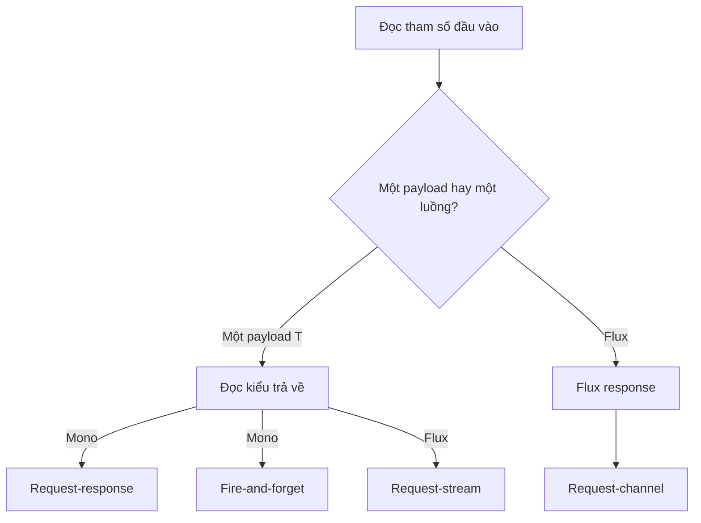

# Chọn mô hình tương tác từ kiểu đầu vào và đầu ra của handler

## Mục tiêu bài học

Trong Spring RSocket, chữ ký method của handler thể hiện cách ứng dụng nhận dữ liệu và phát kết quả. Kiểu tham số đầu vào cho biết handler nhận một payload hay một luồng payload; kiểu trả về cho biết handler không trả dữ liệu, trả tối đa một kết quả hay phát nhiều kết quả.

Spring dùng những đặc điểm này để ánh xạ handler vào một trong bốn mô hình tương tác RSocket: request-response, fire-and-forget, request-stream và request-channel.

Sau bài này, bạn có thể:

- Đọc chữ ký handler và xác định mô hình tương tác tương ứng.
- Phân biệt cardinality của request với cardinality của response.
- Chọn Mono, Flux và kiểu tham số phù hợp trong Spring.
- Viết client RSocketRequester gọi đúng kiểu tương tác.
- Thiết kế request-channel khi cả hai phía cần trao đổi luồng dữ liệu.
- Tránh các lỗi như trả Flux khi chỉ cần một kết quả, dùng fire-and-forget khi cần xác nhận, hoặc tự subscribe trong handler.

## Nguyên tắc: nhìn vào đầu vào và đầu ra

Một route RSocket không tự quyết định interaction type chỉ bằng tên route. Spring phân tích chữ ký của method được gắn @MessageMapping để xác định dữ liệu đi vào và dữ liệu đi ra.

Có hai câu hỏi cần trả lời:

1. **Handler nhận bao nhiêu payload?** Một payload đơn lẻ hay một luồng payload?
2. **Handler phát bao nhiêu kết quả?** Không có response nghiệp vụ, tối đa một response hay nhiều response?

Các kiểu reactive thường gặp:

- **Mono<T>:** một publisher bất đồng bộ có thể phát tối đa một phần tử kiểu T rồi hoàn tất.
- **Flux<T>:** một publisher bất đồng bộ có thể phát không, một hoặc nhiều phần tử kiểu T rồi hoàn tất.
- **Mono<Void>:** publisher chỉ biểu thị việc hoàn tất hoặc lỗi của công việc, không phát giá trị nghiệp vụ.

Trong các ví dụ dưới đây, tham số kiểu DTO như `OrderRequest` biểu diễn một payload đầu vào. Tham số `Flux<OrderCommand>` biểu diễn luồng payload đầu vào của request-channel.

## Bảng chọn mô hình tương tác

Bảng này tóm tắt những chữ ký handler phổ biến:

| Mô hình RSocket | Đầu vào handler | Kiểu trả về điển hình | Ý nghĩa |
|---|---|---|---|
| Request-response | Một payload `T` | `Mono<R>` | Một request, tối đa một response |
| Fire-and-forget | Một payload `T` | `Mono<Void>` | Một request, không có response nghiệp vụ |
| Request-stream | Một payload `T` | `Flux<R>` | Một request, nhiều response |
| Request-channel | `Flux<T>` | `Flux<R>` | Luồng request và luồng response hai chiều |

`Mono` và `Flux` không chỉ là kiểu dữ liệu trả về. Chúng mô tả cardinality và vòng đời bất đồng bộ của publisher. Đặc biệt, với request-channel, tham số đầu vào là một publisher nhiều phần tử; handler tiêu thụ luồng đó và trả một publisher cho chiều response.



Đây là các mẫu chữ ký điển hình để thiết kế handler. Hãy giữ chữ ký rõ ràng, không dùng kiểu trả về quá rộng hoặc raw Publisher nếu không cần thiết, vì generic type giúp Spring chọn codec và chuyển đổi payload chính xác.

## Request-response: một request, một kết quả

Dùng request-response khi client gửi một payload và cần tối đa một kết quả để tiếp tục nghiệp vụ. Ví dụ: tra cứu thông tin tồn kho, lấy hồ sơ người dùng hoặc tính giá một đơn hàng.

Phía server:

```java
import org.springframework.messaging.handler.annotation.MessageMapping;
import org.springframework.stereotype.Controller;
import reactor.core.publisher.Mono;

record StockRequest(String sku) {}

record StockView(String sku, int available) {}

@Controller
class StockController {

    private final StockService stockService;

    StockController(StockService stockService) {
        this.stockService = stockService;
    }

    @MessageMapping("stock.lookup")
    Mono<StockView> lookup(StockRequest request) {
        return stockService.find(request.sku());
    }
}
```

Đầu vào là một `StockRequest`; đầu ra là `Mono<StockView>`. Đây là request-response. Mono có thể phát một StockView rồi hoàn tất, hoặc hoàn tất rỗng nếu service không có kết quả theo hợp đồng ứng dụng.

Client gọi route bằng `retrieveMono`:

```java
Mono<StockView> result = requester
    .route("stock.lookup")
    .data(new StockRequest("SKU-42"))
    .retrieveMono(StockView.class);
```

Dùng request-response khi kết quả cần được ghép với request ban đầu. Nếu handler cần phát nhiều cập nhật theo thời gian, hãy xem request-stream. Nếu client cần gửi liên tục nhiều payload, hãy xem request-channel.

## Fire-and-forget: gửi một request, không chờ response nghiệp vụ

Dùng fire-and-forget khi client gửi một tín hiệu hoặc lệnh mà không cần response từ server trong tương tác đó. Ví dụ: ghi nhận một telemetry event, phát tín hiệu invalidation hoặc gửi một thông báo best-effort.

Phía server:

```java
import org.springframework.messaging.handler.annotation.MessageMapping;
import org.springframework.stereotype.Controller;
import reactor.core.publisher.Mono;

record ViewEvent(String itemId, String action) {}

@Controller
class ViewEventController {

    private final ViewEventService eventService;

    ViewEventController(ViewEventService eventService) {
        this.eventService = eventService;
    }

    @MessageMapping("views.record")
    Mono<Void> record(ViewEvent event) {
        return eventService.record(event);
    }
}
```

Đầu vào là một payload đơn. `Mono<Void>` biểu thị công việc bất đồng bộ phía server không phát response payload. Việc handler hoàn tất hoặc phát lỗi vẫn quan trọng với vòng đời xử lý nội bộ và log, nhưng requester không nhận kết quả nghiệp vụ qua fire-and-forget.

Client gọi `send()`:

```java
Mono<Void> sent = requester
    .route("views.record")
    .data(new ViewEvent("item-42", "OPEN"))
    .send();
```

Cần phân biệt hai điều:

- `send()` hoàn tất ở phía client cho biết thao tác gửi của client đã hoàn tất theo API và transport.
- Nó không xác nhận server đã commit dữ liệu hoặc hoàn thành nghiệp vụ.

Nếu client cần biết server đã tiếp nhận lệnh, hãy dùng request-response để trả xác nhận hoặc thiết kế mã lệnh kèm route truy vấn trạng thái. Không chọn fire-and-forget cho thao tác quan trọng chỉ vì muốn tránh chờ response.

## Request-stream: một request, nhiều response

Dùng request-stream khi một yêu cầu ban đầu mở ra một luồng dữ liệu từ server về client. Ví dụ: theo dõi giá, trạng thái thiết bị, tiến độ công việc hoặc các thay đổi của một đối tượng.

Phía server:

```java
import org.springframework.messaging.handler.annotation.MessageMapping;
import org.springframework.stereotype.Controller;
import reactor.core.publisher.Flux;

record PriceWatch(String symbol) {}

record PriceTick(String symbol, long sequence, double price) {}

@Controller
class PriceController {

    private final PriceService priceService;

    PriceController(PriceService priceService) {
        this.priceService = priceService;
    }

    @MessageMapping("prices.watch")
    Flux<PriceTick> watch(PriceWatch request) {
        return priceService.watch(request.symbol());
    }
}
```

Đầu vào vẫn là một payload `PriceWatch`, nhưng đầu ra là `Flux<PriceTick>`. Vì vậy, đây là request-stream chứ không phải request-channel.

Client gọi `retrieveFlux`:

```java
Flux<PriceTick> ticks = requester
    .route("prices.watch")
    .data(new PriceWatch("ACME"))
    .retrieveFlux(PriceTick.class);
```

Client có thể nhận nhiều phần tử theo thời gian. Luồng có thể complete khi nguồn dữ liệu kết thúc, phát error khi có lỗi hoặc bị cancel khi client không còn quan tâm.

Request-stream không có nghĩa server phát vô hạn. Hãy xác định điều kiện kết thúc, timeout/idle policy và cleanup subscription tới nguồn dữ liệu. Nếu dữ liệu cần được replay sau khi reconnect, nguồn sự kiện cần hỗ trợ lưu trạng thái hoặc cursor ở tầng ứng dụng.

## Request-channel: hai luồng dữ liệu

Dùng request-channel khi client gửi nhiều payload và server cũng có thể phát nhiều payload phản hồi trong cùng tương tác. Đây là lựa chọn phù hợp cho phiên cộng tác, telemetry hai chiều, điều khiển thiết bị hoặc xử lý một tập command trong khi server gửi tiến độ.

Phía server:

```java
import org.springframework.messaging.handler.annotation.MessageMapping;
import org.springframework.stereotype.Controller;
import reactor.core.publisher.Flux;

record DeviceCommand(String deviceId, String action) {}

record DeviceEvent(String deviceId, String state) {}

@Controller
class DeviceChannelController {

    private final DeviceService deviceService;

    DeviceChannelController(DeviceService deviceService) {
        this.deviceService = deviceService;
    }

    @MessageMapping("devices.channel")
    Flux<DeviceEvent> channel(Flux<DeviceCommand> commands) {
        return commands.concatMap(deviceService::handle);
    }
}
```

Tham số `Flux<DeviceCommand>` cho biết handler nhận một luồng command. Kết quả `Flux<DeviceEvent>` là luồng response gửi ngược lại client. Đây là request-channel.

Client gọi `retrieveFlux` và truyền một publisher làm dữ liệu đầu vào:

```java
Flux<DeviceCommand> commands = Flux.just(
    new DeviceCommand("device-7", "START"),
    new DeviceCommand("device-7", "SET_LEVEL"),
    new DeviceCommand("device-7", "STOP")
);

Flux<DeviceEvent> events = requester
    .route("devices.channel")
    .data(commands)
    .retrieveFlux(DeviceEvent.class);
```

Trong ví dụ này, `concatMap` xử lý từng command theo thứ tự và chờ Mono kết quả của command trước hoàn tất rồi mới xử lý command tiếp theo. Nếu dùng `flatMap`, nhiều command có thể được xử lý đồng thời; thứ tự event phản hồi có thể khác thứ tự command. Khi cần concurrency, hãy đặt giới hạn rõ ràng.

Request-channel cho phép hai hướng hoàn tất độc lập. Client có thể gửi hết command rồi tiếp tục nhận event. Server cũng có thể hoàn tất chiều response trong khi client vẫn gửi request, tùy thiết kế. Complete một chiều không đồng nghĩa cancel toàn channel.

Không tự gọi `subscribe()` bên trong handler để xử lý `commands`. Hãy trả về publisher để Spring/Reactor quản lý subscription, demand, cancellation và lỗi theo vòng đời tương tác.

## Cách đọc chữ ký khi có kiểu đồng bộ và kiểu reactive

Spring hỗ trợ nhiều kiểu payload và kiểu trả về, nhưng trong ứng dụng RSocket reactive, các chữ ký `Mono` và `Flux` thường làm rõ ý định nhất.

Một số nguyên tắc:

- Tham số payload đơn như `StockRequest request` thể hiện một request payload.
- Tham số `Flux<Command>` thể hiện luồng request của request-channel.
- `Mono<Response>` thể hiện tối đa một kết quả.
- `Mono<Void>` thể hiện không phát response payload.
- `Flux<Response>` thể hiện nhiều response.

Không nên dùng `Flux<Response>` chỉ vì service đang dùng Reactor. Nếu nghiệp vụ chỉ có một kết quả, `Mono<Response>` diễn đạt đúng cardinality và giúp client dùng `retrieveMono`. Ngược lại, không ép một luồng cập nhật thành một Mono bằng cách lấy phần tử đầu tiên nếu client cần theo dõi liên tục.

Một method trả object đồng bộ có thể đơn giản với tác vụ CPU nhẹ, nhưng nếu I/O hoặc xử lý có thể kéo dài, hãy trả publisher phù hợp để không chặn luồng xử lý mạng. Không bọc một lời gọi blocking trong `Mono.just(...)` rồi cho rằng nó đã trở thành non-blocking; dùng scheduler phù hợp hoặc API I/O reactive.

## Chọn theo nhu cầu nghiệp vụ

| Câu hỏi của client | Mô hình phù hợp | Ví dụ |
|---|---|---|
| Tôi gửi một yêu cầu và cần một kết quả | Request-response | Tra cứu tồn kho |
| Tôi chỉ gửi một tín hiệu, không cần phản hồi nghiệp vụ | Fire-and-forget | Ghi nhận view event |
| Tôi đăng ký một nguồn dữ liệu và nhận nhiều cập nhật | Request-stream | Theo dõi giá thị trường |
| Tôi gửi nhiều lệnh và nhận nhiều event trong cùng phiên | Request-channel | Điều khiển thiết bị |
| Tôi cần xác nhận lệnh đã được tiếp nhận | Request-response | Trả command ID hoặc trạng thái ACCEPTED |
| Tôi cần theo dõi tiến độ của tác vụ chạy lâu | Request-stream hoặc channel | Theo dõi job theo command ID |

Hãy bắt đầu từ hợp đồng nghiệp vụ: dữ liệu nào được gửi, phản hồi nào cần có và ai kiểm soát thời gian sống của tương tác. Sau đó mới chọn chữ ký Java.

## Các lỗi chọn mô hình thường gặp

### Trả Mono<Void> nhưng client mong nhận xác nhận

Mono<Void> không phát response payload. Nếu client gọi `retrieveMono(Ack.class)` cho route fire-and-forget, hợp đồng không khớp. Muốn nhận Ack, handler cần trả kiểu response như `Mono<Ack>` và client dùng request-response.

### Trả Flux khi chỉ có một kết quả

Flux vẫn hoạt động với một phần tử, nhưng nó thể hiện khả năng phát nhiều phần tử. Nếu nghiệp vụ chỉ có một kết quả, Mono rõ ràng hơn và tránh khiến người đọc nghĩ route là stream.

### Dùng tham số đơn nhưng nghĩ rằng handler là request-channel

Một tham số `Command command` là một payload đầu vào. Dù method trả Flux, tương tác vẫn là request-stream: một request mở ra nhiều response. Để nhận luồng request, handler cần tham số dạng `Flux<Command>`.

### Dùng Flux đầu vào nhưng tự subscribe

Ví dụ sau là cách làm sai:

```java
@MessageMapping("commands.bad")
Mono<Void> handle(Flux<Command> commands) {
    commands.subscribe(commandService::handle);
    return Mono.empty();
}
```

Handler tự subscribe làm tách vòng đời xử lý khỏi tương tác RSocket. Spring không còn quản lý đầy đủ demand, lỗi và cancellation của công việc đó. Hãy trả publisher từ pipeline thay vì tạo subscription phụ:

```java
@MessageMapping("commands.good")
Mono<Void> handle(Flux<Command> commands) {
    return commands
        .concatMap(commandService::handle)
        .then();
}
```

Nếu client cần nhận event trong khi gửi command, đổi kiểu trả về thành `Flux<Event>` và thiết kế pipeline channel tương ứng.

### Dùng fire-and-forget cho thao tác cần độ tin cậy cao

FNF không trả xác nhận nghiệp vụ. Với thao tác có tác dụng phụ quan trọng, cần xác nhận tiếp nhận, idempotency, truy vấn trạng thái hoặc cơ chế lưu trữ bền vững tùy yêu cầu.

### Quên vòng đời của stream

Request-stream và request-channel có thể tồn tại lâu. Cần cleanup khi complete, error hoặc cancel; giới hạn tài nguyên và xác định hành vi khi client mất kết nối.

## Kiểm thử chữ ký và interaction type

Kiểm thử nên xác nhận đúng số lượng phần tử và kiểu kết thúc, không chỉ kiểm tra route có phản hồi.

Request-response:

```java
StepVerifier.create(
        requester.route("stock.lookup")
            .data(new StockRequest("SKU-42"))
            .retrieveMono(StockView.class)
    )
    .expectNextMatches(view -> view.sku().equals("SKU-42"))
    .verifyComplete();
```

Fire-and-forget:

```java
StepVerifier.create(
        requester.route("views.record")
            .data(new ViewEvent("item-42", "OPEN"))
            .send()
    )
    .verifyComplete();
```

Kiểm thử FNF cần xác minh side effect qua repository giả, spy hoặc trạng thái quan sát được ở phía server. `send()` complete không chứng minh nghiệp vụ server đã commit.

Request-stream:

```java
StepVerifier.create(
        requester.route("prices.watch")
            .data(new PriceWatch("ACME"))
            .retrieveFlux(PriceTick.class)
            .take(3)
    )
    .expectNextCount(3)
    .verifyComplete();
```

Request-channel:

```java
Flux<DeviceCommand> commands = Flux.just(
    new DeviceCommand("device-7", "START"),
    new DeviceCommand("device-7", "STOP")
);

StepVerifier.create(
        requester.route("devices.channel")
            .data(commands)
            .retrieveFlux(DeviceEvent.class)
    )
    .expectNextCount(2)
    .verifyComplete();
```

Các đoạn trên minh họa cách kiểm tra client publisher; trong test tích hợp, cần khởi động RSocket server thật hoặc test server, cấu hình codec và kết nối requester. Với stream dài hạn, dùng `thenCancel()` hoặc `take(n)` để test kết thúc và cleanup có chủ đích.

## Quy trình chọn mô hình trong thực tế

Trước khi viết method, hãy làm theo trình tự:

1. Xác định client gửi một payload hay nhiều payload.
2. Xác định server cần trả không có dữ liệu, một kết quả hay nhiều kết quả.
3. Chọn chữ ký tham số và kiểu trả về tương ứng.
4. Chọn API client khớp với hợp đồng: `retrieveMono`, `send` hoặc `retrieveFlux`.
5. Xác định complete, error, cancel, timeout và backpressure.
6. Kiểm tra xem client có cần xác nhận nghiệp vụ hay theo dõi trạng thái sau khi gửi không.
7. Viết integration test để xác nhận đúng interaction type và vòng đời.

Một quy tắc dễ nhớ là: đầu vào đơn cộng đầu ra Mono là request-response; đầu vào đơn cộng Mono<Void> là fire-and-forget; đầu vào đơn cộng Flux là request-stream; đầu vào Flux cộng đầu ra Flux là request-channel. Khi thiết kế theo cardinality và nhu cầu nghiệp vụ, chữ ký Spring RSocket sẽ thể hiện rõ hợp đồng giao tiếp giữa client và server.

