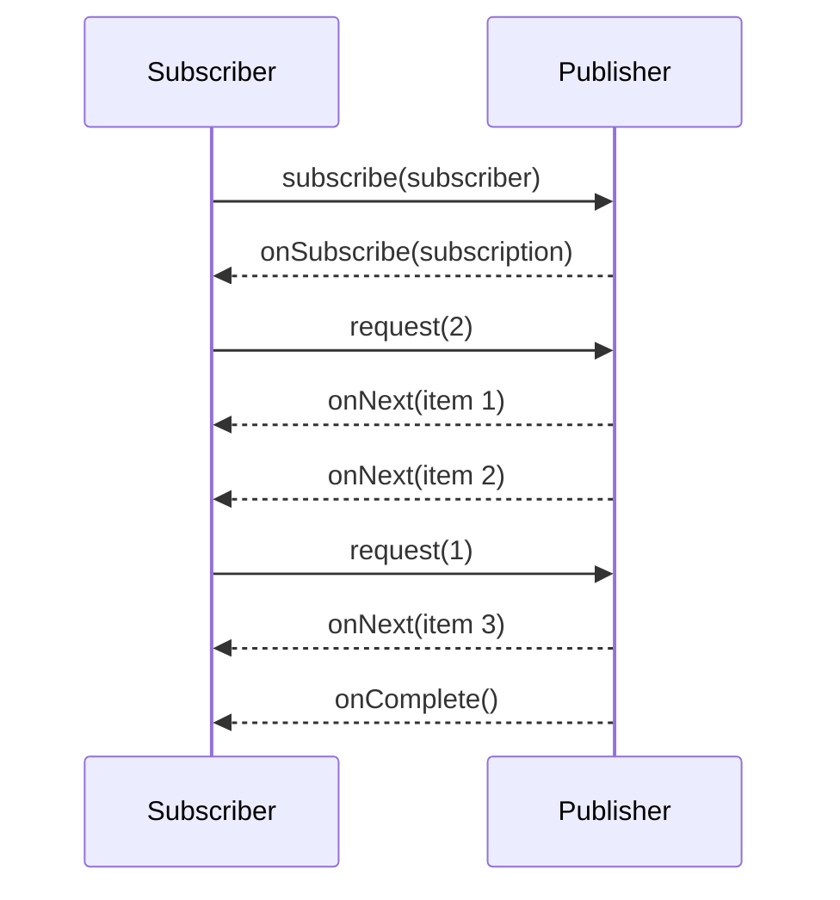

# Lập trình phản ứng và mô hình truyền tín hiệu Reactive Streams

Trong module `INTEGRATION_REALTIME_RSOCKET`, lập trình phản ứng là nền tảng để xây dựng giao tiếp bất đồng bộ, hai chiều và có khả năng điều tiết luồng qua TCP hoặc WebSocket. Khi triển khai client và server Java với Spring Boot, ta thường làm việc với `Mono`, `Flux` và các publisher/subscriber để biểu diễn kết quả đơn lẻ hoặc chuỗi dữ liệu liên tục. Hiểu mô hình tín hiệu Reactive Streams giúp ta biết dữ liệu được phát khi nào, bên nhận yêu cầu bao nhiêu phần tử, lỗi kết thúc luồng ra sao và việc hủy đăng ký ảnh hưởng thế nào đến một phiên realtime.

Bài học này tập trung vào ba ý: tư duy dữ liệu như một dòng sự kiện, hợp đồng tín hiệu của Reactive Streams và cơ chế backpressure. Đây là cơ sở để hiểu các mô hình request-response, fire-and-forget, request-stream và request-channel của RSocket, cũng như cách kiểm thử chúng.

## 1. Từ xử lý tuần tự đến dòng dữ liệu phản ứng

Trong cách lập trình tuần tự quen thuộc, một hàm thường nhận đầu vào, xử lý rồi trả về kết quả. Nếu thao tác cần gọi dịch vụ từ xa, đọc tệp hoặc truy vấn cơ sở dữ liệu, luồng thực thi có thể phải chờ thao tác đó hoàn tất. Khi có nhiều nguồn sự kiện đến liên tục, việc tổ chức vòng lặp đọc, hàng đợi, callback và trạng thái thủ công trở nên phức tạp.

Lập trình phản ứng (reactive programming) mô hình hóa dữ liệu và sự kiện thành các dòng có thể quan sát và biến đổi. Một dòng có thể phát một giá trị, nhiều giá trị hoặc không phát giá trị nào; nó cũng có thể kết thúc bình thường hoặc kết thúc do lỗi. Thay vì yêu cầu chương trình lấy từng giá trị theo cách đồng bộ, bên tiêu thụ đăng ký nhận dữ liệu và phản ứng với các tín hiệu được phát ra.

Ví dụ, một hệ thống giám sát nhiệt độ có thể nhận các mẫu đo theo thời gian. Dòng dữ liệu có thể được lọc để bỏ mẫu không hợp lệ, chuyển đổi đơn vị, gom theo khoảng thời gian rồi gửi đến giao diện theo dõi. Mỗi bước là một phép biến đổi trên dòng dữ liệu:

```text
Nguồn cảm biến
    -> kiểm tra mẫu
    -> đổi đơn vị
    -> lọc theo ngưỡng
    -> gửi dữ liệu đến người theo dõi
```

Điểm quan trọng là dòng dữ liệu có thể tiếp tục tồn tại sau khi một giá trị đã được xử lý. Người tiêu thụ không cần biết trước có bao nhiêu mẫu sẽ đến. Điều này phù hợp với dữ liệu realtime như giá thị trường, trạng thái thiết bị, thông báo hoặc sự kiện trong một phiên cộng tác.

### Reactive không đồng nghĩa với đa luồng

Một pipeline reactive có thể chạy đồng bộ trên một luồng, chạy bất đồng bộ hoặc chuyển qua nhiều scheduler tùy thư viện và cách cấu hình. Reactive mô tả cách biểu diễn, kết hợp và tiêu thụ dòng dữ liệu; nó không tự động bảo đảm mỗi toán tử chạy trên một thread riêng.

Tương tự, bất đồng bộ không tự động đồng nghĩa với có backpressure. Một callback bất đồng bộ vẫn có thể đẩy dữ liệu nhanh hơn khả năng xử lý của bên nhận. Reactive Streams bổ sung một hợp đồng điều tiết nhu cầu để hai phía phối hợp tốc độ phát và tốc độ tiêu thụ.

Reactive programming cũng không nên bị đồng nhất với Reactive Systems. Reactive Systems là cách thiết kế hệ thống hướng đến khả năng phản hồi, phục hồi, co giãn và giao tiếp bằng thông điệp. Reactive Streams là một đặc tả giao tiếp giữa các thành phần xử lý dòng dữ liệu trên JVM. Chúng có liên quan, nhưng giải quyết các lớp vấn đề khác nhau.

## 2. Reactive Streams là gì?

Reactive Streams là đặc tả cho việc xử lý các dòng dữ liệu bất đồng bộ với cơ chế backpressure không chặn (non-blocking backpressure). Đặc tả định nghĩa một hợp đồng nhỏ để các thư viện và thành phần khác nhau có thể kết nối với nhau mà không phải phụ thuộc vào cách cài đặt nội bộ của từng thư viện.

Trong hệ sinh thái Java, cần phân biệt hai bộ kiểu thường gặp:

- `org.reactivestreams`: các interface Reactive Streams được dùng rộng rãi bởi Reactor và nhiều thư viện reactive trên JVM.
- `java.util.concurrent.Flow`: bộ interface được đưa vào JDK từ Java 9, có mô hình tương ứng với Reactive Streams.

Các interface chính của Reactive Streams gồm:

| Thành phần | Vai trò |
| --- | --- |
| `Publisher<T>` | Nguồn phát các phần tử kiểu `T`; nhận một `Subscriber` thông qua `subscribe`. |
| `Subscriber<T>` | Bên tiêu thụ; nhận đăng ký, phần tử, tín hiệu lỗi hoặc tín hiệu hoàn tất. |
| `Subscription` | Liên kết một lần đăng ký cụ thể; cho phép bên tiêu thụ yêu cầu số phần tử và hủy đăng ký. |
| `Processor<T, R>` | Vừa là `Subscriber<T>` vừa là `Publisher<R>`; nhận dữ liệu, biến đổi rồi phát dữ liệu mới. |

Một `Publisher` có thể phục vụ nhiều subscriber. Mỗi lần đăng ký có một `Subscription` riêng, vì vậy nhu cầu và trạng thái hủy của subscriber này không tự động thay đổi subscriber khác. Cách publisher chia sẻ nguồn, phát lại dữ liệu hay tạo nguồn mới phụ thuộc vào cách triển khai và thư viện sử dụng.

## 3. Vòng đời tín hiệu của một subscription

Một subscription bắt đầu khi subscriber gọi `publisher.subscribe(subscriber)`. Publisher phải cung cấp `Subscription` qua `onSubscribe` trước khi gửi các tín hiệu dữ liệu hoặc tín hiệu kết thúc. Sau đó subscriber dùng subscription để yêu cầu dữ liệu hoặc hủy nhận dữ liệu.



Trong sơ đồ, nguồn chỉ có ba phần tử. Subscriber ban đầu yêu cầu hai phần tử, xử lý chúng rồi yêu cầu thêm một phần tử. Khi tất cả phần tử của nguồn hữu hạn đã được phát, publisher gửi `onComplete`.

### Các tín hiệu và thao tác

| Tên | Hướng và ý nghĩa |
| --- | --- |
| `onSubscribe(subscription)` | Publisher gọi subscriber để thông báo đăng ký đã được thiết lập và trao quyền điều khiển subscription. |
| `request(n)` | Subscriber gọi trên `Subscription` để yêu cầu publisher phát thêm tối đa `n` phần tử. Đây là thao tác điều khiển nhu cầu, không phải một phần tử dữ liệu. |
| `onNext(value)` | Publisher gửi một phần tử dữ liệu đến subscriber. Mỗi lần gửi tiêu thụ một đơn vị nhu cầu đã được yêu cầu. |
| `onError(error)` | Publisher thông báo subscription kết thúc do lỗi. Đây là tín hiệu kết thúc. |
| `onComplete()` | Publisher thông báo nguồn đã hoàn tất bình thường. Đây cũng là tín hiệu kết thúc. |
| `cancel()` | Subscriber yêu cầu dừng subscription và không nhận thêm dữ liệu. |

`onError` và `onComplete` là hai kết quả kết thúc loại trừ lẫn nhau: một subscription chỉ kết thúc theo một trong hai cách. Sau tín hiệu kết thúc, publisher không được tiếp tục gửi `onNext` cho subscription đó. Với một subscriber, các tín hiệu `onNext` phải được tuần tự hóa; publisher không được gọi đồng thời nhiều `onNext` khiến subscriber phải xử lý các callback cạnh tranh.

`onComplete` và `onError` không cần tiêu thụ nhu cầu phần tử. Chẳng hạn, một nguồn hữu hạn có thể báo hoàn tất ngay cả khi subscriber không còn yêu cầu thêm `onNext`. Nhu cầu chỉ giới hạn số phần tử dữ liệu được gửi, không ngăn publisher thông báo rằng nguồn đã kết thúc.

## 4. Backpressure: bên nhận điều tiết tốc độ phát

Backpressure là cơ chế để bên tiêu thụ thông báo khả năng tiếp nhận của mình. Thay vì để publisher phát dữ liệu không giới hạn, subscriber yêu cầu số phần tử mà nó sẵn sàng xử lý bằng `Subscription.request(n)`.

Giả sử subscriber gọi `request(5)`. Publisher có thể gửi tối đa năm tín hiệu `onNext` dựa trên nhu cầu đó. Nếu subscriber đã nhận ba phần tử, nó còn hai đơn vị nhu cầu. Khi gọi `request(4)` tiếp theo, tổng nhu cầu chưa sử dụng tăng thêm bốn. Nhu cầu được cộng dồn; nó không phải một giới hạn riêng cho từng lần gọi.

Một số quy tắc thực hành quan trọng:

1. `request(n)` phải nhận `n` lớn hơn 0. Yêu cầu không hợp lệ, chẳng hạn `request(0)` hoặc số âm, dẫn đến tín hiệu lỗi theo hợp đồng Reactive Streams.
2. Publisher không được gửi nhiều `onNext` hơn tổng số phần tử subscriber đã yêu cầu.
3. `request(Long.MAX_VALUE)` biểu thị nhu cầu không giới hạn. Cách này tiện cho trường hợp muốn tiêu thụ tối đa tốc độ nguồn phát, nhưng không còn điều tiết theo lô ở phía subscriber.
4. `cancel()` yêu cầu publisher dừng việc phát dữ liệu cho subscription. Việc dừng có thể cần thời gian để truyền qua các tầng bất đồng bộ; ứng dụng nên thiết kế tài nguyên và tác vụ nền để phản ứng đúng với việc hủy.
5. Backpressure không đồng nghĩa với việc mọi hàng đợi đều tự động có giới hạn. Một toán tử hoặc adapter có thể đệm dữ liệu; nếu bộ đệm không giới hạn, ứng dụng vẫn có nguy cơ tăng bộ nhớ khi tốc độ nguồn cao hơn tốc độ tiêu thụ.

Backpressure cũng không nhất thiết làm nguồn phát chậm lại về mặt vật lý. Với một nguồn không thể tạm dừng, tầng trung gian phải chọn chính sách phù hợp: đệm có giới hạn, bỏ phần tử, giữ phần tử mới nhất hoặc báo lỗi khi vượt ngưỡng. Lựa chọn phụ thuộc vào ý nghĩa dữ liệu. Với số đo giao diện, giữ giá trị mới nhất đôi khi hợp lý; với giao dịch tài chính hoặc lệnh điều khiển, âm thầm bỏ sự kiện có thể không chấp nhận được.

### Ví dụ yêu cầu dữ liệu theo từng lô bằng Reactor

Reactor cung cấp `Flux` cho dòng có từ 0 đến nhiều phần tử và `Mono` cho kết quả có tối đa một phần tử. Cả hai tích hợp với Reactive Streams. `BaseSubscriber` cho phép kiểm soát nhu cầu một cách tường minh:

```java
import org.reactivestreams.Subscription;
import reactor.core.publisher.BaseSubscriber;
import reactor.core.publisher.Flux;

public class DemandDemo {
    public static void main(String[] args) {
        Flux.range(1, 5)
            .map(number -> number * 10)
            .subscribe(new BaseSubscriber<Integer>() {
                private int receivedInBatch;

                @Override
                protected void hookOnSubscribe(Subscription subscription) {
                    request(2); // Bắt đầu với tối đa hai phần tử.
                }

                @Override
                protected void hookOnNext(Integer value) {
                    System.out.println("Nhận: " + value);
                    receivedInBatch++;

                    if (receivedInBatch == 2) {
                        receivedInBatch = 0;
                        request(2); // Yêu cầu lô tiếp theo sau khi xử lý xong lô hiện tại.
                    }
                }

                @Override
                protected void hookOnComplete() {
                    System.out.println("Nguồn đã hoàn tất");
                }

                @Override
                protected void hookOnError(Throwable error) {
                    error.printStackTrace();
                }
            });
    }
}
```

Nguồn `Flux.range(1, 5)` tạo năm số. Subscriber chỉ yêu cầu hai phần tử lúc đầu. Sau khi xử lý đủ hai phần tử, nó mới yêu cầu hai phần tử tiếp theo. Phần tử cuối cùng được xử lý khi subscriber yêu cầu lô thứ ba. Ví dụ minh họa cách điều tiết nhu cầu; trong ứng dụng thực tế, kích thước lô cần dựa trên thời gian xử lý, dung lượng bộ nhớ và đặc tính của nguồn dữ liệu.

## 5. Biến đổi và kết hợp dòng dữ liệu với Reactor

Trong ứng dụng Spring Boot và RSocket, Reactor thường là lớp API mà lập trình viên thao tác trực tiếp. Các toán tử cho phép xây dựng pipeline theo từng bước:

```java
Flux<Reading> readings = sensorRepository.findReadings()
    .filter(Reading::isValid)
    .map(reading -> reading.withCelsius(reading.toCelsius()))
    .filter(reading -> reading.celsius() >= 40);
```

Pipeline trên lọc mẫu hợp lệ, chuyển đổi nhiệt độ rồi chỉ giữ mẫu đạt ngưỡng. Mỗi toán tử tạo thành một phần của chuỗi xử lý. Việc ghép các toán tử giúp mô tả rõ dữ liệu được biến đổi như thế nào trước khi đến subscriber.

Một số toán tử thường gặp:

| Nhóm | Toán tử ví dụ | Mục đích |
| --- | --- | --- |
| Biến đổi | `map`, `flatMap` | Chuyển đổi một phần tử hoặc ánh xạ sang một publisher khác. |
| Lọc | `filter`, `take`, `distinct` | Chọn phần tử phù hợp, giới hạn số phần tử hoặc loại trùng. |
| Kết hợp | `zip`, `merge`, `concat` | Kết hợp nhiều nguồn theo quy tắc về thời điểm và thứ tự. |
| Xử lý lỗi | `onErrorResume`, `onErrorReturn`, `retry` | Chọn nguồn thay thế, giá trị dự phòng hoặc thử lại khi lỗi. |
| Điều tiết | `limitRate`, `onBackpressureBuffer`, `onBackpressureDrop`, `onBackpressureLatest` | Điều chỉnh cách yêu cầu hoặc xử lý khi nguồn phát nhanh hơn bên nhận. |

Các toán tử xử lý backpressure cần được chọn theo ngữ nghĩa nghiệp vụ. `onBackpressureBuffer` có thể giữ phần tử chờ xử lý nhưng cần đặt giới hạn và chính sách khi đầy. `onBackpressureDrop` bỏ phần tử dư; `onBackpressureLatest` giữ giá trị mới nhất. Chúng không thể thay thế cho việc xác định dữ liệu nào được phép mất.

### Nguồn cold và hot

Nguồn cold thường bắt đầu tạo hoặc phát dữ liệu cho từng subscriber khi subscriber đăng ký. Ví dụ, một pipeline đọc dữ liệu có thể thực hiện lại thao tác nguồn cho mỗi lần subscribe. Nguồn hot phát sự kiện theo thời gian độc lập với thời điểm từng subscriber tham gia; subscriber mới có thể chỉ nhìn thấy các sự kiện phát ra sau khi nó đăng ký.

Các operator chia sẻ như `share` hoặc `replay` có thể thay đổi cách nhiều subscriber quan sát cùng một nguồn. Vì vậy, khi thiết kế một luồng realtime, cần xác định rõ subscriber mới có nhận dữ liệu cũ hay chỉ nhận dữ liệu mới, và việc một subscriber hủy có ảnh hưởng đến nguồn đang được chia sẻ hay không.

### Lỗi và hủy là một phần của vòng đời

Lỗi trong pipeline thường được truyền thành `onError`. `onErrorResume` có thể chuyển sang một nguồn thay thế, còn `retry` có thể đăng ký lại nguồn sau lỗi. Thử lại chỉ an toàn khi tác vụ có thể thực hiện lặp lại hoặc đã có cơ chế chống xử lý trùng. Ví dụ, tự động gửi lại một lệnh ghi dữ liệu không idempotent có thể tạo bản ghi trùng.

Hủy cũng cần được xử lý xuyên suốt. Khi giao diện đóng hoặc người dùng rời khỏi một phiên theo dõi, subscription nên được hủy để dừng công việc không còn cần thiết. Với nguồn dựa trên socket, timer hoặc tài nguyên ngoài, cần bảo đảm thao tác hủy giải phóng tài nguyên tương ứng.

## 6. Reactive Streams trong các mô hình tương tác RSocket

RSocket cung cấp các mô hình tương tác khác nhau để biểu diễn trao đổi dữ liệu giữa requester và responder. Trong Java, API RSocket thường dùng kiểu Reactor để thể hiện số lượng kết quả và vòng đời của mỗi tương tác.

| Mô hình RSocket | Kiểu kết quả Java thường gặp | Ý nghĩa |
| --- | --- | --- |
| Request-response | `Mono<Payload>` | Gửi một request và nhận tối đa một response. |
| Fire-and-forget | `Mono<Void>` | Gửi request mà requester không chờ response nghiệp vụ. Publisher hoàn tất theo vòng đời gửi của API; điều đó không tự chứng minh xử lý nghiệp vụ ở phía nhận đã hoàn tất. |
| Request-stream | `Flux<Payload>` | Gửi một request và nhận một dòng response gồm nhiều phần tử. |
| Request-channel | `Flux<Payload>` đầu vào và `Flux<Payload>` đầu ra | Hai phía có thể vừa gửi vừa nhận các dòng dữ liệu trong cùng một tương tác. |

`Mono` và `Flux` giúp biểu diễn hình dạng dữ liệu ở API. Reactive Streams quy định cách subscriber yêu cầu phần tử từ publisher. Ở tầng giao thức RSocket, cơ chế flow control của các luồng được thể hiện bằng các frame như `REQUEST_N`, qua đó requester thông báo số phần tử response mà nó sẵn sàng nhận. Khi hủy một subscription, frame `CANCEL` có thể được dùng để báo cho peer dừng luồng tương ứng.

Với request-stream, bên nhận response có thể yêu cầu dữ liệu theo từng lô. Với request-channel, mỗi chiều có dòng dữ liệu và nhu cầu riêng; bên gửi dữ liệu cũng phải tôn trọng khả năng tiếp nhận của phía bên kia. Đây là lý do backpressure đặc biệt quan trọng đối với stream dài hoặc dữ liệu có tốc độ cao.

Không nên nhầm `Subscription.request(n)` với mô hình RSocket request-response. Từ `request` trong `request(n)` chỉ thao tác yêu cầu thêm `n` phần tử của một subscription. `request-response` là tên một mô hình tương tác gồm một request và tối đa một response.

### Ví dụ endpoint request-stream trong Spring Boot

Một controller Spring có thể trả về `Flux` để biểu diễn dòng dữ liệu cảm biến:

```java
import org.springframework.messaging.handler.annotation.MessageMapping;
import org.springframework.stereotype.Controller;
import reactor.core.publisher.Flux;

@Controller
public class SensorRSocketController {
    private final SensorService sensorService;

    public SensorRSocketController(SensorService sensorService) {
        this.sensorService = sensorService;
    }

    @MessageMapping("sensor.readings")
    public Flux<Reading> readings(SensorQuery query) {
        return sensorService.readings(query)
            .filter(Reading::isValid);
    }
}
```

Requester có thể gọi route tương ứng và nhận một `Flux`:

```java
Flux<Reading> stream = requester
    .route("sensor.readings")
    .data(query)
    .retrieveFlux(Reading.class);
```

`stream` chưa phải một danh sách đã tải hết vào bộ nhớ; nó biểu diễn một publisher có thể được tiêu thụ theo nhu cầu. Khi subscriber xử lý chậm, cơ chế backpressure của RSocket và Reactive Streams giúp điều tiết số phần tử được gửi. Khi subscriber hủy, chẳng hạn vì màn hình theo dõi đã đóng, việc hủy có thể lan ngược về nguồn để dừng công việc liên quan.

Trong thực tế, ứng dụng còn phải cấu hình serialization, route, transport TCP hoặc WebSocket, bảo mật và xử lý lỗi kết nối. Reactive Streams giải quyết hợp đồng truyền tín hiệu và nhu cầu phần tử; nó không tự cấu hình các phần còn lại của một hệ thống RSocket.

## 7. Kiểm thử tín hiệu và backpressure

Không nên chỉ kiểm tra giá trị cuối cùng của một pipeline. Với luồng reactive, cần kiểm tra cả thứ tự phần tử, tín hiệu kết thúc, lỗi, nhu cầu và hủy. Reactor cung cấp `StepVerifier` trong thư viện `reactor-test` để mô phỏng hành vi của subscriber.

Ví dụ kiểm tra subscriber phải yêu cầu dữ liệu trước khi nhận `onNext`:

```java
import reactor.core.publisher.Flux;
import reactor.test.StepVerifier;
import org.junit.jupiter.api.Test;

class ReadingStreamTest {
    @Test
    void emitsValuesOnlyAfterDemand() {
        StepVerifier.create(Flux.range(1, 5), 0)
            .thenRequest(2)
            .expectNext(1, 2)
            .thenRequest(3)
            .expectNext(3, 4, 5)
            .verifyComplete();
    }
}
```

Tham số `0` yêu cầu StepVerifier bắt đầu với nhu cầu bằng không. Hai phần tử đầu chỉ được kỳ vọng sau `thenRequest(2)`. Sau đó verifier yêu cầu ba phần tử còn lại và xác nhận nguồn kết thúc bình thường. Cách kiểm thử này giúp phát hiện pipeline vô tình phát quá nhu cầu hoặc không kết thúc đúng cách.

Một số trường hợp khác nên kiểm thử:

- Nguồn phát lỗi và subscriber nhận đúng `onError`.
- Subscriber hủy sau một số phần tử và nguồn dừng công việc tương ứng.
- Nguồn phát nhanh hơn bên nhận và chính sách buffer, drop hoặc latest hoạt động như thiết kế.
- Nhiều subscriber đăng ký cùng một nguồn và hành vi chia sẻ dữ liệu đúng kỳ vọng.
- Request-stream hoặc request-channel xử lý đúng khi requester hủy, kết nối lỗi hoặc phía còn lại kết thúc luồng.

## 8. Những lỗi thiết kế thường gặp

**Cho rằng bất đồng bộ tự động có backpressure.** Callback hoặc hàng đợi bất đồng bộ vẫn có thể tích tụ dữ liệu. Cần kiểm tra publisher có hỗ trợ Reactive Streams hay không và các adapter trung gian xử lý nhu cầu như thế nào.

**Yêu cầu không giới hạn ở mọi nơi.** Các dạng `subscribe` tiện dụng thường yêu cầu dữ liệu không giới hạn. Điều này phù hợp với nguồn nhỏ hoặc đã được kiểm soát, nhưng có thể làm bên nhận bị quá tải khi stream lớn. Hãy chọn cách subscribe và chiến lược nhu cầu theo khả năng xử lý thực tế.

**Dùng bộ đệm không giới hạn.** Buffer chỉ chuyển áp lực từ tốc độ xử lý sang bộ nhớ. Nếu nguồn liên tục nhanh hơn bên nhận, bộ nhớ có thể tăng cho đến khi ứng dụng gặp lỗi. Cần đặt giới hạn, theo dõi số phần tử chờ và định nghĩa hành vi khi đầy.

**Chặn luồng xử lý bằng `block()` hoặc thao tác I/O đồng bộ.** Chặn thread xử lý sự kiện có thể làm giảm khả năng phục vụ các request khác, đặc biệt trên event loop. Nên giữ pipeline bất đồng bộ xuyên suốt hoặc chuyển công việc blocking sang scheduler phù hợp.

**Bỏ qua tín hiệu hủy và lỗi.** Một stream không còn người tiêu thụ vẫn có thể giữ tài nguyên nếu nguồn không xử lý cancellation. Một lỗi bị bỏ qua hoặc retry vô điều kiện có thể che giấu sự cố và tạo tác dụng phụ lặp lại.

**Đồng nhất `Mono` với một thread nền.** `Mono` biểu diễn tối đa một phần tử và vòng đời hoàn tất; bản thân kiểu này không bảo đảm tác vụ chạy trên thread khác. Việc chọn scheduler là quyết định riêng của pipeline.

## 9. Quy trình tư duy khi thiết kế một reactive stream

Khi bắt đầu một luồng dữ liệu realtime, hãy trả lời lần lượt các câu hỏi sau:

1. Nguồn phát dữ liệu gì, có thể phát bao nhiêu phần tử và kết thúc trong điều kiện nào?
2. Bên nhận cần một kết quả (`Mono`) hay một dòng dữ liệu (`Flux`)?
3. Tốc độ xử lý tối đa của bên nhận là bao nhiêu và nó sẽ yêu cầu dữ liệu theo lô hay không giới hạn?
4. Nếu nguồn nhanh hơn bên nhận, dữ liệu phải được đệm, bỏ, thay bằng giá trị mới nhất hay làm luồng thất bại?
5. Khi có lỗi hoặc hủy, tài nguyên nào cần được giải phóng và tác vụ nào có thể được thử lại an toàn?
6. Với RSocket, tương tác phù hợp là request-response, fire-and-forget, request-stream hay request-channel? Cả hai phía cần flow control ở những chiều nào?

Các câu trả lời này xác định cấu trúc pipeline và hợp đồng với bên gọi. Chúng cũng giúp tránh việc chỉ làm cho một stream chạy được trong trường hợp bình thường mà không có hành vi rõ ràng khi tải tăng, kết nối bị ngắt hoặc người dùng ngừng nhận dữ liệu.

## 10. Ghi nhớ

- Reactive programming biểu diễn dữ liệu và sự kiện thành các dòng có thể biến đổi và tiêu thụ theo tín hiệu.
- Reactive Streams định nghĩa hợp đồng `Publisher`, `Subscriber`, `Subscription` và `Processor` cho dòng dữ liệu bất đồng bộ có backpressure.
- `onSubscribe` thiết lập subscription; `request(n)` thể hiện nhu cầu; `onNext` mang dữ liệu; `onError` và `onComplete` kết thúc luồng; `cancel` yêu cầu dừng nhận dữ liệu.
- Backpressure giúp phối hợp tốc độ phát và tiêu thụ, nhưng ứng dụng vẫn phải chọn chính sách buffer hoặc bỏ dữ liệu phù hợp.
- Reactor cung cấp `Mono` và `Flux` để xây dựng pipeline; Spring Boot và RSocket dùng các kiểu này để biểu diễn kết quả đơn lẻ hoặc stream.
- Trong RSocket, request-stream và request-channel thể hiện rõ nhu cầu flow control; request-response là mô hình tương tác một kết quả, còn `request(n)` là thao tác yêu cầu thêm phần tử của subscription.
- Kiểm thử cần bao gồm dữ liệu, lỗi, hoàn tất, nhu cầu và hủy để bảo đảm stream hoạt động đúng trong cả tình huống tải cao và kết nối thay đổi.
