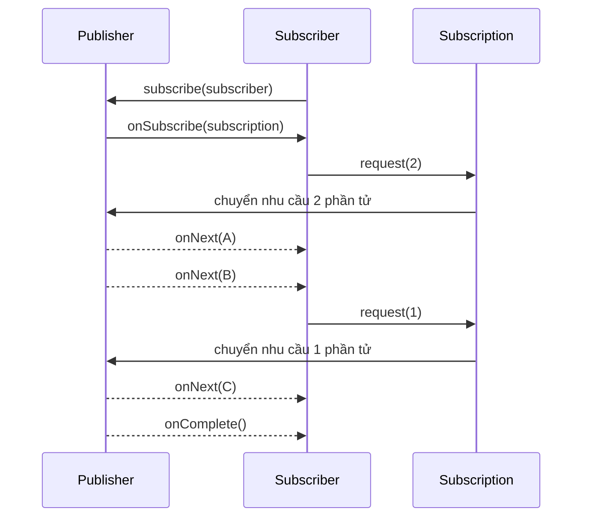

# Vai trò của Publisher, Subscriber, Subscription và Processor

Trong lập trình reactive, dữ liệu thường đi qua một chuỗi xử lý bất đồng bộ: một nguồn phát sự kiện, một hoặc nhiều bước biến đổi, rồi đến thành phần tiêu thụ. Chuỗi này cần một giao thức thống nhất để hai đầu biết khi nào có thể gửi dữ liệu, khi nào cần gửi thêm, khi nào kết thúc và cách hủy công việc đang chạy.

Reactive Streams định nghĩa giao thức đó bằng bốn abstraction cốt lõi: `Publisher`, `Subscriber`, `Subscription` và `Processor`. Hiểu rõ trách nhiệm của từng thành phần giúp ta đọc được pipeline Reactor, kiểm soát backpressure và thiết kế các luồng RSocket ổn định.

## 1. Reactive Streams nằm ở đâu trong kiến trúc reactive?

Reactive Streams là một đặc tả cho việc xử lý luồng dữ liệu bất đồng bộ có điều tiết luồng (*non-blocking backpressure*). Đặc tả cung cấp các interface trong package `org.reactivestreams`; nó không quy định một thư viện phải dùng thread nào, chạy trên TCP hay WebSocket, hoặc phải triển khai thuật toán xử lý dữ liệu ra sao.

Trong hệ sinh thái Java:

- Project Reactor cung cấp `Mono<T>` và `Flux<T>`. Cả hai đều là `Publisher<T>`.
- Spring WebFlux và Spring Boot dùng các kiểu reactive này để nối các bước xử lý HTTP hoặc messaging mà không cần chặn thread cho mỗi thao tác I/O.
- RSocket Java dùng `Publisher`, `Mono` và `Flux` trong API request-response, fire-and-forget, request-stream và request-channel.

Java 9 cũng có các interface tương ứng trong `java.util.concurrent.Flow`. Chúng có cùng ý tưởng và hợp đồng cơ bản, nhưng là các kiểu Java khác với `org.reactivestreams`; khi kết hợp thư viện, hãy kiểm tra kiểu mà API cụ thể yêu cầu hoặc dùng adapter phù hợp.

Điểm quan trọng là Reactive Streams mô tả cách các thành phần phối hợp với nhau. Nó không đồng nghĩa với một thread riêng cho mỗi publisher, cũng không đảm bảo mọi đoạn code trong pipeline tự động chạy song song.

## 2. Bốn thành phần và trách nhiệm của chúng

### 2.1. Publisher: nguồn phát dữ liệu

`Publisher<T>` đại diện cho một nguồn có khả năng phát các phần tử kiểu `T` tới subscriber. Interface có một phương thức:

```java
public interface Publisher<T> {
    void subscribe(Subscriber<? super T> subscriber);
}
```

Publisher nhận một `Subscriber` khi subscriber đăng ký. Sau đó publisher thiết lập một `Subscription` và phát các tín hiệu theo đúng giao thức. Nguồn dữ liệu có thể là:

- Một tập giá trị có sẵn, chẳng hạn danh sách kết quả.
- Một thao tác I/O bất đồng bộ như truy vấn cơ sở dữ liệu hoặc gọi dịch vụ khác.
- Một luồng sự kiện liên tục như thông báo, giá cổ phiếu hoặc telemetry.
- Dữ liệu nhận được từ một RSocket stream hoặc channel.

Publisher không nhất thiết phải phát dữ liệu ngay khi được tạo. Với *cold publisher*, công việc thường bắt đầu khi có subscriber đăng ký; mỗi subscriber có thể kích hoạt một lần thực thi riêng. Với *hot publisher*, nguồn có thể phát độc lập với subscriber, vì vậy subscriber đăng ký muộn có thể bỏ lỡ các sự kiện trước đó. Cold hay hot là đặc tính của cách publisher được triển khai, không phải hai interface khác nhau.

### 2.2. Subscriber: đầu nhận và xử lý tín hiệu

`Subscriber<T>` nhận các tín hiệu từ publisher thông qua bốn callback:

```java
public interface Subscriber<T> {
    void onSubscribe(Subscription subscription);
    void onNext(T item);
    void onError(Throwable error);
    void onComplete();
}
```

Ý nghĩa của từng callback:

- `onSubscribe`: nhận subscription điều khiển luồng. Subscriber thường gọi `request(n)` tại đây để cho phép publisher phát dữ liệu.
- `onNext`: nhận một phần tử. Callback này có thể được gọi nhiều lần, nhưng số phần tử phải tuân theo nhu cầu đã yêu cầu.
- `onError`: thông báo luồng kết thúc do lỗi. Đây là tín hiệu kết thúc, không được theo sau bởi `onNext` hoặc `onComplete`.
- `onComplete`: thông báo publisher đã phát xong. Đây cũng là tín hiệu kết thúc.

Một subscriber phải nhận `onSubscribe` trước các tín hiệu còn lại. Sau đó publisher có thể phát không hoặc nhiều `onNext`, rồi kết thúc bằng đúng một trong hai tín hiệu `onError` hoặc `onComplete`. Một luồng có thể kết thúc ngay bằng `onError` hoặc `onComplete` mà không có `onNext` nào.

Subscriber nên xử lý `onNext` nhanh và tránh chặn thread phát tín hiệu. Nếu công việc xử lý tốn thời gian, hãy điều tiết nhu cầu hoặc chuyển bước xử lý sang scheduler phù hợp trong Reactor. Không nên tự tạo thread cho từng phần tử để né backpressure; cách đó dễ làm hàng đợi tăng không kiểm soát.

### 2.3. Subscription: kênh điều khiển nhu cầu và hủy

`Subscription` là mối liên kết điều khiển giữa một publisher và một subscriber cụ thể:

```java
public interface Subscription {
    void request(long n);
    void cancel();
}
```

Hai phương thức có vai trò khác nhau:

- `request(n)` báo rằng subscriber có khả năng tiếp nhận thêm tối đa `n` phần tử. Đây là cách subscriber điều tiết tốc độ phát dữ liệu.
- `cancel()` yêu cầu dừng subscription hiện tại và giải phóng tài nguyên liên quan khi có thể.

Nhu cầu được cộng dồn qua các lần gọi `request`. Ví dụ, gọi `request(2)` rồi `request(3)` cho phép publisher phát tổng cộng tối đa năm phần tử nếu chưa có nhu cầu nào khác. `request(Long.MAX_VALUE)` biểu thị nhu cầu không giới hạn theo giao thức.

`request` phải nhận số dương. Gọi với `0` hoặc số âm là vi phạm giao thức và publisher phải kết thúc subscription bằng lỗi `IllegalArgumentException`. Khi `cancel()` được gọi, publisher cần dừng việc phát dữ liệu và thu hồi tài nguyên; việc dừng có thể không xảy ra tức thời nếu đang có tín hiệu hoặc thao tác chạy dở.

Mỗi lần đăng ký tạo ra một quan hệ subscription riêng. Vì vậy hai subscriber cùng đăng ký một publisher có thể có nhu cầu và thời điểm hủy khác nhau.

### 2.4. Processor: vừa nhận vừa phát

`Processor<T, R>` kết hợp hai vai trò: nó là subscriber của luồng đầu vào kiểu `T`, đồng thời là publisher của luồng đầu ra kiểu `R`.

```java
public interface Processor<T, R>
        extends Subscriber<T>, Publisher<R> {
}
```

Processor thường được dùng làm cầu nối giữa hai luồng. Nó có thể biến đổi kiểu dữ liệu, lọc phần tử, gom nhóm, kiểm tra dữ liệu hoặc áp dụng một quy tắc nghiệp vụ trước khi phát kết quả cho subscriber phía sau.

Ví dụ về một luồng xử lý có ý nghĩa processor:

```text
Publisher<Order> -> kiểm tra đơn hàng -> tính phí -> Publisher<Invoice>
```

Processor phải phối hợp cả hai phía của backpressure. Nó nhận dữ liệu từ upstream theo nhu cầu mà nó đã yêu cầu, đồng thời chỉ phát dữ liệu downstream khi phía sau có đủ nhu cầu. Một processor có thể cần giữ trạng thái hoặc bộ đệm để nối hai nhịp xử lý; vì vậy việc tự cài đặt processor đòi hỏi tuân thủ đầy đủ giao thức.

Trong ứng dụng Reactor thông thường, ta thường ghép các operator như `map`, `filter`, `flatMap`, `buffer` hoặc `publishOn` thay vì tự triển khai interface `Processor`. Các operator tạo thành những bước trung gian trong pipeline và xử lý việc phối hợp demand. Một operator như `map` có vai trò biến đổi giống processor về mặt khái niệm, nhưng không vì thế mà bản thân nó nhất thiết là một implementation của interface `Processor`.

### 2.5. So sánh nhanh

| Thành phần | Vai trò | Câu hỏi nó trả lời |
| --- | --- | --- |
| `Publisher<T>` | Phát dữ liệu | Có thể cung cấp những phần tử nào? |
| `Subscriber<T>` | Nhận và xử lý tín hiệu | Ai nhận dữ liệu và xử lý kết quả? |
| `Subscription` | Điều khiển demand và hủy | Subscriber muốn nhận bao nhiêu phần tử nữa? |
| `Processor<T, R>` | Nhận đầu vào và phát đầu ra | Làm thế nào nối và biến đổi hai luồng? |

## 3. Vòng đời của một subscription

Một luồng Reactive Streams thường diễn ra theo trình tự sau:

1. Subscriber gọi `publisher.subscribe(subscriber)`.
2. Publisher gọi `subscriber.onSubscribe(subscription)` để trao quyền điều khiển cho subscriber.
3. Subscriber gọi `subscription.request(n)` để thông báo nhu cầu.
4. Publisher phát tối đa số phần tử còn được yêu cầu bằng các lần gọi `onNext`.
5. Khi có thêm khả năng tiếp nhận, subscriber có thể gọi `request(n)` lần nữa.
6. Luồng kết thúc bằng `onComplete` hoặc `onError`; subscriber cũng có thể gọi `cancel` trước thời điểm đó.

Sơ đồ dưới đây minh họa cách demand đi từ subscriber về phía publisher:



Một số quy tắc cần ghi nhớ:

- Publisher không được phát nhiều `onNext` hơn tổng demand mà subscriber đã yêu cầu.
- Các tín hiệu của một subscription phải được tuần tự hóa: subscriber không được nhận hai lời gọi tín hiệu chồng lấn nhau.
- `onError` và `onComplete` là tín hiệu kết thúc. Sau một trong hai tín hiệu này, subscription không được phát thêm phần tử.
- `cancel` là yêu cầu hủy. Ứng dụng không nên giả định mọi công việc đang chạy sẽ biến mất ngay tại đúng thời điểm gọi phương thức.
- Một subscriber có thể yêu cầu thêm dữ liệu ngay trong `onSubscribe` hoặc sau khi xử lý một phần tử trong `onNext`.

## 4. Backpressure: vì sao Subscription quan trọng?

Giả sử một dịch vụ phát 10.000 sự kiện mỗi giây, trong khi subscriber chỉ xử lý được 500 sự kiện mỗi giây. Nếu publisher cứ phát dữ liệu mà không quan tâm khả năng tiếp nhận, hệ thống có thể tích lũy hàng đợi, tăng độ trễ và cuối cùng cạn bộ nhớ.

Backpressure cho phép subscriber diễn đạt khả năng tiếp nhận thông qua `request(n)`. Publisher tuân thủ giao thức sẽ không phát vượt quá demand hiện có. Khi subscriber xử lý xong một phần dữ liệu, nó yêu cầu thêm để tiếp tục luồng.

Tuy nhiên, backpressure không tự động làm cho mọi nguồn dữ liệu bên ngoài chậm lại. Nếu adapter nối với một API callback hoặc một nguồn không có cơ chế điều tiết, thư viện phải lựa chọn cách chuyển đổi như đệm, loại bỏ, giữ phần tử mới nhất hoặc báo lỗi. Mỗi chiến lược có tác động khác nhau đến độ trễ và tính đầy đủ của dữ liệu. Hãy chọn chiến lược theo yêu cầu nghiệp vụ thay vì mặc định rằng buffer luôn an toàn.

Ví dụ: với telemetry, có thể chấp nhận bỏ bớt mẫu cũ khi consumer quá tải; với giao dịch tài chính hoặc lệnh cập nhật trạng thái, bỏ mất sự kiện có thể không chấp nhận được. Backpressure giúp các thành phần phối hợp, nhưng không thay thế quyết định về chính sách quá tải.

## 5. Nhìn các vai trò này qua Project Reactor

Trong Reactor, `Mono<T>` biểu diễn publisher phát tối đa một phần tử rồi kết thúc; `Flux<T>` biểu diễn publisher phát từ không đến nhiều phần tử. Chúng triển khai Reactive Streams `Publisher`, vì vậy có thể được kết nối bằng các operator và subscriber.

```java
Flux<Integer> numbers = Flux.range(1, 5);

Flux<String> messages = numbers
        .filter(number -> number % 2 == 1)
        .map(number -> "event-" + number);
```

Ở ví dụ này, `Flux.range` là nguồn publisher. `filter` và `map` tạo các bước xử lý trung gian. Khi gọi `subscribe`, một subscriber đăng ký vào publisher cuối cùng và Reactor kết nối nhu cầu qua pipeline.

Các overload tiện lợi như `subscribe(value -> ...)` phù hợp khi muốn tiêu thụ luồng đơn giản. Chúng thường yêu cầu dữ liệu không giới hạn (`Long.MAX_VALUE`). Nếu cần kiểm soát demand tường minh, có thể dùng `BaseSubscriber`:

```java
import org.reactivestreams.Subscription;
import reactor.core.publisher.BaseSubscriber;
import reactor.core.publisher.Flux;

Flux.range(1, 5).subscribe(new BaseSubscriber<Integer>() {
    @Override
    protected void hookOnSubscribe(Subscription subscription) {
        request(1); // Ban đầu chỉ nhận một phần tử.
    }

    @Override
    protected void hookOnNext(Integer value) {
        System.out.println("Received: " + value);
        request(1); // Yêu cầu phần tử tiếp theo sau khi xử lý xong.
    }

    @Override
    protected void hookOnError(Throwable error) {
        System.err.println("Stream failed: " + error.getMessage());
    }

    @Override
    protected void hookOnComplete() {
        System.out.println("Stream completed");
    }
});
```

Subscriber trong ví dụ chỉ yêu cầu một phần tử tại một thời điểm. Sau khi xử lý phần tử hiện tại, nó mới yêu cầu phần tử tiếp theo. Trong ứng dụng thực tế, hãy cân nhắc chi phí xử lý, khả năng chạy song song và giới hạn bộ đệm khi chọn kích thước demand.

## 6. Liên hệ với các kiểu tương tác của RSocket

API RSocket Java biểu diễn các kiểu tương tác bằng các publisher của Reactor hoặc Reactive Streams. Nhìn vào kiểu trả về, ta có thể nhận ra luồng dữ liệu nào đang được trao đổi:

| Kiểu tương tác | Dạng API thường gặp | Quan hệ với Reactive Streams |
| --- | --- | --- |
| Request-response | `Mono<Payload>` | Một publisher phát tối đa một response. |
| Fire-and-forget | `Mono<Void>` | Publisher biểu diễn trạng thái hoàn tất của thao tác gửi, không phát response nghiệp vụ. |
| Request-stream | `Flux<Payload>` | Publisher phát nhiều response; subscriber điều tiết demand. |
| Request-channel | Đầu vào `Publisher<Payload>`, đầu ra `Flux<Payload>` | Hai phía trao đổi một luồng hai chiều; mỗi phía có nhịp demand riêng. |

Ví dụ, một client đăng ký nhận sự kiện bằng request-stream có thể nhận `Flux<Payload>`. Client nối các bước giải mã, lọc và lưu trữ vào pipeline. Subscriber cuối cùng quyết định nhịp tiêu thụ bằng demand; khi không còn quan tâm đến luồng, subscription có thể bị hủy để giải phóng tài nguyên liên quan.

Với request-channel, client gửi một publisher lên server và đồng thời nhận một publisher phản hồi. Đây là trường hợp dễ thấy vai trò của cả hai chiều: publisher đầu vào của client là nguồn dữ liệu đối với server, còn flux đầu ra là nguồn dữ liệu đối với client. Hai phía cần được điều tiết độc lập theo khả năng xử lý của từng phía.

RSocket có cơ chế flow control ở tầng giao thức để truyền nhu cầu của stream qua kết nối. Ở tầng ứng dụng, `Subscription.request(n)` vẫn là cách consumer biểu đạt nhu cầu với publisher. Khi chạy qua TCP hay WebSocket, transport đảm nhiệm việc truyền frame; việc chọn transport không làm thay đổi trách nhiệm cơ bản của bốn thành phần Reactive Streams.

## 7. Kiểm thử demand và tín hiệu kết thúc

Khi viết pipeline reactive, đừng chỉ kiểm tra danh sách giá trị đầu ra. Cần kiểm tra cả cách publisher phản ứng với demand, lỗi và hoàn tất. Reactor cung cấp `StepVerifier` để mô phỏng subscriber và yêu cầu dữ liệu theo từng bước:

```java
import reactor.core.publisher.Flux;
import reactor.test.StepVerifier;

StepVerifier.create(Flux.range(1, 5), 0)
        .thenRequest(2)
        .expectNext(1, 2)
        .thenRequest(3)
        .expectNext(3, 4, 5)
        .verifyComplete();
```

Verifier bắt đầu với demand bằng `0`, yêu cầu hai phần tử, xác nhận hai phần tử đầu tiên, rồi yêu cầu ba phần tử còn lại. Bài kiểm thử xác nhận publisher chỉ phát theo nhịp yêu cầu và kết thúc đúng bằng `onComplete`.

Với một publisher thực tế, nên bổ sung các trường hợp:

- Subscriber hủy trước khi nguồn phát xong; tài nguyên như socket, timer hoặc truy vấn đang chạy được dọn dẹp phù hợp.
- Nguồn phát lỗi; subscriber nhận `onError` và không nhận thêm phần tử sau đó.
- Nguồn rỗng; subscriber nhận `onComplete` mà không có `onNext`.
- Consumer xử lý chậm; bộ đệm và chính sách quá tải giữ mức sử dụng tài nguyên trong giới hạn dự kiến.

## 8. Những nhầm lẫn thường gặp

**Publisher không phải là thread.** Publisher mô tả nguồn dữ liệu và giao thức phát tín hiệu. Việc thực thi trên thread nào phụ thuộc vào publisher, scheduler và operator được sử dụng.

**Subscription không phải một đăng ký nghiệp vụ.** Đây là đối tượng điều khiển một lần đăng ký Reactive Streams, cung cấp `request` và `cancel`.

**Processor không đồng nghĩa với mọi operator.** `Processor` là interface kết hợp `Subscriber` và `Publisher`. Operator Reactor có thể đảm nhiệm vai trò biến đổi tương tự trong pipeline mà không trực tiếp triển khai interface này.

**Reactive không có nghĩa là không cần quản lý tài nguyên.** Subscription bị hủy, lỗi giữa chừng hoặc kết nối RSocket đóng đều cần được xử lý để giải phóng buffer, timer, socket và các tài nguyên liên quan.

**Backpressure không phải một hàng đợi vô hạn.** Demand giới hạn lượng tín hiệu publisher được phép phát. Nếu nguồn bên ngoài không thể bị điều tiết, ứng dụng vẫn phải chọn chính sách buffer, drop, latest hoặc error và kiểm thử hành vi quá tải.

Khi đọc hoặc thiết kế một pipeline RSocket, hãy lần theo bốn câu hỏi: nguồn nào là `Publisher`, thành phần nào là `Subscriber`, demand và hủy được quản lý qua `Subscription` ra sao, và bước trung gian nào đang đóng vai trò `Processor`. Bốn câu trả lời này giúp xác định nơi dữ liệu được tạo, nơi dữ liệu được tiêu thụ và cách luồng giữ được nhịp ổn định khi tải thay đổi.
