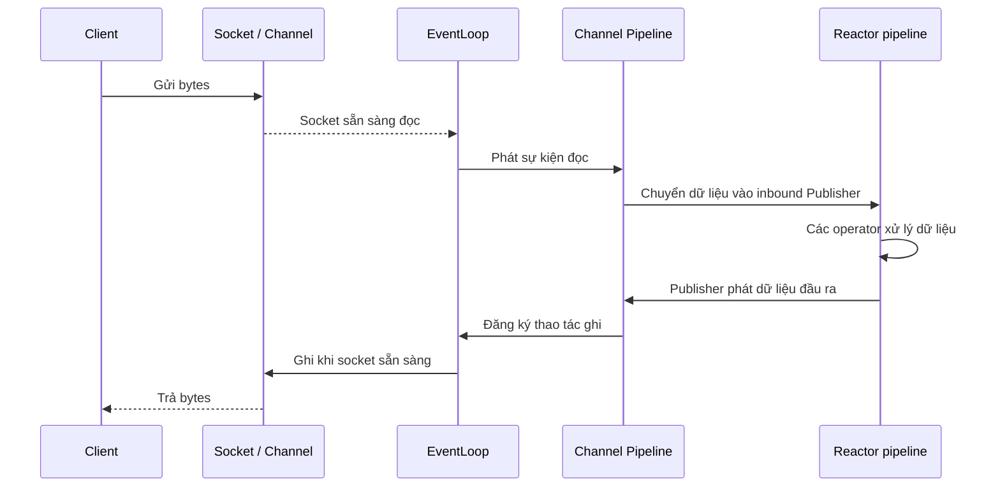

# Bất đồng bộ, không chặn và luồng xử lý của Reactor Netty

Reactor Netty kết hợp khả năng xử lý mạng bất đồng bộ, không chặn của Netty với mô hình lập trình Reactive Streams của Project Reactor. Nhờ đó, một số lượng nhỏ luồng I/O có thể phục vụ nhiều kết nối đồng thời. Mỗi kết nối không cần chiếm riêng một luồng trong suốt thời gian chờ mạng; thay vào đó, EventLoop nhận biết khi socket có dữ liệu hoặc có thể ghi, rồi gọi các handler tương ứng trong Channel Pipeline.

Hiểu đúng mô hình này giúp xây dựng dịch vụ có độ trễ ổn định và sử dụng tài nguyên hiệu quả. Điều đó đặc biệt hữu ích với hệ thống realtime: một dịch vụ RSocket có thể duy trì nhiều phiên TCP hoặc WebSocket, xử lý request-response, fire-and-forget, request-stream và request-channel, đồng thời kiểm soát lượng dữ liệu truyền đi. Tuy nhiên, cần phân biệt các lớp: Reactor Netty là thư viện mạng tích hợp Netty với Reactor; RSocket Java có transport Netty riêng. Hai bên có thể cùng sử dụng những nguyên lý EventLoop và Reactive Streams, nhưng không phải cùng một thư viện hay cùng một transport implementation.

## 1. Phân biệt bất đồng bộ, không chặn và reactive

Ba khái niệm này thường xuất hiện cùng nhau nhưng mô tả những khía cạnh khác nhau.

| Khái niệm | Ý nghĩa | Điều cần tránh hiểu nhầm |
|---|---|---|
| Bất đồng bộ (asynchronous) | Công việc được khởi chạy và kết quả được thông báo sau đó; luồng gọi không cần chờ kết quả ngay tại lời gọi. | Bất đồng bộ không tự động có nghĩa là không chặn. Một API có thể trả kết quả qua callback nhưng bên trong vẫn chờ đồng bộ. |
| Không chặn (non-blocking) | Khi thao tác I/O chưa sẵn sàng, luồng không bị giữ lại để chờ; hệ thống tiếp tục xử lý công việc khác. | Không chặn I/O không có nghĩa mọi đoạn mã ứng dụng đều không chặn. Gọi JDBC đồng bộ trên EventLoop vẫn làm nghẽn luồng. |
| Reactive | Dữ liệu và kết quả được biểu diễn thành luồng tín hiệu; bên nhận có thể yêu cầu dữ liệu, xử lý lỗi và hủy đăng ký. | Dùng `Mono` hoặc `Flux` không tự biến một lời gọi blocking thành non-blocking. |

Ví dụ, một lời gọi HTTP đồng bộ có thể giữ luồng trong vài trăm mili giây để chờ phản hồi. Một lời gọi HTTP bất đồng bộ có thể đăng ký callback, nhưng nếu callback lại gọi một API blocking thì luồng chạy callback vẫn bị giữ. Với Reactor Netty, thao tác socket được thực hiện theo mô hình non-blocking; Reactor biểu diễn kết quả bằng `Mono` hoặc `Flux` để các bước xử lý có thể được kết nối thành một pipeline.

Trong Reactor, `Mono<T>` biểu diễn tối đa một phần tử (hoặc hoàn tất rỗng), còn `Flux<T>` biểu diễn từ không đến nhiều phần tử. Chúng là các `Publisher` theo Reactive Streams. Pipeline thường chỉ bắt đầu thực thi khi có subscriber đăng ký; khi chạy, dữ liệu, tín hiệu hoàn tất, lỗi và yêu cầu về số phần tử được truyền qua các thành phần của pipeline.

## 2. Các thành phần tạo nên luồng xử lý

Reactor Netty có thể được nhìn qua bốn thành phần phối hợp với nhau:

1. **Socket và Channel của Netty** đại diện cho kết nối mạng và các thao tác đọc/ghi trên kết nối đó.
2. **EventLoop và EventLoopGroup** quản lý các sự kiện I/O cùng những tác vụ gắn với Channel.
3. **Channel Pipeline** gồm các handler xử lý sự kiện vào, sự kiện ra, dữ liệu và lỗi.
4. **Reactor Publisher** (`Mono`, `Flux`) mô tả luồng dữ liệu và các bước xử lý bất đồng bộ ở tầng ứng dụng.

Một `EventLoopGroup` quản lý nhiều `EventLoop`. Mỗi Channel thường được đăng ký với một EventLoop và tiếp tục gắn với EventLoop đó trong vòng đời hoạt động. Một EventLoop có thể phục vụ nhiều Channel. Vì vậy, hệ thống không cần tạo một thread riêng cho từng kết nối đang mở.

Các tác vụ của một Channel được điều phối tuần tự trên EventLoop tương ứng. Điều này làm giảm nhu cầu đồng bộ hóa khi xử lý trạng thái gắn với Channel, nhưng cũng tạo ra một quy tắc quan trọng: handler chạy trên EventLoop phải kết thúc nhanh. Nếu một handler thực hiện công việc blocking trong thời gian dài, các Channel khác được EventLoop đó phục vụ cũng có thể bị chậm.

Channel Pipeline là chuỗi handler mà Netty đi qua khi nhận hoặc gửi dữ liệu. Ở chiều vào, dữ liệu từ socket đi qua các handler giải mã, chuyển đổi và xử lý. Ở chiều ra, dữ liệu được mã hóa và chuyển xuống socket. Reactor Netty kết nối các sự kiện này với API reactive để ứng dụng có thể trả về `Publisher` thay vì tự quản lý callback I/O ở mức thấp.

## 3. Một yêu cầu đi qua Reactor Netty như thế nào?

Với một server TCP, vòng đời tổng quát có thể mô tả như sau:



Đây là sơ đồ khái niệm; chi tiết nội bộ có thể khác theo loại transport, phiên bản thư viện và cấu hình. Có thể chia quá trình thành các bước:

**Bước 1 — Đăng ký kết nối.** Server bind vào địa chỉ và cổng. Khi client kết nối, Netty tạo hoặc thiết lập Channel, rồi đăng ký Channel đó với một EventLoop.

**Bước 2 — Nhận sự kiện I/O.** Khi socket có dữ liệu để đọc, cơ chế I/O của hệ điều hành thông báo sự kiện sẵn sàng. EventLoop xử lý sự kiện và gọi các handler thích hợp. EventLoop không cần ngồi chờ riêng trên từng socket.

**Bước 3 — Đưa dữ liệu vào pipeline.** Các handler trong Channel Pipeline có thể giải mã bytes thành thông điệp hoặc chuyển dữ liệu đến inbound API của Reactor Netty. Ở tầng ứng dụng, dữ liệu thường được tiêu thụ qua một `Flux`.

**Bước 4 — Chạy logic reactive.** Các operator như `map`, `filter`, `flatMap` hoặc `concatMap` mô tả cách biến đổi và kết hợp dữ liệu. Operator không nhất thiết tạo thread mới. Nếu không có ranh giới scheduler, nhiều đoạn xử lý có thể tiếp tục chạy trên thread phát tín hiệu trước đó, thường là EventLoop đối với callback I/O.

**Bước 5 — Ghi dữ liệu.** Ứng dụng trả về một `Publisher` cho thao tác gửi. Reactor Netty kết nối Publisher đó với hoạt động ghi của Channel. Khi socket có khả năng ghi, EventLoop tiếp tục đẩy dữ liệu xuống transport.

**Bước 6 — Hoàn tất hoặc đóng kết nối.** Publisher có thể hoàn tất, phát lỗi hoặc bị hủy. Kết nối có thể tiếp tục được giữ để trao đổi thông điệp tiếp theo hoặc được đóng theo giao thức và vòng đời ứng dụng.

Điểm cốt lõi là EventLoop xử lý sự kiện I/O và các callback ngắn; pipeline reactive mô tả công việc cần thực hiện khi dữ liệu đến. Khi phải chờ mạng, luồng không cần bị giữ lại như trong mô hình một thread cho mỗi request.

## 4. Ví dụ server TCP với Reactor Netty

Đoạn mã sau tạo một TCP server đơn giản. Server chuyển dữ liệu nhận được thành chuỗi và echo từng chunk dữ liệu về client:

```java
import reactor.netty.tcp.TcpServer;

public class EchoServer {
    public static void main(String[] args) {
        TcpServer.create()
            .host("0.0.0.0")
            .port(7000)
            .handle((inbound, outbound) ->
                outbound.sendString(
                    inbound.receive()
                        .asString()
                        .map(message -> "echo: " + message)
                ).then()
            )
            .bindNow()
            .onDispose()
            .block();
    }
}
```

TCP là luồng byte, không giữ ranh giới thông điệp của tầng ứng dụng. Vì vậy, một lần `receive()` có thể tạo ra chunk khác với ranh giới mà client dùng khi gửi. Ví dụ trên minh họa cách nối luồng nhận với luồng gửi; nếu giao thức cần xử lý từng thông điệp hoàn chỉnh, ứng dụng phải định nghĩa framing rõ ràng, chẳng hạn delimiter hoặc trường độ dài, rồi giải mã theo framing đó.

Trong ví dụ này:

- `TcpServer.create()` khởi tạo cấu hình server TCP.
- `handle(...)` nhận inbound và outbound abstraction cho kết nối.
- `inbound.receive()` cung cấp luồng dữ liệu đến; `asString()` chuyển dữ liệu nhận được thành chuỗi theo API của Reactor Netty.
- `map(...)` biến đổi từng chunk dữ liệu nhận được.
- `outbound.sendString(...)` gửi luồng chuỗi ra kết nối.
- `then()` biểu diễn việc hoàn tất thao tác gửi mà không phát các phần tử dữ liệu đầu ra.
- `bindNow()` chờ server bind thành công trên luồng khởi động; `onDispose().block()` giữ tiến trình chạy cho đến khi server được dispose.

`bindNow()` chờ server bind thành công, còn `onDispose().block()` giữ luồng khởi động chờ đến khi server được dispose. Hai thao tác chờ này nằm trong mã khởi động của ứng dụng độc lập. Không được sao chép cách chờ đồng bộ này vào handler xử lý request hoặc callback chạy trên EventLoop. Trong ứng dụng Spring Boot, nên để cơ chế lifecycle của ứng dụng quản lý server thay vì tự bind và block trong mỗi luồng xử lý.

## 5. EventLoop và ranh giới thread

Một nhầm lẫn thường gặp là cho rằng cứ dùng Reactor thì mỗi operator sẽ chạy trên một thread riêng. Thực tế, Reactor không tự tạo thread cho từng operator. Các operator thường chạy trên thread đang phát tín hiệu, trừ khi pipeline có thay đổi scheduler hoặc thư viện tích hợp thực hiện chuyển giao thread.

Hai operator thường dùng để điều khiển scheduler là:

- `publishOn(scheduler)` chuyển việc xử lý các tín hiệu ở phía downstream của vị trí đó sang scheduler được chỉ định.
- `subscribeOn(scheduler)` ảnh hưởng đến thread thực hiện quá trình subscribe ở phía upstream; nó thường được đặt gần đầu nguồn dữ liệu.

Ví dụ:

```java
import reactor.core.publisher.Mono;
import reactor.core.scheduler.Schedulers;

Mono<String> result = remoteCall()
    .publishOn(Schedulers.parallel())
    .map(this::calculate);
```

Trong ví dụ trên, `map` và các bước downstream tiếp theo được xử lý trên scheduler `parallel` sau khi tín hiệu đi qua `publishOn`. Nguồn `remoteCall()` vẫn được subscribe theo quy tắc của pipeline và thư viện tạo nguồn.

Với một lời gọi blocking bắt buộc phải dùng, có thể cô lập nó trên `boundedElastic`:

```java
import reactor.core.publisher.Mono;
import reactor.core.scheduler.Schedulers;

Mono<Customer> customer = Mono.fromCallable(
        () -> legacyJdbcRepository.findById(customerId)
    )
    .subscribeOn(Schedulers.boundedElastic());
```

`fromCallable` trì hoãn việc gọi hàm cho đến khi có subscription; `subscribeOn` chuyển việc thực thi nguồn sang scheduler phù hợp với tác vụ blocking. Trong hệ thống mới, nên ưu tiên driver và client reactive để giữ luồng xử lý non-blocking xuyên suốt. `boundedElastic` là vùng cách ly cho phần blocking không thể loại bỏ ngay, không phải lý do để đưa mọi tác vụ vào một thread pool tùy ý.

Có thể chọn scheduler theo tính chất công việc:

| Loại công việc | Cách thực hiện phù hợp |
|---|---|
| Đọc/ghi mạng qua Reactor Netty | Dùng API reactive của client/server; để thư viện điều phối I/O. |
| Tính toán CPU ngắn, độc lập | Có thể chuyển sang `Schedulers.parallel()` khi cần tách khỏi EventLoop. |
| Gọi API hoặc thư viện blocking | Cô lập bằng `Schedulers.boundedElastic()` hoặc thay bằng API non-blocking. |
| Công việc có thứ tự và cần giữ ngữ cảnh | Thiết kế pipeline và scheduler có chủ đích; không dựa vào giả định rằng mọi callback luôn chạy trên cùng một thread. |

Không nên chuyển mọi operator sang scheduler khác theo thói quen. Việc chuyển thread có chi phí điều phối và có thể làm mất lợi ích của xử lý tuần tự theo Channel. Chỉ tạo ranh giới scheduler khi loại công việc hoặc yêu cầu về độ trễ thực sự cần nó.

## 6. Vì sao blocking trên EventLoop nguy hiểm?

Giả sử một EventLoop đang phục vụ nhiều kết nối. Nếu một handler gọi hàm đồng bộ mất hai giây, EventLoop không thể xử lý các sự kiện khác trong khoảng thời gian đó. Một kết nối chậm có thể khiến nhiều kết nối cùng EventLoop tăng độ trễ, dù các client còn lại không có vấn đề.

Những thao tác cần tránh trên EventLoop gồm:

- `Thread.sleep(...)` hoặc chờ bằng vòng lặp bận.
- Gọi JDBC/JPA đồng bộ, HTTP client đồng bộ hoặc SDK chặn thread.
- Đọc/ghi file đồng bộ với kích thước lớn.
- Gọi `block()`, `blockFirst()`, `blockLast()` hoặc chờ `Future.get()` trong đường xử lý I/O.
- Thực hiện tính toán CPU nặng kéo dài trong một callback.

Khi cần gọi một dịch vụ khác, hãy dùng WebClient hoặc client reactive tương ứng và kết hợp kết quả bằng `flatMap`. Khi phải dùng API blocking, chuyển riêng lời gọi đó sang scheduler phù hợp. Nếu công việc CPU nặng, tách nó khỏi EventLoop và giới hạn mức song song để tránh làm cạn tài nguyên máy.

Một dấu hiệu đáng chú ý là độ trễ của nhiều request cùng tăng dù CPU tổng thể chưa đạt mức tối đa. Khi đó, cần kiểm tra thread dump, thời gian xử lý callback và những đoạn mã blocking trong pipeline, thay vì chỉ tăng số lượng kết nối hoặc timeout.

## 7. Backpressure và kiểm soát luồng dữ liệu

Reactive Streams có cơ chế demand: subscriber yêu cầu publisher phát tối đa một số lượng phần tử thông qua `request(n)`. Cơ chế này cho phép bên tiêu thụ điều tiết tốc độ nhận dữ liệu và hạn chế việc tạo ra lượng phần tử vượt quá khả năng xử lý.

Ví dụ, khi một dịch vụ đọc luồng sự kiện và ghi sang một đích khác, pipeline cần tính đến tốc độ của cả nguồn lẫn đích. Nếu bên ghi chậm hơn, hệ thống phải có chiến lược điều tiết, giới hạn buffer hoặc xử lý phần tử bị trễ.

```java
import reactor.core.publisher.Flux;

Flux<Event> events = eventSource.readEvents()
    .limitRate(64)
    .flatMap(this::processAsync, 8);
```

Trong ví dụ, `limitRate(64)` điều chỉnh cách yêu cầu dữ liệu từ upstream theo lô; tham số `8` giới hạn số inner Publisher được `flatMap` xử lý đồng thời. Đây là các tham số cần được chọn dựa trên tải thực tế, độ trễ và tài nguyên của từng công đoạn.

Một số operator có ý nghĩa khác nhau khi upstream nhanh hơn downstream:

| Operator | Hành vi chính | Trường hợp cần cân nhắc |
|---|---|---|
| `onBackpressureBuffer(...)` | Giữ phần tử trong buffer khi downstream chưa tiêu thụ kịp. | Cần giới hạn dung lượng và quyết định cách xử lý khi buffer đầy. |
| `onBackpressureDrop(...)` | Bỏ phần tử mới đến khi downstream không theo kịp. | Chỉ phù hợp khi mất một số cập nhật là chấp nhận được. |
| `onBackpressureLatest()` | Giữ giá trị mới nhất trong khi downstream đang chậm. | Hữu ích với trạng thái hoặc số đo mà giá trị mới quan trọng hơn lịch sử đầy đủ. |
| `limitRate(...)` | Điều tiết lượng demand gửi về upstream. | Hữu ích khi muốn kiểm soát nhịp yêu cầu phần tử. |

Không phải mọi loại backpressure đều giống nhau. Cần phân biệt ít nhất ba tầng:

1. **Reactive Streams demand** điều tiết số phần tử giữa Publisher và Subscriber trong pipeline.
2. **RSocket flow control** điều tiết số payload mà peer được phép gửi trong các tương tác streaming theo giao thức RSocket, chẳng hạn request-N.
3. **TCP flow control** điều tiết lượng byte mà bên gửi có thể truyền dựa trên cửa sổ nhận của kết nối TCP.

Ba tầng có liên quan đến khả năng kiểm soát tải nhưng không đồng nhất. Demand ở tầng ứng dụng không có nghĩa mỗi lần `request(n)` tương ứng chính xác với `n` gói TCP hoặc `n` payload RSocket. Khi thiết kế một luồng RSocket, cần kiểm soát cả cách ứng dụng tiêu thụ `Flux`, chiến lược request-N của giao thức và giới hạn tài nguyên ở transport.

Với dữ liệu realtime, lựa chọn chính sách phụ thuộc ý nghĩa dữ liệu. Luồng giá cổ phiếu hoặc trạng thái thiết bị có thể ưu tiên giá trị mới nhất; luồng giao dịch hoặc audit thường không được phép bỏ phần tử. Không nên dùng `onBackpressureDrop` hoặc `onBackpressureLatest` nếu nghiệp vụ yêu cầu xử lý đầy đủ mọi sự kiện.

## 8. Kết hợp các tác vụ bất đồng bộ

Các operator kết hợp Publisher quyết định thứ tự và mức song song của pipeline.

- `flatMap` đăng ký các Publisher con và cho phép xử lý đồng thời; kết quả có thể đến không theo thứ tự nguồn.
- `concatMap` xử lý từng Publisher con theo thứ tự, chỉ chuyển sang phần tử tiếp theo khi Publisher hiện tại hoàn tất.
- `flatMapSequential` cho phép chạy đồng thời nhưng giữ thứ tự phát kết quả theo thứ tự nguồn.

Ví dụ, nếu mỗi thông điệp cần gọi một dịch vụ reactive khác:

```java
Flux<Response> responses = inboundMessages
    .flatMap(message -> downstreamClient.send(message), 16);
```

Tham số `16` giới hạn số Publisher con được subscribe đồng thời. Nếu bỏ giới hạn phù hợp hoặc để buffer tăng không kiểm soát, một luồng đầu vào lớn có thể tạo quá nhiều công việc đang chờ. Nếu nghiệp vụ yêu cầu giữ thứ tự, hãy cân nhắc `concatMap` hoặc `flatMapSequential`, đồng thời đánh giá tác động đến thông lượng và độ trễ.

Không nên gọi `collectList()` trên một luồng vô hạn hoặc rất lớn chỉ để thuận tiện xử lý. Cách đó buộc ứng dụng giữ toàn bộ phần tử trong bộ nhớ. Với stream dài hạn, hãy xử lý từng phần tử hoặc theo cửa sổ có giới hạn.

## 9. Lỗi, timeout và hủy subscription

Trong pipeline reactive, lỗi được truyền thành tín hiệu `onError`. Có thể xử lý lỗi ở vị trí phù hợp bằng `onErrorResume`, `onErrorReturn` hoặc `retryWhen`. Việc chọn cách xử lý phải dựa vào bản chất lỗi:

- Lỗi dữ liệu không hợp lệ thường cần trả lỗi nghiệp vụ hoặc loại bỏ thông điệp theo chính sách rõ ràng.
- Lỗi kết nối tạm thời có thể được retry với backoff và giới hạn số lần thử.
- Timeout giúp giới hạn thời gian chờ một công đoạn, nhưng cần xác định rõ timeout áp dụng cho một request, một phần tử hay toàn bộ stream.
- Hủy subscription có thể xảy ra khi client ngắt kết nối, timeout hoặc tầng trên không còn cần dữ liệu. Tác vụ phía dưới nên phản ứng với cancellation và giải phóng tài nguyên.

Ví dụ retry có giới hạn:

```java
import java.time.Duration;
import reactor.core.publisher.Mono;
import reactor.util.retry.Retry;

Mono<Reply> reply = requestRemoteService()
    .timeout(Duration.ofSeconds(3))
    .retryWhen(
        Retry.backoff(2, Duration.ofMillis(200))
            .maxBackoff(Duration.ofSeconds(2))
    );
```

Retry có thể làm tăng tải khi hệ thống đích đang quá tải. Chỉ retry lỗi có khả năng phục hồi, giới hạn số lần thử và cân nhắc tính idempotent của thao tác. Với stream realtime dài hạn, cần xác định việc retry sẽ tạo stream mới, tiếp tục từ checkpoint hay có nguy cơ phát lại dữ liệu.

Có thể dùng `doOnError`, `doFinally` hoặc các hook quan sát tương ứng để ghi nhận lỗi và vòng đời subscription. Không nên dùng các hook quan sát để thay thế việc chuyển tiếp lỗi hoặc giải phóng tài nguyên một cách có cấu trúc.

## 10. Liên hệ với hệ thống RSocket

RSocket cung cấp các kiểu tương tác như request-response, fire-and-forget, request-stream và request-channel. Với request-stream và request-channel, luồng dữ liệu có thể tồn tại lâu hơn một HTTP request thông thường; vì vậy việc kiểm soát demand, cancellation và tài nguyên kết nối trở nên đặc biệt quan trọng.

Các nguyên lý Reactor Netty giúp hiểu cách một server mạng reactive xử lý nhiều kết nối trên EventLoop, cách dữ liệu đi qua Channel Pipeline và vì sao handler phải tránh blocking. Trong ứng dụng RSocket Java, transport Netty của `rsocket-transport-netty` đảm nhiệm giao tiếp mạng; API RSocket thường biểu diễn payload và luồng tương tác bằng các kiểu reactive. Không nên mặc định rằng sử dụng RSocket đồng nghĩa với việc server đang chạy qua `reactor.netty.tcp.TcpServer` hoặc `reactor.netty.http.server.HttpServer`.

Khi thiết kế một dịch vụ realtime, hãy xem xét các điểm sau:

- **Một phiên có thể sống lâu:** không giữ tài nguyên đắt tiền cho mỗi phiên nếu không cần thiết; theo dõi số kết nối, thời gian sống và trạng thái dispose.
- **Luồng có thể bị hủy:** khi peer ngắt kết nối hoặc không còn subscribe, dừng công việc upstream nếu có thể và giải phóng tài nguyên liên quan.
- **Tốc độ hai phía có thể khác nhau:** dùng demand và flow control phù hợp; đặt giới hạn cho buffer và mức concurrency.
- **Thông điệp có thể cần thứ tự:** chọn operator kết hợp phù hợp với yêu cầu nghiệp vụ, không dựa vào thứ tự hoàn tất ngẫu nhiên của các tác vụ `flatMap`.
- **Lỗi cần có ranh giới:** xác định lỗi thuộc một thông điệp, một stream hay toàn bộ connection; tránh để một lỗi cục bộ làm hỏng những phiên không liên quan.
- **Không chặn luồng I/O:** dùng API reactive cho cơ sở dữ liệu, HTTP và message broker khi có thể; cô lập thư viện blocking khi chưa thể thay thế.

Ví dụ ở tầng xử lý RSocket bằng Spring có thể trả về `Flux` cho một route streaming:

```java
@MessageMapping("device.telemetry")
public Flux<Telemetry> telemetry(DeviceQuery query) {
    return telemetryService.streamFor(query.deviceId());
}
```

Phương thức trả về một `Flux` để biểu diễn chuỗi dữ liệu telemetry. Service phía dưới cần tôn trọng cancellation, giới hạn tài nguyên và áp dụng chính sách backpressure phù hợp. Đoạn mã này minh họa API reactive của tầng ứng dụng RSocket; transport cụ thể được cấu hình riêng.

## 11. Quan sát và kiểm tra hệ thống

Khi một dịch vụ Reactor Netty có độ trễ cao hoặc thông lượng giảm, nên quan sát cả tầng mạng lẫn tầng reactive:

- **Thread dump:** tìm các EventLoop thread đang thực hiện JDBC, gọi HTTP đồng bộ, chờ lock hoặc ngủ.
- **Độ trễ theo công đoạn:** đo thời gian từ lúc nhận thông điệp đến lúc bắt đầu và hoàn tất xử lý; tách thời gian chờ upstream khỏi thời gian CPU.
- **Connection và request metrics:** theo dõi số kết nối đang hoạt động, số request, lỗi, timeout và thời gian phản hồi.
- **Buffer và concurrency:** kiểm tra queue, buffer, số tác vụ đang chạy và số tác vụ chờ.
- **Cancellation và dispose:** xác minh rằng kết nối đóng hoặc subscriber hủy sẽ dừng công việc không còn cần thiết.
- **Kiểm tra blocking:** dùng công cụ phát hiện blocking trong môi trường phát triển hoặc kiểm thử để tìm thao tác chặn vô tình chạy trên thread không phù hợp.

Trong kiểm thử, có thể dùng `StepVerifier` để xác minh số phần tử, thứ tự, tín hiệu hoàn tất, lỗi và hành vi hủy của một `Flux` hoặc `Mono`. Với server thực tế, cần thêm kiểm thử tích hợp cho kết nối bị đóng, client đọc chậm, stream kéo dài và tải đồng thời. Một pipeline chạy đúng với vài phần tử trong unit test chưa chứng minh rằng nó an toàn về bộ nhớ và độ trễ khi có hàng nghìn kết nối.

## 12. Quy tắc thiết kế thực tế

Khi triển khai Reactor Netty hoặc một transport reactive cho hệ thống realtime, có thể dùng các quy tắc sau làm điểm kiểm tra:

1. Giữ callback trên EventLoop ngắn và không blocking.
2. Ưu tiên client, driver và API reactive để tránh chuyển thread không cần thiết.
3. Cô lập thao tác blocking bằng scheduler có giới hạn; không dùng `block()` trong đường xử lý request.
4. Chọn `flatMap`, `concatMap` hoặc `flatMapSequential` theo yêu cầu thứ tự và concurrency.
5. Đặt giới hạn rõ ràng cho buffer, prefetch, concurrency và số lần retry.
6. Phân biệt Reactive Streams demand, RSocket request-N và TCP flow control khi phân tích hiện tượng nghẽn.
7. Xử lý cancellation, timeout và dispose như một phần của thiết kế vòng đời.
8. Đo độ trễ và tải thực tế trước khi thay đổi số EventLoop hoặc kích thước thread pool.

Reactor Netty đạt hiệu quả khi ứng dụng giữ được tính non-blocking từ lúc nhận dữ liệu đến lúc hoàn tất xử lý. EventLoop đảm nhận việc điều phối I/O, Reactor biểu diễn chuỗi xử lý và demand, còn ứng dụng quyết định cách giới hạn công việc, xử lý lỗi và giải phóng tài nguyên. Khi các trách nhiệm này được phân định rõ, dịch vụ có thể phục vụ nhiều kết nối đồng thời mà vẫn giữ được khả năng kiểm soát độ trễ và bộ nhớ.
