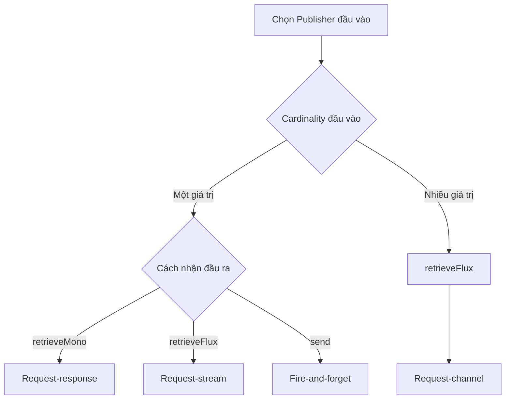

# Tạo request-channel từ Publisher đầu vào

## Mục tiêu bài học

`RSocketRequester` cho phép gửi một publisher làm nguồn dữ liệu đầu vào của request. Khi publisher có nhiều phần tử và client nhận kết quả bằng `retrieveFlux()`, Spring thực hiện tương tác **request-channel**: client phát một luồng payload tới server và đồng thời nhận một luồng payload phản hồi.

Sau bài này, bạn có thể:

- Tạo một request-channel từ `Flux<T>` hoặc một Publisher tương thích Reactive Streams.
- Khai báo kiểu phần tử đầu vào bằng `data(publisher, elementClass)`.
- Nhận dữ liệu phản hồi bằng `retrieveFlux()`.
- Phân biệt request-channel với request-stream và fire-and-forget.
- Kết hợp publisher nguồn, route, metadata và codec.
- Quản lý backpressure, complete, error và cancel ở cả hai chiều.
- Kiểm thử dữ liệu gửi đi, dữ liệu nhận về và vòng đời channel.

## Khi nào RSocketRequester tạo request-channel?

Một request-channel có hai luồng dữ liệu thuộc cùng một tương tác:

- Luồng **request** đi từ requester tới responder.
- Luồng **response** đi từ responder về requester.

Với Spring, interaction type được xác định ngầm từ cardinality của dữ liệu đầu vào và đầu ra. Khi đầu vào là một publisher nhiều phần tử, `retrieveFlux()` tạo tương tác request-channel. Khi đầu vào là một giá trị đơn và đầu ra là Flux, tương tác là request-stream.

| Dữ liệu đầu vào client gửi | Cách nhận phản hồi | Interaction type |
|---|---|---|
| Một object hoặc publisher đơn giá trị | `retrieveMono()` | Request-response |
| Một object hoặc publisher đơn giá trị | `retrieveFlux()` | Request-stream |
| Publisher nhiều phần tử | `retrieveFlux()` | Request-channel |
| Một object hoặc publisher đơn giá trị | `send()` | Fire-and-forget |

Không có tương tác RSocket many-to-one. Vì vậy, không dùng `retrieveMono()` với publisher nhiều phần tử làm request input. Spring sẽ báo lỗi vì một luồng request không thể được ghép thành một request-response đơn.



Cardinality là đặc tính của publisher mà Spring nhận được, không phải số phần tử tình cờ phát ra trong một lần chạy. Một `Flux<T>` chỉ phát một phần tử ở runtime vẫn là publisher nhiều giá trị theo hợp đồng kiểu dữ liệu. Nếu muốn request-response, hãy gửi một payload đơn thay vì bọc nó trong Flux.

## Chuẩn bị publisher chứa các payload request

Giả sử client cần gửi các lệnh điều khiển thiết bị. Mỗi lệnh là một payload riêng:

```java
import reactor.core.publisher.Flux;

record DeviceCommand(
    String deviceId,
    String action,
    long sequence
) {}

Flux<DeviceCommand> commands = Flux.just(
    new DeviceCommand("device-7", "START", 1),
    new DeviceCommand("device-7", "SET_LEVEL", 2),
    new DeviceCommand("device-7", "STOP", 3)
);
```

Publisher có thể đến từ nhiều nguồn:

- `Flux.just(...)` cho một tập lệnh hữu hạn.
- `Flux.fromIterable(...)` cho collection hoặc iterator.
- `Flux.fromStream(...)` cho một nguồn Stream Java.
- Một message source hoặc event source reactive.
- Một publisher được tạo từ dữ liệu đọc theo từng phần.

Mỗi phần tử phát ra từ publisher được encode thành một payload request riêng trong cùng channel. Publisher không được serialize thành một object đơn chứa toàn bộ danh sách. Đây là điểm khác biệt quan trọng giữa gửi một collection làm payload và gửi publisher nhiều phần tử.

Với một collection:

```java
requester.route("devices.batch")
    .data(List.of(command1, command2, command3))
    .retrieveMono(BatchResult.class);
```

Server nhận một payload chứa cả danh sách. Còn với publisher:

```java
requester.route("devices.channel")
    .data(commands, DeviceCommand.class)
    .retrieveFlux(DeviceEvent.class);
```

Server nhận lần lượt từng payload trên một request-channel.

## Gửi publisher bằng RSocketRequester

Đây là mẫu gọi chính để tạo channel:

```java
Flux<DeviceEvent> events = requester
    .route("devices.channel")
    .data(commands, DeviceCommand.class)
    .retrieveFlux(DeviceEvent.class);
```

Các bước có ý nghĩa như sau:

1. `route("devices.channel")` chọn route responder sẽ xử lý. Route được đặt trong metadata của request mở đầu.
2. `data(commands, DeviceCommand.class)` khai báo publisher đầu vào và kiểu của từng phần tử.
3. `retrieveFlux(DeviceEvent.class)` khai báo kiểu response và yêu cầu một luồng kết quả.
4. Khi subscribe vào `events`, tương tác được thực thi và publisher `commands` được tiêu thụ theo nhu cầu của bên nhận.

### Vì sao nên khai báo element type?

`RequestSpec.data(Object)` có thể nhận một Publisher. Tuy nhiên, khi publisher phát nhiều phần tử cùng kiểu, overload sau thường rõ ràng và hiệu quả hơn:

```java
.data(commands, DeviceCommand.class)
```

Kiểu phần tử giúp Spring tìm encoder phù hợp một lần ở đầu, thay vì phải kiểm tra kiểu và tìm encoder cho từng phần tử. Đây cũng là cách thể hiện rõ hợp đồng serialization của luồng request.

Nếu kiểu phần tử có generic type, dùng `ParameterizedTypeReference`:

```java
import org.springframework.core.ParameterizedTypeReference;

record CommandEnvelope<T>(
    String correlationId,
    T payload
) {}

Flux<CommandEnvelope<DeviceCommand>> envelopes = commandSource();

Flux<DeviceEvent> events = requester
    .route("devices.channel")
    .data(
        envelopes,
        new ParameterizedTypeReference<CommandEnvelope<DeviceCommand>>() {}
    )
    .retrieveFlux(DeviceEvent.class);
```

Đừng dùng `Object.class` nếu phần tử thực tế cần codec cho một kiểu cụ thể. Kiểu không rõ ràng có thể khiến encoder không chọn được cách serialize phù hợp hoặc làm mất thông tin generic.

## Ví dụ hoàn chỉnh ở phía client

Ví dụ sau gom việc tạo publisher và mở channel vào một service client:

```java
import org.springframework.messaging.rsocket.RSocketRequester;
import org.springframework.stereotype.Service;
import reactor.core.publisher.Flux;

record DeviceCommand(String deviceId, String action, long sequence) {}
record DeviceEvent(String deviceId, long sequence, String state) {}

@Service
class DeviceChannelClient {

    private final RSocketRequester requester;

    DeviceChannelClient(RSocketRequester.Builder requesterBuilder) {
        this.requester = requesterBuilder.tcp("localhost", 7000);
    }

    Flux<DeviceEvent> execute(String deviceId) {
        Flux<DeviceCommand> commands = Flux.just(
            new DeviceCommand(deviceId, "START", 1),
            new DeviceCommand(deviceId, "SET_LEVEL", 2),
            new DeviceCommand(deviceId, "STOP", 3)
        );

        return requester
            .route("devices.channel")
            .data(commands, DeviceCommand.class)
            .retrieveFlux(DeviceEvent.class);
    }
}
```

Phương thức `execute` trả về Flux thay vì tự gọi `subscribe()`. Thành phần gọi service quyết định khi nào tiêu thụ event và khi nào kết thúc subscription. Cách này giúp cancellation và lỗi truyền về đúng pipeline của ứng dụng.

Ví dụ ở tầng ứng dụng:

```java
deviceChannelClient.execute("device-7")
    .doOnNext(event -> log.info("Device event: {}", event))
    .doOnError(error -> log.warn("Channel failed", error))
    .doFinally(signal -> log.info("Channel ended: {}", signal))
    .subscribe();
```

Trong ứng dụng thực tế, hãy quản lý subscription theo vòng đời phiên hoặc tác vụ. Không tạo subscription không được quản lý cho mỗi lần gọi nếu service cần đóng channel khi người dùng rời phiên.

## Handler tương ứng ở phía server

Để channel hoạt động, responder phải có handler nhận publisher đầu vào. Chữ ký điển hình là `Flux<Request>` và trả về `Flux<Response>`:

```java
import org.springframework.messaging.handler.annotation.MessageMapping;
import org.springframework.stereotype.Controller;
import reactor.core.publisher.Flux;
import reactor.core.publisher.Mono;

record DeviceCommand(String deviceId, String action, long sequence) {}

record DeviceEvent(
    String deviceId,
    long sequence,
    String state
) {}

@Controller
class DeviceChannelController {

    private final DeviceService deviceService;

    DeviceChannelController(DeviceService deviceService) {
        this.deviceService = deviceService;
    }

    @MessageMapping("devices.channel")
    Flux<DeviceEvent> channel(Flux<DeviceCommand> commands) {
        return commands.concatMap(this::handle);
    }

    private Mono<DeviceEvent> handle(DeviceCommand command) {
        return deviceService.apply(command)
            .map(result -> new DeviceEvent(
                command.deviceId(),
                command.sequence(),
                result.state()
            ));
    }
}
```

Ở đây:

- `Flux<DeviceCommand>` là luồng request mà Spring cung cấp cho handler.
- `concatMap` xử lý từng command theo thứ tự.
- Mỗi kết quả `Mono<DeviceEvent>` trở thành một phần tử của response Flux.
- Khi publisher command hoàn tất và các thao tác đang xử lý xong, response Flux trong ví dụ này cũng hoàn tất.

Nếu dùng `flatMap`, nhiều command có thể được xử lý đồng thời. Điều đó có thể tăng throughput nhưng event có thể đến không theo thứ tự command. Nếu nghiệp vụ phụ thuộc thứ tự, dùng `concatMap` hoặc thiết kế sequence/ordering rõ ràng.

## Dùng publisher có nguồn dữ liệu thật

Publisher không nhất thiết phải là một danh sách tĩnh. Ví dụ, client có thể chuyển các event từ một nguồn reactive thành command:

```java
Flux<DeviceCommand> commands = uiEventSource
    .filter(event -> event.isAction())
    .map(event -> new DeviceCommand(
        event.deviceId(),
        event.action(),
        event.sequence()
    ));

Flux<DeviceEvent> responses = requester
    .route("devices.channel")
    .data(commands, DeviceCommand.class)
    .retrieveFlux(DeviceEvent.class);
```

Publisher chỉ được tiêu thụ khi channel được subscribe. Nếu nguồn là cold publisher, mỗi subscription có thể tạo một luồng dữ liệu mới. Nếu nguồn là hot publisher, event phát ra trước khi subscription bắt đầu có thể bị bỏ lỡ tùy semantics của source.

Vì vậy, hãy quyết định rõ:

- Nguồn command có replay dữ liệu hay không?
- Khi reconnect, có phát lại command từ đầu hay tiếp tục từ sequence đã lưu?
- Mỗi subscription có tạo một luồng nguồn mới hay dùng chung một luồng?
- Nếu client cancel, nguồn event có dừng được hay vẫn tiếp tục tạo dữ liệu?
- Có cần buffer hữu hạn giữa nguồn event và channel không?

Nếu mỗi lần subscribe phải tạo một publisher độc lập, có thể dùng `Flux.defer(...)` để khởi tạo source theo subscription:

```java
Flux<DeviceCommand> commands = Flux.defer(
    () -> commandRepository.readPending(deviceId)
);
```

Đừng giữ một Java Stream đã tiêu thụ rồi dùng lại cho nhiều subscription. Nếu cần tạo lại nguồn, hãy tạo Stream mới trong `defer` hoặc chuyển sang Publisher có vòng đời phù hợp.

## Backpressure ở chiều request và response

Request-channel có backpressure theo Reactive Streams ở cả hai chiều.

- Ở chiều request, responder yêu cầu thêm command khi có khả năng xử lý.
- Ở chiều response, requester yêu cầu thêm event khi subscriber sẵn sàng nhận.
- Nhu cầu ở một chiều không thay thế demand ở chiều còn lại.

Ví dụ, client phát command từ một publisher đọc file hoặc database. Nếu server xử lý chậm, demand giúp điều tiết số command được gửi tiếp. Nếu client tiêu thụ event chậm, demand ở chiều response giúp responder điều tiết việc phát event.

Không nên mặc định rằng mọi nguồn publisher đều tôn trọng backpressure như nhau. Một adapter cho callback API hoặc hot source có thể cần buffer, drop hoặc chiến lược khác. Hãy kiểm tra semantics của source và đặt giới hạn buffer.

Tránh những mẫu sau:

```java
// Không nên gom toàn bộ dữ liệu vào bộ nhớ trước khi mở channel.
List<DeviceCommand> allCommands = commandRepository.loadAll();

// Không nên block để chờ phản hồi trong event loop.
List<DeviceEvent> allEvents = responses.collectList().block();
```

Nếu dữ liệu lớn, hãy phát theo từng phần từ nguồn reactive và tiêu thụ response theo luồng. Khi cần gom kết quả cho một báo cáo nhỏ, hãy đặt giới hạn số phần tử hoặc dung lượng trước khi collect.

## Hoàn tất hai chiều độc lập

Publisher đầu vào hoàn tất có nghĩa requester không còn gửi command. Nó không nhất thiết kết thúc response ngay lập tức. Responder có thể tiếp tục phát event đã được tạo ra từ các command trước đó hoặc phát kết quả cuối cùng.

Ví dụ, client gửi xong danh sách lệnh nhưng server còn đang xử lý tác vụ nền. Handler có thể nối response từ một nguồn trạng thái độc lập:

```java
@MessageMapping("jobs.channel")
Flux<JobEvent> submitAndWatch(Flux<JobCommand> commands) {
    Mono<Void> accepted = commands
        .concatMap(jobService::accept)
        .then();

    return accepted.thenMany(jobService.watchActiveJobs());
}
```

Đoạn này minh họa việc hoàn tất tiêu thụ request trước khi bắt đầu phát event theo dõi. Nếu cần phát event ngay khi từng command đến, hãy ghép các publisher theo đúng semantics nghiệp vụ, thay vì chờ toàn bộ input hoàn tất.

Ngược lại, responder có thể hoàn tất response trước trong khi requester vẫn tiếp tục gửi. Sau khi response Flux hoàn tất, client vẫn cần tuân thủ vòng đời channel và publisher request theo API/interaction contract. Nếu mục tiêu là duy trì trao đổi hai chiều, hãy thiết kế cả hai publisher có điều kiện kết thúc rõ ràng.

## Complete, error và cancel

Ba tín hiệu này có ý nghĩa khác nhau:

| Tín hiệu | Ý nghĩa | Hành vi cần thiết |
|---|---|---|
| Complete request publisher | Client đã gửi hết command | Responder xử lý nốt phần đã nhận và có thể tiếp tục phát response |
| Complete response publisher | Server đã gửi hết event | Client nhận hoàn tất chiều response |
| Error | Một phía gặp lỗi kết thúc | Pipeline nhận lỗi; dừng công việc liên quan và giải phóng tài nguyên |
| Cancel | Subscriber không còn muốn tiếp tục channel | Hủy tương tác, dừng nguồn dữ liệu và cleanup |

Khi subscriber ở client cancel response Flux, channel có thể bị hủy và publisher request cũng không nên tiếp tục tạo command cho một tương tác đã kết thúc. Hãy dùng hook như `doFinally` để quan sát complete, error và cancel; cleanup nên an toàn khi được gọi ở mọi nhánh.

Không dùng `take(n)` chỉ để cắt response nếu nghiệp vụ yêu cầu gửi hết mọi command. `take(n)` có thể cancel channel sau khi nhận đủ n response, làm dừng chiều request trước khi publisher đầu vào được tiêu thụ hết.

## Xử lý lỗi và retry an toàn

Lỗi có thể xuất hiện từ nhiều nơi:

- Publisher nguồn không thể đọc dữ liệu.
- Encoder không serialize được một phần tử.
- Kết nối bị đóng khi channel đang hoạt động.
- Handler server phát lỗi khi xử lý command.
- Subscriber phía client phát sinh lỗi khi xử lý response.

Hãy đặt xử lý lỗi tại đúng ranh giới. Ví dụ:

```java
Flux<DeviceEvent> events = requester
    .route("devices.channel")
    .data(commands, DeviceCommand.class)
    .retrieveFlux(DeviceEvent.class)
    .onErrorMap(error ->
        new DeviceChannelException("Không thể hoàn tất channel", error)
    )
    .doFinally(signal ->
        metrics.recordChannelTermination(signal.name())
    );
```

Không retry toàn bộ channel một cách mù quáng. Nếu publisher được subscribe lại từ đầu, các command đã được server xử lý có thể bị gửi trùng. Với command có tác dụng phụ, nên có:

- `commandId` hoặc `idempotencyKey` ổn định.
- `sequence` để nhận diện vị trí trong luồng.
- Cơ chế server loại bỏ command đã xử lý.
- Trạng thái/cursor để tiếp tục từ phần chưa hoàn tất.
- Quy tắc rõ ràng cho command đang có kết quả chưa xác định.

Retry kết nối và retry nghiệp vụ là hai quyết định riêng. Channel có thể bị mất do transport, nhưng điều đó không chứng minh server chưa xử lý các command đã nhận.

## Metadata và route trên request-channel

Route và metadata ban đầu được gắn vào request mở channel. Ví dụ, có thể thêm metadata xác thực hoặc correlation context:

```java
Flux<DeviceEvent> events = requester
    .route("devices.channel")
    .metadata(correlationId, MimeType.valueOf("message/x.example-tracing"))
    .data(commands, DeviceCommand.class)
    .retrieveFlux(DeviceEvent.class);
```

Metadata route và metadata mở đầu không cần lặp lại như một request mới cho từng phần tử của publisher. Nếu mỗi command có thông tin riêng, hãy đặt thông tin đó trong payload command hoặc dùng cơ chế metadata phù hợp với protocol và API. Không đưa token nhạy cảm vào payload/log; metadata không tự thay thế xác thực và authorization.

Đảm bảo client và server có encoder/decoder tương ứng cho data và metadata MIME type. Nếu dùng kiểu DTO, cấu hình `RSocketStrategies` với codec phù hợp, ví dụ Jackson CBOR hoặc JSON theo hợp đồng của hệ thống.

## Kiểm thử request-channel

Kiểm thử cần xác nhận cả command được gửi và event được nhận. Có thể dùng `StepVerifier` cho publisher response:

```java
Flux<DeviceCommand> commands = Flux.just(
    new DeviceCommand("device-7", "START", 1),
    new DeviceCommand("device-7", "STOP", 2)
);

Flux<DeviceEvent> events = requester
    .route("devices.channel")
    .data(commands, DeviceCommand.class)
    .retrieveFlux(DeviceEvent.class);

StepVerifier.create(events)
    .expectNextMatches(event -> event.sequence() == 1)
    .expectNextMatches(event -> event.sequence() == 2)
    .verifyComplete();
```

Các tình huống nên có:

1. Publisher phát nhiều command và server trả event tương ứng.
2. Publisher đầu vào rỗng; server hoàn tất response đúng hợp đồng.
3. Publisher phát một phần tử; vẫn tạo channel vì kiểu đầu vào là multi-value Publisher.
4. Publisher đầu vào phát lỗi giữa chừng.
5. Handler server phát lỗi khi xử lý một command.
6. Subscriber client cancel khi channel còn hoạt động.
7. Consumer chậm để xác minh backpressure và giới hạn buffer.
8. Nguồn publisher là hot source và có event trước/sau lúc subscribe.
9. Reconnect hoặc retry không tạo command trùng.
10. Codec serialize/deserialize đúng kiểu phần tử và metadata.

Để kiểm tra side effect phía server, dùng repository giả, spy hoặc trạng thái có thể truy vấn. Chỉ xác nhận response Flux complete chưa đủ để chứng minh mọi command đã được commit theo yêu cầu nghiệp vụ nếu server phát event trước khi commit.

## Checklist trước khi mở channel

Trước khi dùng RSocketRequester tạo request-channel, hãy kiểm tra:

1. Publisher đầu vào có thực sự là nguồn nhiều phần tử không?
2. Mỗi phần tử có đúng kiểu payload mà responder mong đợi không?
3. Đã khai báo element type cho encoder bằng `data(publisher, Element.class)` chưa?
4. Client có dùng `retrieveFlux()` để nhận response không?
5. Handler server có tham số `Flux<Request>` và trả về kiểu response phù hợp không?
6. Nguồn publisher có hỗ trợ backpressure hoặc có buffer hữu hạn không?
7. Điều kiện complete, error và cancel của hai chiều đã rõ chưa?
8. Retry có thể gửi trùng command không và đã có idempotency chưa?
9. Metadata, MIME type và codec hai phía có tương thích không?
10. Integration test đã kiểm tra cả chiều gửi và chiều nhận chưa?

Cách tạo request-channel cốt lõi là truyền một Publisher nhiều phần tử vào `data(publisher, elementType)` và nhận response bằng `retrieveFlux(Response.class)`. Khi giữ publisher trong cùng pipeline, khai báo kiểu phần tử rõ ràng và thiết kế backpressure, cancellation cùng retry an toàn, RSocketRequester có thể điều phối trao đổi hai chiều mà không cần tự quản lý frame giao thức.

## Tài liệu tham khảo

- [Spring Framework Reference: RSocketRequester và interaction cardinality](https://docs.spring.io/spring-framework/reference/rsocket.html)
- [RSocketRequester.RequestSpec — data(Publisher, elementClass)](https://docs.spring.io/spring-framework/docs/6.2.18/javadoc-api/org/springframework/messaging/rsocket/RSocketRequester.RequestSpec.html)
- [RSocketRequester.RetrieveSpec — retrieveFlux()](https://docs.spring.io/spring-framework/docs/6.2.16/javadoc-api/org/springframework/messaging/rsocket/RSocketRequester.RetrieveSpec.html)

