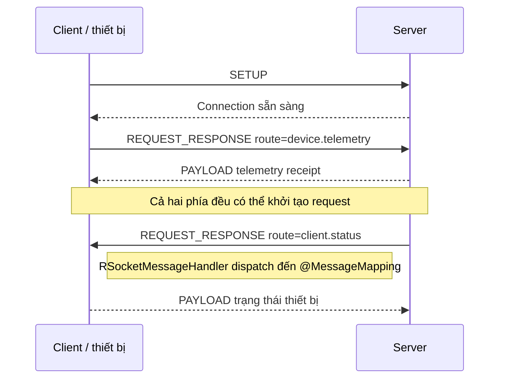

# Cung cấp RSocketMessageHandler để xử lý yêu cầu ngược

Trong nhiều ví dụ RSocket, client tạo kết nối rồi gửi request đến server. Cách nhìn đó dễ khiến ta nghĩ server luôn là bên phản hồi và client luôn là bên yêu cầu. Thực tế, sau khi phiên RSocket được thiết lập, hai peer có vai trò đối xứng: mỗi bên đều có thể khởi tạo request và xử lý request do bên kia gửi.

Ví dụ, một thiết bị IoT kết nối đến server và gửi telemetry. Khi cần, server có thể gọi ngược đến thiết bị để yêu cầu trạng thái, thay đổi cấu hình hoặc kiểm tra khả năng hỗ trợ. Muốn client nhận được request đó, client phải đăng ký một responder trên chính kết nối RSocket đang dùng. Trong Spring, `RSocketMessageHandler` cung cấp cơ chế ánh xạ request đến các method `@MessageMapping` và `@ConnectMapping`; `RSocketRequester.Builder` đăng ký responder này thông qua `rsocketConnector`.

Bài này giải thích cách kết hợp `RSocketRequester` và `RSocketMessageHandler` để xử lý request ngược ở client, cách server gửi request đến đúng kết nối client, cấu hình codec/route, quản lý vòng đời và kiểm thử hai chiều.

## 1. RSocket đối xứng sau khi kết nối

RSocket phân biệt hai vai trò trong từng tương tác:

- **Requester:** bên khởi tạo một request cụ thể.
- **Responder:** bên nhận request và phát response nếu interaction type yêu cầu.

Hai vai trò này không cố định theo client/server. Sau khi `SETUP` hoàn tất, client có thể là requester trong một request và responder trong request kế tiếp. Server cũng có thể làm cả hai vai trò trên cùng một connection.



Trong sơ đồ, client khởi tạo request `device.telemetry` như thường lệ. Sau đó server khởi tạo request mới `client.status` trên cùng connection. Client phải có responder được đăng ký để xử lý route đó.

Điểm quan trọng: `RSocketRequester` là API tạo request. `RSocketMessageHandler` là hạ tầng dispatch request đến method responder. Để xử lý request ngược ở client, cần cấu hình cả hai: tạo responder và gắn responder vào connector của requester.

## 2. Vai trò của RSocketRequester và RSocketMessageHandler

| Thành phần | Trách nhiệm |
|---|---|
| `RSocketRequester` | Tạo request-response, request-stream, fire-and-forget hoặc request-channel; mã hóa data và metadata; đọc response |
| `RSocketMessageHandler` | Nhận request từ peer, đọc route/metadata, tìm method annotated phù hợp và chuyển payload vào handler |
| `RSocketStrategies` | Cung cấp encoder, decoder, metadata extractor và route matcher dùng chung |
| `SocketAcceptor` | Cung cấp responder cho một RSocket connection; nhận request từ peer và dispatch đến handler |
| `RSocketConnector` | Cấu hình kết nối phía client, bao gồm responder cục bộ được đăng ký qua `acceptor` |

Ở phía server, Spring Boot tự cấu hình `RSocketMessageHandler` để xử lý request đến ứng dụng khi bật RSocket server support. Ở phía client, việc đăng ký responder cho request từ server cần được cấu hình trong `RSocketRequester.Builder`.

Một cách tạo responder gọn là static factory:

```java
SocketAcceptor responder = RSocketMessageHandler.responder(
    strategies,
    new ClientResponder()
);
```

Factory này tạo `RSocketMessageHandler`, đăng ký các handler object được truyền vào và trả về một `SocketAcceptor`. Các handler object không bắt buộc phải có stereotype như `@Controller` khi được truyền trực tiếp vào factory.

Static factory `RSocketMessageHandler.responder(...)` có từ Spring Framework 5.2.6. Với phiên bản cũ hơn hoặc khi cần auto-discovery handler từ Spring context, có thể khai báo `RSocketMessageHandler` thành bean rồi lấy `handler.responder()` để đăng ký.

## 3. Viết handler ở phía client

Client cần khai báo các route mà server được phép gọi. Ví dụ, một thiết bị hỗ trợ route `client.status` để trả trạng thái và route `client.apply-config` để nhận cấu hình.

```java
import org.springframework.messaging.handler.annotation.MessageMapping;
import reactor.core.publisher.Mono;

public class ClientResponder {

    private final DeviceService deviceService;

    public ClientResponder(DeviceService deviceService) {
        this.deviceService = deviceService;
    }

    @MessageMapping("client.status")
    Mono<DeviceStatus> status(DeviceStatusQuery query) {
        return deviceService.readStatus(query.deviceId());
    }

    @MessageMapping("client.apply-config")
    Mono<ConfigResult> applyConfig(DeviceConfig config) {
        return deviceService.apply(config);
    }
}
```

`@MessageMapping` xác định route mà responder nhận. Method argument mặc định được xem là payload nếu kiểu đó không thuộc một loại argument đặc biệt khác. Return type `Mono<T>` tạo một response; `Flux<T>` có thể trả một stream response; `Mono<Void>` phù hợp với xử lý không có response payload như fire-and-forget.

Handler này là code phía client. Khi server gửi request route `client.status`, Spring gọi `status`; khi server gửi `client.apply-config`, Spring gọi `applyConfig`. Client không cần tự parse frame RSocket hoặc tự viết switch theo route.

### 3.1. Phân biệt @MessageMapping và @ConnectMapping

Hai annotation xử lý hai loại sự kiện khác nhau:

| Annotation | Thời điểm/phạm vi | Ví dụ |
|---|---|---|
| `@ConnectMapping` | Sự kiện ở cấp connection, thường là `SETUP` và metadata push | Nhận diện thiết bị khi vừa kết nối, đọc setup metadata |
| `@MessageMapping` | Một request cụ thể có route | Trả trạng thái, nhận lệnh, phát stream dữ liệu |

Server dùng `@ConnectMapping` để tiếp nhận thông tin setup từ client. Client cũng có thể đăng ký `@ConnectMapping` trong responder của mình nếu cần xử lý sự kiện kết nối/metadata ở phía client. Các request ngược thông thường như truy vấn trạng thái hoặc gửi cấu hình nên dùng `@MessageMapping`.

## 4. Tạo SocketAcceptor từ RSocketMessageHandler

`RSocketStrategies` xác định cách encode/decode payload và metadata. Trong ứng dụng cần route matcher theo pattern, có thể dùng `PathPatternRouteMatcher` khi có `spring-web`.

```java
import org.springframework.messaging.rsocket.RSocketStrategies;
import org.springframework.messaging.rsocket.annotation.support.RSocketMessageHandler;
import org.springframework.web.util.pattern.PathPatternRouteMatcher;
import io.rsocket.SocketAcceptor;

RSocketStrategies strategies = RSocketStrategies.builder()
    .routeMatcher(new PathPatternRouteMatcher())
    .build();

SocketAcceptor clientResponder = RSocketMessageHandler.responder(
    strategies,
    new ClientResponder(deviceService)
);
```

Nếu không cần route pattern nâng cao, có thể dùng route matcher mặc định. Khi dùng Spring Boot, `RSocketStrategies` thường đã được auto-configure; có thể inject bean đó để bảo đảm requester và responder dùng codec tương thích.

Khi payload là DTO, hai phía phải có encoder/decoder tương thích. Spring Boot starter RSocket có thể cấu hình codec JSON/CBOR dựa trên dependency hiện có; nếu dùng định dạng khác, hãy đăng ký encoder/decoder tương ứng trong `RSocketStrategies` ở cả hai phía.

## 5. Đăng ký responder trong RSocketRequester.Builder

Đây là bước kết nối handler với connection. `RSocketRequester.Builder.rsocketConnector` cho phép tùy chỉnh `RSocketConnector`; gọi `acceptor(clientResponder)` để đăng ký responder cục bộ.

```java
import org.springframework.messaging.rsocket.RSocketRequester;
import io.rsocket.SocketAcceptor;

RSocketRequester requester = RSocketRequester.builder()
    .rsocketStrategies(strategies)
    .rsocketConnector(connector -> connector.acceptor(clientResponder))
    .tcp("rsocket.example.internal", 7000);
```

Khi server gửi request qua connection này, `clientResponder` nhận request và chuyển đến các method annotated. Cùng một `requester` vẫn có thể được client dùng để gửi request đến server:

```java
Mono<ServerReceipt> receipt = requester
    .route("device.telemetry")
    .data(new DeviceTelemetry("device-42", 21.5))
    .retrieveMono(ServerReceipt.class);
```

Vì vậy, một client connection có thể vừa gọi server bằng `requester.route(...)`, vừa nhận request từ server thông qua `SocketAcceptor` đã đăng ký.

Lưu ý rằng `.tcp(...)` tạo requester đã cấu hình transport nhưng không nhất thiết mở socket ngay tại dòng code đó. Kết nối và frame `SETUP` thường được thực hiện khi request đầu tiên được subscribe. Nếu server cần gửi request ngược sau khi client kết nối, client phải khởi tạo connection trước, chẳng hạn bằng một request đăng ký/heartbeat ban đầu; server chỉ có thể gọi ngược sau khi setup hoàn tất.

### 5.1. Dùng Spring Boot Builder

Spring Boot cung cấp `RSocketRequester.Builder` prototype bean và `RSocketStrategies` auto-configured. Ví dụ cấu hình client:

```java
@Configuration
class DeviceRSocketClientConfig {

    @Bean
    RSocketRequester deviceRequester(
            RSocketRequester.Builder builder,
            RSocketStrategies strategies,
            DeviceService deviceService) {

        SocketAcceptor responder = RSocketMessageHandler.responder(
            strategies,
            new ClientResponder(deviceService)
        );

        return builder
            .rsocketStrategies(strategies)
            .rsocketConnector(connector -> connector.acceptor(responder))
            .tcp("rsocket.example.internal", 7000);
    }
}
```

Builder là đối tượng có trạng thái cấu hình; Spring Boot cung cấp prototype bean để mỗi injection point có instance riêng. Không nên tái sử dụng một builder đã cấu hình cho nhiều requester khác nhau nếu các connection cần setup, transport hoặc responder khác nhau.

Trong một ứng dụng có nhiều loại client, hãy tạo responder phù hợp cho từng requester. Không đăng ký nhầm handler của thiết bị A vào connection của thiết bị B.

## 6. Cấu hình phía server để gọi ngược client

Sau khi client đăng ký responder, server cần lấy requester gắn với đúng connection client. Spring hỗ trợ tham số `RSocketRequester` trong các method `@ConnectMapping` và `@MessageMapping` phía server.

Ví dụ server nhận setup và lưu requester theo định danh thiết bị:

```java
@Controller
class DeviceConnectionController {

    private final DeviceConnectionRegistry registry;

    DeviceConnectionController(DeviceConnectionRegistry registry) {
        this.registry = registry;
    }

    @ConnectMapping("device")
    Mono<Void> register(
            @Payload DeviceHello hello,
            RSocketRequester requester) {

        return registry.register(hello.deviceId(), requester);
    }
}
```

Client cần gửi setup route phù hợp nếu server dùng `@ConnectMapping("device")`. `DeviceConnectionRegistry` là thành phần ứng dụng lưu requester theo connection/thiết bị và phải quản lý việc loại bỏ entry khi connection đóng.

Sau khi setup handler hoàn tất, service server có thể dùng requester đã lưu để gửi request đến client:

```java
Mono<DeviceStatus> queryDevice(String deviceId) {
    RSocketRequester requester = registry.require(deviceId);

    return requester
        .route("client.status")
        .data(new DeviceStatusQuery(deviceId))
        .retrieveMono(DeviceStatus.class);
}
```

Server gọi route `client.status`; responder trên client nhận và xử lý route đó. Kết quả trả về server theo interaction request-response.

### 6.1. Vì sao không nên gọi request ngay trong setup handler?

`@ConnectMapping` xử lý frame `SETUP`, tức là phần khởi tạo connection. Request cần được bắt đầu sau khi quá trình setup handler hoàn tất. Nếu cần phát request ngay khi thiết bị kết nối, hãy tách việc khởi chạy request khỏi phần xử lý setup và quản lý lifecycle bằng service/registry.

Không nên giữ một `RSocketRequester` toàn cục rồi ghi đè mỗi khi client mới kết nối. Mỗi requester đại diện cho một connection cụ thể; dùng nhầm requester có thể gửi lệnh đến sai thiết bị. Hãy lưu theo connection ID hoặc device ID đã xác thực và dọn registry khi connection kết thúc.

## 7. Luồng request ngược theo từng interaction type

Responder client có thể xử lý nhiều interaction type. Loại tương tác được xác định bởi cardinality của payload đầu vào và kết quả handler.

| Request từ server | Handler phía client | Kết quả |
|---|---|---|
| Request-response | Một payload vào, trả `Mono<T>` hoặc một giá trị | Một response |
| Request-stream | Một payload vào, trả `Flux<T>` | Một stream response |
| Fire-and-forget | Một payload vào, trả `void` hoặc `Mono<Void>` | Không có response payload |
| Request-channel | `Flux<T>` đầu vào, có thể trả `Flux<R>` | Hai luồng dữ liệu trong một tương tác |

Ví dụ client trả stream trạng thái:

```java
@MessageMapping("client.telemetry.live")
Flux<DeviceMetric> liveMetrics(DeviceMetricQuery query) {
    return deviceService.streamMetrics(query.deviceId());
}
```

Server khởi tạo request-stream:

```java
Flux<DeviceMetric> metrics = requester
    .route("client.telemetry.live")
    .data(new DeviceMetricQuery("device-42"))
    .retrieveFlux(DeviceMetric.class);
```

Backpressure hoạt động trên stream response. Nếu server tiêu thụ chậm, demand được truyền về client để điều tiết nguồn metric, với điều kiện publisher phía client tôn trọng demand.

Ví dụ client nhận lệnh từ server qua fire-and-forget:

```java
@MessageMapping("client.refresh-cache")
Mono<Void> refreshCache(CacheRefreshCommand command) {
    return cacheService.refresh(command.scope());
}
```

Server gửi:

```java
Mono<Void> sent = requester
    .route("client.refresh-cache")
    .data(new CacheRefreshCommand("device-config"))
    .send();
```

`send()` hoàn tất chỉ cho biết thao tác gửi ở phía requester đã hoàn thành theo API. Nó không xác nhận client đã refresh cache thành công. Nếu server cần kết quả, hãy dùng request-response hoặc thiết kế acknowledgement qua route riêng.

## 8. Route, setup metadata và request metadata

Có ba phạm vi metadata cần phân biệt:

- **Setup metadata:** được gửi trong `SETUP`, áp dụng cho connection; có thể dùng để nhận diện client hoặc xác thực ban đầu.
- **Request route:** metadata gắn với từng request để responder tìm method `@MessageMapping`.
- **Request metadata bổ sung:** token, tenant hoặc context khác được gửi kèm từng request theo MIME type đã đăng ký.

Ví dụ client gửi setup route và data:

```java
RSocketRequester requester = builder
    .setupRoute("device")
    .setupData(new DeviceHello("device-42", "v2"))
    .rsocketConnector(connector -> connector.acceptor(clientResponder))
    .tcp("rsocket.example.internal", 7000);
```

Server có thể dùng `@ConnectMapping("device")` để nhận setup này. Khi gọi route request, client hoặc server dùng `.route("...")`; route đó được mã hóa vào metadata của request, ví dụ `client.status`.

Nếu dùng composite metadata, có thể thêm giá trị metadata có MIME type tương ứng:

```java
import org.springframework.util.MimeType;

MimeType authMime = MimeType.valueOf(
    "message/x.rsocket.authentication.bearer.v0"
);

Mono<DeviceStatus> status = requester
    .route("client.status")
    .metadata(accessToken, authMime)
    .data(new DeviceStatusQuery("device-42"))
    .retrieveMono(DeviceStatus.class);
```

Đảm bảo encoder/decoder và metadata extractor ở hai phía hiểu cùng định dạng. Không đưa access token hoặc dữ liệu nhạy cảm vào log route/payload.

## 9. Nhiều handler và nhiều loại client trong cùng ứng dụng

Trong ứng dụng vừa là server vừa là client, có thể tồn tại hai nhóm responder:

- Responder phía server xử lý request do các client kết nối đến gửi.
- Responder phía client xử lý request ngược do server gửi đến từng client connection.

Nếu cả hai nhóm handler cùng nằm trong một Spring ApplicationContext, stereotype mặc định như `@Controller` có thể khiến một `RSocketMessageHandler` phát hiện nhầm handler. Với client responder được tạo trực tiếp qua `RSocketMessageHandler.responder(strategies, handlerObjects)`, chỉ các object truyền vào factory được đăng ký, nên dễ tách biệt.

Với cấu hình nâng cao dùng `RSocketMessageHandler` bean và auto-discovery, có thể cấu hình `setHandlerPredicate` hoặc custom stereotype để chỉ chọn các client responder phù hợp. Ví dụ, server controller dùng `@Controller`, còn client responder dùng annotation riêng `@RSocketClientResponder`. Cách này giúp tránh cùng một method bị đăng ký vào cả server và client responder ngoài ý muốn.

Nếu một process quản lý nhiều requester, mỗi connection có thể cần responder state riêng. Tránh dùng một singleton handler có mutable field lưu “client hiện tại”; request từ nhiều connection có thể chạy đồng thời. Hãy truyền connection context qua payload/metadata hoặc dùng registry có khóa theo connection đã xác thực.

## 10. Xử lý lỗi và vòng đời connection

Request ngược có thể thất bại vì client đã disconnect, route không tồn tại, codec không tương thích, authorization bị từ chối hoặc handler ném exception. Server cần phân biệt lỗi transport với lỗi nghiệp vụ.

Ở phía client:

- Handler trả `Mono.error` hoặc `Flux.error` khi xử lý request thất bại.
- Dùng `@MessageExceptionHandler` hoặc `@ControllerAdvice` phù hợp để ánh xạ exception thành lỗi RSocket có cấu trúc.
- Không nuốt lỗi rồi trả response thành công giả.
- Giới hạn thời gian cho thao tác phụ thuộc I/O hoặc thiết bị.

Ở phía server:

- Xử lý lỗi từ `retrieveMono`/`retrieveFlux` khi gọi client.
- Đặt timeout cho request ngược; thiết bị offline không nên giữ request vô hạn.
- Khi requester không còn hợp lệ, loại connection khỏi registry và không tiếp tục gửi lệnh.
- Có retry/backoff với lỗi tạm thời, nhưng tránh retry vô hạn hoặc gửi lại command không idempotent.

Một route ngược nên có hợp đồng rõ về timeout, response type, trạng thái thiết bị offline và tính idempotent. Với lệnh thay đổi trạng thái, nên dùng command ID để tránh áp dụng hai lần nếu caller retry sau khi mất kết nối.

## 11. Bảo mật request ngược

Khi server có thể gọi vào client, responder phía client trở thành một bề mặt API cần được bảo vệ. Không nên xem việc request đến từ cùng connection là đủ để cho phép mọi route.

Các điểm cần kiểm tra:

- Xác thực peer ở lúc setup bằng TLS và/hoặc cơ chế authentication metadata phù hợp.
- Ràng buộc connection với principal, device ID hoặc tenant đã xác thực.
- Kiểm tra quyền trên từng route và từng command; một client không được nhận lệnh dành cho client khác.
- Giới hạn payload, số request đồng thời và tốc độ gọi route.
- Không tin device ID trong payload nếu chưa đối chiếu với identity của connection.
- Không log access token, credential hoặc payload nhạy cảm.
- Xử lý thu hồi quyền và đóng connection khi principal không còn hợp lệ.

Với server gửi request ngược đến thiết bị, registry phải được xây từ thông tin identity đã xác thực. Không để caller bên ngoài truyền tùy ý device ID rồi lấy requester tương ứng nếu chưa có authorization check.

## 12. Kiểm thử responder ở phía client

Nên có integration test với RSocket server và client thật. Test cần xác minh server có thể gọi route của client sau khi client đăng ký `SocketAcceptor`.

Một cấu trúc test tối giản:

```java
import org.springframework.messaging.handler.annotation.MessageMapping;
import org.springframework.messaging.rsocket.RSocketRequester;
import org.springframework.messaging.rsocket.RSocketStrategies;
import org.springframework.messaging.rsocket.annotation.support.RSocketMessageHandler;
import io.rsocket.SocketAcceptor;
import io.rsocket.core.RSocketServer;
import io.rsocket.transport.netty.server.TcpServerTransport;
import reactor.core.publisher.Mono;

class ServerHandler {

    @MessageMapping("server.query-client")
    Mono<DeviceStatus> queryClient(
            DeviceStatusQuery query,
            RSocketRequester requester) {

        return requester
            .route("client.status")
            .data(query)
            .retrieveMono(DeviceStatus.class);
    }
}

RSocketStrategies strategies = RSocketStrategies.builder().build();

SocketAcceptor serverResponder = RSocketMessageHandler.responder(
    strategies,
    new ServerHandler()
);

var server = RSocketServer.create(serverResponder)
    .bind(TcpServerTransport.create("localhost", 0))
    .block();

SocketAcceptor clientResponder = RSocketMessageHandler.responder(
    strategies,
    new ClientResponder(deviceService)
);

RSocketRequester client = RSocketRequester.builder()
    .rsocketStrategies(strategies)
    .rsocketConnector(connector -> connector.acceptor(clientResponder))
    .tcp("localhost", server.address().getPort());

// Request đầu tiên mở connection; server handler gọi ngược client.status.
DeviceStatus status = client
    .route("server.query-client")
    .data(new DeviceStatusQuery("device-42"))
    .retrieveMono(DeviceStatus.class)
    .block();
```

Đây là khung minh họa cho test; `DeviceService` và dữ liệu test cần được triển khai trong fixture. Request đầu tiên từ client kích hoạt kết nối và gọi `server.query-client`. Server nhận `RSocketRequester` gắn với client, sau đó gửi request ngược đến route `client.status`. Khi kết thúc test, đóng transport/client connection và server bằng lifecycle handle mà test đang sử dụng để giải phóng tài nguyên. Không dùng `.block()` trên event-loop của ứng dụng reactive; nó chỉ xuất hiện ở đây trong test đồng bộ.

Các tình huống nên kiểm tra:

1. Server gọi route `client.status`; client trả đúng DTO.
2. Server gọi route không tồn tại; nhận lỗi phù hợp.
3. Client handler trả lỗi; server quan sát được lỗi đó.
4. Server gửi request trước khi setup hoàn tất; xác minh ứng dụng không khởi chạy request quá sớm.
5. Hai client kết nối cùng lúc; request của server được định tuyến đúng connection.
6. Client disconnect; registry loại requester cũ và server không tiếp tục dùng nó.
7. Route có metadata/authentication; quyền được kiểm tra ở phía client.
8. Request-stream và request-channel tuân thủ demand khi consumer chậm.
9. Timeout và cancellation giải phóng tác vụ phía client.

## 13. Lỗi thường gặp

| Triệu chứng | Nguyên nhân thường gặp | Cách khắc phục |
|---|---|---|
| Server gửi request nhưng client không gọi handler | Chưa đăng ký client `SocketAcceptor` vào connector | Dùng `RSocketMessageHandler.responder(...)` và `connector.acceptor(...)` |
| Route không tìm thấy | Tên route không khớp hoặc responder chưa được đăng ký | Đối chiếu `.route(...)` với `@MessageMapping` |
| DTO decode lỗi | Codec hoặc MIME type không tương thích | Dùng `RSocketStrategies` tương thích ở cả hai phía |
| Handler client bị phát hiện nhầm ở server | Auto-discovery chung stereotype trong cùng context | Dùng static responder factory hoặc custom handler predicate/stereotype |
| Server gọi nhầm client | Registry dùng khóa không duy nhất hoặc requester cũ chưa được dọn | Gắn requester với connection/device identity đã xác thực và cleanup khi disconnect |
| Request ngay khi client kết nối thất bại | Gửi request trong lúc `@ConnectMapping` còn xử lý SETUP | Tách request khỏi setup handler và khởi chạy sau khi setup hoàn tất |
| Fire-and-forget bị coi là đã xử lý | Nhầm `send()` hoàn tất với business acknowledgement | Dùng request-response hoặc route acknowledgement riêng |

## 14. Quy trình triển khai

1. Xác định những route nào server cần gọi trên client và interaction type tương ứng.
2. Viết client handler với `@MessageMapping`/`@ConnectMapping` và return type reactive phù hợp.
3. Tạo `RSocketStrategies` với codec và route matcher tương thích.
4. Tạo `SocketAcceptor` bằng `RSocketMessageHandler.responder(strategies, handlers...)` hoặc lấy `handler.responder()` từ bean.
5. Đăng ký acceptor qua `RSocketRequester.Builder.rsocketConnector(connector -> connector.acceptor(responder))`.
6. Thiết lập connection bằng TCP hoặc WebSocket và gửi setup metadata nếu cần.
7. Ở server, lấy requester gắn với từng client connection qua `@ConnectMapping`/`@MessageMapping` và lưu registry an toàn.
8. Gửi request ngược bằng `.route(...).data(...).retrieveMono(...)` hoặc `.retrieveFlux(...)`.
9. Bổ sung timeout, error mapping, authorization và cleanup connection.
10. Kiểm thử nhiều client đồng thời, disconnect, route lỗi và backpressure.

## 15. Kết luận

RSocket là giao thức hai chiều: sau khi setup, client và server đều có thể khởi tạo request. `RSocketRequester` gửi request; `RSocketMessageHandler` dispatch request đến các method annotated; `SocketAcceptor` gắn responder vào một connection. Để client nhận request ngược từ server, hãy tạo responder bằng `RSocketMessageHandler.responder(...)` rồi đăng ký nó trong `RSocketRequester.Builder.rsocketConnector(...)`.

Ở chiều server gọi client, lấy `RSocketRequester` gắn với connection qua `@ConnectMapping` hoặc `@MessageMapping`, quản lý requester theo đúng client đã xác thực và gửi đến route mà client đã đăng ký. Khi tách rõ requester và responder, cấu hình codec/route nhất quán, quản lý vòng đời connection và bảo vệ từng route, ứng dụng có thể xây dựng lệnh điều khiển, truy vấn trạng thái và luồng dữ liệu hai chiều trên cùng một RSocket connection.

## Tài liệu tham khảo

- [Spring Framework Reference – RSocket](https://docs.spring.io/spring-framework/reference/rsocket.html)
- [Spring Boot Reference – RSocket](https://docs.spring.io/spring-boot/reference/messaging/rsocket.html)
- [RSocketMessageHandler Javadoc](https://docs.spring.io/spring-framework/docs/current/javadoc-api/org/springframework/messaging/rsocket/annotation/support/RSocketMessageHandler.html)
