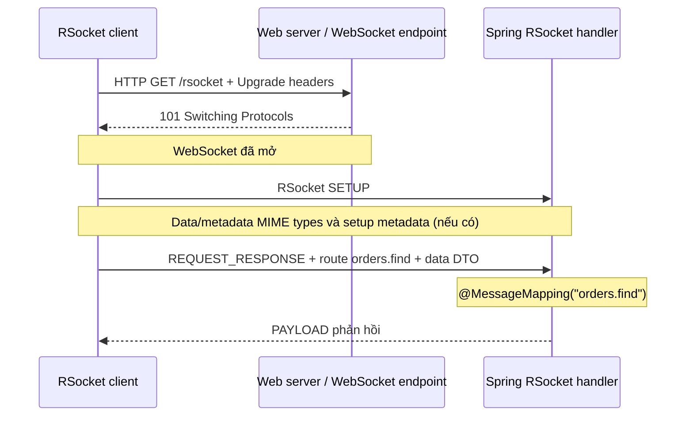

# Phân biệt route của Spring với địa chỉ HTTP và header HTTP

Khi làm việc với Spring RSocket, các khái niệm **route**, **địa chỉ HTTP** và **HTTP header** dễ bị nhầm lẫn vì chúng đều có thể xuất hiện trong lúc client kết nối tới server. Tuy nhiên, chúng thuộc những tầng khác nhau:

- **RSocket route** là metadata trong một request RSocket, dùng để chọn handler như `@MessageMapping("orders.find")`.
- **Địa chỉ HTTP/WebSocket** xác định nơi client thực hiện HTTP handshake để mở WebSocket, ví dụ `ws://api.example.com:8080/rsocket`.
- **HTTP header** là thông tin của HTTP request/handshake, ví dụ `Origin`, `Cookie` hoặc `Authorization` được gửi trong lúc nâng cấp kết nối.

RSocket qua WebSocket sử dụng HTTP ở bước mở kết nối. Sau khi handshake hoàn tất, dữ liệu RSocket được truyền trong các frame WebSocket. Route và metadata của từng tương tác RSocket nằm trong payload/frame theo giao thức RSocket; chúng không phải URL path hay HTTP header của handshake.

## 1. Ba khái niệm thuộc ba tầng khác nhau

| Thành phần | Ví dụ | Tầng giao tiếp | Dùng để làm gì? |
|---|---|---|---|
| HTTP/WebSocket URL | `wss://api.example.com/rsocket` | HTTP và WebSocket handshake | Xác định host, port, scheme và endpoint mở WebSocket |
| WebSocket mapping path | `/rsocket` | HTTP/WebSocket handshake phía server | Chọn endpoint WebSocket mà Spring RSocket server đăng ký |
| RSocket route | `orders.find` | Metadata của request RSocket | Chọn method `@MessageMapping` xử lý tương tác |
| HTTP header | `Origin`, `Cookie`, `Authorization` | HTTP handshake | Cung cấp thông tin cho proxy, web server hoặc chính sách bảo mật handshake |
| RSocket metadata | `correlationId`, token, tenant context | SETUP hoặc payload của tương tác RSocket | Truyền ngữ cảnh cấp kết nối hoặc cấp request cho peer RSocket |

Một URL có thể chứa path `/rsocket`, nhưng route của request vẫn có thể là `orders.find`. Hai chuỗi này không cần giống nhau và không thay thế cho nhau.

## 2. RSocket route là metadata định tuyến request

Trong Spring RSocket, route thường được biểu diễn bằng routing metadata. Client sử dụng `RSocketRequester.route(...)` để chỉ định route. Spring đưa route vào metadata của payload, sau đó server dùng route để tìm method có `@MessageMapping` tương ứng.

Ví dụ handler:

```java
@Controller
public class OrderController {

    @MessageMapping("orders.find")
    public Mono<OrderView> find(@Payload FindOrderRequest request) {
        return orderService.findById(request.orderId());
    }
}
```

Client gửi request:

```java
Mono<OrderView> response = requester
    .route("orders.find")
    .data(new FindOrderRequest("ORD-1001"))
    .retrieveMono(OrderView.class);
```

Ở đây:

- `orders.find` là route RSocket, không phải địa chỉ mạng.
- `@MessageMapping("orders.find")` đăng ký handler cho route đó.
- `FindOrderRequest` được encode thành data của payload.
- `retrieveMono(OrderView.class)` nhận một payload phản hồi và decode thành `OrderView`.

Route không chứa `http://`, `https://`, hostname hoặc port. Nó cũng không tự xác thực hay cấp quyền cho caller; server vẫn phải kiểm tra danh tính và quyền truy cập riêng.

### Route có thể có biến

Spring cho phép dùng route pattern để trích xuất một phần route thành biến:

```java
@MessageMapping("orders.{orderId}.cancel")
public Mono<CancelResult> cancel(
        @DestinationVariable String orderId,
        @Payload CancelOrderRequest request) {
    return orderService.cancel(orderId, request.reason());
}
```

Client có thể xây dựng route phù hợp, ví dụ `orders.ORD-1001.cancel`. `@DestinationVariable` lấy `orderId` từ route pattern. Đây vẫn là routing metadata của RSocket, không phải path variable trong URL HTTP như `@PathVariable` của Spring MVC.

## 3. Địa chỉ HTTP và WebSocket mapping path

Khi chọn transport WebSocket, client cần mở WebSocket tới một endpoint HTTP. Ví dụ:

```text
ws://localhost:8080/rsocket
wss://api.example.com/rsocket
```

Các thành phần của URL:

- `ws` hoặc `wss`: WebSocket thường hoặc WebSocket được bảo vệ bằng TLS.
- `localhost` hoặc `api.example.com`: host mà client có thể truy cập.
- `8080` hoặc `443`: port tiếp nhận handshake.
- `/rsocket`: HTTP path được server ánh xạ tới RSocket WebSocket endpoint.

Spring Boot có thể cấu hình WebSocket transport như sau:

```yaml
server:
  address: 0.0.0.0
  port: 8080

spring:
  rsocket:
    server:
      transport: websocket
      mapping-path: /rsocket
```

Client kết nối tới đúng endpoint:

```java
URI endpoint = URI.create("ws://localhost:8080/rsocket");

Mono<RSocketRequester> requesterMono = RSocketRequester.builder()
    .websocket(endpoint);
```

Sau khi WebSocket handshake thành công và RSocket setup hoàn tất, client có thể gửi nhiều request trên kết nối đó. Mỗi request có thể dùng một route khác nhau, ví dụ `orders.find`, `orders.create` hoặc `inventory.watch`, trong khi URL kết nối vẫn giữ nguyên `/rsocket`.

### TCP không có HTTP URL hoặc WebSocket path

Với RSocket qua TCP, client kết nối trực tiếp bằng host và port:

```java
Mono<RSocketRequester> requesterMono = RSocketRequester.builder()
    .tcp("rsocket-service", 7000);
```

TCP không thực hiện HTTP handshake, do đó không có HTTP path `/rsocket` hoặc HTTP header. RSocket route vẫn được dùng trong các request sau khi kết nối được thiết lập.

## 4. So sánh route RSocket với HTTP endpoint của Spring MVC

Một ứng dụng có thể cung cấp cả REST API và RSocket API, nhưng hai kiểu endpoint có cơ chế định tuyến riêng.

| Spring MVC/WebFlux | Spring RSocket |
|---|---|
| `@GetMapping("/orders/{id}")` | `@MessageMapping("orders.find")` |
| Địa chỉ gồm scheme, host, port và path HTTP | Kết nối tới transport endpoint; route nằm trong metadata RSocket |
| Path variable lấy từ URL | `@DestinationVariable` lấy từ route pattern |
| HTTP body được bind bằng `@RequestBody` | Data của payload được bind bằng `@Payload` |
| HTTP headers được bind bằng `@RequestHeader` | Metadata đã trích xuất được bind bằng `@Header` |
| Response là HTTP response | Response là payload hoặc stream RSocket |

Ví dụ hai API có thể phục vụ cùng một nghiệp vụ:

```java
@RestController
@RequestMapping("/api/orders")
class OrderHttpController {

    @GetMapping("/{id}")
    Mono<OrderView> findHttp(@PathVariable String id) {
        return orderService.findById(id);
    }
}

@Controller
class OrderRSocketController {

    @MessageMapping("orders.find")
    Mono<OrderView> findRSocket(@Payload FindOrderRequest request) {
        return orderService.findById(request.orderId());
    }
}
```

HTTP client gọi URL như `GET https://api.example.com/api/orders/ORD-1001`. RSocket client kết nối một lần tới endpoint transport, sau đó gửi route `orders.find` cùng data chứa `orderId`. URL HTTP và route RSocket có thể được thiết kế độc lập.

## 5. HTTP header được gửi ở bước handshake

Khi mở WebSocket, client bắt đầu bằng một HTTP request có các header phục vụ quá trình handshake. Một số header thường gặp:

| HTTP header | Ý nghĩa trong handshake |
|---|---|
| `Host` | Host mà client yêu cầu kết nối |
| `Upgrade: websocket` | Yêu cầu nâng cấp kết nối lên WebSocket |
| `Connection: Upgrade` | Báo hiệu quá trình upgrade |
| `Sec-WebSocket-Key` | Giá trị dùng trong WebSocket handshake |
| `Sec-WebSocket-Version` | Phiên bản WebSocket client sử dụng |
| `Origin` | Nguồn trang khởi tạo kết nối, thường được dùng trong chính sách kiểm tra origin |
| `Cookie` | Cookie của domain nếu client gửi và chính sách cho phép |
| `Authorization` | Thông tin xác thực nếu client/proxy/server hỗ trợ trong handshake |

Sau khi server trả về phản hồi upgrade thành công, kết nối chuyển sang WebSocket. Các message RSocket tiếp theo được gửi dưới dạng frame WebSocket chứa frame RSocket. HTTP header của handshake không tự động được gắn vào từng request RSocket.

Điều này có nghĩa là `@Header("Authorization")` trong một `@MessageMapping` không mặc nhiên đọc được HTTP header `Authorization` đã dùng để mở WebSocket. Muốn nhận metadata ở handler RSocket, client phải gửi metadata theo định dạng RSocket và server phải trích xuất nó.

## 6. RSocket metadata không phải HTTP header

RSocket metadata được truyền cùng frame RSocket. Có hai phạm vi thường gặp:

- **Setup metadata**: được gửi trong frame `SETUP`, dùng cho ngữ cảnh ban đầu của kết nối như thông tin xác thực hoặc capability của peer.
- **Request metadata**: được gửi cùng một request cụ thể, dùng cho route, correlation ID, tenant context hoặc dữ liệu điều khiển của request.

Một request RSocket có thể có data và metadata. Routing metadata thường nằm trong composite metadata với MIME type routing đã biết. Khi client gọi `route("orders.find")`, Spring tự tạo phần routing metadata phù hợp; không cần tự thêm route thành HTTP header.

Ví dụ gửi metadata tùy chỉnh ở cấp request:

```java
Mono<OrderView> response = requester
    .route("orders.find")
    .metadata("trace-7f21", MimeTypeUtils.TEXT_PLAIN)
    .data(new FindOrderRequest("ORD-1001"))
    .retrieveMono(OrderView.class);
```

Ở phía server, để tham số `@Header("correlationId")` nhận được giá trị trên, `RSocketStrategies` cần có `MetadataExtractor` ánh xạ MIME type `text/plain` thành tên header `correlationId`:

```java
@Bean
RSocketStrategies rSocketStrategies() {
    MimeType textPlain = MimeTypeUtils.TEXT_PLAIN;

    return RSocketStrategies.builder()
        .metadataExtractorRegistry(registry ->
            registry.metadataToExtract(
                textPlain,
                String.class,
                "correlationId"
            )
        )
        .build();
}
```

Handler nhận metadata đã trích xuất:

```java
@MessageMapping("orders.find")
Mono<OrderView> find(
        @Payload FindOrderRequest request,
        @Header("correlationId") String correlationId) {
    return orderService.findById(request.orderId())
        .doOnEach(signal -> log.debug(
            "orders.find correlationId={}", correlationId));
}
```

Trong ví dụ, `correlationId` là Spring message header được tạo từ RSocket metadata. Nó không phải HTTP header của WebSocket handshake. Với metadata phức hợp hoặc nhiều MIME type, cần cấu hình extractor tương ứng cho từng mục metadata.

## 7. Khi nào dùng HTTP header và khi nào dùng RSocket metadata?

| Nhu cầu | Cơ chế phù hợp | Lý do |
|---|---|---|
| Kiểm tra `Origin` của trình duyệt | HTTP/WebSocket handshake header | Chính sách nguồn trang được kiểm tra khi mở WebSocket |
| Định tuyến qua reverse proxy | HTTP host/path và header liên quan | Proxy chọn backend trước khi RSocket hoạt động |
| Gửi route `orders.find` | RSocket routing metadata | Route chọn handler cho từng request RSocket |
| Gửi correlation ID cho một request | Request metadata | Mỗi tương tác có thể có ID riêng |
| Gửi ngữ cảnh xác thực ban đầu của kết nối | Setup metadata hoặc cơ chế bảo mật phù hợp | Ngữ cảnh được cung cấp khi thiết lập RSocket session |
| Gửi token thay đổi theo từng request | Request metadata hoặc cơ chế xác thực được thiết kế cho từng request | Token có phạm vi request, không phụ thuộc handshake ban đầu |
| Xác thực truy cập WebSocket endpoint trước khi upgrade | HTTP security/filter hoặc cơ chế xác thực handshake | Có thể từ chối kết nối ngay ở tầng HTTP |

Một ứng dụng có thể dùng cả HTTP header và RSocket metadata, nhưng phải xác định rõ thành phần nào đọc và kiểm tra từng loại. Không nên giả định một giá trị được gửi trong HTTP handshake sẽ tự xuất hiện ở mọi request RSocket.

## 8. Lưu ý bảo mật khi dùng header và metadata

Route là tên đích xử lý, không phải bằng chứng về quyền truy cập. Client có thể tự gửi route `admin.delete`; server vẫn phải xác thực caller và kiểm tra quyền trên từng thao tác.

Đối với WebSocket:

- Kiểm tra `Origin` theo chính sách của ứng dụng, đặc biệt với client chạy trong trình duyệt.
- Dùng `wss://` khi kết nối qua mạng không tin cậy để bảo vệ handshake và dữ liệu truyền sau đó bằng TLS.
- Không ghi token, cookie hoặc giá trị `Authorization` vào log handshake.
- Nếu dùng cookie, cân nhắc CSRF/cross-site WebSocket hijacking và kiểm soát origin phù hợp.

Đối với RSocket metadata:

- Chỉ chấp nhận MIME type và cấu trúc metadata đã định nghĩa.
- Xác thực token và kiểm tra audience, thời hạn, issuer cùng quyền tương ứng.
- Không tin `tenantId`, `role` hoặc `userId` do client tự khai báo nếu chưa được xác minh.
- Không đưa bí mật vào route vì route có thể xuất hiện trong log hoặc tracing.
- Giới hạn kích thước metadata và không cho phép metadata tùy ý làm tăng tài nguyên parser.

Nếu Spring Security bảo vệ RSocket, hãy cấu hình cơ chế xác thực và phân quyền cho RSocket connection/request metadata theo integration RSocket của Spring Security. HTTP security của WebSocket handshake và authorization của message RSocket là hai điểm kiểm soát riêng; có thể dùng đồng thời để bảo vệ cả việc mở kết nối lẫn từng tương tác.

## 9. Sơ đồ luồng kết nối và định tuyến



Sơ đồ cho thấy HTTP path `/rsocket` chỉ tham gia bước mở WebSocket. Sau đó, route `orders.find` nằm trong request RSocket và chọn method xử lý. Một WebSocket connection có thể mang nhiều request với route khác nhau.

## 10. Các nhầm lẫn thường gặp

| Nhầm lẫn | Cách hiểu đúng |
|---|---|
| Route `orders.find` là URL `/orders/find` | Route là routing metadata của RSocket; URL HTTP là địa chỉ tài nguyên ở tầng HTTP |
| `mapping-path: /rsocket` là route cho mọi message | Đây là path của WebSocket handshake; route message được chọn riêng bằng metadata |
| `@MessageMapping` tương đương `@PostMapping` | Cả hai đều ánh xạ handler nhưng thuộc hai cơ chế transport/định tuyến khác nhau |
| `@Header` luôn đọc HTTP header | Trong RSocket handler, `@Header` đọc Spring message header, thường được trích xuất từ RSocket metadata |
| HTTP `Authorization` handshake tự động áp dụng cho mọi request | Header handshake không tự động trở thành request metadata; cần thiết kế xác thực và truyền ngữ cảnh rõ ràng |
| Route quyết định quyền truy cập | Route chỉ chọn handler; authorization phải được kiểm tra riêng |
| TCP cũng cần `/rsocket` path | TCP chỉ cần host/port; path chỉ xuất hiện với HTTP/WebSocket transport |

## 11. Checklist khi thiết kế endpoint Spring RSocket

- [ ] Xác định transport là TCP hay WebSocket.
- [ ] Nếu dùng WebSocket, URL client khớp `server.port` và `mapping-path` sau khi tính cả proxy rewrite.
- [ ] Route trong `RSocketRequester.route(...)` khớp với `@MessageMapping`.
- [ ] Không dùng HTTP URL path thay cho RSocket route.
- [ ] Phân biệt `@PathVariable`/HTTP path variable với `@DestinationVariable`/RSocket route variable.
- [ ] Phân biệt HTTP `@RequestHeader` với Spring RSocket `@Header`.
- [ ] Metadata tùy chỉnh có MIME type, extractor và schema được thống nhất.
- [ ] Không giả định HTTP handshake header được tự động chuyển thành RSocket metadata.
- [ ] Xác thực handshake và xác thực/authorization RSocket được cấu hình theo đúng phạm vi.
- [ ] Route không chứa bí mật và không được xem là cơ chế phân quyền.

Route của Spring RSocket, địa chỉ HTTP và HTTP header có thể cùng xuất hiện trong một ứng dụng, nhưng mỗi thành phần phục vụ một tầng khác nhau. URL và HTTP header giúp mở, định tuyến hoặc bảo vệ WebSocket handshake; RSocket route metadata chọn handler cho từng request; RSocket metadata truyền ngữ cảnh cấp kết nối hoặc cấp tương tác. Phân biệt đúng các tầng này giúp cấu hình client/server rõ ràng và tránh lỗi bảo mật do giả định header hoặc route có ý nghĩa vượt quá phạm vi thực tế.
