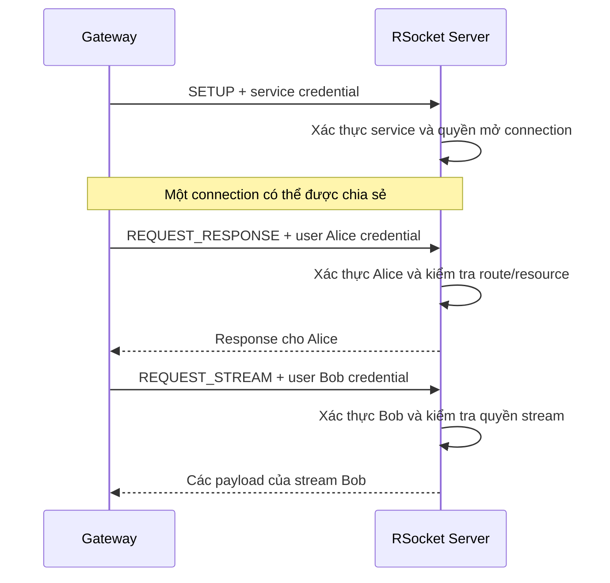

# Phân quyền theo route, loại trao đổi và quyền của người gọi

Một kết nối RSocket có thể mang nhiều request và nhiều stream đồng thời. Vì vậy, chỉ xác thực kết nối một lần chưa đủ để quyết định mọi thao tác trên connection đều được phép. Một người dùng có thể được đọc trạng thái thiết bị nhưng không được gửi lệnh điều khiển; một service có thể được mở request-stream nhưng không được mở request-channel; một người dùng có thể xem hồ sơ của chính mình nhưng không được đọc hồ sơ của người khác.

Spring Security hỗ trợ phân quyền RSocket theo payload exchange. Ứng dụng có thể kiểm tra quyền lúc `SETUP`, theo route, theo loại interaction như request-response/request-stream/request-channel và theo quyền của principal. Với quyền trên tài nguyên cụ thể, ví dụ quyền sở hữu thiết bị hoặc tenant, cần kiểm tra thêm ở tầng service sau khi đã xác định đối tượng nghiệp vụ.

## 1. Authentication và authorization giải quyết hai câu hỏi khác nhau

- **Authentication (xác thực):** caller là ai? Ví dụ user `alice`, service `telemetry-gateway` hoặc thiết bị `device-42`.
- **Authorization (phân quyền):** caller đó được phép làm gì? Ví dụ `DEVICE_READ`, `DEVICE_CONTROL`, `TELEMETRY_STREAM` hoặc `CHAT_CHANNEL`.

Authentication tạo ra `Authentication` chứa principal và authorities. Authorization dùng thông tin này cùng route, loại exchange và dữ liệu nghiệp vụ để quyết định cho phép hay từ chối.

| Thông tin | Nguồn điển hình | Dùng để quyết định |
|---|---|---|
| Principal | JWT, credential hoặc identity provider | Người gọi là ai |
| Authority/scope | Claim đã được xác thực hoặc user details | Có quyền thực hiện thao tác nào |
| Route | Routing metadata | Đang gọi chức năng nào |
| Interaction type | `PayloadExchangeType` | Đang mở request-response, stream, channel hay gửi payload tiếp |
| Resource ownership | Database/domain service | Caller có quyền với đúng tài nguyên này không |

Không lấy `userId`, `role` hoặc `tenantId` từ data payload rồi tin ngay. Giá trị do client gửi chỉ là dữ liệu đầu vào. Server phải suy ra identity và quyền từ `Authentication`, sau đó đối chiếu quyền truy cập tài nguyên bằng nguồn dữ liệu có thẩm quyền.

## 2. Xác thực lúc SETUP hay lúc từng request?

Spring Security RSocket hỗ trợ xác thực ở thời điểm thiết lập connection, ở từng request hoặc kết hợp cả hai.

**Xác thực lúc SETUP** phù hợp khi một connection chỉ đại diện cho một người dùng hoặc một thiết bị. Ví dụ ứng dụng mobile mở connection riêng cho người dùng đã đăng nhập. Server xác thực credential trong setup metadata và gắn principal với phiên đó.

**Xác thực theo request** phù hợp khi connection được chia sẻ bởi nhiều caller. Ví dụ một backend gateway chỉ mở một RSocket connection đến downstream service nhưng chuyển request cho nhiều người dùng web khác nhau. Mỗi request cần mang credential của người dùng tương ứng để downstream authorization không nhầm tất cả request là cùng một service identity.

**Kết hợp hai lớp** hữu ích khi server cần xác nhận cả ứng dụng kết nối lẫn người dùng cuối. Credential ở SETUP chứng minh client service được phép mở connection; credential trên request xác định người dùng cuối và quyền của họ cho thao tác cụ thể.



Không nên mặc định principal ở SETUP luôn đại diện đúng cho từng người dùng nếu connection được chia sẻ. Cần thiết kế rõ identity của connection và identity của request.

## 3. Bật Spring Security cho RSocket

Với Spring Boot, thêm dependency Spring Security phù hợp với stack reactive và bật `@EnableRSocketSecurity`. Ví dụ cấu hình JWT:

```java
@Configuration
@EnableRSocketSecurity
public class RSocketSecurityConfiguration {

    @Bean
    ReactiveJwtDecoder jwtDecoder() {
        return ReactiveJwtDecoders.fromIssuerLocation(
            "https://identity.example.com/issuer");
    }

    @Bean
    PayloadSocketAcceptorInterceptor rsocketInterceptor(
            RSocketSecurity rsocket) {

        rsocket
            .authorizePayload(authorize -> authorize
                .setup().hasAuthority("RSC_CONNECT")
                .anyRequest().authenticated()
                .anyExchange().denyAll()
            )
            .jwt(Customizer.withDefaults());

        return rsocket.build();
    }
}
```

`ReactiveJwtDecoder` xác minh JWT theo issuer. Phần `jwt(...)` cấu hình converter xác thực bearer token trong RSocket metadata. Authority `RSC_CONNECT` là ví dụ về quyền mở connection; issuer phải cấp claim/authority tương ứng và ứng dụng phải thống nhất cách ánh xạ claim thành `GrantedAuthority`.

Khi dùng Spring Boot với dependency và auto-configuration tương ứng, Spring Boot đăng ký security interceptor vào RSocket server. Nếu tự tạo RSocket server ngoài auto-configuration, cần gắn `SecuritySocketAcceptorInterceptor` vào server bằng `RSocketServerCustomizer` theo tài liệu của phiên bản đang dùng.

Trong môi trường production, không dùng `User.withDefaultPasswordEncoder()` làm kho tài khoản thực. Ví dụ user in-memory chỉ phù hợp minh họa hoặc kiểm thử. Dùng identity provider, reactive user store hoặc `ReactiveAuthenticationManager` phù hợp với hệ thống.

## 4. Gửi credential từ RSocketRequester

Với JWT bearer metadata, client có thể gửi token lúc setup:

```java
MimeType authMimeType = MimeTypeUtils.parseMimeType(
    WellKnownMimeType.MESSAGE_RSOCKET_AUTHENTICATION.getString());

BearerTokenMetadata token = new BearerTokenMetadata(accessToken);

Mono<RSocketRequester> requester = RSocketRequester.builder()
    .setupMetadata(token, authMimeType)
    .connectTcp(host, port);
```

Hoặc gửi credential theo từng request trên connection dùng chung:

```java
Mono<DeviceStatus> status = requester
    .route("devices.status")
    .metadata(new BearerTokenMetadata(userAccessToken), authMimeType)
    .data(new DeviceQuery("device-42"))
    .retrieveMono(DeviceStatus.class);
```

Chọn một cách theo mô hình identity đã thiết kế. Nếu cần cả service identity lẫn user identity, có thể gửi service credential ở setup và user credential ở từng request. Không log token, không đưa token vào data DTO và dùng TLS để bảo vệ credential trên đường truyền.

## 5. Phân quyền theo route

Route là tên chức năng trong routing metadata, ví dụ `devices.status`, `devices.command` hoặc `telemetry.watch`. Spring Security cho phép áp dụng rule theo route:

```java
rsocket.authorizePayload(authorize -> authorize
    .setup().hasAuthority("RSC_CONNECT")
    .route("devices.status").hasAuthority("DEVICE_READ")
    .route("devices.command").hasAuthority("DEVICE_CONTROL")
    .route("telemetry.watch").hasAuthority("TELEMETRY_READ")
    .route("admin.*").hasRole("ADMIN")
    .anyRequest().denyAll()
    .anyExchange().denyAll()
);
```

Ví dụ trên thể hiện quyền khác nhau cho từng nhóm chức năng. `hasRole("ADMIN")` kiểm tra authority có tiền tố `ROLE_`, tức `ROLE_ADMIN`; `hasAuthority("DEVICE_READ")` kiểm tra đúng chuỗi authority được chỉ định.

Các rule được đánh giá theo thứ tự khai báo và chỉ rule đầu tiên khớp được sử dụng. Vì vậy, đặt rule cụ thể trước rule tổng quát. Nếu đặt `.anyRequest().authenticated()` trước các route rule, request sẽ khớp rule tổng quát và không đi đến các rule phía sau.

Không dùng `.anyExchange().permitAll()` như một fallback tùy tiện. `anyExchange` có thể bao gồm exchange không mang routing metadata, payload tiếp diễn của channel và metadata push. Với hệ thống cần bảo vệ, dùng mặc định từ chối rồi mở rõ các trường hợp thật sự công khai.

## 6. Phân quyền theo loại interaction

Một route có thể được gọi bằng nhiều interaction model nếu server cho phép. Nếu chỉ kiểm tra route, server chưa chắc đã phân biệt được caller được phép đọc một response đơn hay được phép mở một stream dài hạn hoặc một channel hai chiều.

Spring Security cung cấp `PayloadExchange` và `PayloadExchangeType`. `PayloadExchange.getType()` cho biết loại exchange đang được kiểm tra. Các giá trị quan trọng gồm:

| `PayloadExchangeType` | Ý nghĩa | Quyền thường cần |
|---|---|---|
| `SETUP` | Thiết lập connection | `RSC_CONNECT` |
| `REQUEST_RESPONSE` | Mở request-response | Quyền đọc hoặc thực hiện lệnh tương ứng |
| `FIRE_AND_FORGET` | Gửi một chiều, không chờ response | Quyền publish/submit |
| `REQUEST_STREAM` | Mở request-stream | Quyền subscribe/stream |
| `REQUEST_CHANNEL` | Mở channel hai chiều | Quyền mở channel và gửi dữ liệu hai chiều |
| `PAYLOAD` | Payload tiếp diễn trong một interaction, ví dụ dữ liệu tiếp theo của channel | Xác thực và chính sách cho message tiếp diễn |
| `METADATA_PUSH` | Cập nhật metadata cấp connection | Quyền cập nhật session metadata |

Có thể dùng custom matcher để kiểm tra loại exchange:

```java
import org.springframework.security.rsocket.api.PayloadExchangeType;

rsocket.authorizePayload(authorize -> authorize
    .matcher(exchange ->
        exchange.getType() == PayloadExchangeType.REQUEST_STREAM)
        .hasAuthority("STREAM_ALLOWED")
    .matcher(exchange ->
        exchange.getType() == PayloadExchangeType.REQUEST_CHANNEL)
        .hasAuthority("CHANNEL_ALLOWED")
    .anyRequest().denyAll()
    .anyExchange().denyAll()
);
```

Đây là rule theo loại exchange trên toàn server. Nếu cần kết hợp route và type để yêu cầu cả hai điều kiện, dùng route matcher cùng `.access(...)` và kiểm tra `PayloadExchange.getType()` trong authorization callback. Cách này tránh việc một rule type-wide khớp trước rồi che khuất rule route-specific.

## 7. Kết hợp route, interaction type và authority trong một rule

Một policy cho `telemetry.watch` có thể yêu cầu đồng thời:

1. Route đúng là `telemetry.watch`.
2. Interaction phải là `REQUEST_STREAM`.
3. Caller phải có authority `TELEMETRY_READ`.

Ví dụ dùng `.route(...).access(...)`:

```java
private Mono<AuthorizationDecision> authorizeTelemetryStream(
        Mono<Authentication> authentication,
        PayloadExchangeAuthorizationContext context) {

    if (context.getExchange().getType()
            != PayloadExchangeType.REQUEST_STREAM) {
        return Mono.just(new AuthorizationDecision(false));
    }

    return authentication.map(auth -> new AuthorizationDecision(
        auth.getAuthorities().stream().anyMatch(authority ->
            authority.getAuthority().equals("TELEMETRY_READ"))
    )).defaultIfEmpty(new AuthorizationDecision(false));
}
```

```java
rsocket.authorizePayload(authorize -> authorize
    .route("telemetry.watch").access(this::authorizeTelemetryStream)
    .anyRequest().denyAll()
    .anyExchange().denyAll()
);
```

Route matcher giới hạn rule vào `telemetry.watch`; callback kiểm tra interaction type và authority. Nếu client gọi cùng route bằng `REQUEST_RESPONSE` hoặc `REQUEST_CHANNEL`, callback từ chối. Đây là ví dụ minh họa custom authorization; import và cách tổ chức bean cần phù hợp với phiên bản Spring Security của dự án.

Nếu muốn dùng một route cho nhiều interaction type, callback có thể quyết định authority theo `exchange.getType()`. Tuy nhiên, các route riêng như `telemetry.latest`, `telemetry.watch` và `telemetry.publish` thường làm contract dễ hiểu hơn và giảm nguy cơ vô tình cấp quyền rộng.

## 8. Phân quyền riêng cho từng interaction model

Nên xem mỗi interaction là một năng lực khác nhau:

| Nghiệp vụ | Route gợi ý | Interaction | Authority ví dụ |
|---|---|---|---|
| Đọc trạng thái hiện tại | `devices.status` | Request-response | `DEVICE_READ` |
| Điều khiển thiết bị và nhận xác nhận | `devices.command` | Request-response | `DEVICE_CONTROL` |
| Gửi sự kiện telemetry | `telemetry.publish` | Fire-and-forget | `TELEMETRY_PUBLISH` |
| Theo dõi dữ liệu liên tục | `telemetry.watch` | Request-stream | `TELEMETRY_STREAM` |
| Trao đổi lệnh và phản hồi liên tục | `devices.session` | Request-channel | `DEVICE_CHANNEL` |

**Request-response:** kiểm tra quyền đọc hoặc quyền thực hiện lệnh trước khi service chạy. Nếu response chứa dữ liệu thuộc user/tenant, kiểm tra thêm quyền trên resource.

**Fire-and-forget:** không có response nghiệp vụ để xác nhận kết quả. Quyền cần thể hiện caller được phép publish hoặc submit loại lệnh đó. Nếu cần xác nhận server đã chấp nhận hoặc xử lý, dùng request-response và trả operation ID/trạng thái.

**Request-stream:** kiểm tra quyền mở stream trước khi bắt đầu phát dữ liệu. Với stream dài, còn cần giới hạn số stream, thời hạn subscription và quyền khi credential hết hạn hoặc bị thu hồi. Không cho rằng một lần xác thực ban đầu đồng nghĩa stream được phép tồn tại vô thời hạn.

**Request-channel:** kiểm tra quyền mở channel và quyền gửi loại message tương ứng. Channel có dữ liệu hai chiều; ngoài frame mở `REQUEST_CHANNEL`, các payload tiếp theo có thể được biểu diễn bằng exchange type `PAYLOAD`. Cần có rule cho payload tiếp diễn và kiểm tra nghiệp vụ từng message nếu nội dung có thể chứa nhiều loại lệnh.

## 9. Chú ý payload tiếp diễn của request-channel

Một lỗi thiết kế thường gặp là chỉ bảo vệ frame mở channel rồi mặc định mọi payload tiếp theo đều được bảo vệ bởi route rule ban đầu. Trong Spring Security, `anyRequest()` tập trung vào request mở interaction có metadata; payload tiếp diễn có thể được phân loại là `PAYLOAD`. Do đó cần một rule riêng cho exchange type này.

Ví dụ yêu cầu mọi payload tiếp diễn phải được xác thực:

```java
rsocket.authorizePayload(authorize -> authorize
    .route("devices.session").access(this::authorizeDeviceChannel)
    .anyRequest().denyAll()
    .matcher(exchange ->
        exchange.getType() == PayloadExchangeType.PAYLOAD)
        .authenticated()
    .anyExchange().denyAll()
);
```

Rule trên yêu cầu xác thực cho payload tiếp diễn. Nó chưa tự xác minh từng message có thuộc đúng channel, device hoặc loại lệnh được cấp quyền hay không. Nếu channel có thể mang nhiều lệnh, handler/service cần kiểm tra từng message dựa trên principal và trạng thái channel đã được xác lập. Với yêu cầu phân quyền tinh vi theo từng payload, có thể bổ sung `PayloadInterceptor` hoặc cơ chế kiểm tra domain trong pipeline nhận message.

Không dùng `anyExchange().permitAll()` chỉ để làm channel chạy được. Cách đó có thể mở các payload hoặc metadata exchange khác mà ứng dụng chưa có ý định công khai.

## 10. Quyền của caller trên tài nguyên cụ thể

Role hoặc authority thường trả lời câu hỏi caller có thể gọi một chức năng hay không. Nó chưa trả lời caller có thể truy cập đúng thiết bị, tài khoản, đơn hàng hoặc tenant được yêu cầu hay không.

Ví dụ user có `DEVICE_READ` nhưng chỉ được đọc thiết bị thuộc tenant của mình. Service cần kiểm tra ownership sau khi tải resource:

```java
public Mono<DeviceStatus> getStatus(String deviceId) {
    return ReactiveSecurityContextHolder.getContext()
        .map(SecurityContext::getAuthentication)
        .flatMap(authentication -> deviceRepository.findById(deviceId)
            .switchIfEmpty(Mono.error(
                new DeviceNotFoundException(deviceId)))
            .filterWhen(device -> permissionService.canRead(
                authentication, device))
            .switchIfEmpty(Mono.error(new AccessDeniedException(
                "Caller cannot read this device")))
            .map(deviceMapper::toStatus)
        );
}
```

Ví dụ này giả định `permissionService.canRead(...)` trả về `Mono<Boolean>` và repository là reactive. Nó minh họa kiểm tra ở tầng domain sau khi xác thực route-level đã thành công. Trong hệ thống multi-tenant, nên dùng tenant/principal từ security context và kiểm tra quyền ngay trong truy vấn hoặc service; không chỉ lọc theo tenant ID do client gửi.

Với tài nguyên nhạy cảm, cần quyết định có phân biệt `NOT_FOUND` và `FORBIDDEN` hay che giấu sự tồn tại của resource. Dù chọn cách nào, không được trả dữ liệu trước khi kiểm tra quyền.

## 11. Quy tắc route và quyền theo thứ tự

Spring Security đánh giá authorization rules theo thứ tự khai báo và dùng rule đầu tiên khớp. Một cấu hình production nên đặt các trường hợp cụ thể trước, sau đó mới tới fallback:

```java
rsocket.authorizePayload(authorize -> authorize
    .setup().hasAuthority("RSC_CONNECT")
    .route("admin.*").hasRole("ADMIN")
    .route("devices.command").hasAuthority("DEVICE_CONTROL")
    .route("devices.status").hasAuthority("DEVICE_READ")
    .route("telemetry.watch").access(this::authorizeTelemetryStream)
    .matcher(exchange ->
        exchange.getType() == PayloadExchangeType.PAYLOAD)
        .authenticated()
    .anyRequest().denyAll()
    .anyExchange().denyAll()
);
```

Khi kết hợp custom matcher và route matcher, hãy kiểm tra rule nào sẽ khớp trước. Không đặt matcher quá rộng ở đầu danh sách nếu nó sẽ bắt mọi exchange thuộc một type trước khi route-specific rule được xét. Nếu cần đồng thời nhiều điều kiện, gom chúng vào cùng `.access(...)` như ví dụ ở phần trước.

Mặc định từ chối giúp route mới không tự động được mở cho mọi caller khi developer thêm handler nhưng quên thêm policy. Mỗi route công khai cần có quyết định rõ ràng: public, authenticated hoặc yêu cầu authority cụ thể.

## 12. Kết hợp method security và business authorization

Route-level authorization phù hợp để chặn sớm caller không có quyền gọi chức năng. Method security hoặc service-level authorization phù hợp để bảo vệ use case khi được gọi từ nhiều entry point.

Có thể bật reactive method security:

```java
@Configuration
@EnableReactiveMethodSecurity
public class MethodSecurityConfiguration {}
```

Sau đó dùng `@PreAuthorize` cho điều kiện dựa trên authority:

```java
@PreAuthorize("hasAuthority('DEVICE_CONTROL')")
public Mono<CommandResult> execute(DeviceCommand command) {
    return deviceCommandService.execute(command);
}
```

Với ownership/tenant phức tạp, một `PermissionService` hoặc policy service thường rõ ràng hơn biểu thức annotation dài. Hãy đảm bảo method được gọi qua Spring proxy để method security được áp dụng; self-invocation trong cùng bean có thể bỏ qua proxy-based advice.

Không chỉ dựa vào route authorization nếu cùng service còn được gọi từ HTTP, scheduler hoặc message consumer. Quy tắc bảo vệ dữ liệu quan trọng nên nằm ở service/domain boundary.

## 13. Bảo vệ metadata và identity

RSocket authorization thường dựa vào authentication metadata và routing metadata. Những giá trị này cần được xử lý như dữ liệu đến từ mạng:

- Xác minh JWT: chữ ký, issuer, audience, thời hạn và claim cần thiết.
- Dùng TLS cho TCP hoặc WebSocket khi truyền credential và dữ liệu nhạy cảm.
- Không tin `role`, `scope`, `tenantId` hoặc `userId` tự khai trong metadata tùy chỉnh nếu chưa được xác thực.
- Không ghi bearer token, password hoặc raw authentication metadata vào log.
- Giới hạn kích thước metadata và chỉ chấp nhận MIME type được hỗ trợ.
- Có chính sách hết hạn/thu hồi credential cho connection và stream dài hạn.
- Tách quyền của service mở connection khỏi quyền của user cuối trên từng request.

Nếu dùng connection-scoped authentication, hãy xác định điều gì xảy ra khi người dùng logout hoặc quyền bị thu hồi. Connection dài hạn có thể giữ security context cũ nếu ứng dụng không có cơ chế đóng connection, cập nhật credential hoặc xác minh lại theo request.

## 14. Xử lý từ chối và phản hồi an toàn

Khi caller không đủ quyền, server nên trả lỗi authorization theo cơ chế Spring Security/RSocket. Không nên bắt `AccessDeniedException` rồi chuyển thành response thành công hoặc empty completion, vì client sẽ hiểu nhầm thao tác đã được xử lý.

Một số nguyên tắc:

- Dùng authentication failure cho credential thiếu, sai hoặc hết hạn.
- Dùng access denied cho caller đã xác thực nhưng thiếu authority.
- Dùng business rejection cho trạng thái nghiệp vụ không cho phép, ví dụ thiết bị đang bảo trì.
- Không để lỗi tiết lộ token, claim nhạy cảm, query nội bộ hoặc dữ liệu của tenant khác.
- Ghi audit event cho lệnh điều khiển hoặc thao tác nhạy cảm, kèm principal, route, resource ID đã chuẩn hóa và kết quả.

Với fire-and-forget, client không nhận response payload nên cần có metric/audit phía server và thiết kế retry/idempotency nếu caller phải biết lệnh đã được chấp nhận. Không dùng fire-and-forget cho thao tác cần xác nhận quyền và kết quả đồng bộ ở client mà không có cơ chế trạng thái bổ sung.

## 15. Kiểm thử authorization

Kiểm thử cần bao phủ cả route, interaction type và caller/resource:

1. Không có credential: request tới route bảo vệ bị từ chối.
2. JWT hợp lệ nhưng thiếu authority: route bị từ chối.
3. Caller có `DEVICE_READ`: request-response `devices.status` được phép.
4. Caller chỉ có `DEVICE_READ`: route `devices.command` bị từ chối.
5. Caller có authority route nhưng dùng sai interaction type: custom access check từ chối.
6. Request-stream chỉ được mở bởi caller có quyền stream.
7. Request-channel bị từ chối nếu caller chỉ có quyền đọc đơn lẻ.
8. Payload tiếp diễn của channel tuân theo rule `PAYLOAD` và policy từng message.
9. User có quyền chung nhưng truy cập resource của tenant khác bị từ chối.
10. SETUP thiếu authority kết nối bị từ chối dù request có route hợp lệ.
11. Metadata push và exchange không có route bị xử lý theo default-deny policy.
12. Rule cụ thể được đánh giá trước fallback; route mới không tự động public.

Nên dùng test client/server RSocket thật để xác minh security interceptor, setup metadata, request metadata, routing và từng interaction model. Unit test riêng cho `PermissionService` không chứng minh interceptor đã được gắn vào server hoặc rule matcher hoạt động đúng trên transport.

## 16. Quan sát và audit

Theo dõi các metric và audit event như:

- Số authentication success/failure theo loại credential.
- Số authorization denied theo route, interaction type và authority yêu cầu.
- Số request/channel/stream đang hoạt động theo principal hoặc tenant đã chuẩn hóa.
- Số lỗi token hết hạn, issuer/audience không hợp lệ và metadata sai định dạng.
- Số lệnh nhạy cảm được cho phép, từ chối hoặc bị business policy chặn.
- Các lần truy cập resource không thuộc quyền caller.

Không đưa access token, password hoặc dữ liệu cá nhân vào metric label. Dùng correlation ID, principal ID đã được phép log, route và mã policy để truy vết. Audit log phải đủ để điều tra nhưng không được chứa secret.

## 17. Quy tắc thiết kế

1. Xác thực caller ở SETUP khi connection thuộc một principal; xác thực theo request khi connection được chia sẻ bởi nhiều caller.
2. Dùng route rule để giới hạn quyền gọi chức năng.
3. Dùng `PayloadExchangeType` khi quyền phụ thuộc request-response, fire-and-forget, stream, channel hoặc payload tiếp diễn.
4. Kết hợp route và interaction type trong cùng custom `.access(...)` nếu cần cả hai điều kiện.
5. Nhớ rule cho `PAYLOAD` tiếp diễn của request-channel; không chỉ bảo vệ frame mở channel.
6. Kiểm tra authority từ `Authentication`, không tin role/tenant do client tự khai.
7. Kiểm tra quyền trên resource ở service/domain boundary.
8. Đặt rule cụ thể trước rule tổng quát; dùng default deny cho exchange chưa được định nghĩa.
9. Bảo vệ credential và metadata bằng TLS, validation và logging an toàn.
10. Kiểm thử cả authentication, route, interaction type, quyền resource và thứ tự matcher.

Phân quyền RSocket cần nhìn đồng thời ba lớp: route cho biết caller muốn gọi chức năng nào, interaction type cho biết caller muốn giao tiếp theo cách nào, còn `Authentication` và policy nghiệp vụ cho biết caller có quyền làm việc đó trên tài nguyên cụ thể hay không. Khi các lớp này được kiểm tra rõ ràng và default policy là từ chối, một connection multiplexed có thể phục vụ nhiều request realtime mà không vô tình mở rộng quyền của người gọi.

## Tài liệu tham khảo

- [Spring Security — RSocket Security](https://docs.spring.io/spring-security/reference/reactive/integrations/rsocket.html)
- [PayloadExchange API](https://docs.spring.io/spring-security/reference/api/java/org/springframework/security/rsocket/api/PayloadExchange.html)
- [PayloadExchangeType API](https://docs.spring.io/spring-security/reference/api/java/org/springframework/security/rsocket/api/PayloadExchangeType.html)
- [PayloadExchangeAuthorizationContext API](https://docs.spring.io/spring-security/reference/api/java/org/springframework/security/rsocket/util/matcher/PayloadExchangeAuthorizationContext.html)
