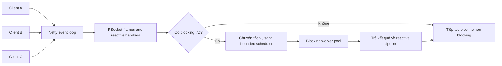

# Tách tác vụ chặn khỏi event loop và giới hạn tài nguyên thực thi

RSocket được xây dựng quanh mô hình reactive và thường chạy trên transport non-blocking như Reactor Netty. Một số thread event loop có thể phục vụ nhiều connection và stream cùng lúc. Nếu handler gọi JDBC đồng bộ, `Thread.sleep`, đọc file đồng bộ hoặc một HTTP client blocking ngay trên event loop, thread đó không thể tiếp tục xử lý các sự kiện mạng khác trong thời gian chờ. Hệ quả là latency tăng trên nhiều request, throughput giảm và connection có thể bị timeout dù server chưa hết CPU.

Giải pháp không chỉ là chuyển mọi thứ sang một scheduler khác. Ứng dụng cần xác định đúng đoạn blocking, cô lập nó trên scheduler có giới hạn, giới hạn số công việc đồng thời và số phần tử được buffer, đồng thời đặt timeout và chính sách từ chối khi quá tải. Với RSocket, backpressure điều tiết số payload trên stream; nó không tự biến một lời gọi blocking thành non-blocking và cũng không giới hạn toàn bộ tài nguyên mà một request có thể chiếm.

## 1. Event loop có nhiệm vụ gì?

Transport như TCP hoặc WebSocket thường dùng event loop để xử lý I/O không chặn. Một event loop thread có thể luân phiên xử lý dữ liệu đến, ghi dữ liệu đi, tín hiệu kết nối và callback của nhiều stream. Thay vì chờ một thao tác I/O hoàn tất, thread đăng ký sự kiện rồi tiếp tục xử lý việc khác.

Trong ứng dụng RSocket Spring Boot, request đi qua transport, RSocket protocol, message conversion và handler. Các callback thường chạy trên thread do transport/reactive pipeline sử dụng; không nên giả định mọi callback luôn chạy trên một thread cố định. Tuy nhiên, nguyên tắc vẫn là không thực hiện thao tác blocking trên thread non-blocking của transport.



Event loop nên dành cho công việc ngắn, không chặn: đọc/ghi frame, chuyển tín hiệu, ánh xạ nhẹ và điều phối publisher. Một thao tác chờ database, file, socket hoặc lock có thể giữ thread lâu hơn nhiều so với thời gian xử lý một frame.

## 2. Dấu hiệu một đoạn code đang blocking

Các thao tác thường cần được xem xét:

- JDBC, JPA/Hibernate đồng bộ hoặc thư viện database chỉ có API blocking.
- `RestTemplate`, `HttpURLConnection`, client HTTP đồng bộ hoặc SDK gọi dịch vụ ngoài theo kiểu blocking.
- `Files.readAllBytes`, `FileInputStream.read`, ghi file đồng bộ và thao tác filesystem có độ trễ không dự đoán được.
- `Thread.sleep`, `Future.get`, `CountDownLatch.await`, `synchronized` giữ lock lâu hoặc chờ semaphore.
- Gọi `.block()` hoặc `.toIterable()` trên `Mono`/`Flux` trong handler/service reactive.
- Mã hóa/giải nén hoặc xử lý CPU rất nặng chạy lâu trên thread I/O.

Không phải mọi lời gọi method đồng bộ đều gây blocking đáng kể; điều cần quan tâm là nó có thể chờ tài nguyên bên ngoài hoặc chiếm CPU đủ lâu để làm nghẽn event loop hay không. Ngược lại, một method trả về `Mono` không bảo đảm bên trong nó không blocking. Hãy kiểm tra implementation và thread thực thi của dependency.

Ví dụ không an toàn:

```java
@MessageMapping("devices.status")
public Mono<DeviceStatus> status(@Payload DeviceQuery query) {
    // JDBC đồng bộ chạy trực tiếp trên thread xử lý request
    DeviceEntity entity = jdbcRepository.findById(query.deviceId());
    return Mono.just(mapper.toStatus(entity));
}
```

Việc bọc kết quả đã lấy bằng `Mono.just(...)` không làm lời gọi JDBC trở thành non-blocking. JDBC đã chạy trước khi `Mono` được tạo.

## 3. Không gọi block trong pipeline reactive

`block()` chờ publisher phát kết quả bằng cách giữ thread hiện tại. Trên event loop, điều này có thể gây lỗi phát hiện blocking hoặc làm ngừng xử lý những connection khác đang dùng chung event loop.

Không nên viết:

```java
@MessageMapping("devices.status")
public Mono<DeviceStatus> status(@Payload DeviceQuery query) {
    DeviceEntity entity = deviceService.find(query.deviceId()).block();
    return Mono.just(mapper.toStatus(entity));
}
```

Nếu service đã reactive thật sự, hãy nối publisher trực tiếp:

```java
@MessageMapping("devices.status")
public Mono<DeviceStatus> status(@Payload DeviceQuery query) {
    return reactiveDeviceRepository.findById(query.deviceId())
        .map(mapper::toStatus);
}
```

Nếu dependency chỉ có API blocking, bọc chính lời gọi blocking trong một publisher lazy rồi chỉ định scheduler phù hợp. Không thực hiện lời gọi trước khi tạo publisher.

## 4. Dùng `subscribeOn` cho nguồn blocking

Với một API đồng bộ, mẫu Reactor thường dùng là `Mono.fromCallable(...)` kết hợp `subscribeOn(Schedulers.boundedElastic())`:

```java
@MessageMapping("devices.status")
public Mono<DeviceStatus> status(@Payload DeviceQuery query) {
    return Mono.fromCallable(() ->
            jdbcRepository.findById(query.deviceId()))
        .subscribeOn(Schedulers.boundedElastic())
        .map(mapper::toStatus);
}
```

`Mono.fromCallable` trì hoãn việc gọi JDBC cho đến khi có subscription. `subscribeOn` chuyển quá trình subscribe và việc thực thi nguồn lên scheduler đã chọn. Vì thế, lời gọi JDBC chạy trên worker của `boundedElastic`, còn event loop có thể tiếp tục xử lý sự kiện mạng.

Mẫu tương tự áp dụng cho HTTP client blocking hoặc SDK đồng bộ:

```java
Mono<ExternalProfile> profile = Mono.fromCallable(
        () -> legacyProfileClient.fetch(userId))
    .subscribeOn(Schedulers.boundedElastic());
```

Đừng bọc một API vốn đã non-blocking trong `boundedElastic` chỉ vì nó trả về `Mono`/`Flux`. Việc chuyển scheduler không làm tăng throughput của I/O reactive và có thể tạo thêm context switch không cần thiết.

## 5. Phân biệt `subscribeOn` và `publishOn`

Hai operator đều ảnh hưởng đến thread nhưng có phạm vi khác nhau:

| Operator | Tác động chính | Vị trí thường dùng |
|---|---|---|
| `subscribeOn(scheduler)` | Lên lịch subscribe và thực thi nguồn upstream | Gần nguồn blocking cần cô lập |
| `publishOn(scheduler)` | Chuyển việc xử lý các tín hiệu downstream kể từ vị trí operator | Trước đoạn xử lý downstream cần chạy trên scheduler khác |

Ví dụ:

```java
Mono.fromCallable(() -> legacyClient.fetch(id))
    .subscribeOn(blockingIoScheduler)
    .map(this::toDomain)
    .publishOn(Schedulers.parallel())
    .map(this::performCpuTransformation);
```

Trong ví dụ, lời gọi blocking và phép ánh xạ đầu tiên chạy trên scheduler được chọn bởi `subscribeOn`. Sau `publishOn`, các operator phía sau được xử lý trên scheduler `parallel` khi nhận tín hiệu. `publishOn` đặt sau một lời gọi blocking không thể cứu lời gọi đó nếu nó đã chạy trên event loop trước khi pipeline chuyển thread.

Các lưu ý:

- `doOnNext`, `map` hoặc `flatMap` tự thân không chuyển thread.
- Nhiều `subscribeOn` trong cùng pipeline không phải cách tốt để phân luồng từng đoạn; thường chỉ cần đặt một `subscribeOn` gần nguồn cần đổi scheduler.
- `publishOn` có thể tạo hàng đợi tín hiệu và prefetch; không thêm tùy tiện vì nó cũng tiêu thụ bộ nhớ.
- Không chuyển mọi pipeline sang `parallel()`; scheduler này dành cho công việc CPU-bound ngắn, không dành cho I/O blocking.

## 6. Chọn scheduler theo loại công việc

Reactor cung cấp một số scheduler thông dụng:

| Scheduler | Mục đích | Dùng cho |
|---|---|---|
| `Schedulers.parallel()` | Pool worker cho tác vụ CPU-bound | Tính toán, biến đổi dữ liệu thuần CPU |
| `Schedulers.boundedElastic()` | Worker có giới hạn và hàng đợi cho tác vụ blocking | JDBC cũ, SDK đồng bộ, filesystem blocking |
| `Schedulers.single()` | Một worker tuần tự dùng chung | Tác vụ ngắn cần tuần tự hóa, nếu phù hợp |
| `Schedulers.immediate()` | Thực thi ngay trên thread hiện tại | Trường hợp đặc biệt, không phải cách offload |
| `Schedulers.fromExecutorService(...)` | Scheduler bọc executor do ứng dụng quản lý | Tích hợp pool chuyên biệt có lifecycle rõ ràng |

Không dùng `parallel()` để chạy JDBC hoặc gọi HTTP đồng bộ. Một tác vụ blocking có thể chiếm worker CPU và làm chậm những phép tính không liên quan. Không dùng `single()` cho nhiều lời gọi I/O có thể chờ lâu vì một tác vụ sẽ chặn tất cả tác vụ xếp sau.

`boundedElastic()` là lựa chọn mặc định thuận tiện để cô lập nguồn blocking. Tuy nhiên, nó có giới hạn thread và hàng đợi; khi hệ thống quá tải, tác vụ có thể phải chờ hoặc bị từ chối. Hãy đo và cấu hình giới hạn phù hợp thay vì coi scheduler là tài nguyên vô hạn.

## 7. Tạo scheduler riêng cho dependency blocking

Scheduler toàn cục `boundedElastic()` có thể dùng chung cho nhiều loại công việc. Nếu một dependency cũ thường xuyên chậm, nó có thể cạnh tranh worker và hàng đợi với các tác vụ blocking khác. Một scheduler riêng tạo ranh giới tài nguyên rõ hơn:

```java
@Configuration
public class BlockingWorkConfiguration {

    @Bean(destroyMethod = "dispose")
    @Qualifier("legacyDatabaseScheduler")
    Scheduler legacyDatabaseScheduler() {
        return Schedulers.newBoundedElastic(
            12,      // tối đa worker thread
            500,     // giới hạn task chờ theo cấu hình scheduler
            "legacy-db");
    }
}
```

Inject scheduler vào service sở hữu dependency:

```java
@Service
public class LegacyDeviceService {
    private final JdbcDeviceRepository repository;
    private final Scheduler databaseScheduler;

    public LegacyDeviceService(
            JdbcDeviceRepository repository,
            @Qualifier("legacyDatabaseScheduler") Scheduler databaseScheduler) {
        this.repository = repository;
        this.databaseScheduler = databaseScheduler;
    }

    public Mono<DeviceEntity> find(String id) {
        return Mono.fromCallable(() -> repository.findById(id))
            .subscribeOn(databaseScheduler);
    }
}
```

Các con số 12 worker và 500 task chờ chỉ là ví dụ. Cần chọn theo connection pool, giới hạn của dependency, thời gian xử lý và ngân sách bộ nhớ. `destroyMethod = "dispose"` giúp Spring đóng scheduler khi application context dừng.

Không tạo `newBoundedElastic(...)` bên trong từng request. Làm vậy sẽ tạo nhiều pool khó kiểm soát và khiến giới hạn tài nguyên không còn hiệu lực ở cấp ứng dụng.

## 8. Giới hạn concurrency cho công việc đồng thời

Offload blocking khỏi event loop mới giải quyết vị trí thực thi. Nếu một request phát sinh hàng nghìn lời gọi blocking cùng lúc, scheduler vẫn có thể bị đầy hàng đợi và dependency phía sau có thể quá tải.

Reactor `flatMap` nhận tham số `concurrency` để giới hạn số inner publisher đang được subscribe đồng thời. Ví dụ:

```java
Flux<DeviceStatus> statuses = Flux.fromIterable(deviceIds)
    .flatMap(id -> Mono.fromCallable(() -> jdbcRepository.findById(id))
        .subscribeOn(databaseScheduler)
        .map(mapper::toStatus),
        8, 1);
```

Trong ví dụ, tối đa 8 inner publisher được xử lý đồng thời trong subscription này; tham số prefetch `1` giới hạn số phần tử được yêu cầu trước từ mỗi inner publisher. Chọn concurrency theo năng lực database và pool, không theo số lượng ID đầu vào.

Các lựa chọn khác:

- `concatMap` xử lý tuần tự, phù hợp khi cần giữ thứ tự và chỉ cho một tác vụ con hoạt động tại một thời điểm.
- `flatMapSequential` cho phép xử lý đồng thời nhưng phát kết quả theo thứ tự nguồn; có thể phải giữ kết quả đã hoàn thành trong lúc chờ phần tử trước.
- `flatMap(mapper, concurrency, prefetch)` cho phép kiểm soát concurrency và prefetch rõ ràng.

Concurrency trong một subscription chỉ là giới hạn cục bộ. Nếu 100 connection cùng mở request và mỗi request có concurrency 8, tổng số tác vụ có thể lớn hơn nhiều. Cần kết hợp giới hạn toàn process, giới hạn theo tenant hoặc bulkhead ở dependency dùng chung.

## 9. Giới hạn worker, queue và admission control

Một hệ thống ổn định cần giới hạn ở nhiều cấp:

| Tài nguyên | Cách giới hạn | Mục tiêu |
|---|---|---|
| Worker thread | Bounded scheduler/thread pool | Không tạo vô hạn thread |
| Task queue | Queue có capacity | Giới hạn công việc đang chờ |
| Inner publisher | `flatMap` concurrency | Giới hạn tác vụ đồng thời trong một pipeline |
| Database connection | Connection pool | Không vượt năng lực database |
| Request/stream | Quota hoặc admission control | Không cho một caller chiếm toàn bộ tài nguyên |
| Buffer | Bounded buffer và overflow policy | Không giữ vô hạn dữ liệu khi consumer chậm |
| Thời gian | Timeout/deadline | Không giữ tài nguyên vô thời hạn |

Admission control quyết định có nhận thêm công việc hay không. Khi pool hoặc queue đã gần ngưỡng, server có thể từ chối nhanh bằng lỗi overload/retryable theo contract thay vì nhận mọi request rồi để chúng chờ quá lâu. Với fire-and-forget, vì client không nhận response nghiệp vụ, cần metric/audit và chính sách publish/quota riêng; không nên dùng interaction này cho công việc cần xác nhận chấp nhận nếu không có cơ chế trạng thái khác.

Hàng đợi không giới hạn chỉ chuyển overload thành tăng bộ nhớ và latency. Hãy chọn rõ một trong các chính sách: chờ trong queue có giới hạn, từ chối, bỏ dữ liệu cũ, giữ giá trị mới nhất hoặc ghi bền vững vào broker/storage. Chính sách phải phù hợp ý nghĩa dữ liệu; không được âm thầm bỏ lệnh điều khiển hoặc giao dịch cần bảo toàn.

## 10. Backpressure không thay thế giới hạn tài nguyên

RSocket dùng demand để điều tiết số payload mà peer được phép phát trên stream. Reactive Streams truyền demand qua `Subscription.request(n)`; khi consumer xử lý chậm, nó có thể giảm hoặc ngừng yêu cầu thêm dữ liệu.

Tuy nhiên, backpressure không tự giải quyết các vấn đề sau:

- Một payload đơn lẻ quá lớn.
- Một handler gọi blocking trên event loop.
- Một request tạo quá nhiều inner publisher.
- Nhiều connection đồng thời cùng gọi một database có pool nhỏ.
- Một scheduler có hàng đợi quá lớn.
- Fire-and-forget không có response demand nhưng vẫn có thể tạo nhiều công việc nền.

Với request-stream hoặc request-channel, hãy để pipeline giữ demand tự nhiên và tránh gọi `subscribe()` thủ công bên trong handler. Nếu cần buffer, đặt capacity và overflow strategy rõ ràng:

```java
events.onBackpressureBuffer(
    256,
    dropped -> metrics.incrementBufferOverflow(),
    BufferOverflowStrategy.ERROR);
```

Ví dụ giới hạn buffer ở 256 phần tử rồi phát lỗi khi đầy. Chỉ dùng `DROP` hoặc `LATEST` khi nghiệp vụ cho phép mất dữ liệu cũ; với lệnh điều khiển hoặc dữ liệu cần bảo toàn, hãy từ chối hoặc ghi bền vững thay vì âm thầm bỏ phần tử.

`REQUEST_N` đếm payload, không đếm byte hay số tác vụ blocking. Một demand nhỏ vẫn có thể cho phép payload lớn hoặc một payload kích hoạt công việc rất tốn tài nguyên. Cần giới hạn kích thước payload và chi phí xử lý độc lập.

## 11. Ví dụ handler RSocket kết hợp blocking I/O và giới hạn tài nguyên

Request-response dùng JDBC cũ:

```java
@Controller
public class DeviceHandler {
    private final LegacyDeviceService service;

    public DeviceHandler(LegacyDeviceService service) {
        this.service = service;
    }

    @MessageMapping("devices.status")
    public Mono<DeviceStatus> status(@Payload DeviceQuery query) {
        return service.find(query.deviceId())
            .switchIfEmpty(Mono.error(
                new DeviceNotFoundException(query.deviceId())))
            .map(mapper::toStatus);
    }
}
```

Handler không cần tự quản lý scheduler vì service đã cô lập lời gọi JDBC tại đúng nguồn blocking.

Request-channel nhận sự kiện và ghi vào một thư viện đồng bộ:

```java
@MessageMapping("events.ingest")
public Flux<IngestAck> ingest(@Payload Flux<DeviceEvent> events) {
    return events.flatMap(event ->
        Mono.fromCallable(() -> blockingEventStore.append(event))
            .subscribeOn(eventStoreScheduler)
            .map(result -> new IngestAck(event.id(), result.sequence())),
        4, 1);
}
```

Ví dụ giới hạn tối đa bốn thao tác ghi đang hoạt động trong subscription. Nếu thứ tự sự kiện bắt buộc phải giữ, dùng `concatMap` hoặc cơ chế sequence/partition rõ ràng thay vì `flatMap`.

## 12. Timeout và cancellation với tác vụ blocking

Có thể đặt timeout trên publisher:

```java
Mono<DeviceEntity> device = Mono.fromCallable(
        () -> jdbcRepository.findById(deviceId))
    .subscribeOn(databaseScheduler)
    .timeout(Duration.ofSeconds(2));
```

`timeout` giới hạn thời gian mà subscriber chờ kết quả. Tuy nhiên, hủy subscription không bảo đảm mọi thư viện blocking dừng thao tác ngay lập tức. JDBC driver, SDK hoặc filesystem call có thể không phản ứng với interrupt/cancellation. Nếu tác vụ vẫn chạy sau timeout, nó vẫn chiếm worker và có thể tiếp tục tác dụng phụ.

Vì vậy, cần đặt timeout ở chính dependency:

- Connection timeout và query timeout cho database.
- Connect/read/call timeout cho HTTP client hoặc SDK.
- Deadline ở tầng nghiệp vụ và giới hạn thời gian chờ lock.
- Cancellation API của thư viện nếu có hỗ trợ.

Với lệnh ghi, timeout không cho biết thao tác đã commit hay chưa. Hãy dùng idempotency key hoặc operation ID để tra cứu trạng thái trước khi retry. Không tự động phát lại command chỉ vì client đã timeout.

## 13. CPU-bound work và blocking I/O là hai loại khác nhau

Không phải tác vụ nặng nào cũng nên đưa vào `boundedElastic`:

- **Blocking I/O:** thời gian chủ yếu chờ tài nguyên bên ngoài; dùng `boundedElastic` hoặc scheduler blocking riêng.
- **CPU-bound:** thời gian chủ yếu tính toán; dùng `parallel()` hoặc pool CPU chuyên biệt có giới hạn.
- **Non-blocking I/O:** API đã trả `Mono`/`Flux` và không chặn thread; giữ pipeline reactive, chỉ chuyển scheduler nếu có lý do cụ thể.

Ví dụ xử lý CPU sau khi đọc dữ liệu blocking:

```java
Mono<Report> report = Mono.fromCallable(() -> legacyRepository.load(id))
    .subscribeOn(databaseScheduler)
    .publishOn(Schedulers.parallel())
    .map(reportCalculator::calculate);
```

Lời gọi repository chạy trên scheduler I/O blocking; phần tính toán sau `publishOn` chạy trên scheduler CPU. Không tạo nhiều phép tính nặng trên một event loop, nhưng cũng không chuyển toàn bộ I/O sang pool CPU.

## 14. Giữ Reactor Context và security context khi đổi scheduler

Trong ứng dụng reactive, dữ liệu ngữ cảnh như security principal, trace context hoặc correlation ID thường được truyền qua Reactor Context thay vì dựa vào `ThreadLocal` của một thread cố định. `subscribeOn` và `publishOn` đổi thread thực thi nhưng Reactor Context được truyền theo subscription khi pipeline được xây dựng đúng cách.

Với Spring Security reactive, dùng `ReactiveSecurityContextHolder` hoặc cơ chế tích hợp tương ứng; không tự lấy principal từ `ThreadLocal` trong worker thread. Với logging/tracing, dùng Micrometer Context Propagation hoặc tích hợp observability đã cấu hình cho Reactor nếu cần truyền context sang thư viện dựa trên ThreadLocal.

Tránh gọi `subscribe()` thủ công bên trong service để tạo một pipeline tách rời. Việc đó có thể làm mất context, tách lifecycle khỏi request, khiến lỗi không quay lại caller và làm khó cancellation. Hãy trả publisher cho tầng gọi quản lý.

## 15. Giới hạn theo dependency và theo caller

Một scheduler có giới hạn thread không thay thế giới hạn connection của database hoặc quota theo tenant. Nếu JDBC pool có 20 connection, tạo 100 worker thread chỉ khiến phần lớn worker chờ connection. Hãy đặt concurrency phù hợp với pool và khả năng chịu tải của database.

Trong hệ thống nhiều tenant, một tenant có thể tạo tải lớn và chiếm toàn bộ pool. Có thể áp dụng:

- Quota số request hoặc stream đồng thời theo principal/tenant.
- Bulkhead riêng cho dependency quan trọng hoặc tenant có mức dịch vụ khác nhau.
- Rate limit theo thời gian cho route đắt đỏ.
- Admission control từ chối sớm khi capacity đã hết.
- Hàng đợi bền vững cho công việc nền cần bảo toàn.

Nếu dùng Resilience4j Bulkhead hoặc RateLimiter, cấu hình cả concurrency, thời gian chờ và chính sách từ chối. Không dùng hàng đợi chờ vô hạn. Với các dependency có khả năng treo, kết hợp timeout và circuit breaker phù hợp.

## 16. Kiểm thử phát hiện blocking và quá tải

Kiểm thử nên bao gồm:

1. Xác minh lời gọi JDBC/SDK được thực thi trên scheduler blocking, không phải event loop.
2. Xác minh pipeline reactive thuần không bị chuyển sang scheduler blocking không cần thiết.
3. Gửi nhiều request đồng thời và xác minh số tác vụ blocking không vượt concurrency đã cấu hình.
4. Làm dependency chậm để quan sát queue, latency và hành vi từ chối khi quá tải.
5. Hủy request hoặc stream và kiểm tra subscription được cleanup; xác minh tác vụ blocking thực tế có dừng hay không.
6. Kiểm tra timeout của cả Reactor và dependency bên dưới.
7. Kiểm tra request-channel khi consumer chậm và buffer đạt giới hạn.
8. Kiểm tra fire-and-forget khi tốc độ gửi vượt năng lực xử lý.
9. Kiểm tra security/trace context vẫn đúng sau khi chuyển scheduler.
10. Chạy tải kéo dài để phát hiện queue tăng liên tục, thread leak hoặc pool cạn.

BlockHound có thể phát hiện một số lời gọi blocking trên thread được đánh dấu non-blocking trong test. Cấu hình BlockHound cần tương thích với JDK, Reactor và thư viện đang dùng; có thể phải allowlist một số lời gọi được biết là an toàn. BlockHound bổ sung cho kiểm thử tải, không thay thế đo latency, queue và resource thực tế.

## 17. Metrics và chẩn đoán vận hành

Theo dõi tối thiểu:

- Thời gian xử lý event loop và số connection/stream đang hoạt động.
- Số tác vụ được submit, đang chạy, đang chờ và bị từ chối trên scheduler blocking.
- Số worker thread và mức sử dụng queue của scheduler.
- Thời gian chờ connection pool, query latency và timeout của dependency.
- Số request/stream bị giới hạn concurrency hoặc admission control.
- Buffer occupancy, overflow, dropped item và backpressure event.
- Tỷ lệ lỗi, cancellation, retry và latency p50/p95/p99 theo route.
- CPU, heap, direct memory và số thread của process.

Khi latency tăng, hãy xác định nghẽn ở event loop, scheduler queue, database pool, dependency bên ngoài hay CPU. Chỉ tăng thread cap có thể làm database quá tải và tăng context switching. Chỉ tăng queue capacity có thể làm request chờ lâu hơn và giữ nhiều object hơn. Điều chỉnh dựa trên số liệu và giới hạn của dependency.

## 18. Quy tắc thiết kế

1. Không gọi blocking API hoặc `block()` trên event loop/non-blocking thread.
2. Bọc lời gọi đồng bộ trong `Mono.fromCallable` hoặc `Flux.defer` để trì hoãn thực thi.
3. Dùng `subscribeOn(boundedElastic)` hoặc scheduler blocking riêng ngay tại nguồn blocking.
4. Dùng `publishOn` để chuyển phần xử lý downstream; không dùng nó để che một lời gọi đã blocking trước đó.
5. Dùng `parallel()` cho công việc CPU-bound và `boundedElastic` cho I/O blocking.
6. Tạo scheduler dùng chung theo lifecycle bean; không tạo pool trong từng request.
7. Giới hạn worker, queue, concurrency, connection pool, buffer và quota theo caller.
8. Kết hợp RSocket backpressure với giới hạn payload và admission control.
9. Đặt timeout ở cả reactive pipeline lẫn dependency blocking; không giả định cancel luôn dừng được I/O.
10. Trả publisher cho caller quản lý, giữ Reactor Context và kiểm thử bằng BlockHound cùng tải thực tế.

Tách blocking khỏi event loop bảo vệ khả năng xử lý đồng thời của RSocket, còn giới hạn scheduler, queue, concurrency và dependency pool ngăn công việc chuyển sang một nơi khác rồi tiếp tục tăng không kiểm soát. Khi hai phần được thiết kế cùng nhau, ứng dụng có thể duy trì latency ổn định hơn dưới tải và xử lý quá tải bằng chính sách rõ ràng thay vì làm nghẽn toàn bộ connection.
