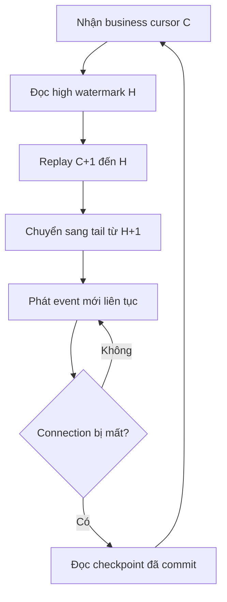

# Thiết kế tiếp tục từ vị trí nghiệp vụ khi không thể resume giao thức

RSocket connection resumption giúp hai peer tiếp tục một phiên giao thức khi transport bị gián đoạn, nhưng khả năng đó phụ thuộc vào session state, resume token, thời gian lưu phiên và buffer frame. Nếu server restart, session hết hạn, buffer không còn dữ liệu cần phát lại hoặc client kết nối đến node không giữ session, protocol resume có thể thất bại. Khi đó client phải mở một RSocket session mới.

Mở session mới không có nghĩa ứng dụng phải bắt đầu xử lý nghiệp vụ từ đầu. Muốn tiếp tục an toàn, ứng dụng cần lưu một vị trí nghiệp vụ bền vững như event sequence, log offset, cursor hoặc checkpoint. Sau khi kết nối lại, client gửi vị trí đã xử lý thành công; server phát lại dữ liệu bắt đầu sau vị trí đó. Cơ chế này độc lập với RSocket stream ID và frame position, nên vẫn hoạt động sau khi session cũ không còn tồn tại.

## 1. Protocol resume và business resume giải quyết hai vấn đề khác nhau

Protocol resume khôi phục phiên và frame ở tầng RSocket. Business resume khôi phục tiến độ xử lý ở tầng nghiệp vụ. Hai cơ chế có thể bổ sung cho nhau nhưng không thay thế nhau.

| Tiêu chí | RSocket protocol resume | Business-level resume |
|---|---|---|
| Định danh | Resume token, vị trí frame/byte, stream state | Cursor, event sequence, log offset, operation ID |
| Phạm vi | Một phiên RSocket đã tồn tại | Một subscription hoặc công việc nghiệp vụ |
| Dữ liệu cần lưu | Session state và resume buffer | Checkpoint bền vững, event log hoặc nguồn dữ liệu có thể replay |
| Sau khi server mất session state | Có thể không resume được | Có thể tiếp tục nếu dữ liệu nghiệp vụ và checkpoint còn tồn tại |
| Đơn vị phục hồi | Frame/stream protocol | Event, record, chunk hoặc bước nghiệp vụ |
| Bảo đảm xử lý | Tiếp tục truyền frame trong giới hạn protocol | Phụ thuộc ack, checkpoint, deduplication và transaction của ứng dụng |

Ví dụ, client đang nhận event đơn hàng qua `orders.watch`. Kết nối mất sau khi client nhận event sequence `840`, nhưng trước khi lưu kết quả xử lý. Protocol resume có thể thất bại. Khi mở session mới, client không nên gửi lại một RSocket stream ID cũ; nó cần hỏi checkpoint bền vững để xác định event nào đã được xử lý và yêu cầu server tiếp tục từ vị trí tương ứng.

```mermaid
sequenceDiagram
    participant C as Client
    participant S as RSocket Server
    participant L as Durable Event Log
    participant P as Checkpoint Store
    C->>S: SETUP + subscription
    S->>L: Read events from cursor 840
    L-->>S: Event 841, 842, 843...
    S-->>C: Event 841
    C->>P: Commit processing + checkpoint 841
    S-->>C: Event 842
    Note over C,S: Transport lost; protocol resume unavailable
    C->>S: New SETUP + new request, cursor 841
    S->>L: Replay events after 841
    L-->>S: Event 842, 843...
    S-->>C: Event 842 (may be delivered again)
```

Client có thể nhận lại event `842` nếu lần trước đã nhận nhưng chưa commit checkpoint. Đây là hành vi at-least-once có chủ đích; consumer phải xử lý trùng an toàn.

## 2. Chọn một business cursor ổn định

Cursor biểu diễn vị trí mà consumer đã xử lý và commit. Cursor phải có ý nghĩa ở tầng dữ liệu, tồn tại qua lần kết nối mới và không phụ thuộc vào một connection cụ thể.

Các dạng cursor thường dùng:

| Dạng | Ví dụ | Khi phù hợp |
|---|---|---|
| Sequence tăng dần | `841` | Một event log có thứ tự duy nhất trong phạm vi stream |
| Offset theo partition | `{p0: 841, p1: 390}` | Nguồn dữ liệu được chia partition và không có thứ tự toàn cục |
| Event ID có thứ tự | `evt_01J...` | Event store cung cấp ID có thể truy vấn theo thứ tự |
| Composite cursor | `(createdAt, eventId)` | Cần phân trang ổn định khi timestamp có thể trùng |
| Opaque cursor | Chuỗi token do server phát | Muốn che cấu trúc offset và gắn cursor với query/subscription |

Không nên chỉ dùng timestamp làm cursor nếu nhiều event có thể cùng timestamp hoặc event đến trễ. Nếu dùng timestamp, cần thêm tie-breaker ổn định như event ID hoặc sequence. Với stream phân vùng, nên lưu offset riêng cho từng partition hoặc dùng watermark được định nghĩa rõ.

Cursor cũng cần gắn với phạm vi dữ liệu: subscription ID, tenant/principal, route, filter, phiên bản schema và partition. Nếu client thay đổi bộ lọc từ “mọi đơn hàng” sang “đơn hàng của một kho”, cursor cũ có thể không còn mang cùng ý nghĩa. Server phải từ chối cursor không tương thích hoặc yêu cầu tạo subscription mới.

## 3. Cursor là vị trí đã xử lý, không phải vị trí đã nhận

Một client có thể đã nhận bytes hoặc deserialize event nhưng chưa hoàn tất tác dụng phụ nghiệp vụ. Vì vậy cần phân biệt:

- **Received position:** event cuối cùng đã đến client.
- **Processed position:** event đã được logic nghiệp vụ xử lý thành công.
- **Committed checkpoint:** vị trí đã được lưu bền vững và có thể dùng để tiếp tục sau restart.
- **Acknowledged position:** vị trí client đã thông báo cho server/consumer coordinator, nếu hệ thống dùng ack phía server.

Chỉ dùng committed checkpoint làm điểm bắt đầu cho business resume. Nếu client cập nhật cursor ngay khi nhận event, một crash trước khi xử lý xong có thể khiến event bị bỏ qua vĩnh viễn.

Ví dụ: client nhận event `842`, cập nhật cursor lên `842`, rồi process crash trước khi ghi thay đổi vào database. Khi reconnect từ `842`, server chỉ gửi event `843` trở đi; tác động của event `842` bị mất. Thứ tự an toàn là xử lý và commit trước, sau đó mới xác nhận checkpoint.

## 4. Lưu checkpoint bền vững

Một checkpoint record thường cần các trường:

| Trường | Mục đích |
|---|---|
| `subscription_id` | Định danh subscription nghiệp vụ |
| `consumer_id` | Định danh consumer hoặc consumer group |
| `tenant_id` / `principal_id` | Phạm vi caller được phép tiếp tục |
| `stream_name` | Nguồn dữ liệu hoặc loại event |
| `partition_id` | Partition nếu nguồn phân vùng |
| `last_committed_sequence` | Vị trí xử lý đã commit |
| `filter_hash` / `schema_version` | Kiểm tra cursor còn tương thích với subscription |
| `updated_at` | Thời điểm checkpoint được cập nhật |

Ví dụ DDL giản lược:

```sql
CREATE TABLE stream_checkpoint (
    subscription_id VARCHAR(120) NOT NULL,
    consumer_id VARCHAR(120) NOT NULL,
    partition_id VARCHAR(80) NOT NULL,
    last_committed_sequence BIGINT NOT NULL,
    filter_hash VARCHAR(128) NOT NULL,
    updated_at TIMESTAMP NOT NULL,
    PRIMARY KEY (subscription_id, consumer_id, partition_id)
);
```

Checkpoint phải được lưu ở nơi sống lâu hơn connection và process. Không chỉ giữ cursor trong field của controller, biến static hoặc memory của một pod. Nếu ứng dụng chạy nhiều replica, các instance cần đọc/ghi checkpoint qua một kho bền vững hoặc một consumer coordinator có tính nhất quán phù hợp.

## 5. Thiết kế contract resume ở tầng ứng dụng

Một route resume có thể nhận subscription cùng cursor đã commit và trả event tiếp theo:

```java
public record ResumeRequest(
    String subscriptionId,
    String cursor,
    String filterVersion,
    int maxBatchSize
) {}

public record EventEnvelope(
    String eventId,
    String partitionId,
    long sequence,
    String eventType,
    JsonNode payload
) {}

public record EventAck(
    String subscriptionId,
    String partitionId,
    long committedSequence
) {}
```

Server handler dùng route rõ ràng:

```java
@Controller
public class EventFeedHandler {
    private final EventFeedService eventFeedService;

    public EventFeedHandler(EventFeedService eventFeedService) {
        this.eventFeedService = eventFeedService;
    }

    @MessageMapping("events.resume")
    public Flux<EventEnvelope> resume(@Payload ResumeRequest request) {
        return eventFeedService.readAfter(request);
    }
}
```

`readAfter` phải kiểm tra quyền truy cập, tính hợp lệ và thời hạn cursor, giới hạn batch/window, rồi đọc dữ liệu sau vị trí đã commit. Với một event log hữu hạn, nó có thể phát các event hiện có rồi complete. Với feed realtime, nó cần kết hợp replay phần còn thiếu với việc theo dõi event mới.

Client không gửi stream ID cũ. Nó mở request mới trên connection mới và gửi business cursor:

```java
Mono<EventCheckpoint> checkpoint = checkpointRepository.load(
    subscriptionId, consumerId, partitionId);

Flux<EventEnvelope> events = checkpoint.flatMapMany(saved ->
    requester.route("events.resume")
        .data(new ResumeRequest(
            subscriptionId,
            cursorCodec.encode(saved),
            filterVersion,
            100))
        .retrieveFlux(EventEnvelope.class));
```

Ví dụ giả định `cursorCodec` tạo/đọc cursor theo contract của ứng dụng. Nếu client gửi sequence thô thay vì opaque cursor, server vẫn phải kiểm tra subscription, partition, tenant và giới hạn truy vấn.

Nếu server quản lý consumer group hoặc cần biết consumer đã xử lý đến đâu để quản lý retention/lag, có thể bổ sung route acknowledgment:

```java
@MessageMapping("events.ack")
public Mono<AckAccepted> acknowledge(@Payload EventAck ack) {
    return eventFeedService.recordCommittedPosition(ack);
}
```

Client chỉ gửi `EventAck` sau khi checkpoint cục bộ và tác dụng phụ đã commit. Server phải kiểm tra principal có quyền với subscription, chỉ cho phép offset tăng đơn điệu và xử lý ack lặp một cách idempotent. Nếu ack bị mất trên đường truyền, event có thể được replay; client vẫn phải deduplicate. Với thiết kế mà client gửi cursor trong mỗi lần reconnect và server không cần quản lý offset phía consumer, route ack riêng có thể không cần thiết.

## 6. Replay event và cập nhật checkpoint theo thứ tự

Consumer nên cập nhật checkpoint sau khi tác dụng phụ cần thiết đã commit. Với một stream có thứ tự duy nhất và xử lý tuần tự, `concatMap` là lựa chọn dễ kiểm soát:

```java
Flux<EventEnvelope> process(Flux<EventEnvelope> events) {
    return events.concatMap(event ->
        eventProcessor.applyAndCheckpoint(event)
            .thenReturn(event));
}
```

`applyAndCheckpoint` phải chỉ hoàn tất sau khi xử lý nghiệp vụ và checkpoint đã được commit. Nếu side effect và checkpoint nằm trong cùng database, hãy thực hiện chúng trong một transaction. Khi transaction rollback, cả hai không được xem là đã hoàn tất.

Nếu xử lý song song bằng `flatMap`, event `843` có thể hoàn tất trước `842`. Không được cập nhật một cursor đơn lên `843` khi `842` vẫn chưa commit; nếu crash, event `842` có thể bị bỏ qua. Có thể giữ trạng thái hoàn tất theo sequence và chỉ nâng checkpoint đến contiguous prefix lớn nhất, tức vị trí cao nhất mà mọi event trước đó đều đã commit.

Với nguồn phân vùng, mỗi partition có tiến độ độc lập. Một checkpoint toàn cục chỉ hợp lệ nếu nó là watermark được tính từ tất cả partition theo quy tắc rõ ràng; nếu không, lưu cursor riêng cho từng partition.

## 7. Kết hợp xử lý nghiệp vụ và checkpoint trong cùng transaction

Nếu tác dụng phụ nằm trong cùng database với checkpoint, transaction giúp tránh hai trạng thái lệch nhau:

```java
public Mono<Void> applyAndCheckpoint(
        String consumerId,
        EventEnvelope event) {

    return transactionalOperator.transactional(
        inboxRepository.insertIfAbsent(
                consumerId, event.eventId())
            .flatMap(inserted -> {
                if (!inserted) {
                    return Mono.empty(); // event đã được xử lý
                }

                return orderProjection.apply(event)
                    .then(checkpointRepository.advance(
                        consumerId,
                        event.partitionId(),
                        event.sequence()));
            })
    );
}
```

Đây là pseudocode thể hiện ranh giới transaction. `insertIfAbsent` cần được bảo vệ bằng unique constraint trên `(consumer_id, event_id)`; `advance` phải từ chối việc lùi checkpoint và xử lý cập nhật đồng thời. Các repository tham gia phải dùng cùng transaction manager và cùng transaction boundary. Không thể đạt tính nguyên tử nếu projection và checkpoint thực tế nằm ở hai database không có giao dịch phân tán.

Nếu tác dụng phụ nằm ở dịch vụ ngoài, dùng idempotency key ổn định hoặc outbox/inbox. Ví dụ gửi lệnh thanh toán với `eventId` làm idempotency key; nếu response mất, client tra cứu kết quả bằng key trước khi gửi lệnh mới. Với outbox, ghi event cần gửi và trạng thái xử lý trong cùng transaction local, sau đó worker phát ít nhất một lần; consumer vẫn cần deduplicate.

## 8. Reconnect và lấy checkpoint mới nhất

Mỗi lần reconnect cần đọc checkpoint đã commit mới nhất, sau đó tạo request resume mới. Không giữ cursor lúc bắt đầu process rồi dùng mãi, vì trong thời gian connection hoạt động consumer có thể đã commit thêm nhiều event.

Ví dụ pipeline client:

```java
Flux<EventEnvelope> consume(String subscriptionId) {
    return Flux.defer(() ->
        checkpointRepository.load(subscriptionId, consumerId, partitionId)
            .flatMapMany(checkpoint ->
                requesterFactory.connectNewSession()
                    .flatMapMany(requester ->
                        requester.route("events.resume")
                            .data(resumeRequest(checkpoint))
                            .retrieveFlux(EventEnvelope.class)
                            .concatMap(event ->
                                eventProcessor.applyAndCheckpoint(event)
                                    .thenReturn(event))
                    )
            )
    ).retryWhen(Retry.backoff(5, Duration.ofMillis(300))
        .maxBackoff(Duration.ofSeconds(10))
        .filter(this::isTransientConnectionFailure));
}
```

`Flux.defer` khiến mỗi lần subscribe lại đọc checkpoint mới. `connectNewSession()` đại diện cho việc mở connection/session mới khi phiên cũ không thể resume. Đây là khung minh họa; ứng dụng cần phân loại lỗi, giới hạn tổng thời gian retry và quản lý/dispose requester theo lifecycle. Không retry lỗi authorization, cursor không hợp lệ hoặc schema mismatch như thể đó là lỗi mạng tạm thời.

Nếu `events.resume` chỉ phát một batch hữu hạn rồi complete, client cần yêu cầu batch kế tiếp bằng cursor mới. Nếu route phát replay rồi tiếp tục tail realtime, cần có giao thức rõ ràng về backpressure, cancellation và cách client yêu cầu lại sau disconnect.

## 9. Tránh khoảng trống giữa replay và live stream

Một lỗi khó phát hiện là client đọc lịch sử rồi mới đăng ký nhận event mới. Event có thể xuất hiện giữa hai thao tác và không nằm trong kết quả lịch sử cũng không nằm trong live subscription.

Nguồn dữ liệu cần hỗ trợ một cách handoff không mất event. Một mẫu thường dùng:

1. Lấy high watermark `H` của event log tại thời điểm bắt đầu subscription.
2. Replay các event từ `cursor + 1` đến `H`.
3. Bắt đầu tail từ `H + 1` trên cùng log hoặc consumer primitive có bảo đảm không có gap.



Đây là mô hình logic; cách triển khai phụ thuộc event store, broker hoặc database change stream. Nếu nguồn không cung cấp primitive replay/tail nguyên tử, cần dùng buffer trung gian có sequence hoặc cơ chế subscribe trước rồi replay có dedup để không bỏ sót event.

## 10. Cursor hết hạn, dữ liệu đã bị xóa hoặc có gap

Business resume chỉ khả thi khi nguồn còn giữ dữ liệu bắt đầu từ cursor. Event log thường có retention; checkpoint cũ có thể trỏ đến dữ liệu đã được compact hoặc xóa.

Server cần trả trạng thái có ý nghĩa, ví dụ:

| Trạng thái | Ý nghĩa | Cách xử lý |
|---|---|---|
| `RESUMABLE` | Cursor hợp lệ và dữ liệu còn đủ | Replay từ vị trí tiếp theo |
| `CURSOR_EXPIRED` | Dữ liệu trước cursor đã hết retention | Snapshot/resync hoặc quy trình khôi phục khác |
| `CURSOR_INVALID` | Cursor sai chữ ký, sai định dạng hoặc không thuộc subscription | Từ chối và yêu cầu tạo subscription hợp lệ |
| `FILTER_MISMATCH` | Query/filter/schema khác với cursor cũ | Tạo cursor mới hoặc xác nhận lại subscription |
| `GAP_DETECTED` | Thiếu sequence trong phạm vi cần replay | Đối soát nguồn, snapshot hoặc báo lỗi rõ ràng |
| `NOT_AUTHORIZED` | Caller không còn quyền truy cập | Dừng stream, không tiết lộ dữ liệu |

Không âm thầm bắt đầu từ “latest” khi cursor đã hết hạn. Làm vậy có thể bỏ qua một khoảng event mà client tưởng đã được xử lý. Client phải biết mình đang tiếp tục đầy đủ hay cần đồng bộ lại trạng thái.

## 11. Snapshot và resynchronization

Khi event cũ không còn trong retention, server có thể cung cấp snapshot hiện tại kèm một watermark nhất quán `S`. Client thay thế projection cục bộ bằng snapshot rồi tiếp tục replay từ `S + 1`.

Một quy trình snapshot cần bảo đảm snapshot và watermark tương ứng cùng một điểm nhất quán. Nếu snapshot được tạo ở trạng thái `S` nhưng server trả watermark `S + 10`, client sẽ bỏ qua mười event chưa có trong snapshot. Nếu watermark thấp hơn dữ liệu đã được áp dụng, client có thể xử lý lặp.

Quy trình:

1. Client yêu cầu snapshot cho đúng tenant/resource/filter.
2. Server trả dữ liệu snapshot và cursor/watermark tương ứng.
3. Client áp dụng snapshot theo cách nguyên tử hoặc ghi vào vùng dữ liệu mới rồi chuyển đổi.
4. Client lưu checkpoint `S` cùng trạng thái snapshot đã commit.
5. Client mở stream mới từ `S + 1`.
6. Nếu snapshot quá lớn, tải theo chunk có transfer ID, checksum và checkpoint riêng.

Với dữ liệu quan trọng, cần lưu phiên bản snapshot và schema để có thể kiểm tra tính tương thích khi client reconnect sau thời gian dài.

## 12. Cursor phải được xác thực và ràng buộc với subscription

Nếu client được phép gửi sequence bất kỳ, nó có thể yêu cầu đọc lại dữ liệu cũ, bỏ qua dữ liệu hoặc dò tài nguyên của tenant khác. Server cần xác minh cursor trước khi truy vấn log.

Một opaque cursor có thể chứa hoặc tham chiếu đến:

- Subscription ID và consumer ID.
- Principal/tenant được phép sử dụng cursor.
- Stream name, filter hash và schema version.
- Partition và offset/sequence.
- Expiry hoặc retention epoch.
- Chữ ký/HMAC nếu cursor chứa thông tin có thể chỉnh sửa.

Có hai lựa chọn phổ biến:

- **Server-side cursor:** token ngẫu nhiên tham chiếu tới record lưu trên server. Server kiểm tra owner và trạng thái; token khó bị giả mạo nhưng cần kho cursor.
- **Signed cursor:** token chứa dữ liệu đã serialize và được ký. Server kiểm tra chữ ký, expiry, audience/tenant và query scope trước khi dùng offset. Chữ ký bảo vệ tính toàn vẹn, không che nội dung; nếu cần bí mật phải mã hóa hoặc dùng token tham chiếu.

Không xem cursor là credential thay thế authentication. Mỗi lần resume phải xác thực caller và kiểm tra quyền hiện tại. Nếu user bị thu hồi quyền, cursor cũ không được phép vượt qua policy mới.

## 13. Request-channel cần checkpoint riêng cho hai chiều

Request-channel có dữ liệu từ client lên server và từ server về client. Nếu protocol session không thể resume, một cursor duy nhất thường không đủ để mô tả tiến độ của cả hai chiều.

Hãy quản lý độc lập:

| Chiều | Dữ liệu | Vị trí nghiệp vụ cần lưu |
|---|---|---|
| Client → Server | Command, event hoặc chunk client gửi | Last acknowledged client sequence/command ID |
| Server → Client | Reply, event hoặc kết quả server phát | Last committed server event sequence |

Client nên lưu các message chưa được server xác nhận trong outbox bền vững. Khi mở channel mới, client gửi lại các message chưa ack với cùng command ID/idempotency key. Server lưu inbox/dedup record và chỉ thực hiện side effect một lần về mặt nghiệp vụ. Với chiều server-to-client, client tiếp tục từ checkpoint đã commit của riêng chiều đó.

Ví dụ: client đã gửi command sequence `51`, server đã commit nhưng ack bị mất. Sau reconnect, client gửi lại command `51` với cùng `commandId`; server tìm inbox record và trả lại kết quả đã lưu. Nếu client tạo command ID mới, server không thể biết đó là retry và có thể thực hiện tác dụng phụ lần nữa.

Không giả định RSocket `REQUEST_N` là acknowledgment nghiệp vụ. Demand cho biết consumer sẵn sàng nhận bao nhiêu payload; nó không chứng minh payload đã được lưu bền vững hoặc side effect đã commit.

## 14. Retry, deduplication và semantics giao nhận

Khi replay sau reconnect, event có thể được gửi nhiều lần. Một thiết kế phổ biến là at-least-once delivery kết hợp consumer idempotent:

- Event có ID ổn định, không thay đổi qua các lần replay.
- Consumer lưu event ID đã xử lý hoặc dùng unique constraint để chống trùng.
- Side effect và checkpoint được commit cùng transaction khi có thể.
- Nếu side effect nằm ở hệ thống ngoài, dùng idempotency key, outbox/inbox và reconciliation.
- Chỉ ack sau khi processing/checkpoint đã bền vững.

Exactly-once end-to-end không tự xuất hiện nhờ RSocket, cursor hay retry. Nó chỉ có thể được đảm bảo trong một ranh giới transaction cụ thể. Khi có database, broker và service ngoài, cần mô tả semantics thực tế và cơ chế xử lý trùng ở từng ranh giới.

## 15. Batch, window và retention

Business resume cần cân bằng throughput, latency và khả năng phục hồi:

- Batch nhỏ giảm lượng dữ liệu phải xử lý lại sau crash nhưng tăng số lần request/ack.
- Batch lớn tăng throughput nhưng làm tăng thời gian và lượng công việc có thể phải replay.
- Window giới hạn số event outstanding chưa được commit/ack.
- Retention phải dài hơn khoảng gián đoạn và thời gian xử lý sự cố mà hệ thống cam kết hỗ trợ.
- Checkpoint cần được cập nhật đủ thường xuyên để giới hạn replay, nhưng không nên ghi database cho từng event nếu chi phí quá lớn và có thể dùng batch transaction an toàn.

Nếu ack theo batch, chỉ ack đến sequence cao nhất mà mọi event trước đó trong batch đã commit. Nếu có partition, ack theo partition. Đừng ack event cuối cùng chỉ vì nó hoàn tất trước trong một pipeline song song.

## 16. Kiểm thử business resume

Kiểm thử nên mô phỏng các điểm lỗi khác nhau:

1. Mất connection trước khi client nhận event.
2. Mất connection sau khi nhận nhưng trước khi xử lý.
3. Mất connection sau side effect nhưng trước checkpoint.
4. Mất connection sau checkpoint nhưng trước server ack.
5. Server restart khiến protocol session không còn nhưng event log và checkpoint vẫn tồn tại.
6. Resume token hết hạn hoặc resume buffer bị mất; client tạo session mới và gửi business cursor.
7. Event được replay trùng; consumer không lặp side effect.
8. Event sequence bị thiếu hoặc cursor đã hết retention.
9. Client dùng filter/schema khác với cursor cũ.
10. Nhiều partition có offset độc lập và xử lý hoàn tất không theo thứ tự.
11. Snapshot được áp dụng và tiếp tục từ watermark chính xác.
12. Request-channel mất ack ở một chiều và reconnect phải khôi phục cả hai tiến độ.
13. Credential hết hạn hoặc quyền bị thu hồi trước khi tiếp tục subscription.
14. Hai instance cùng consumer ID cố xử lý một partition; lease/ownership ngăn xử lý đồng thời không hợp lệ.

Với mỗi test, xác minh event nào được phát lại, checkpoint nào được lưu, số lần side effect thực tế, gap có được phát hiện và client có nhận được trạng thái resync rõ ràng hay không. Unit test cho cursor parser không thay thế integration test với event store và transport thật.

## 17. Monitoring và vận hành

Theo dõi các chỉ số:

- Số lần protocol resume thành công/thất bại và lý do thất bại.
- Số lần business resume, cursor expired/invalid và snapshot resync.
- Consumer lag: khoảng cách giữa high watermark của nguồn và committed checkpoint.
- Số event replay, duplicate, gap và dedup hit.
- Thời gian xử lý event, thời gian commit checkpoint và ack latency.
- Kích thước batch, số payload outstanding và số partition đang hoạt động.
- Tuổi checkpoint, retention còn lại và số subscription hết hạn.
- Số operation ở trạng thái unknown/reconciliation cần xử lý.

Log cần liên kết subscription ID, consumer ID, partition, cursor đã được che hoặc hash, event ID và trace ID. Không ghi bearer token hoặc cursor có thể chứa thông tin nhạy cảm. Alert khi consumer lag tăng liên tục, cursor sắp hết retention hoặc snapshot/resync tăng đột biến.

## 18. Quy tắc thiết kế

1. Xem protocol resume và business resume là hai lớp độc lập.
2. Dùng cursor/offset ổn định của nguồn dữ liệu, không dùng stream ID hoặc frame position làm checkpoint nghiệp vụ.
3. Chỉ lưu committed checkpoint sau khi xử lý nghiệp vụ thành công.
4. Gắn cursor với subscription, tenant, filter, schema và partition; xác thực nó ở server.
5. Replay từ vị trí sau checkpoint và thiết kế consumer chịu được event trùng.
6. Commit side effect cùng checkpoint trong một transaction khi có thể; dùng idempotency/outbox/inbox khi qua hệ thống ngoài.
7. Khi xử lý song song, chỉ tiến checkpoint qua contiguous prefix đã commit.
8. Thiết kế replay-to-live handoff không có gap.
9. Khi cursor hết retention, trả trạng thái rõ ràng và dùng snapshot/resync có watermark nhất quán.
10. Với request-channel, quản lý cursor và ack riêng cho từng chiều.
11. Phân biệt demand/flow control với acknowledgment nghiệp vụ.
12. Kiểm thử server restart, replay trùng, gap, cursor hết hạn, snapshot và quyền bị thu hồi.

Khi RSocket không thể resume phiên cũ, client có thể mở session mới và tiếp tục từ checkpoint nghiệp vụ nếu nguồn dữ liệu còn khả năng replay. Cursor ổn định, checkpoint sau commit, deduplication và snapshot có watermark giúp hệ thống phục hồi tiến độ một cách có kiểm soát, không phụ thuộc vào vòng đời của connection hoặc stream protocol cũ.
