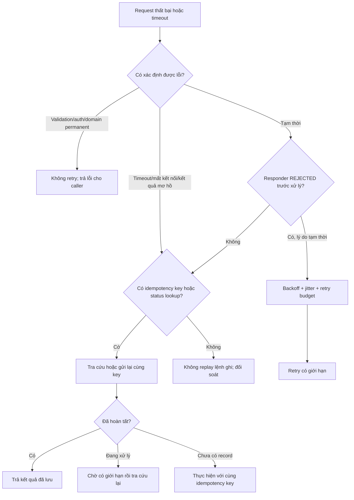

# Chọn retry theo loại lỗi và tránh nhân bản tác dụng phụ

Trong hệ thống RSocket, một request có thể thất bại vì mạng bị ngắt, server quá tải, dữ liệu không hợp lệ hoặc quy tắc nghiệp vụ từ chối thao tác. Không phải lỗi nào cũng nên retry. Đặc biệt, khi client timeout hoặc mất kết nối sau khi gửi lệnh ghi, server có thể đã hoàn tất tác dụng phụ nhưng phản hồi chưa tới client. Gửi lại lệnh theo cách thông thường có thể tạo hai đơn hàng, hai lần trừ tiền hoặc hai thông báo.

Thiết kế retry an toàn cần trả lời hai câu hỏi trước khi gửi lại:

1. **Lỗi này có khả năng tạm thời và có thể phục hồi không?**
2. **Nếu lần trước đã được xử lý, lần gửi lại có tạo thêm tác dụng phụ không?**

Vì vậy, retry phải dựa trên phân loại lỗi, thời hạn và ngân sách thử lại. Với thao tác có side effect, cần một khóa idempotency ổn định và cơ chế lưu kết quả để các lần gửi trùng cùng trả về một kết quả nghiệp vụ.

## 1. Vì sao retry có thể tạo lỗi nghiệp vụ?

Giả sử client gửi yêu cầu tạo thanh toán `PAY-9001`:

1. Client gửi request tới server.
2. Server gọi cổng thanh toán và giao dịch được chấp nhận.
3. Server lưu kết quả vào cơ sở dữ liệu.
4. Kết nối RSocket bị ngắt trước khi response tới client.
5. Client chỉ nhìn thấy timeout và cho rằng thao tác thất bại.
6. Client gửi lại request; server tạo một giao dịch khác.

Ở góc nhìn client, lần đầu không có response. Ở góc nhìn server, tác dụng phụ có thể đã hoàn tất. Đây là **kết quả không xác định** (*ambiguous outcome*), khác với trường hợp server từ chối request trước khi xử lý.

Retry chỉ giải quyết lỗi truyền thông hoặc lỗi tạm thời. Nó không tự bảo đảm thao tác nghiệp vụ chỉ xảy ra một lần. Để chống trùng, server cần nhận diện các lần gửi thuộc cùng một thao tác logic và trả lại kết quả đã ghi nhận.

## 2. Phân loại lỗi trước khi retry

Hãy chia lỗi thành ba nhóm chính:

| Nhóm lỗi | Ví dụ | Hành động phù hợp |
|---|---|---|
| Tạm thời, có thể phục hồi | Dịch vụ phụ thuộc tạm ngừng, quá tải có kiểm soát, lỗi kết nối trước khi request được gửi | Có thể retry có giới hạn và backoff nếu thao tác an toàn để lặp |
| Vĩnh viễn hoặc do request | Validation, sai route, sai schema, thiếu quyền, token không hợp lệ, quy tắc nghiệp vụ từ chối | Không retry tự động; trả lỗi để caller sửa dữ liệu hoặc quyền |
| Kết quả không xác định | Timeout sau khi gửi, mất kết nối khi request đang chạy, response bị mất sau commit | Tra cứu trạng thái theo operation/idempotency key; chỉ gửi lại khi có bảo vệ chống trùng |

Một số lỗi như HTTP 503 từ dịch vụ phụ thuộc hoặc `REJECTED` do server quá tải có thể là tạm thời, nhưng cần xét mã nguyên nhân. `APPLICATION_ERROR` không tự nói rằng lỗi có thể retry; đó chỉ là tín hiệu lỗi ở tầng ứng dụng. Không nên viết một policy kiểu “gặp bất kỳ exception nào thì retry”.

## 3. Hiểu đúng các mã lỗi RSocket

RSocket có mã lỗi giao thức giúp requester phân biệt một số trường hợp quan trọng:

| Mã RSocket | Ý nghĩa | Quyết định retry |
|---|---|---|
| `REJECTED` | Responder từ chối một request hợp lệ và bảo đảm request đó chưa được xử lý | Có thể thử lại nếu lý do từ chối là tạm thời; dùng backoff và giới hạn |
| `APPLICATION_ERROR` | Logic ứng dụng phát sinh lỗi (`onError`) | Phải phân loại mã lỗi ứng dụng; không retry mặc định |
| `INVALID` | Request không hợp lệ | Không retry trước khi sửa request |
| `CANCELED` (error code) | Responder hủy request nhưng có thể đã bắt đầu xử lý | Kết quả có thể không xác định; cần idempotency hoặc tra cứu trạng thái |
| `CONNECTION_ERROR` | Kết nối đang bị kết thúc | Các request đang chạy có thể không biết đã được xử lý tới đâu; không retry lệnh ghi mù |
| `REJECTED_SETUP` / `INVALID_SETUP` | Server từ chối thiết lập phiên | Kiểm tra cấu hình, xác thực và khả năng tương thích; chỉ thử lại khi nguyên nhân có thể thay đổi |

Điểm quan trọng: theo đặc tả RSocket, `REJECTED` bảo đảm responder chưa xử lý request. Đây là thông tin mạnh hơn một timeout thông thường. Tuy vậy, `REJECTED` vẫn có thể do chính sách vĩnh viễn, chẳng hạn caller không được phép dùng route; chỉ retry khi lý do từ chối là tạm thời.

Mã `CANCELED` trong frame `ERROR` không giống việc requester chủ động gửi frame `CANCEL`. Cả hai đều kết thúc stream, nhưng không nên suy luận rằng tác dụng phụ đã được rollback. Hủy subscription ở client không phải là giao dịch phân tán và không tự hoàn tác công việc server đã thực hiện.

## 4. Bảng quyết định retry theo tình huống

| Tình huống | Có nên retry? | Điều kiện |
|---|---|---|
| Không phân giải DNS hoặc không mở được socket trước khi gửi request | Có thể | Lỗi có tính tạm thời, endpoint/cấu hình đúng và có giới hạn thử lại |
| Server từ chối do quá tải bằng `REJECTED` | Có thể | Mã lý do cho biết quá tải tạm thời; chờ backoff trước khi thử lại |
| Validation hoặc `INVALID` | Không | Client phải sửa dữ liệu |
| Unauthorized/forbidden | Không | Cần xác thực lại hoặc cấp quyền đúng |
| Domain conflict, ví dụ đơn hàng đã hủy | Thường không | Chỉ thử lại khi trạng thái nghiệp vụ đã thay đổi và có quyết định mới |
| Timeout sau khi gửi lệnh ghi | Chưa thể kết luận | Tra cứu theo idempotency key hoặc gửi lại cùng key đã được bảo vệ |
| Mất kết nối sau khi server commit nhưng trước response | Không retry mù | Lấy lại kết quả đã lưu hoặc gửi lại cùng idempotency key |
| Stream phát một số phần tử rồi gặp lỗi | Không retry từ đầu mù quáng | Tiếp tục từ cursor/checkpoint và loại phần tử đã xử lý |
| Fire-and-forget | Không thể xác nhận bằng response | Nếu cần xác nhận, đổi contract sang request-response/acknowledgement hoặc dùng broker bền vững |

## 5. Backoff, jitter và giới hạn thử lại

Nếu nhiều client retry ngay sau khi cùng gặp sự cố, chúng có thể làm server quá tải thêm. Dùng exponential backoff để tăng dần thời gian chờ:

\[
delay_n = \min(maxDelay, baseDelay \times 2^n)
\]

Trong đó `baseDelay` là thời gian chờ ban đầu, `n` là số lần retry và `maxDelay` là giới hạn trên. Thêm **jitter** để phân tán thời điểm retry giữa các client.

Ví dụ cấu hình minh họa:

| Lần retry | Backoff trước jitter |
|---:|---:|
| 1 | 200 ms |
| 2 | 400 ms |
| 3 | 800 ms |
| 4 | 1.600 ms |
| 5 trở đi | Tăng tới giới hạn 3 giây |

Một policy nên có:

- Số lần retry tối đa.
- Backoff tối thiểu và tối đa.
- Jitter.
- Bộ lọc chỉ cho phép lỗi tạm thời.
- Deadline tổng cho cả thao tác, không chỉ timeout từng lần thử.
- Retry budget để giới hạn tổng lượng retry của một client hoặc toàn dịch vụ.

Không retry vô hạn. Khi hết budget, trả lỗi cho caller hoặc đưa thao tác vào workflow đối soát phù hợp.

## 6. Ví dụ retry có chọn lọc bằng Reactor

Project Reactor cung cấp `Retry.backoff(...)` với số lần thử tối đa, exponential backoff, jitter và bộ lọc exception. Ứng dụng cần ánh xạ lỗi giao thức và lỗi phụ thuộc thành các loại lỗi nội bộ ổn định trước khi áp dụng policy.

Ví dụ định nghĩa hai lỗi tạm thời do ứng dụng phân loại:

```java
public final class TemporaryDependencyException extends RuntimeException {
    public TemporaryDependencyException(String message, Throwable cause) {
        super(message, cause);
    }
}

public final class TemporaryOverloadException extends RuntimeException {
    public TemporaryOverloadException(String message) {
        super(message);
    }
}
```

Retry policy:

```java
import java.util.concurrent.TimeoutException;

Retry retryPolicy() {
    return Retry.backoff(3, Duration.ofMillis(200))
        .maxBackoff(Duration.ofSeconds(3))
        .jitter(0.5)
        .filter(error ->
            error instanceof TemporaryDependencyException
                || error instanceof TemporaryOverloadException
                || error instanceof TimeoutException
        )
        .onRetryExhaustedThrow((spec, signal) -> signal.failure());
}
```

`Retry.backoff(3, ...)` cho phép tối đa ba lần retry ngoài lần gửi đầu tiên. `jitter(0.5)` thêm độ ngẫu nhiên vào backoff. `filter(...)` bảo đảm validation, authorization và lỗi nghiệp vụ không nằm trong hai loại tạm thời sẽ không bị retry.

Áp dụng cho một request đọc có thể lặp an toàn:

```java
Mono<OrderView> findOrder(String orderId) {
    return Mono.defer(() -> requester
            .route("orders.find")
            .data(new FindOrderRequest(orderId))
            .retrieveMono(OrderView.class)
            .timeout(Duration.ofSeconds(2)))
        .retryWhen(retryPolicy())
        .timeout(Duration.ofSeconds(8));
}
```

Timeout hai giây áp dụng cho mỗi lần thử; timeout tám giây ở ngoài giới hạn tổng thời gian của cả chuỗi. `Mono.defer` tạo publisher request khi có subscription/retry. Ví dụ cho phép retry timeout vì đây là thao tác đọc idempotent. Với lệnh ghi, timeout sau khi gửi vẫn là kết quả không xác định và chỉ được gửi lại khi có idempotency key hoặc cơ chế tra cứu trạng thái. Trong ứng dụng thật, bộ phân loại cần ánh xạ các lỗi RSocket/transport và lỗi dịch vụ phụ thuộc sang loại tạm thời một cách có chủ đích; không wrap mọi exception thành `TemporaryDependencyException`.

## 7. Retry không thay thế idempotency

Một thao tác được gọi là idempotent khi thực hiện nhiều lần với cùng ý định và cùng đầu vào không tạo thêm tác dụng phụ so với thực hiện một lần. Ví dụ, đặt trạng thái đơn hàng thành `SHIPPED` có thể idempotent nếu server chỉ cập nhật trạng thái tới giá trị đó. Lệnh “cộng thêm 100.000 đồng vào số dư” không idempotent nếu mỗi lần gọi đều cộng thêm.

Với các thao tác ghi như tạo đơn, thu tiền, hoàn tiền, đặt chỗ hoặc phát lệnh điều khiển, hãy dùng **idempotency key**:

1. Client tạo một key duy nhất cho một thao tác logic.
2. Client giữ nguyên key qua tất cả lần retry của thao tác đó.
3. Server lưu key cùng danh tính caller, loại thao tác, hash request và kết quả.
4. Khi nhận lại cùng key và cùng request, server trả lại kết quả đã lưu mà không chạy side effect lần nữa.
5. Nếu cùng key nhưng nội dung request khác, server từ chối vì key đang được dùng cho một ý định khác.

Key phải được tạo một lần cho thao tác logic, không tạo key mới trong mỗi lần retry. Nếu mỗi attempt dùng key khác, server không thể nhận ra đó là cùng một thao tác.

## 8. Thiết kế bảng idempotency và ràng buộc duy nhất

Một bảng lưu idempotency có thể chứa:

| Trường | Vai trò |
|---|---|
| `principal_id` | Caller đã xác thực; dùng để scope key |
| `operation` | Tên thao tác/route logic, ví dụ `payments.create` |
| `idempotency_key` | Key do client tạo và giữ nguyên qua retry |
| `request_hash` | Hash của request đã canonicalize |
| `state` | `PROCESSING`, `COMPLETED` hoặc trạng thái lỗi đã định nghĩa |
| `response_payload` | Kết quả đã lưu để trả lại cho request trùng |
| `created_at`, `completed_at` | Thời điểm tạo và hoàn tất |

Đặt unique constraint trên bộ ba `(principal_id, operation, idempotency_key)`. Việc scope theo principal ngăn hai caller khác nhau vô tình dùng chung key. `principal_id` phải lấy từ danh tính đã xác thực, không lấy từ trường `userId` do client tự gửi.

Quy tắc xử lý:

- Key chưa tồn tại: claim key và thực hiện thao tác.
- Key đã `COMPLETED`, hash giống nhau: trả lại response đã lưu.
- Key đang `PROCESSING`: chờ kết quả trong giới hạn hoặc trả trạng thái đang xử lý để client tra cứu sau; không thực hiện side effect song song lần nữa.
- Key đã tồn tại nhưng hash khác: trả lỗi conflict.

Giữ key lâu hơn khoảng thời gian retry/replay mà hệ thống cho phép. Xóa key quá sớm có thể khiến một request cũ được gửi lại và thực hiện side effect lần nữa.

## 9. Ghi idempotency record và thay đổi nghiệp vụ trong cùng transaction

Nếu side effect nằm trong cùng cơ sở dữ liệu, việc claim key, cập nhật nghiệp vụ và lưu response nên được commit trong một transaction. Khi transaction rollback, cả thay đổi nghiệp vụ và kết quả idempotency đều không được coi là hoàn tất.

Một service có thể thể hiện contract như sau:

```java
@MessageMapping("payments.create")
public Mono<PaymentResult> create(
        @Payload CreatePaymentRequest request,
        Principal principal) {
    return paymentService.createOnce(principal.getName(), request);
}
```

DTO mang key ổn định:

```java
public record CreatePaymentRequest(
    String idempotencyKey,
    String orderId,
    BigDecimal amount,
    String currency
) {}
```

`createOnce(...)` là một abstraction nghiệp vụ có trách nhiệm:

```java
Mono<PaymentResult> createOnce(
        String principalId,
        CreatePaymentRequest request) {

    String requestHash = requestHasher.sha256Canonical(request);

    return idempotencyExecutor.executeAtomically(
        principalId,
        "payments.create",
        request.idempotencyKey(),
        requestHash,
        () -> paymentRepository.create(request)
            .flatMap(payment -> paymentRepository.toResult(payment))
    );
}
```

`executeAtomically(...)` là abstraction minh họa, không phải class có sẵn của Spring. Contract của nó phải bảo đảm việc claim key, chạy supplier tạo payment và lưu response hoàn tất cùng một reactive transaction. Để đạt điều đó, implementation có thể điều phối `TransactionalOperator` bên trong và ghi trạng thái `COMPLETED` trước khi commit; supplier ở ví dụ chỉ chứa thay đổi nghiệp vụ và tạo kết quả.

Khi hai request cùng claim một key, unique constraint chỉ cho phép một request thắng. Request còn lại phải đọc kết quả bằng transaction mới nếu transaction claim của nó đã rollback-only, hoặc chờ bản ghi chuyển sang `COMPLETED` trong thời hạn cho phép. Không bắt duplicate-key rồi tiếp tục dùng transaction đã hỏng. Nếu dùng một abstraction khác, hãy giữ nguyên yêu cầu nguyên tử này: key đã hoàn tất phải luôn tương ứng với thay đổi nghiệp vụ đã commit, và thay đổi nghiệp vụ không được commit khi kết quả idempotency chưa được lưu.

Hash request phải được tính từ biểu diễn canonical, loại bỏ các trường thay đổi theo lần gửi như timestamp transport hoặc trace ID. Không dùng hash để thay thế idempotency key; hash chỉ xác nhận cùng key có cùng nội dung nghiệp vụ.

## 10. Side effect bên ngoài và Transactional Outbox

Một transaction cơ sở dữ liệu không thể tự rollback một khoản tiền đã được cổng thanh toán thu, email đã gửi hoặc lệnh đã tới thiết bị. Không giữ transaction database mở trong lúc chờ một hệ thống ngoài rồi giả định hai hệ thống cùng commit/rollback.

Với side effect liên dịch vụ, có thể dùng **Transactional Outbox**:

1. Trong một transaction database, lưu thay đổi nghiệp vụ và một bản ghi outbox có event ID duy nhất.
2. Commit transaction.
3. Một relay đọc outbox và gửi sự kiện tới broker hoặc dịch vụ đích.
4. Relay đánh dấu đã gửi sau khi nhận xác nhận theo contract.
5. Consumer dùng event ID/idempotency key để xử lý trùng an toàn.

Outbox giúp không mất sự kiện giữa lúc commit dữ liệu và lúc phát thông báo, nhưng relay thường có thể gửi lại nếu bị ngắt sau khi bên nhận xử lý mà trước khi relay ghi nhận acknowledgement. Consumer vẫn cần dedup/idempotency.

Nếu gọi cổng thanh toán, dùng idempotency key mà nhà cung cấp hỗ trợ và truyền cùng key cho mọi lần gọi lại. Nếu nhà cung cấp không hỗ trợ idempotency, cần một workflow có trạng thái, đối soát giao dịch và quy trình xử lý thủ công/compensation cho kết quả không xác định. Không thể đạt bảo đảm exactly-once xuyên nhiều hệ thống chỉ bằng `retryWhen`.

## 11. Retry theo từng interaction model RSocket

Các interaction model có mức độ xác nhận khác nhau:

| Kiểu | Đặc điểm | Quy tắc retry |
|---|---|---|
| Request-response | Một request, tối đa một response | Retry khi lỗi tạm thời và thao tác idempotent hoặc responder đã `REJECTED` trước xử lý |
| Fire-and-forget | Không có response nghiệp vụ | Không biết chắc responder đã xử lý; dùng event ID/dedup hoặc đổi sang acknowledgement nếu cần xác nhận |
| Request-stream | Một request, nhiều payload phản hồi | Nếu lỗi sau một số payload, chỉ tiếp tục từ cursor/checkpoint; không phát lại toàn stream từ đầu một cách mù quáng |
| Request-channel | Hai chiều đều có thể phát nhiều payload | Dùng sequence/event ID, ack theo phần tử hoặc batch và checkpoint; không retry toàn channel nếu input có side effect |

### Request-response

Đây là kiểu dễ áp dụng retry nhất vì mỗi lần tương tác có một kết quả đơn. Tuy vậy, timeout sau khi gửi request vẫn tạo kết quả không xác định. Với lệnh ghi, giữ nguyên idempotency key và để server trả lại kết quả đã lưu.

### Fire-and-forget

Fire-and-forget là best-effort. Việc gửi hoàn tất ở phía requester không phải acknowledgement nghiệp vụ rằng responder đã lưu hoặc xử lý sự kiện. Nếu sự kiện quan trọng, dùng request-response để nhận `ACCEPTED`/`PERSISTED`, hoặc ghi vào broker bền vững. Nếu vẫn dùng FNF, gắn event ID và thiết kế consumer dedup.

### Request-stream

Một stream có thể đã phát và client đã xử lý nhiều phần tử trước khi lỗi terminal xảy ra. Retry từ đầu sẽ gửi lại các phần tử cũ. Hãy dùng cursor, sequence number hoặc offset; chỉ checkpoint sau khi phần tử được xử lý bền vững. Request mới tiếp tục từ cursor đã xác nhận.

### Request-channel

Channel có luồng input và output đồng thời. Một số command đầu vào có thể đã được xử lý dù client chưa nhận đủ acknowledgement. Gắn event ID cho từng command và trả acknowledgement riêng. Khi khôi phục, chỉ phát lại những command chưa có trạng thái hoàn tất, dùng cùng event ID.

Không tự động resubscribe một publisher đầu vào không thể phát lại, chẳng hạn hot source hoặc publisher đọc dữ liệu từ một nguồn tiêu thụ một lần. Hãy lưu command vào nguồn bền vững, checkpoint theo sequence/event ID và tạo publisher mới từ phần chưa xác nhận khi cần phục hồi.

## 12. Không nhầm RSocket Resumption với idempotency nghiệp vụ

RSocket Resumption có thể tiếp tục một phiên sau khi transport bị gián đoạn bằng cách khôi phục trạng thái phiên và trao đổi lại frame cần thiết theo giao thức. Nó giúp giảm việc phải tạo phiên mới, nhưng không thay thế transaction nghiệp vụ, idempotency key hoặc đối soát.

Ví dụ, server có thể đã gọi một hệ thống thanh toán bên ngoài trước khi transport bị ngắt. Việc resume phiên không tự rollback khoản thanh toán và cũng không bảo đảm hệ thống ngoài chỉ thực hiện một lần. Bảo vệ side effect phải nằm ở tầng nghiệp vụ và hệ thống đích.

## 13. Xử lý kết quả không xác định bằng status lookup

Với thao tác có giá trị cao như thanh toán, đặt chỗ hoặc tạo lệnh điều khiển, nên cung cấp route tra cứu trạng thái theo operation ID/idempotency key:

```java
@MessageMapping("payments.status")
public Mono<PaymentStatus> status(@Payload PaymentStatusRequest request,
                                 Principal principal) {
    return paymentService.findStatus(
        principal.getName(),
        request.idempotencyKey()
    );
}
```

Khi client timeout:

1. Giữ nguyên idempotency key.
2. Gọi route status để kiểm tra `PROCESSING`, `COMPLETED`, `FAILED` hoặc `UNKNOWN`.
3. Nếu `COMPLETED`, dùng kết quả đã lưu.
4. Nếu `PROCESSING`, chờ có giới hạn rồi tra cứu lại.
5. Nếu `UNKNOWN`, có thể gửi lại cùng key nếu server bảo đảm idempotency.
6. Nếu trạng thái vẫn không rõ, chuyển sang đối soát thay vì tạo key mới.

Không trả `FAILED` chỉ vì client không nhận được response. Trạng thái `UNKNOWN` có ý nghĩa riêng và giúp tránh tạo một thao tác mới khi lần trước có thể đã thành công.

## 14. Retry budget, circuit breaker và chống retry storm

Ngay cả retry có backoff cũng có thể làm tăng tải khi mọi request cùng retry. Hãy kết hợp:

- **Retry budget**: giới hạn số retry trên tổng số request hoặc theo principal/route trong một cửa sổ.
- **Circuit breaker**: tạm ngừng gọi dependency khi tỷ lệ lỗi vượt ngưỡng, sau đó thử lại có kiểm soát ở trạng thái half-open.
- **Concurrency limit**: giới hạn số thao tác đang chạy đồng thời.
- **Jitter**: phân tán thời điểm retry.
- **Deadline**: dừng toàn bộ thao tác khi đã hết thời gian caller cho phép.
- **Load shedding**: server từ chối sớm thay vì nhận thêm công việc không thể xử lý.

Nếu server trả `REJECTED` vì quá tải, client nên chờ theo backoff. Nếu hệ thống có thông tin retry-after riêng trong payload/metadata, client có thể kết hợp giá trị đó với jitter. Không tự suy ra thời gian retry từ `APPLICATION_ERROR` hoặc `CONNECTION_ERROR` khi chưa có contract.

## 15. Sơ đồ quyết định retry an toàn



## 16. Kiểm thử retry và tác dụng phụ trùng

Test chỉ kiểm tra rằng client “nhận được response cuối cùng” là chưa đủ. Cần kiểm tra số lần side effect thực sự xảy ra:

1. Gửi request đọc và làm dependency lỗi tạm thời hai lần; xác nhận retry đúng số lần và backoff.
2. Gửi request lỗi validation/authorization; xác nhận không retry.
3. Trả `REJECTED` do quá tải; xác nhận client chờ rồi thử lại theo budget.
4. Ngắt kết nối trước khi server nhận request; xác nhận retry an toàn.
5. Ngắt kết nối sau khi server commit nhưng trước response; gửi lại cùng key và xác nhận chỉ có một bản ghi nghiệp vụ.
6. Gửi đồng thời hai request cùng principal, operation và key; xác nhận chỉ một side effect được thực hiện.
7. Dùng cùng key nhưng payload hash khác; xác nhận server trả conflict.
8. Giả lập cổng thanh toán timeout sau khi đã chấp nhận giao dịch; xác nhận cùng provider idempotency key trả về cùng giao dịch.
9. Làm stream phát một số event rồi lỗi; xác nhận resume từ cursor không xử lý lại event đã checkpoint.
10. Hủy request-channel sau một số command; xác nhận command được dedup khi gửi lại.
11. Kiểm tra key hết hạn sau retention window và chính sách đối soát với request đến muộn.

Theo dõi số lần retry, lý do retry, số lần idempotency hit, conflict key, request ở trạng thái `PROCESSING`, kết quả `UNKNOWN`, duplicate event bị bỏ và side effect thực tế. Không ghi token hoặc dữ liệu thanh toán nhạy cảm vào log.

## 17. Checklist thiết kế retry cho production

- [ ] Mỗi lỗi được phân loại là tạm thời, vĩnh viễn hay kết quả không xác định.
- [ ] Chỉ retry lỗi đã được allowlist; không retry mọi exception.
- [ ] Có số lần retry tối đa, exponential backoff, jitter và deadline tổng.
- [ ] Có retry budget và giới hạn concurrency để tránh retry storm.
- [ ] `REJECTED`, `APPLICATION_ERROR`, `CANCELED` và `INVALID` được diễn giải đúng theo protocol và application code.
- [ ] Thao tác ghi có idempotency key ổn định qua mọi attempt.
- [ ] Key được scope theo principal đã xác thực và operation.
- [ ] Request hash phát hiện trường hợp dùng cùng key cho nội dung khác.
- [ ] Unique constraint và transaction bảo vệ idempotency record cùng thay đổi nghiệp vụ.
- [ ] Side effect bên ngoài dùng provider idempotency hoặc outbox/workflow đối soát.
- [ ] Fire-and-forget không bị xem là acknowledgement nghiệp vụ.
- [ ] Stream/channel có event ID, cursor, sequence và checkpoint.
- [ ] Timeout/mất kết nối sau khi gửi được xử lý như kết quả có thể chưa xác định.
- [ ] Có test lỗi sau commit, retry đồng thời và duplicate request.
- [ ] Có metric cho retry, idempotency hit, duplicate và trạng thái chưa xác định.

Retry an toàn là sự kết hợp giữa phân loại lỗi và khả năng lặp lại thao tác mà không tạo thêm tác dụng phụ. Backoff và jitter giúp hệ thống phục hồi khi lỗi tạm thời; idempotency key, transaction, outbox và status lookup bảo vệ nghiệp vụ khi response bị mất hoặc client không biết lần trước đã hoàn tất hay chưa. Với stream và channel, cursor cùng event ID giúp tiếp tục từ phần đã xác nhận thay vì phát lại toàn bộ dữ liệu.

## Tài liệu tham khảo

- [RSocket Protocol — Error Codes and Interaction Models](https://rsocket.io/about/protocol/)
- [Spring Framework — RSocket](https://docs.spring.io/spring-framework/reference/rsocket.html)
- [Project Reactor — RetryBackoffSpec API](https://projectreactor.io/docs/core/release/api/reactor/util/retry/RetryBackoffSpec.html)
- [Project Reactor — Retry API](https://projectreactor.io/docs/core/release/api/reactor/util/retry/Retry.html)
