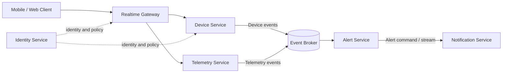
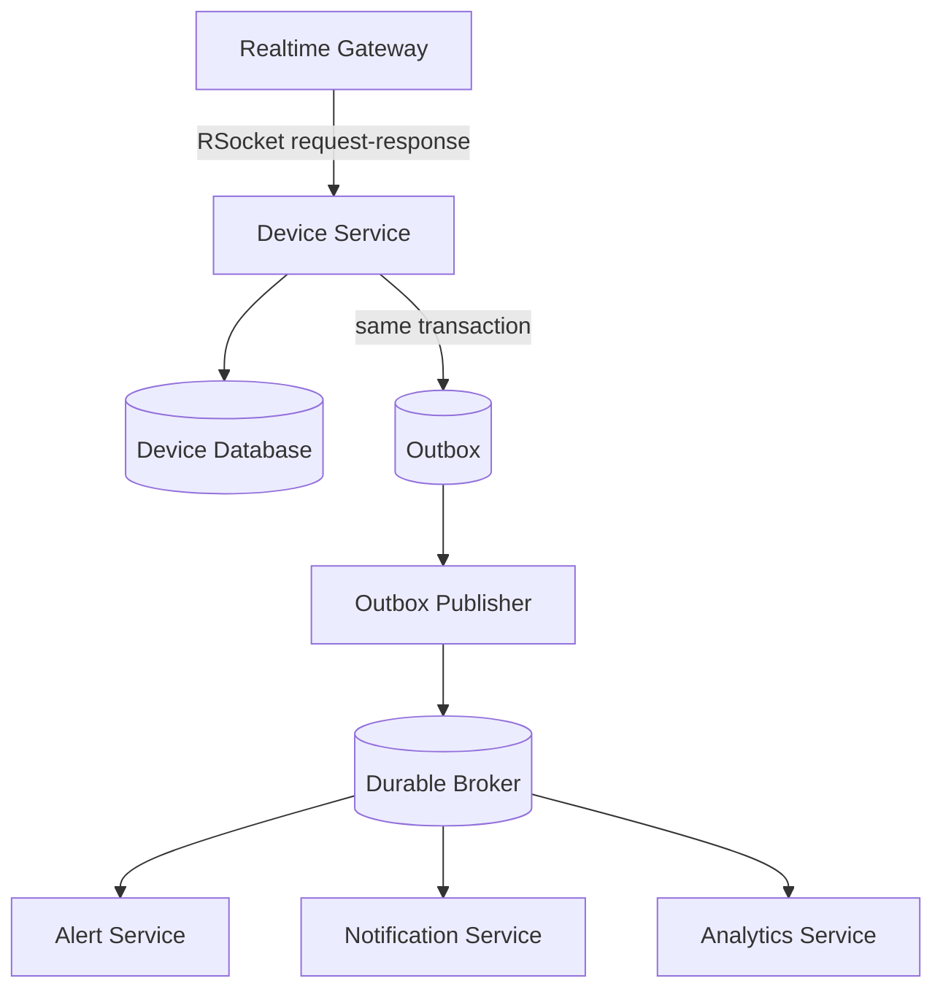

# Chọn ranh giới dùng RSocket trong kiến trúc nhiều dịch vụ

Trong kiến trúc nhiều dịch vụ, RSocket phù hợp ở những ranh giới cần trao đổi realtime, tương tác hai chiều hoặc truyền dữ liệu theo luồng với backpressure. Tuy nhiên, không nên chọn RSocket chỉ vì hệ thống đang dùng Spring Boot hoặc vì một giao tiếp có tần suất cao. Ranh giới dịch vụ trước hết phải phản ánh quyền sở hữu nghiệp vụ và dữ liệu; sau đó mới chọn giao thức phù hợp với yêu cầu latency, streaming, độ bền thông điệp, khả năng phục hồi và vận hành.

RSocket cung cấp request-response, fire-and-forget, request-stream và request-channel trên một kết nối có thể multiplex nhiều stream. Điều này hữu ích cho các tương tác realtime giữa service, nhưng RSocket không tự biến một request thành message bền vững, không cung cấp transaction xuyên nhiều service và không thay thế event broker khi cần lưu trữ, replay hoặc consumer độc lập. Thiết kế tốt thường phối hợp RSocket với HTTP/gRPC và message broker, mỗi công nghệ ở ranh giới mà nó giải quyết tốt.

## 1. Bắt đầu từ ranh giới nghiệp vụ, không bắt đầu từ giao thức

Một service nên sở hữu một năng lực nghiệp vụ rõ ràng, cùng dữ liệu và quy tắc mà nó có quyền quyết định. Service khác tương tác thông qua contract công khai thay vì truy cập trực tiếp database hoặc phụ thuộc vào class nội bộ.

Ví dụ trong hệ thống quản lý thiết bị:

- **Device Service** sở hữu đăng ký thiết bị, trạng thái và lệnh điều khiển.
- **Telemetry Service** sở hữu dữ liệu đo, cửa sổ thời gian và luồng telemetry.
- **Alert Service** sở hữu quy tắc cảnh báo và trạng thái cảnh báo.
- **Notification Service** sở hữu việc gửi email, push hoặc thông báo realtime.
- **Identity Service** cấp danh tính và quyền truy cập.

Device Service có thể cung cấp route đọc trạng thái và route điều khiển. Telemetry Service có thể cung cấp stream dữ liệu. Alert Service tiêu thụ sự kiện thiết bị để tính cảnh báo. Mỗi service vẫn giữ quyền sở hữu dữ liệu của mình; việc trao đổi qua RSocket không có nghĩa các service được dùng chung repository hoặc database schema.



Sơ đồ minh họa các ranh giới logic. Từng đường kết nối có thể dùng RSocket, HTTP/gRPC hoặc broker tùy semantics; không bắt buộc mọi mũi tên đều dùng cùng một giao thức.

## 2. Những câu hỏi cần trả lời trước khi chọn RSocket

Hãy xác định yêu cầu của tương tác trước khi chọn công nghệ:

| Câu hỏi | Ý nghĩa đối với thiết kế |
|---|---|
| Có cần phản hồi ngay trong cùng tương tác không? | Request-response hoặc giao thức RPC có thể phù hợp |
| Dữ liệu có được phát liên tục không? | Request-stream có thể phù hợp |
| Hai phía có cùng gửi dữ liệu trong một phiên không? | Request-channel có thể phù hợp |
| Caller có cần gửi mà không chờ response không? | Fire-and-forget chỉ phù hợp khi không cần xác nhận kết quả đồng bộ |
| Có cần lưu message khi consumer offline không? | Cần broker hoặc durable store; không dựa vào connection RSocket đơn lẻ |
| Consumer có cần replay từ offset không? | Cần event log/checkpoint hoặc broker hỗ trợ retention/replay |
| Có bao nhiêu caller và stream đồng thời? | Cần tính connection, multiplexing, quota, backpressure và buffer |
| Có cần client bên ngoài mạng nội bộ truy cập không? | Cần xem xét WebSocket, gateway, TLS, auth và network policy |
| Team có thể vận hành connection dài hạn không? | Cần readiness, reconnect, keepalive, metrics và graceful shutdown |

Nếu chưa rõ message có cần được lưu và xử lý khi receiver offline hay không, hãy làm rõ yêu cầu độ bền trước. Đây thường là quyết định kiến trúc quan trọng hơn việc chọn TCP hay WebSocket.

## 3. Khi nào RSocket là lựa chọn phù hợp?

RSocket thường đáng cân nhắc khi có một hoặc nhiều đặc điểm sau:

- Service cần stream dữ liệu liên tục từ server tới client hoặc service khác.
- Hai phía cần trao đổi nhiều payload trong cùng một interaction, ví dụ command và phản hồi liên tục.
- Nhiều stream có thể dùng chung một connection và cần multiplexing.
- Consumer cần backpressure để điều tiết số payload đang nhận.
- Tương tác cần latency thấp và có thể giữ kết nối dài hạn.
- Cả hai phía có thể triển khai cùng contract RSocket và quản lý lifecycle connection.

Ví dụ phù hợp là Telemetry Service phát dữ liệu cảm biến đến Realtime Gateway; Device Service gửi trạng thái tiến trình điều khiển theo stream; hoặc một phiên điều khiển thiết bị hai chiều cần nhận lệnh và gửi telemetry trong cùng một interaction.

RSocket không tự động nhanh hơn mọi giao thức khác. Hiệu năng thực tế phụ thuộc payload, codec, kích thước message, số stream, network, runtime, TLS, scheduler và cách triển khai. Hãy benchmark với workload thực tế thay vì chọn chỉ dựa trên nhãn “reactive” hoặc “low latency”.

## 4. So sánh RSocket với HTTP/gRPC và message broker

Các công nghệ này giải quyết các nhu cầu khác nhau và có thể cùng tồn tại:

| Tiêu chí | RSocket | HTTP/REST hoặc gRPC | Message broker |
|---|---|---|---|
| Request-response | Có | Có | Có thể mô phỏng qua request/reply, nhưng không phải lúc nào cũng cần |
| Server stream | Request-stream | gRPC streaming; HTTP streaming tùy stack | Consumer nhận message liên tục |
| Hai chiều trong một interaction | Request-channel | gRPC bidirectional streaming | Hai chiều thường là các channel/topic độc lập |
| Fire-and-forget | Có interaction riêng | Có thể trả `202 Accepted` hoặc không chờ kết quả theo thiết kế | Publish message |
| Flow control | Reactive Streams demand trong interaction | Phụ thuộc giao thức và client/server API | Prefetch, credit hoặc consumer flow control tùy broker |
| Lưu trữ và replay message | Không tự cung cấp durable log | Không tự cung cấp durable log | Thường là chức năng cốt lõi |
| Consumer offline | Cần application recovery hoặc nguồn dữ liệu khác | Caller phải retry/query lại | Có thể giữ message theo retention và subscription policy |
| Kết nối | Thường dùng connection dài hạn, multiplexed | HTTP request/response; HTTP/2 có thể multiplex | Producer/consumer kết nối tới broker |
| Phù hợp | Realtime interaction và stream có tương tác | API phổ biến, tích hợp rộng, RPC đồng bộ | Event/task cần độ bền, replay và tách producer-consumer |

Không nên xem bảng là bảng xếp hạng. Ví dụ gRPC bidirectional streaming cũng phù hợp cho stream hai chiều; HTTP/2 có multiplexing; broker có thể hỗ trợ latency thấp. Chọn theo contract, hệ sinh thái client, yêu cầu vận hành và semantics cần bảo đảm.

## 5. Chọn interaction model theo ý nghĩa nghiệp vụ

Một route RSocket cần có contract xác định rõ loại interaction. Không nên để cùng một route thay đổi semantics tùy ý mà caller không biết.

| Interaction | Dùng khi | Ví dụ route |
|---|---|---|
| Request-response | Một request cần tối đa một kết quả | `devices.status`, `orders.quote` |
| Fire-and-forget | Caller gửi một thông điệp và không cần response payload | `telemetry.ingest` cho dữ liệu best-effort |
| Request-stream | Một request mở luồng kết quả nhiều phần tử từ server | `telemetry.watch`, `orders.track` |
| Request-channel | Hai phía cùng gửi/nhận nhiều payload trong một interaction | `devices.control-session`, `collaboration.sync` |

Lựa chọn cần dựa vào ngữ nghĩa, không dựa vào số lượng byte đơn thuần. Một file lớn không nhất thiết nên gửi thành một request-stream có một payload; thường nên chia thành các chunk nghiệp vụ với sequence, checksum và transfer ID. Một command cần xác nhận đã commit không nên chuyển thành fire-and-forget chỉ để giảm latency.

## 6. Request-response cho truy vấn và command có kết quả

Request-response phù hợp khi caller cần một kết quả rõ ràng cho một thao tác. Ví dụ Gateway hỏi Device Service trạng thái thiết bị:

```java
Mono<DeviceStatus> status = requester
    .route("devices.status")
    .data(new DeviceQuery(deviceId))
    .retrieveMono(DeviceStatus.class);
```

Service nhận request, kiểm tra quyền, đọc dữ liệu do mình sở hữu và trả DTO. Caller có thể áp dụng timeout và xử lý lỗi theo contract.

Với command có tác dụng phụ, response cần phân biệt ít nhất việc command được chấp nhận, đã hoàn tất hoặc bị từ chối. Nếu tác vụ dài, trả `operationId` để caller truy vấn trạng thái thay vì giữ request mở quá lâu.

Timeout không chứng minh command chưa được thực hiện. Nếu server commit rồi response bị mất, retry có thể lặp tác dụng phụ. Hãy dùng idempotency key ổn định và operation state để caller retry hoặc tra cứu an toàn.

## 7. Request-stream cho dữ liệu realtime

Request-stream phù hợp khi caller mở một subscription và server phát nhiều payload:

```java
Flux<TelemetryPoint> telemetry = requester
    .route("telemetry.watch")
    .data(new TelemetryQuery(deviceId, Duration.ofSeconds(1)))
    .retrieveFlux(TelemetryPoint.class);
```

Server có thể phát dữ liệu mới theo thời gian. Demand từ consumer giúp điều tiết số payload được phát; khi client xử lý chậm, pipeline có thể giảm tốc độ hoặc ngừng yêu cầu thêm dữ liệu.

Hãy định nghĩa rõ:

- Subscription có thời hạn bao lâu và ai có quyền mở nó.
- Có giới hạn số stream trên mỗi caller/tenant hay không.
- Event bị bỏ lỡ trong lúc disconnect được replay hay chỉ gửi dữ liệu mới nhất.
- Cursor/checkpoint nào được dùng nếu cần business resume.
- Khi dữ liệu đến nhanh hơn consumer, hệ thống buffer, drop, coalesce hay từ chối theo chính sách nào.
- Cách client cancel và server giải phóng tài nguyên.

Nếu dữ liệu cần được lưu để consumer offline có thể nhận lại, hãy dùng event log/broker hoặc lưu trữ nghiệp vụ làm nguồn replay. Một `Flux` sống trên connection không tự biến thành durable subscription.

## 8. Request-channel cho tương tác hai chiều

Request-channel phù hợp khi client và server đều cần gửi chuỗi payload trong cùng interaction. Ví dụ một phiên điều khiển thiết bị: client gửi command hoặc thay đổi cấu hình, server gửi telemetry và acknowledgement.

```java
Flux<ControlReply> replies = requester
    .route("devices.control-session")
    .data(commands)
    .retrieveFlux(ControlReply.class);
```

Ở phía server, handler có thể nhận `Flux<ControlCommand>` và trả `Flux<ControlReply>`. Cần định nghĩa sequence, command ID, acknowledgement, quyền từng loại command và hành vi khi một phía complete/cancel.

Request-channel không tự cung cấp độ bền cho message đã gửi. Nếu client cần khôi phục các command chưa được xác nhận sau khi session mất, hãy lưu chúng trong outbox bền vững và gửi lại bằng cùng command ID/idempotency key khi tạo channel mới. Server cần deduplicate và trả lại kết quả đã lưu.

## 9. Fire-and-forget chỉ dành cho thông điệp không cần xác nhận

Fire-and-forget hữu ích khi caller không cần response payload cho từng message, ví dụ telemetry best-effort hoặc tín hiệu cập nhật không quan trọng. Nhưng tên gọi này không có nghĩa message được ghi bền vững hoặc chắc chắn được xử lý sau khi connection mất.

```java
Mono<Void> sent = requester
    .route("telemetry.ingest")
    .data(point)
    .send();
```

Publisher hoàn tất theo semantics gửi của requester; nó không phải bằng chứng rằng dữ liệu đã được commit vào database hoặc consumer downstream đã hoàn thành công việc. Nếu caller cần xác nhận server đã tiếp nhận, hãy dùng request-response và trả `Accepted`/`operationId`. Nếu cần đảm bảo message tồn tại khi receiver offline, dùng broker hoặc durable inbox/outbox.

Không dùng fire-and-forget cho thanh toán, tạo đơn, cập nhật quyền hoặc command thiết bị an toàn nếu không có durable acceptance và cơ chế đối soát riêng.

## 10. Chọn transport TCP hay WebSocket

RSocket có thể chạy trên TCP hoặc WebSocket. Transport không thay đổi ý nghĩa nghiệp vụ của route, nhưng ảnh hưởng cách service được expose và vận hành.

| Tiêu chí | TCP | WebSocket |
|---|---|---|
| Môi trường | Giao tiếp service-to-service trong mạng có thể mở cổng TCP | Trình duyệt, mạng chỉ cho phép HTTP(S), gateway/proxy hỗ trợ WebSocket |
| Client | Java/service hoặc client có RSocket TCP | Browser và client hỗ trợ WebSocket |
| Network path | Cần firewall, load balancer và service discovery hỗ trợ TCP | Cần proxy/load balancer hỗ trợ WebSocket upgrade và timeout phù hợp |
| TLS | Có thể dùng transport bảo mật/TLS theo implementation | Thường dùng `wss://` khi qua mạng không tin cậy |
| Vận hành | Theo dõi connection TCP và idle timeout | Theo dõi upgrade, proxy idle timeout, sticky/session routing nếu cần |

Nếu chỉ service nội bộ giao tiếp với nhau và nền tảng mạng hỗ trợ TCP, TCP thường là lựa chọn đơn giản. Nếu browser cần kết nối trực tiếp hoặc hệ thống chỉ expose HTTP(S), WebSocket có thể phù hợp hơn. Gateway vẫn có thể terminate WebSocket rồi gọi RSocket TCP nội bộ.

## 11. Một service hay một connection cho mỗi service?

RSocket hỗ trợ multiplex nhiều stream trên một connection. Với các service gọi đi, thường nên quản lý một connection pool nhỏ hoặc một connection lifecycle owner theo remote service/identity/configuration, rồi tái sử dụng cho nhiều request.

Không tạo một connection mới cho từng request nếu không có yêu cầu isolation cụ thể. Điều đó làm tăng handshake, socket, event loop registration và tải server. Ngược lại, không nên dùng một connection duy nhất cho mọi downstream nếu các service có yêu cầu identity, timeout, security hoặc failure isolation khác nhau.

Khi quyết định phạm vi connection, cân nhắc:

- Remote service và endpoint/cluster đích.
- Principal/service identity dùng trong setup.
- Credential và chu kỳ rotation.
- Timeout, keepalive và resume policy.
- Giới hạn số stream và mức tải của caller.
- Failure domain: một connection bị lỗi có nên ảnh hưởng mọi chức năng không?
- Lifecycle khi deploy, drain và shutdown.

Một connection multiplexed giảm overhead nhưng tạo một số tài nguyên dùng chung. Cần quota theo route/tenant và bulkhead để một stream chậm hoặc caller quá tải không chiếm hết capacity của connection.

## 12. Fan-out đến nhiều service

Gateway có thể cần tổng hợp dữ liệu từ nhiều service, ví dụ màn hình thiết bị cần trạng thái, telemetry gần nhất và cảnh báo hiện tại. Có thể gọi song song các service rồi tổng hợp:

```java
Mono<DeviceOverview> overview(String deviceId) {
    Mono<DeviceStatus> status = deviceClient.status(deviceId);
    Mono<TelemetrySummary> telemetry = telemetryClient.latest(deviceId);
    Mono<List<AlertSummary>> alerts = alertClient.activeFor(deviceId)
        .collectList();

    return Mono.zip(status, telemetry, alerts)
        .map(tuple -> new DeviceOverview(
            tuple.getT1(), tuple.getT2(), tuple.getT3()));
}
```

`Mono.zip` chờ các nguồn hoàn tất. Nếu một dependency lỗi, kết quả tổng hợp cũng có thể lỗi; nếu một nguồn complete rỗng, cần xác định cách biểu diễn dữ liệu thiếu. Trong thực tế hãy đặt timeout riêng, giới hạn concurrency và quyết định nguồn nào bắt buộc, nguồn nào có thể degraded.

Không dùng fan-out không giới hạn cho hàng trăm service hoặc hàng nghìn resource. Nếu phải gọi nhiều phần tử, dùng `flatMap` có giới hạn concurrency và đặt deadline tổng thể. Với dữ liệu không cần tức thời, cân nhắc projection/read model được cập nhật bất đồng bộ để tránh fan-out trên mỗi request.

## 13. Đồng bộ request và bất đồng bộ event

Không phải mọi giao tiếp giữa service đều cần một kết nối realtime. Có thể phân chia:

- **Synchronous query:** caller cần kết quả ngay, có thể dùng RSocket request-response, HTTP hoặc gRPC.
- **Realtime subscription:** caller cần dữ liệu liên tục, có thể dùng RSocket request-stream hoặc broker subscription tùy yêu cầu durability.
- **Command cần kết quả:** request-response trả acceptance/operation ID hoặc kết quả cuối.
- **Command bền vững:** ghi command vào broker/outbox để xử lý ngay cả khi consumer tạm offline.
- **Domain event:** publish vào broker để nhiều consumer độc lập xử lý theo lifecycle riêng.

RSocket và broker có thể bổ sung nhau: service dùng RSocket để tương tác trực tiếp với gateway; khi nghiệp vụ commit, service ghi outbox event và broker phân phối event đến Alert/Notification/Analytics. Điều này tách luồng realtime request khỏi luồng event bền vững.



Outbox publisher có thể phát lại event sau lỗi, vì vậy consumer vẫn cần idempotency/deduplication. Việc dùng RSocket cho request không thay thế transaction và outbox của nghiệp vụ.

## 14. Tránh transaction phân tán qua nhiều service

Một request RSocket có thể gọi nhiều service nhưng không tạo transaction ACID xuyên tất cả service. Nếu Device Service đã commit lệnh, rồi Notification Service thất bại, caller không thể rollback database của Device Service chỉ bằng cách đóng stream.

Với quy trình nhiều bước, hãy thiết kế saga hoặc workflow:

1. Mỗi service commit thay đổi trong database do mình sở hữu.
2. Service phát domain event hoặc trả operation state.
3. Orchestrator/participant theo dõi tiến độ và gửi bước tiếp theo.
4. Nếu bước sau thất bại, dùng compensating action khi nghiệp vụ cho phép.
5. Lưu operation state để có thể tiếp tục sau restart.

RSocket có thể vận chuyển command, response hoặc tiến độ realtime của saga. Broker/outbox phù hợp cho event cần lưu và phát lại. Không giả định giữ một request-response mở trong suốt quy trình dài sẽ tạo độ tin cậy cao hơn.

## 15. Quản lý lỗi và failure isolation

Khi một service downstream chậm hoặc mất kết nối, caller cần giới hạn tác động:

- Timeout kết nối và request theo từng route.
- Retry chỉ với lỗi tạm thời và thao tác an toàn/idempotent.
- Dùng idempotency key cho command có side effect.
- Circuit breaker để tránh tiếp tục gọi dependency đang lỗi.
- Bulkhead hoặc quota để giới hạn stream/request đồng thời.
- Fallback chỉ khi có ý nghĩa nghiệp vụ; không trả dữ liệu giả mà caller tưởng là dữ liệu thật.
- Hủy subscription và giải phóng tài nguyên khi caller rời đi.
- Phân biệt lỗi một stream với lỗi toàn connection.

Với request-stream dài hạn, cần quy tắc reconnect và business resume nếu mất event trong thời gian offline. Với request-channel, cần lưu outbox/inbox nếu hai phía phải phục hồi message chưa xác nhận. Với fire-and-forget, cần quan sát server-side acceptance và không giả định caller sẽ biết message bị từ chối.

## 16. Security và trust boundary

Trong hệ thống nhiều service, không phải service nào cũng được phép gọi mọi route. Thiết kế quyền theo service identity, user identity và loại interaction:

- Xác thực service ở connection setup khi phù hợp.
- Truyền user context theo request nếu gateway đại diện cho nhiều người dùng.
- Phân quyền theo route và interaction type.
- Kiểm tra tenant/resource ownership trong service sở hữu dữ liệu.
- Dùng TLS trên network không tin cậy và bảo vệ credential/metadata.
- Giới hạn kích thước payload, metadata, stream và request rate.
- Không tin tenant ID hoặc role chỉ vì client gửi trong metadata.

Gateway không nên trở thành nơi duy nhất quyết định quyền trên mọi resource. Service sở hữu resource phải thực hiện authorization ở domain boundary để bảo vệ dữ liệu kể cả khi có một caller khác bỏ qua gateway.

## 17. Service discovery, load balancing và connection lifecycle

Connection dài hạn làm thay đổi cách nhìn load balancing. Load balancer thường chọn backend lúc mở connection; các stream trên connection đó tiếp tục đi đến backend đã chọn. Điều này có thể tạo phân bố tải không đều nếu một số client giữ connection lâu hoặc mở nhiều stream hơn client khác.

Hãy cân nhắc:

- Dùng DNS/service discovery ổn định thay vì IP pod cố định.
- Kiểm tra load balancer hỗ trợ TCP hoặc WebSocket đúng cách.
- Đặt idle timeout lớn hơn keepalive interval và đặc tính stream.
- Dùng readiness để ngừng nhận connection mới trước khi shutdown.
- Drain request/stream đang hoạt động trong thời gian giới hạn.
- Reconnect có jitter và backoff để tránh thundering herd khi nhiều client cùng mất kết nối.
- Nếu cần session resumption qua nhiều replica, bảo đảm node có session state/buffer phù hợp hoặc sticky routing theo implementation.
- Business resume bằng cursor khi protocol session không còn khả dụng.

Không nên giả định DNS thay đổi sẽ chuyển một TCP connection đang mở sang pod mới. Client cần phát hiện connection đóng và tạo connection mới theo lifecycle policy.

## 18. Contract, versioning và compatibility

Route, DTO, MIME type và metadata là contract giữa service. Hãy quản lý chúng như API:

- Đặt route theo capability và hành động rõ ràng.
- Dùng DTO request/response riêng, không chia sẻ entity database.
- Thêm field tùy chọn theo cách tương thích; xác định default và đơn vị.
- Không đổi ý nghĩa field hiện có khi chưa version hóa.
- Version hóa route hoặc MIME type khi thay đổi schema không tương thích.
- Xác định semantics của empty, not-found, denied, accepted và failed.
- Giới hạn payload/metadata và kiểm tra version khi setup nếu cần.
- Có contract test giữa client/server và kiểm thử rolling deployment.

Không để service consumer phụ thuộc trực tiếp vào package Java nội bộ của producer. Chia sẻ một artifact DTO có thể tiện nhưng dễ tạo coupling phiên bản; ưu tiên contract độc lập và kiểm tra tương thích trên wire.

## 19. Observability xuyên service

Một request realtime có thể đi qua Gateway, Device Service và Telemetry Service. Cần liên kết trace qua nhiều connection và stream:

- Trace ID/correlation ID đi qua metadata theo contract.
- Ghi route, interaction type, service đích và kết quả.
- Đo connection count, stream count, request rate và latency p50/p95/p99.
- Theo dõi backpressure, payload size, buffer, queue và cancellation.
- Theo dõi reconnect, resume success/failure và business replay.
- Theo dõi lỗi auth, timeout, circuit breaker và downstream saturation.
- Không ghi access token, secret hoặc payload nhạy cảm.

Với stream dài hạn, không tạo một span khổng lồ sống hàng giờ nếu hệ thống tracing không phù hợp. Có thể dùng span cho thời điểm mở stream, metric cho lifetime/throughput và span/event theo batch hoặc message quan trọng.

## 20. Ma trận quyết định cho ranh giới service

| Tình huống | Lựa chọn thường phù hợp | Lý do và lưu ý |
|---|---|---|
| Gateway cần trạng thái hiện tại từ một service | RSocket request-response hoặc HTTP/gRPC | Chọn theo hệ sinh thái, latency, contract và vận hành |
| Gateway cần telemetry liên tục | RSocket request-stream hoặc broker subscription | RSocket cho tương tác realtime; broker nếu cần durable replay/consumer độc lập |
| Thiết bị và server trao đổi liên tục hai chiều | RSocket request-channel | Cần sequence, auth, backpressure và business recovery |
| Gửi event nghiệp vụ cần lưu khi consumer offline | Durable broker + outbox | Không dựa vào fire-and-forget qua connection |
| Gọi API phổ biến từ đối tác bên ngoài | HTTP/REST hoặc gRPC tùy đối tác | Hệ sinh thái và khả năng tích hợp thường quan trọng hơn multiplexing |
| Gửi telemetry best-effort, không cần response | RSocket fire-and-forget hoặc UDP/collector theo yêu cầu | Cần chấp nhận mất dữ liệu và có metric; không dùng cho command quan trọng |
| Fan-out đọc nhiều service | Gateway aggregation hoặc read model | Giới hạn concurrency/deadline; cân nhắc projection nếu dữ liệu không cần tức thời |
| Quy trình nhiều bước có compensation | Saga/workflow + broker; RSocket cho tiến độ realtime | Không có transaction phân tán chỉ vì dùng một request |

Ma trận là điểm khởi đầu. Cần xác nhận semantics giao nhận, bảo mật, client support, năng lực vận hành và tải thực tế trước khi chốt.

## 21. Các anti-pattern cần tránh

- Dùng RSocket cho mọi giao tiếp chỉ để thống nhất một giao thức.
- Chia service quá nhỏ rồi tạo chuỗi request đồng bộ dài qua nhiều hop.
- Gọi trực tiếp database của service khác.
- Dùng fire-and-forget cho command cần xác nhận hoặc cần được lưu bền vững.
- Dùng một stream RSocket thay cho event log khi cần replay sau nhiều giờ/ngày.
- Mở connection mới cho mỗi request và không quản lý lifecycle.
- Dùng một connection dùng chung cho mọi identity dù security context khác nhau.
- Fan-out không giới hạn hoặc giữ stream vô hạn mà không quota.
- Coi `REQUEST_N` là giới hạn byte hoặc acknowledgment nghiệp vụ.
- Retry command có side effect mà không có idempotency.
- Giữ request mở cho saga dài thay vì lưu operation state.
- Cho Gateway quyết định toàn bộ quyền resource và bỏ qua authorization tại service sở hữu dữ liệu.
- Không có contract versioning hoặc không kiểm thử rolling upgrade.

## 22. Quy trình chọn và triển khai ranh giới

1. Xác định capability và dữ liệu do service nào sở hữu.
2. Viết contract: route, request/response DTO, metadata và lỗi.
3. Xác định semantics: cần response, stream, channel hay durable event.
4. Chọn RSocket, HTTP/gRPC hoặc broker theo yêu cầu client, latency, flow control và durability.
5. Chọn TCP/WebSocket theo network path và client platform.
6. Xác định authentication, authority, tenant/resource ownership và TLS.
7. Đặt timeout, quota, backpressure, payload limit, retry và idempotency.
8. Thiết kế discovery, connection lifecycle, readiness, drain và reconnect.
9. Thêm trace/metric/log an toàn xuyên service.
10. Benchmark và kiểm thử lỗi mạng, downstream chậm, consumer offline, replay và rolling deployment.

## 23. Quy tắc thiết kế

1. Chọn ranh giới theo capability và quyền sở hữu dữ liệu, sau đó mới chọn giao thức.
2. Dùng RSocket cho tương tác realtime, stream hoặc channel khi hai phía kiểm soát được contract và lifecycle.
3. Dùng HTTP/gRPC khi cần API RPC phổ biến hoặc client ecosystem rộng.
4. Dùng broker/outbox cho event/command cần durable acceptance, retention, replay hoặc consumer độc lập.
5. Chọn interaction model theo ý nghĩa nghiệp vụ; không dùng fire-and-forget cho command cần xác nhận.
6. Không coi RSocket connection, stream hay backpressure là durable message queue hoặc transaction.
7. Quản lý connection theo remote service/identity và tái sử dụng có giới hạn.
8. Thiết kế idempotency, checkpoint và business resume cho command/stream cần phục hồi.
9. Bảo vệ từng route và resource tại service sở hữu dữ liệu.
10. Vận hành với timeout, quota, observability, reconnect, drain và contract compatibility.

RSocket tạo giá trị rõ nhất khi ranh giới service cần trao đổi realtime có tương tác, đặc biệt là stream và channel hai chiều. Kiến trúc vẫn cần broker cho sự kiện bền vững, HTTP/gRPC cho những API phù hợp và các cơ chế nghiệp vụ như idempotency, checkpoint, saga cùng authorization. Chọn đúng ranh giới và semantics trước sẽ giúp hệ thống tránh phụ thuộc giao thức quá mức, đồng thời giữ được khả năng phục hồi và mở rộng khi số service tăng lên.
