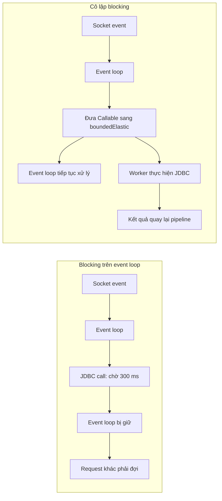

# Tích hợp nguồn dữ liệu chặn mà không chặn event loop

Ứng dụng RSocket thường xử lý nhiều kết nối và nhiều stream trên một nhóm event loop nhỏ. Nếu một handler gọi trực tiếp JDBC đồng bộ, `RestTemplate`, SDK cũ hoặc một API đọc file blocking, thread đang phục vụ I/O mạng có thể bị giữ lại cho đến khi thao tác hoàn tất. Trong thời gian đó, các request khác dùng chung event loop phải chờ, làm tăng độ trễ và giảm thông lượng của toàn hệ thống.

Khi tích hợp một nguồn dữ liệu chỉ có API blocking, ta vẫn có thể giữ bề mặt ứng dụng reactive bằng cách cô lập lời gọi blocking trên scheduler dành cho công việc chặn, thường là `Schedulers.boundedElastic()`. Bài này giải thích cách bọc nguồn dữ liệu đúng thời điểm, chọn scheduler, giới hạn concurrency, xử lý timeout/cancellation và kiểm thử để bảo đảm event loop không bị chặn.

## 1. Vì sao event loop cần được giữ thông thoáng?

Trong cấu hình RSocket dựa trên Reactor Netty, event loop xử lý các sự kiện socket: đọc byte, ghi frame, phát hiện kết nối đóng và chuyển dữ liệu tới tầng RSocket. Một event loop thường phục vụ nhiều connection hoặc channel. Nó được thiết kế để thực hiện các thao tác ngắn, không chờ I/O blocking.

Giả sử một handler chạy trên event loop và gọi trực tiếp `repository.findById(id)` bằng JDBC. Nếu truy vấn mất 300 ms, thread đó không thể xử lý các sự kiện socket khác trong khoảng thời gian bị chặn. Một truy vấn chậm vì database, DNS, filesystem hoặc dịch vụ ngoài có thể làm nhiều stream cùng tăng độ trễ.



Chuyển công việc blocking sang worker không làm cho JDBC trở thành non-blocking. Nó chỉ bảo vệ event loop bằng cách để một nhóm thread khác chờ I/O. Vì vậy, worker vẫn cần giới hạn số thread, số tác vụ xếp hàng và số kết nối tới hệ thống phụ thuộc.

## 2. Phân biệt API blocking và API non-blocking

Trước khi tích hợp, cần xác định loại API đang được gọi:

| Nguồn dữ liệu | Kiểu API thường gặp | Cách tích hợp ưu tiên |
| --- | --- | --- |
| JDBC/JPA đồng bộ | `find`, `query`, `save` chặn thread khi chờ database. | Bọc lời gọi đồng bộ trong `Mono.fromCallable` và `subscribeOn(boundedElastic)`. |
| R2DBC | Publisher reactive cho thao tác database. | Compose trực tiếp trong pipeline reactive; không bọc vào boundedElastic. |
| `RestTemplate` hoặc HTTP client đồng bộ | Lời gọi chờ response mạng. | Cô lập bằng bounded elastic; cân nhắc chuyển sang `WebClient`. |
| `WebClient` | API reactive, non-blocking. | Compose trực tiếp, không gọi `block()`. |
| SDK legacy | Thường trả kết quả đồng bộ hoặc chờ callback bằng blocking. | Đọc rõ hợp đồng; bọc phần thực sự blocking và quản lý thread/resource. |
| File I/O đồng bộ | Đọc/ghi có thể chờ filesystem. | Dùng scheduler phù hợp hoặc API file bất đồng bộ khi thích hợp. |

Không phải mọi API trả về `Mono` hoặc `CompletableFuture` đều tự động non-blocking. Một wrapper có thể gọi JDBC ngay bên trong rồi mới trả về `Mono`. Cần kiểm tra hành vi thực tế của thư viện, không chỉ nhìn kiểu trả về.

Nếu có driver non-blocking trưởng thành như R2DBC hoặc HTTP client reactive, ưu tiên dùng API đó xuyên suốt. Bounded elastic là cầu nối thực dụng cho dependency blocking, không phải lý do để biến mọi thao tác thành blocking.

## 3. Mẫu cơ bản: fromCallable kết hợp subscribeOn

`Mono.fromCallable(...)` tạo nguồn lazy: hàm blocking chỉ được gọi khi có subscription. `subscribeOn(...)` chọn scheduler thực hiện quá trình subscribe vào nguồn, vì thế lời gọi trong `Callable` chạy trên scheduler được chỉ định.

Ví dụ service dùng JDBC đồng bộ:

```java
import reactor.core.publisher.Mono;
import reactor.core.scheduler.Schedulers;

Mono<Order> findOrder(String orderId) {
    return Mono.fromCallable(() -> jdbcOrderRepository.findById(orderId))
        .subscribeOn(Schedulers.boundedElastic());
}
```

Khi RSocket handler subscribe vào Mono này, Reactor thực hiện lời gọi JDBC trên bounded elastic. Event loop có thể tiếp tục xử lý frame và các stream khác trong khi worker chờ database.

Một handler RSocket có thể compose service đó trực tiếp:

```java
import org.springframework.messaging.handler.annotation.MessageMapping;
import org.springframework.stereotype.Controller;
import reactor.core.publisher.Mono;

@Controller
class OrderController {

    private final OrderService orderService;

    OrderController(OrderService orderService) {
        this.orderService = orderService;
    }

    @MessageMapping("orders.lookup")
    Mono<OrderView> lookup(OrderQuery query) {
        return orderService.findOrder(query.orderId())
            .map(OrderView::from);
    }
}
```

Handler trả publisher cho Spring quản lý. Không cần tự gọi `subscribe()` trong handler; framework subscribe và gắn vòng đời tương tác RSocket với publisher trả về.

## 4. Vì sao không dùng Mono.just cho lời gọi blocking?

Đoạn code sau không an toàn:

```java
// Sai: JDBC được gọi ngay khi xây dựng pipeline.
Mono<Order> result = Mono.just(jdbcOrderRepository.findById(orderId))
    .subscribeOn(Schedulers.boundedElastic());
```

Java đánh giá đối số `Mono.just(...)` trước khi gọi `Mono.just`. Do đó `findById` đã chạy trên thread hiện tại, có thể là event loop. `subscribeOn` ở phía sau không thể chuyển ngược một lời gọi đã xảy ra.

Sửa thành:

```java
Mono<Order> result = Mono.fromCallable(
        () -> jdbcOrderRepository.findById(orderId))
    .subscribeOn(Schedulers.boundedElastic());
```

`Mono.defer(...)` cũng có thể trì hoãn việc tạo publisher tới lúc subscribe, nhưng nếu phần tạo publisher có thao tác blocking thì vẫn cần đặt subscribe trên scheduler phù hợp:

```java
Mono<Order> result = Mono.defer(() -> {
        Order order = jdbcOrderRepository.findById(orderId);
        return Mono.justOrEmpty(order);
    })
    .subscribeOn(Schedulers.boundedElastic());
```

Với một lời gọi đồng bộ trả về một giá trị, `fromCallable` thường ngắn gọn và thể hiện ý định rõ hơn. Nếu repository trả `null`, `Mono.fromCallable` phát `Mono.empty()`; hãy xác định đây có phải ngữ nghĩa mong muốn hay cần ánh xạ sang lỗi `NotFound`.

## 5. subscribeOn và publishOn khác nhau thế nào?

Hai operator này không thể thay thế tùy tiện:

| Operator | Ảnh hưởng | Khi dùng với blocking source |
| --- | --- | --- |
| `subscribeOn(scheduler)` | Chuyển quá trình subscribe vào nguồn upstream sang scheduler đã chọn. | Đặt gần nguồn blocking để lời gọi `Callable` chạy trên worker. |
| `publishOn(scheduler)` | Chuyển các tín hiệu downstream tiếp theo sang scheduler đã chọn. | Có thể chuyển bước xử lý sau nguồn; không tự chuyển lời gọi blocking đã chạy trước đó. |

Ví dụ không đủ để bảo vệ lời gọi blocking:

```java
Mono<Order> result = Mono.fromCallable(
        () -> jdbcOrderRepository.findById(orderId))
    .publishOn(Schedulers.boundedElastic());
```

Nguồn `fromCallable` có thể được subscribe trên thread hiện tại; `publishOn` chỉ chuyển các tín hiệu sau ranh giới đó. Hãy dùng `subscribeOn` để điều khiển nơi thực thi source.

`publishOn` vẫn hữu ích khi cần chuyển một bước downstream tốn CPU hoặc cần thread context riêng. Không nên thêm nhiều lần đổi scheduler nếu không có lý do vì mỗi ranh giới có thể tạo queue và chi phí chuyển thread.

## 6. Chọn scheduler cho từng loại công việc

Reactor cung cấp một số scheduler có mục đích khác nhau:

| Scheduler | Mục đích | Có phù hợp để chờ I/O blocking? |
| --- | --- | --- |
| `Schedulers.parallel()` | Công việc CPU-bound, dùng số worker gần với số core. | Không. Tránh gọi JDBC hoặc API blocking trên scheduler này. |
| `Schedulers.single()` | Công việc tuần tự trên một thread. | Không. Một lời gọi blocking có thể làm dừng mọi công việc dùng scheduler đó. |
| `Schedulers.boundedElastic()` | Cô lập tác vụ blocking với số thread và hàng đợi có giới hạn. | Có, đây là lựa chọn phổ biến cho API blocking. |
| `Schedulers.immediate()` | Chạy ngay trên thread hiện tại. | Không. Nó không tạo ranh giới thread. |
| Scheduler tùy chỉnh | Cô lập một dependency hoặc workload riêng. | Có, nếu được cấu hình giới hạn và lifecycle phù hợp. |

Không chuyển toàn bộ pipeline sang bounded elastic nếu chỉ một bước blocking. Giữ các bước reactive/non-blocking trên scheduler mặc định, chỉ cô lập đoạn cần chờ.

## 7. Dùng scheduler riêng để cô lập dependency

`Schedulers.boundedElastic()` là scheduler chia sẻ toàn ứng dụng. Với một dependency có độ trễ cao hoặc có nguy cơ cạn pool, có thể tạo scheduler riêng để áp dụng giới hạn độc lập:

```java
import jakarta.annotation.PreDestroy;
import org.springframework.stereotype.Component;
import reactor.core.scheduler.Scheduler;
import reactor.core.scheduler.Schedulers;

@Component
class LegacyDatabaseScheduler {

    private final Scheduler scheduler =
        Schedulers.newBoundedElastic(12, 500, "legacy-db");

    Scheduler scheduler() {
        return scheduler;
    }

    @PreDestroy
    void shutdown() {
        scheduler.dispose();
    }
}
```

Service dùng scheduler này:

```java
Mono<Customer> findCustomer(String id) {
    return Mono.fromCallable(() -> legacyCustomerDao.find(id))
        .subscribeOn(legacyDatabaseScheduler.scheduler());
}
```

Ví dụ đặt tối đa 12 backing thread và giới hạn hàng đợi theo cấu hình scheduler. Các con số cần được chọn theo kích thước connection pool, giới hạn database, latency và tải thực tế. Scheduler riêng tạo bulkhead ở tầng thread; nó không tự giới hạn số connection database nếu DAO dùng pool khác.

Scheduler tự tạo phải được dispose khi Spring context dừng. Không tạo scheduler mới cho từng request vì điều đó làm mất khả năng giới hạn tài nguyên và gây rò rỉ thread.

## 8. Giới hạn concurrency để bảo vệ nguồn dữ liệu

Chuyển blocking call sang bounded elastic bảo vệ event loop, nhưng vẫn có thể làm database quá tải nếu hàng nghìn request đồng thời cùng gọi DAO. Cần giới hạn concurrency ở pipeline và đồng bộ với connection pool.

Ví dụ xử lý một danh sách ID với tối đa 8 truy vấn đồng thời:

```java
import reactor.core.publisher.Flux;
import reactor.core.publisher.Mono;
import reactor.core.scheduler.Schedulers;

Flux<Customer> findCustomers(Flux<String> ids) {
    return ids.flatMap(
        id -> Mono.fromCallable(() -> legacyCustomerDao.find(id))
            .subscribeOn(Schedulers.boundedElastic()),
        8
    );
}
```

`flatMap(..., 8)` giới hạn số publisher con đang hoạt động trong pipeline này. Nó không phải giới hạn toàn cục nếu mỗi request tạo một pipeline riêng. Nếu cần quota tổng theo ứng dụng hoặc tenant, dùng semaphore/bulkhead hoặc limiter dùng chung.

Chọn operator theo yêu cầu thứ tự:

- `flatMap` cho phép nhiều thao tác đồng thời và phát kết quả khi hoàn tất.
- `flatMapSequential` cho phép chạy đồng thời nhưng giữ thứ tự phát kết quả theo nguồn.
- `concatMap` chỉ chạy một publisher con tại một thời điểm, giữ thứ tự nhưng giảm concurrency.

Không tăng concurrency vượt xa khả năng của connection pool. Nếu database chỉ cho phép 20 connection cho workload này, việc tạo 100 worker chỉ khiến 80 tác vụ chờ và tăng bộ nhớ/độ trễ.

## 9. Đọc dữ liệu lớn theo trang thay vì tải tất cả

Một nguồn blocking có thể trả một danh sách rất lớn. Đưa toàn bộ `findAll()` vào bounded elastic bảo vệ event loop nhưng vẫn có nguy cơ giữ nhiều heap và một worker trong thời gian dài.

Với DAO có API phân trang, có thể lấy từng trang theo demand:

```java
import reactor.core.publisher.Flux;
import reactor.core.publisher.Mono;
import reactor.core.scheduler.Schedulers;

Flux<Order> streamOrders(int pageSize) {
    return fetchPage(0, pageSize);
}

private Flux<Order> fetchPage(int page, int pageSize) {
    return Mono.fromCallable(() -> legacyOrderDao.findPage(page, pageSize))
        .subscribeOn(Schedulers.boundedElastic())
        .flatMapMany(rows -> {
            Flux<Order> currentPage = Flux.fromIterable(rows);
            if (rows.size() < pageSize) {
                return currentPage;
            }
            return currentPage.concatWith(
                Flux.defer(() -> fetchPage(page + 1, pageSize))
            );
        });
}
```

Mỗi lần gọi `findPage` chạy trên bounded elastic và chỉ trang tiếp theo được truy vấn sau khi trang hiện tại đã được phát. `Flux.generate` chỉ cho phép phát tối đa một phần tử trong mỗi lần gọi generator, vì vậy không dùng `rows.forEach(sink::next)` để phát cả trang. Ví dụ này cần kiểm tra `pageSize` dương và bổ sung cursor/checkpoint theo hợp đồng DAO. Với nguồn có thể truy vấn theo cursor, hãy ưu tiên cursor hoặc keyset pagination để tránh chi phí offset cao.

Không dùng `Flux.fromIterable(legacyDao.findAll())` trực tiếp trong handler vì `findAll()` chạy ngay khi xây dựng pipeline. Nếu DAO chỉ hỗ trợ cursor hoặc iterator blocking, phải quản lý mở/đóng cursor bằng `using`/`usingWhen` và bảo đảm thao tác đọc lẫn đóng đều không chạy trên event loop.

## 10. Timeout, cancellation và tài nguyên blocking

Có thể đặt timeout cho một thao tác blocking:

```java
import java.time.Duration;
import reactor.core.publisher.Mono;
import reactor.core.scheduler.Schedulers;

Mono<Report> loadReport(String id) {
    return Mono.fromCallable(() -> legacyReportClient.load(id))
        .subscribeOn(Schedulers.boundedElastic())
        .timeout(Duration.ofSeconds(3));
}
```

`timeout` giới hạn thời gian chờ của subscriber. Khi timeout, Reactor hủy subscription upstream, nhưng cancellation không bảo đảm mọi API blocking sẽ dừng ngay. Một JDBC driver hoặc SDK cũ có thể tiếp tục chạy cho tới khi lời gọi trả về hoặc timeout riêng của nó hết hạn.

Vì vậy, cần cấu hình timeout ở chính dependency:

- JDBC query timeout và connection acquisition timeout.
- HTTP connect/read/response timeout trong client đồng bộ.
- Socket timeout hoặc deadline của SDK.
- Timeout cho hàng đợi và bulkhead nếu có.

Khi một lời gọi blocking bị hủy, không giả định thread bị interrupt và không tự đóng tài nguyên từ thread khác nếu API không hỗ trợ. Dùng API cancellation/close chính thức của thư viện, quản lý transaction và đảm bảo tài nguyên được giải phóng trong `finally` hoặc cơ chế tương đương.

## 11. Không gọi block hoặc subscribe thủ công trong handler

Một handler reactive nên trả `Mono` hoặc `Flux` để Spring quản lý subscription và ánh xạ vòng đời tương tác RSocket. Tránh các mẫu sau:

```java
// Sai: chặn thread xử lý request.
@MessageMapping("orders.lookup")
OrderView lookup(OrderQuery query) {
    return orderService.findOrder(query.orderId()).block();
}

// Sai: tách subscription khỏi lifecycle request và bỏ mất error signal.
@MessageMapping("orders.refresh")
Mono<Void> refresh(RefreshCommand command) {
    orderService.refresh(command).subscribe();
    return Mono.empty();
}
```

Thay bằng compose pipeline:

```java
@MessageMapping("orders.refresh")
Mono<RefreshResult> refresh(RefreshCommand command) {
    return orderService.refresh(command);
}
```

Khi tự gọi `subscribe()`, handler có thể trả response trước khi công việc hoàn tất; lỗi không còn đi về requester và cancellation của stream không dừng được tác vụ nền. Nếu thật sự cần tác vụ nền tách khỏi request, hãy dùng queue/job system có lifecycle, retry và quan sát riêng, không dùng `subscribe()` tùy tiện.

## 12. Context, security principal và MDC khi đổi scheduler

Chuyển thread có thể ảnh hưởng tới dữ liệu gắn với `ThreadLocal`, chẳng hạn MDC logging hoặc security context được triển khai dựa trên thread. Reactor có `Context` để truyền ngữ cảnh theo subscription; Spring hỗ trợ tích hợp Reactor Context cho nhiều cơ chế reactive.

Không nên đọc principal hoặc trace ID từ một `ThreadLocal` tùy tiện bên trong `Callable` rồi giả định nó luôn có mặt sau khi đổi scheduler. Hãy truyền dữ liệu cần thiết qua tham số hoặc Reactor Context và dùng cơ chế context propagation phù hợp với phiên bản Spring/Reactor.

Ví dụ truyền tenant rõ ràng vào service:

```java
Mono<Account> findAccount(String tenantId, String accountId) {
    return Mono.fromCallable(
            () -> legacyAccountDao.find(tenantId, accountId))
        .subscribeOn(Schedulers.boundedElastic());
}
```

Truyền principal đã xác thực rõ ràng cũng giúp code dễ kiểm thử và tránh nhầm tenant khi nhiều request chạy đồng thời.

## 13. Virtual threads và boundedElastic

Ở các phiên bản Reactor tương thích với Java 21+, `Schedulers.boundedElastic()` có thể sử dụng virtual thread khi bật tùy chọn cấu hình `reactor.schedulers.defaultBoundedElasticOnVirtualThreads`. Virtual thread giúp chi phí mỗi tác vụ chờ thấp hơn trong một số workload blocking.

Virtual thread không làm I/O blocking trở thành non-blocking và không loại bỏ giới hạn tài nguyên bên ngoài. Database connection pool vẫn có số connection hữu hạn; HTTP server bên kia vẫn có giới hạn; CPU vẫn hữu hạn. Vì vậy, cần giữ giới hạn concurrency, timeout và bulkhead ngay cả khi dùng virtual thread.

Chỉ bật chế độ này khi runtime Java và phiên bản Reactor hỗ trợ, sau đó đo hiệu năng trên workload thật. Không giả định mọi `ThreadLocal`, thư viện native hoặc SDK cũ hoạt động tối ưu trên virtual thread.

## 14. Đo lường và vận hành

Khi tích hợp nguồn blocking, theo dõi riêng các chỉ số sau:

- Số tác vụ đang chạy và số tác vụ đang chờ trên scheduler.
- Thời gian chờ trước khi worker bắt đầu thực thi.
- Thời gian thực thi thực tế của JDBC/SDK/API.
- Số timeout, lỗi, cancellation và queue rejection.
- Active/idle connection của database pool hoặc HTTP connection pool.
- Độ trễ RSocket theo route và số event loop bị sử dụng cao.

Nếu latency tăng, cần phân biệt worker queue bị đầy, database chậm, connection pool cạn hay event loop bị chặn. Tăng thread count không phải giải pháp mặc định; nó có thể làm tăng số truy vấn đồng thời và khiến dependency quá tải hơn.

Log nên có correlation ID, route và mã lỗi, nhưng không ghi credential hoặc payload nhạy cảm. Dùng metric label có cardinality hữu hạn; không gắn ID người dùng tùy ý làm label.

## 15. Kiểm thử phát hiện blocking trên event loop

Có thể dùng BlockHound để phát hiện các lệnh blocking chạy trên thread được đánh dấu non-blocking. BlockHound tích hợp với Reactor và thường được bật trong test hoặc môi trường kiểm thử:

Với Maven, thêm dependency test tương ứng với phiên bản BlockHound mà dự án chọn:

```xml
<dependency>
    <groupId>io.projectreactor.tools</groupId>
    <artifactId>blockhound</artifactId>
    <scope>test</scope>
</dependency>
```

```java
import org.junit.jupiter.api.BeforeAll;
import reactor.blockhound.BlockHound;

class BlockingIntegrationTest {

    @BeforeAll
    static void installBlockHound() {
        BlockHound.install();
    }
}
```

Khi test chạy, cố tình gọi một API blocking trên event loop có thể tạo `BlockingOperationError`. Sau khi bọc lời gọi trong `fromCallable(...).subscribeOn(boundedElastic())`, thao tác được chạy trên worker và không còn bị BlockHound đánh dấu là blocking trên event loop.

Các kiểm thử nên có:

1. Gọi service blocking qua handler RSocket và xác nhận thread thực thi có tên scheduler worker, không phải event loop.
2. Gọi một request nhanh đồng thời với một request JDBC chậm; request nhanh không bị giữ chờ toàn bộ thời gian JDBC.
3. Mô phỏng database chậm và xác nhận timeout được áp dụng ở cả Reactor lẫn driver.
4. Hủy request đang chờ và xác nhận tài nguyên/transaction được giải phóng theo khả năng của driver.
5. Tạo tải đồng thời và xác nhận concurrency không vượt giới hạn đã đặt.
6. Làm đầy scheduler queue có kiểm soát và xác nhận hệ thống trả lỗi/áp lực phù hợp thay vì tăng bộ nhớ vô hạn.
7. Kiểm tra tenant, principal và correlation ID vẫn đúng sau khi chuyển scheduler.

BlockHound không thay thế kiểm thử tải hoặc quan sát production. Nó giúp phát hiện một lớp lỗi cụ thể: gọi phương thức blocking trên thread được đánh dấu non-blocking.

## 16. Những lỗi thường gặp

**Gọi JDBC trực tiếp trong `@MessageMapping`.** Handler có thể chạy trên event loop; bọc lời gọi đồng bộ bằng `fromCallable` và `subscribeOn(boundedElastic())`.

**Dùng `Mono.just(blockingCall())`.** Lời gọi xảy ra trước khi Mono được tạo. Dùng `Mono.fromCallable` hoặc `defer`.

**Dùng `publishOn` để chuyển lời gọi nguồn.** `publishOn` chuyển downstream; dùng `subscribeOn` để chuyển quá trình thực thi source blocking.

**Dùng `Schedulers.parallel()` cho JDBC.** Scheduler này dành cho CPU-bound; blocking có thể làm nghẽn worker và gây lỗi BlockHound.

**Cho rằng boundedElastic giải quyết mọi quá tải.** Nó chỉ cô lập thread; cần giới hạn concurrency, queue và connection pool.

**Gọi `block()` trong handler.** Điều này chặn thread và phá vỡ pipeline reactive. Trả `Mono`/`Flux` để framework quản lý.

**Gọi `subscribe()` bên trong handler.** Tác vụ tách khỏi request lifecycle, lỗi và cancellation không được truyền đúng. Hãy compose publisher hoặc dùng job system riêng.

**Cho rằng timeout sẽ dừng ngay JDBC/SDK.** Cancellation không bắt buộc API blocking dừng tức thời. Cấu hình timeout ở driver/client.

**Tạo scheduler cho từng request.** Việc này làm mất giới hạn tài nguyên và gây rò rỉ. Dùng scheduler chia sẻ hoặc bean scheduler có lifecycle rõ ràng.

## 17. Ghi nhớ

- Event loop phục vụ I/O mạng và nhiều stream; không chạy lời gọi JDBC, SDK hoặc HTTP blocking trực tiếp trên đó.
- `Mono.fromCallable(...).subscribeOn(Schedulers.boundedElastic())` là mẫu cơ bản để cô lập một lời gọi đồng bộ.
- `Mono.just(blockingCall())` thực hiện lời gọi ngay khi xây dựng pipeline; `fromCallable` trì hoãn tới subscription.
- `subscribeOn` chuyển quá trình subscribe vào source; `publishOn` chuyển các tín hiệu downstream sau ranh giới operator.
- Dùng `parallel` cho CPU-bound, bounded elastic cho blocking I/O; có thể tạo scheduler riêng để cô lập dependency.
- Giới hạn concurrency và queue theo khả năng database/HTTP pool; bounded elastic không thay thế quota hoặc bulkhead nghiệp vụ.
- Timeout Reactor không đảm bảo API blocking dừng tức thì; cấu hình timeout ở driver/SDK và quản lý tài nguyên đúng cách.
- Handler Spring nên trả `Mono`/`Flux`, không gọi `block()` hoặc `subscribe()` thủ công.
- Dùng Reactor Context/context propagation khi cần truyền security, tenant, trace và logging qua scheduler.
- BlockHound giúp phát hiện blocking trên event loop; cần bổ sung kiểm thử tải, timeout, cancellation và observability.
