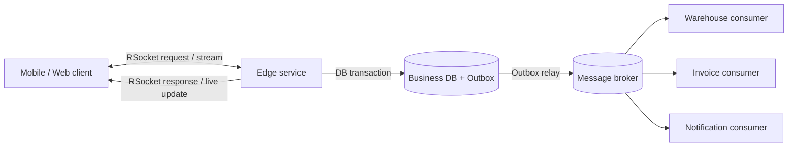

# Phân biệt RSocket trực tiếp với broker trong lưu trữ và phát lại

RSocket và message broker đều giúp các thành phần trong hệ thống trao đổi dữ liệu bất đồng bộ, nhưng chúng giải quyết hai bài toán khác nhau. **RSocket trực tiếp** thiết lập một phiên giao tiếp giữa hai peer để gửi request, stream hoặc channel với độ trễ thấp và flow control. **Message broker** nhận message từ producer, lưu hoặc xếp hàng theo cấu hình, rồi phân phối cho consumer theo chính sách retention, acknowledgement và replay của broker.

Điểm cần nhớ là RSocket là giao thức giao tiếp; nó không tự trở thành một kho message bền vững. Một kết nối RSocket có thể đang hoạt động và truyền dữ liệu rất hiệu quả, nhưng nếu peer offline hoặc phiên bị mất thì ứng dụng không có lịch sử để phát lại trừ khi tự lưu dữ liệu hoặc chuyển nó vào một hệ thống lưu trữ/broker. Broker được thiết kế để tách thời điểm producer gửi khỏi thời điểm consumer xử lý, đồng thời cung cấp khả năng lưu giữ và đọc lại message theo mô hình của từng sản phẩm.

## 1. Hai mô hình giải quyết hai nhu cầu khác nhau

### RSocket trực tiếp

Client mở kết nối TCP hoặc WebSocket tới server RSocket. Hai peer có thể trao đổi request-response, fire-and-forget, request-stream hoặc request-channel trên phiên đó. Một kết nối có thể multiplex nhiều stream và dùng backpressure để điều tiết lượng payload đang truyền.

```text
Client  ───── RSocket connection ───── Server
          request / response
          stream / channel
```

Mô hình này phù hợp khi hai bên cần giao tiếp trực tiếp, tương tác ngay và thường cùng online. Server có thể xử lý request, trả response hoặc phát dữ liệu realtime. Nếu muốn giữ message sau khi phiên kết thúc, ứng dụng phải lưu message vào database, log hoặc broker riêng.

### Message broker

Producer gửi message tới broker. Broker nhận trách nhiệm lưu hoặc xếp hàng theo cấu hình, sau đó consumer đọc message độc lập với thời điểm producer gửi.

```text
Producer ─────> Broker ─────> Consumer A
                  │
                  ├─────────> Consumer B
                  │
                  └─────────> Consumer C
```

Consumer có thể offline trong một khoảng thời gian rồi đọc lại message còn trong retention/queue. Broker cũng có thể phân phối message cho nhiều consumer, cân bằng tải theo consumer group hoặc queue subscription. Khả năng lưu bền vững và replay phụ thuộc loại broker, cấu hình replication, retention, acknowledgement và cách consumer quản lý offset.

## 2. So sánh RSocket trực tiếp và broker

| Tiêu chí | RSocket trực tiếp | Message broker |
|---|---|---|
| Mục tiêu chính | Giao tiếp hai chiều, realtime, request và stream | Lưu giữ, đệm và phân phối message giữa các thành phần |
| Kết nối | Peer giữ phiên TCP/WebSocket | Producer/consumer kết nối tới broker độc lập |
| Độ trễ | Thường thấp khi kết nối đã mở | Có thêm hop và chi phí ghi/đọc broker; đổi lại producer không cần chờ consumer online |
| Lưu trữ mặc định | Không có durable message log do giao thức cung cấp | Có thể lưu queue hoặc log theo cấu hình broker |
| Consumer offline | Không tự lưu message để consumer đọc sau | Message có thể chờ trong queue/log trong thời hạn lưu giữ |
| Replay | Không có replay nghiệp vụ tùy ý; Resumption chỉ khôi phục phiên theo giới hạn session | Có thể đọc lại theo offset, replay log hoặc requeue tùy broker |
| Fan-out | Server phải quản lý subscription và phát tới peer đang kết nối | Broker hỗ trợ routing, topic, queue hoặc consumer group |
| Flow control | Reactive Streams và RSocket `REQUEST_N` cho stream/channel | Broker có prefetch, credit, consumer lag hoặc cơ chế flow control riêng |
| Acknowledgement | Tùy interaction và hợp đồng ứng dụng | ACK/offset/commit theo semantics của broker |
| Thứ tự | Theo stream và cách ứng dụng xử lý trên phiên | Theo partition, queue hoặc ordering guarantee của broker |
| Phục hồi | Reconnect/Resumption, rồi ứng dụng quyết định tiếp tục từ đâu | Consumer có thể đọc lại message chưa ack hoặc từ offset đã lưu |
| Phù hợp | Tương tác trực tiếp, UI realtime, command-response, live session | Job nền, tích hợp nhiều hệ thống, event fan-out, consumer offline, replay |

Không có lựa chọn nào tốt hơn trong mọi tình huống. Hãy chọn theo yêu cầu về độ trễ, khả năng chịu mất kết nối, lưu giữ, số consumer và cách xác nhận xử lý.

## 3. RSocket không tự lưu message để phát lại

RSocket truyền payload qua một kết nối và cung cấp các interaction model khác nhau. Giao thức không yêu cầu server ghi mọi payload vào database hoặc log bền vững. Khi connection bị đóng, stream có thể kết thúc và message chưa được ứng dụng lưu có thể không còn cách nào lấy lại.

Các kiểu tương tác có semantics khác nhau:

| Interaction | Điều gì được xác nhận? | Điều gì không được bảo đảm tự động? |
|---|---|---|
| Request-response | Client nhận một payload phản hồi hoặc lỗi | Không tự bảo đảm response chỉ được gửi sau khi transaction nghiệp vụ đã commit; ứng dụng phải thiết kế điểm ACK |
| Fire-and-forget | Requester gửi payload mà không chờ response nghiệp vụ | Không có xác nhận rằng responder đã lưu hoặc xử lý thành công |
| Request-stream | Responder phát nhiều payload theo demand của requester | Không tự lưu lịch sử stream để consumer mới đọc lại từ đầu |
| Request-channel | Hai bên gửi nhiều payload trên cùng tương tác | Không tự lưu input/output để phát lại sau khi phiên mất |

Ví dụ client gửi fire-and-forget:

```java
Mono<Void> sent = requester
    .route("metrics.publish")
    .data(new MetricEvent("device-01", 72.5))
    .send();
```

`send()` hoàn tất theo contract gửi của API, không phải acknowledgement nghiệp vụ rằng server đã ghi metric vào kho bền vững. Nếu metric bắt buộc không được mất, cần chuyển nó qua một đường ghi bền vững và có cơ chế xác nhận phù hợp.

## 4. Request-response có thể trả ACK nghiệp vụ, nhưng phải định nghĩa rõ

Với request-response, server có thể trả một DTO xác nhận:

```java
public record PublishEventRequest(
    String eventId,
    String eventType,
    String payload
) {}

public record PublishAck(
    String eventId,
    String status
) {}
```

```java
@Controller
class EventController {

    private final EventService eventService;

    EventController(EventService eventService) {
        this.eventService = eventService;
    }

    @MessageMapping("events.publish")
    Mono<PublishAck> publish(@Payload PublishEventRequest request) {
        return eventService.persist(request)
            .thenReturn(new PublishAck(request.eventId(), "PERSISTED"));
    }
}
```

Trong ví dụ, `PERSISTED` chỉ nên được trả sau khi `eventService.persist(...)` hoàn tất theo semantics bền vững mà hệ thống cam kết. Nếu handler trả `ACCEPTED` ngay sau khi đưa vào queue trong bộ nhớ, client không được hiểu đó là đã lưu bền vững. Tên trạng thái ACK phải nói chính xác điều đã xảy ra.

Ngay cả khi server commit rồi nhưng response bị mất, client vẫn có thể không biết kết quả. Vì vậy, request ghi quan trọng nên có `eventId`/idempotency key và route tra cứu trạng thái hoặc cơ chế dedup khi gửi lại.

## 5. Broker cung cấp retention và replay theo mô hình riêng

Broker không phải tất cả đều lưu và phát lại theo cùng một cách. Cần phân biệt hai nhóm phổ biến:

### Log-based broker

Một broker dạng log như Apache Kafka ghi record vào partition theo thứ tự append. Record được giữ theo retention time/size hoặc chính sách compact. Consumer group đọc từ offset và lưu vị trí đã commit. Consumer có thể reset offset hoặc tạo consumer group mới để đọc lại record còn trong retention.

```text
Partition log:
offset 0 ── event A
offset 1 ── event B
offset 2 ── event C
offset 3 ── event D
             ↑
       consumer offset = 2
```

Consumer có thể tiếp tục từ offset đã commit hoặc đọc lại từ offset trước đó nếu chính sách cho phép. Replay không có nghĩa broker sẽ tự chạy lại tác dụng phụ an toàn; consumer cần idempotency vì record có thể được xử lý lại.

### Queue-based broker

Một broker kiểu queue như RabbitMQ thường giữ message trong queue tới khi consumer ACK hoặc message được xử lý theo chính sách queue. Nếu consumer mất kết nối trước ACK, message có thể được requeue và giao lại. Dead-letter exchange/queue có thể nhận message bị reject hoặc hết hạn theo cấu hình.

Queue-based delivery thường phục vụ competing consumers: một message được giao cho một consumer trong nhóm tại một thời điểm theo cơ chế queue. Muốn nhiều hệ thống cùng nhận một sự kiện, cần fan-out qua exchange/topic và các queue/subscription tương ứng.

### Kiểm tra cấu hình thực tế

Khả năng replay phụ thuộc ít nhất vào:

- Message có được ghi bền vững hay chỉ nằm trong bộ nhớ.
- Replication và mức xác nhận ghi.
- Retention time/size hoặc TTL của queue.
- Chính sách ACK, offset commit, requeue và dead-letter.
- Consumer group/subscription có giữ trạng thái đọc riêng hay không.
- Broker có bị xóa message sau ACK hay vẫn giữ trong log.

Không nên nói “dùng broker là chắc chắn không mất message”. Broker chỉ cung cấp các bảo đảm đã được cấu hình; ứng dụng phải xác định mức bền vững, replication, acknowledgement và retention phù hợp.

## 6. Replay khác retry và khác RSocket Resumption

Ba khái niệm này giải quyết các vấn đề khác nhau:

| Khái niệm | Ý nghĩa |
|---|---|
| Retry | Gửi lại một thao tác/request sau lỗi; cần phân loại lỗi và idempotency để tránh side effect trùng |
| Replay | Đọc lại message/event đã được lưu từ một log, queue hoặc kho lịch sử theo cursor/offset |
| RSocket Resumption | Tiếp tục một phiên RSocket bị gián đoạn bằng trạng thái phiên và buffer frame còn được giữ trong giới hạn cấu hình |

RSocket Resumption không phải durable event log. Nó có thể giúp một peer tiếp tục phiên và nhận các frame còn nằm trong resume state, nhưng không cung cấp retention tùy ý, consumer group độc lập hoặc khả năng cho một consumer mới đọc lịch sử nghiệp vụ. Nếu session state hoặc resume buffer không còn, ứng dụng vẫn cần reconnect và khôi phục từ cursor/dữ liệu bền vững của chính nó.

Broker replay cũng không phải retry một request RPC. Replay thường phát lại event đã lưu cho consumer; retry gọi lại thao tác có thể tạo side effect mới nếu không idempotent.

## 7. Khi nào nên dùng RSocket trực tiếp?

Chọn RSocket trực tiếp khi hai peer cần trao đổi ngay và kết quả phụ thuộc vào phiên giao tiếp đang hoạt động:

- UI cần request-response tới backend với độ trễ thấp.
- Server phát trạng thái realtime cho client đang kết nối.
- Hai dịch vụ cần request-channel để trao đổi dữ liệu hai chiều liên tục.
- Một phiên làm việc có trạng thái tạm thời, ví dụ điều khiển thiết bị hoặc phối hợp tác vụ trực tiếp.
- Client cần backpressure theo nhu cầu thay vì polling liên tục.

Ví dụ client đọc một đơn hàng trực tiếp:

```java
Mono<OrderView> order = requester
    .route("orders.find")
    .data(new FindOrderRequest("ORD-1001"))
    .retrieveMono(OrderView.class);
```

Server có thể cung cấp stream trạng thái:

```java
@MessageMapping("orders.{orderId}.watch")
Flux<OrderEvent> watch(@DestinationVariable String orderId) {
    return orderService.watch(orderId);
}
```

Nếu client disconnect, subscription của phiên đó kết thúc hoặc cần được phục hồi theo chính sách ứng dụng. Nếu client phải nhận đủ mọi event kể cả khi offline, chỉ dùng stream trực tiếp là chưa đủ; hãy lưu event và cho client tiếp tục từ cursor hoặc dùng broker.

## 8. Khi nào nên dùng broker?

Chọn broker khi producer và consumer không cần online cùng lúc, hoặc hệ thống cần lưu message để xử lý sau:

- Job nền có thể chạy sau vài giây hoặc vài phút.
- Tích hợp nhiều hệ thống mà không muốn producer biết từng consumer.
- Nhiều consumer độc lập cần nhận cùng một event.
- Consumer có thể dừng để triển khai hoặc bảo trì.
- Cần replay event để tái dựng projection, chạy lại pipeline hoặc điều tra sự cố.
- Cần đệm lưu lượng khi producer tạm thời nhanh hơn consumer.
- Cần retry, dead-letter và quản lý poison message ở tầng message delivery.

Ví dụ: dịch vụ đơn hàng phát `OrderCreated`; hệ thống kho, hóa đơn và thông báo xử lý độc lập. Broker giữ event theo chính sách retention/queue để mỗi consumer xử lý theo tiến độ riêng. Dịch vụ đơn hàng không cần mở một RSocket stream trực tiếp tới từng hệ thống nhận.

## 9. Kiến trúc kết hợp RSocket và broker

Trong nhiều hệ thống, giải pháp phù hợp là dùng cả hai:

- RSocket phục vụ tương tác realtime giữa client và edge/application service.
- Database/outbox hoặc broker lưu các event cần xử lý bền vững.
- Broker phân phối event tới các hệ thống downstream.
- RSocket trả ACK hoặc phát trạng thái trực tiếp cho client đang online.



Ví dụ, client gửi yêu cầu đặt hàng qua RSocket. Server xác thực, kiểm tra request, ghi đơn hàng và outbox record trong cùng transaction. Khi transaction commit, relay gửi `OrderCreated` tới broker. Server có thể trả `PERSISTED` cho client sau commit. Kho, hóa đơn và thông báo tiêu thụ event độc lập; nếu một consumer offline, broker giữ event theo retention/queue policy.

Thiết kế này tránh việc server vừa commit database vừa trực tiếp gọi nhiều hệ thống ngoài trong cùng request rồi phải tự xử lý hàng loạt timeout không xác định.

## 10. Transactional Outbox nối database với broker

Nếu ứng dụng ghi database rồi gửi broker bằng hai thao tác độc lập, có một cửa sổ lỗi:

1. Database commit thành công.
2. Ứng dụng crash trước khi publish broker.
3. Trạng thái nghiệp vụ đã tồn tại nhưng event không được phát.

Transactional Outbox giải quyết khoảng trống dual-write bằng cách lưu thay đổi nghiệp vụ và outbox record trong cùng transaction:

```sql
BEGIN;

INSERT INTO orders(order_id, customer_id, status)
VALUES ('ORD-1001', 'CUS-01', 'CREATED');

INSERT INTO outbox(event_id, aggregate_id, event_type, payload, created_at)
VALUES ('EVT-9001', 'ORD-1001', 'OrderCreated', '{...}', CURRENT_TIMESTAMP);

COMMIT;
```

Relay đọc outbox chưa được publish, gửi event tới broker và đánh dấu trạng thái gửi theo acknowledgement. Nếu relay crash sau khi broker nhận event nhưng trước khi đánh dấu, event có thể được gửi lại. Do đó consumer vẫn cần dedup theo `event_id`.

Outbox bảo đảm thay đổi nghiệp vụ và ý định phát event được commit cùng nhau; nó không tự tạo exactly-once delivery xuyên database và broker.

## 11. Inbox/dedup ở consumer khi broker giao lại

Broker thường có thể giao lại message khi consumer crash trước khi ACK/commit offset. Consumer nên dùng inbox hoặc bảng dedup:

```sql
BEGIN;

WITH claimed AS (
    INSERT INTO processed_events(consumer_name, event_id, processed_at)
    VALUES ('warehouse', 'EVT-9001', CURRENT_TIMESTAMP)
    ON CONFLICT (consumer_name, event_id) DO NOTHING
    RETURNING event_id
)
UPDATE inventory_projection
SET pending_orders = pending_orders + 1
WHERE order_id = 'ORD-1001'
  AND EXISTS (SELECT 1 FROM claimed);

COMMIT;
```

Ví dụ dùng cú pháp PostgreSQL. CTE `claimed` chỉ trả về hàng khi event ID chưa được xử lý; projection chỉ cập nhật khi insert thành công. Inbox record và thay đổi projection nằm trong cùng transaction để crash không tạo trạng thái “đã đánh dấu xử lý nhưng projection chưa cập nhật” hoặc ngược lại. Sau commit, consumer mới ACK message hoặc commit offset theo semantics broker.

Trong code consumer thực tế, hãy kiểm tra số hàng projection được cập nhật. Nếu aggregate không tồn tại hoặc điều kiện cập nhật không thỏa mãn, rollback transaction hoặc đưa event vào quy trình xử lý lỗi; không commit inbox record như thể event đã được áp dụng thành công.

Dedup retention phải dài hơn khoảng thời gian broker có thể replay message và thời gian vận hành cho phép chạy lại. Nếu xóa inbox record quá sớm, một replay cũ có thể tạo side effect lần nữa.

## 12. Phân biệt ACK của RSocket và ACK của broker

ACK có ý nghĩa theo tầng nơi nó được phát:

| ACK | Điều nó có thể xác nhận | Không nên suy diễn |
|---|---|---|
| RSocket request-response | Responder đã tạo response theo contract ứng dụng | Không mặc định database đã commit nếu handler trả response quá sớm |
| RSocket `send()`/FNF hoàn tất | Requester hoàn tất thao tác gửi theo API | Không có nghĩa responder đã xử lý hoặc lưu bền vững |
| Application ACK `PERSISTED` | Server cam kết dữ liệu đã được lưu theo định nghĩa ứng dụng | Không có nghĩa tất cả consumer downstream đã xử lý |
| Broker producer ACK | Broker xác nhận message theo cấu hình durability/replication | Không có nghĩa consumer đã xử lý |
| Consumer ACK/offset commit | Broker được phép coi message/offset đã được consumer xác nhận | Không có nghĩa side effect bên ngoài broker đã hoàn tất trừ khi consumer commit sau side effect |

Đặt tên ACK cụ thể như `RECEIVED`, `ACCEPTED`, `PERSISTED`, `PUBLISHED` hoặc `PROCESSED`. Tài liệu hóa chính xác thời điểm phát ACK và điều kiện bền vững tương ứng.

## 13. Fan-out, competing consumers và replay

Broker hỗ trợ nhiều mô hình phân phối:

- **Competing consumers**: nhiều instance cùng tiêu thụ một queue/group để chia tải; một message được một consumer trong nhóm xử lý theo semantics của broker.
- **Fan-out/pub-sub**: nhiều subscription hoặc queue độc lập nhận cùng một event.
- **Log consumers**: nhiều consumer group đọc cùng log nhưng giữ offset riêng, vì vậy mỗi nhóm có thể xử lý lịch sử độc lập.

RSocket trực tiếp cũng có thể fan-out tới nhiều client đang online bằng cách server giữ các subscription và phát dữ liệu cho từng peer. Nhưng server phải tự quản lý danh sách subscriber, backpressure, buffer, lifecycle và hành vi khi một subscriber offline. RSocket không tự tạo durable queue riêng cho mỗi client.

Nếu cần client offline nhận lại event sau khi đăng nhập, hãy cấp cursor/offset hoặc subscription ID gắn với kho/broker bền vững. Không giữ một `Flux` trong bộ nhớ rồi coi nó là lịch sử phát lại.

## 14. Backpressure không thay thế persistence

RSocket `REQUEST_N` điều tiết số payload mà responder được phép phát theo demand của requester. Điều đó giúp slow consumer không bị đẩy dữ liệu vô hạn nếu nguồn hỗ trợ backpressure. Tuy nhiên:

- Backpressure không ghi message xuống đĩa.
- Backpressure không giữ message khi client offline.
- Backpressure không cung cấp replay sau khi session mất.
- Backpressure không tự cân bằng tải hoặc lưu message cho consumer khác.

Broker cũng có flow control riêng, ví dụ prefetch ở queue broker hoặc consumer lag/partition fetch ở log broker. Flow control giới hạn lượng message đang được giao/đọc; retention và persistence là cơ chế riêng.

Nếu producer nhanh hơn consumer, broker có thể tích lũy backlog trong giới hạn dung lượng và retention. Hệ thống cần theo dõi queue depth/consumer lag và có cảnh báo khi backlog tăng quá lâu.

## 15. Thứ tự và partition khi replay

RSocket stream giữ thứ tự phát trong một stream theo giao thức, nhưng nếu ứng dụng xử lý song song bằng `flatMap`, thứ tự hoàn thành nghiệp vụ có thể khác thứ tự đầu vào. Với broker, ordering thường được bảo đảm trong phạm vi queue hoặc partition, không nhất thiết trên toàn topic.

Nếu cần thứ tự theo một aggregate, ví dụ tất cả event của một đơn hàng, hãy dùng `orderId` làm partition key hoặc routing key phù hợp. Khi consumer chạy song song, các event của cùng aggregate phải đi qua cùng một luồng tuần tự hoặc có sequence/version để phát hiện event đến sai thứ tự.

Replay có thể đưa event cũ trở lại sau event mới nếu consumer reset offset hoặc nhiều partition được xử lý đồng thời. Handler nên kiểm tra sequence/version và chỉ áp dụng chuyển trạng thái hợp lệ.

## 16. Xử lý poison message, retry và dead-letter

Broker giúp tách việc gửi khỏi xử lý, nhưng một message lỗi vĩnh viễn có thể được giao lại nhiều lần và chặn queue hoặc partition. Nên phân loại lỗi consumer:

- Lỗi tạm thời: retry có backoff, giới hạn attempts và không giữ message vô thời hạn.
- Lỗi dữ liệu/schema vĩnh viễn: đưa vào dead-letter queue/topic kèm nguyên nhân.
- Lỗi phụ thuộc: pause/limit consumer hoặc retry có kiểm soát.
- Lỗi kết quả không xác định sau side effect: dùng idempotency/inbox và tra cứu trạng thái.

Dead-letter không phải nơi để bỏ quên message. Cần có quy trình quan sát, sửa dữ liệu, replay có chọn lọc và audit ai đã thực hiện replay. Trước khi replay, consumer phải có dedup để side effect cũ không xảy ra lần nữa.

RSocket trực tiếp không có DLQ tích hợp ở tầng giao thức. Nếu muốn giữ request lỗi để xử lý sau, server phải ghi request/error vào kho hoặc broker và cung cấp workflow quản trị tương ứng.

## 17. Ví dụ chọn kiến trúc theo yêu cầu

| Yêu cầu | Lựa chọn thường phù hợp | Lý do |
|---|---|---|
| UI cần xem trạng thái đơn hàng đang thay đổi | RSocket request-stream | Client đang online và cần cập nhật trực tiếp |
| Tạo đơn hàng và cần biết đã commit hay chưa | RSocket request-response + idempotency | Trả application ACK sau commit; retry an toàn bằng key |
| Phát `OrderCreated` cho kho, hóa đơn và thông báo | Outbox + broker | Nhiều consumer độc lập, cần lưu và phân phối lại |
| Consumer có thể offline vài giờ | Broker có retention/queue phù hợp | Message chờ trong thời gian consumer offline |
| Thiết bị gửi telemetry tốc độ cao, dashboard chỉ cần trạng thái mới nhất | RSocket stream hoặc channel + sampling/aggregation; lưu raw nếu cần | Tối ưu realtime; lịch sử đầy đủ phải lưu riêng |
| Cần tái dựng projection từ lịch sử event | Log broker hoặc event store | Có cursor/offset và replay lịch sử |
| Lệnh điều khiển thiết bị cần xác nhận thực thi | RSocket request-response với operation ID, hoặc broker command workflow | Cần ACK nghiệp vụ, status lookup và dedup |
| Một dịch vụ cần gọi một dịch vụ khác ngay để lấy dữ liệu | RSocket request-response hoặc HTTP/gRPC tùy hệ thống | Không cần thêm broker nếu không có nhu cầu lưu/đệm/replay |

## 18. Những lỗi thiết kế thường gặp

| Sai lầm | Hậu quả | Cách sửa |
|---|---|---|
| Coi RSocket connection là message queue | Message mất khi peer offline hoặc session hết hạn | Persist vào database/broker nếu cần giao sau |
| Coi `send()` là server đã xử lý | Client không biết event đã được lưu chưa | Dùng application ACK hoặc broker producer acknowledgement phù hợp |
| Coi Resumption là replay lịch sử | Không khôi phục được dữ liệu ngoài resume session/buffer | Dùng cursor/offset và durable store |
| Dùng broker nhưng không bật durability/replication phù hợp | Broker có thể mất dữ liệu khi lỗi máy hoặc cấu hình | Xác định durability SLA và kiểm tra cấu hình thật |
| Commit offset trước side effect | Crash có thể làm mất tác dụng phụ dù message đã bị coi là xử lý | Commit side effect và inbox atomically, sau đó ACK/commit offset |
| Retry consumer mà không dedup | Side effect xảy ra nhiều lần | Inbox/event ID/idempotency key |
| Dùng một queue cho nhiều consumer nhưng mong mọi consumer nhận một bản | Chỉ một consumer trong nhóm có thể nhận mỗi message | Dùng fan-out subscription/queue hoặc consumer group độc lập |
| Dùng RSocket stream cho consumer offline dài hạn | Không có durable backlog cho client | Broker/event log hoặc database cursor |
| Replay toàn bộ log vào hệ thống production mà không kiểm soát | Tải đột biến và side effect trùng | Replay vào consumer riêng, throttle và dedup |

## 19. Checklist lựa chọn và vận hành

- [ ] Xác định consumer có phải online cùng thời điểm với producer hay không.
- [ ] Xác định message có cần lưu sau khi connection/session kết thúc không.
- [ ] Xác định retention, replay, fan-out và consumer group có phải yêu cầu bắt buộc không.
- [ ] Phân biệt request-response/FNF/stream/channel với queue/log delivery.
- [ ] Định nghĩa application ACK theo đúng mốc `ACCEPTED`, `PERSISTED` hoặc `PROCESSED`.
- [ ] Nếu dùng broker, cấu hình persistence, replication, retention/TTL, ACK và dead-letter phù hợp.
- [ ] Dùng outbox để nối transaction database với publish broker khi cần tránh dual-write.
- [ ] Dùng inbox/dedup/idempotency để xử lý giao lại hoặc replay.
- [ ] Chọn partition/routing key theo yêu cầu ordering.
- [ ] Theo dõi consumer lag, queue depth, oldest message age, retry và DLQ.
- [ ] Giới hạn backlog, tốc độ replay và concurrency của consumer.
- [ ] Không nhầm RSocket Resumption với durable replay.
- [ ] Kiểm thử producer/consumer offline, crash sau side effect trước ACK và replay trùng.

RSocket trực tiếp phù hợp với giao tiếp realtime giữa các peer đang hoạt động; broker phù hợp với message cần lưu, phân phối độc lập và phát lại sau này. RSocket Resumption giúp phục hồi một phiên trong phạm vi trạng thái phiên còn được giữ, còn broker replay dựa trên message được lưu theo retention/queue policy. Trong kiến trúc tích hợp thực tế, kết hợp RSocket cho tương tác trực tiếp với outbox và broker cho công việc bền vững thường tạo ra ranh giới rõ ràng giữa trải nghiệm realtime và xử lý nền đáng tin cậy.

## Tài liệu tham khảo

- [RSocket Protocol — Interaction Models and Resumption](https://rsocket.io/about/protocol/)
- [RSocket — Protocol Overview](https://rsocket.io/)
- [Spring Framework — RSocket](https://docs.spring.io/spring-framework/reference/rsocket.html)
- [Apache Kafka — Design and Message Delivery](https://kafka.apache.org/documentation/#design)
- [RabbitMQ — Reliability Guide](https://www.rabbitmq.com/docs/reliability)
- [Spring for Apache Kafka — Reference](https://docs.spring.io/spring-kafka/reference/)
