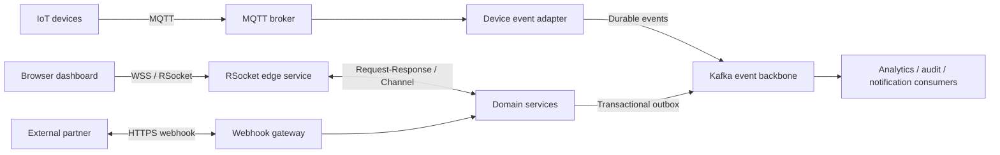

# Chọn giao thức theo nhu cầu thời gian thực, độ bền và hệ sinh thái

Không có một giao thức phù hợp cho mọi kết nối realtime. Một giao diện cộng tác cần hai chiều và phản hồi nhanh; một hệ thống thanh toán cần lưu sự kiện bền vững và đối soát; một mạng cảm biến cần giao thức nhẹ cho thiết bị hạn chế tài nguyên; một đối tác bên ngoài có thể chỉ hỗ trợ webhook hoặc HTTP API. Chọn giao thức chỉ theo độ trễ sẽ bỏ qua các yêu cầu quan trọng như replay, xác nhận xử lý, khả năng tích hợp và chi phí vận hành.

Trong module `INTEGRATION_REALTIME_RSOCKET`, RSocket là một lựa chọn cho giao tiếp reactive hai chiều giữa client và server qua TCP hoặc WebSocket. Bài viết này đặt RSocket cạnh WebSocket, SSE, HTTP/webhook, gRPC, Kafka, AMQP và MQTT để xác định vai trò của từng công nghệ, khi nào nên kết hợp chúng và cách đưa ra quyết định theo yêu cầu thực tế.

## 1. Bắt đầu từ yêu cầu nghiệp vụ

Trước khi chọn giao thức, hãy mô tả luồng dữ liệu bằng những câu hỏi cụ thể:

1. **Ai gửi cho ai?** Một client gọi một server, server phát cho nhiều client, hay nhiều producer gửi vào một hệ thống tiêu thụ?
2. **Có cần hai chiều không?** Client chỉ nhận cập nhật, chỉ gửi lệnh hay vừa gửi vừa nhận liên tục?
3. **Độ trễ mục tiêu là bao nhiêu?** Cần phản hồi tương tác trong vài chục mili giây, cập nhật trong vài giây hay xử lý nền trong vài phút?
4. **Có được phép mất dữ liệu không?** Một mẫu telemetry có thể bỏ qua hay một lệnh nghiệp vụ phải được lưu và xử lý?
5. **Có cần replay không?** Client reconnect có cần đọc lại sự kiện trong thời gian offline không?
6. **Cần fan-out hay competing consumers?** Mỗi subscriber đều nhận một bản hay nhiều worker chia nhau xử lý?
7. **Ai kiểm soát hai đầu?** Cả hai service đều do tổ chức quản lý hay một đầu là browser, thiết bị IoT hoặc đối tác bên ngoài?
8. **Hệ sinh thái hiện có là gì?** Ngôn ngữ, broker, gateway, tracing, schema registry, vận hành và năng lực đội ngũ đang hỗ trợ công nghệ nào?

Một giao thức có thể đáp ứng tốt một số câu hỏi nhưng không đáp ứng tất cả. Ví dụ, RSocket có request-response, stream, channel và flow control, nhưng không tự cung cấp event log bền vững để client offline nhiều giờ rồi replay lịch sử. Kafka có retention và replay, nhưng không phải lựa chọn trực tiếp thay thế một request-response tương tác tới một service.

## 2. Phân biệt giao thức ứng dụng, transport và broker

Các công nghệ thường được so sánh nằm ở những lớp khác nhau:

| Nhóm | Ví dụ | Trách nhiệm chính |
|---|---|---|
| Giao thức tương tác | RSocket, gRPC | Định nghĩa cách hai ứng dụng trao đổi request, response, stream và flow control. |
| Transport/framing | TCP, WebSocket, HTTP/2 | Chuyển dữ liệu qua mạng và quản lý kết nối/framing ở tầng thấp hơn. |
| Giao thức web hướng sự kiện | SSE, webhook | Đưa cập nhật từ server tới client hoặc thông báo tới endpoint HTTP. |
| Message broker/protocol | Kafka, AMQP, MQTT | Tiếp nhận, định tuyến, lưu giữ hoặc phân phối message giữa producer và consumer. |

WebSocket thường là một transport hai chiều, không tự định nghĩa route nghiệp vụ, retry, replay hoặc acknowledgement xử lý. RSocket có thể chạy trên WebSocket nhưng bổ sung interaction model, stream ID, demand và cancellation. Kafka và RabbitMQ là nền tảng broker có lưu giữ/định tuyến message theo cấu hình; MQTT là giao thức publish/subscribe thường dùng qua broker cho thiết bị và mạng IoT.

Không nên so sánh chỉ dựa trên tên giao thức. Hãy so sánh đúng lớp và hợp đồng mà ứng dụng cần.

## 3. RSocket: giao tiếp reactive hai chiều giữa các ứng dụng

RSocket phù hợp khi hai đầu cần một giao thức tương tác giàu ngữ nghĩa hơn raw WebSocket, đặc biệt trong hệ thống Java/Spring hoặc client hỗ trợ RSocket.

RSocket có bốn interaction model:

| Model | Luồng dữ liệu | Trường hợp điển hình |
|---|---|---|
| Request-Response | Một request, tối đa một response | Đọc trạng thái, kiểm tra quyền, truy vấn một kết quả. |
| Fire-and-Forget | Một chiều, không có response payload | Gửi telemetry hoặc tín hiệu best-effort. |
| Request-Stream | Một request mở đầu, nhiều response | Theo dõi giá trị cảm biến hoặc trạng thái thay đổi. |
| Request-Channel | Nhiều payload theo cả hai hướng | Phiên điều khiển, cộng tác hoặc tương tác liên tục. |

Các điểm mạnh:

- Flow control/backpressure theo demand, giúp consumer điều tiết số payload muốn nhận.
- Cancellation ở cấp stream để dừng công việc không còn cần thiết.
- Metadata và routing hỗ trợ tích hợp các handler theo hợp đồng ứng dụng.
- Có thể chạy qua TCP hoặc WebSocket, phù hợp service-to-service và browser client có RSocket JS.
- Resume có thể phục hồi logical connection sau gián đoạn ngắn nếu session state và buffer còn hợp lệ.

Giới hạn cần hiểu:

- RSocket không tự lưu event log nghiệp vụ bền vững và không thay thế broker.
- Resume buffer giữ frame chưa được xác nhận trong cửa sổ phục hồi; nó không phải replay store cho client offline dài hạn.
- Fire-and-Forget không cung cấp xác nhận nghiệp vụ rằng server đã commit side effect.
- Cả hai phía cần hỗ trợ RSocket và thống nhất serialization, metadata, authentication và version.
- Với browser, còn phải xử lý WSS, Origin, proxy Upgrade, CSP và giới hạn Browser WebSocket API.

Chọn RSocket khi cần tương tác realtime có stream/channel và backpressure giữa các ứng dụng kiểm soát được hợp đồng. Khi yêu cầu chính là lưu sự kiện để consumer đọc lại sau nhiều giờ hoặc nhiều ngày, hãy bổ sung broker hoặc event store.

## 4. WebSocket: kênh hai chiều linh hoạt

WebSocket cung cấp kết nối hai chiều lâu dài giữa browser/native client và server. Nó phù hợp với ứng dụng cần push nhanh và muốn tự định nghĩa message format hoặc đang dùng một hệ sinh thái WebSocket sẵn có.

Ưu điểm:

- Browser hỗ trợ trực tiếp qua WebSocket API.
- Kết nối hai chiều trên một socket.
- Có thể mang JSON, binary frame hoặc một giao thức ứng dụng khác.
- Dễ đi qua hạ tầng HTTP nếu proxy hỗ trợ Upgrade.

Giới hạn:

- WebSocket không tự định nghĩa request-response, request-channel, route, demand hay business acknowledgement.
- Không có replay/history bền vững mặc định.
- Ứng dụng phải tự thiết kế message ID, correlation, sequencing, retry, deduplication và schema evolution.
- Browser WebSocket API không cung cấp custom Authorization handshake header hoặc demand-based receive API.

Nếu chỉ cần raw push/pull đơn giản, WebSocket có thể đủ. Nếu cần flow control và interaction model chuẩn hóa, RSocket trên WebSocket có thể giảm lượng giao thức ứng dụng phải tự xây dựng. Hai lựa chọn vẫn cần kiểm soát authentication, Origin, buffer, heartbeat và reconnect.

## 5. Server-Sent Events: cập nhật một chiều tới browser

SSE sử dụng HTTP để server gửi một luồng event dạng text tới browser. Đây là lựa chọn đơn giản khi browser chỉ cần nhận cập nhật từ server; client gửi lệnh bằng HTTP request riêng.

Ưu điểm:

- Dựa trên HTTP và có thể hoạt động tốt với nhiều proxy/CDN phổ biến.
- Browser có `EventSource` API và cơ chế reconnect cơ bản.
- Có thể dùng `id` cho event; browser gửi `Last-Event-ID` khi reconnect nếu server/client path hỗ trợ.
- Hợp với dashboard, notification feed hoặc trạng thái chỉ đi từ server tới browser.

Giới hạn:

- Kênh event là một chiều server → client; client-to-server cần HTTP request riêng.
- EventSource chuẩn chủ yếu nhận text; binary payload cần encoding hoặc API khác.
- Không có demand/backpressure theo từng event như Reactive Streams.
- Replay chỉ hoạt động nếu server giữ lịch sử và thực hiện logic `Last-Event-ID`; header này tự nó không tạo durability.

Chọn SSE khi nhu cầu là server push đơn giản và không cần hai chiều trên cùng một session. Nếu browser cần gửi lệnh liên tục và nhận phản hồi trong cùng phiên, WebSocket/RSocket phù hợp hơn.

## 6. HTTP API và webhook: tương tác theo request hoặc thông báo

### 6.1. HTTP request-response

HTTP API phù hợp với thao tác có điểm bắt đầu/kết thúc rõ ràng, dễ cache, dễ quan sát và được hầu hết hệ sinh thái hỗ trợ. REST/JSON hoặc HTTP API khác thường là lựa chọn mặc định tốt cho truy vấn, cập nhật tài nguyên và tích hợp đối tác.

HTTP không tự trở thành realtime chỉ vì dùng keep-alive. Long polling hoặc streaming response có thể giảm độ trễ cập nhật, nhưng cần cân nhắc timeout proxy, connection usage và khả năng hạ tầng.

### 6.2. Webhook

Webhook là thông báo từ một hệ thống tới HTTP endpoint của hệ thống khác. Nó phù hợp cho tích hợp bất đồng bộ với đối tác, ví dụ nhà cung cấp thanh toán thông báo trạng thái giao dịch.

Webhook thường có những đặc điểm:

- Producer gửi HTTP request khi có event.
- Receiver trả HTTP status để xác nhận đã nhận ở mức endpoint.
- Provider có thể retry khi timeout hoặc nhận status lỗi; số lần và khoảng retry phụ thuộc provider.
- Event có thể đến trùng hoặc không đúng thứ tự.
- Receiver cần xác minh chữ ký, chống replay, lưu event ID và xử lý idempotent.

HTTP `2xx` thường chỉ xác nhận endpoint đã nhận request theo hợp đồng provider; nó không nhất thiết có nghĩa toàn bộ quy trình nghiệp vụ đã hoàn tất. Receiver có thể lưu event vào inbox/outbox rồi trả `2xx`, sau đó xử lý nền.

Chọn webhook khi cần tích hợp qua ranh giới tổ chức và đối tác đã hỗ trợ callback HTTP. Không dùng webhook làm một stream hai chiều liên tục.

## 7. gRPC: RPC có schema và streaming trên HTTP/2

gRPC phù hợp với service-to-service khi cần contract rõ ràng, code generation và hỗ trợ nhiều ngôn ngữ. Protocol Buffers định nghĩa service/message; gRPC hỗ trợ unary RPC, server streaming, client streaming và bidirectional streaming.

Ưu điểm:

- Contract có schema và sinh client/server stub.
- HTTP/2 multiplexing và flow control cho streaming.
- Hỗ trợ deadline, cancellation, metadata và status code.
- Hệ sinh thái đa ngôn ngữ và tooling phong phú.

Giới hạn:

- gRPC stream không tự có lịch sử bền vững hoặc replay sau khi client offline.
- Browser thường cần gRPC-Web hoặc gateway; khả năng streaming hai chiều của browser không tương đương native gRPC trong mọi triển khai.
- Cần quản lý tương thích schema, deadline, load balancing và hạ tầng HTTP/2.

Chọn gRPC khi tổ chức đã dùng protobuf/gRPC rộng rãi, cần contract RPC rõ ràng và client/server phù hợp. Chọn RSocket khi interaction model, channel hai chiều và tích hợp reactive là trọng tâm của hệ thống. Cả hai đều có thể dùng streaming nhưng không thay thế durable messaging.

## 8. Kafka: event log bền vững và replay

Kafka phù hợp với luồng sự kiện có throughput cao, nhiều consumer độc lập, khả năng lưu giữ và replay theo offset. Producer ghi event vào topic/partition; consumer đọc theo offset và có thể quay lại đọc lịch sử trong thời hạn retention.

Ưu điểm:

- Event được lưu bền vững theo cấu hình replication và retention.
- Consumer có thể đọc lại từ offset hoặc xử lý backlog sau khi offline.
- Consumer group hỗ trợ chia partition cho nhiều worker; các consumer group khác nhau có thể đọc cùng event log độc lập.
- Hệ sinh thái cho stream processing, CDC, schema registry và data integration.

Giới hạn:

- Kafka không phải request-response trực tiếp tới một service; cần correlation topic hoặc RPC riêng nếu cần câu trả lời tức thời.
- Ordering được bảo đảm trong phạm vi partition, không phải tự động trên toàn bộ topic.
- Consumer có thể xử lý lại event sau crash/rebalance; side effect bên ngoài Kafka cần idempotency.
- Cần vận hành broker, partition, replication, retention, ACL, schema và consumer lag.

Kafka có thể cung cấp exactly-once semantics trong phạm vi các thao tác Kafka được phối hợp bằng transaction/idempotent producer. Điều đó không tự mở rộng thành exactly-once cho database, HTTP service hoặc thiết bị bên ngoài. Với side effect ngoài Kafka, vẫn cần idempotency, outbox/inbox hoặc cơ chế transaction phù hợp.

Chọn Kafka khi cần event backbone bền vững, replay, nhiều consumer group và stream processing. Không chọn chỉ vì muốn gửi một request nhỏ tới một service với latency thấp.

## 9. AMQP/RabbitMQ: queue, routing và acknowledgement

AMQP, thường gặp qua RabbitMQ, phù hợp với message-oriented integration giữa các service. Producer publish message tới exchange; exchange định tuyến tới queue; consumer nhận và ack/nack theo kết quả xử lý.

Ưu điểm:

- Queue và exchange hỗ trợ routing linh hoạt, fan-out, topic và competing consumers.
- Message acknowledgement giúp broker biết consumer đã xác nhận xử lý/nhận theo semantics cấu hình.
- Durable queue, persistent message, publisher confirms và dead-letter exchange có thể hỗ trợ độ bền và xử lý lỗi.
- Phù hợp công việc nền, tích hợp hệ thống và workload cần tách producer khỏi consumer.

Giới hạn:

- Độ bền phụ thuộc cấu hình queue/message, replication, confirms và broker topology; không tự có chỉ vì dùng AMQP.
- Message có thể được giao lại sau crash hoặc ack timeout; consumer phải idempotent.
- Ordering và fairness phụ thuộc queue, prefetch, concurrency và topology.
- Không phải giao thức tương tác hai chiều realtime giữa một client và server như RSocket channel.

Chọn AMQP/RabbitMQ khi cần queue routing, worker pool, acknowledgement và dead-letter handling. Chọn Kafka khi cần event log/retention/replay nhiều consumer; hai hệ thống có thể bổ sung cho nhau nhưng không có semantics hoàn toàn giống nhau.

## 10. MQTT: publish/subscribe nhẹ cho IoT

MQTT được thiết kế cho thiết bị và mạng có băng thông/tài nguyên hạn chế. Client kết nối broker, publish tới topic và subscribe topic. Broker phân phối message theo subscription.

MQTT có ba mức QoS:

| QoS | Hợp đồng giao nhận ở tầng MQTT | Đặc điểm |
|---|---|---|
| 0 | At most once | Không có xác nhận giao nhận; có thể mất message. |
| 1 | At least once | Có xác nhận; message có thể được giao trùng. |
| 2 | Exactly once ở phạm vi trao đổi MQTT QoS 2 | Handshake nhiều bước để tránh giao trùng theo protocol. |

MQTT còn có retained message và persistent session theo phiên bản/cấu hình broker, giúp subscriber mới nhận trạng thái retained hoặc tiếp tục nhận message phù hợp khi reconnect. Tuy nhiên, các tính năng này không tự biến mọi side effect nghiệp vụ thành exactly-once. Broker retention, session expiry, message expiry, QoS và client storage phải được cấu hình rõ.

Chọn MQTT cho cảm biến, thiết bị IoT, gateway và mạng không ổn định. Không nên dùng MQTT QoS 2 làm bằng chứng rằng một giao dịch database hoặc lệnh actuator chỉ được thực hiện đúng một lần; ứng dụng vẫn cần command ID và idempotency.

## 11. So sánh tổng hợp

| Công nghệ | Hai chiều | Streaming/fan-out | Durability/replay | Browser/IoT fit | Thường phù hợp nhất |
|---|---|---|---|---|---|
| RSocket | Có, gồm Request-Channel | Stream/channel, flow control | Resume ngắn hạn; không phải event log bền vững | Browser qua WebSocket; Java/native tốt | Realtime reactive giữa ứng dụng |
| WebSocket | Có | Có thể tự xây dựng | Không có mặc định | Browser rất tốt | Kênh hai chiều tùy biến |
| SSE | Client → server không nằm trên cùng event stream | Server → browser một chiều | Có thể replay nếu server lưu event ID | Browser tốt | Notification/feed một chiều |
| HTTP API/webhook | Request-response; webhook một chiều theo callback | Streaming tùy API | Phụ thuộc database/queue/provider retry | Rất rộng | API nghiệp vụ và tích hợp đối tác |
| gRPC | Có streaming hai chiều | Unary và streaming RPC | Không có replay bền vững mặc định | Native tốt; browser qua gRPC-Web/gateway | RPC có schema giữa service |
| Kafka | Không phải RPC hai chiều trực tiếp | Topic, consumer groups | Event log và replay theo retention | Backend/data platform | Event backbone và stream processing |
| AMQP/RabbitMQ | Không phải channel tương tác trực tiếp mặc định | Queue, routing, pub/sub | Queue/message durability theo cấu hình | Backend integration | Work queue và routing message |
| MQTT | Publish/subscribe hai chiều qua broker | Topic fan-out | QoS, retained/persistent session theo cấu hình | IoT rất tốt; browser qua WebSocket nếu broker hỗ trợ | Thiết bị và mạng IoT |

Đánh giá latency cần đo theo workload và deployment. Không nên gán một con số cố định cho từng giao thức: TLS, broker topology, payload size, serialization, network hop, queue depth và concurrency có thể ảnh hưởng nhiều hơn bản thân giao thức.

## 12. Độ bền là thuộc tính của cả kiến trúc

Một giao thức có thể xác nhận frame hoặc message ở một tầng, nhưng nghiệp vụ cần biết side effect đã được commit hay chưa. Cần phân biệt:

- **Transport delivery:** byte/frame đã được gửi hoặc peer đã nhận theo semantics giao thức.
- **Broker acknowledgement:** broker hoặc consumer xác nhận message theo hợp đồng của broker.
- **Application acceptance:** ứng dụng đã xác thực và lưu yêu cầu để chịu trách nhiệm xử lý.
- **Business completion:** side effect cuối cùng đã hoàn tất và trạng thái đã được lưu.

Các mốc này không tương đương. Ví dụ, RSocket Fire-and-Forget không có business receipt; Kafka consumer commit offset không tự chứng minh một HTTP side effect bên ngoài đã hoàn tất đúng một lần; webhook trả `2xx` không nhất thiết chứng minh quy trình downstream đã kết thúc.

Với command quan trọng, nên dùng:

1. Command ID/idempotency key ổn định.
2. Unique constraint và deduplication record ở server.
3. Transactional Outbox khi cần phát event ra broker sau khi commit database.
4. Inbox/dedup ở consumer để xử lý event lặp an toàn.
5. Receipt hoặc status query để client đối soát kết quả.
6. Retry có backoff, jitter và giới hạn; giữ nguyên command ID qua mọi lần gửi lại.

Không tuyên bố exactly-once end-to-end nếu chưa xác định ranh giới transaction và side effect. Thông thường, at-least-once delivery kết hợp idempotent processing dễ xây dựng và vận hành hơn.

## 13. Kiến trúc kết hợp các giao thức

Trong hệ thống lớn, các giao thức thường được dùng ở những ranh giới khác nhau. Ví dụ nền tảng điều khiển thiết bị:

Một cách phân chia trách nhiệm:

- **Browser ↔ edge:** RSocket trên WebSocket cho stream/channel và backpressure; SSE có thể đủ nếu chỉ cần notification một chiều.
- **Device ↔ broker:** MQTT cho mạng IoT và thiết bị hạn chế tài nguyên.
- **Backend event backbone:** Kafka cho event cần retention, replay và nhiều consumer group.
- **Work queue:** RabbitMQ/AMQP cho công việc cần routing, acknowledgement và competing consumers.
- **Service RPC:** gRPC hoặc RSocket cho tương tác trực tiếp giữa service tùy contract và hệ sinh thái.
- **Partner integration:** HTTP API/webhook vì đó thường là giao thức đối tác hỗ trợ.

Edge service có thể đọc event từ broker rồi phát live feed qua RSocket. Nếu browser mất kết nối lâu, nó có thể lấy snapshot/cursor từ API hoặc event store rồi tiếp tục live stream. Nhờ vậy, RSocket đảm nhiệm tương tác realtime còn broker/event store đảm nhiệm độ bền và replay.

## 14. Ma trận quyết định theo tình huống

| Tình huống | Lựa chọn khởi đầu | Lý do và điều kiện |
|---|---|---|
| Dashboard browser chỉ nhận trạng thái | SSE hoặc RSocket/WebSocket | SSE đơn giản nếu một chiều; RSocket khi cần channel/flow control. |
| Browser và server gửi/nhận liên tục | RSocket trên WSS hoặc WebSocket | Chọn RSocket nếu muốn interaction model và backpressure chuẩn hóa. |
| Java service gọi một service khác theo contract protobuf | gRPC | Code generation, deadline và streaming RPC. |
| Service cần truy vấn trạng thái tức thời | HTTP API, gRPC hoặc RSocket Request-Response | Chọn theo ecosystem và yêu cầu reactive/session. |
| Lưu event để nhiều nhóm đọc lại | Kafka | Retention, offset và consumer group. |
| Phân phối job nền cho worker | RabbitMQ/AMQP hoặc Kafka | RabbitMQ cho queue/routing; Kafka cho log/replay và nhiều consumer độc lập. |
| Thiết bị IoT gửi telemetry | MQTT | Lightweight pub/sub, QoS và broker session. |
| Đối tác gửi thông báo giao dịch | Webhook + durable inbox | Phù hợp HTTP callback; xác minh chữ ký và idempotency. |
| Lệnh realtime nhưng không được mất | RSocket/HTTP để nhận command + database/outbox/broker | Kênh realtime không thay thế lưu bền vững và đối soát. |

Ma trận này là điểm bắt đầu. Quyết định cuối cùng cần xét phiên bản giao thức, broker hiện có, giới hạn network, yêu cầu bảo mật, khả năng vận hành và tải đo được.

## 15. Cách đánh giá trước khi chốt công nghệ

Thay vì chọn theo xu hướng, hãy làm một thử nghiệm nhỏ có thể so sánh:

1. **Định nghĩa workload:** số client đồng thời, message/giây, kích thước payload, số consumer và tỷ lệ burst.
2. **Đặt SLO:** p50/p95/p99 latency, tỷ lệ mất message cho phép, thời gian phục hồi và thời gian replay.
3. **Đo flow control:** producer nhanh hơn consumer thì queue/buffer tăng ra sao; cancellation có dừng nguồn không?
4. **Đo durability:** restart broker/server, mất mạng và reconnect; message nào còn lại, message nào cần replay?
5. **Kiểm tra semantics:** duplicate, ordering, acknowledgement, timeout và idempotency.
6. **Kiểm tra ecosystem:** browser support, SDK theo ngôn ngữ, schema tooling, tracing, security và proxy.
7. **Đo chi phí vận hành:** số broker/cluster, partition/queue, connection, storage, monitoring và kỹ năng trực vận hành.
8. **Kiểm thử lỗi:** kill process sau commit, cắt kết nối trước response, consumer crash sau side effect và failover node.

Một benchmark chỉ đo throughput trên localhost thường không đủ. Hãy chạy qua TLS, proxy, broker topology và payload gần với production; đồng thời đo memory, queue depth, CPU, reconnect storm và chi phí replay.

## 16. Những sai lầm khi chọn giao thức

- **Dùng WebSocket cho mọi thứ:** phải tự xây dựng routing, acknowledgement, sequencing, retry và backpressure ở tầng ứng dụng.
- **Dùng RSocket như message broker:** Resume không phải retention/replay bền vững cho client offline dài hạn.
- **Dùng Kafka cho RPC đơn giản:** tăng độ phức tạp khi chỉ cần một response trực tiếp và không cần event log.
- **Coi MQTT QoS 2 là exactly-once nghiệp vụ:** QoS chỉ mô tả handshake giao nhận MQTT, không bảo vệ side effect ở database hoặc thiết bị ngoài broker.
- **Coi webhook `2xx` là hoàn tất nghiệp vụ:** nó chỉ xác nhận theo hợp đồng HTTP/provider; worker downstream vẫn có thể chưa xử lý.
- **Coi gRPC streaming là durable:** stream bị ngắt không tự có cursor hoặc replay.
- **Bỏ qua hệ sinh thái browser/proxy:** giao thức phù hợp trên service native có thể không dùng được trực tiếp trong browser.
- **Không có idempotency:** retry sau timeout có thể thực hiện side effect nhiều lần ở bất kỳ giao thức nào.
- **Chọn nhiều broker mà không có ranh giới trách nhiệm:** làm tăng vận hành và tạo thêm luồng đồng bộ khó kiểm soát.

## 17. Kết luận

Chọn giao thức theo interaction pattern, latency, durability/replay, flow control, loại client và hệ sinh thái đang vận hành. RSocket phù hợp cho giao tiếp reactive hai chiều; WebSocket cho kênh hai chiều tùy biến; SSE cho server push một chiều; HTTP/webhook cho API và tích hợp đối tác; gRPC cho RPC có schema; Kafka cho event log/replay; AMQP cho queue/routing; MQTT cho IoT. Với nghiệp vụ quan trọng, độ bền phải được xây dựng bằng transaction, outbox/inbox, idempotency và trạng thái có thể đối soát. Một kiến trúc tốt thường kết hợp nhiều giao thức, mỗi giao thức đảm nhiệm đúng ranh giới mà nó làm tốt nhất.
