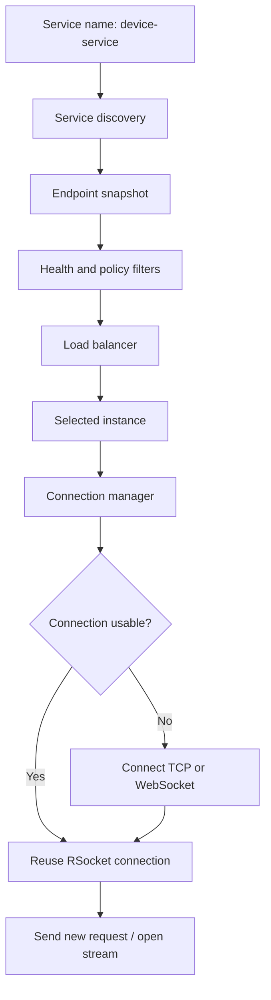

# Khám phá dịch vụ và cập nhật danh sách đích kết nối

Trong hệ thống RSocket nhiều instance, client thường biết tên dịch vụ như `device-service` nhưng không nên cố định một IP hoặc hostname của từng pod trong source code. Service discovery tìm các instance hiện có và cung cấp thông tin cần thiết để client mở kết nối. Khi instance được thêm, rút khỏi cụm hoặc chuyển trạng thái không sẵn sàng, danh sách đích phải được cập nhật để request mới chọn được instance phù hợp.

RSocket thường giữ connection dài hạn và multiplex nhiều stream trên cùng connection. Vì vậy, load balancing diễn ra chủ yếu khi chọn instance để mở connection hoặc chọn một connection đã tồn tại cho request mới. Một stream đang chạy thường gắn với connection đã mở; cập nhật danh sách instance không tự chuyển stream đó sang pod khác. Thiết kế cần kết hợp discovery, selection, connection pool và graceful drain.

## 1. Phân biệt service discovery, load balancing và connection management

Ba trách nhiệm này liên quan nhưng không giống nhau:

| Thành phần | Câu hỏi cần trả lời | Kết quả |
|---|---|---|
| Service discovery | Những instance nào đang được công bố cho service? | Danh sách endpoint cùng metadata |
| Load balancing | Trong các endpoint hợp lệ, chọn endpoint nào cho lần kết nối/request tiếp theo? | Một target theo thuật toán và policy |
| Connection manager | Có connection RSocket nào tới target đó chưa, còn dùng được không? | Requester/socket sẵn sàng hoặc thao tác kết nối mới |

Ví dụ, registry trả về ba instance `device-service`. Bộ chọn chọn instance ở zone gần client. Connection manager tìm requester đang hoạt động tới instance đó; nếu chưa có, nó mở TCP/WebSocket connection mới. Requester sau đó được tái sử dụng cho nhiều interaction.



Không nên gộp cả ba trách nhiệm vào một method đọc danh sách host rồi gọi `connectTcp`. Khi tách riêng, ứng dụng có thể thay registry hoặc thuật toán chọn instance mà không phải viết lại handler nghiệp vụ.

## 2. Các nguồn khám phá dịch vụ

Nguồn discovery phụ thuộc nền tảng triển khai:

| Nguồn | Cách hoạt động | Phù hợp khi |
|---|---|---|
| Service registry như Eureka, Consul hoặc Nacos | Instance đăng ký/deregister và cập nhật health/metadata | Hệ thống dùng registry tập trung hoặc service discovery của Spring Cloud |
| Kubernetes Service DNS | Tên Service phân giải tới virtual IP hoặc endpoint theo cấu hình cluster | Ứng dụng chạy trong Kubernetes và chấp nhận load balancing ở tầng Service |
| Kubernetes headless Service / EndpointSlice | DNS hoặc API cung cấp địa chỉ pod/endpoint cụ thể | Client cần tự chọn instance hoặc cần metadata theo pod |
| Cloud service discovery | Nền tảng cloud cung cấp endpoint/health của service | Ứng dụng triển khai trên hạ tầng cloud tương ứng |
| Static configuration | Host/port được khai báo theo môi trường | Local development, test hoặc cụm nhỏ cố định |

Spring Cloud `DiscoveryClient` cung cấp API đọc instance theo service ID khi ứng dụng đã tích hợp một implementation discovery phù hợp. Kubernetes DNS có thể đủ cho nhiều hệ thống; không cần thêm registry riêng nếu Service/EndpointSlice đã đáp ứng yêu cầu. Ngược lại, nếu cần lựa chọn theo zone, weight, metadata hoặc loại transport, client-side discovery có thể cần đọc danh sách instance cụ thể.

Không nhầm tên service logic với địa chỉ kết nối. `device-service` là định danh tra cứu; `10.2.4.18:7000` hoặc `device-7.internal:7000` là endpoint có thể thay đổi theo vòng đời instance.

## 3. Registry và health/readiness của instance

Một instance chỉ nên được công bố là endpoint nhận traffic sau khi nó sẵn sàng phục vụ. Việc process đã mở cổng không nhất thiết có nghĩa ứng dụng đã khởi tạo xong codec, security, dependency hoặc handler.

Vòng đời instance thường gồm:

1. Process khởi động và bind RSocket server.
2. Ứng dụng hoàn tất khởi tạo dependency cần thiết.
3. Readiness chuyển sang trạng thái sẵn sàng và instance được đăng ký/đưa vào danh sách nhận traffic.
4. Instance phục vụ request và cập nhật health.
5. Khi shutdown, instance chuyển sang not-ready hoặc deregister trước khi đóng listener.
6. Sau thời gian drain, connection còn lại được đóng và process kết thúc.

Discovery registry có thể lọc instance theo health status, nhưng client vẫn nên kiểm tra các điều kiện vận hành cần thiết như endpoint có port RSocket, transport được hỗ trợ và metadata hợp lệ. Health check chủ động có thể kết hợp với passive health từ lỗi kết nối, timeout hoặc circuit breaker.

Không dùng liveness thay cho readiness. Liveness trả lời process có cần restart hay không; readiness trả lời instance có nên nhận traffic mới hay không. Một instance đang drain có thể vẫn sống nhưng phải bị loại khỏi lựa chọn cho connection mới.

## 4. Metadata của một service instance

Một endpoint record nên có đủ thông tin để mở kết nối và áp dụng policy:

| Trường | Mục đích | Ví dụ |
|---|---|---|
| `instanceId` | Định danh ổn định trong thời gian instance sống | `device-service-pod-a7` |
| `serviceId` | Tên dịch vụ logic | `device-service` |
| `host` | Host hoặc IP có thể kết nối | `10.2.4.18` |
| `port` | Cổng RSocket TCP hoặc cổng WebSocket | `7000` |
| `transport` | Kiểu transport | `TCP`, `WEBSOCKET` |
| `path` | WebSocket mapping path nếu có | `/rsocket` |
| `secure` | Có yêu cầu TLS hay không | `true` |
| `zone` | Vùng triển khai | `zone-a` |
| `weight` | Trọng số tương đối | `100` |
| `status` | Trạng thái nhận traffic | `READY`, `DRAINING` |

Registry có thể cung cấp host, port, secure flag và metadata. Với RSocket, cần thống nhất convention cho port/path: một ứng dụng có thể expose HTTP/WebSocket trên cổng web, còn TCP RSocket trên cổng riêng. Đừng mặc định `ServiceInstance.getPort()` luôn là cổng RSocket nếu deployment đăng ký cổng HTTP.

Metadata discovery không phải nguồn xác thực. Client không nên tin một endpoint chỉ vì nó khai báo `secure=false` hoặc một role đặc biệt. Security vẫn phải được xác minh bằng TLS, certificate và authentication ở connection/request.

## 5. Kubernetes DNS và khác biệt giữa Service với headless Service

Kubernetes Service cung cấp tên DNS ổn định cho một nhóm pod. Với ClusterIP Service, client kết nối tới virtual IP; nền tảng mạng chọn backend cho kết nối TCP mới. Với RSocket, một khi TCP connection được thiết lập, nhiều stream multiplexed trên connection đó thường tiếp tục đi tới cùng backend.

Headless Service (`clusterIP: None`) cung cấp DNS records cho các endpoint thay vì một virtual IP duy nhất. Cách này có thể giúp client biết địa chỉ pod và tự chọn instance, nhưng client phải xử lý TTL/cache DNS, pod readiness, endpoint thay đổi và stale address.

| Mô hình | Client nhìn thấy | Ai chọn pod? | Lưu ý với RSocket |
|---|---|---|---|
| ClusterIP Service | Một DNS name/virtual IP | Kubernetes networking khi mở connection | Mỗi connection được pin tới một backend; nhiều stream trên connection chia sẻ backend |
| Headless Service | Một hoặc nhiều pod address qua DNS | Client hoặc DNS resolver tùy cách sử dụng | Cần refresh địa chỉ và loại pod không ready |
| Registry client-side | Danh sách instance cụ thể | Client load balancer | Có thể chọn theo zone, weight, health và connection count |

DNS cache của JVM và resolver có thể giữ địa chỉ lâu hơn TTL mà ứng dụng mong đợi. Nếu dùng DNS để khám phá instance cụ thể, hãy kiểm tra cache policy của runtime và resolver. Không nên tự phân tích DNS một lần lúc startup rồi giữ IP pod mãi mãi.

## 6. Đọc danh sách instance bằng DiscoveryClient

Với Spring Cloud, một abstraction phổ biến là `DiscoveryClient`. Ví dụ service ID được lấy từ cấu hình:

```yaml
app:
  rsocket:
    discovery:
      service-id: device-service
      refresh-interval: 10s
      max-stale: 60s
```

Một model nội bộ giúp tách API discovery khỏi phần kết nối:

```java
public record RSocketTarget(
    String instanceId,
    String host,
    int port,
    boolean secure,
    String transport,
    String websocketPath,
    String zone,
    int weight
) {}
```

Ví dụ ánh xạ từ `ServiceInstance`:

```java
List<RSocketTarget> discover(DiscoveryClient discoveryClient,
                             String serviceId) {
    return discoveryClient.getInstances(serviceId).stream()
        .map(instance -> new RSocketTarget(
            instance.getInstanceId(),
            instance.getHost(),
            rsocketPort(instance),
            instance.isSecure(),
            instance.getMetadata().getOrDefault("rsocket.transport", "TCP"),
            instance.getMetadata().getOrDefault("rsocket.path", "/rsocket"),
            instance.getMetadata().getOrDefault("zone", "default"),
            parseWeight(instance.getMetadata().get("weight"))))
        .toList();
}
```

`rsocketPort(instance)` và `parseWeight(...)` là hàm ứng dụng cần triển khai theo convention đăng ký instance. Không thay thế chúng bằng `instance.getPort()` một cách mù quáng nếu service đăng ký nhiều cổng. Cần validate port, transport, path, weight và instance ID trước khi công bố endpoint.

`DiscoveryClient` là API đồng bộ trong nhiều implementation. Không gọi registry network I/O trực tiếp trên Netty event loop. Hãy đọc discovery ở scheduler phù hợp hoặc dùng reactive discovery API nếu implementation cung cấp.

## 7. Cập nhật danh sách đích mà không làm request đọc trạng thái dở dang

Không nên xóa danh sách cũ rồi mới gọi registry để nạp danh sách mới. Trong khoảng giữa hai thao tác, request có thể không tìm thấy endpoint. Nếu registry tạm thời lỗi, cách làm đó còn có thể biến lỗi discovery thành trạng thái “không có service”.

Một pattern an toàn là tạo snapshot mới hoàn chỉnh, validate, rồi thay snapshot hiện tại bằng một thao tác atomic:

```java
@Component
public class RSocketTargetDirectory {
    private final AtomicReference<List<RSocketTarget>> targets =
        new AtomicReference<>(List.of());

    public List<RSocketTarget> snapshot() {
        return targets.get();
    }

    public void replace(List<RSocketTarget> discovered) {
        List<RSocketTarget> next = discovered.stream()
            .filter(this::isValid)
            .filter(this::isReady)
            .toList();
        targets.set(List.copyOf(next));
    }

    private boolean isValid(RSocketTarget target) {
        return target.instanceId() != null
            && !target.instanceId().isBlank()
            && target.host() != null
            && !target.host().isBlank()
            && target.port() > 0
            && target.port() <= 65535
            && target.weight() > 0;
    }

    private boolean isReady(RSocketTarget target) {
        return true; // Thay bằng readiness/health policy của ứng dụng
    }
}
```

Snapshot bất biến giúp request đang đọc danh sách cũ có thể hoàn tất mà không thấy collection bị sửa giữa chừng. Request tiếp theo sẽ dùng snapshot mới sau khi `AtomicReference` được cập nhật. Trong production, `isReady` cần dựa trên trạng thái discovery/health thực tế, không trả `true` cố định.

Nếu lần đọc registry thất bại, giữ last-known-good snapshot trong khoảng `max-stale` đã cấu hình và ghi nhận tuổi snapshot. Khi vượt giới hạn stale, có thể ngừng chọn endpoint hoặc chuyển sang degraded mode. Nếu registry trả về danh sách rỗng một cách hợp lệ, đó là trạng thái khác với lỗi truy vấn; không giữ endpoint đã deregister chỉ vì muốn tránh danh sách rỗng.

## 8. Lập lịch refresh và tránh refresh chồng lấn

Danh sách instance có thể cập nhật bằng polling, event/watch từ registry hoặc kết hợp cả hai. Polling đơn giản nhưng tạo độ trễ phát hiện; watch giảm độ trễ nhưng cần xử lý reconnect và đồng bộ snapshot ban đầu.

Ví dụ polling một `DiscoveryClient` đồng bộ:

```java
@Component
public class RSocketDiscoveryRefresher {
    private final DiscoveryClient discoveryClient;
    private final RSocketTargetDirectory directory;
    private final AtomicBoolean refreshing = new AtomicBoolean();

    @Scheduled(fixedDelayString = "${app.rsocket.discovery.refresh-interval:10s}")
    public void refresh() {
        if (!refreshing.compareAndSet(false, true)) {
            return;
        }

        Mono.fromCallable(() ->
                discover(discoveryClient, "device-service"))
            .subscribeOn(Schedulers.boundedElastic())
            .doOnNext(directory::replace)
            .doOnError(error -> log.warn(
                "RSocket discovery refresh failed", error))
            .doFinally(signal -> refreshing.set(false))
            .subscribe();
    }
}
```

Đây là skeleton minh họa; service ID nên được inject từ properties thay vì hardcode. Cần cấu hình `@EnableScheduling`, timeout cho registry call và xử lý lỗi mà không ghi đè snapshot khi refresh thất bại. `AtomicBoolean` ngăn lần refresh mới chạy chồng lên lần trước nếu registry phản hồi chậm.

Không refresh danh sách bằng cách tạo một scheduler mới mỗi lần. Dùng scheduler/lifecycle do ứng dụng quản lý. Nếu discovery API vốn reactive, giữ pipeline reactive thay vì bọc nó trong `fromCallable`.

## 9. Lọc endpoint trước khi đưa vào bộ chọn

Không phải mọi instance được registry trả về đều phải nhận request. Trước khi chọn, có thể lọc theo:

- Trạng thái readiness/health và trạng thái drain.
- Service ID và phiên bản contract tương thích.
- Transport client hỗ trợ (`TCP` hoặc `WEBSOCKET`).
- Port/path có hợp lệ và có RSocket listener thực sự.
- Zone/region theo chính sách locality.
- Circuit breaker/passive health của endpoint.
- Trọng số hoặc capacity được cấu hình.

Không xóa endpoint chỉ vì một request đơn lẻ timeout. Một lỗi có thể do mạng hoặc caller; cần ngưỡng lỗi, cửa sổ thời gian và thời gian eject để tránh flapping. Khi endpoint bị đánh dấu unhealthy, cần có cơ chế thử lại có kiểm soát để đưa nó trở lại sau khi health phục hồi.

Readiness từ registry thường là tín hiệu chính để ngừng gửi kết nối mới. Passive health bổ sung thông tin từ chính client: connect failure, `onClose` bất thường, timeout hoặc lỗi protocol. Không nên dùng một nguồn duy nhất nếu hệ thống cần phục hồi nhanh nhưng tránh false positive.

## 10. Chọn instance theo thuật toán nào?

Sau khi lọc, bộ chọn quyết định target cho lần kết nối hoặc request tiếp theo.

| Thuật toán | Cách hoạt động | Phù hợp khi | Hạn chế |
|---|---|---|---|
| Round-robin | Lần lượt chọn từng endpoint | Các instance tương đương và request gần đồng đều | Không xét tải thực tế |
| Random | Chọn ngẫu nhiên | Muốn đơn giản, giảm đồng bộ chọn cùng lúc | Phân bố ngắn hạn có thể lệch |
| Weighted round-robin | Instance có weight lớn nhận tỷ lệ lựa chọn cao hơn | Instance khác cấu hình/capacity | Weight phải được cập nhật và kiểm chứng |
| Least outstanding | Chọn endpoint/connection có ít request đang xử lý | Có metric in-flight đáng tin cậy | Stream dài hạn làm metric khó cân bằng |
| Zone/region affinity | Ưu tiên instance gần caller | Giảm latency và chi phí liên vùng | Cần fallback khi zone cạn endpoint |

Ví dụ round-robin trên snapshot:

```java
public final class RoundRobinTargetSelector {
    private final AtomicInteger sequence = new AtomicInteger();

    public RSocketTarget select(List<RSocketTarget> targets) {
        if (targets.isEmpty()) {
            throw new NoAvailableRSocketTargetException();
        }
        int index = Math.floorMod(sequence.getAndIncrement(), targets.size());
        return targets.get(index);
    }
}
```

Đoạn mã đơn giản này phù hợp minh họa. Khi snapshot thay đổi, index vẫn được chuẩn hóa theo kích thước mới. Production cần kết hợp filter health, tránh chọn lại endpoint vừa lỗi trong cùng retry chain và có fallback nếu danh sách rỗng.

## 11. Cân bằng tải diễn ra theo connection, không tự động theo từng frame

RSocket multiplex nhiều stream trên một connection. Nếu load balancer ở tầng TCP chọn backend lúc connection được mở, tất cả stream trên connection đó thường đi đến cùng instance. Vì vậy:

- Một connection với hàng trăm stream có thể làm một pod chịu tải lớn hơn các pod khác.
- Thêm pod mới không tự chia các stream đang chạy sang pod mới.
- Một client có thể cần nhiều connection tới các instance khác nhau để phân phối tải.
- Request-stream hoặc request-channel dài hạn thường gắn với endpoint đã chọn cho đến khi interaction kết thúc.

Nếu cần cân bằng ở cấp request, client cần chọn một connection phù hợp cho mỗi request mới từ pool nhiều connection. Không thể đổi target giữa chừng của một stream đã mở chỉ bằng cách cập nhật danh sách discovery.

Một connection pool có thể lưu nhiều requester theo `instanceId`. Connection manager nên giới hạn số connection trên mỗi instance, phát hiện socket đã đóng, tái tạo connection theo nhu cầu và dispose các connection không còn được dùng sau drain.

## 12. Cập nhật connection pool khi endpoint thêm hoặc bị gỡ

Khi snapshot thay đổi, connection manager nên so sánh tập `instanceId` cũ và mới:

| Thay đổi discovery | Hành động connection manager |
|---|---|
| Instance mới xuất hiện | Đưa vào pool selection; tạo connection lazy khi có request |
| Instance vẫn tồn tại, metadata không đổi | Giữ connection đang hoạt động |
| Host/port/transport thay đổi | Xem là endpoint mới; mở connection mới và drain connection cũ |
| Instance chuyển `DRAINING`/not-ready | Ngừng chọn cho request/connection mới; cho stream hiện tại thời gian hoàn tất |
| Instance bị deregister | Loại khỏi selection; đóng connection sau deadline drain |
| Connection đóng bất thường | Đánh dấu connection không dùng được; thử endpoint khác theo retry policy |

Không nhất thiết phải kết nối tới mọi instance ngay khi refresh. Kết nối lazy tránh tạo hàng loạt socket tới instance chưa từng được dùng. Với workload cần warm pool, tạo trước số connection giới hạn và có kiểm soát.

Khi instance bị loại, không đóng connection ngay nếu đang có request/stream cần hoàn tất. Chuyển connection sang trạng thái draining: không nhận request mới, theo dõi in-flight interaction, chờ tới deadline rồi dispose phần còn lại. Client cần xử lý kết quả chưa xác định nếu command bị ngắt sau khi server đã commit.

## 13. Ví dụ chọn target và mở RSocketRequester

Tách việc chọn endpoint khỏi factory kết nối:

```java
public interface RSocketRequesterFactory {
    Mono<RSocketRequester> connect(RSocketTarget target);
}

public class DeviceClient {
    private final RSocketTargetDirectory directory;
    private final RSocketTargetSelector selector;
    private final RSocketConnectionPool pool;

    public Mono<DeviceStatus> status(DeviceQuery query) {
        return Mono.defer(() -> {
            RSocketTarget target = selector.select(directory.snapshot());
            return pool.getOrConnect(target)
                .flatMap(requester -> requester
                    .route("devices.status")
                    .data(query)
                    .retrieveMono(DeviceStatus.class));
        });
    }
}
```

`RSocketConnectionPool` là abstraction ứng dụng quản lý requester theo target; nó nên dùng `instanceId` và endpoint fingerprint để phát hiện thay đổi địa chỉ, giới hạn pool, loại connection disposed và xử lý reconnect. `getOrConnect` cần bảo đảm nhiều request đồng thời tới cùng target không tạo vô hạn connection giống nhau.

Factory có thể chọn transport:

```java
public Mono<RSocketRequester> connect(RSocketTarget target) {
    RSocketRequester.Builder builder = requesterBuilderFactory.create();

    builder.dataMimeType(MimeTypeUtils.APPLICATION_JSON)
        .metadataMimeType(COMPOSITE_METADATA);

    return switch (target.transport()) {
        case "TCP" -> builder.connectTcp(target.host(), target.port());
        case "WEBSOCKET" -> builder.connectWebSocket(
            toWebSocketUri(target));
        default -> Mono.error(new UnsupportedTransportException(
            target.transport()));
    };
}
```

Đây là skeleton; `requesterBuilderFactory` phải tạo builder được cấu hình nhất quán với codec/security của ứng dụng. Với WebSocket, `toWebSocketUri` phải tạo URI `ws` hoặc `wss` cùng port/path đúng theo deployment. Không suy ra path hoặc port bằng cách đoán từ HTTP endpoint.

## 14. Xử lý endpoint stale và lỗi discovery

Discovery có thể tạm thời không truy cập được trong khi các endpoint hiện tại vẫn hoạt động. Ứng dụng cần phân biệt:

- **Refresh thành công, danh sách có instance:** thay snapshot bằng danh sách đã validate.
- **Refresh thành công, danh sách rỗng:** registry nói hiện không có instance; không tiếp tục chọn endpoint đã deregister.
- **Refresh thất bại:** không có dữ liệu mới; giữ last-known-good snapshot trong `max-stale` nếu policy cho phép và phát cảnh báo.
- **Snapshot quá stale:** ngừng dùng endpoint hoặc chuyển sang degraded mode theo mức độ quan trọng của request.
- **Endpoint connect failure:** đánh dấu passive unhealthy trong thời gian giới hạn, thử target khác nếu thao tác retry an toàn.

Không giữ endpoint cũ vô thời hạn vì có thể route request tới pod đã bị xóa hoặc IP đã được tái sử dụng. Ngược lại, không xóa toàn bộ danh sách khi một lần polling thất bại ngắn vì có thể gây outage rộng hơn lỗi registry.

Retry discovery nên có backoff và jitter. Nếu mọi client refresh cùng một chu kỳ cố định, registry có thể nhận burst request đồng thời. Với watch/stream discovery, cần reconnect watch và lấy full snapshot mới sau khi phát hiện gap.

## 15. Zone affinity và weighted endpoint

Nếu instance có metadata zone, client có thể ưu tiên endpoint cùng zone để giảm latency và chi phí liên vùng. Policy cần fallback sang zone khác khi zone gần nhất không còn endpoint healthy.

Weight có thể biểu diễn capacity tương đối, nhưng không nên lấy trực tiếp một con số do instance tự khai nếu caller không kiểm soát nguồn đó. Weight cần được quản trị bởi deployment/configuration hoặc registry đáng tin cậy. Nếu cập nhật weight liên tục, dùng snapshot version để mọi request nhìn thấy một bộ giá trị nhất quán.

Với stream dài hạn, zone affinity có thể tạo kết nối kéo dài tới một zone và làm tải phân bố lệch. Cần theo dõi số stream, byte rate và in-flight load theo instance, không chỉ đếm số connection.

## 16. Security khi khám phá và kết nối

Discovery chỉ trả lời “địa chỉ nào có thể gọi”; nó không chứng minh endpoint là đáng tin cậy hoặc caller có quyền truy cập.

- Xác thực server bằng TLS certificate và hostname verification khi dùng TLS.
- Không tắt certificate validation để xử lý lỗi hostname của endpoint discovery.
- Giới hạn registry access để chỉ workload được phép mới có thể đăng ký instance cho service nhạy cảm.
- Không lấy credential từ metadata endpoint do instance tự khai; dùng secret manager và identity provider.
- Xác thực caller và phân quyền route ở server như bình thường.
- Kiểm tra transport/port/path theo allowlist để tránh kết nối tới endpoint tùy ý do metadata bị thao túng.
- Không ghi token, private key hoặc URI chứa credential vào log.

Nếu kết nối tới pod bằng IP nhưng certificate được cấp cho DNS service, hostname verification có thể thất bại. Hãy thiết kế SAN/certificate và cách xác định server name phù hợp với hạ tầng; không giải quyết bằng cách bỏ qua xác minh TLS.

## 17. Kiểm thử discovery và cập nhật endpoint

Kiểm thử nên bao phủ cả vòng đời danh sách và connection:

1. Discovery trả về nhiều instance hợp lệ; selector chọn được target.
2. Instance thiếu RSocket port hoặc transport không hỗ trợ bị loại.
3. Instance not-ready hoặc draining không được chọn cho connection mới.
4. Instance mới được thêm vào snapshot và có thể nhận connection mới.
5. Instance bị deregister không nhận request mới nhưng stream đang chạy được drain theo deadline.
6. Registry lỗi tạm thời; last-known-good snapshot được giữ trong giới hạn stale.
7. Registry trả danh sách rỗng thành công; endpoint cũ được loại theo policy.
8. Refresh chậm không tạo nhiều lần refresh chồng lấn.
9. Hai request đồng thời không tạo connection trùng ngoài giới hạn pool.
10. Connection đóng bất thường; selector thử endpoint khác nếu retry an toàn.
11. Thay host/port/path tạo connection mới và drain connection cũ.
12. DNS/EndpointSlice thay đổi được phản ánh sau refresh/cache expiry.
13. Zone affinity có fallback khi zone local không còn instance.
14. TLS hostname mismatch bị từ chối và được quan sát rõ ràng.
15. Rolling deployment không làm mọi client reconnect cùng lúc.

Có thể dùng fake `DiscoveryClient` hoặc registry test để điều khiển danh sách instance. Integration test nên mở RSocket server trên nhiều port, cập nhật endpoint directory rồi xác minh request mới tới đúng instance. Test chỉ kiểm tra thuật toán round-robin không chứng minh connection pool đã loại requester disposed hoặc drain đúng.

## 18. Metrics và vận hành

Theo dõi các chỉ số:

- Số instance discovered, ready, draining và bị filter theo service ID.
- Tuổi snapshot hiện tại, thời gian refresh và tỷ lệ refresh lỗi.
- Số lần endpoint được chọn theo instance/zone/weight.
- Số connection active, connecting, disposed và draining theo instance.
- Số stream/in-flight request, byte rate và latency theo endpoint.
- Connect failure, connection close bất thường, timeout và circuit-breaker ejection.
- Số lần fallback zone, retry target và request bị từ chối do không có endpoint.
- Thời gian drain và số interaction bị kết thúc khi hết deadline.

Không dùng IP động, instance ID có cardinality cao hoặc user ID làm metric label không kiểm soát. Có thể log instance ID và endpoint đã chuẩn hóa trong structured log để điều tra, nhưng tránh ghi credential. Alert khi snapshot stale, service không còn endpoint ready hoặc một instance nhận tải lệch bất thường.

## 19. Quy tắc thiết kế

1. Dùng service ID ổn định để khám phá; không hardcode pod IP trong client.
2. Chọn nguồn discovery phù hợp: registry, Kubernetes Service/EndpointSlice, cloud discovery hoặc static config cho môi trường đơn giản.
3. Đăng ký instance sau khi readiness đạt và deregister trước khi shutdown.
4. Mô hình hóa endpoint bằng instance ID, host, port, transport, path, zone, weight và trạng thái.
5. Đọc discovery ngoài event loop và validate endpoint trước khi công bố.
6. Cập nhật immutable snapshot bằng atomic swap; phân biệt refresh lỗi với danh sách rỗng hợp lệ.
7. Lọc readiness/health, transport và metadata trước khi load balance.
8. Chọn instance khi tạo connection hoặc chọn requester từ pool; không giả định mỗi frame được cân bằng lại.
9. Tái sử dụng connection có giới hạn, theo dõi `onClose` và loại connection disposed.
10. Khi instance bị gỡ, ngừng chọn mới rồi drain stream hiện tại trước khi dispose.
11. Dùng backoff/jitter, max-stale và passive health để xử lý discovery/network lỗi.
12. Bảo vệ registry, TLS, hostname verification và credential; không tin metadata discovery như identity.
13. Kiểm thử add/remove, stale snapshot, concurrent refresh, pool update, failover và rolling deployment.

Service discovery cung cấp danh sách endpoint có thể thay đổi theo vòng đời của cụm; load balancer chọn instance phù hợp; connection manager biến lựa chọn đó thành requester/socket có thể tái sử dụng. Với RSocket, cần nhớ một connection có thể mang nhiều stream và giữ backend đã chọn trong thời gian dài. Cập nhật snapshot an toàn, quản lý pool theo instance và drain/reconnect có kiểm soát giúp client tiếp tục chọn được đích khỏe mạnh khi hệ thống scale hoặc rollout.
