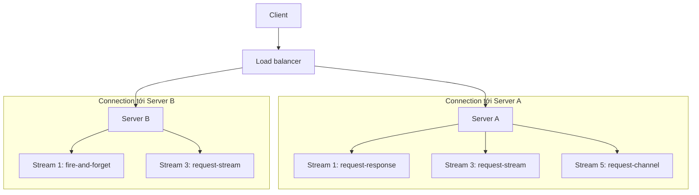
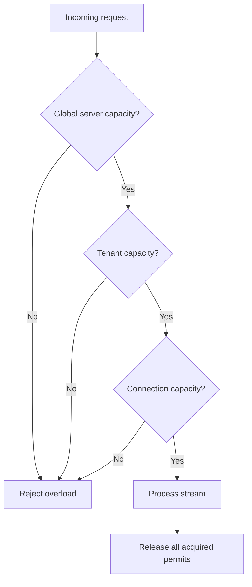

# Quản lý số kết nối và giới hạn số luồng trên mỗi máy chủ

RSocket multiplex nhiều tương tác trên cùng một connection. Một client có thể mở một kết nối TCP hoặc WebSocket lâu dài rồi chạy nhiều request-response, fire-and-forget, request-stream và request-channel trên kết nối đó. Vì vậy, số connection không phản ánh đầy đủ tải của một máy chủ: hai node có cùng 100 connection vẫn có thể chịu tải rất khác nếu một node đang xử lý 200 stream còn node kia xử lý 5.000 stream.

Để cân bằng tải ổn định, hệ thống cần quản lý riêng số connection được chấp nhận, số tương tác đang hoạt động và tốc độ tạo stream. Bài này trình bày cách đặt giới hạn theo từng connection và từng server, kết hợp admission control với RSocket Lease, phân phối connection qua load balancer và vận hành khi server quá tải hoặc cần drain để triển khai.

## 1. Connection và stream là hai đơn vị tải khác nhau

Một connection là kênh transport giữa client và server, thường tồn tại lâu. Một stream là một tương tác RSocket được multiplex bên trong connection đó. Mỗi stream có stream ID riêng; các frame của nhiều stream có thể xen kẽ trên cùng transport.



Một connection có thể không có stream nào trong một khoảng thời gian nhưng vẫn giữ socket, session context, buffer và keepalive. Ngược lại, một connection có thể đang mang nhiều stream dài hạn và tiêu thụ đáng kể CPU, memory, database connection hoặc subscription tới broker.

Do đó cần theo dõi ít nhất ba đại lượng:

- **Active connections:** số connection đã được chấp nhận và chưa đóng.
- **Active streams/interactions:** số tương tác đang chạy tại một thời điểm.
- **Stream start rate:** số tương tác mới được mở trong một đơn vị thời gian.

Giới hạn connection bảo vệ tài nguyên transport và session. Giới hạn stream bảo vệ năng lực xử lý ứng dụng. Giới hạn tốc độ mở stream bảo vệ hệ thống khỏi burst và request storm.

## 2. RSocket multiplexing ảnh hưởng đến cân bằng tải

Load balancer TCP hoặc WebSocket thường chọn backend khi connection được thiết lập. Sau khi connection đã được định tuyến tới một node, các stream RSocket trên connection đó tiếp tục đi qua cùng connection và cùng node. Load balancer lớp transport không tự phân phối từng stream sang backend khác.

Điều này tạo ra một số hệ quả:

- Một client mở một connection có thể gửi hàng nghìn stream tới một server duy nhất.
- Round-robin theo connection không bảo đảm cân bằng theo số stream hoặc chi phí xử lý.
- Connection tồn tại lâu làm quyết định phân phối ban đầu ảnh hưởng trong thời gian dài.
- Một node có thể quá tải vì một số connection có stream dài hoặc payload lớn, dù tổng số connection không cao.

Nếu cần phân phối request ở mức ứng dụng, client có thể duy trì một pool gồm nhiều connection tới các node và chọn connection cho từng tương tác. Cách này vẫn giữ multiplexing bên trong mỗi connection nhưng mở thêm cơ hội phân phối tải. Cần đặt giới hạn pool để tránh tạo quá nhiều socket và handshake.

## 3. Xác định ngân sách connection cho mỗi server

Không có một con số connection tối đa phù hợp cho mọi máy chủ. Ngân sách phụ thuộc vào:

- Bộ nhớ nền và bộ nhớ trung bình cho mỗi connection/session.
- Số file descriptor/socket mà hệ điều hành cho phép tiến trình mở.
- Chi phí TLS, buffer transport, keepalive và metadata/session context.
- Số stream trung bình trên mỗi connection và thời gian sống của stream.
- Giới hạn CPU, event loop, database pool, broker consumer và dịch vụ phụ thuộc.
- Mức dự phòng cần có khi một node khác trong cluster ngừng hoạt động.

Có thể ước lượng giới hạn trên theo nhiều ràng buộc rồi lấy giá trị nhỏ nhất:

\[
C_{max} \leq \min\left(\frac{M_{budget}}{M_{connection}},\; FD_{available},\; C_{tested}\right)
\]

Trong đó `M_budget` là phần memory dành cho connection, `M_connection` là mức tiêu thụ đã đo trên mỗi connection, `FD_available` là số socket/file descriptor còn có thể dùng và `C_tested` là mức connection đã kiểm thử tải đạt SLA. Đây chỉ là cách lập ngân sách ban đầu; cần đo trong môi trường gần production và giữ headroom cho spike, reconnect và rolling deployment.

Đừng lấy giới hạn tối đa lý thuyết của hệ điều hành làm giới hạn vận hành. Server cần tài nguyên cho request xử lý, GC, buffer và các tác vụ nền khác.

## 4. Giới hạn connection ở đâu?

Nên áp dụng nhiều lớp kiểm soát vì mỗi lớp bảo vệ một phạm vi khác nhau:

| Vị trí | Mục tiêu | Cách thực hiện |
| --- | --- | --- |
| Load balancer/API gateway | Ngăn một backend nhận quá nhiều connection mới. | Connection cap theo target, health check, slow start và connection draining. |
| Transport/server acceptor | Giới hạn connection được server nhận hoặc setup được chấp nhận. | Theo dõi connection lifecycle và từ chối setup khi hết capacity. |
| Application session registry | Giới hạn session theo principal, tenant hoặc loại client. | Admission control sau xác thực và quota theo danh tính. |
| Client connection pool | Tránh một client tạo quá nhiều socket tới cùng backend. | Pool size, idle timeout, reconnect backoff và connection reuse. |

Giới hạn ở load balancer giúp bảo vệ node trước khi ứng dụng phải tạo session. Giới hạn ở server giúp xử lý trường hợp traffic đi đường khác hoặc gateway không có đủ thông tin. Giới hạn theo principal ngăn một tenant chiếm hết capacity của server.

## 5. Admission control khi SETUP

Một connection RSocket bắt đầu bằng `SETUP`. Server có thể kiểm tra capacity và chính sách truy cập trước khi chấp nhận session. Nếu server đã đạt giới hạn connection, nó nên từ chối setup có kiểm soát thay vì chấp nhận thêm rồi để hệ thống thiếu bộ nhớ hoặc thread.

Một quy trình admission thường gồm:

1. Transport chấp nhận socket mới.
2. Server nhận frame `SETUP` và đọc thông tin cần thiết.
3. Xác thực principal và xác định tenant/client class.
4. Kiểm tra giới hạn connection toàn server và giới hạn theo principal/tenant.
5. Nếu còn capacity, giữ một connection permit và tạo session context.
6. Khi connection đóng, giải phóng permit đúng một lần.
7. Nếu hết capacity, từ chối setup bằng lỗi cấp connection phù hợp, thường là `REJECTED_SETUP`.

`REJECTED_SETUP` biểu thị server từ chối thiết lập connection, ví dụ do server đang bận. Client có thể thử lại sau theo backoff và jitter; không nên retry liên tục vì điều đó làm node quá tải hơn.

Đếm connection phải an toàn khi nhiều SETUP đến đồng thời. Một cách đơn giản là dùng atomic counter với thao tác compare-and-set hoặc semaphore. Không dùng chuỗi thao tác `if (active < max) active++` riêng rẽ vì nhiều thread có thể cùng thấy còn slot và cùng vượt giới hạn.

## 6. Quản lý vòng đời connection permit

Mỗi connection được chấp nhận cần sở hữu một permit. Permit phải được giải phóng khi connection đóng, setup thất bại sau khi đã giữ permit hoặc quá trình accept bị cancel. Thao tác release cần idempotent để nhiều đường kết thúc không làm giảm counter nhiều lần.

Ví dụ một bộ đếm capacity độc lập với transport:

```java
import java.util.concurrent.atomic.AtomicBoolean;
import java.util.concurrent.atomic.AtomicInteger;

final class ConnectionGate {
    private final int limit;
    private final AtomicInteger active = new AtomicInteger();

    ConnectionGate(int limit) {
        if (limit < 1) throw new IllegalArgumentException("limit must be positive");
        this.limit = limit;
    }

    ConnectionPermit tryAcquire() {
        for (;;) {
            int current = active.get();
            if (current >= limit) return null;
            if (active.compareAndSet(current, current + 1)) {
                return new ConnectionPermit(active);
            }
        }
    }

    int activeConnections() {
        return active.get();
    }
}

final class ConnectionPermit implements AutoCloseable {
    private final AtomicInteger active;
    private final AtomicBoolean released = new AtomicBoolean();

    ConnectionPermit(AtomicInteger active) {
        this.active = active;
    }

    @Override
    public void close() {
        if (released.compareAndSet(false, true)) {
            active.decrementAndGet();
        }
    }
}
```

`ConnectionGate` chỉ quản lý ngân sách trong một JVM. Adapter `SocketAcceptor` hoặc transport lifecycle của ứng dụng cần gọi `tryAcquire()` khi nhận connection và gắn `permit.close()` với sự kiện đóng thật của connection. Nếu setup bị từ chối hoặc bị hủy trước khi hoàn tất, phải release permit ngay. Không giữ permit chỉ dựa trên việc handler `@ConnectMapping` trả về, vì connection có thể tồn tại lâu sau khi setup hoàn tất.

Trong cluster nhiều node, mỗi instance có gate riêng để bảo vệ chính nó. Nếu cần quota tổng cho một tenant trên toàn cluster, phải dùng bộ đếm dùng chung hoặc phân vùng quota; counter trong JVM không tạo ra giới hạn toàn cục.

## 7. Giới hạn số stream đồng thời trên mỗi connection

Một client có thể mở nhiều stream trên cùng connection. Nếu mỗi stream tạo subscription, buffer, truy vấn database hoặc tác vụ nền, server cần giới hạn số tương tác đang hoạt động trên connection đó.

RSocket multiplexing không đồng nghĩa server phải nhận vô hạn stream. Tuy nhiên, protocol không cung cấp một trường `max-concurrent-streams-per-connection` tổng quát trong `SETUP` để hai bên tự động thương lượng một con số như HTTP/2 setting. Ứng dụng cần triển khai admission control ở tầng server/handler hoặc dùng cơ chế lease cho chính sách cấp quyền mở request.

Nên phân biệt:

- **Active stream limit:** số stream đồng thời đang chạy trên một connection.
- **Request rate limit:** số request mới được mở trong một khoảng thời gian.
- **Payload/item limit:** số payload hoặc byte được xử lý trong stream.
- **Connection limit:** số transport/session đang hoạt động.

Một request-stream dài hạn chỉ được tính là một stream active, nhưng có thể tiếp tục tiêu thụ tài nguyên trong nhiều phút. Một request-response ngắn cũng chiếm một slot trong lúc xử lý. Đơn vị tính phải được thống nhất trong chính sách.

## 8. Dùng semaphore để giới hạn stream active

Một limiter có thể dùng `Semaphore` để giữ permit từ lúc subscription bắt đầu đến khi publisher kết thúc. `doFinally` được gọi khi complete, error hoặc cancel nên phù hợp để trả permit.

```java
import java.util.concurrent.Semaphore;
import java.util.function.Supplier;
import reactor.core.publisher.Flux;
import reactor.core.publisher.Mono;

final class StreamLimiter {
    private final Semaphore permits;

    StreamLimiter(int maxActiveStreams) {
        if (maxActiveStreams < 1) {
            throw new IllegalArgumentException("limit must be positive");
        }
        this.permits = new Semaphore(maxActiveStreams);
    }

    <T> Mono<T> withPermit(Supplier<Mono<T>> work) {
        return Mono.defer(() -> {
            if (!permits.tryAcquire()) {
                return Mono.error(new StreamLimitExceededException());
            }
            return Mono.defer(work).doFinally(signal -> permits.release());
        });
    }

    <T> Flux<T> withStreamPermit(Supplier<Flux<T>> work) {
        return Flux.defer(() -> {
            if (!permits.tryAcquire()) {
                return Flux.error(new StreamLimitExceededException());
            }
            return Flux.defer(work).doFinally(signal -> permits.release());
        });
    }
}
```

`StreamLimitExceededException` là exception của ứng dụng. Adapter RSocket có thể ánh xạ tình trạng quá tải sang lỗi request-level phù hợp, thường là `REJECTED`, hoặc thành mã lỗi ứng dụng theo hợp đồng riêng. Không biến lỗi quá tải thành response thành công giả.

Phạm vi của limiter phụ thuộc vào nơi tạo instance:

- Tạo một `StreamLimiter` trong mỗi `ConnectionContext` thì giới hạn áp dụng riêng cho connection đó.
- Dùng một `StreamLimiter` singleton thì đây là giới hạn toàn server, được chia sẻ giữa các connection.
- Dùng registry theo principal/tenant thì mỗi key có một ngân sách riêng; cần xóa entry khi principal hết hạn hoặc không còn hoạt động để registry không tăng vô hạn.

Ví dụ handler dùng context do ứng dụng quản lý:

```java
@MessageMapping("orders.watch")
Flux<OrderEvent> watch(OrderWatch query, ConnectionContext connection) {
    return connection.streamLimiter().withStreamPermit(
        () -> orderService.watch(query)
    );
}
```

`ConnectionContext` trong ví dụ là kiểu của ứng dụng, được tạo khi connection được chấp nhận và gắn với connection bằng `SocketAcceptor`, interceptor hoặc cơ chế argument resolver riêng. Spring không tự cung cấp một tham số tên `ConnectionContext`; ứng dụng phải ánh xạ request hiện tại tới context đã xác thực của đúng connection.

Với request-response, permit được giữ đến khi `Mono` hoàn tất hoặc lỗi. Với request-stream/request-channel, permit được giữ suốt vòng đời `Flux`, bao gồm cả khi subscriber cancel. Với fire-and-forget, permit nên được giữ đến khi xử lý nghiệp vụ hoàn tất, không chỉ đến khi server nhận frame.

## 9. Giới hạn theo connection, tenant và toàn server

Chỉ có một semaphore toàn server có thể khiến một client chiếm toàn bộ capacity. Chỉ có limiter theo connection lại cho phép một tenant mở nhiều connection để nhân số slot. Thực tế thường cần giới hạn phân cấp:



Các tầng thường dùng:

- **Global server limit:** bảo vệ tổng CPU, memory và downstream pools.
- **Tenant/principal limit:** chia sẻ capacity công bằng giữa các khách hàng.
- **Per-connection limit:** ngăn một socket mở quá nhiều stream.
- **Per-route limit:** bảo vệ route tốn tài nguyên như export hoặc truy vấn báo cáo.

Khi cần giữ nhiều permit, hãy acquire theo thứ tự cố định và release tất cả permit đã acquire nếu bước sau thất bại. Nếu không, có thể rò rỉ permit hoặc tạo deadlock do thứ tự acquire không nhất quán.

Đối với stream dài hạn, cân nhắc quota riêng cho stream tương tác và quota khác cho request ngắn. Một stream subscription lâu dài có thể chiếm slot đáng kể nhưng ít CPU; route tính toán nặng có thể cần ít concurrency hơn.

## 10. RSocket Lease và giới hạn stream

RSocket Lease cho responder quyền kiểm soát số request mà requester được phép bắt đầu trong một khoảng thời gian. Lease mang thời hạn (TTL) và số request được cấp; requester chỉ được mở request khi còn lease hợp lệ.

Lease hữu ích để điều tiết tốc độ khởi tạo request và báo cho client biết server đang cấp bao nhiêu quyền sử dụng trong một thời gian. Tuy nhiên, lease không phải bộ đếm số stream đang active:

- Một request-stream được cấp một lượt request nhưng có thể tồn tại rất lâu.
- Nhiều request đã được bắt đầu trong thời hạn lease có thể vẫn đang hoạt động sau khi TTL hết.
- Lease không tự giới hạn số connection TCP/WebSocket.
- Lease không thay thế semaphore hoặc bulkhead bảo vệ tài nguyên đang xử lý.

Nếu mục tiêu là giới hạn đồng thời, kết hợp Lease với active stream limiter. Nếu mục tiêu là giới hạn số request mỗi phút, Lease hoặc rate limiter có thể phù hợp hơn, tùy yêu cầu và cách client/server triển khai.

## 11. Client connection pool và phân phối connection

Vì load balancer thường chọn backend theo connection, client có thể sử dụng một pool nhỏ các connection lâu dài để phân phối request qua nhiều node. Mỗi connection vẫn multiplex nhiều stream, nhờ đó giảm chi phí handshake so với mở socket mới cho từng request.

Một chiến lược client có thể gồm:

1. Khám phá danh sách endpoint khỏe từ service discovery hoặc load balancer.
2. Tạo số connection tối đa cấu hình được cho mỗi client/host.
3. Chọn connection theo active stream count, pending request count hoặc round-robin có cân nhắc tải.
4. Không chọn connection đang draining hoặc đã đóng.
5. Khi connection lỗi, reconnect theo backoff và jitter; cập nhật pool khi node thay đổi trạng thái.
6. Đặt giới hạn tổng connection của client để không tạo tải ngược lên cluster.

Không nhất thiết mỗi client phải mở nhiều connection. Với workload nhẹ, một connection có thể đủ. Pool hữu ích khi một connection đơn trở thành điểm nóng hoặc cần phân phối các stream độc lập đến nhiều node. Kích thước pool phải được đo theo số client, số node và ngân sách connection toàn cluster.

## 12. Load balancer, sticky routing và connection resumption

RSocket connection resumption cần server tìm được session cũ cùng frame buffer khi client gửi `RESUME`. Nếu session state chỉ nằm trong memory của một instance, kết nối resume phải quay lại instance đó hoặc các node phải chia sẻ session/frame store tương thích.

Do đó, khi dùng resume:

- Cấu hình sticky routing theo connection/session token nếu session state nằm local.
- Hoặc dùng kho session/frame state dùng chung nếu implementation hỗ trợ và đã kiểm chứng.
- Đặt session duration và buffer capacity phù hợp với thời gian gián đoạn cần phục hồi.
- Nếu resume bị từ chối, tạo session mới và đồng bộ trạng thái nghiệp vụ từ checkpoint.

Sticky routing không phải lúc nào cũng cần cho RSocket thường. Nó quan trọng khi các request tiếp theo hoặc resume phải đến đúng instance đang giữ state. Với request độc lập và stateless, phân phối connection mới bằng least-connections hoặc thuật toán phù hợp có thể đủ.

## 13. Xử lý khi server chạm giới hạn

Khi một giới hạn bị chạm, server cần hành vi rõ ràng thay vì để queue tăng vô hạn:

| Tình huống | Hành vi gợi ý |
| --- | --- |
| Đạt connection cap | Từ chối SETUP mới bằng lỗi phù hợp; load balancer ngừng gửi connection mới đến node đó. |
| Đạt active stream cap | Từ chối request mới bằng `REJECTED` hoặc mã lỗi ứng dụng; không ảnh hưởng stream đang chạy. |
| Đạt tenant quota | Từ chối hoặc throttle riêng tenant; giữ capacity cho tenant khác. |
| Downstream pool cạn | Giảm concurrency, timeout hoặc trả lỗi overload; tránh xếp hàng không giới hạn. |
| Node draining | Ngừng nhận setup mới, cho stream hiện tại hoàn tất trong grace period rồi đóng connection còn lại theo chính sách. |

Client cần phân biệt lỗi quá tải tạm thời với lỗi validation hoặc authorization. Chỉ lỗi có thể phục hồi mới nên retry; dùng exponential backoff, jitter và giới hạn retry. Retry storm có thể làm server vừa phục hồi lại quá tải.

## 14. Connection draining và rolling deployment

Vì connection RSocket thường tồn tại lâu, rolling deployment cần một quy trình drain:

1. Đánh dấu node không còn nhận connection mới trong service discovery/load balancer.
2. Từ chối hoặc ngừng quảng bá endpoint cho client mới.
3. Giữ các connection hiện tại trong một khoảng grace period.
4. Cho stream ngắn hoàn tất; với stream dài, gửi tín hiệu ứng dụng yêu cầu client reconnect hoặc chuyển sang checkpoint mới.
5. Hủy các stream còn lại khi hết grace period và giải phóng session/resource.
6. Dừng transport server sau khi số connection giảm về mức cho phép.

Không đóng socket ngay khi bắt đầu deploy nếu ứng dụng cần bảo toàn stream đang chạy. Ngược lại, không chờ vô hạn vì một stream có thể tồn tại hàng giờ. Cần có deadline và chính sách cho stream không thể hoàn tất.

## 15. Cấu hình TCP/WebSocket và proxy timeout

Với TCP, load balancer cần hỗ trợ kết nối TCP lâu dài và giữ nguyên luồng byte theo thứ tự. Với WebSocket, reverse proxy cần hỗ trợ HTTP Upgrade, giữ kết nối lâu dài và chuyển tiếp đúng path RSocket.

Các timeout ở proxy, load balancer, client keepalive và server lifetime cần được cấu hình tương thích. Nếu proxy idle timeout ngắn hơn khoảng keepalive, proxy có thể đóng connection trước khi RSocket kịp phát hiện. Hãy xác định rõ:

- TCP connect timeout và handshake timeout.
- WebSocket upgrade timeout và idle timeout.
- RSocket keepalive interval/max lifetime.
- Application request timeout và stream idle timeout.
- Grace period khi drain node.

Không nhầm timeout request với timeout connection. Một request có thể hết hạn trong khi connection vẫn phục vụ các stream khác.

## 16. Quan sát connection và stream theo từng node

Để cân bằng tải theo năng lực thực, cần thu thập metric ở cả transport lẫn RSocket/application:

| Nhóm metric | Ví dụ |
| --- | --- |
| Connection | Active, accepted, rejected, closed, connection churn, thời gian sống trung bình. |
| Stream | Active stream theo interaction type, stream start rate, duration, cancel/error/complete. |
| Admission | Số lần chạm connection cap, stream cap, tenant quota và số request bị reject. |
| Resource | CPU, heap, direct memory, file descriptor, event loop pending task. |
| Downstream | Database pool active/pending, broker lag, HTTP connection pool, queue depth. |
| Load balancing | Connection/stream count theo node, request distribution, node draining và health state. |

Không chỉ nhìn số connection. Một node có ít connection nhưng nhiều stream dài hoặc nhiều payload lớn vẫn có thể là node nóng. Có thể dùng active stream count, pending downstream work và CPU làm tín hiệu bổ sung cho thuật toán phân phối connection mới.

Tránh dùng connection ID, user ID hoặc token làm metric label vì cardinality tăng không giới hạn. Dùng node, route, interaction type và tenant tier; định danh cụ thể chỉ nên xuất hiện trong log có kiểm soát.

## 17. Kiểm thử giới hạn connection và stream

Kiểm thử cần bao gồm tải đồng thời và vòng đời đầy đủ:

- Mở connection đến đúng giới hạn; connection tiếp theo bị từ chối setup.
- Đóng một connection; permit được giải phóng và connection mới được chấp nhận.
- Nhiều SETUP đến đồng thời không vượt connection cap do race condition.
- Một connection đạt stream cap; stream mới bị từ chối nhưng stream hiện tại tiếp tục.
- Stream complete, error hoặc cancel đều trả permit đúng một lần.
- Một tenant không thể vượt quota bằng cách mở nhiều connection nếu policy là tenant-wide.
- Lease hết hạn ngăn request mới nhưng không bị hiểu nhầm là hủy các stream đang chạy.
- Pool client phân phối connection mới qua các node theo chiến lược đã chọn.
- Node draining không nhận connection mới nhưng stream hiện tại được xử lý trong grace period.
- Resume quay lại đúng node hoặc hoạt động qua shared state theo cấu hình.
- Proxy idle timeout không cắt connection còn keepalive hợp lệ.
- Load test xác nhận SLA khi một node mất và traffic được phân phối lại.

Với semaphore, test riêng complete/error/cancel bằng `StepVerifier` và kiểm tra số permit còn lại. Với connection gate, dùng test đa luồng để xác nhận active count không bao giờ vượt limit. Với load balancer, chạy kiểm thử tích hợp nhiều node thay vì suy luận từ unit test.

## 18. Những lỗi thường gặp

**Chỉ cân bằng theo số connection.** Mỗi connection có thể chứa số stream và mức chi phí rất khác nhau. Theo dõi active stream và downstream load.

**Mở một connection cho mỗi request.** Cách này làm tăng handshake, socket và TLS overhead. Tái sử dụng connection và multiplex stream.

**Cho rằng load balancer phân phối từng stream.** Load balancer TCP/WebSocket thường chọn backend theo connection; các stream trên cùng connection ở lại node đó.

**Cho rằng RSocket tự giới hạn active streams theo một con số cấu hình chung.** Cần admission control ở ứng dụng/server hoặc cơ chế lease cho request admission.

**Dùng Lease như semaphore.** Lease giới hạn số request được bắt đầu trong TTL, không phải số stream đang hoạt động đồng thời.

**Chỉ giới hạn theo connection.** Một tenant có thể mở nhiều connection để nhân quota. Kết hợp global, tenant, per-connection và per-route limits.

**Không release permit khi cancel/error.** Dùng `doFinally` hoặc resource lifecycle tương ứng và làm release idempotent.

**Dùng counter cục bộ như quota toàn cluster.** Mỗi instance có counter riêng; dùng shared store hoặc phân vùng quota có chủ đích cho giới hạn toàn cụm.

**Không drain connection khi deploy.** Connection dài hạn có thể giữ session và stream trên node sắp dừng. Dùng health state, grace period và reconnect policy.

## 19. Ghi nhớ

- Connection là transport/session; stream là tương tác multiplex bên trong connection. Hai số liệu cần giới hạn riêng.
- Load balancer TCP/WebSocket thường phân phối connection, không phân phối từng stream trên connection đó.
- Giới hạn connection dựa trên memory, socket/file descriptor, TLS/session cost và kết quả load test; luôn giữ headroom.
- Admission control tại SETUP có thể từ chối connection mới bằng `REJECTED_SETUP` khi server hết capacity.
- Dùng permit theo connection và gắn release với lifecycle đóng thật của connection.
- Giới hạn stream active bằng semaphore/admission control; giữ permit đến complete, error hoặc cancel.
- Kết hợp giới hạn global, tenant/principal, connection và route để tránh một client chiếm hết tài nguyên.
- RSocket Lease giới hạn số request được bắt đầu trong TTL, không thay thế active stream concurrency limit.
- Client pool có thể phân phối stream qua nhiều connection/node nhưng phải có giới hạn tổng socket.
- Resume cần sticky routing hoặc shared session/frame state nếu session chỉ lưu tại một instance.
- Drain node có grace period, dừng nhận connection mới và cho stream hiện tại hoàn tất hoặc reconnect theo checkpoint.
- Quan sát active connection, active stream, start rate, resource pressure và downstream queue theo từng node.
