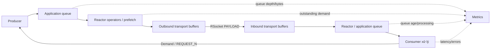
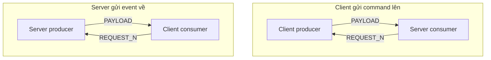

# Theo dõi bộ đệm, nhu cầu nhận và dấu hiệu bên nhận chậm

Một service RSocket có thể vẫn giữ connection khỏe trong khi một stream cụ thể đang bị nghẽn. Producer có thể phát dữ liệu nhanh hơn consumer xử lý; các payload tích lũy trong queue, thời gian chờ tăng và bộ nhớ bị chiếm dụng. Nếu consumer truyền demand ngược về producer đúng cách, tốc độ phát có thể giảm và backlog được giữ trong giới hạn. Vì vậy, chỉ theo dõi trạng thái connection hoặc số request thành công là chưa đủ để biết hệ thống có đang chịu áp lực từ bên nhận chậm hay không.

Để quan sát đúng, cần theo dõi đồng thời ba nhóm tín hiệu: **demand** cho biết consumer cho phép producer gửi thêm bao nhiêu payload; **buffer/queue** cho biết dữ liệu thực tế đang chờ ở đâu và chiếm bao nhiêu byte; **processing/lag** cho biết consumer xử lý chậm đến mức nào. Với request-channel, phải tách các tín hiệu theo hai hướng vì mỗi chiều có consumer và demand riêng.

Bài này hướng dẫn thiết kế metric, instrument publisher/subscriber bằng Reactor và Micrometer, dựng thí nghiệm consumer chậm, đọc dấu hiệu nghẽn, đặt cảnh báo và xây dựng runbook xử lý. Các metric minh họa là metric do ứng dụng tự định nghĩa; tên và cách thu thập frame protocol cụ thể phụ thuộc implementation RSocket đang dùng.

## 1. Quan sát từ đầu đến cuối đường đi dữ liệu

Một payload có thể đi qua nhiều hàng đợi trước khi được xử lý xong. Nếu chỉ đo queue ở tầng ứng dụng, ta có thể bỏ sót buffer của Reactor, transport hoặc tầng reassembly.



Ở mỗi ranh giới, hãy xác định:

- Thành phần nào tạo payload?
- Thành phần nào đang giữ payload nếu downstream chưa sẵn sàng?
- Queue có giới hạn theo số phần tử, byte hay thời gian không?
- Consumer phát demand ở đâu?
- Khi buffer đầy thì hệ thống block, reject, drop hay phát lỗi?
- Khi stream bị cancel hoặc connection đóng, phần tử đang chờ được giải phóng như thế nào?

Một queue depth bằng 0 không nhất thiết có nghĩa hệ thống khỏe. Producer có thể đang idle; consumer có thể chưa subscribe; hoặc buffer nằm ở một tầng khác. Cần đọc queue cùng demand, throughput, latency và trạng thái nguồn dữ liệu.

## 2. Phân biệt demand, queue depth và consumer lag

Ba khái niệm này liên quan nhưng không thay thế cho nhau:

| Tín hiệu | Trả lời câu hỏi | Đơn vị thường dùng |
|---|---|---|
| Demand/outstanding request | Consumer cho phép producer gửi thêm bao nhiêu payload? | Payload |
| Queue depth | Có bao nhiêu payload đang chờ trong một queue cụ thể? | Payload |
| Queue bytes | Dữ liệu đang chờ chiếm bao nhiêu bộ nhớ? | Byte |
| Consumer lag | Bao nhiêu payload đã đến nhưng chưa được xử lý xong? | Payload hoặc byte |
| Oldest item age | Payload cũ nhất đã chờ bao lâu? | Giây |
| Processing latency | Consumer mất bao lâu để xử lý một payload? | Millisecond/second |

Demand là quyền phát, không phải số phần tử đang nằm trong queue. Một subscriber có thể cấp demand 100 nhưng producer mới chỉ có 2 payload; queue vẫn bằng 0 sau khi hai payload được xử lý. Ngược lại, queue có thể tăng nếu nguồn không thể pause và đang buffer dữ liệu bên ngoài pipeline có backpressure.

Consumer lag thường được ước lượng bằng số payload đã nhận trừ số payload đã xử lý. Chỉ số này có thể bao gồm payload đang xử lý, vì vậy không nên gọi nó là queue depth nếu không đo queue trực tiếp. Với hệ thống có nhiều stream hoặc counter reset, cần tính lag theo cùng một stream/partition/epoch hoặc dùng sequence nghiệp vụ.

Một tín hiệu rất hữu ích là tuổi của payload cũ nhất trong queue. Queue depth 100 có thể bình thường nếu xử lý trong 10 ms; queue depth 5 có thể nghiêm trọng nếu payload đầu tiên đã chờ 30 giây và SLO chỉ cho phép 1 giây.

## 3. `REQUEST_N` và demand trong RSocket

RSocket dùng demand-based flow control. Consumer yêu cầu số payload muốn nhận; producer chỉ được phát thêm trong phạm vi demand đã cấp. Demand được truyền qua frame `REQUEST_N` ở tầng protocol.

Một số nguyên tắc khi quan sát:

- `REQUEST_N` đếm payload, không đếm byte.
- `initialRequestN` cấp demand ban đầu cho chiều response khi mở request-stream hoặc request-channel.
- Khi cần thêm payload, consumer có thể gửi `REQUEST_N` bổ sung.
- Demand mới được cộng vào demand còn lại theo semantics Reactive Streams.
- Producer có thể phát ít hơn demand nếu chưa có dữ liệu.
- `request(n)` ở tầng Reactor là tín hiệu demand trong publisher/subscriber pipeline; runtime có thể gộp hoặc chuyển đổi các yêu cầu thành frame protocol. Không mặc định mỗi lần `doOnRequest` tương ứng chính xác một frame `REQUEST_N` trên wire.
- Demand không giới hạn (`Long.MAX_VALUE`) có nghĩa subscriber yêu cầu không giới hạn số phần tử; điều này có thể làm mất tác dụng bảo vệ nếu các tầng sau buffer không giới hạn.

Trong request-channel, hai hướng có demand độc lập:

| Hướng dữ liệu | Producer | Consumer | Ai cấp demand? |
|---|---|---|---|
| Client → Server | Client | Server | Server gửi `REQUEST_N` để yêu cầu thêm command |
| Server → Client | Server | Client | Client gửi `REQUEST_N` để yêu cầu thêm event/response |

Đừng gộp hai chiều thành một metric `demand` chung. Server có thể tiêu thụ command nhanh nhưng client lại xử lý event chậm, hoặc ngược lại. Cần quan sát `client_to_server` và `server_to_client` riêng.

## 4. Bộ metric tối thiểu

Nên chia metric thành counter, gauge và timer/histogram.

### 4.1. Counter: những gì đã xảy ra

| Metric gợi ý | Ý nghĩa |
|---|---|
| `app_rsocket_payload_requested_total` | Tổng số payload được yêu cầu ở ranh giới publisher được instrument |
| `app_rsocket_payload_emitted_total` | Tổng số payload publisher đã phát |
| `app_rsocket_payload_received_total` | Tổng số payload subscriber nhận được ở tầng ứng dụng |
| `app_rsocket_payload_processed_total` | Tổng số payload consumer xử lý xong |
| `app_rsocket_payload_dropped_total` | Số payload bị drop theo policy |
| `app_rsocket_buffer_overflow_total` | Số lần buffer đạt capacity hoặc overflow |
| `app_rsocket_stream_cancelled_total` | Số stream bị cancel |
| `app_rsocket_stream_error_total` | Số stream kết thúc do lỗi |

Counter nên tăng đơn điệu trong vòng đời process. Khi tính rate, dùng hàm `rate()`/`increase()` của hệ thống metrics thay vì lưu counter hiện tại làm gauge.

### 4.2. Gauge: trạng thái đang tồn tại

| Metric gợi ý | Ý nghĩa |
|---|---|
| `app_rsocket_demand_outstanding` | Demand còn lại tại ranh giới pipeline được instrument |
| `app_rsocket_buffer_depth` | Số phần tử hiện đang chờ trong queue cụ thể |
| `app_rsocket_buffer_bytes` | Tổng byte ước lượng đang chờ |
| `app_rsocket_buffer_capacity` | Capacity tối đa của queue |
| `app_rsocket_oldest_item_age_seconds` | Tuổi phần tử cũ nhất trong queue |
| `app_rsocket_in_flight_payloads` | Số payload đã phát/nhận nhưng chưa hoàn tất xử lý |
| `app_rsocket_active_streams` | Số stream đang hoạt động |
| `app_rsocket_active_connections` | Số connection RSocket đang mở |

Gauge cần phản ánh trạng thái hiện tại. Nếu dùng `AtomicLong` hoặc `AtomicInteger`, phải cập nhật ở cả đường thành công, lỗi, cancel và overflow để tránh gauge bị kẹt ở giá trị cũ.

### 4.3. Timer và histogram: tốc độ xử lý

| Metric gợi ý | Ý nghĩa |
|---|---|
| `app_rsocket_processing_duration` | Thời gian consumer xử lý một payload |
| `app_rsocket_queue_wait_duration` | Thời gian payload nằm trong queue trước khi xử lý |
| `app_rsocket_stream_lifetime` | Thời gian sống của một stream |
| `app_rsocket_payload_size_bytes` | Phân bố kích thước payload |
| `app_rsocket_request_latency` | Thời gian từ lúc gửi request đến response theo contract |

Theo dõi p50/p95/p99 thay vì chỉ trung bình. Trung bình thấp có thể che giấu một nhóm payload chờ rất lâu hoặc một vài consumer bị nghẽn.

## 5. Chọn label để không làm metric bùng nổ cardinality

Các label hữu ích thường có tập giá trị nhỏ:

- `route`: route RSocket đã được chuẩn hóa.
- `interaction`: `request_response`, `request_stream`, `request_channel` hoặc `fire_and_forget`.
- `direction`: `client_to_server` hoặc `server_to_client`.
- `transport`: `tcp` hoặc `websocket`.
- `outcome`: `success`, `error`, `cancel`, `overflow`.
- `consumer_group` hoặc `service`: chỉ dùng nếu tập giá trị được kiểm soát.

Tránh đưa `connectionId`, `streamId`, `deviceId`, `userId`, `transferId`, token hoặc correlation ID làm label metric. Các giá trị này thường có cardinality rất cao, làm tăng bộ nhớ của metrics backend và có thể lộ thông tin nhạy cảm. Dùng log/trace có sampling và masking để điều tra một phiên cụ thể.

Nếu có nhiều route động, hãy chuẩn hóa route thành template hoặc nhóm capability, ví dụ `devices.status` thay vì nhúng ID thiết bị vào tên route.

### 5.1. Đăng ký metric bằng Micrometer

Với queue do ứng dụng quản lý, có thể đăng ký gauge cho depth/bytes/capacity và counter/timer cho các sự kiện xử lý. Đăng ký metric một lần khi khởi tạo component; cập nhật giá trị backing object trong lúc chạy:

```java
AtomicInteger queueDepth = new AtomicInteger();
AtomicLong queuedBytes = new AtomicLong();
AtomicInteger queueCapacity = new AtomicInteger(512);

Gauge.builder("app.rsocket.buffer.depth", queueDepth, AtomicInteger::get)
    .tag("route", "telemetry.watch")
    .tag("direction", "server_to_client")
    .register(meterRegistry);

Gauge.builder("app.rsocket.buffer.bytes", queuedBytes, AtomicLong::get)
    .tag("route", "telemetry.watch")
    .tag("direction", "server_to_client")
    .register(meterRegistry);

Gauge.builder("app.rsocket.buffer.capacity", queueCapacity, AtomicInteger::get)
    .tag("route", "telemetry.watch")
    .tag("direction", "server_to_client")
    .register(meterRegistry);

Counter processed = Counter.builder("app.rsocket.payload.processed")
    .tag("route", "telemetry.watch")
    .tag("direction", "server_to_client")
    .register(meterRegistry);

Timer processing = Timer.builder("app.rsocket.processing.duration")
    .tag("route", "telemetry.watch")
    .tag("direction", "server_to_client")
    .publishPercentileHistogram()
    .register(meterRegistry);
```

Các object `queueDepth`, `queuedBytes` và `queueCapacity` cần được cập nhật cùng thao tác enqueue/dequeue/drop để gauge phản ánh trạng thái thật. Ví dụ dùng tag cố định để minh họa; trong ứng dụng, route/direction nên đến từ cấu hình có cardinality hữu hạn. Không tạo meter mới cho từng connection hoặc stream.

## 6. Instrument demand và payload trong Reactor

`doOnRequest` và `doOnNext` có thể giúp quan sát demand và phần tử phát ở một ranh giới publisher. Ví dụ sau minh họa outstanding demand trong một subscription:

```java
static long addCap(long current, long n) {
    long sum = current + n;
    return sum < 0L ? Long.MAX_VALUE : sum;
}

Flux<TelemetryPoint> observeDemand(
        Flux<TelemetryPoint> source,
        AtomicLong outstandingDemand,
        Counter requestedCounter,
        Counter emittedCounter,
        Counter unboundedRequestCounter) {

    return Flux.defer(() -> {
        AtomicLong demand = new AtomicLong();

        return source
            .doOnRequest(n -> {
                if (n == Long.MAX_VALUE) {
                    demand.set(Long.MAX_VALUE);
                    unboundedRequestCounter.increment();
                } else {
                    requestedCounter.increment(n);
                    demand.getAndUpdate(current -> addCap(current, n));
                }
                outstandingDemand.set(demand.get());
            })
            .doOnNext(point -> {
                emittedCounter.increment();
                demand.updateAndGet(current ->
                    current == Long.MAX_VALUE
                        ? current
                        : Math.max(0L, current - 1L)
                );
                outstandingDemand.set(demand.get());
            })
            .doFinally(signal -> outstandingDemand.set(0L));
    });
}
```

`Flux.defer` tạo bộ đếm demand riêng cho từng subscription. `addCap` tránh overflow khi cộng demand lớn hoặc `Long.MAX_VALUE`. Khi phát một phần tử, bộ đếm giảm một đơn vị trừ trường hợp demand không giới hạn.

Đoạn ví dụ này dành cho một subscription đang được quan sát; `outstandingDemand` là gauge gắn với subscription đó. Nếu một route có nhiều stream đồng thời, hãy giữ demand state riêng cho từng subscription rồi tổng hợp bằng một aggregator có xử lý đúng trường hợp unbounded/cancel, hoặc chỉ export histogram/counter theo route. Không ghi `Long.MAX_VALUE` như thể consumer đã yêu cầu một lượng payload hữu hạn lớn như vậy; ví dụ tách nó thành counter `unboundedRequestCounter`.

Đây là quan sát ở ranh giới publisher mà bạn đặt operator. Nó không phải bộ giải mã frame protocol và không đảm bảo khớp một-một với số frame `REQUEST_N`. Nếu publisher có operator prefetch hoặc buffer ở trước/sau vị trí instrument, giá trị nhìn thấy có thể phản ánh demand của operator đó thay vì nhu cầu cuối cùng của ứng dụng. Hãy ghi rõ ranh giới đo trong tên dashboard và tài liệu vận hành.

Với stream dài hạn, nên tạo gauge theo subscription/route ở phạm vi có cardinality kiểm soát. Không đăng ký gauge mới với tag stream ID cho mỗi subscription rồi để lại trong registry sau khi stream kết thúc.

## 7. Đo queue depth, queue bytes và tuổi dữ liệu

Đếm số phần tử chưa đủ nếu payload có kích thước khác nhau. Một queue 100 phần tử có thể chiếm vài KiB hoặc hàng trăm MiB. Khi queue do ứng dụng quản lý, hãy duy trì ít nhất:

- `depth`: số phần tử hiện đang chờ.
- `queuedBytes`: tổng byte ước lượng của các phần tử đang chờ.
- `capacity`: số phần tử hoặc byte tối đa.
- `oldestEnqueueTime`: thời điểm payload cũ nhất được đưa vào queue.
- `overflowCount`: số lần không thể thêm phần tử mới.

Ví dụ wrapper có timestamp:

```java
record QueuedPayload<T>(T value, int sizeBytes, Instant enqueuedAt) {}
```

Khi enqueue, tăng depth và queuedBytes; khi dequeue hoặc drop, giảm đúng số tương ứng. Nếu queue có nhiều consumer, cập nhật phải thread-safe và tránh giảm hai lần trong đường cancel/error. Có thể dùng `LongAdder` cho counter throughput cao, nhưng gauge cần một phép đọc nhất quán đủ tốt cho mục đích quan sát.

Tuổi phần tử cũ nhất:

\[
age_{oldest} = now - enqueuedAt_{oldest}
\]

Độ trễ chờ gần đúng của queue có thể được ước lượng từ backlog và throughput xử lý:

\[
wait_{estimate} \approx \frac{queueDepth}{processingRate}
\]

Đây chỉ là ước lượng khi tốc độ xử lý tương đối ổn định. Khi workload burst hoặc processing time có phân bố lệch, `oldestEnqueueTime` và histogram queue wait đáng tin cậy hơn.

Nếu queue nằm bên trong operator/runtime và không có API để đọc trực tiếp, không nên bịa queue depth từ một counter khác. Có thể quan sát số payload nhận/trả, in-flight, demand và bộ nhớ; ghi rõ đây là proxy metric chứ không phải kích thước queue chính xác.

## 8. Đo processing latency và in-flight

Consumer có thể chậm vì CPU, blocking I/O, lock contention, database, thread starvation hoặc downstream API. Đo thời gian xử lý ở đúng ranh giới:

```java
Mono<ProcessedEvent> process(TelemetryPoint point) {
    return Mono.defer(() -> {
        Timer.Sample sample = Timer.start(meterRegistry);

        return telemetryService.store(point)
            .doOnNext(ignored -> metrics.processedCounter().increment())
            .doFinally(signal -> sample.stop(metrics.processingTimer()));
    });
}

Flux<ProcessedEvent> handle(Flux<TelemetryPoint> inbound) {
    return inbound.concatMap(this::process, 1);
}
```

Ví dụ này đo thời gian từ lúc bắt đầu xử lý một phần tử đến terminal signal của publisher con. `concatMap(..., 1)` giữ thứ tự và prefetch một phần tử trong pipeline minh họa. Nếu dùng `flatMap` có concurrency, hãy đo cả số tác vụ đang chạy và queue chờ; throughput có thể tăng nhưng memory và downstream pressure cũng tăng.

`in_flight` có thể được tăng khi bắt đầu xử lý và giảm trong `doFinally`, để bao gồm cả complete, error và cancel. Không chỉ giảm trong `doOnSuccess`, vì lỗi hoặc cancellation sẽ để gauge bị kẹt.

## 9. Dựng thí nghiệm bên nhận chậm

Một thí nghiệm dễ tái hiện là tạo nguồn phát 100 payload/giây và consumer xử lý khoảng 10 payload/giây. Mục tiêu là quan sát cách demand và buffer thay đổi khi tốc độ hai phía không cân bằng.

```java
Flux<Long> source = Flux.interval(Duration.ofMillis(10))
    .onBackpressureBuffer(
        256,
        dropped -> metrics.bufferOverflowCounter().increment()
    );

Flux<Long> slowConsumer = source
    .doOnRequest(n -> metrics.recordRequested(n))
    .concatMap(sequence ->
        Mono.delay(Duration.ofMillis(100))
            .thenReturn(sequence),
        1
    )
    .doOnNext(sequence -> metrics.recordProcessed());
```

Nguồn interval tạo tick khoảng 100 lần/giây; consumer xử lý tuần tự khoảng 10 lần/giây. Buffer giới hạn 256 phần tử giúp quan sát backlog có capacity rõ ràng. Khi buffer đầy, operator sẽ báo overflow theo overload được dùng; ứng dụng cần ghi nhận lỗi và xử lý terminal signal.

Để so sánh, chạy thêm các kịch bản:

1. Consumer nhanh hơn nguồn: queue gần 0, demand được cấp đều.
2. Consumer chậm với publisher demand-aware: tốc độ phát giảm theo demand, memory ổn định.
3. Nguồn không thể pause với bounded buffer: queue tăng đến capacity rồi overflow/drop theo policy.
4. Nguồn không pause với buffer không giới hạn: chỉ chạy trong môi trường lab ngắn để quan sát backlog và memory tăng; không dùng cấu hình này trong production.
5. Nhiều stream đồng thời: tăng concurrency theo từng bước để tìm ngưỡng capacity.

Không dùng `Thread.sleep()` trong event-loop để mô phỏng consumer chậm. Dùng delay bất đồng bộ như `Mono.delay` hoặc một downstream test service có latency được kiểm soát.

## 10. Quan sát riêng hai chiều request-channel

Trong request-channel, cùng một stream ID có hai dòng payload và hai consumer:



Thiết kế metric theo direction:

| Metric dimension | Client → Server | Server → Client |
|---|---|---|
| `payload_received` | Server nhận command | Client nhận event/response |
| `payload_processed` | Server xử lý command xong | Client xử lý event xong |
| `demand_outstanding` | Demand server cấp cho command | Demand client cấp cho event |
| `buffer_depth/bytes` | Queue command ở server | Queue event ở client/server theo vị trí thực tế |
| `processing_duration` | Thời gian xử lý command | Thời gian xử lý event |
| `overflow_total` | Command bị từ chối/drop | Event bị từ chối/drop |

Không nên dùng tên chung `inbound_queue` nếu dashboard không nói rõ inbound từ phía nào. Tên metric và tag cần giúp người trực ca biết producer, consumer và hướng đang nghẽn.

Ví dụ, server xử lý command nhanh nhưng client UI tiêu thụ event chậm: queue command có thể ổn định, trong khi demand response từ client giảm và event buffer tăng. Nếu chỉ nhìn tổng số payload của channel, vấn đề sẽ bị che khuất.

## 11. Kết hợp với heap, direct memory và Netty

Queue depth tăng thường kéo theo memory tăng, nhưng bộ nhớ còn có thể nằm trong serialization, reassembly, Netty ByteBuf hoặc replay buffer của resumption.

Theo dõi đồng thời:

- JVM heap used và live set sau GC.
- Allocation rate và GC pause/count.
- Direct buffer used/capacity qua JMX `BufferPoolMXBean`.
- Netty allocator metrics nếu implementation cung cấp.
- Process RSS và container memory.
- Queue depth/bytes và số payload in-flight.
- Replay bytes và số session chờ resume nếu có bật resumption.

Heap ổn định nhưng RSS/direct memory tăng có thể liên quan Netty direct buffer hoặc native allocation. RSS không giảm ngay sau khi queue xả cũng chưa chắc là leak vì pooled allocator có thể giữ vùng nhớ để tái sử dụng. Hãy xem xu hướng qua nhiều chu kỳ tải, số buffer outstanding và allocator metrics.

Với payload lớn, demand đếm payload chứ không đếm byte. Vì vậy, một demand nhỏ vẫn có thể cho phép một payload rất lớn đi vào reassembly. Cần giới hạn payload size, fragment/reassembly concurrency và tổng byte in-flight riêng.

## 12. Dashboard và câu hỏi cần trả lời

Một dashboard theo route/interaction/direction nên có các panel:

1. Payload requested, emitted, received và processed theo thời gian.
2. Outstanding demand hiện tại.
3. Queue depth, queued bytes và capacity.
4. Oldest item age và queue wait p95/p99.
5. Processing latency p50/p95/p99.
6. In-flight payloads và active streams.
7. Overflow/drop/error/cancel rate.
8. Heap, direct memory, RSS và GC.
9. Connection count, reconnect/resume và stream lifetime.

Dashboard cần trả lời nhanh:

- Producer có dữ liệu nhưng consumer không cấp demand không?
- Consumer có cấp demand nhưng producer không phát dữ liệu không?
- Payload đã nhận nhưng chưa xử lý đang tích lũy ở queue nào?
- Queue tăng theo phần tử hay theo byte?
- Consumer chậm vì xử lý lâu hay vì thread/dependency bị nghẽn?
- Chỉ một route/tenant bị ảnh hưởng hay toàn process?
- Bộ nhớ tăng theo queue hay do buffer/allocator khác?
- Vấn đề nằm ở client → server hay server → client?

## 13. Cảnh báo dựa trên SLO và capacity

Không có một ngưỡng queue depth phù hợp cho mọi route. Một route telemetry có thể chấp nhận buffer vài giây; route điều khiển thiết bị có thể cần phản hồi trong vài trăm mili giây. Hãy đặt threshold theo SLO, capacity và kích thước payload.

Các điều kiện cảnh báo có thể dùng:

- Queue depth hoặc queued bytes vượt 80% capacity liên tục trong một khoảng thời gian.
- Oldest item age vượt ngưỡng latency của route.
- Processing p95/p99 tăng liên tục so với baseline.
- Outstanding demand bằng 0 kéo dài trong khi queue depth hoặc received-but-not-processed tăng.
- Overflow/drop counter tăng khác 0 trong cửa sổ cảnh báo.
- Consumer lag tăng liên tục và không giảm sau khi tải nguồn hạ.
- Direct memory/RSS tiến gần container limit cùng với in-flight bytes tăng.
- Active stream hoặc connection vượt quota đã đặt.

Ví dụ PromQL với metric tùy chỉnh:

```promql
app_rsocket_buffer_depth / app_rsocket_buffer_capacity > 0.8
```

```promql
increase(app_rsocket_buffer_overflow_total[5m]) > 0
```

```promql
app_rsocket_oldest_item_age_seconds > 2
```

Các biểu thức chỉ minh họa; cần thêm label filter, `for` duration, xử lý capacity bằng 0 và ngưỡng riêng theo route. Không cảnh báo chỉ vì demand bằng 0: đó có thể là trạng thái idle bình thường nếu không có dữ liệu chờ.

## 14. Đọc các mẫu dấu hiệu

| Quan sát | Diễn giải có thể | Kiểm tra tiếp |
|---|---|---|
| Demand thấp, queue tăng, oldest age tăng | Consumer không yêu cầu thêm hoặc pipeline bị nghẽn | Processing latency, thread, downstream và cancellation |
| Demand thấp, queue bằng 0, producer không có dữ liệu | Hệ thống idle hoặc nguồn chưa phát | Source rate và lịch tạo dữ liệu |
| Demand cao, emitted thấp | Producer/source chậm hoặc không có dữ liệu | Source health, database, scheduler |
| Emitted/received cao, processed thấp | Consumer chậm hoặc queue trung gian đang tích lũy | Queue bytes, processing time, concurrency |
| Queue thấp nhưng processing p99 cao | Consumer xử lý từng payload lâu; backlog có thể chưa hình thành | CPU, blocking I/O, lock, downstream latency |
| Queue và memory cùng tăng | Backpressure không xuyên suốt hoặc buffer không giới hạn | Operator prefetch, source không pause, payload size |
| Heap ổn định, direct memory/RSS cao | Netty/native buffer hoặc allocator pool | BufferPoolMXBean, allocator metrics, nhiều chu kỳ tải |
| Chỉ một hướng channel bị nghẽn | Consumer của hướng đó chậm | Tách metrics theo `direction` |
| Overflow tăng nhưng latency vẫn thấp | Buffer đang drop/reject để bảo vệ hệ thống | Drop policy, business impact và source rate |
| Demand cao và queue thấp nhưng timeout tăng | Vấn đề có thể nằm ở network hoặc handler downstream | Transport latency, request timer, trace |

Đừng kết luận “backpressure hoạt động tốt” chỉ vì queue thấp. Có thể consumer đã ngừng cấp demand và hệ thống đang không xử lý dữ liệu. Luôn đối chiếu throughput/processed rate với input rate và SLO.

## 15. Tracing và log có cấu trúc

Metric cho biết xu hướng tổng thể; trace/log giúp tìm một request hoặc stream cụ thể. Các trường hữu ích:

- Route và interaction type.
- Direction của payload.
- Transport và service peer.
- Correlation ID hoặc trace ID đã được bảo vệ.
- Payload size theo bucket, không ghi payload nhạy cảm.
- Queue wait, processing duration và outcome.
- Cancel/error/overflow reason.

Với stream dài hạn, không nhất thiết giữ một span duy nhất mở hàng giờ. Có thể tạo span cho thời điểm mở stream, dùng metric cho throughput/lifetime và tạo span/event theo batch hoặc thao tác quan trọng. Sampling cần giới hạn để không biến mỗi payload thành một trace quá tốn kém.

Không log resume token, access token, secret hoặc raw metadata có thể chứa credential. Khi cần chẩn đoán một stream, dùng ID đã làm mờ và lưu trong log có retention phù hợp, không biến nó thành metric label.

## 16. Quy trình xử lý bên nhận chậm

Khi cảnh báo xuất hiện, thực hiện theo trình tự:

1. **Xác định phạm vi:** route, interaction, direction, client/tenant group và thời điểm bắt đầu.
2. **Kiểm tra throughput:** so sánh payload received với processed, không chỉ nhìn request rate.
3. **Kiểm tra demand:** consumer có đang cấp demand không, demand có bằng 0 kéo dài không?
4. **Tìm queue:** xác định queue nào tăng; xem depth, bytes, capacity và oldest age.
5. **Kiểm tra xử lý:** xem processing p95/p99, CPU, thread, blocking call và downstream dependency.
6. **Kiểm tra bộ nhớ:** heap, direct memory, RSS, GC, in-flight payload và replay buffer.
7. **Giảm áp lực:** giới hạn concurrency, giảm producer rate, tạm dừng nguồn nếu có thể hoặc load shed theo policy.
8. **Bảo toàn dữ liệu:** với command quan trọng, reject rõ ràng hoặc ghi bền vững; không drop âm thầm.
9. **Khôi phục:** kiểm tra queue có giảm và oldest age có trở lại SLO sau khi tải hạ.
10. **Ghi nhận nguyên nhân:** cập nhật capacity, prefetch, buffer limit, source rate hoặc downstream sizing dựa trên số liệu.

Không tăng buffer ngay khi thấy overflow mà chưa tính memory budget. Tăng capacity có thể trì hoãn lỗi nhưng làm payload chờ lâu hơn và tăng heap/direct memory. Nếu consumer xử lý lâu dài chậm hơn producer, cần giảm nguồn, tăng năng lực consumer hoặc thay đổi semantics dữ liệu.

## 17. Kiểm thử observability

Một bộ kiểm thử tốt cần chứng minh metric thay đổi đúng khi điều kiện tải thay đổi:

1. Consumer nhanh: demand, emitted và processed tăng tương ứng; queue ổn định.
2. Consumer chậm: processing latency tăng, demand giảm hoặc buffer tăng tùy source.
3. Source demand-aware: producer không phát vượt demand; queue không tăng vô hạn.
4. Source không pause: bounded buffer tăng đến capacity rồi overflow/drop theo policy.
5. Cancel stream: active stream và in-flight gauge giảm; tài nguyên được giải phóng.
6. Request-channel: metric của hai hướng thay đổi độc lập khi làm chậm từng consumer.
7. Payload lớn: queued bytes và direct/heap memory phản ánh kích thước dữ liệu tốt hơn queue depth đơn thuần.
8. Nhiều stream: metric label không tạo cardinality theo stream/client ID.
9. Dependency chậm: processing timer và queue age chỉ ra đúng downstream bị nghẽn.
10. Sau khi tải dừng: queue depth/bytes về 0 hoặc mức nền; allocator memory có thể giữ pool nhưng không tăng vô hạn qua nhiều chu kỳ.

Có thể dùng `StepVerifier` để kiểm tra demand ở tầng Reactor và integration test RSocket client/server để xác minh hành vi stream thực tế. Khi kiểm tra frame `REQUEST_N`, bật protocol logging có chọn lọc trong môi trường test; không dựa vào `doOnRequest` để khẳng định chính xác số frame trên wire.

## 18. Checklist triển khai

- [ ] Mỗi route/interaction quan trọng có counter received và processed.
- [ ] Demand được đo tại ranh giới publisher phù hợp và ghi rõ ý nghĩa.
- [ ] Request-channel có metric tách theo hai hướng.
- [ ] Queue có giới hạn và metric depth/capacity.
- [ ] Payload có giới hạn kích thước; queue theo dõi cả byte.
- [ ] Có oldest item age hoặc queue wait histogram.
- [ ] Processing latency có p95/p99.
- [ ] Có counter overflow/drop/reject/cancel/error.
- [ ] Có heap, direct memory, RSS và GC metrics.
- [ ] Label metric có cardinality thấp, không chứa ID/token.
- [ ] Alert gắn với SLO/capacity, không cảnh báo chỉ vì demand bằng 0.
- [ ] Có dashboard phân biệt producer chậm, consumer chậm và network chậm.
- [ ] Có test consumer chậm, source nhanh, cancellation và hai chiều channel.

## 19. Kết luận

Theo dõi bên nhận chậm cần kết hợp demand, queue, consumer lag, processing latency và bộ nhớ. Demand cho biết consumer cho phép producer phát bao nhiêu payload; queue depth/bytes cho biết dữ liệu đang chờ; oldest item age và processing histogram cho biết tác động đến latency. Với request-channel, phải tách hai hướng vì client và server là consumer khác nhau ở mỗi chiều.

Hãy instrument tại ranh giới có ý nghĩa, ghi rõ metric phản ánh publisher hay queue nào, đặt buffer có giới hạn và theo dõi cả heap lẫn direct memory. Khi có dấu hiệu nghẽn, đối chiếu input rate, processed rate, outstanding demand, queue age và dependency latency trước khi tăng buffer hoặc concurrency. Observability tốt không chỉ phát hiện queue tăng; nó phải chỉ ra producer, consumer, hướng dữ liệu và tài nguyên đang tạo ra nút thắt.
